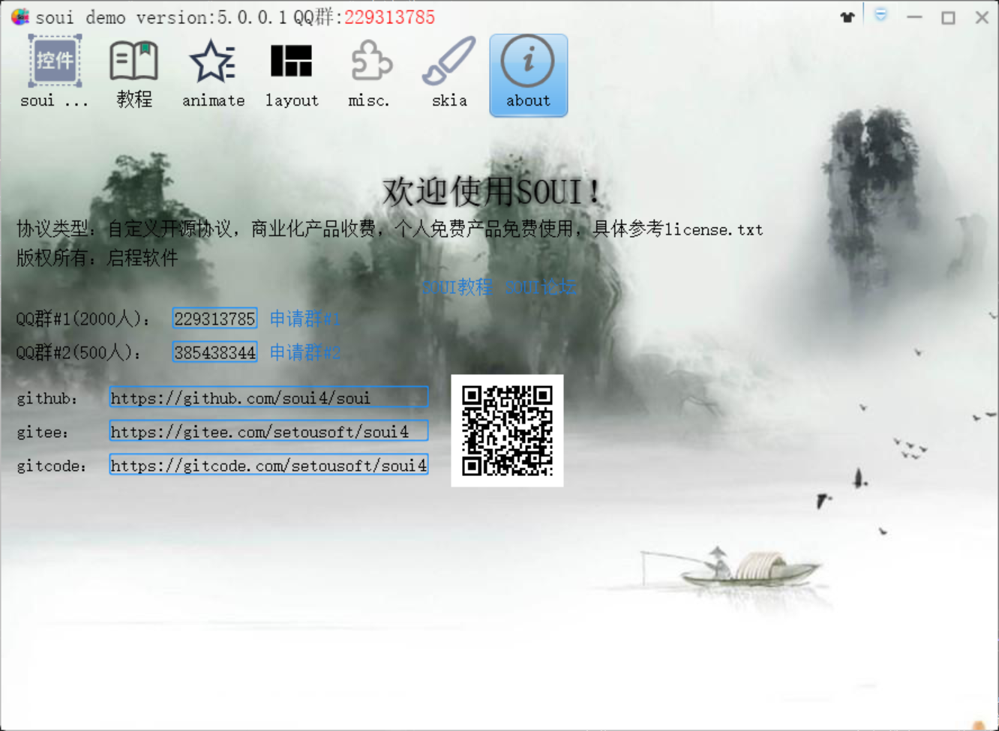
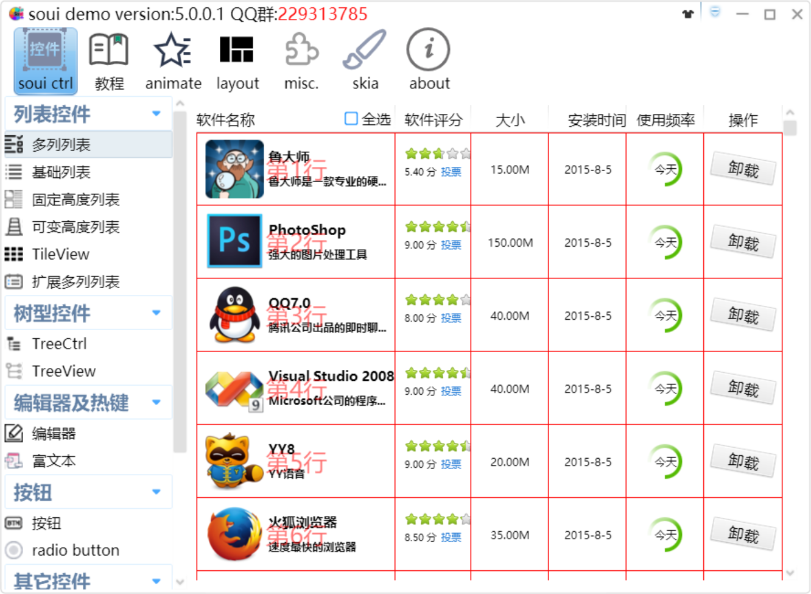

 <h1>SOUI 4</h1>

 
 
 

 

 

## Language Versions / 语言版本

This README is available in the following languages:
- [English Version (README.md)](README.md)
- [Chinese Version (README.zh-CN.md)](README.zh-CN.md)

---

## Guide

SOUI4 is a lightweight **cross-platform** C++ DirectUI framework, continuously developed and maintained for **14 years**; the compiled core is about 2.3 MB in its smallest Release build. The framework design draws inspiration from popular frameworks such as WTL, Android, QT, and Flash. UI presentation is based on XML configuration, with high performance (choose GDI or [Skia](https://www.oschina.net/p/skia) rendering), rich controls, and flexible extension (supports xml + lua + js), truly separating UI and logic.

SOUI4 started on Windows but is **no longer a Windows-only framework**. Thanks to the built-in **swinx** layer — a framework that re-implements the Windows API (windows.h / winuser.h / gdi.h …) on non-Windows platforms — the **same C++ UI and business code** runs on Windows, Linux, macOS, iOS, Android and HarmonyOS (OHOS). The same abstraction also carries the framework **down to bare metal** (FreeRTOS on Cortex-M) and **up into the browser** (WebAssembly). The API surface stays Win32-shaped on every target, so Windows code and habits carry over unchanged; Windows is the reference implementation, not a prerequisite. Visit the [SOUI Official Website](https://www.soui.com.cn).

## Cross-Platform Support

Windows is one of eight targets SOUI4 covers through swinx; they sit in two maturity tiers:

| Platform | Status | Windowing / Launcher | 2D Backend |
| --- | --- | --- | --- |
| **Windows** | Native | System CRT / Win32 | GDI / Direct2D |
| **Linux** | Supported | xcb + `poll()` event loop | Cairo |
| **macOS** | Supported | `NSApplication` (`SwinXApplication`) | Core Graphics |
| **iOS** | Supported | `UIApplicationMain` (hosted by `swinx_ios_entry`) | Core Graphics |
| **Android** | Supported | JVM launcher, `PlatformAPI` bridge | Cairo |
| **HarmonyOS (OHOS)** | Supported | ArkTS runtime, `PlatformAPI` bridge | Cairo |
| **FreeRTOS** | Proof of capability | No OS: a FreeRTOS task drives the pump, the host scans out the framebuffer | Cairo → memory framebuffer |
| **WebAssembly** | Proof of capability | `emscripten_set_main_loop`, JS host blits dirty rects onto a canvas | Cairo → image surface → Canvas |

The two tiers are not the same claim:

- **Supported** (the six above) = shipping quality: CI builds, demos, real-device runs.
- **Proof of capability** (FreeRTOS, WebAssembly) = the architecture was shown to absorb a
  new host type; the targets build and run an `SApp` end to end, but they still have known
  gaps (FreeRTOS: font metrics, `ICON:` stubs, no target board; WASM: ~66 MB artifacts, no
  IME, no touch). Read them as "the abstraction reaches this far", not as "ready to ship".
  See `soui-freertos/README.md` and `doc/soui-wasm-port-plan.md`.

How swinx is layered per platform:

- **Windows** does not compile swinx — it uses the system Windows SDK directly.
- **Linux / macOS / iOS** implement their platform APIs *inside* swinx and own their own message loop / launcher, so they need no extra bridge.
- **Android / HarmonyOS** are launched by the JVM / ArkTS runtime and have no launcher of their own; their platform bridges (`clipboard / window / ime / audio / path`) are filled into the C struct `PlatformAPI` and registered through `PlatformAPI_Init`.
- **FreeRTOS / WebAssembly** invert the relationship: there is no OS window manager to talk to, so the embedding application drives the pump and consumes a framebuffer. Both share the same four host seams (`framebuffer`, `input`, `pump`, `resource`), which is why the second one cost far less than the first.

The SOUI render factory (`Render_Gdi` / `Render_Skia` / `Render_D2d`) is uniform across platforms; cross-platform projects typically use **`Render_Skia`** + `ImgDecoder_Stb`. Mobile builds additionally provide `SModalView` (a modal-dialog implementation that replaces `SHostDialog`, since mobile runtimes cannot spin up their own message loop) and inertial **fling** scrolling on `SPanel`.

## Demo Screenshots

If you are new to SOUI, you can download the statically linked **Windows** build [demo.exe](https://github.com/soui4/soui/actions) for a quick try (no need for source code or dependencies, just download and run). The same demo is built from source on the other platforms with the steps further down.

Steps:
1. Click the badge above to enter the page
2. Click any link after the green circle
3. Scroll down to find the `Artifacts` section
4. Download and extract `PC_Demo` to run

For more demo cases, visit the DEMO repository:
- https://github.com/soui4-demo
Each demo is in a separate repository, clone as needed.

## Getting Started

SOUI keeps a **Win32-shaped API** (windows / messages / GDI) on every target, so C++ background plus Win32 experience carries over directly; on Linux, macOS, iOS, Android, OHOS, FreeRTOS and WebAssembly that API surface is supplied by the bundled **swinx** layer instead of by the OS. A Windows toolchain is needed only when Windows is one of your targets.
For more details, see the [official documentation](https://www.soui.com.cn/help).

### Git Repositories
- [GitHub](https://github.com/soui4/soui)
- [Gitee](https://gitee.com/setoutsoft/soui4)
- [GitCode](https://gitcode.com/setoutsoft/soui4)

### UI Visual Designer
The latest souieditor is integrated in the demos folder. Build the demo to get souieditor.

### SOUI4JS
- JavaScript export version for client development. Repository: [soui4js](https://github.com/soui4/soui4js)
- Supports Windows, Linux, macOS.

### SOUI4PY
- Python3 version for client development. Repository: [soui4py](https://gitee.com/setoutsoft/soui4py)
- Supports Windows, Linux, macOS.

### Tutorials
- Latest [Online Tutorial](http://doc.soui.com.cn) (most complete, updated regularly)
- [Tutorial Source Code](https://gitee.com/setoutsoft/soui-docs) (host locally with http server)
- Author's [Blog](http://www.cnblogs.com/setoutsoft/)
- Author's Bilibili [Video Tutorials](https://space.bilibili.com/110611388)

## QQ Groups
- SOUI Discussion #1: [Join](http://shang.qq.com/wpa/qunwpa?idkey=9653a811a72365d798a5247d6ba6885a568bdcf51c624f906c8ce7b8fd9e4eda)
- SOUI Discussion #2: [Join](http://shang.qq.com/wpa/qunwpa?idkey=03d3294a2551beb1b54b4012086cec14b3f66d5c253debaeed241d9c623966e0)

## 
## 
## 

### Windows
- Use CMake to generate project files, open with Visual Studio, and compile
- Or use mingw32/64: `mkdir build && cd build && cmake .. && make -j8`

### Linux
- Pull submodule swinx: `git submodule update --init`
- Install dependencies: `sudo apt install cmake git build-essential gdb libxcb1-dev libgl1-mesa-dev freeglut3-dev`
- Build: `mkdir build && cd build && cmake .. && make -j8`

### macOS
- Pull submodule swinx: `git submodule update --init`
- Install Homebrew ([China mirror](https://gitee.com/cunkai/HomebrewCN) recommended)
- Install homebrew-core and homebrew-cask: `brew tap homebrew/core && brew tap homebrew/cask`
- Install tools and dependencies: `brew install cmake ninja pkgconf glfw3 glew`
- Build: `mkdir build && cd build && cmake .. -G Ninja && ninja -j8`

### iOS
- Pull submodule swinx: `git submodule update --init`
- Generate an Xcode project and build with Xcode:
  `mkdir build && cd build && cmake .. -G Xcode -DCMAKE_SYSTEM_NAME=iOS`
- The app entry is hosted by `swinx_ios_entry()`, which wraps `UIApplicationMain`; the C++ `_tWinMain` is dispatched on the main thread after launch.

### Android
- Pull submodules: `git submodule update --init --recursive`
- Requirements: Android Studio with AGP 7.2.1+, a matching NDK (25.x / 26.x), CMake 3.18.1+, JDK 11/17.
- Build the minimal sample in `demos/android-demo`:
  `cd demos/android-demo && ./gradlew :app:assembleDebug` (use `gradlew.bat` on Windows), then
  `adb install -r app/build/outputs/apk/debug/app-debug.apk`.
- No prebuilt `.so` is shipped: `soui-android-lib` provides the Java platform bridge as an AAR plus
  the CMake fragment `soui4_android.cmake`, which your app `include()`s so that SOUI is compiled
  into your own `.so`. Your C++ implements `Soui4AndroidEntry` (`InitApp` / `UninitApp` /
  `ScreenStartup` / `ScreenShutdown`) and registers it with `InitSoui4AndroidEntry`.
- UI resources are read straight from the APK `assets` through `AAssetManager`. A complete business
  sample is `games/cnchess/client/android`; the step-by-step guide is
  `doc/SOUI5-Android开发入门指南.md`.

### HarmonyOS (OHOS)
- Requires the HarmonyOS SDK and DevEco Studio.
- The native layer lives under `entry/src/main/cpp`; UI resources are loaded directly from the HAP `rawfile` directory through `NativeResourceManager` (no copy to the sandbox).
- Build the OHOS module from DevEco Studio (or the `hvigor` CLI).

### FreeRTOS (bare metal)
- The `soui-freertos` submodule is the only entry point: one `include` plus one `soui_fr_project()` brings up the kernel, third-party libs, the swinx platform layer, SOUI and the packed resources.
- Cross-compile for the QEMU Cortex-M3 target:
  `cd soui-freertos/soui_fr && cmake -S . -B build -G Ninja -DCMAKE_TOOLCHAIN_FILE=../demo/cmake/toolchain-arm-freertos.cmake -DSOUI_FR_CENSUS=OFF -DCMAKE_BUILD_TYPE=MinSizeRel`
  then `qemu-system-arm -M mps2-an385 -nographic -semihosting -kernel build/soui_fr.elf`.
- For host-side iteration use `soui_sim` (the FreeRTOS Windows simulator with an SDL2 window); see `soui-freertos/README.md` and the FreeRTOS development guide in that submodule.

### WebAssembly
- Requires [emsdk](https://emscripten.org/docs/getting_started/downloads.html) (verified locally with 6.0.13).
- `emcmake cmake -S . -B build-wasm -G Ninja -DCMAKE_BUILD_TYPE=RelWithDebInfo -DSOUI_BUILD_WASM_DEMO=ON`
- `cmake --build build-wasm --target soui-wasm-demo -j4`; artifacts land in `demos/wasm-demo/out/`.
- To look at it in a browser, serve with `python3 -m http.server 8080 -d demos/wasm-demo/out` and open `soui-wasm-demo.html`. Build options, verification steps and known limits are in [`demos/wasm-demo/readme.md`](./demos/wasm-demo/readme.md).
- A second, much larger WebAssembly port ships with the Chinese-chess client: configure with `-DSOUI_BUILD_WASM_CNCHESS=ON` and build the `cnchess-wasm` target (or use the wrapper script `games/cnchess/client/wasm/build-cnchess.sh`, `build-cnchess.bat` on Windows; both have a `--release` profile). Artifacts land in `games/cnchess/client/wasm/out/`; networking uses the browser-native WebSocket and threading runs on a single-threaded `TaskLoop`. See `games/cnchess/client/wasm/readme.md`.

## Contributors
See [contributors.md](./contributors.md)

## License
See [`LICENSE-en.md`](./LICENSE-en.md)
