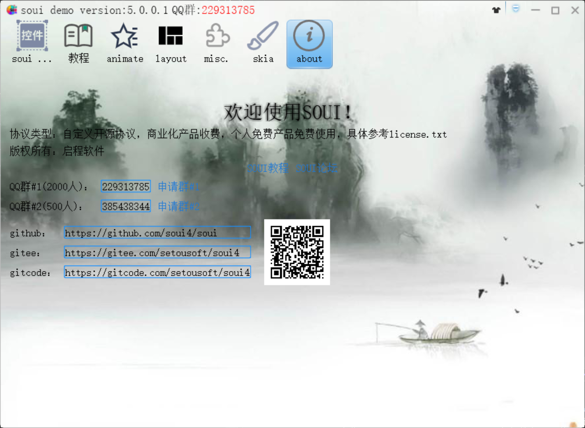
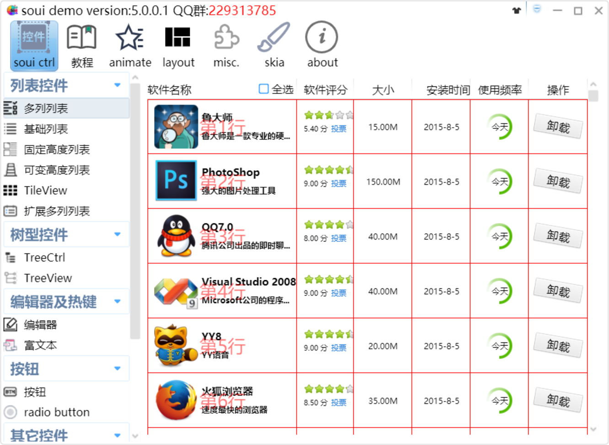

<div align= "center">

</div>

<div align= "center">
 <h1>SOUI 4</h1>

 <a>
    
 </a>
 <a>
    
 </a>
 <a href="https://github.com/soui4/soui/releases">
    
 </a>
<a href="https://github.com/soui4/soui/">
    
</a>

 <a href="https://2926295173.github.io/SoUIDocs">
    
</a>

 <a href="https://deepwiki.com/soui4/soui">
    
</a>
</div>

## Language Versions / 语言版本

以下是指南的中文版本和英文版本：
- [英文版 (README.md)](README.md)
- [中文版 (README.zh-CN.md)](README.zh-CN.md)

---

##  指南 / Guide

SOUI4 是一套已经持续开发维护 **14年** 的轻量级**跨平台** C++ DirectUI 框架（内核编译后最小体积约 2.3M，Release x86）。框架设计吸收了 `WTL`、`Android`、`QT`、`Flash` 等流行框架的特点，UI 展示基于 `xml` 配置，性能高效（可选择 GDI 或 [Skia](https://www.oschina.net/p/skia) 渲染），控件丰富，扩展灵活（可使用 xml + lua + js），真正做到 UI 界面与逻辑分离。

SOUI4 起源于 Windows，但**不再只面向 Windows**。借助内置的 **swinx** 层（在非 Windows 平台重新实现 Windows API：`windows.h` / `winuser.h` / `gdi.h` …），**同一份 C++ UI 与业务代码**即可运行在 Windows、Linux、macOS、iOS、Android 与鸿蒙（OHOS）六大平台上；同一套抽象还能把框架**下沉到裸机**（FreeRTOS / Cortex-M）与**上移到浏览器**（WebAssembly）。API 面在各平台始终保持 Win32 形态，Windows 上写的代码与积累的经验可以直接沿用——**Windows 只是参考实现，不是前提条件**。点击 [SOUI 官网](https://www.soui.com.cn) 了解更多。

##  跨平台支持 / Cross-Platform

Windows 只是 SOUI4 通过 swinx 覆盖的八个目标之一，这八端分成两档成熟度：

| 平台 | 状态 | 窗口系统 / 启动器 | 2D 后端 |
| --- | --- | --- | --- |
| **Windows** | 原生 | 系统 CRT / Win32 | GDI / Direct2D |
| **Linux** | 已支持 | xcb + `poll()` 事件循环 | Cairo |
| **macOS** | 已支持 | `NSApplication`（`SwinXApplication`） | Core Graphics |
| **iOS** | 已支持 | `UIApplicationMain`（由 `swinx_ios_entry` 托管） | Core Graphics |
| **Android** | 已支持 | JVM 启动器，`PlatformAPI` 桥接 | Cairo |
| **鸿蒙（OHOS）** | 已支持 | ArkTS 运行时，`PlatformAPI` 桥接 | Cairo |
| **FreeRTOS** | 能力证明级 | 无 OS：FreeRTOS 任务驱动消息泵，宿主扫描帧缓冲上屏 | Cairo → 内存帧缓冲 |
| **WebAssembly** | 能力证明级 | `emscripten_set_main_loop`，JS 宿主按脏矩形 blit 到 Canvas | Canvas 2D API |

两档的含义不同，不能互换：

- **已支持**（上面六端）= 产品级：有 CI、有示例、有真机/实机验证。
- **能力证明级**（FreeRTOS、WebAssembly）= 架构被验证能吸收新的宿主形态：目标能构建、
  `SApp` 能端到端跑通，但仍有明确缺口（FreeRTOS：字体测宽、`ICON:` 仍是桩、未适配目标板；
  WASM：无系统级 IME / OLE 拖放、触摸与真机输入法未系统验证）。它们说明"抽象能伸到这里"，
  不等于"可以交付"。详见 `soui-freertos/README.md` 与 wasm 设计实现文档
  `swinx/doc/swinx-wasm-design.md`。

swinx 在不同平台的分层方式：

- **Windows** 不编译 swinx，直接使用系统的 Windows SDK。
- **Linux / macOS / iOS** 在 swinx 内部自实现平台 API，且各自拥有自己的消息循环 / 启动器，无需额外桥接。
- **Android / 鸿蒙** 由 JVM / ArkTS 运行时启动，没有自己的启动器；其平台桥接（`clipboard / window / ime / audio / path`）被填入 C 结构体 `PlatformAPI` 后，通过 `PlatformAPI_Init` 注册。
- **FreeRTOS / WebAssembly** 把关系反过来：没有可对话的 OS 窗口管理器，于是由嵌入方驱动消息泵并消费帧缓冲。两者共用同一组四个宿主接缝（帧缓冲 / 输入 / 泵 / 资源），这也是第二个形态比第一个便宜得多的原因。

SOUI 的渲染工厂（`Render_Gdi` / `Render_Skia` / `Render_D2d`）在各平台统一；跨平台工程通常统一使用 **`Render_Skia`** + `ImgDecoder_Stb`。移动端还额外提供 `SModalView`（替代 `SHostDialog` 的模态对话框实现，因为移动端运行时无法自行拉起消息循环），以及 `SPanel` 上的惯性 **fling** 滑动支持。

##  demo 基本界面




如果您初次了解此库，可以下载自动化静态编译的 **Windows** 版 [demo.exe](https://github.com/soui4/soui/actions) 进行尝鲜体验（无需下载源代码和其他依赖，直接下载运行）。其余平台按下方对应小节从源码编译同一套 demo。

具体方法：

```
1. 点击上方图标，进入页面
2. 随便点击一个绿色圆圈后面的链接进入
3. 下拉界面，找到 `Artifacts` 栏
4. 点击栏中的 `PC_Demo` 进行下载解压运行即可。
```

如您想自己编译更多的界面案例，请拉取 DEMO 仓库：
- https://github.com/soui4-demo

每一个 Demo 一个单独的仓库，自己分别 clone 就好了。

##  开始

SOUI 在各平台都保持 **Win32 形态的 API**（窗口 / 消息 / GDI），因此 C++ 基础加上 Win32 经验可以直接沿用；在 Linux、macOS、iOS、Android、鸿蒙、FreeRTOS 与 WebAssembly 上，这层 API 由内置的 **swinx** 提供，而不是由 OS 提供。只有当 Windows 本身也是目标平台时，才需要 Windows 工具链。

除本页说明外，您还可以查看更详细的 [官方文档](https://www.soui.com.cn/help)。

### Git 下载地址

- [国外 Git 下载站点](https://github.com/soui4/soui)
- [国内 Gitee](https://gitee.com/setoutsoft/soui4)
- [国内 gitcode](https://gitcode.com/setoutsoft/soui4)

### UI 可视化设计

最新版本 souieditor 已经集成到这个代码库的 demos 中，选择编译 demo 就可以获得 souieditor。

### SOUI4JS
- `SOUI4 的 JavaScript 导出版本，实现使用 js 开发客户端程序的框架，完美解决性能和灵活性的矛盾`，仓库地址 [soui4js](https://github.com/soui4/soui4js)
- 目前已经支持 Windows、Linux、macOS 三平台。

### SOUI4PY
- `SOUI4 的 Python3 版本，实现使用 python3 开发客户端程序的框架，完美解决性能和灵活性的矛盾`，仓库地址 [soui4py](https://gitee.com/setoutsoft/soui4py)
- 目前已经支持 Windows、Linux、macOS 三平台。

### SOUI 教程

- 最新 [教程](http://doc.soui.com.cn)，目前最完整的 SOUI 在线教程，不断更新，请持续关注。
- 最新 [教程源代码](https://gitee.com/setoutsoft/soui-docs)，自己在本地搭建 http 服务器，本地查看教程。发现教程有问题，欢迎随时提 issue。
- 作者 [博客](http://www.cnblogs.com/setoutsoft/)，能让你更快掌握如何使用 SOUI 快速开发客户端应用。
- 作者录制的 B 站 [视频教程](https://space.bilibili.com/110611388)

##  QQ 群

- SOUI 讨论 #1: [点击加入](http://shang.qq.com/wpa/qunwpa?idkey=9653a811a72365d798a5247d6ba6885a568bdcf51c624f906c8ce7b8fd9e4eda)
- SOUI 讨论 #2: [点击加入](http://shang.qq.com/wpa/qunwpa?idkey=03d3294a2551beb1b54b4012086cec14b3f66d5c253debaeed241d9c623966e0)

##  [](https://github.com/soui4/soui/actions/workflows/build.yml)
##  [](https://github.com/soui4/soui/actions/workflows/soui-freertos-gate.yml)
##  [](https://github.com/soui4/soui/actions/workflows/soui-wasm-gate.yml)

###  Windows 编译
- 直接使用 cmake 生成工程文件，然后使用 Visual Studio 打开工程文件，编译即可。
- 使用 mingw32/64 编译：`mkdir build && cd build && cmake .. && make -j8`

###  Linux 编译
- 拉取子模块 swinx：`git submodule update --init`
- 安装依赖：`sudo apt install cmake git build-essential gdb libxcb1-dev libgl1-mesa-dev freeglut3-dev`
- 编译：`mkdir build && cd build && cmake .. && make -j8`

###  macOS 编译
- 拉取子模块 swinx：`git submodule update --init`
- 安装 brew，国内建议使用 [中国镜像](https://gitee.com/cunkai/HomebrewCN)
- 安装 homebrew-core 和 homebrew-cask: `brew tap homebrew/core && brew tap homebrew/cask`
- 安装编译工具及依赖: `brew install cmake ninja pkgconf glfw3 glew`
- 编译: `mkdir build && cd build && cmake .. -G Ninja && ninja -j8`

###  iOS 编译
- 拉取子模块 swinx：`git submodule update --init`
- 用 CMake 生成 Xcode 工程并通过 Xcode 编译：
  `mkdir build && cd build && cmake .. -G Xcode -DCMAKE_SYSTEM_NAME=iOS`
- 应用入口由 `swinx_ios_entry()` 托管（内部封装 `UIApplicationMain`），C++ 的 `_tWinMain` 在启动后于主线程派发执行。
- Add -DCMAKE_OSX_SYSROOT=iphonesimulator for simulator

###  Android 编译
- 拉取子模块：`git submodule update --init --recursive`
- 依赖：Android Studio（AGP 7.2.1+）、与 AGP 匹配的 NDK（25.x / 26.x）、CMake 3.18.1+、JDK 11/17。
- 编译 `demos/android-demo` 最小示例：
  `cd demos/android-demo && ./gradlew :app:assembleDebug`（Windows 用 `gradlew.bat`），
  然后 `adb install -r app/build/outputs/apk/debug/app-debug.apk`。
- 不分发预编译的 `.so`：`soui-android-lib` 只提供 Java 平台桥（AAR）与 CMake 片段
  `soui4_android.cmake`，由业务 app `include()` 后把 SOUI 编进自己的 `.so`；业务 C++ 实现
  `Soui4AndroidEntry`（`InitApp` / `UninitApp` / `ScreenStartup` / `ScreenShutdown`），并通过
  `InitSoui4AndroidEntry` 注册。
- UI 资源通过 `AAssetManager` 直接从 APK 的 `assets` 读取。完整业务示例见
  `games/cnchess/client/android`，分步指南见 `doc/SOUI5-Android开发入门指南.md`。

###  鸿蒙（OHOS）编译
- 需要 HarmonyOS SDK 与 DevEco Studio。
- 原生层位于 `entry/src/main/cpp`；UI 资源通过 `NativeResourceManager` 直接从 HAP 的 `rawfile` 目录读取（无需拷贝到沙箱）。
- 在 DevEco Studio（或 `hvigor` 命令行）中编译 OHOS 模块。

###  FreeRTOS（裸机）编译
- 子模块 `soui-freertos` 是唯一入口：一个 `include` + 一个 `soui_fr_project()` 完成内核 / 三方库 / swinx 平台层 / SOUI / 资源打包。
- 交叉编译到 QEMU 的 Cortex-M3 目标：
  `cd soui-freertos/soui_fr && cmake -S . -B build -G Ninja -DCMAKE_TOOLCHAIN_FILE=../demo/cmake/toolchain-arm-freertos.cmake -DSOUI_FR_CENSUS=OFF -DCMAKE_BUILD_TYPE=MinSizeRel`
  然后 `qemu-system-arm -M mps2-an385 -nographic -semihosting -kernel build/soui_fr.elf`。
- 宿主侧迭代用 `soui_sim`（FreeRTOS Windows 模拟器，SDL2 出图），见 `soui-freertos/README.md` 与《SOUI5-FreeRTOS 开发指南》。

###  WebAssembly 编译
- 需要 [emsdk](https://emscripten.org/docs/getting_started/downloads.html)（本地验证用 6.0.13）。
- `emcmake cmake -S demos/wasm-demo -B build-wasm -G Ninja -DCMAKE_BUILD_TYPE=RelWithDebInfo`（每个 wasm 版都是独立的顶层 CMake 工程，SOUI 库通过 `add_subdirectory` 拉入）。
- `cmake --build build-wasm --target soui-wasm-demo -j4`，产物在 `demos/wasm-demo/out/`。
- 浏览器里看效果用 `python3 -m http.server 8080 -d demos/wasm-demo/out` 打开 `soui-wasm-demo.html`。构建选项、验证步骤与已知限制见 [`demos/wasm-demo/readme.md`](./demos/wasm-demo/readme.md)。
- 中国象棋客户端另有一个完整的 wasm 版：以独立工程配置——`emcmake cmake -S games/cnchess/client/wasm -B build-wasm-cnchess -G Ninja -DCMAKE_BUILD_TYPE=RelWithDebInfo`，再 `cmake --build build-wasm-cnchess --target cnchess-wasm`（或包装脚本 `games/cnchess/client/wasm/build-cnchess.sh`，Windows 主机用同目录的 `build-cnchess.bat`；两个脚本都带 `--release` 上线档），产物在 `games/cnchess/client/wasm/out/`；网络走浏览器原生 WebSocket、线程走单线程 TaskLoop，详见 `games/cnchess/client/wasm/readme.md`。
- 基金持仓工具也有一个 wasm 版：以独立工程配置——`emcmake cmake -S demos/fundholdings/wasm -B build-wasm-fund -G Ninja -DCMAKE_BUILD_TYPE=RelWithDebInfo -DSOUI_WASM_PTHREADS=ON -DSOUI_BUILD_HTTPCLIENT=ON -DSWINX_FB_WIDTH=390 -DSWINX_FB_HEIGHT=844`，再 `cmake --build build-wasm-fund --target fundholdings-wasm`（或包装脚本 `demos/fundholdings/wasm/build-fundholdings.sh`，Windows 主机用同目录的 `build-fundholdings.bat`；两个脚本都带 `--release` 上线档）。它复用演示页的 `soui-host.js`、使用 mobile 的 390x844 竖屏资源，基金行情经 `demos/fundholdings/wasm/serve-fundholdings.py` 的同源代理转发（通用静态服务在 `tools/wasm/serve-isolated.py`）；默认开 pthreads，页面必须 crossOriginIsolated，`python3 -m http.server` 起不来。产物在 `demos/fundholdings/wasm/out_pt/`（加 `--no-pthreads` 时落在 `out/`）。
- `fun_test` 的 GDI 用例另有一条 wasm 单测腿，用来对两个 swinx GDI 后端做 A/B：`emcmake cmake -S demos/fun_test/wasm -B build-ft -G Ninja -DCMAKE_BUILD_TYPE=Debug -DSWINX_WASM_GDI_BACKEND=canvas2d`（或 `cairo`），再 `cmake --build build-ft --target fun_test`，用 `node demos/fun_test/wasm/run-node.js` 跑；详见 `demos/fun_test/readme.md`。

##  贡献名单
参见 [贡献名单](./contributors.md)

##  LICENSE

请查看 [`LICENSE-zh.md`](./LICENSE-zh.md) 文档（英文版见 [`LICENSE-en.md`](./LICENSE-en.md)）
