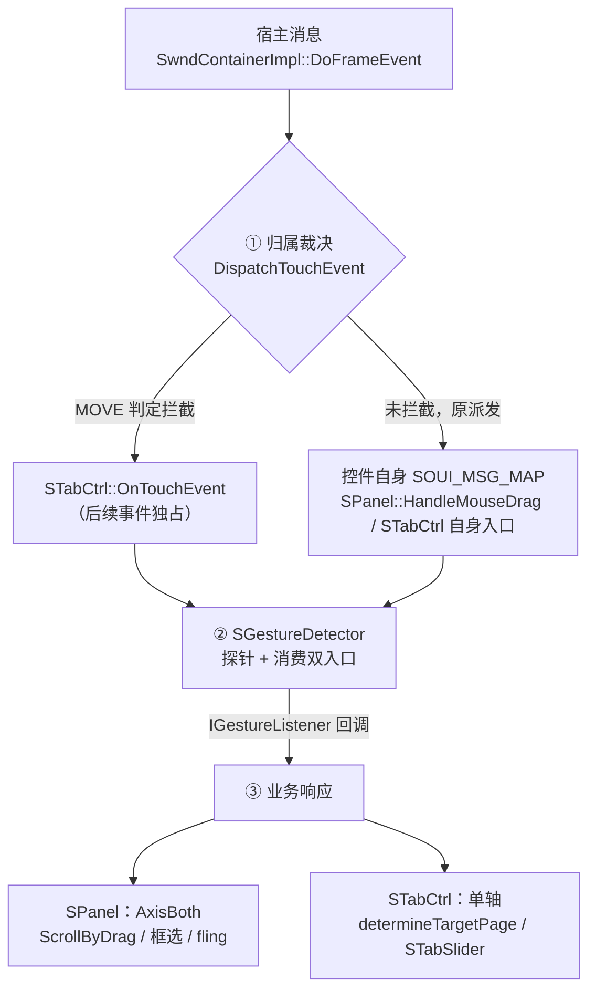
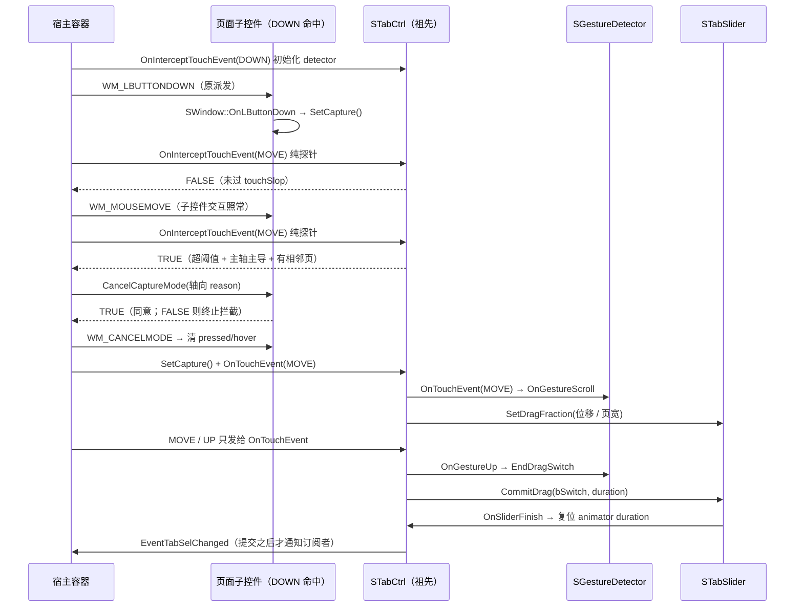
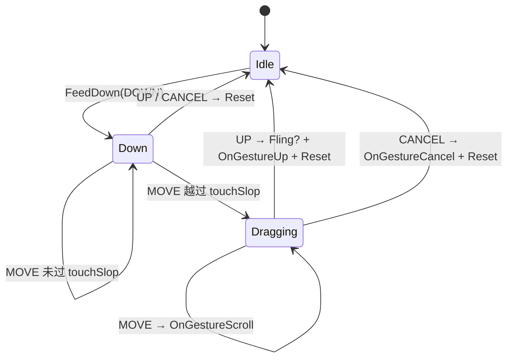
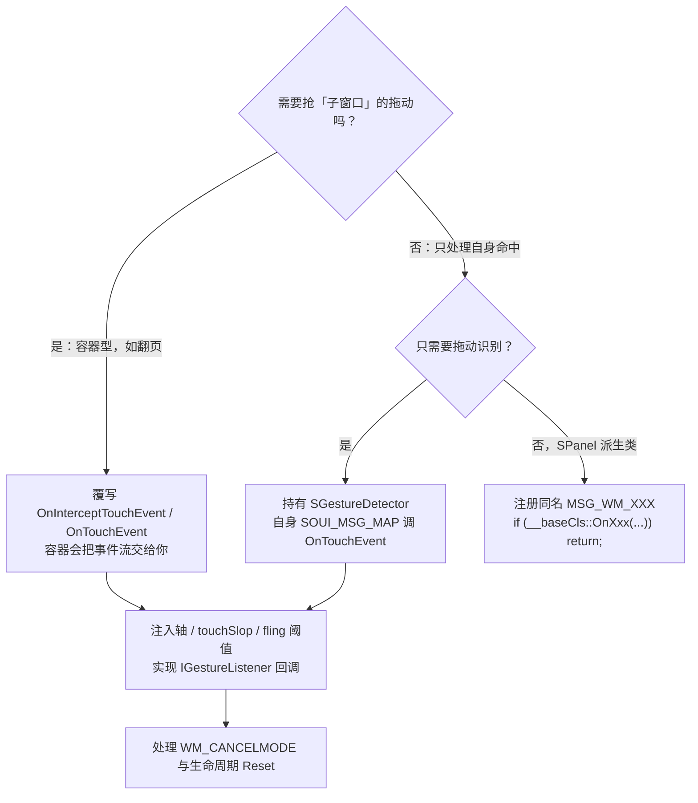

# SOUI 鼠标手势支持：设计与实现

> 更新：2026-11-08
> 主题：SOUI 框架鼠标手势体系的设计意图、分层架构、现有实现、接入方式与验证状态
> 覆盖范围：容器触摸拦截链（`SWindow` / `SwndContainerImpl`）、通用识别器（`SGestureDetector`）、拖动滚动 / 惯性 / 框选（`SPanel` 及 4 个 MVC 列表）、拖动切页（`STabCtrl`）
> 参考：Android Developers — [Manage touch events in a ViewGroup](https://developer.android.com/training/gestures/viewgroup)；`GestureDetector` / `VelocityTracker` / `ViewConfiguration.getScaledTouchSlop()` / `ViewPager.determineTargetPage()`
> 关联文档：`doc/SOUI-列表控件框选多选设计方案.md`（框选与滚动的优先级）、`doc/SOUI-事件体系设计方案.md`（消息与事件不冒泡）
> 源码口径：行号按 2026-11-08 的工作区核对，格式化后可能漂移，定位以「文件 + 符号名」为准
> 验证状态：非嵌套拖动切页已由用户构建运行确认；其后的嵌套修复、`SPanel` 统一接入、消息映射收尾、代码评审修复**仅完成静态复核，待编译与 ctest**，见 §9.3

---

## 0. 概览

SOUI 的鼠标消息原本只有一条路径：容器用 `SwndFromPoint()` 找到最内层窗口（或当前捕获窗口），把消息交给它；消息与 `FireEvent()` 事件都**不向父链冒泡**。因此「页面铺满子控件时，父容器想感知拖动」这件事无法靠常规事件订阅完成。

现在的鼠标手势体系分三层，识别与归属彻底分离：

| 层 | 组件 | 职责 | 关键文件 |
|---|---|---|---|
| ① 归属裁决 | `SwndContainerImpl::DispatchTouchEvent()` + `SWindow::OnInterceptTouchEvent()` / `OnTouchEvent()` | 决定「这次拖动归谁」：DOWN / MOVE / UP / CANCEL 流转、子控件放弃捕获、嵌套优先级、事件流独占 | `SOUI/src/core/SWndContainerImpl.cpp`、`SOUI/include/core/SWnd.h` |
| ② 手势识别 | `SGestureDetector` + `IGestureListener` | 与窗口无关的 touchSlop、轴判定、速度窗、fling 判定、UP / CANCEL 状态机 | `SOUI/include/core/SGestureDetector.h`、`SOUI/src/core/SGestureDetector.cpp` |
| ③ 业务响应 | `SPanel`（滚动 / 惯性 / 框选）、`STabCtrl`（拖动切页） | 把识别回调映射成滚动位移、页面切换与动画 | `SOUI/src/core/SPanel.cpp`、`SOUI/src/control/STabCtrl.cpp` |



### 0.1 现有能力清单

| 能力 | 触发路径 | 承载控件 | 默认状态 |
|---|---|---|---|
| 拖动滚动 + 惯性（fling） | 控件自身消息映射 → detector | `SPanel` 及 `SListView` / `SMCListView` / `STileView` / `STreeView` | 有滚动条或框选能力时启用 |
| 框选（rubber band）多选 | 同上，优先于滚动 | 支持多选的派生控件（`bandEnable`） | 由控件决定 |
| 拖动切换页面（ViewPager 形状） | 容器拦截链 → detector | `STabCtrl` | `enableDragSwitch="0"` 关闭 |
| 同轴向 / 异轴向嵌套裁决 | 容器自内向外询问 | 任意容器 | 内置，无需配置 |
| 轴向感知的放弃捕获 | `CANCEL_REASON_SCROLL_H/V` + `GetTouchInterceptAxis()` | `SPanel` / 扩展控件 / `STabCtrl` | 内置（§3.8） |
| 手势打断与清理 | `WM_CANCELMODE` | 全部接入者 | 内置 |
| 子控件否决父级拦截 | `RequestDisallowInterceptTouchEvent()` / `CancelCaptureMode()` | 全部窗口 | 内置 |

### 0.2 设计原则

1. **识别与归属分离**：`SGestureDetector` 只回答「这算不算一次拖动」，容器只回答「归谁」，控件只回答「拖动后做什么」。
2. **DOWN 永不拦截**：阈值之内的点击、hover、子控件拖动完整保留；只有 MOVE 越过 touchSlop 才可能改变归属。
3. **接管必须先征得同意**：拦截成立时先调用子控件 `CancelCaptureMode(reason)` 并**尊重返回值**（reason 带拦截者声明的轴，见 §3.8），返回 FALSE 就放弃拦截；同意后补发 `WM_CANCELMODE`（等价 Android `ACTION_CANCEL`）。
4. **扩展点回归框架惯例**：业务控件不重写识别逻辑，派生类也不再依赖私有虚函数，统一用 `SOUI_MSG_MAP` + `__baseCls::` 链式调用（§5.4）。

---

## 1. 背景与方案取舍

### 1.1 原有派发模型的约束

| 约束 | 后果 |
|---|---|
| `SwndFromPoint()` 命中最内层窗口；`SWindow::OnLButtonDown()` 默认 `SetCapture()` | 消息不经过祖先，父容器无从得知页面内发生了拖动 |
| `SOUI_MSG_MAP_END()` 只沿继承链回退，事件 `FireEvent()` 不沿父链冒泡 | 无法靠「订阅事件」让 `STabCtrl` 观察子页面的鼠标流 |
| 原 `SPanel` 自带一套 8px 阈值 + 单帧速度 + 100ms 有效期 + fling 状态机 | 阈值/速度口径与新增翻页手势各自维护，难以保证一致 |
| 早期拖动改造引入 `virtual OnLButtonDownEx / OnMouseMoveEx / OnLButtonUpEx` 供派生类覆写 | vtable 与消息映射两套扩展点并存，派生类无法用常规 `MSG_WM_XXX` 拦截 |

### 1.2 方案取舍：旁路偷看 vs 归属裁决

最早的一版实现是容器给「观察者」窗口发一份消息副本（`NotifyMouseObservers()`），父容器据此抢捕获。它可用，但语义含混。当前实现改为 Android `ViewGroup` 的裁决模型：

| Android 机制 | 旁路方案的问题 | 当前实现 |
|---|---|---|
| DOWN 不拦截，MOVE 超 `scaledTouchSlop` 才 `onInterceptTouchEvent=true` | 从 DOWN 起就发消息副本，阈值那次 MOVE 被子控件与父容器各处理一次 | DOWN 只做初始化，MOVE 才询问拦截 |
| 拦截后子视图收 `ACTION_CANCEL`，后续只给父 `onTouchEvent` | 只 `SetCapture()` 抢捕获，子控件 pressed / hover / drag 状态残留 | `CancelCaptureMode()` + `WM_CANCELMODE` + 独占事件流 |
| `requestDisallowInterceptTouchEvent(true)` 让子声明手势归我 | 无对应机制 | `SWindow::RequestDisallowInterceptTouchEvent()` |
| 子可拒绝放弃捕获 | 忽略 `CancelCaptureMode()` 返回值直接抢 | 返回 FALSE 直接放弃本次拦截 |
| `GestureDetector` + `VelocityTracker` + `ViewConfiguration` | 阈值 / 主轴 / 速度 / UP 全塞在业务函数里 | 统一收归 `SGestureDetector` |
| 父链逐层询问 | 只通知最近一个观察者 | 从命中窗口起沿父链逐层询问 |

一句话：旁路是「spy」，裁决模型才是「ownership」。

### 1.3 Android → SOUI 对照

| Android | SOUI | 源码 |
|---|---|---|
| `ViewGroup.onInterceptTouchEvent()` | `SWindow::OnInterceptTouchEvent()`（默认 FALSE） | `SWnd.h`、`Swnd.cpp` |
| `View.onTouchEvent()` | `SWindow::OnTouchEvent()`（默认 FALSE） | `SWnd.h`、`Swnd.cpp` |
| `ViewParent.requestDisallowInterceptTouchEvent()` | `SWindow::RequestDisallowInterceptTouchEvent(BOOL)`，容器沿父链查 `IsDisallowIntercept()` | `SWnd.h`、`SWndContainerImpl.cpp` |
| `dispatchTouchEvent()` | `SwndContainerImpl::DispatchTouchEvent()`，在 `DoFrameEvent()` 最前面 | `SWndContainerImpl.cpp` |
| 拦截者声明自己消费的方向 | `SWindow::GetTouchInterceptAxis()`（`STabCtrl` 按 `tabAlign` 覆写，默认 0 = 容器回退猜轴） | `SWnd.h`、`STabCtrl.cpp`（§3.8） |
| `ACTION_CANCEL` | `CancelCaptureMode(reason)`（轴向常量，见 §3.8）+ `SSendMessage(WM_CANCELMODE)` | `SWndContainerImpl.cpp` 接管流程 |
| `ViewConfiguration.getScaledTouchSlop()` | `SLayoutSize(8,dp).toPixelSize(GetScale())` 注入 detector | `SPanel.cpp`、`STabCtrl.cpp` 的 `PrepareGesture()` |
| `GestureDetector.OnGestureListener` | `IGestureListener`（Down / Scroll / Fling / Up / Cancel） | `SGestureDetector.h` |
| `VelocityTracker` | `SGestureDetector::AddSample/UpdateVelocity`，100ms 速度窗 | `SGestureDetector.cpp` |
| `ViewPager.determineTargetPage()` | `STabCtrl::EndDragSwitch()` | `STabCtrl.cpp` |
| `ViewPager` 的 `scrollTo` 跟手 | `STabSlider::SetDragFraction()`（两页离屏快照） | `STabCtrl.cpp` |

**一个刻意的实现取舍**：disallow flag 放在 `SWindow` 上，而不是加进 `ISwndContainer` 接口 —— 后者会改动 COM 式接口 vtable 并波及所有实现类。容器在 DOWN 时沿命中窗口父链清 flag（与 `ViewGroup` 清 `FLAG_DISALLOW_INTERCEPT` 一致），MOVE 时沿链检查。

---

## 2. 事件流总览

### 2.1 一次完整手势的五个阶段

| 阶段 | 容器动作 | 控件动作 |
|---|---|---|
| ① `WM_LBUTTONDOWN` | 记 `m_hTouchTarget` / `m_ptTouchDown`、清 disallow、沿父链自外向内调 `OnInterceptTouchEvent(DOWN)` **仅初始化、忽略返回值**；返回 FALSE 继续原派发 | 命中窗口按常规消息映射处理；祖先的 detector 各自 `FeedDown()` |
| ② 阈值内 `WM_MOUSEMOVE` | 自内向外询问，全部返回 FALSE → 继续原派发 | 子控件 hover / 点击 / 拖动照常 |
| ③ 越过阈值的 `WM_MOUSEMOVE` | 第一个返回 TRUE 的候选执行接管流程（§3.5、§3.8）；返回 TRUE 短路原派发 | 原子控件收 CANCEL 并清理；拦截者 `OnTouchEvent(MOVE)` |
| ④ 后续 MOVE | 只调拦截者 `OnTouchEvent()` | 拦截者的 detector 持续发 `OnGestureScroll()` |
| ⑤ `WM_LBUTTONUP` / `WM_CANCELMODE` | 有拦截者：只给它 `OnTouchEvent()` 并 `ResetTouchState()`；无拦截者：CANCEL 时给目标发 `WM_CANCELMODE` 后复位，继续原派发 | detector 发 `OnGestureFling` / `OnGestureUp` 或 `OnGestureCancel` 并 `Reset()` |

### 2.2 时序（按下点落在页面子控件上）



### 2.3 坐标系前提

全树共享宿主坐标系：`GetWindowRect()` 返回 `m_rcWindow`，`GetChildrenLayoutRect()` 是它按 margin / padding 收缩的结果；`TransformPointEx()` 逐层只做变换矩阵求逆、不平移原点。因此 `DispatchTouchEvent()` 直接把原始 `lParam` 往上抛，`STabCtrl::IsPointInPage()` 可以拿它和页面矩形直接 `PtInRect`，无需坐标换算。

### 2.4 两条入口、一份状态

`STabCtrl` 既可能是「拦截者」（DOWN 命中页面子控件），也可能是「命中窗口自身」（点 tab 头或空白区）。容器在 DOWN 时只为**祖先**初始化 detector，所以自身命中时由 `STabCtrl` 自己的 `OnLButtonDown/OnMouseMove/OnLButtonUp` 调 `m_gesture.OnTouchEvent()`（`STabCtrl.cpp:445-474`、`:518-523`）。两条路径共用同一个 detector 实例；嵌套修复后自身也被纳入 MOVE 候选链，若它自己声明拦截，`DoFrameEvent()` 会短路原派发，同一次 MOVE 不会被喂两遍。

---

## 3. 第一层：容器归属裁决

### 3.1 `SWindow` 暴露的接口

追加在 `SWnd.h` 类末尾（避免插入 vtable 中间）：

| 接口 | 签名 / 默认行为 | 语义 |
|---|---|---|
| `OnInterceptTouchEvent` | `virtual BOOL (UINT, WPARAM, LPARAM)`，默认 FALSE | 询问「是否接管手势」；DOWN 时只做初始化，MOVE 返回 TRUE 才可能接管 |
| `OnTouchEvent` | `virtual BOOL (UINT, WPARAM, LPARAM)`，默认 FALSE | 接收自己拥有的事件流（拦截成立后，或自身命中的常规路径） |
| `GetTouchInterceptAxis` | `virtual int () const`，默认 0 | 拦截者声明自己消费的轴（`CANCEL_REASON_SCROLL_H/V`），容器据此生成 CANCEL reason；0 = 未声明，按累计位移回退（§3.8） |
| `RequestDisallowInterceptTouchEvent` | `void (BOOL)` | 声明「本次手势归我」，容器 MOVE 时沿父链检查，DOWN 时清除 |
| `IsDisallowIntercept` | `BOOL () const` | 供容器查询 flag |

`CancelCaptureMode(int reason)` 是既有虚函数（`SWnd.h`、`Swnd.cpp`）：默认释放捕获、清 `WndState_PushDown|WndState_Hover` 并返回 TRUE；`SPanel` / `SOsrPanel` 与 `controls.extend/` 的 `SGridCtrl` / `SFreeMoveWindow` / `SImageKnob` 覆写它来表达「拒绝放弃」（§3.5）。所有覆写必须用 `CANCEL_REASON_IS_SCROLL(reason)` 判断，不能只比单个轴向常量（§3.8）。

### 3.2 容器状态

`SwndContainerImpl.h` 增加 `m_hTouchTarget`（DOWN 命中窗口）、`m_hTouchInterceptor`（当前拦截者）与 `m_ptTouchDown`（DOWN 起点），构造时清零。`m_ptTouchDown` 只在「拦截者未声明轴」时用来回退推算拖动方向。`DoFrameEvent()` 在**任何原派发之前**调 `DispatchTouchEvent()`；返回 TRUE 就结束，不再走 `SwndFromPoint()` / 捕获派发。`WM_CANCELMODE` 在 `DoFrameEvent()` 里是空分支，注释说明事件已由 `DispatchTouchEvent()` 交付给手势拥有者。

### 3.3 四个分支

| 消息 | 行为（`SWndContainerImpl.cpp`） |
|---|---|
| 已有 `m_hTouchInterceptor` | 只调 `pInterceptor->OnTouchEvent()`；UP / CANCEL 后 `ResetTouchState()`（含释放捕获） |
| `WM_LBUTTONDOWN` | `ResetTouchState()` → 重新 `SwndFromPoint()` 记目标 → 沿链清 disallow → 父链自外向内 `OnInterceptTouchEvent(DOWN)` 初始化 → **返回 FALSE 继续原派发** |
| `WM_LBUTTONUP` / `WM_CANCELMODE`（无拦截者） | CANCEL 时给目标发 `WM_CANCELMODE` → `ResetTouchState()` → 返回 FALSE 继续原派发 |
| `WM_MOUSEMOVE` | 要求 `MK_LBUTTON` 且有 DOWN 目标、disallow 为假；从命中/捕获窗口自身起**自内向外**询问，第一个 TRUE 的候选进入接管流程 |

### 3.4 MOVE 询问顺序：自内向外

```cpp
SList<SWindow *> chain;
for (SWindow *p = pTarget; p; p = p->GetParent())
    chain.AddTail(p);   // 最局部的处理器优先
```

父链用 `AddTail()`（而不是反转成自外向内）是**嵌套手势正确性的关键**：`page_skia.xml` 里两层 `tabAlign=top` 的 `STabCtrl` 会在同一次 MOVE 同时越过 touchSlop，旧的自外向内顺序让最外层恒赢；改成自内向外后，等价于 Android 里内层 ViewPager 通过 `requestDisallowInterceptTouchEvent(true)` 得到的「最局部处理器优先」，但由容器直接裁决、控件无需显式声明。`pTarget` 自身也纳入候选链，保证直接命中 tabctrl 时它同样能声明手势。

### 3.5 接管六步（含子控件拒绝权）

1. `pCancel = m_hCapture ? m_hCapture : m_hTouchTarget`；
2. 若 `pCancel != pCandidate`，调 `pCancel->CancelCaptureMode(nReason)`（`nReason` 由 §3.8 产生）—— **检查返回值**；返回 FALSE（例如 `SPanel` 正在框选、启用框选、或对应轴仍有滚动条）就**终止整条询问链**并返回 FALSE，本次 MOVE 照常派发给子控件；
3. `pCancel->SSendMessage(WM_CANCELMODE)`，等价 `ACTION_CANCEL`；
4. `OnFrameMouseLeave()` 清掉旧 hover；
5. 候选 `SetCapture()` + 记 `m_hTouchInterceptor` + 把本次 MOVE 转交 `OnTouchEvent()`；
6. 返回 TRUE，原派发全部跳过。

> `SPanel::CancelCaptureMode()` 在 `m_bRubberBandActive`、`IsRubberBandSelEnabled()` 或对应轴存在滚动条时返回 FALSE；`SOsrPanel::CancelCaptureMode()`（`SOUI/src/core/SItemPanel.cpp`）会沿捕获链向下转发并检查返回值。框架原本就具备 Android CANCEL 的语义，只是旧方案绕过了它。

### 3.6 disallow 的语义边界

`IsDisallowIntercept(pTarget)` 沿命中窗口父链检查，一旦为真就**跳过整条询问链（包括内层自己）**。它是「整个手势完全归子控件」的强否决，与 §3.4 的「内层优先」不是一回事。目前 `SOUI/` 内只有容器在 DOWN 时清标记，`STabCtrl` 未调用它；页内控件若需要保住自己的手势，可在 DOWN / MOVE 时调 `RequestDisallowInterceptTouchEvent(TRUE)`（必须在 DOWN 之后）。

### 3.7 嵌套场景的可观察行为

1. **同轴向内层优先**：`page_skia` 内层页面上水平拖动只切 L4 内层，外层不动、不发切换事件。
2. **异轴向共存**：外层水平轴遇垂直拖动时 `ShouldStartDrag()` 的「主轴主导」判据返回 FALSE，链继续向外，`tabAlign=left` 的垂直层才有机会接管。
3. **边界不吞手势**：`STabCtrl::OnInterceptTouchEvent(MOVE)` 在探针返回 TRUE 后还会按 `StartDragSwitch()` 的方向规则预判相邻页，边界方向返回 FALSE，让机会逐层回退给外层；这同时修掉「捕获已转移但 `StartDragSwitch()` 才发现越界 → 画面不动、手势被吞」的缺陷。
4. **落选层的状态残留**：UP / CANCEL 只发给拦截者，未中选层的 `m_bDragArmed` 与 detector 的 `m_bDown` 等下一次 DOWN 的 `FeedDown() → Reset()` 清理，不影响后续手势。

### 3.8 轴向 reason：由拦截者声明，而不是猜位移

`SWindow-i.h` 定义两个可按位或的取消原因标志：`CANCEL_REASON_SCROLL_H(1)` / `_V(2)`；两者同时置位表示无轴向接管（原第三个常量的语义）。`CANCEL_REASON_IS_SCROLL(reason)` 用位与覆盖任意组合，`SPanel` 与所有扩展控件覆写统一用它判定。

容器在候选 `OnInterceptTouchEvent()` 返回 TRUE 后，优先用 `pCandidate->GetTouchInterceptAxis()` 的返回值作为 reason；`STabCtrl` 按 `tabAlign` 声明（`left/right` → `_V`，其余 → `_H`），未声明轴时返回 0，容器才回退到 `|dx| >= |dy|` 的累计位移猜测。

**为什么不能只猜位移**：45° 拖动 `|dx| == |dy|` 时回退逻辑恒选水平；而 `AxisVertical` 的探针因 `nAxis >= nCross`（相等成立）也会拦截垂直翻页，于是「垂直翻页却发水平 reason」——垂直滚动列表放行、水平滚动列表被误挡。折线拖动（先横后竖）同理。让拦截者自己声明轴，才能把「谁的轴」与「拖动的位移」解耦。

`SPanel::CancelCaptureMode()` 按 reason 位标志决定是否否决：`_H` 只看水平滚动条、`_V` 只看垂直滚动条、两轴都置位时两者都看；**启用框选时一律否决**，因为框选可从任意方向起手，而容器在越过阈值那次 MOVE 的探针阶段就发 CANCEL，此时 `m_bRubberBandActive` 还没置位。`controls.extend/` 的三个覆写用宏接收轴向标志的任意组合，保证轴向改造后旧的「拒绝放弃捕获」语义不失效。

> 这条保守否决的代价：启用框选的列表会挡住外层 `STabCtrl` 的翻页，即使拖动方向与滚动条无关；这类列表上的翻页需要另设触发区（见 §10 第 2 条）。

---

## 4. 第二层：`SGestureDetector`

### 4.1 接口

`IGestureListener`（`SGestureDetector.h`）全部带默认空实现，控件按需覆写：

| 回调 | 参数 | 时机 |
|---|---|---|
| `OnGestureDown` | `pt` | DOWN 初始化（`FeedDown`） |
| `OnGestureScroll` | `ptDown, ptCur, dx, dy` | 已判定 dragging 的每次 MOVE（含越过阈值的那一次） |
| `OnGestureFling` | `vx, vy` | UP 时速度超过阈值且本次确实拖动过 |
| `OnGestureUp` | `pt, vx, vy` | UP 收尾（fling 之后） |
| `OnGestureCancel` | — | `WM_CANCELMODE` 且本次正在拖动 |

配置项：`SetAxis(AxisHorizontal|AxisVertical|AxisBoth)`、`SetTouchSlop(int px)`、`SetMinFlingVelocity(float px/ms)`；查询项：`IsDragging()` / `IsDown()` / `GetDownPoint()` / `GetCurrentPoint()` / `GetVelocityX/Y()`。默认 `AxisHorizontal`、8px、0.5 px/ms。

### 4.2 双入口：探针与消费

| 入口 | 用途 | 行为 |
|---|---|---|
| `OnInterceptTouchEvent(uMsg,...)` | 容器询问父链时调用 | **纯探针**：DOWN 记起点并 `FeedDown()`；MOVE 只返回 `ShouldStartDrag(pt)`，不改状态、不发回调；返回 FALSE 表示 DOWN 永不拦截 |
| `OnTouchEvent(uMsg,...)` | 拦截成立后 / 控件自身消息映射 | DOWN 幂等初始化；MOVE 采样、启动 dragging、发 `OnGestureScroll()`；UP 校验速度新鲜度后发 `OnGestureFling/OnGestureUp()` 并 `Reset()`；CANCEL 发 `OnGestureCancel()`。返回 `m_bDragging` 表示「本次事件是否被吞」 |

**探针不喂样本**是有意为之：拦截成立的那次 MOVE 会先经探针、再经 `OnTouchEvent()`；探针只读 `m_ptDown`，不写 `m_ptLast` 和样本，所以同一次 MOVE 不会被喂两次，拦截前后起点与速度样本连续。

`OnTouchEvent(WM_LBUTTONUP)` 带 `m_bDown` 守卫：无配对 DOWN 的 stray UP 不发回调、不让宿主误释放捕获。`WM_CANCELMODE` 只在 `m_bDragging` 为真时发 cancel 回调。

### 4.3 判定规则

| 规则 | 实现 |
|---|---|
| 单轴启动 | `nAxis > touchSlop && nAxis >= nCross`，主轴主导 —— 页面里的纵向列表不会被误判成横向翻页 |
| 双轴启动 | `AxisBoth`：`dx > slop \|\| dy > slop`，不做主轴主导，供 `SPanel` 同一次手势同时滚 X / Y |
| 速度窗 | 最多 16 个样本，只保留最近 **100ms**；速度为窗口首尾差分（px/ms）；`Sample::t` 是 `DWORD`，`GetTickCount()` + `Ts32Diff()` 处理 32 位回绕 |
| 速度新鲜度 | UP 时若最后样本超过 100ms，速度归零（对齐旧 `SPanel` 的 100ms 有效期） |
| fling 判据 | 单轴取对应轴速度；`AxisBoth` 取 `\|vx\|` / `\|vy\|` 较大者，与 `minFlingVelocity` 比较 |



`Ts32Diff()` 简化为无符号回绕减法 `ts2 - ts1`：`DWORD` 在 Windows 是 32 位 `unsigned long`、swinx 是 `unsigned int`，无符号回绕正确，顺带修掉了相等时返回 `0xffffffff` 的老问题。

### 4.4 配置注入

| 宿主 | 轴 | touchSlop | minFlingVelocity | 注入点 |
|---|---|---|---|---|
| `STabCtrl` | `AxisHorizontal` / `AxisVertical`（随 `tabAlign`） | `dragThreshold`，默认 `8dp` | 默认 `0.5 px/ms` | `STabCtrl::PrepareGesture()` |
| `SPanel` | `AxisBoth` | `8dp` → `toPixelSize(GetScale())` | `0.01 px/ms`（保留旧灵敏度） | `SPanel::PrepareGesture()` |

detector 不依赖窗口 / 容器 / 资源，可脱离运行环境直接单测（`test_tab_drag.cpp` / `test_panel_gesture.cpp` 里的 `soui_*_detector` 用例）。

> **构建注意**：`SOUI/CMakeLists.txt` 用 `file(GLOB_RECURSE ...)` 收集源文件且**没有 `CONFIGURE_DEPENDS`**。新增 `SGestureDetector.cpp` 后，ninja 构建目录（`build/`、`out/mingw64_rel/`）必须重跑 `cmake -S . -B <build>`，否则会静默漏掉该编译单元、链接缺符号。VS 生成器工程已包含此文件。`demos/fun_test/CMakeLists.txt` 的测试 GLOB 带 `CONFIGURE_DEPENDS`，新增测试文件无需重配。

---

## 5. 第三层 A：`SPanel` 拖动滚动 / 惯性 / 框选

### 5.1 接入形态

`SPanel` 继承 `IGestureListener`、持有 `SGestureDetector m_gesture`（`SPanel.h`）。`HandleMouseDrag(UINT, WPARAM, LPARAM, LRESULT&)` 保持原有公共入口与语义（返回 TRUE = 吞掉 MOVE / UP），内部改为：先处理已激活的 rubber band 与 fling 打断，再 `m_gesture.OnTouchEvent()`，业务规则全部搬到回调里。

四个 MVC 列表 `SListView` / `SMCListView` / `STileView` / `STreeView` 的 `OnMouseEvent()` 都先调 `HandleMouseDrag()`，签名与调用点**未改动**。

### 5.2 arm 门槛（兼容性关键）

```cpp
if (!m_gesture.IsDown() && !m_bDragScrolling &&
    !IsRubberBandSelEnabled() && !IsEnableDragMode())
    return (uMsg == WM_LBUTTONDOWN && bFlingRunning) ? TRUE : FALSE;
```

只有「有框选能力」或「有滚动条且允许拖动滚动」的面板才武装手势。否则普通不可滚动面板上移动 8px 就会吞掉派生类的 `OnLButtonUp` 点击。手势一旦启动就不再重复判定（滚动条可能在拖动中消失，配对的 UP 仍必须被吞）。fling 动画运行中按下会 `StopFlingAnimation()` 并吞掉这次 DOWN，但仍把 DOWN 喂给 detector，让后续拖动走统一的 touchSlop / 速度路径。

### 5.3 回调映射

| detector 回调 | `SPanel` 动作 |
|---|---|
| `OnGestureDown(pt)` | 记 `m_ptDragStart`（框选锚点），清 fling 标记 |
| `OnGestureScroll` **首次** | 框选优先：`StartRubberBandSel(ptDown, bAdd)` + `UpdateRubberBandSel(ptCur)`；否则 `OnDragCancelCapture(CANCEL_REASON_SCROLL_H | CANCEL_REASON_SCROLL_V)` → `SetCapture()` + `OnDragScrollStart()`。**这次 MOVE 不产生位移**（与旧行为一致） |
| `OnGestureScroll` 后续 | `GetVelocityX/Y()` → `ScrollByDrag(TRUE, dy, vy)` / `ScrollByDrag(FALSE, dx, vx)`，两轴都执行 |
| `OnGestureFling` | 只置 `m_bGestureFling` |
| `OnGestureUp` | `OnDragScrollEnd()` → `ReleaseCapture()` → 有 fling 标记才 `StartFlingAnimation(vx, vy)`；未拖动时仅释放 pending 捕获 |
| `OnGestureCancel` | 清 dragging / pending、`EndRubberBandSel(TRUE)`、`ReleaseCapture()`，不起 fling |

`ScrollByDrag()` 按速度分档乘 0.7x / 1.2x / 1.8x / 2.5x 后调 `OnDragScroll()`，这套业务倍率保持原样。`OnGestureScroll` 首次传给 `OnDragCancelCapture()` 的仍是**无轴向**的旧常量：那是面板内部向自己的子控件询问，与 §3.8 的容器接管 reason 是两条不同路径。

### 5.4 消息映射与派生类链式调用

`SPanel` 的三个 `MSG_WM_LBUTTONDOWN / MOUSEMOVE / LBUTTONUP` 处理器改为返回 `BOOL`：

| 返回值 | 含义 |
|---|---|
| `TRUE` | 拖动 / fling / 框选吞掉了事件，派生类必须直接 `return` |
| `FALSE` | 普通点击，`SPanel` 已链式调用 `SWindow` 默认处理（focus、capture、`EventCmd` 等） |

派生类用标准 `SOUI_MSG_MAP` 拦截同名消息：

```cpp
// SOUI/include/control/SListCtrl.h：注册 MSG_WM_LBUTTONDOWN / MSG_WM_MOUSEMOVE
void SListCtrl::OnLButtonDown(UINT nFlags, CPoint pt)
{
    if (__baseCls::OnLButtonDown(nFlags, pt)) // SPanel 先裁决手势
        return;                                // 被吞：跳过自己的逻辑
    // ... 自己的选中 / 点击逻辑
}
```

采用该写法的控件：`SListCtrl`、`SListBox`、`STreeCtrl`（`SOUI/src/control/*.cpp`）、`demos/fundholdings` 的 `SFundWatchTabs`、`demos/fun_test/test_panel_gesture.cpp` 的 `GesturePanel`。原来的 `virtual OnLButtonDownEx / OnMouseMoveEx / OnLButtonUpEx` 三个扩展点已**全部删除**，全仓无残留符号。

> 删除 3 个 `virtual` 会改变 `SPanel` 的 vtable 布局，**必须全量重编**，不能混用旧对象。

### 5.5 生命周期清理

`MSG_WM_CANCELMODE(OnCancelMode)` 在容器抢走手势或平台打断时调 `OnGestureCancel()`、`EndRubberBandSel(TRUE)`、`CancelDragGesture()`、`ReleaseCapture()`；销毁 / 容器变更 / 缩放变化分别走 `CancelDragGesture()` 与 `PrepareGesture()`（刷新 touchSlop）；`STileView::OnMouseLeave()` 改调 `CancelDragGesture()` 而非直接清标志位。

### 5.6 相对旧状态机的行为差异

| 项 | 变化 | 兼容性 |
|---|---|---|
| touchSlop | 8 **px** → 8 **dp** | 100% 缩放等价，高分屏更接近 Android `scaledTouchSlop` |
| 速度 | 单帧瞬时 → 100ms 窗口首尾差分 | `ScrollByDrag()` 的分档触发点变化，甩动手感需实测 |
| fling 灵敏度 | 保持 `0.01 px/ms` | detector 默认 0.5 被显式覆盖 |
| fling 期间再次按下拖动 | 旧：第一个带按钮的 MOVE 直接滚动；新：仍需越过 touchSlop | 统一手势语义的必然结果 |
| `WM_CANCELMODE` | 新增清理 | 旧实现无此处理，手势被抢时可能残留状态 |
| 阈值那次 MOVE / UP 吞消息 / 框选优先 / `CancelCaptureMode` 拒绝外层 | 全部保持 | `test_rubberband.cpp` 与 `fundholdings` 依赖这些语义 |

旧成员 `m_bDragStarted` / `m_ptDragLast` / `m_fLastVelocityX/Y` / `m_nLastMoveTime` 已删除；`m_bDragPending` 保留。

**一处顺序变化**：`SListBox` 以前把基类调用放在 `OnLButtonUpEx()` 末尾，改标准链式后 `EventCmd`（`FireCommand`）会早于 `EventLBSelChanging / EventLBSelChanged` 发出。`SListCtrl` / `STreeCtrl` 原本就是基类先行，本次只是让三者对齐；若业务依赖 `EVT_CMD` 读取新选中项，应改监听 `EVT_LB_SELCHANGED`。

---

## 6. 第三层 B：`STabCtrl` 拖动切页

### 6.1 形状

`tabHeight="0"` 时 `STabCtrl` 是纯页面容器，语义等价于移动端 fragment / ViewPager 容器。目标交互：内容区任意位置（包括铺满按钮、列表的子控件）都能拖；阈值内子控件交互完全不受影响；拖动时两页跟手；松手按位移比例或速度决定切页 / 回弹；方向随 `tabAlign` 自动切换。

### 6.2 两条入口与 armed 条件

| 场景 | 入口 | 代码 |
|---|---|---|
| DOWN 落在页面子控件 | 容器拦截链 → `OnInterceptTouchEvent(DOWN/MOVE)` → 拦截后 `OnTouchEvent()` | `STabCtrl.cpp` 手势实现段 |
| DOWN 落在 `STabCtrl` 自身（tab 头 / 空白区） | 自身消息映射 → `m_gesture.OnTouchEvent()` | `STabCtrl.cpp:445-474`、`:518-523` |

`OnInterceptTouchEvent(DOWN)` 只在**页面区**内 `m_bDragArmed = TRUE`（`IsPointInPage()` 判 `GetChildrenLayoutRect()`），tab 头点击仍是既有 `SetCurSel()`。`CanDragSwitch()` 还要求 `enableDragSwitch` 打开、页数 > 1、当前页有效。

MOVE 分支在 detector 探针返回 TRUE 之后追加**边界方向预判**：按 `StartDragSwitch()` 同样的规则算目标页（左/上拖 → 下一页，右/下拖 → 上一页），无相邻页就返回 FALSE 让位给更外层容器（ViewPager 的 `canScroll` 语义）。

### 6.3 回调映射与提交决策

| detector 回调 | `STabCtrl` 行为 |
|---|---|
| `OnGestureScroll` | 首次 `StartDragSwitch()`（按位移符号定目标页、越界不激活、不循环），之后 `UpdateDragSwitch()` → `STabSlider::SetDragFraction()` |
| `OnGestureFling` | 置 `m_bDragFling = TRUE` |
| `OnGestureUp` | `EndDragSwitch(轴向速度)` |
| `OnGestureCancel` | `CancelDragSwitch()` 回弹 |

`StartDragSwitch()` **不再自己抢捕获** —— 捕获归属已由容器在拦截时处理完，这里只结束旧动画、保存 animator duration、创建拖动模式的 `STabSlider`。

`EndDragSwitch()` 的提交判据：

1. `bSwitch = fraction * 100 >= dragSwitchRatio`（默认 35）；
2. 否则若 `dragFling` 开启、detector 触发过 fling（默认阈值 0.5 px/ms）、朝目标页速度 `> 0.5 px/ms` 且已有 `> 2%` 可见位移，也提交；
3. 提交前发 `EventTabSelChanging`，`bCancel = TRUE` 则改为回弹；
4. 确认后更新 `m_nCurrentPage`、`UpdateChildrenPosition()`、重绘 tab 头；
5. `CommitDrag(bSwitch, dragCommitDuration)`，`OnSliderFinish()` 恢复被临时改写的 animator duration；
6. **最后**才发 `EventTabSelChanged` / `accNotifyEvent(EVENT_OBJECT_SELECTION)`，与 `SetCurSel()` 的「先建 slider 再通知」顺序一致。事件若早于提交发出，订阅者在回调里同步 `SetCurSel()` 复位页面（`demos/fundholdings` 的三页滑动容器就是如此）会 `Stop()` 掉尚未提交的 drag slider，`CommitDrag()` 随即失效，跟手补间被吞、页面直接跳变。

`OnSliderFinish()` 即使 `m_tabSlider` 已为空，也必须先清 `m_bDragCommitting` 并还原 duration，否则下一次程序化切页会沿用拖动提交的临时时长。

生命周期清理由 `SetCurSel()` 抢占、`OnCaptureChanged()`（捕获丢失）、`OnShowWindow()`（隐藏）、`OnEnable()`（禁用）、`OnContainerChanged()`、`CancelDragSwitch()` 统一收口；隐藏 / 禁用用 `IsVisible(TRUE)` / `IsDisabled(TRUE)` 判断整条祖先链。

### 6.4 视觉层：`STabSlider`

沿用既有机制：新旧两页离屏 `IRenderTarget` 快照 → 隐藏真实页面 → animator fraction 驱动 `OnPaint()` 位移（垂直性由 `m_bVertical` 决定）→ 结束 `Stop()` / `OnSliderFinish()`。拖动模式是在此之上的扩展：构造参数 `bDragMode`、拖动模式不 `start()` animator、`SetDragFraction/GetDragFraction()`、`CommitDrag()` 从当前 fraction 补到 1 / 0（`duration <= 0` 同步收尾，无头测试用）、`OnPaint()` 三分支。`dragCommitDuration` 会临时改写 animator duration，所以才有 `m_nDragSavedDuration` + `OnSliderFinish()` 还原；`OnSliderFinish()` 的空 slider 守卫放在状态清理之后，避免迟到回调留下悬挂状态。

### 6.5 XML 属性

属性定义 `STabCtrl.h` 的 `SOUI_ATTRS_BEGIN()` 段，默认值在构造函数。

| 属性 | 类型 | 默认 | 语义 |
|---|---|---|---|
| `enableDragSwitch` | BOOL | `0` | 总开关；关闭时 `CanDragSwitch()` 为 FALSE，拦截链对该控件完全不生效 |
| `dragThreshold` | LAYOUTSIZE | `8dp` | touchSlop，`toPixelSize(GetScale())` 随 DPI 缩放 |
| `dragSwitchRatio` | INT | `35` | 松手提交所需位移百分比（1–100） |
| `dragFling` | BOOL | `1` | 是否允许甩动速度触发提交 |
| `dragCommitDuration` | INT (ms) | `200` | 提交 / 回弹补间时长；`0` = 立即完成（无头测试用） |

方向自动跟随 `tabAlign`（`IsDragAxisVertical()`）：`left/right` 走垂直，其余水平，与 `STabSlider::m_bVertical` 同判据。

`demos/wxDemo/uires/xml/dlg_main.xml` 的完整属性示例（纯页面容器；此例 `tabAlign="left"`，拖动方向为**垂直**）：

```xml
<tabctrl pos="[0,0,-0,-0" name="tab_main_opt" tabWidth="0" tabAlign="left"
         enableDragSwitch="1" dragThreshold="10dp" dragSwitchRatio="35"
         dragFling="1" dragCommitDuration="180">
    <page title="page_msg"><include src="LAYOUT:XML_PAGE_MSG" /></page>
    ...
</tabctrl>
```

---

## 7. 扩展指南：给新控件接入手势



三条实践规则：

1. **容器型控件**：`OnInterceptTouchEvent(DOWN)` 只初始化并判断命中区域，永远返回 FALSE；MOVE 用 `m_gesture.OnInterceptTouchEvent()` 做纯探针，之后追加自己的业务预判（例如边界让位）；`OnTouchEvent()` 直接把消息喂给 `m_gesture.OnTouchEvent()`；**同时覆写 `GetTouchInterceptAxis()` 声明消费轴**（§3.8）。
2. **自身型控件**：在消息映射里调 `m_gesture.OnTouchEvent()`，用返回值决定是否短路默认处理；不要在探针里改状态。
3. **派生类扩展**：一律 `MSG_WM_LBUTTONDOWN/MOUSEMOVE/LBUTTONUP` + `__baseCls::` 链式调用；基类处理器返回 TRUE 时必须立刻 `return`，否则拖动会同时触发点击选中。

常见坑：忘记在 DOWN 后刷新 `PrepareGesture()`（DPI 变化会让 touchSlop 过时）；容器拦截后忘了给子控件 CANCEL；忽略 `CancelCaptureMode()` 返回值；把 `RequestDisallowInterceptTouchEvent()` 当成「内层优先」用（它会连内层一起挡掉）；容器型控件不声明轴导致 45° 拖动发出错误 reason；`CancelCaptureMode()` 覆写只比单个轴向常量而漏掉其它位标志组合（必须用 `CANCEL_REASON_IS_SCROLL()`）。

---

## 8. Demo 配置现状

`demos/demo/uires/xml/` 下 7 个 XML 共 12 个 `<tabctrl>` 实例显式配置了 `enableDragSwitch`，专门用于验证最多 **4 层**嵌套（`tab_main → tab_contents → 页面级 tabctrl → 页内 tabctrl`）。当前工作区状态：

| 层级 | 控件 | 位置 | `tabAlign` | 拖动轴 | 开关 |
|---|---|---|---|---|---|
| L1 | `tab_main` | `dlg_main.xml:82` | 默认 top | 水平 | `0`（当前关闭，可用于隔离对照） |
| L2 | `tab_contents` | `dlg_main.xml:94` | 默认 top | 水平 | `0`（当前关闭） |
| L3 | `tab_ctrls` | `page_ctrls.xml:54` | left | 垂直 | `1` |
| L3 | 页面级 tabctrl（布局 / 动画 / 杂项 / 脚本） | `page_layout.xml:15`、`page_animator.xml:12`、`page_misc.xml:12`、`page_script.xml:87` | left | 垂直 | `1` |
| L3 | `page_skia` 外层 | `page_skia.xml:8` | top | 水平 | `1` |
| L4 | `page_skia` 内层 | `page_skia.xml:11` | top | 水平 | `1` |
| L4 | `tab_radio2` | `page_ctrls.xml:341` | 默认 top | 水平 | `1` |
| L4 | 杂项内嵌 ×2 | `page_misc.xml:67`、`:107` | 默认 / middle | 水平 | `1` |

`uidef/init.xml` 中的 `<tabctrl/>` 位于 `<objattr>`，是控件默认属性模板而不是实例，故意不加，保留「逐层关掉某一层做对照」的能力。`demos/wxDemo/uires/xml/dlg_main.xml` 另有 1 个带完整 5 个属性的示例（§6.5）。

`demos/fundholdings` 的移动版布局（`uires/layout/dlg_main.xml` 与 `mobile/` 副本）用两个隐藏页头的 `tabctrl`：`pane_swipe` 承载三个面板的左右滑切页（`dragCommitDuration="200"`），`fund_swipe` 用「上一支 / 当前 / 下一支」三页实现左右滑切基金（`dragCommitDuration="0"`，切页后由 `EventTabSelChanged` 复位到中间页并 `ActivateFund(next)`）。后者正是 §6.3 事件顺序的现实用例。

隔离测法：把目标层以上的 `enableDragSwitch` 改成 `0`，即可只留该层；逐层调 `dragThreshold` / `dragCommitDuration` 也能区分是哪一层在响应。

---

## 9. 测试与验证

### 9.1 回归用例

| 文件 | 用例数 | 覆盖 |
|---|---|---|
| `demos/fun_test/test_tab_drag.cpp` | 24 | 默认关闭 / 阈值内点击 / 左右翻页 / 回弹 / 边界 clamp / `selchanging` 否决 / 子控件按下时的容器拦截 / CANCEL 与拒绝放弃 / disallow / CANCELMODE / 轴向跟随 / **同轴向嵌套内层优先** / **内层边界回退外层** / 捕获丢失·隐藏·禁用清理 / 空 slider 迟到回调，以及评审修复的**声明轴、45° reason、Changed 重入不破坏提交** 3 例；另有 `soui_gesture_detector.*` 2 例 |
| `demos/fun_test/test_panel_gesture.cpp` | 13 | 阈值内点击语义 / **派生类消息映射链式调用** / 阈值 MOVE 只启动 / `AxisBoth` 斜向双轴滚动 / 纯水平滚动 / CANCELMODE 后可开新手势 / stray UP / 不可滚动面板不吞点击 / 轴向否决 / **框选启用时跨轴否决**，以及 `soui_panel_gesture_detector.*` 3 例 |
| `demos/fun_test/test_rubberband.cpp` | 37 | 通过真实 `SSendMessage` 驱动 `SListCtrl` / `STreeCtrl` 等，覆盖框选与滚动互斥、点击选中、坐标换算、多选迁移等；是 §5.4 链式改写的天然回归 |

三份合计 **74 例**（24 + 13 + 37）。

### 9.2 测试技巧

- `dragCommitDuration='0' dragFling='0'` 让断言只取决于位移比例，不依赖定时器。
- `container()->SetRoot(root)` 是容器级 `DoFrameEvent()` 的前提。
- `CancelSpyWindow` 继承 `SWindow` 并覆写 `CancelCaptureMode()`，用 `m_lastReason` 观察轴向 reason、用 `m_refuse` 模拟「拒绝放弃」；`MakeNestedTabs()` 用真实 XML 构造两层 `tabctrl` 复现 `page_skia.xml`。
- `SwipeResetter` 在 `EventTabSelChanged` 里同步 `SetCurSel()` 复位，并用 `TabHook::HasSlider()` 记录通知到达时 drag slider 是否还在，用来断言「事件必须晚于提交」。
- `GesturePanel` 用自己的 `SOUI_MSG_MAP` 拦截 DOWN / MOVE / UP 并链式调用 `SPanel`，同时覆写 `OnDragScroll` / `OnFlingScroll` 等回调计数，避开真实滚动条皮肤与定时器；速度倍率依赖真实时钟，所以只断言位移**方向与是否为 0**。

### 9.3 验证状态（如实记录）

- ✅ 用户反馈（2026-11-08）：Android 语义重构版的**非嵌套**拖动切页已构建运行，效果符合预期。
- ✅ 静态复核：声明 / 实现逐一比对、旧符号（`IsMouseObserver` / `NotifyMouseObservers` / `HandleDragSwitch` / `OnXxxEx`）全仓清零、BOM 与 CRLF 字节断言、`git diff --stat` 无全文件重写、`git -c core.whitespace=cr-at-eol diff --check` 通过。
- ⚠️ 嵌套修复（§3.4 / §6.2）、`SPanel` 统一接入（§5）、消息映射收尾（§5.4）、代码评审修复（§3.8 / §6.3）之后的改动**尚未编译、ctest 未运行**；37 个手势用例与 37 个框选用例的逐项结果以本地执行为准。
- ❌ 跟手视觉效果、真实触摸事件（Android / OHOS / wasm）未做 GUI / 真机验证；修复后的 4 层嵌套交互待在 demo 中人工复核。

### 9.4 回归命令

```bash
cd /d/work/soui4 && unset https_proxy http_proxy HTTPS_PROXY HTTP_PROXY
cmake -S . -B build          # 新增 SGestureDetector.cpp，ninja 目录必须重新配置
cmake --build build --config Debug --parallel     # 改过公共头文件 + vtable，必须全量重编
ctest --test-dir build -R '^TabDragTest\.|^soui_gesture_detector\.|^PanelGestureTest\.|^soui_panel_gesture_detector\.|^soui_rubberband\.' --output-on-failure
ctest --test-dir build -L '^soui-headless$' --output-on-failure
# 单独复跑：fun_test --gtest_filter=PanelGestureTest.*:soui_panel_gesture_detector.*:TabDragTest.*
```

GUI 人工复核建议：`demos/demo` 嵌套页与 `fundholdings` 移动版滑切，验证拖动 / fling 与点击选中互斥；重点看「纵向滚动列表 + 外层水平翻页」「启用框选的列表 + 外层翻页」以及 `fund_swipe` 复位时是否还有多余动画 / 闪屏。

---

## 10. 已知限制与后续

1. **离屏快照是静态帧**：拖动期间两页是位图贴图（沿用 `STabSlider`），页内动画 / 视频在拖动瞬间不动。
2. **只统一了「识别」，没统一「归属协商」**：`SPanel` 不实现 `OnInterceptTouchEvent()`，仍靠 `CancelCaptureMode()` 在有滚动条 / 框选时返回 FALSE 表达「这个手势归我」。启用框选时对所有轴向一律否决（§3.8），因此这类列表上的外层翻页需要另设触发区。列表与外层 `STabCtrl` 之间没有 Android `NestedScrolling` 式的剩余滑动量传递，内层滑到边界后不会把位移交给外层。
3. **单容器一级状态机**：`DispatchTouchEvent()` 由 `SwndContainerImpl` 独占裁决；同轴向嵌套已用「自内向外 + 边界回退」解决，但 `SOsrPanel` item container 场景尚未验证。
4. **主轴主导是硬判据**：页内横向可滚动控件与外层横向翻页天然冲突，需靠 `RequestDisallowInterceptTouchEvent()` 或调大 `dragThreshold`；未做滑动量协商。
5. **边界不循环、无橡皮筋阻尼**：首/末页不激活 slider，拦截阶段已提前让位给外层。
6. **内层页签头上的拖动可能落到外层**：`IsPointInPage()` 判的是页面区，点在内层 tab 头时内层不 armed，但外层的页面区覆盖整个内层，仍可能被外层接管。若要禁止，需给 `STabCtrl` 增加「命中自身但不 armed 时临时 disallow 外层」的语义。
7. **速度窗是简化版**：100ms 内首尾差分，未实现 Android `VelocityTracker` 的加权最小二乘；依赖 `GetTickCount()` 可用。
8. **依赖 `MK_LBUTTON`**：触摸后端若不上报该标志，需改为由容器维护按下状态。
9. **拦截期间 hover 不更新**：`m_uNcHitTest` / hover 在手势结束后由下一次普通 MOVE 恢复，这是刻意简化。
10. **异步提交期间的事件重入**：`dragCommitDuration > 0` 时 `EventTabSelChanged` 在补间动画刚启动后发出；订阅者若在该回调里同步 `SetCurSel()`，仍会截断动画。需要「动画结束再复位」的业务应监听动画结束或用异步一帧（见 §6.3）。

---

## 11. 文件清单

| 层 | 文件 | 内容 |
|---|---|---|
| ① 归属裁决 | `SOUI/include/core/SWnd.h`、`SOUI/src/core/Swnd.cpp` | 类末尾追加 `OnInterceptTouchEvent` / `OnTouchEvent` / `GetTouchInterceptAxis` / `RequestDisallowInterceptTouchEvent` / `IsDisallowIntercept` 与 flag |
| ① 常量 | `SOUI/include/interface/SWindow-i.h` | 位标志 `CANCEL_REASON_SCROLL_H(1)` / `_V(2)` 与 `CANCEL_REASON_IS_SCROLL()` |
| ① 归属裁决 | `SOUI/include/core/SWndContainerImpl.h`、`SOUI/src/core/SWndContainerImpl.cpp` | `DispatchTouchEvent()` / `ResetTouchState()` / `IsDisallowIntercept()`、`m_hTouchTarget` / `m_hTouchInterceptor` / `m_ptTouchDown`、MOVE 自内向外候选链、按声明轴生成 reason、`WM_CANCELMODE` 派发 |
| ② 识别 | `SOUI/include/core/SGestureDetector.h`、`SOUI/src/core/SGestureDetector.cpp` | `IGestureListener` + `SGestureDetector`（含 `AxisBoth`、速度窗、UP 守卫、`Ts32Diff` 回绕修正） |
| ③ 业务 | `SOUI/include/core/SPanel.h`、`SOUI/src/core/SPanel.cpp` | 继承 `IGestureListener`、`HandleMouseDrag()` 薄封装、3 个 `BOOL` 消息处理器、`MSG_WM_CANCELMODE`、轴向 + 框选否决；删除 `OnXxxEx` 虚函数与旧速度成员 |
| ③ 业务 | `SOUI/include/control/STabCtrl.h`、`SOUI/src/control/STabCtrl.cpp` | 拦截 / 触摸双入口、声明轴、`IGestureListener` 回调、边界预判、5 个 XML 属性、`STabSlider` 拖动模式与生命周期清理；`EventTabSelChanged` 晚于提交 |
| ③ 业务 | `SOUI/src/control/SListView.cpp`、`SMCListView.cpp`、`STileView.cpp`、`STreeView.cpp` | `OnMouseEvent()` 调 `HandleMouseDrag()`；`STileView::OnMouseLeave()` 改调 `CancelDragGesture()` |
| ③ 派生类 | `SListCtrl.*`、`SListbox.*`、`STreeCtrl.*`、`demos/fundholdings/SFundWidgets.*` | 常规 `SOUI_MSG_MAP` 拦截 + `__baseCls::` 链式调用 |
| ③ 扩展控件 | `controls.extend/gridctrl/SGridCtrl.cpp`、`SFreeMoveWindow.cpp`、`SImageKnob.cpp` | `CancelCaptureMode()` 用 `CANCEL_REASON_IS_SCROLL()` 接收轴向 reason |
| ③ Demo | `demos/fundholdings/MainDlg.cpp` | `pane_swipe` / `fund_swipe` 滑切容器；`ShowPane()` 避免 `UpdatePaneChrome()` 重复执行 |
| 配置 | `demos/wxDemo/uires/xml/dlg_main.xml`、`demos/demo/uires/xml/*.xml`、`demos/fundholdings/uires/layout/dlg_main.xml` | 启用示例、嵌套测试配置与移动版滑切（§8） |
| 测试 | `demos/fun_test/test_tab_drag.cpp`、`test_panel_gesture.cpp`、`test_rubberband.cpp` | 74 个手势 / 框选回归用例 |
| 文档 | `doc/SOUI-列表控件框选多选设计方案.md` | 框选与滚动优先级的专项设计 |

---

## 12. 演进记录

| 日期 | 阶段 | 要点 |
|---|---|---|
| 2026-11-08 | 初版 | 用「鼠标消息旁路观察者」为 `STabCtrl` 加拖动切页；随后因语义含混被整体替换 |
| 2026-11-08 | Android 语义重构 | 引入 `ViewGroup` 式拦截链 + `SGestureDetector` + `STabSlider` 拖动模式；用户确认非嵌套效果符合预期 |
| 2026-11-08 | 嵌套 bug 修复 | `page_skia.xml` 同轴向双层 tabctrl 外层恒赢 → MOVE 候选链改自内向外 + 边界方向预判 |
| 2026-11-08 | 统一手势管理 | `SPanel` 旧的阈值 / 速度 / fling 状态机换成 `SGestureDetector`，新增 `AxisBoth` 与 `WM_CANCELMODE` 清理 |
| 2026-11-08 | 消息映射收尾 | 移除 `OnXxxEx` 虚函数，派生类回归 `SOUI_MSG_MAP` + `__baseCls::` 链式调用 |
| 2026-11-08 | 文档整理 | 由「STabCtrl 拖动切换页面」专题扩写为全框架鼠标手势支持文档，并按三层架构重组 |
| 2026-11-08 | 代码评审修复（轴向化） | `CancelCaptureMode` 改发 H/V 轴向 reason；`STabCtrl` 补捕获丢失 / 隐藏 / 禁用的拖动清理、空 slider 守卫；`Ts32Diff` 修正；`fundholdings` 移动版用两个 tabctrl 承载滑切面板与滑切基金 |
| 2026-11-08 | 评审修复的回归修复 | 扩展控件 3 处改用宏接收轴向 reason；新增 `GetTouchInterceptAxis()` 让拦截者声明轴（45° 不再判错）；框选启用时一律否决；`EventTabSelChanged` 移到 `CommitDrag()` 之后；`OnSliderFinish()` 先清状态；`ShowPane()` 去重；补 4 个回归用例 |

> 本文原名 `doc/SOUI-STabCtrl拖动切换页面设计与实现.md`，内容已全部并入本文件。仓库文件编码惯例为**无 BOM + CRLF**（`core.autocrlf=true`，工作区 CRLF）。
