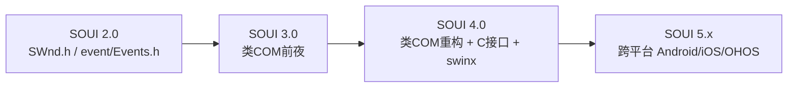
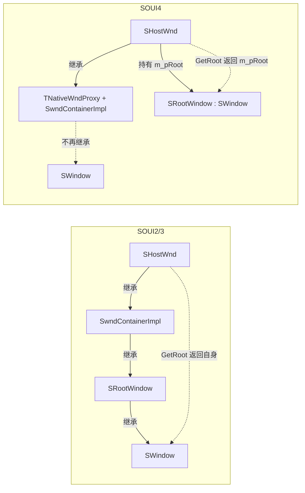

# SOUI2 / SOUI3 升级到 SOUI4 迁移指南

> 本文在仓库 `changelog.md` 的「3.0 升级 4.0 注意事项」12 条基础上，结合 **SOUI2（`D:/work/soui2`）、SOUI3（`D:/work/soui3`）、SOUI4（`D:/work/soui4`，即本仓库）** 三套源码逐条核对，补充历史写法、新版写法、差异根因与机械迁移步骤。
>
> 所有结论均附 **`文件:行号`** 出处，便于在源码中复核。版本号口径：本仓库对外称 SOUI5，目录仍为 `soui4`；文档中的「4.0」指这次「类 COM 重构」大版本。

---

## 0. 适用范围与版本沿革

SOUI 的 API 断裂主要出现在 **3.0 → 4.0**（引入类 COM 接口、统一 C 接口、跨平台抽象 `swinx`）。SOUI2 与 SOUI3 在这些接口上基本一致，**2.0 → 3.0 基本源码兼容**，因此本指南聚焦 **3.0 → 4.0** 的破坏性变更；SOUI2 用户需先把这些代码迁到 3.0 形态（差异很小，见 §0.1），再套用本指南。



### 0.1 SOUI2 用户额外注意（与 3.0 的命名差异）

| 项 | SOUI2 | SOUI3 / SOUI4 |
|---|---|---|
| 事件头文件 | `event/Events.h` | `event/SEvents.h`（`#include <event/SEvents.h>`） |
| 原生窗口基类 | `CSimpleWnd`（`SHostWnd` 继承它） | `SNativeWnd` / `TNativeWndProxy<IHostWnd>` |
| `SWindow` 头文件 | `core/Swnd.h` | `core/SWnd.h`（字母大小写规范化） |
| 类注册宏 | `SOUI_CLASS_NAME`（机制与 3.0 相同） | 同左；4.0 改为 `DEF_SOBJECT` |

> 仅头文件名与个别基类改名，宏语义、事件写法与 3.0 一致，先按 3.0 形态改完再走 §1–§13 即可。

---

## 1. 类注册宏：`SOUI_CLASS_NAME` → `DEF_SOBJECT`（对应原第 1 条）

这是改动面最广的一条：**几乎每个控件类都要改一行**。

### 1.1 旧版（SOUI2 / SOUI3）

宏定义位于 `utilities/include/sobject/sobject-i.h:25-67`，**第一个参数是类自身名（如 `SButton`），但宏体内完全没用到**——RTTI 链靠 MSVC 私有关键字 `__super` 向上回溯：

```cpp
// utilities/include/sobject/sobject-i.h:25
#define SOUI_CLASS_NAME_EX(theclass, classname,clsType) \
public:                                                 \
    static LPCWSTR GetClassName() { return classname; } \
    ...                                                 \
    virtual LPCWSTR GetObjectClass() const { return classname; } \
    virtual BOOL IsClass(LPCWSTR lpszName) const {      \
        if(wcscmp(GetClassName(), lpszName)==0) return TRUE; \
        return __super::IsClass(lpszName);             \
    }

#define SOUI_CLASS_NAME(theclass, classname) SOUI_CLASS_NAME_EX(theclass,classname,0)
```

控件用法（`SOUI3/SOUI/include/control/SCmnCtrl.h:146-150`）：

```cpp
class SOUI_EXP SButton : public SWindow
    , public IAcceleratorTarget
    , public ITimelineHandler {
    SOUI_CLASS_NAME(SButton, L"button")   // 首参 = 类自身名（被忽略）
};
```

### 1.2 新版（SOUI4）

定义位于 `SOUI/include/interface/sobject-i.h:51-90`，**第一个参数改成「直接基类」，且在宏体内被真正使用**：

```cpp
// SOUI/include/interface/sobject-i.h:51
#define DEF_SOBJECT_EX(baseCls, clsName, clsAlise)                       \
  public:                                                               \
    typedef baseCls __baseCls;                                           \
    static LPCWSTR GetClassName() { return clsName; }                    \
    static LPCWSTR GetClassAlise() { return clsAlise; }                  \
    static LPCWSTR BaseClassName() { return __baseCls::GetClassName(); } \
    virtual LPCWSTR WINAPI GetObjectClass() const OVERRIDE { return clsName; } \
    virtual BOOL WINAPI IsClass(LPCWSTR lpszName) const OVERRIDE {       \
        if (wcscmp(GetClassName(), lpszName) == 0) return TRUE;          \
        return __baseCls::IsClass(lpszName);                            \
    }                                                                    \
    virtual int WINAPI GetClassNameList(wchar_t ppClassNameList[][50], int nMaxCount) const OVERRIDE { ... }

#define DEF_SOBJECT(baseCls, clsName) DEF_SOBJECT_EX(baseCls, clsName, NULL)
```

控件用法（`SOUI/include/control/SCmnCtrl.h:201-205`）：

```cpp
class SOUI_EXP SButton
    : public SWindow
    , public IAcceleratorTarget
    , public IAnimatorUpdateListener {
    DEF_SOBJECT(SWindow, L"button")   // 首参 = 直接基类（被使用）
};
```

### 1.3 关键差异与根因

| 维度 | 旧 `SOUI_CLASS_NAME` | 新 `DEF_SOBJECT` |
|---|---|---|
| 第一参语义 | `theclass` = 类自身名，宏体内**未使用**（占位符） | `baseCls` = 直接基类，宏体内 `typedef` + 显式调用基类 |
| RTTI 回溯 | MSVC 私有 `__super` | 显式 `__baseCls::` |
| 新增能力 | 无 | `GetClassAlise()`（XML 类别名）、`GetClassNameList()`（完整类链） |

**为什么要变**：`__super` 是 MSVC 扩展，SOUI4 为支持 clang / 跨平台而移除对它的依赖，改为由开发者显式写出基类。因此**迁移时第一参数必须改写成当前类的直接基类**，第二参数（XML 类名字符串）保持不变。

### 1.4 迁移步骤（机械替换）

```cpp
// 旧（SOUI2/3）
class SButton : public SWindow { SOUI_CLASS_NAME(SButton, L"button") };
// 新（SOUI4）
class SButton : public SWindow { DEF_SOBJECT(SWindow, L"button") };

// 窗口基类自身（SWindow）
// 旧: SOUI_CLASS_NAME_EX(SWindow, L"window", Window)
// 新: DEF_SOBJECT(SObjectImpl<IWindow>, L"window")   // SOUI/include/core/SWnd.h:369-372

// 皮肤 / 布局等（依实际基类而定）
// 旧: SOUI_CLASS_NAME_EX(SSkinImgList, L"imglist", Skin)
// 新: DEF_SOBJECT_EX(SObjectImpl<ISkinObj>, L"imglist", NULL)
```

> 注册机制（`ISystemObjectRegister` + `SObjectFactoryMgr` + `SObjectDefaultRegister`）在三个版本中**完全一致**（`SOUI3/SOUI/include/SApp.h:65-108` 与 `SOUI4/SOUI/include/SApp.h:88-215`），无需迁移。`SOUI_CLASS_NAME` 在 SOUI4 中已彻底不存在。

---

## 2. 事件定义：`SEVENT_BEGIN_EX` → `DEF_EVT` / `DEF_EVENT`（对应原第 2 条）

> changelog 中记作 `DEF_EVENT` / `DEF_EVENT_EXT`；源码实际提供 **`DEF_EVENT`（5 参全量）、`DEF_EVT`（4 参常用封装）、`DEF_EVT_EXT`（3 参）**（`SOUI/include/event/SEvents.h:377-385`）。日常最常用 `DEF_EVT`。

### 2.1 旧版（SOUI2 / SOUI3）

```cpp
// SOUI3/SOUI/include/event/SEvents.h:19-38
#define SEVENT_BEGIN_EX(evt,id,evt_name, api) \
class evt : public SOUI::EventArgs {          \
public:                                       \
    virtual int GetID() const { return evt::EventID; } \
    virtual LPCWSTR GetName() const { return evt::GetClassName(); } \
    SOUI_CLASS_NAME(evt,L#evt_name)           \
    enum { EventID = id };                    \
    evt(SOUI::SObject *pSender) :EventArgs(pSender){}
#define SEVENT_END() };
```

系统事件示例（`SOUI3/SOUI/include/event/SEvents.h:342-343`）：

```cpp
SEVENT_BEGIN_EX(EventCmd, EVT_CMD, on_command, SOUI_EXP)
SEVENT_END()
```

### 2.2 新版（SOUI4）

事件参数被拆成「纯接口 `IEvtArgs` + 具体类 `SEvtArgs`」，事件数据抽成独立结构 `StEventXxx`，事件类同时继承二者（`SOUI/include/event/SEvents.h:342-385`）：

```cpp
// SOUI/include/event/SEvents.h:377
#define DEF_EVT_CLASS(evt, id, evt_name, evtData, api) \
    class api evt : public SEvtArgs, public evtData {  \
        DEF_SOBJECT(SEvtArgs, WIDESTR(evt_name))        \
      public:                                          \
        STDMETHOD_(int, GetID)(THIS) const OVERRIDE { return evt::EventID; } \
        STDMETHOD_(LPCWSTR, GetName)(THIS) const OVERRIDE { return evt::GetClassName(); } \
        STDMETHOD_(LPVOID, Data)(THIS) OVERRIDE { return (evtData *)this; } \
        enum { EventID = id };                         \
        evt(SNS::IObject *pSender = NULL) : SEvtArgs(pSender) {} \
    };

#define DEF_EVENT(evt, id, name, x, api)  DEF_EVT_STRUCT(St##evt, x) DEF_EVT_CLASS(evt, id, name, St##evt, api)
#define DEF_EVT(evt, id, name, x)         DEF_EVENT(evt, id, name, x, SOUI_EXP)        // 最常用
#define DEF_EVT_EXT(evt, id, x)           DEF_EVENT(evt, id, on_##evt, x, )            // 3 参，默认名 on_##evt
```

系统事件示例（`SOUI/include/event/SEvents.h:538`）：

```cpp
DEF_EVT(EventCmd, EVT_CMD, on_command, { int fake; })
```

### 2.3 自定义事件 before / after

```cpp
// 旧（SOUI2/3）
#include <event/SEvents.h>
SEVENT_BEGIN_EX(EventMyData, EVT_EXTERNAL_BEGIN+100, on_my_data, SOUI_EXP)
    int      nValue;
    SStringT strInfo;
SEVENT_END()

// 新（SOUI4）
#include <event/SEvents.h>
DEF_EVT(EventMyData, EVT_EXTERNAL_BEGIN+100, on_my_data, {
    int       nValue;
    IStringT *strInfo;   // 字符串成员建议改用接口指针（系统事件均如此，见 SEvents.h:491）
})
```

> 数据成员放进匿名结构，事件类自动继承它，故 `pEvt->nValue` 仍可直访；`Data()` 返回结构指针主要为 C 接口设计。

---

## 3. 事件参数基类：`SEventArgs` → `IEvtArgs`（对应原第 5 条）

### 3.1 旧版

```cpp
// SOUI2/SOUI/include/event/Events.h:161 ; SOUI3/SOUI/include/event/SEvents.h:168
class SOUI_EXP EventArgs : public TObjRefImpl<IObjRef>, public SObjectImpl<IObject> {
    SOUI_CLASS_NAME(EventArgs,L"eventargs")
    ...
    bool bubbleUp; UINT handled; int idFrom; LPCWSTR nameFrom; SObject *sender;
};
```

### 3.2 新版

拆分为接口 + 具体类（`SOUI/include/interface/SEvtArgs-i.h:10`、事件类 `SOUI/include/event/SEvents.h:206`）：

```cpp
// SOUI/include/interface/SEvtArgs-i.h:10
DECLARE_INTERFACE_(IEvtArgs, IObject) {
    DEF_OBJ_BASE(IEvtArgs, Event)
    STDMETHOD_(IObject *, Sender)(THIS) PURE;
    STDMETHOD_(int, IdFrom)(CTHIS) SCONST PURE;
    STDMETHOD_(BOOL, IsBubbleUp)(CTHIS) SCONST PURE;
    STDMETHOD_(void, SetBubbleUp)(THIS_ BOOL bBubbleUp) PURE;
    STDMETHOD_(UINT, HandleCount)(CTHIS) SCONST PURE;
    STDMETHOD_(LPVOID, Data)(THIS) PURE;
};

// 兼容别名（极易踩坑）：SOUI/include/interface/SEvtArgs-i.h:145
#define EventArgs IEvtArgs
```

### 3.3 迁移要点

- 旧 `EventArgs*` 因 `#define EventArgs IEvtArgs` **仍可编译**，但语义已变成接口指针；建议显式改为 `IEvtArgs*`（或具体事件类指针）以保持清晰。
- 冒泡控制由直接写 `pEvt->bubbleUp = false` 改为 `pEvt->SetBubbleUp(false)` / `pEvt->IsBubbleUp()`（基类成员现在是接口方法）。
- `EVENT_MAP` 宏名基本沿用，但 `_HandleEvent` 形参从 `SOUI::EventArgs*` 变为 `SNS::IEvtArgs*`，并新增 `EVENT_MAP_BEGIN_OV()`（显式 `OVERRIDE`）与 `EVENT_MAP_END2(基类)`（`SOUI/include/event/SEventCrack.h:14-96`）。
- `subscribeEvent` 返回值 `bool → BOOL`，slot 类型 `ISlotFunctor → IEvtSlot`，带 ID 的重载形参 `EventArgs* → IEvtArgs*`（`SOUI/include/event/SEventSet.h:151/162/208`）。

```cpp
// 控件内事件响应 before / after
// 旧
EVENT_MAP_BEGIN()
    EVENT_HANDLER(EVENTID(EventMyData), OnMyData)
EVENT_MAP_END()
void OnMyData(SOUI::EventArgs *pEvt) { EventMyData *p=(EventMyData*)pEvt; int v=p->nValue; }

// 新
EVENT_MAP_BEGIN()    // 或在派生类用 EVENT_MAP_BEGIN_OV()
    EVENT_HANDLER(EVENTID(EventMyData), OnMyData)
EVENT_MAP_END()      // 或在派生类用 EVENT_MAP_END2(基类)
void OnMyData(SNS::IEvtArgs *pEvt) { EventMyData *p=(EventMyData*)pEvt; int v=p->nValue; }
```

### 3.4 系统事件字段更名提醒（迁移时若直访这些字段需同步改）

| 事件 | 旧字段 | 新字段（`SOUI/include/event/SEvents.h`） |
|---|---|---|
| `EventTimer` | `UINT uID;` | `UINT uID; LPARAM uData;`（新增 `uData`，`:391`） |
| `EventKeyDown` | `UINT nChar; UINT nFlags; bool bCancel;` | `UINT nChar; UINT nRepCnt; UINT nFlags;`（`:452`，去 `bCancel`） |
| `EventScroll` | `UINT uSbCode;` | `int nSbCode;`（`:398`） |
| 含字符串字段 | `SStringT` | `IStringT*`（如 `EventSwndUpdateTooltip`，`:491`） |
| `EventLButtonUp` | 旧名 | 已改名 `EventMouseClick`（`:531-536`） |

---

## 4. 资源加载（ResProvider）：全局函数 → `SouiFactory`（对应原第 3 条）

### 4.1 旧版（SOUI2 / SOUI3）

统一由全局函数创建，输出 `IObjRef**`；内置类名为 `S` 前缀（**不是** `CResProviderXXX`）：

```cpp
// SOUI3/SOUI/include/res.mgr/SResProvider.h:94
BOOL SOUI_EXP CreateResProvider(BUILTIN_RESTYPE resType, IObjRef **pObj);

// SOUI3/SOUI/include/res.mgr/SResProvider.h:27 / :66
class SResProviderPE    : public TObjRefImpl<IResProvider> { ... BOOL Init(WPARAM, LPARAM); };
class SResProviderFiles : public TObjRefImpl<IResProvider> { ... BOOL Init(WPARAM, LPARAM); };

// 内置类型枚举（SOUI3 仅 2 种）：SOUI3/SOUI/include/interface/SResProvider-i.h:28-32
enum BUILTIN_RESTYPE { RES_PE = 0, RES_FILE, };

// 典型用法：SOUI3/demo/demo.cpp:297 / :285
CreateResProvider(RES_FILE, (IObjRef**)&pResProvider);
CreateResProvider(RES_PE,   (IObjRef**)&sysResProvider);
```

### 4.2 新版（SOUI4）

统一走 `SouiFactory`（或 `ISouiFactory` / `CreateSouiFactory()` C 接口），直接返回 `IResProvider*`：

```cpp
// SOUI/include/interface/SFactory-i.h:82
STDMETHOD_(IResProvider *, CreateResProvider)(THIS_ BUILTIN_RESTYPE resType) PURE;

// SOUI/include/SouiFactory.h:8 / :17 / :74
class SOUI_EXP SouiFactory : public TObjRefImpl<ISouiFactory> {
    static SouiFactory &instance(void);          // 单例
    STDMETHOD_(IResProvider *, CreateResProvider)(THIS_ BUILTIN_RESTYPE resType) OVERRIDE;
};
// SOUI/include/interface/SFactory-i.h:123
EXTERN_C ISouiFactoryPtr SOUI_EXP CreateSouiFactory();

// 典型用法：SOUI/include/SAppCfg.h:209-211 / :216-218
SouiFactory souiFac;
m_pResProvider.Attach(souiFac.CreateResProvider(RES_FILE));
m_pResProvider.Attach(souiFac.CreateResProvider(RES_PE));

// 内置类型枚举新增移动平台：SOUI/include/interface/SResProvider-i.h:44-49
typedef enum BUILTIN_RESTYPE {
    RES_PE = 0, RES_FILE, RES_ANDROID_ASSET, RES_OHOS_RAWFILE, ...
};
```

### 4.3 迁移

```cpp
// 旧: CreateResProvider(RES_FILE, (IObjRef**)&pResProvider);
// 新:
SouiFactory souiFac;
pResProvider.Attach(souiFac.CreateResProvider(RES_FILE));
```

> zip / 7z 资源仍走 `GetComMgr()->CreateResProvider_ZIP / _7ZIP`（见 `SOUI/include/SAppCfg.h:185,197`），与旧版一致。

---

## 5. resbuilder / `UIRES` / `R` 的变化（对应原第 4 条）

`UIRES` 与 `R` **不是宏，而是 uiresbuilder 工具生成的全局访问对象**（如 `struct _UIRES` / `_R`，见 `SOUI3/demo/res/resource.h:15 / :680 / :1450-1451`）。这一**概念在 4.0 不变**，生成后无需改用户代码。真正变化的是「构建类接收的 XML 参数类型」：

```cpp
// 旧（SOUI3）
virtual BOOL CreateChildren(pugi::xml_node xmlNode);          // SOUI3/SOUI/include/core/SWnd.h:947
virtual BOOL InitFromXml(pugi::xml_node xmlNode);             // SOUI3/SOUI/include/control/SCmnCtrl.h:192
BOOL LoadXmlDocment(pugi::xml_document & xmlDoc, const SStringT & strResId); // SOUI3/SOUI/include/SApp.h:153

// 新（SOUI4）
virtual BOOL CreateChildren(SXmlNode xmlNode);                // SOUI/include/core/SWnd.h:1804
STDMETHOD_(BOOL, InitFromXml)(THIS_ IXmlNode *pNode) OVERRIDE; // SOUI/include/core/SWnd.h:1052
BOOL LoadXmlDocment(SXmlDoc &xmlDoc, const SStringT &strResId, IResProvider *pResProvider = NULL); // SOUI/include/SApp.h:642
```

> 迁移时**只需把派生类里重写的 `CreateChildren` / `InitFromXml` 形参类型从 `pugi::xml_node` 改为 `SXmlNode`**，逻辑不变。详见 §6。

---

## 6. XML 包装：pugixml → `SXml`（对应原第 6、11 条）

### 6.1 旧版（SOUI2 / SOUI3）

直接使用 pugixml：`pugi::xml_document` **继承自** `pugi::xml_node`，因此 document 本身就能当节点遍历：

```cpp
// SOUI3/SOUI/include/control/SComboBase.h:452
pugi::xml_document m_xmlDropdownStyle;
// SOUI3/SOUI/include/res.mgr/SNamedValue.h:30
for (pugi::xml_node xmlStr = xmlNode.first_child(); xmlStr; xmlStr = xmlStr.next_sibling()) { ... }
// SOUI3/SOUI/include/interface/SAdapter-i.h:69
virtual void getView(int position, SWindow * pItem, pugi::xml_node xmlTemplate) PURE;
```

### 6.2 新版（SOUI4）

统一封装为 `SXmlDoc` / `SXmlNode`（接口 `IXmlDoc` / `IXmlNode`），底层仍持有 pugixml（`SOUI/utilities/include/xml/SXml.h:19 / :365 / :959`）：

```cpp
// SOUI/utilities/include/xml/SXml.h:365
class UTILITIES_API SXmlNode : public IXmlNode { pugi::xml_node _node; ... };
// SOUI/utilities/include/xml/SXml.h:959
class UTILITIES_API SXmlDoc : public TObjRefImpl<IXmlDoc> { pugi::xml_document *_doc; ... };
// 取根节点
SXmlNode root() const;   // SXmlDoc::root() :1187 ；SXmlNode::root() :728
```

### 6.3 关键差异（务必注意）

| 点 | pugixml（旧） | SXml（新） |
|---|---|---|
| 文档能否当节点用 | 能。`pugi::xml_document` **继承** `pugi::xml_node` | **不能**。`SXmlDoc` 与 `SXmlNode` 是并列的 COM 风格包装类 |
| 获取根节点 | `doc.child("root")` 或直接遍历 `doc` | **必须**先 `doc.root()` 拿到 `SXmlNode`，再 `.child()` |
| 节点 / 文档类型 | `pugi::xml_node` / `pugi::xml_document` | `SXmlNode` / `SXmlDoc`（接口 `IXmlNode` / `IXmlDoc`） |

> 这与原第 11 条「`SXmlDoc` 不继承 `SXmlNode`，用 `SXmlDoc.root()` 取根节点」一致。

### 6.4 迁移

```cpp
// 旧
pugi::xml_document xmlDoc;
app.LoadXmlDocment(xmlDoc, strId);
pugi::xml_node root = xmlDoc.child(L"root");   // document 即节点

// 新
SXmlDoc xmlDoc;
app.LoadXmlDocment(xmlDoc, strId);
SXmlNode root = xmlDoc.root();                 // 必须显式取 root
SXmlNode node = root.child(L"root");
```

---

## 7. 渲染对象接口加 `S` 后缀（对应原第 7 条）

### 7.1 旧版（SOUI2 / SOUI3）

接口名为无 `S` 后缀的 `IPen` / `IBrush` / `IBitmap` / `IRegion` / `IPath`：

```cpp
// SOUI3/SOUI/include/interface/SRender-i.h:201 / :215 / :229 / :447 / :570
struct IBrush  : public IRenderObj { ... };
struct IPen    : public IRenderObj { ... };
struct IBitmap : public IRenderObj { ... };
struct IRegion : public IRenderObj { ... };
struct IPath   : public IRenderObj { ... };
```

### 7.2 新版（SOUI4）

统一改为带 `S` 后缀，且由 C++ 抽象类改为 COM 风格 `DECLARE_INTERFACE_`：

```cpp
// SOUI/include/interface/SRender-i.h
DECLARE_INTERFACE_(IBrushS,  IRenderObj) { ... };  // :285-294
DECLARE_INTERFACE_(IPenS,    IRenderObj) { ... };  // :361-362
DECLARE_INTERFACE_(IBitmapS, IRenderObj) { ... };  // :474-475
DECLARE_INTERFACE_(IRegionS, IRenderObj) { ... };  // :856-857
DECLARE_INTERFACE_(IPathS,   IRenderObj) { ... };  // :1099-1100
```

### 7.3 迁移要点（重要）

- **当前 SOUI4 快照中不存在 `typedef IPenS IPen;` 之类的向后兼容别名**（已全仓核查 `SOUI/include` 下 `IPen` 零引用）。changelog 第 7 条提到的「最新修改在 C++ 版本中增加了兼容定义」在当前代码里已不存在——**必须把旧代码中的无 `S` 接口名全部改为带 `S` 的版本**。
- 指针别名仍在（`SOUI/include/interface/SRender-i.h:690` `typedef IBitmapS *IBitmapPtr;` 等），类型别名需自行补或全局替换。
- C 接口宏同步为 `IPenS_*`（`SOUI/include/interface/capi/SRender-capi.h`）。

```cpp
// 旧: IPen *p = ...; IBitmap *bmp = ...;
// 新: IPenS *p = ...; IBitmapS *bmp = ...;
```

---

## 8. 接口默认参数（对应原第 8 条）

4.0 初期为兼容 C 接口去掉了所有默认参数；**当前 SOUI4 已通过 `DEF_VAL(...)` 加回常用默认参数**，例如 `SelectObject`：

```cpp
// SOUI/include/interface/SRender-i.h:2032-2033
STDMETHOD_(HRESULT, SelectObject)
(THIS_ IRenderObj * pObj, IRenderObj * *pOldObj DEF_VAL(NULL)) PURE;
```

> 迁移时：对**系统接口**可直接沿用旧写法（参数可省略）；若你**自定义了 COM 接口**，声明方法时要么写全所有参数，要么用 `DEF_VAL(...)` 显式给出默认值，否则 C++ 调用处会报「缺少参数」。

---

## 9. XxxView 适配器接口调整（对应原第 9 条）

列表类控件（`SListView` / `SListCtrl` / `STreeView` / `STileView` / `SMCListView` / `SComboView` 等）的适配器接口有三处统一变更。

### 9.1 调用约定统一为 `WINAPI`（`__stdcall`）

旧版用普通 `virtual ... PURE`（默认 `__cdecl`）；新版用 `STDMETHOD_(...)`，展开为 `virtual ... STDMETHODCALLTYPE`（`SOUI/swinx/include/basetyps.h:109`）。

### 9.2 `SWindow*` → `SItemPanel*`（基类）/ `IWindow*`（COM）

### 9.3 `pugi::xml_node` → `SXmlNode`（基类）/ `IXmlNode*`（COM）

```cpp
// 旧（SOUI3）：SOUI3/SOUI/include/interface/SAdapter-i.h:69 / :102 / :125
virtual void getView(int position, SWindow * pItem, pugi::xml_node xmlTemplate) PURE;
virtual SIZE getViewDesiredSize(int position, SWindow *pItem, int wid, int hei) PURE;
virtual void InitByTemplate(pugi::xml_node xmlTemplate) PURE;

// 新（SOUI4）：SOUI/include/interface/SAdapter-i.h:101 / :126 / :140
STDMETHOD_(void, getView)(THIS_ int position, IWindow *pItem, IXmlNode *xmlTemplate) PURE;
STDMETHOD_(void, getViewDesiredSize)(THIS_ SIZE *ret, int position, IWindow *pItem, int wid, int hei) PURE;
STDMETHOD_(void, InitByTemplate)(THIS_ IXmlNode * xmlTemplate) PURE;
// C++ 便利基类（你实际重写的是这些）：SOUI/include/helper/SAdapterBase.h:178 / :275
STDMETHOD_(void, getView)(int position, SItemPanel *pItem, SXmlNode xmlTemplate);
STDMETHOD_(void, getViewDesiredSize)(SIZE *ret, int position, SItemPanel *pItem, int wid, int hei);
```

### 9.4 其它破坏性变更

- `getViewDesiredSize` 由「返回 `SIZE`」改为「`void` + 首出参 `SIZE *ret`」。
- `getItemDesc` 在 SOUI4 改为 `void getItemDesc(int, IStringW *pDesc)`（出参），不再返回 `SStringT`。
- `GetItemPanel` 自 SOUI3 起即返回 `SItemPanel*`，此项非破坏变更。

```cpp
// 旧
void getView(int position, SWindow *pItem, pugi::xml_node xmlTemplate) { ... }
SIZE getViewDesiredSize(int position, SWindow *pItem, int wid, int hei) { ... }

// 新（重写 SAdapterBase 的便利签名）
void getView(int position, SItemPanel *pItem, SXmlNode xmlTemplate) { ... }
void getViewDesiredSize(SIZE *ret, int position, SItemPanel *pItem, int wid, int hei) { *ret = ...; }
```

---

## 10. `SHostWnd` 不再继承 `SWindow` → 用 `GetRoot()`（对应原第 10 条）

这是除类注册外最易引发编译/运行错误的一条。

### 10.1 旧版（SOUI2 / SOUI3）

`SHostWnd` 经 `SwndContainerImpl` **间接继承 `SWindow`**，且 `GetRoot()` 直接 `return (SWindow*)this`——宿主窗口自身就是根窗口：

```cpp
// SOUI3/SOUI/include/core/SHostWnd.h:93-96 / :152
class SOUI_EXP SHostWnd
    : public SwndContainerImpl
    , public SNativeWnd
    , protected IHostMsgHandler { ... };
SWindow * GetRoot() const { return (SWindow*)this; }
// SWndContainerImpl : public ISwndContainer, public SRootWindow (SRootWindow : public SWindow)
```

### 10.2 新版（SOUI4）

`SHostWnd` **不再继承 `SWindow`**（仅 `TNativeWndProxy<IHostWnd>` + `SwndContainerImpl`），根窗口变为独立对象 `m_pRoot`（`SRootWindow*`，而 `SRootWindow : public SWindow`）：

```cpp
// SOUI/include/core/SHostWnd.h:197-199 / :233 / :613-616
class SOUI_EXP SHostWnd
    : public TNativeWndProxy<IHostWnd>
    , public SwndContainerImpl { ... };
SRootWindow *m_pRoot;                       // :233
SWindow *GetRoot() const { return m_pRoot; } // :613-616
```



### 10.3 迁移

```cpp
// 旧（SOUI2/3）：SHostWnd 自身即 SWindow，可直接当 SWindow* 用
SHostWnd *pHost = ...;
pHost->FindChildByName(L"btn_ok");     // 直接可用
SWindow *pRoot = pHost->GetRoot();     // == (SWindow*)pHost

// 新（SOUI4）：必须通过 GetRoot() 取得独立根窗口
SHostWnd *pHost = ...;
// pHost->FindChildByName(...);        // 错误：SHostWnd 不再拥有 SWindow 方法
SWindow *pRoot = pHost->GetRoot();     // 返回 m_pRoot（独立对象）
pRoot->FindChildByName(L"btn_ok");     // 正确
```

> `SHostWnd` 仍转发了少量常用方法（如 `FindChildByName` / `FindChildByID` 直接转到 `GetRoot()`，`SHostWnd.h:526/538/552/578`），但**不能把 `SHostWnd*` 强转为 `SWindow*`**。

---

## 11. `SStringX::Format` 的 `%s` 必须 `.c_str()`（对应原第 12 条）

`Format` 是 **C 风格变参函数**（`const wchar_t* pszFormat, ...`）。C++ 在匹配 `...` 时**不会执行用户定义转换**（如 `operator const wchar_t*`），只做标准算术提升。直接传 `SStringX` 对象会把整个对象（结构体）当指针解引用，导致乱码或崩溃。

```cpp
// SOUI4/utilities/include/string/sstringw.h:382
SStringW __cdecl Format(const wchar_t* pszFormat, ...);   // 变参
// sstringw.h:154  c_str() ; sstringw.h:392  operator const wchar_t*()（变参不会调用它）
// 正确示例：SOUI/include/res.mgr/SNamedValue.h:62
SStringW msg = SStringW().Format(L"parse value failed, name=%s,value=%s",
                                 xmlStr.name(),                                       // const wchar_t*
                                 xmlStr.attribute(L"value").as_string());            // const wchar_t*
```

```cpp
// 错误（3.0/4.0 都一样会崩/乱码）
SStringT msg = SStringT().Format(_T("name=%s"), name);          // name 是 SStringT 对象
// 正确
SStringT msg = SStringT().Format(_T("name=%s"), name.c_str());  // 显式 .c_str()
```

> 3.0 与 4.0 在 `Format` 上无本质差别；SOUI 没有 Qt 式 `arg()` / `%1` 占位符，全部是 printf 风格 `%s`/`%d`，凡遇 `%s` 对应 `SStringX` 一律 `.c_str()`。

---

## 12. 综合迁移清单（Checklist）

按此顺序逐项核对，可覆盖全部 12 条原注意事项：

- [ ] **类注册**：所有 `SOUI_CLASS_NAME(X, L"...")` → `DEF_SOBJECT(基类, L"...")`（首参改基类；`SWindow` 自身用 `DEF_SOBJECT(SObjectImpl<IWindow>, L"window")`）。
- [ ] **事件定义**：`SEVENT_BEGIN_EX(...)` / `SEVENT_END()` → `DEF_EVT(...)`（数据成员收进 `{ }` 结构）；`SWindow*`/`pugi::xml_node` 入参改为 `SItemPanel*`/`SXmlNode`。
- [ ] **事件参数**：处理函数形参 `EventArgs*` → `IEvtArgs*`（旧 token 仍可编译但建议显式改）；冒泡控制改 `SetBubbleUp(false)` / `IsBubbleUp()`；`EVENT_MAP` 派生类用 `_OV` / `_END2`。
- [ ] **系统事件字段**：核对 `EventTimer`/`EventKeyDown`/`EventScroll` 等字段更名（`§3.4`），`EventLButtonUp` → `EventMouseClick`。
- [ ] **ResProvider**：`CreateResProvider(resType, (IObjRef**)&p)` → `SouiFactory souiFac; p.Attach(souiFac.CreateResProvider(resType));`。
- [ ] **resbuilder / XML**：重写的 `CreateChildren` / `InitFromXml` 形参 `pugi::xml_node` → `SXmlNode`；`LoadXmlDocment` 的 `pugi::xml_document&` → `SXmlDoc&`，且**必须 `xmlDoc.root()` 取根**。
- [ ] **渲染接口**：`IPen`/`IBrush`/`IBitmap`/`IRegion`/`IPath` → 对应 `IPenS`/`IBrushS`/`IBitmapS`/`IRegionS`/`IPathS`（无兼容别名，必须全局改名）。
- [ ] **适配器**：调用约定 `__stdcall`；`getViewDesiredSize` 改为 `void` + `SIZE *ret` 出参；`getItemDesc` 改为出参；`InitByTemplate` 形参 `IXmlNode*` / `SXmlNode`。
- [ ] **SHostWnd**：所有直接写在 `SHostWnd*` 上的 `SWindow` 操作改为 `GetRoot()->...`；删除任何 `SHostWnd*` → `SWindow*` 强转。
- [ ] **字符串格式化**：所有 `Format(L"...%s...", strX)` 的 `strX` 加 `.c_str()`。
- [ ] **自定义 COM 接口**：方法要么写全参数，要么用 `DEF_VAL(...)` 显式默认参数。

---

## 13. 源文件索引（复核用）

| 主题 | 旧版（SOUI2/SOUI3） | 新版（SOUI4） |
|---|---|---|
| 类注册宏定义 | `utilities/include/sobject/sobject-i.h:25-67` | `SOUI/include/interface/sobject-i.h:51-90` |
| `SButton` 用法 | `SOUI3/SOUI/include/control/SCmnCtrl.h:146-150` | `SOUI/include/control/SCmnCtrl.h:201-205` |
| `SWindow` 用法 | `SOUI3/SOUI/include/core/SWnd.h:221` | `SOUI/include/core/SWnd.h:369-372` |
| 事件参数基类 | `SOUI3/SOUI/include/event/SEvents.h:168` | `SOUI/include/interface/SEvtArgs-i.h:10`；`:145` 兼容别名 |
| 事件定义宏 | `SOUI3/SOUI/include/event/SEvents.h:19-38` | `SOUI/include/event/SEvents.h:342-385`；`EventCmd` `:538` |
| 事件映射 | `SOUI3/SOUI/include/event/SEventCrack.h:15-40` | `SOUI/include/event/SEventCrack.h:14-96` |
| 订阅事件 | `SOUI3/SOUI/include/event/EventSet.h` | `SOUI/include/event/SEventSet.h:151/162/208` |
| ResProvider 全局函数 | `SOUI3/SOUI/include/res.mgr/SResProvider.h:94` | `SOUI/include/interface/SFactory-i.h:82`；`SOUI/include/SouiFactory.h:74` |
| ResProvider 枚举 | `SOUI3/SOUI/include/interface/SResProvider-i.h:28-32` | `SOUI/include/interface/SResProvider-i.h:44-49` |
| XML 包装 | pugixml（`SOUI3/.../SAdapter-i.h:69`） | `SOUI/utilities/include/xml/SXml.h:365/959/1187` |
| 渲染接口 | `SOUI3/SOUI/include/interface/SRender-i.h:201-570` | `SOUI/include/interface/SRender-i.h:285-1100` |
| SelectObject 默认参数 | — | `SOUI/include/interface/SRender-i.h:2032-2033` |
| 适配器接口 | `SOUI3/SOUI/include/interface/SAdapter-i.h:69/102/125` | `SOUI/include/interface/SAdapter-i.h:101/126/140`；`helper/SAdapterBase.h:178/275` |
| SHostWnd | `SOUI3/SOUI/include/core/SHostWnd.h:93-96/152` | `SOUI/include/core/SHostWnd.h:197-199/233/613-616` |
| Format | `utilities/include/string/sstringw.h` | `SOUI/utilities/include/string/sstringw.h:382/154/392` |

---

*本文档基于 `D:/work/soui2`、`D:/work/soui3`、`D:/work/soui4`（即本仓库）三套源码核对生成，所有结论均可按上表文件:行号在源码中复核。*
