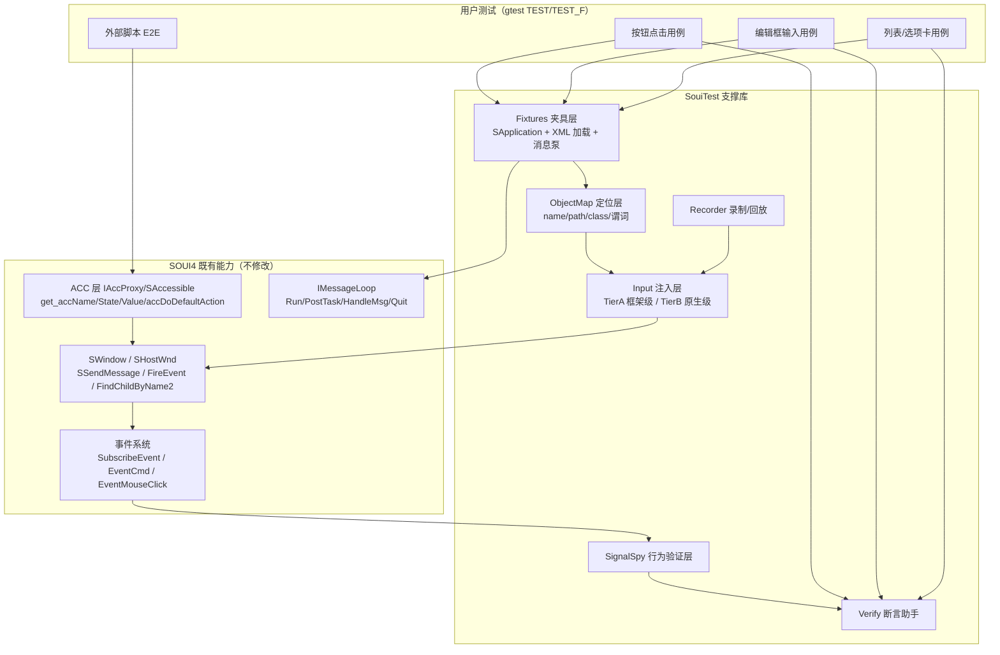

# SOUI4 UI 自动化测试支持框架 —— 设计文档

> 版本：v0.1（设计稿，待评审）
> 目标：参考 Qt Test / Qt Accessibility 的成熟范式，为 SOUI4 设计一套**框架级、跨平台、可无头运行**的 UI 自动化测试支持框架，并与现有 `fun_test`（gtest + CTest）体系无缝衔接。
> 约定：本文所有 SOUI 符号均对照 `D:/work/soui4` 当前源码核实，引用格式为 `文件:行号`。

---

## 1. 背景与动机

### 1.1 现状

SOUI4 当前已经有一套以 **gtest** 为底座的 `fun_test` 工程（`demos/fun_test/`），并按文件名约定在 CTest 中分层打标签（`readme.md`）：

| 标签 | 层级 | 是否进入 `soui-headless` 门禁 |
|---|---|---|
| `soui-unit` | 纯函数/尺寸/矩阵/控件规则 | ✅ |
| `soui-integration` | 资源提供器/资源管理器/XML→控件 | ✅ |
| `soui-e2e` | 资源索引→控件树→状态变化（无窗口） | ✅ |
| `soui-gui` | 真实宿主窗口 + 鼠标消息派发（`test_gui_smoke.cpp`） | ❌（需 `-DSOUI_ENABLE_GUI_SMOKE=ON` + 显示） |
| `soui-interactive` | 人工操作窗口（`test_gdi.cpp`/`test_soui.cpp`） | ❌ |

**关键缺口**：现有唯一的 GUI 用例 `window.gui_smoke_dispatches_button_click`（`test_gui_smoke.cpp:46`）是把 XML 布局 `CreateEx` 成**真实原生宿主窗口**后，通过 `SendMessage(hwnd, WM_LBUTTONDOWN, ...)` 向窗口过程发鼠标消息来驱动交互的。这带来两个限制：

1. **必须有显示设备**（Windows 真机 / Linux 需 `xvfb-run` / macOS 需登录会话），因此只能放在 `soui-gui` 这一非门禁层，无法进入 400 条的 `soui-headless` 门禁。
2. **输入语义在原生窗口过程这一层**，绕过了 SOUI 框架自身的消息/事件管线，难以做"细粒度、可重放、可录制"的 UI 行为验证，更无法让外部脚本工具（类似 Squish / GammaRay）直接 introspect 控件树。

### 1.2 Qt 给我们的参照

Qt 的 UI 测试之所以好用，是因为它把三件事解耦：

| Qt 能力 | 本质 | SOUI4 对应物（已存在） |
|---|---|---|
| `QObject::findChild()` / `objectName()` | 对象树定位（object map） | `SHostWnd::FindChildByName2<T>` (SHostWnd.h:522)、`FindChildByNamePath` (SWnd.h:1570)、`SWindow::GetName()` (SobjectApi.h:77) |
| `QTest::mouseClick/keyClick` | **框架级**事件注入（不走 OS 输入） | `SWindow::SSendMessage(WM_*,...)` (Swnd.cpp:844) 可路由进窗口处理链 |
| `QSignalSpy` | 行为验证（订阅信号） | `SWindow::SubscribeEvent(id, slot)` + `FireEvent/FireCommand` (SWnd.h:1100/1106) |
| `QAccessible` + Squish/GammaRay | 外部工具 introspect 控件树 | **ACC 层** `IAccProxy`/`SAccessible`（见 `doc/SOUI-无障碍(ACC)支持实现.md`） |
| `QTestEventList` | 事件录制/回放 | 可新建，复用 `SSendMessage` 序列 |

> 核心洞察：SOUI4 **已经具备** Qt Test 所需的全部底层原语，缺的只是一层把这些原语组织成"测试友好 API + 夹具 + 运行模型"的**支撑库**。此外，SOUI 已实现的 ACC（无障碍）层，本身就是一套与平台无关的对象 introspection/action 协议——这正是外部 E2E 工具最需要的"控件树视图"，可直接复用，**不必为测试另造一套**。

---

## 2. 设计目标与非目标

### 2.1 目标

1. **框架级注入，可无头运行**：输入事件直接注入 SOUI 的窗口消息/事件管线（`SWindow::SSendMessage`），不需要原生窗口与显示设备，从而能进入 `soui-headless` 门禁。
2. **对象定位**：提供 `name` / `path` / `class` / 谓词 等多种定位方式，覆盖 Qt `findChild` 的能力。
3. **行为验证**：提供 `SignalSpy`（事件订阅计数器），对齐 `QSignalSpy`。
4. **统一 introspection**：复用 ACC 层的 `get_accName/State/Value/Role` 与 `accDoDefaultAction`（→`FireCommand`）作为属性读取与动作触发的统一通道，同时服务"内部 C++ 断言"与"外部脚本工具"两端。
5. **与 gtest/CTest 融合**：以 gtest fixture 形式落地，新增 `soui-uitest` 标签；无头 UI 测试归入 `soui-headless` 门禁。
6. **跨平台一致**：Windows / Linux / macOS 走同一套框架级注入；Android/OHOS 提供"无头宿主 + 注入"的最小子集（不依赖真机显示）。

### 2.2 非目标（本期不做）

- 像素级渲染比对（截图 diff）——属于视觉验收，留给后续 `soui-gui` 层或人工。
- 录制真人操作（OS 级钩子回放）——本期只做**框架级**事件录制。
- 替换现有 `fun_test` 的单元/集成/E2E 分层——只在之上**新增 UI 测试层**。

---

## 3. 总体架构

框架命名为 **`SouiTest`**，作为一个轻量支撑库（建议落地于 `components/souitest/` 或独立 `testing/souitest/`），对 `soui4` 与 `utilities4` 零侵入（只调用既有公共 API）。分层如下：



要点：
- **注入层对上是统一 API，对下分两个 Tier**（`SSendMessage` 框架级 / `SendMessage(hwnd)` 原生级），调用方无感。
- **ACC 层是"被复用"的协议**，不是新造；内部 C++ 断言和外部脚本 E2E 通过它共享同一套控件视图。

---

## 4. 核心组件设计

### 4.1 定位层 ObjectMap（对齐 `QObject::findChild`）

封装既有查找 API，对外提供一组定位器：

```cpp
namespace SouiTest {
// 按 name 属性查找（对应 XML 的 name="..."），返回强类型指针
template<class T = SWindow>
T* findByName(SHostWnd* host, const wchar_t* name, int deep = -1);

// 按 "page1/btn_ok" 这样的路径查找（复用 FindChildByNamePath, SWnd.h:1570）
SWindow* findByPath(SHostWnd* host, const char* path);

// 按类名/类型查找（遍历 GetChildrenCount/GetChild, SWnd.h:616/1322）
SWindow* findByClass(SHostWnd* host, const char* clsName);

// 按谓词查找（可见、可用、文本匹配等）
SWindow* findIf(SHostWnd* host, std::function<bool(SWindow*)> pred);
}
```

内部直接转发到已验证 API：
- `host->FindChildByName2<T>(name, deep)`（SHostWnd.h:548/562）
- `host->GetRoot()->FindChildByNamePath(pszName)`（SWnd.h:1580）
- `SWindow::GetChildrenCount()` + `GetChild(i)` 做 DFS

> 定位键统一用 `SWindow::GetName()`（IWindow，SobjectApi.h:77）返回的 `name` 属性，它正是 `FindChildByName` 的匹配键。注意 ACC 的 `get_accName` 返回的是窗口文本或类名，**不是** `name` 属性——测试对象图用 `GetName()`，ACC 通道用 `get_accName`，二者用途不同，不要混用。

### 4.2 注入层 Input（对齐 `QTest::mouseClick/keyClick`）

**Tier A —— 框架级（无头，主推）**

直接对目标 `SWindow` 调 `SSendMessage`，把 `WM_*` 送进它的处理链（Swnd.cpp:844）。以 `mouseClick` 为例：

```cpp
namespace SouiTest {
// 在 wnd 的客户区坐标 pt 处模拟一次左键点击
inline void mouseClick(SWindow* wnd, CPoint pt, MouseClickId id = MOUSE_LBTN_DBCLICK/*实为单击*/) {
    wnd->SSendMessage(WM_MOUSEMOVE,   0,                MAKELPARAM(pt.x, pt.y));
    wnd->SSendMessage(WM_LBUTTONDOWN, MK_LBUTTON,       MAKELPARAM(pt.x, pt.y));
    wnd->SSendMessage(WM_LBUTTONUP,   0,                MAKELPARAM(pt.x, pt.y));
    // 若需触发 on_mouse_click 语义，可再 FireEvent(EventMouseClick{...})（SEvents.h:531）
}
inline void keyClick(SWindow* wnd, UINT vk) {
    wnd->SSendMessage(WM_KEYDOWN, vk, 0);
    wnd->SSendMessage(WM_KEYUP,   vk, 0);
    // 字符消息
    wnd->SSendMessage(WM_CHAR, vk, 0);
}
}
```

> 坐标口径：`SWindow::GetWindowRect()` 返回的是**宿主坐标系**下的矩形（与 SOUI 全树共享同一坐标系，见工作记忆）。Tier A 的 `SSendMessage` 走窗口自身处理链，建议用**窗口本地坐标**（相对该控件左上角），由调用方用 `GetWindowRect` 做换算，与 Qt `QTest::mouseClick` 取 widget 局部坐标一致。

**Tier B —— 原生级（需显示，保真）**

复用 `test_gui_smoke.cpp:87-89` 的写法，向宿主 `hwnd` 发原生消息。用于需要完整输入管线（命中测试、焦点切换、鼠标捕获、hover 态、IME）的保真用例，放在 `soui-gui` 层。

```cpp
inline void nativeMouseClick(HWND hwnd, CPoint clientPt) {
    LPARAM lp = MAKELPARAM(clientPt.x, clientPt.y);
    ::SendMessage(hwnd, WM_MOUSEMOVE,    0,          lp);
    ::SendMessage(hwnd, WM_LBUTTONDOWN,  MK_LBUTTON, lp);
    ::SendMessage(hwnd, WM_LBUTTONUP,    0,          lp);
}
```

**两种 Tier 的取舍**（写入文档，避免误用）：

| 维度 | Tier A（SSendMessage） | Tier B（SendMessage hwnd） |
|---|---|---|
| 是否需要显示 | ❌ 不需要 | ✅ 需要 |
| 进入 `soui-headless` | ✅ 可 | ❌ 不可 |
| 命中测试/焦点/捕获 | 部分（依赖控件自身处理） | 完整（走宿主 WndProc） |
| 适用场景 | 行为逻辑验证、回归、CI 门禁 | 输入管线保真、像素前最后一步 |
| 推荐默认 | **是** | 仅保真用例 |

> ⚠️ **待验证风险**：`SSendMessage(WM_LBUTTONDOWN)` 是否等价于原生 `SendMessage` 所触发的完整处理链（尤其焦点变更、`WM_SETCURSOR`、鼠标捕获、`NotifyWinEvent` 异步派发）。Phase 0 必须写一个对比用例，断言两种 Tier 在"按钮点击→`EventCmd`"这一最小路径上行为一致；若有差异，以 Tier B 为 ground truth，Tier A 仅用于已验证一致的子集。

### 4.3 行为验证层 SignalSpy（对齐 `QSignalSpy`）

基于 `SubscribeEvent` + 计数槽，订阅任意事件 ID：

```cpp
namespace SouiTest {
class SignalSpy {
public:
    // 订阅 wnd 上的某个事件（如 EventCmd::EventID / EVT_MOUSE_CLICK）
    SignalSpy(SWindow* wnd, DWORD eventId) : m_wnd(wnd), m_id(eventId) {
        m_slot = Subscriber(&SignalSpy::onEvent, this);
        wnd->SubscribeEvent(eventId, &m_slot);   // 同 test_gui_smoke.cpp:80
    }
    ~SignalSpy() { m_wnd->UnsubscribeEvent(m_id, &m_slot); }

    int count() const { return m_count; }
    const EventArgs* lastArgs() const { return m_last; }

private:
    BOOL onEvent(IEvtArgs* e) { ++m_count; m_last = e; return TRUE; }
    SWindow* m_wnd; DWORD m_id; int m_count = 0;
    MemberFunctionSlot<SignalSpy, IEvtArgs> m_slot;
    const EventArgs* m_last = nullptr;
};
}
```

用法（对齐 `QSignalSpy` 语义）：

```cpp
auto* btn = host->FindChildByName2<SButton>("action");
SignalSpy spy(btn, EventCmd::EventID);
SouiTest::mouseClick(btn, centerOf(btn));
EXPECT_EQ(spy.count(), 1);          // 等价于 QCOMPARE(spy.count(), 1)
```

> 事件类字段可直接读取：`EventKeyDown{nChar,nRepCnt,nFlags}`（SEvents.h:452）、`EventMouseClick{pt,uFlags,clickId,bHover}`（SEvents.h:531）、`EventSetFocus{wndOld}`（SEvents.h:547）。`EventCmd` 本身无负载（SEvents.h:538），适合验证"是否触发了命令"。

**`lastArgs()` 的生命周期约束（实施中确认）**：事件对象是 `FireEvent` 调用方栈上的临时对象（如 `SWindow::OnMouseClick` 里的 `EventMouseClick evt(this)`），`FireEvent` 返回后即析构。因此 `lastArgs()` 只能在**回调当次**使用；在派发结束后读 `lastArgs()->Sender()` / `Data()` 属悬垂访问。实施时补了两个按值录制的派生助手（`components/souitest/souitest.h`）：

| 助手 | 记录内容 | 用途 |
|---|---|---|
| `DataSpy<StEventXxx>` | 每次事件的 `Data()` 负载（`DEF_EVT` 展开出的 POD 结构）按值入 `std::vector` | 断言事件序列与负载，如 `DataSpy<StEventMouseClick>` 断言 `clickId` 依次为 DOWN/UP |
| `ArgsSpy` | 回调内快照 `sender/idFrom/nameFrom/handled/bubbleUp` | 断言发送者身份、被处理次数、此刻是否仍冒泡 |

### 4.4 断言助手 Verify（对齐 `QVERIFY`/`QCOMPARE` + 属性检查）

统一从 **ACC 通道**读属性（复用既有 `IAccProxy`，无需为新控件写测试专用接口）：

```cpp
namespace SouiTest {
inline bool isVisible(SWindow* w) { return w->IsVisible(TRUE) != FALSE; }      // SWnd.h:529
inline bool isEnabled(SWindow* w) { return w->IsDisabled(TRUE) == FALSE; }     // SWnd.h:515
inline SStringT textOf(SWindow* w) { return w->GetWindowText(); }              // SWnd.h:1387
inline CRect  rectOf(SWindow* w) { CRect r; w->GetWindowRect(&r); return r; }  // SWnd.h:1449

// 走 ACC 通道读取统一语义（需 SOUI_ENABLE_ACC；见 §6）
inline SStringW accName(SWindow* w) {
    SStringW s; w->GetAccProxy()->get_accName(&s); return s;
}
}
// 宏糖：EXPECT_XXX 直接复用 gtest
#define SOUITEST_EXPECT_VISIBLE(w) EXPECT_TRUE(SouiTest::isVisible(w))
```

> 复用 ACC 的好处：对 MVC 列表/树/选项卡等复杂控件，`get_accName/State/Value/Role` 已经由对应 proxy 正确实现（如 `SAccProxyTabCtrl` 暴露页签、`SAccProxyListView` 暴露可见项，`doc/SOUI-无障碍(ACC)支持实现.md` §4–§5）。测试断言直接站在 proxy 之上，**不重复实现控件语义**。

### 4.5 录制/回放 Recorder（对齐 `QTestEventList`）

把一组输入事件序列化为 `SouiTest::InputEvent` 列表，可存储为测试数据、在任意窗口树上回放：

```cpp
namespace SouiTest {
struct InputEvent { enum Type{Move,Down,Up,Key} t; CPoint pt; UINT vk; };
class EventList {
public:
    void addMouseClick(CPoint pt) { /* push Move/Down/Up */ }
    void addKeyClick(UINT vk)     { /* push KeyDown/Up/Char */ }
    void replay(SWindow* target) const { for (auto& e : m_evts) dispatch(target, e); }
private:
    std::vector<InputEvent> m_evts;
};
}
```

回放直接复用 `Input` 层的 `SSendMessage` 分发，因此天然支持数据驱动（`QTest` tutorial 4 的 `QTestEventList` 正是此模式）。

### 4.6 夹具 Fixtures（对齐 `QObject` test fixture + `init/cleanup`）

提供 gtest `TestFixture` 基类，标准化"建应用→载布局→建窗口→跑消息泵→拆"：

```cpp
class SouiTestFixture : public ::testing::Test {
protected:
    void SetUp() override {
        ASSERT_TRUE(m_comMgr.CreateRender_GDI((IObjRef**)&m_render));
        m_app = std::make_unique<SApplication>(m_render, NULL);
        // 加载布局：支持从 XML buffer 或 uires（对齐 test_gui_smoke.cpp:54-69）
    }
    SHostWnd* show(const char* xmlUtf8) {
        SXmlDoc doc; doc.LoadBuffer(xmlUtf8, strlen(xmlUtf8), 0, enc_utf8);
        auto* h = new SHostWnd();
        h->CreateEx(NULL, WS_POPUP, 0, 100, 100, 240, 80, &doc.root().first_child());
        h->ShowWindow(SW_SHOW);
        return h;
    }
    // 驱动异步事件（NotifyWinEvent / 定时器 / PostTask）收敛
    void pump(int maxIter = 100) {
        auto* loop = m_app->GetMsgLoop();           // SApp.h:363
        MSG msg;
        while (loop->PeekMsg(&msg, 0, 0, PM_REMOVE) && maxIter--)
            loop->HandleMsg();                        // SMsgLoop.h:124/136
    }
    void TearDown() override { /* DestroyWindow + 释放 app */ }

    SComMgr2 m_comMgr; SAutoRefPtr<IRenderFactory> m_render;
    std::unique_ptr<SApplication> m_app;
};
```

注入的两条约束（来自现有 readme 与 AGENTS.md）：
- **异步事件必须 pump**：`NotifyWinEvent` 在消息泵里异步派发（ACC 文档 §6.2(d)）；定时器、`PostTask` 同理。夹具的 `pump()` 保证断言前事件已落地。
- **跨线程用例不用 Sleep 定序**：沿用 `fun_test` 既有约定（readme "用事件握手"），测试驱动也只用消息泵收敛，不靠 `Sleep` 估时。

---

## 5. 测试组织与 CTest 集成

沿用现有 `fun_test` 的文件名分层约定，新增一类：

| 源文件 | 标签 | 门禁 |
|---|---|---|
| `test_soui_uitest_*.cpp` | `soui-uitest` | ✅ 进 `soui-headless`（仅 Tier A 用例） |
| 既有 `test_gui_*.cpp` | `soui-gui` | ❌（Tier B，需显示） |
| 既有单元/集成/E2E | 原标签 | ✅ |

- 命名遵循 readme 的"文件名约定"：`test_soui_uitest_*` 注册为 `soui-uitest`。
- 把 `soui-uitest` 并入 `soui-headless` 门禁集合（当前 400 条 + 新增 UI 测试）。**约束**：`soui-uitest` 用例内部**只允许 Tier A 注入**，CI 在无显示环境（`pr-core.yml` / `build.yml`）即可全绿。
- 输出：gtest 自带 `--gtest_output=xml:` 与 TeamCity/xUnit 格式，满足 CI 报告需求（对齐 Qt Test 的 `-o filename,format`）。

示例用例（无头，进 `soui-headless`）：

```cpp
TEST_F(SouiTestFixture, button_click_fires_command) {
    SHostWnd* host = show(R"(<SOUI title='t'><root width='200' height='60' layout='vbox'>
        <text name='status' text='Ready' size='-2,30'/>
        <button name='act' text='Go' size='80,30'/></root></SOUI>)");
    auto* status = host->FindChildByName2<SText>("status");
    auto* act    = host->FindChildByName2<SButton>("act");
    SignalSpy spy(act, EventCmd::EventID);

    SouiTest::mouseClick(act, centerOf(act));
    pump();

    EXPECT_EQ(spy.count(), 1);
    SOUITEST_EXPECT_VISIBLE(status);
}
```

---

## 6. 外部工具桥接（对齐 `QAccessible` + Squish/GammaRay）

这是 SOUI 相对"从零造测试框架"的最大红利：**ACC 层已经是控件树的统一视图**。

### 6.1 复用 ACC 作为 introspection 协议

`doc/SOUI-无障碍(ACC)支持实现.md` 已证明：
- `SWindow::GetAccProxy()`（Swnd.cpp:4161）惰性返回 `IAccProxy`，提供 `get_accName/get_accValue/get_accRole/get_accState` + `GetAccChildCount/GetAccChild` + `GetAccSubItem*`。
- `accDoDefaultAction()` 默认实现就是 `m_pWnd->FireCommand()`（SAccProxyWindow.cpp:633）——即"程序化点击"。
- `SApplication::CreateAccProxy()`（SApp.cpp:380）按类名集中分派 40+ 控件 proxy，MVC 视图（列表/树/瓦片）也已暴露可见项。

→ 一个**测试探针（Inspector Agent）**只需：
1. 从 `SHostWnd` 根 `GetRoot()->GetAccProxy()` 出发，DFS 遍历 `GetAccChild/GetAccSubItem`；
2. 读 `get_accName/State/Value/Role` 得到"名称/状态/取值/角色"；
3. 对目标元素调 `accDoDefaultAction()` 或 `SetAccSubItemSel(i)` 触发动作。

这等价于 Squish 的 "object map + action" 模型，**且零新增控件代码**。

### 6.2 脚本化 E2E 通道

| 平台 | 既有的 ACC 下游 | 测试驱动利用方式 |
|---|---|---|
| Windows | 原生 oleacc / UIAutomation | 用 `AccessibleObjectFromWindow` + `SetWinEventHook`（swinx 已实现）写 PowerShell/Python 驱动 |
| Linux | swinx → AT-SPI2 over D-Bus | 经 a11y bus 用 Python（`pyatspi`/自写 D-Bus 客户端）遍历控件树、触发动作 |
| macOS | swinx → NSAccessibility | 经 Accessibility API 脚本驱动 |
| Android/OHOS | ACC 默认 OFF（OHOS 强制关闭，ACC 文档 §8.1） | 本期仅提供 C++ 内部 `SouiTest` 通道；外部脚本桥接留待 ACC 在这些平台开启后 |

> 构建开关：Inspector/Agent 路径依赖 `SOUI_ENABLE_ACC=ON`（默认 OFF，OHOS 强制 OFF）。设计上把"ACC 依赖"严格收敛在 `SouiTest::acc*` 助手内部；不开启 ACC 时，C++ 内部测试仍可用 `GetName/IsVisible/GetWindowText/SSendMessage` 等基础 API 完成绝大多数行为验证，只是缺少统一的 `accValue/Role` 语义与脚本桥接。

### 6.3 与"内部 C++ 断言"共用一层

`Verify` 助手（§4.4）的 `accName/accState` 实现直接调 `GetAccProxy()`，因此**内部断言与外部脚本看到的是同一份语义**——避免"测试专用接口"和"真实控件语义"漂移，这正是 Qt `QAccessible` 的设计意图。

---

## 7. 跨平台与无头要点

1. **Tier A 注入 = 无头可行**：`SSendMessage` 不依赖原生窗口，只要 `SApplication` + 控件树存在即可。在 Linux CI（`pr-core.yml`）无显示环境可直接跑，归入 `soui-headless`。
2. **消息泵收敛**：异步事件（`NotifyWinEvent`、定时器、`PostTask`）必须在断言前经 `IMessageLoop` 派发（§4.6 `pump()`）。`IMessageLoop` 接口见 `SMsgLoop.h:77`（Run/PostTask/PeekMsg/HandleMsg/ExecutePendingTask/Quit）。
3. **线程模型**：SOUI UI 操作默认在 UI 线程；`SouiTest` 夹具在测试线程内创建 `SApplication` 与宿主窗口，等价于现有 `test_gui_smoke.cpp` 的做法（单线程建窗）。跨线程输入需经 `PostTask` 投递到 UI 线程，不直调。
4. **Android/OHOS**：本期提供"C++ 内部 `SouiTest`（Tier A + SignalSpy + Verify 基础 API）"的最小可用子集，要求一个**无头宿主**（可渲染到离屏 RT，不依赖系统窗口）。外部脚本桥接留待 ACC 在这些平台开启。
5. **坐标与 DPI**：`GetWindowRect` 已是宿主坐标系（工作记忆已确认）。注入前如需全局坐标，注意 PerMonitorV2 DPI 缩放（`biaoge_hz` 经验：`SDpiHandler::ScaleHost` 在 `WM_INITDIALOG` 之后生效）——无头测试建议固定 DPI=100 或显式 `SetScale`。

---

## 8. 分阶段落地计划

### Phase 0 —— 最小可用（进 `soui-headless`）
- 新增 `components/souitest/`（或 `testing/souitest/`）：`ObjectMap` + `SignalSpy` + `Input`(Tier A) + `Verify`(基础 API) + `SouiTestFixture`。
- 写 3~5 个无头 UI 用例覆盖：按钮点击→`EventCmd`、编辑框输入→文本变化、组合框选择→`EVT_CB_SELCHANGE`、选项卡切换→`GetCurSel`、复选/单选状态切换。
- **必做对照用例**：同一条"按钮点击"路径，分别用 Tier A 与 Tier B 驱动并断言一致，锁定 `SSendMessage` 的等价子集。
- CTest 新增 `soui-uitest` 标签并并入 `soui-headless` 门禁（验证 `ctest -N -L '^soui-headless$'` 计数增加且全绿）。

**实施状态（已落地，`ctest -L 'soui-uitest'` 31/31 通过）**

| 文件 | 用例数 | 覆盖内容 |
|---|---|---|
| `test_soui_uitest_button.cpp` | 3 | 点击→`EventCmd`、空格键激活、抬起落在窗口外不触发 |
| `test_soui_uitest_controls.cpp` | 3 | 编辑框文本往返、复选框点击+勾选态、单选框命令 |
| `test_soui_uitest_container.cpp` | 2 | 组合框 `EVT_CB_SELCHANGE`、选项卡 `EVT_TAB_SELCHANGED` |
| `test_soui_uitest_layout.cpp` | 11 | `pos` 语义（2 值/4 值/负值锚定）、`padding`/`extend`、vbox 堆叠、hbox weight、wrap_content 度量、grid 单元格、嵌套坐标累积、重排 |
| `test_soui_uitest_events.cpp` | 12 | `EventMouseClick`/`EventCmd`/键盘三事件负载、冒泡中断（订阅者与容器）、owner 链、订阅需已注册事件、退订、`SetEventMute`、`EventSwndPos`/`EventSwndSize` 随重排触发 |

两个基础设施约束（实施中确认）：
1. **容器控件需要系统资源皮肤**：`SComboBox`/`STabCtrl` 的 `OnCreate` 依赖 `_skin.sys.dropbtn`/`_skin.sys.tab.page` 等内置皮肤，且皮肤是 PNG ⇒ 必须先设图片解码器。`SouiTestFixture::SetUp` 统一调用 `HeadlessApp::LoadSystemResource()`（惰性建 imgdecoder-stb + 载 `soui-sys-resource`）。该接口**不做成构造时自动执行**：`check_sync`/`rubberband` 等既有用例刻意依赖"仅 scrollbar 皮肤"的固定几何度量。
2. **业务布局用例不要假设"均分"**：`SGridLayout` 的列宽/行高由单元格内子项度量值决定（`pColsWidth[i] = max(cellWidth)`），子项全为 `wrap_content` 时整格塌缩为 0；需要均分时给子项显式尺寸或 `columnWeight`/`rowWeight`。

### Phase 1 —— 数据驱动与录制回放
- `EventList` 录制/回放（§4.5）。
- 数据驱动宏（基于 gtest `TEST_P` / `INSTANTIATE_TEST_SUITE_P`，或薄封装 `SOUITEST_DATA` 对齐 `QTest::addColumn/newRow`）。
- `Verify` 补全 ACC 通道（`accName/accState/accValue`），需 `-DSOUI_ENABLE_ACC=ON` 的构建变体验证。

### Phase 2 —— 外部脚本桥接（Squish 式）
- Inspector Agent 复用 ACC 层 DFS 遍历 + 动作触发（§6）。
- 提供 Linux（AT-SPI2/D-Bus）与 Windows（UIAutomation）的参考驱动脚本，证明"外部进程可 introspect 并操作 SOUI 控件树"。
- 文档：如何在 CI 中跑一条脚本化 E2E（默认 `soui-interactive`，不开进门禁）。

### Phase 3 —— 保真与可视化（可选）
- Tier B 原生注入纳入 `soui-gui` 层，覆盖输入管线保真用例。
- 可选的像素级截图比对（仅在有人值守/专设可视化门禁时），不作为 `soui-headless` 内容。

---

## 9. 风险与待决问题

| # | 风险 / 问题 | 缓解 |
|---|---|---|
| R1 | `SSendMessage(WM_LBUTTONDOWN)` 与原生 `SendMessage` 处理链是否完全等价（焦点/捕获/hover/异步事件） | Phase 0 写对照用例锁定等价子集；保真场景回退 Tier B |
| R2 | ACC 默认 OFF，OHOS 强制 OFF → 外部脚本桥接与 `acc*` 语义通道在这些平台不可用 | 内部 `SouiTest` 用基础 API 兜底；桥接留待 ACC 开启；文档标注构建开关 |
| R3 | 异步事件未 pump 导致断言提前失败 | 夹具 `pump()` 强制收敛；断言前统一调用 |
| R4 | 复杂控件（MVC 列表/树）的"可见项 vs 全量数据"语义 | 复用 ACC proxy 的 `GetVisibleAccChild*`（ACC 文档 §4.3），断言只针对可见项，避免误测未渲染数据 |
| R5 | 坐标/DPI 换算错误导致点击落空 | 提供 `centerOf(w)` 助手基于 `GetWindowRect` 计算；无头固定 DPI=100 |
| R6 | `fun_test` 的 CTest 注册坑（配置期扫源码、注释掉的 TEST 也注册、平台分支重名） | 沿用 readme 既有约束；新增 `soui-uitest` 同样遵守文件名约定与 `DISABLED_` 命名规则 |

---

## 10. 结论

SOUI4 不需要"从零发明" UI 测试框架——它已经拥有 Qt Test 范式的全部底层原语：

- **对象定位** → `FindChildByName2` / `FindChildByNamePath` / `GetName` / `GetChild`
- **框架级注入（无头关键）** → `SWindow::SSendMessage`
- **行为验证** → `SubscribeEvent` / `FireEvent` / `FireCommand`
- **统一 introspection + 外部桥接** → 既有 ACC 层 `IAccProxy`/`SAccessible`
- **事件泵** → `IMessageLoop`（Run/PostTask/PeekMsg/HandleMsg）

本设计的价值在于**把这些原语编排成一套测试友好、可无头、跨平台、与 gtest/CTest 融合的支撑库 `SouiTest`**，并复用 ACC 层同时满足"内部 C++ 断言"与"外部脚本 E2E"两端需求。Phase 0 即可让一批真实 UI 行为测试进入 `soui-headless` 门禁，把当前只能待在 `soui-gui` 的 GUI 验证首次拉进门禁。

---

### 附录 A：SOUI 既有 API 索引（设计依据）

| 用途 | 符号 | 位置 |
|---|---|---|
| 按名查找（强类型） | `SHostWnd::FindChildByName2<T>` | SHostWnd.h:548 / 562 |
| 按路径查找 | `SWindow::FindChildByNamePath` | SWnd.h:1570 |
| 取 name 属性（定位键） | `IWindow::GetName` | SobjectApi.h:77 |
| 子窗口枚举 | `GetChildrenCount` / `GetChild` | SWnd.h:616 / 1322 |
| 可见/可用/文本/矩形 | `IsVisible` / `IsDisabled` / `GetWindowText` / `GetWindowRect` | SWnd.h:529 / 515 / 1387 / 1449 |
| 框架级消息分发 | `SWindow::SSendMessage` | SWnd.h:626 / Swnd.cpp:844 |
| 框架级消息广播 | `SWindow::SDispatchMessage` | SWnd.h:635 / Swnd.cpp:868 |
| 触发命令/事件 | `FireCommand` / `FireEvent(IEvtArgs*)` | SWnd.h:1106 / 1100 |
| 订阅事件 | `SubscribeEvent` / `UnsubscribeEvent` | 见 test_gui_smoke.cpp:80/38 |
| 事件参数类 | `EventCmd` / `EventMouseClick` / `EventKeyDown` / `EventSetFocus` / `EventMouseMove` | SEvents.h:538 / 531 / 452 / 547 / 486 |
| 消息泵 | `IMessageLoop::Run/PostTask/PeekMsg/HandleMsg/ExecutePendingTask/Quit` | SMsgLoop.h:77 / 102 / 124 / 136 / 114 / 95 |
| ACC  introspection | `GetAccProxy` / `accDoDefaultAction`→`FireCommand` / `CreateAccProxy` | Swnd.cpp:4161 / SAccProxyWindow.cpp:633 / SApp.cpp:380 |
| 现有 GUI 用例（参照） | `window.gui_smoke_dispatches_button_click` | demos/fun_test/test_gui_smoke.cpp:46 |
| CTest 分层约定 | `soui-unit/integration/e2e/gui/interactive` + `soui-headless` | demos/fun_test/readme.md |
