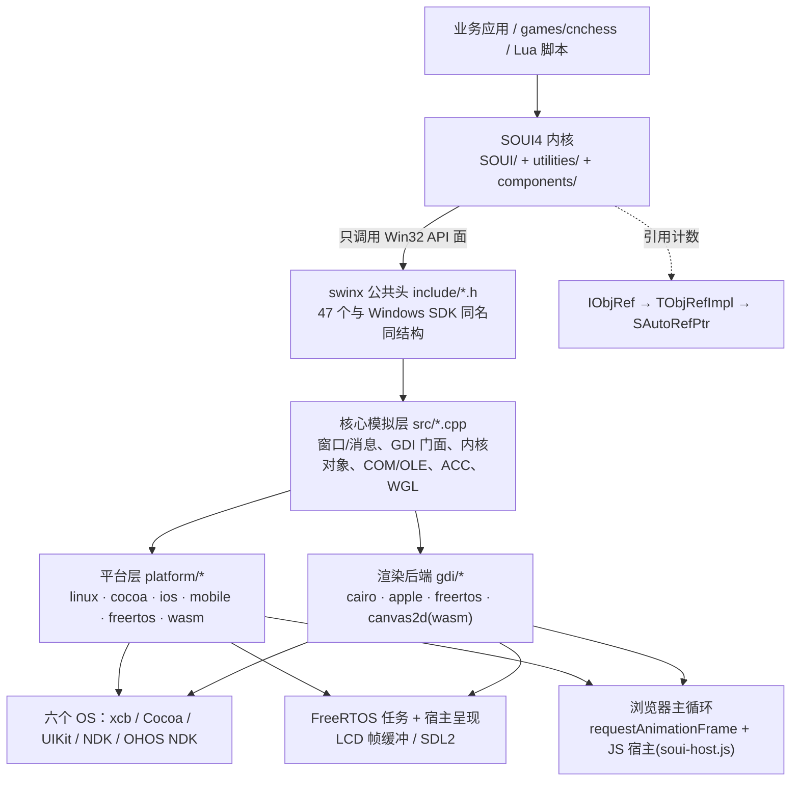
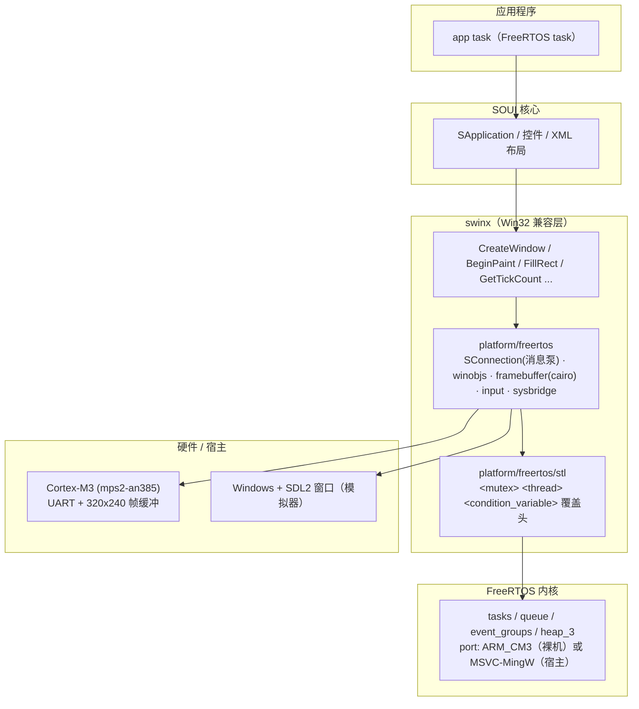
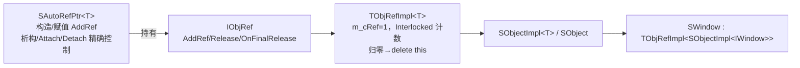

# SOUI4 跨平台 C++ GUI 框架项目评估报告

> **评估时间**：2026-11-02（全部数字取自当日 HEAD 现场实测与源码核对，单一口径）
>
> **代码基线**：主仓库 `soui4` HEAD `b274659f`（2026-11-02，`移动demo位置。`）；`swinx` 子模块 HEAD `039d4f38`（2026-11-02，`update fun.`）；`swinx` 版本 **1.8.0**（MAJOR 1 / MINOR 8 / PATCH 0）；`soui-freertos` 子模块照旧
>
> **评估范围**：SOUI4 内核（`SOUI/`、`utilities/`）、跨平台层 `swinx/`、组件 `components/`（16 个）、扩展控件 `controls.extend/`、移动端宿主库 `soui-android-lib/`·`soui-ohos-lib/`、以及三块能力面——FreeRTOS 移植（`soui-freertos/`）、WebAssembly 移植（`demos/wasm-demo/` + `games/cnchess/client/wasm/`）、OpenGL/WGL 兼容层（`swinx/include/wgl.h` + `swinx/src/wgl.cpp` + `demos/opengl_demo/`）
>
> **方法**：机制性结论逐条回源码核对；规模/计数取自当前仓库状态实测（`git ls-files` 受控文件、按字节计 `\n` 数、`wasm.cmake` / `CMakeLists.txt`、磁盘产物）；性能数字来自 `demos/wasm-demo/tools/diag/` 的 `bench_repaint.cjs` 同机 A/B
>
> **本文性质**：面向技术决策的**当前状态**评估——只描述"现在是什么样"，既列优势也列风险，不做营销式结论
>
> **与 2026-10-29 版的关系**：本版是**重写**而非增补。2026-10-29 版把运行目标从 6 扩到 8（新增 FreeRTOS 与 WASM）、把三块新能力独立成章。本版在那一版之上，把 WASM 线**定稿**为浏览器 Canvas2D 后端（`gdi/canvas2d`，route C）——这是现行交付形态，cairo 后端仅服务桌面/Android/OHOS、不再参与 wasm 构建——并据此重写 WASM 章、修正与之相关的体量/风险表述。FreeRTOS / OpenGL / 内核机制等未变处沿用旧版结论，仅同步口径。旧章与新章的对应关系见 §0.5。

---

## 〇、结论与速览

> 本章只给结论、核心数据与导航；逐条论证见后文对应章节。

### 0.1 一句话结论

SOUI4 是一套**以 Win32 API 语义为统一编程面**的 C++ DirectUI 框架：借助自研的 `swinx` 兼容层，**同一套 C++ UI 与业务代码**已在 **8 个运行目标**上原生运行——Windows / Linux / macOS / iOS / Android / OpenHarmony 六个操作系统，加上 FreeRTOS（裸机 MCU）与 WebAssembly（浏览器）；`games/cnchess` 的 `__ANDROID__`·`__OHOS__` 在业务源码中出现次数为 **0**，"一次编写、多端运行"是工程现实而非口号。

本轮评估的**新增判断**有三条，都建立在"同一套抽象能否继续吸收新形态"这一标尺上：

1. **FreeRTOS 证明这套抽象能下沉到"没有操作系统"的场景**（§3）。落点只有三件事——新增 `platform/freertos`、复用 cairo 后端把"画到窗口"换成"画到帧缓冲"、一个 `soui_fr_project()` 管掉构建。SOUI 内核、控件、XML 布局、动画**一行未改为移植而改**；QEMU mps2-an385（Cortex-M3, 4 MB FLASH）上 `SApp` 真跑出图。
2. **WebAssembly 证明同一套抽象能上移到"宿主是浏览器"的场景**（§4）。WASM 与 FreeRTOS 同属"无原生窗口服务器 + 软件光栅到内存 + 宿主注入输入/负责呈现"，因此 FreeRTOS 的帧缓冲链路被**直接复用为蓝图**；现行 wasm 用浏览器原生 **Canvas2D 后端（route C）** 重写 GDI 语义，**不再链接 cairo/fontconfig/freetype/pixman/brotli**，字体走浏览器系统字体。浏览器里能跑真正的 SOUI XML 布局（演示十二页 + 中国象棋真实联网客户端），且已出现**第二个、真实应用级**消费端。
3. **OpenGL/WGL 证明兼容层能从"2D 窗口与绘制"扩到"GPU 上下文"**（§5）。`demos/opengl_demo` 的源码在 Windows / macOS / Linux **三端同源**，WGL 入口契约测试在三端给出**同一套断言**、Windows 实测 `16 PASS / 0 FAIL / 1 SKIP`。

三条合起来回答的是同一个问题：**这个框架的跨端能力是"覆盖了八个平台"，还是"具备吸收新平台形态的架构能力"**——本轮证据支持后者。

同时必须客观记录代价：**这三块新能力目前都不在任何 CI 里**（§1.4、风险 2）；FreeRTOS 的字体桥测宽与绘制不一致、`ICON:` 资源仍是 NULL 桩（§3.5）；WASM 的 IME 虽已在真实应用路径验证、但触摸/移动端浏览器、多窗口 z-order、单线程约束仍未覆盖（§4.8）；OpenGL 的 current context 已于 2026-10-29 对齐为 per-thread（`thread_local`，与 WGL 语义一致）、无 MSAA 仍待补（§5.6）。它们与既有短板一样，**都是工作量问题，不是架构不确定性**（§12.2、§13）。

### 0.2 本次最重要的变化：从"六端"到"八目标 + 一条硬件加速面"

| 维度                   | 2026-10-14 版                      | 2026-10-29 版 / 本版（2026-11-02）                                    | 变化性质                            |
| -------------------- | --------------------------------- | -------------------------------------------------------------- | ------------------------------- |
| 运行目标数                | 6（三桌面 + 三移动）                      | **8**（+ FreeRTOS 裸机、+ WebAssembly 浏览器）                         | 新增两类宿主形态：**无 OS** 与 **无原生窗口**   |
| `swinx/platform/` 目录 | 4（`cocoa`/`ios`/`linux`/`mobile`） | **7**（+ `freertos`/`wasm`/`posix` 复用层）                         | 平台维度扩展，渲染维度仅 +1（`gdi/canvas2d` 仅 wasm） |
| `swinx/include/` 公共头 | 44                                | **57**（+`wgl.h`、`GL/gl.h`、`GL/wglext.h`、`sfr_config.h` 等）      | 从"窗口与 GDI"扩到"GPU 上下文"与"内核无关配置"  |
| Win32 API 面          | 声明 1,042 / 有定义 913                | 声明 **1,272** / 有定义 **1,142**（impl 1,094 + partial 8 + stub 40） | 覆盖率 87.6% → **89.8%**           |
| `swinx` 自有代码         | 165,707 行                         | **200,889 行**（302 文件，+6,169，主要来自 `gdi/canvas2d/` 4,689 + `platform/wasm` 增长） | 增量几乎全部来自三块新能力                   |
| 测试门禁                 | 约 426 条 `soui-headless`           | **508 条**（497 单元 + 1 集成 + 10 无窗口 E2E）                          | 用例规模 ×1.19                      |
| CI 工作流               | 4 个                               | **5 个**（+`swinx-mobile-gate`：Android/OHOS arm64 交叉编译）          | 移动端"能不能编过"交给机器                  |

> **口径提醒**：本节所有数字的统计方式见 §1.2 与各章脚注。运行目标数按"需要独立构建脚本 + 独立平台适配层"计，因此 Windows 不计入 `platform/`；`posix` 是被 `freertos`/`wasm` 复用的系统 API 实现层，不计为独立目标。

### 0.3 核心数据速览

| 维度                 | 当前值                                                                                                                                                       | 出处        |
| ------------------ | --------------------------------------------------------------------------------------------------------------------------------------------------------- | --------- |
| 自有源码规模             | **约 1,184 个文件 / 约 526,700 行**（内核 `SOUI/`+`utilities/` = 184,919 行）                                                                                        | §1.2      |
| 跨平台层 `swinx`       | **200,889 行 / 302 文件**（受控 `src/`+`include/`）；公共头 **57 个**；API 声明 **1,272** · 有定义 **1,142**                              | §2.4      |
| 运行目标               | **8**：Windows / Linux / macOS / iOS / Android / OHOS / **FreeRTOS** / **WASM**；业务源码 `__ANDROID__`·`__OHOS__` 均为 0 次                                       | §2.2、§2.9 |
| 平台/渲染正交            | `platform/` **7 目录** × `gdi/` **4 后端**（`cairo` / `apple` / `freertos` / `canvas2d`）                                                                                    | §2.2      |
| **FreeRTOS（新增）**   | QEMU mps2-an385（Cortex-M3 / 4 MB FLASH）真跑 `SApp` 出图；Windows SDL 模拟器同构迭代；工程胶水 **35 文件 / 4,031 行**（+ vendored 内核 655 / 348,485 行）                           | §3        |
| **WASM（新增，定稿）**   | 浏览器原生 Canvas2D 后端（route C，`gdi/canvas2d` 4,689 行）；**2 个消费端**（演示 + 中国象棋真实联网应用）；演示产物 `.wasm` 4.60 MB + `.data` 0.81 MB；脏矩形上屏节省约 **84%**；IME 已证；DPI 超采样已定；整窗帧与 Lua 游戏帧均进 60fps | §4        |
| **OpenGL/WGL（新增）** | `wgl.h` + `GL/{gl,wglext}.h` 三头；公共层 + macOS `NSOpenGLContext` 桥 + Linux GLX 动态加载；契约测试 Windows **16 PASS / 0 FAIL / 1 SKIP**，macOS/Linux 同一套断言             | §5        |
| 测试门禁               | **508 条** `soui-headless`（497 单元 + 1 集成 + 10 无窗口 E2E）+ 3 条 `soui-gui`；`demos/fun_test` **41 个** `test_*.cpp`、源码 `TEST/TEST_F` 声明 **113 处**（经参数化展开注册为上述条目） | §1.4      |
| 控件面                | **40 个**内置控件头 + **37 个**扩展控件类；六个列表控件统一多选/框选/键盘导航（37 条无头用例）                                                                                                | §7.2      |
| 国际化与高分屏            | 多语言 `ITranslatorMgr` 运行时热切换 + High-DPI `SDpiHandler` 自动缩放；XMusic 中英双语 + 全 DPI 实证                                                                          | §9        |
| 脚本绑定面              | `ScriptModule-LUA`：44 文件 / 约 1,570 处注册 / `NativeCall` 零改动导出 / 24 条生命周期用例                                                                                  | §8        |
| 体积                 | 最小编译核心约 **2 MB**（动态链接、仅必需模块）；常规配置 **Windows ~4 MB / Linux ~10 MB / macOS ~7 MB**，16 组件按需装载；wasm 演示 `.wasm` 4.60 MB + `.data` 0.81 MB（route C，免内嵌字体）              | §6.2      |
| 第三方 vendor         | **11,770** 个受控文件，占两仓库受控文件合计（17,650）的 **66.7%**                                                                                                            | §1.3      |

### 0.4 能力地图：四条主线 + 一条纵轴

上一版用"三条主线"（跨端 / 工程 / 可编程）。本版新增一条**纵轴**——"平台扩展性的可复用度"，因为 §3–§5 让它可以被度量了：一个新目标到底要新增多少东西、复用什么、改不改内核。

| 主线                        | 回答的问题                | 最硬证据                                                                               | 主要短板                                                    |
| ------------------------- | -------------------- | ---------------------------------------------------------------------------------- | ------------------------------------------------------- |
| **跨端能力**（§2）              | 同一套 C++ 能否多目标运行、代价多大 | 47 个与 SDK 同名同结构的公共头；`platform/`(7) × `gdi/`(4) 二维正交；cnchess 业务零平台宏；连浏览器引擎（WKE）都被接住 | 原生控件库仅 3 个、窗口菜单栏与资源对话框接口面未建立（§2.5）                      |
| **平台扩展性**（§3–§5，**本版新增**） | 吸收一个新宿主形态要动多少        | FreeRTOS：3 件事、内核零改；WASM：复用 FreeRTOS 的帧缓冲蓝图、且第二个真实消费端已落地；OpenGL：三端同源 + 同一套契约断言                  | 三块新能力**均无 CI**；FreeRTOS 字体/图标桩未齐；WASM 触摸/移动端/CI 过渡态 |
| **工程能力**（§6）              | 内存安全、资源管理、体积、矢量渲染    | `SAutoRefPtr` + 控件树裸指针；资源"三层职责 + 字符串键"；最小 ~2 MB；SVG 为渲染原语                          | vendor 占比 66.7%；资源无条目级失效（§6.4）                          |
| **开发能力**（§7）              | 写 UI 有多快、控件够不够、事件怎么写 | XML + 类 COM 工厂 + uieditor；40 控件头 / 37 扩展类；映射表 + 订阅双面                               | 事件最"框架化"的语义无自动化回归（§7.3）                                 |
| **可编程能力**（§8）             | 玩法能否免编译迭代            | XML 事件直挂 Lua；消消乐动画全脚本编排；`ITaskLoop` + `PostTask`                                   | JS/Python 分仓且仅桌面三端                                      |

**纵轴的结论**：三个新目标的落点高度收敛在同一处——`swinx/src/platform/<os>/`。FreeRTOS 动了 34 个文件、WASM 动了 16 个，`SOUI/` 与 `utilities/` 为移植而改的代码**只有若干显式 include 与一个 `__EMSCRIPTEN__` 分支**（§3.4、§4.1）。这就是"新增平台 = 新增一个目录"这句话在本轮被真正验证的含义。

### 0.5 全文导航

| 章                        | 回答什么                                     | 关键数字                                        |
| ------------------------ | ---------------------------------------- | ------------------------------------------- |
| 一 · 项目底图                 | 规模、构成、CI 与模块边界                           | ~526,700 行 / 17,650 受控文件 / 5 个工作流          |
| 二 · 跨端能力                 | 同一套 C++ 如何多目标运行、兼容边界在哪                   | 57 头 / API 1,272→1,142 / platform 7 × gdi 4 |
| **三 · FreeRTOS（第七端）**    | 无 OS 场景怎么落地、已证到什么程度                      | QEMU Cortex-M3 / 3 件事 / 34 文件               |
| **四 · WebAssembly（第八端）** | 浏览器场景怎么复用裸机蓝图、现行 Canvas2D 后端与真实应用          | route C 4,689 行 / 2 消费端 / 演示 4.6 MB          |
| **五 · OpenGL/WGL**       | GPU 上下文怎么做到三端同源                          | 3 头 / 16 PASS·0 FAIL·1 SKIP                 |
| 六 · 工程能力                 | 内存、资源、体积、矢量                              | 最小 ~2 MB / SVG 四后端 / 资源三层                   |
| 七 · 开发能力                 | 开发效率、控件完整性、事件体系                          | 40 控件头 / 37 扩展类 / 37 条框选用例                  |
| 八 · 可编程能力                | 脚本化玩法迭代                                  | 44 文件 / 1,570 注册 / 24 用例                    |
| 九 · 国际化与高分屏              | 多语言热切换 + DPI 自动缩放                        | `EnableMultiLang` / `SDpiHandler`           |
| 十 · 性能与线程                | 密集计算与 UI 线程协作                            | `PostTask` / `ITaskLoop` / wasm 单线程        |
| 十一 · 横向对照                | 与 Qt / Flutter / Electron / wxWidgets 对照 | 16 个维度（+ 运行目标数 / 裸机·浏览器 / GPU 接口）           |
| 十二 · 优势与风险               | 优势清单 + 风险清单                              | 每项给出章节出处                                    |
| 十三 · 路线图                 | 按性价比排序的措施                                | 14 项                                        |
| 十四 · 结论                  | 总体判断与能力边界                                | —                                           |

---

## 一、项目底图：规模、构成、CI 与架构

### 1.1 项目速览（定位与关键事实）

| 维度     | 事实                                                                                                                                                                                       | 出处                                              |
| ------ | ---------------------------------------------------------------------------------------------------------------------------------------------------------------------------------------- | ----------------------------------------------- |
| 定位     | 轻量跨平台 C++ DirectUI 框架，持续开发 **14 年**                                                                                                                                                      | `README.zh-CN.md`                               |
| 版本     | 内核 `ver:` 标注 **5.3.2.1**（`ChangeLog.md` 以特性线 5.3 为锚）；`swinx` **1.8.0**                                                                                                                              | `swinx/src/swinx_version.h`                     |
| 核心编译体积 | 约 **2 MB**（官方声明，动态链接核心库）                                                                                                                                                                 | `README.zh-CN.md`                               |
| 运行目标   | **8** 个：Windows / Linux / macOS / iOS / Android / OHOS / FreeRTOS / WASM                                                                                                                 | §2.2                                            |
| 渲染后端   | GDI / Direct2D（Win）、Skia（跨平台主流）、Cairo（swinx 内，服务 Linux/Android/OHOS）、Core Graphics（Apple）；**Canvas2D（wasm 专用，route C）**；**GL 上下文**经 swinx WGL 层承接（§5）                                                                                        | `components/render-*`、`swinx/src/gdi/`          |
| 内存模型   | 类 COM 引用计数 + 智能指针 `SAutoRefPtr`                                                                                                                                                          | `utilities/include/helper/obj-ref-impl.hpp`     |
| 编程风格   | Win32/WTL 式 API + XML 描述 UI + Lua 脚本逻辑                                                                                                                                                   | `README.zh-CN.md`、`components/ScriptModule-LUA` |
| 生态     | `demos/` **21 个子目录**（含设计器 `uieditor`、测试工程 `fun_test`、本轮新增 `opengl_demo`·`wasm-demo`）；`games/` **3 个示例**（cnchess / junqi / upgrade）；脚本生态：内置 Lua 5.4，JS（soui4js）与 Python3（soui4py）为独立仓库且仅覆盖桌面三端 | `demos/`、`games/`                               |
| 许可     | 自有商业条款（非商用免费）；`swinx` 内含 Wine 派生代码并单列披露                                                                                                                                                  | `LICENSE-zh.md`、`swinx/license_CN.txt`          |

> **README 口径未同步（客观记录）**：`README.zh-CN.md` 的"跨平台支持"表仍只列六端，FreeRTOS 与 WASM 未进 README。当前权威描述分散在 `soui-freertos/README.md`、`demos/wasm-demo/readme.md`、`games/cnchess/client/wasm/readme.md`。这是文档债，见 §12.2 风险 16。

### 1.2 代码规模（当前实测）

框架**自有源码**（不含 `third-part/` 与 `swinx/thirdparty/` 的 vendor 代码；`swinx` 仅计受控 `src/`+`include/`）：

| 模块                                              |       源文件 |          行数 |
| ----------------------------------------------- | --------: | ----------: |
| `SOUI/`（DirectUI 内核）                            |       412 |     149,547 |
| `utilities/`（基础件）                               |        56 |      35,372 |
| `components/`（16 个可插拔组件）                        |       192 |      87,306 |
| `controls.extend/`（扩展控件）                        |       214 |      52,693 |
| `swinx/src` + `swinx/include`                   |       302 |     200,889 |
| `soui-android-lib/` + `soui-ohos-lib/`          |        18 |       6,812 |
| **合计**                                          | **1,184** | **526,709** |
| 附：`soui-freertos/`（子模块，工程胶水）                    |        35 |       4,031 |
| 附：`soui-freertos/FreeRTOS-Kernel/`（vendored 内核） |       655 |     348,485 |

> **统计口径**：只计受控的 `.c/.cpp/.h/.hpp/.cc/.mm/.m/.inl`，按字节计 `\n` 数；不含 `.idl`/`.rc`/构建脚本。与 2026-10-29 版相比：`swinx` 由 194,720 → **200,889（+6,169）**，增量几乎全部落在 `gdi/canvas2d/`（4,689 行，本版新增的 wasm 后端）与 `platform/wasm/`（3,716 行，较旧版 2,942 +774）；其余模块行数与旧版一致（SOUI 149,547 / utilities 35,372 / components 87,306 / controls.extend 52,693）。文件数差异来自扩展名过滤口径微调（本版不含 `.idl/.rc`），不代表代码缩减。
>
> 框架的真正内核是 **`SOUI/` + `utilities/` = 184,919 行**；`swinx` 的 200,889 行是"让内核在非 Windows 上零改动编译"的代价与资产——**它现在比内核本身还长**，这个比例本身就是本轮评估要讨论的对象（§2.4）。

### 1.3 仓库文件构成（`git ls-files` 口径）

| 分区                                                        |                  受控文件数 |
| --------------------------------------------------------- | ---------------------: |
| 主仓库 `soui4` 合计                                            |              **9,441** |
| ├ `third-part/`（vendor，含 3 个嵌套子模块）                        |                  3,927 |
| ├ `demos/`（示例 + 设计器 + 测试工程）                               |                  2,976 |
| ├ `games/`（棋牌示例）                                          |                    896 |
| ├ `SOUI/`                                                 |                    416 |
| ├ `wizard/`（VS 向导）                                        |                    275 |
| ├ `components/` · `controls.extend/`                      |              247 · 217 |
| ├ `utilities/` · `tools/` · `doc/` · 移动端 lib · `__cmake/` | 61 · 68 · 53 · 58 · 10 |
| └ 其他（根目录文件、`.github/`、`promotion/` 等）                     |                    237 |
| `swinx` 子模块合计                                             |              **8,209** |
| ├ `swinx/thirdparty/`（vendor）                             |                  7,843 |
| └ `swinx` 自有（`src/` `include/` `doc/` 等）                  |                    366 |

**第三方 vendor 合计 11,770 个受控文件**（`third-part/` 3,927 + `swinx/thirdparty/` 7,843），在两仓库受控文件合计 17,650 中占 **66.7%**——`third-part/` 占主仓库 41.6%、`swinx/thirdparty/` 占 swinx 子模块 **95.5%**。

> 代价换来的是**零版本兼容风险**：cairo / freetype / fontconfig / skia / richedit41 / FreeRTOS 内核等全部源码 vendor 化，构建不依赖发行版提供什么版本。代价是 clone 体积与检索体验。注意：**wasm（route C）链接彻底不碰 `third-part/` 的 cairo/fontconfig/freetype/pixman/brotli**——这些 vendor 不再进入浏览器构建（§4.3）。

### 1.4 CI 与自动化现状（需与"门禁已生效"区分）

| 工作流                               | 触发                            | 覆盖                                    | 做什么                                                       |
| --------------------------------- | ----------------------------- | ------------------------------------- | --------------------------------------------------------- |
| `build.yml`                       | push tag、push `build-test` 分支 | Windows/Linux/macOS × x64/x86/arm64   | 全量构建 + `ctest -L '^soui-headless$'` + 上传 demo 制品          |
| `pr-core.yml`                     | PR → `master`                 | linux-x64 / windows-x64 / macos-arm64 | 只构建 `fun_test` + 跑无头门禁（失败时 gdb 打印可疑用例栈）                   |
| `gui-smoke.yml`                   | PR → `master`、手动              | linux-x64（Xvfb）                       | `-DSOUI_ENABLE_GUI_SMOKE=ON` 后跑真实宿主窗口烟测                   |
| `swinx-api-gate.yml`              | PR、push `master`、手动           | ubuntu-latest（纯文本扫描，约 2 分钟）           | `api_scan.py --check` 断言 swinx 声明面与已提交 `api_scan.json` 一致 |
| `swinx-mobile-gate.yml`           | PR/push 且路径命中 `swinx`         | Android arm64（API 28）+ OHOS arm64     | 用 `swinx/tools/cross_build.py` 交叉编译 swinx 目标，只保证"三端还能编过"  |

**CI 的净变化与仍存边界**：

- ✅ 风险"移动端无任何自动构建"（旧版风险 1）**已被部分关闭**：Android 与 OHOS 的 arm64 交叉编译进了 PR 门禁。
- ⚠️ **iOS 仍无自动构建**（`cross_build.py` 的 iOS 路径未进门禁），且移动端仍无**运行期**回归——门禁只证明"编译链路不断"，不证明"界面与输入正确"。
- ⚠️ **FreeRTOS 与 WASM 完全不在 CI 内**：FreeRTOS 需 `arm-none-eabi` + QEMU；WASM 的 `soui-wasm-gate.yml` 虽存在，但其烟测步骤引用的 `demos/wasm-demo/smoke.js` 已被移除、而真正可用的 `games/cnchess/client/wasm/smoke.js` 未接 CI（详见 §4.7）。两者当前都靠人工本地构建与手工证据。这是本版风险 2。
- ⚠️ 工作流文件的存在**不等于**线上 Required Check 已生效，后者须在 GitHub 分支保护规则现场核验。

### 1.5 分层结构（8 目标）



> 与 10-14 版图形的差别只有三处：`platform/` 多了 `freertos` 与 `wasm`、`gdi/` 多了 `freertos` 与 `canvas2d` 后端、`wgl` 进了核心模拟层。**但正是这三处让"运行目标"从 6 变 8**——这就是 §0.4 纵轴要表达的意思。

### 1.6 模块划分

- **`SOUI/`**：DirectUI 内核——窗口树（`SWindow`）、消息路由、事件系统、布局、动画、XML 对象工厂；`control/` 下 **40 个控件头**（含聚合头 `SouiCtrls.h`），MVC 虚拟列表 `SListView`/`SMCListView`/`STreeView`/`STileView`/`SComboView` 即在此处。
- **`utilities/`**：与 UI 无关的基础件——接口定义、引用计数、XML（`SXml.h`）、字符串与数学、COM 动态加载。
- **`swinx/`**：跨平台兼容层（§2）。Windows 下**不编译**。
- **`components/`**：**16 个**可独立链接的组件——`render-skia`/`render-gdi`/`render-d2d`、`imgdecoder-stb`/`-wic`/`-gdip`、`resprovider-zip`/`-7zip`、`ws`/`network`/`httpclient`/`TaskLoop`/`SIpcObject`、`ScriptModule-LUA`、`log4z`、`translator`。按需装载，未用组件不链入。
- **`controls.extend/`**：扩展控件——`propgrid`/`gridctrl`/`hellocharts`/`gif`/`qrcode`/`image3d`/`reole`/`smiley`/`trayicon` 等 9 个子目录 + 平铺控件源码，37 个窗口类经 `SCtrlsRegister::RegisterCtrls` 集中注册。
- **`soui-android-lib/` / `soui-ohos-lib/`**：移动端宿主库——把 `SApplication` 托管进 `GameActivity`（JNI）/ `EntryAbility`（N-API）并填写 `PlatformAPI`；OHOS 侧以 **HAR 包**形态提供。
- **`soui-freertos/`**（**本版新增**）：FreeRTOS 工作区子模块——vendored 内核 + `cmake/soui.cmake` 唯一入口 + 四个工程（`demo`/`swinx_test`/`soui_fr` 跑 QEMU，`soui_sim` 跑 Windows）+ 新建工程模板（§3）。
- **`demos/wasm-demo/`**（原 `soui-wasm/`，已迁移至 `demos/`）：WebAssembly 演示（阶段 0 裸窗口 / SOUI XML 十二页）＋ 可复用宿主 `soui-host.js` ＋ `tools/diag/` 验收脚本。`SOUI_BUILD_WASM_DEMO=ON` 时由根 `CMakeLists.txt` 接入。
- **`games/cnchess/client/wasm/`**（**本版新增**）：中国象棋桌面客户端的 wasm 版本（真实联网应用）。`cnchess_main.cpp` 宿主入口、`smoke.js` 无头端到端烟测、`node-websocket.js` node 侧 RFC6455 客户端，复用 `demos/wasm-demo` 的 `soui-host.js`。
- **`swinx/src/gdi/canvas2d/`**（**本版新增统计**）：route C 的浏览器 Canvas2D GDI 后端，4,689 行，wasm 链接唯一后端。
- **`demos/opengl_demo/`**（**本版新增**）：OpenGL/WGL 三端同源验证装置（§5）。

---

## 二、跨端能力：`swinx` 跨平台兼容层

> 本章是评估基础：先看设计哲学与量化现状（§2.1、§2.4），再看兼容边界（§2.5），然后用一节把三个新目标的"落点"横向摆平（§2.6）——这一节是 §3–§5 的总纲；最后用重组件、RC 资源、cnchess、WKE 四个案例收口（§2.7–§2.10）。

### 2.1 设计哲学：以 Win32 为"世界语"

swinx 不是"为每个平台写一套抽象接口"，而是**重演 Win32 语义**——`include/` 下 **57 个头文件**与 Windows SDK **同名同结构**（其中 47 个直接对应 SDK 头，如 `windows.h`/`winuser.h`/`gdi.h`/`unknwn.h`/`oleacc.h`/`textserv.h`/`wgl.h`，另有 `GL/gl.h`、`GL/wglext.h`；12 个是 SOUI 自有扩展头：`platform_api.h`、`sfr_config.h`、`class.h`、`wnd.h`、`strapi.h`、`sysapi.h`、`resapi.h`、`region.h`、`ctrl_types.h`、`logdef.h`、`ios_entry.h`）。因此 SOUI 内核直接 `#include <windows.h>`，**零平台 `#ifdef`**。

> 价值：下游（内核、控件、业务代码）完全不感知平台差异。这与 Qt（自有 Q* 体系）、Flutter（Dart + 自绘）、wxWidgets（每平台原生控件 + 不同 API）的路径都不同。
>
> **本轮的补充证据**：这条哲学的价值此前由"六端"证明；§3–§5 证明它还**可外推**——FreeRTOS（无 OS）与 WASM（无原生窗口）都不需要新的编程范式，只需要新的 `SConnection`。

### 2.2 八目标 × 渲染后端矩阵

各 `*.cmake` 用 `file(GLOB)` 把当前平台源文件自动纳入编译，**新增 `.cpp`/`.mm` 不需改 cmake**。实际编译归属：

| 目标               | 平台适配层                                 | 渲染后端                                  | 构建脚本                                        | 宿主形态 / 呈现方式                                              |
| ---------------- | ------------------------------------- | ------------------------------------- | ------------------------------------------- | -------------------------------------------------------- |
| Windows          | （不编译 swinx，用系统 Win32）                 | GDI / D2D                             | MSVC/MinGW                                  | 系统窗口系统                                                   |
| Linux            | `platform/linux`                      | `gdi/cairo`                           | `linux.cmake`                               | xcb + `poll()` 事件循环                                      |
| macOS            | `platform/cocoa`                      | `gdi/apple`                           | `macos.cmake`                               | `NSApplication`                                          |
| iOS              | `platform/ios`                        | `gdi/apple`                           | `ios.cmake`                                 | `UIApplicationMain`（`swinx_ios_entry` 托管）                |
| Android          | `platform/mobile`                     | `gdi/cairo`                           | `mobile.cmake`                              | JVM 启动 + `PlatformAPI` 桥接                                |
| OpenHarmony      | `platform/mobile`                     | `gdi/cairo`                           | `mobile.cmake`                              | ArkTS 启动 + `PlatformAPI` 桥接                              |
| **FreeRTOS**（新增） | `platform/freertos`（22 源文件 / 5,220 行） | `gdi/freertos`（99 行 cairo 包装 → 内存帧缓冲） | `soui-freertos/cmake/soui.cmake`            | **无 OS**：FreeRTOS 任务跑消息泵，宿主取帧缓冲上屏（LCD / 半主机 dump / SDL2） |
| **WASM**（新增）     | `platform/wasm`（16 源文件 / 3,716 行）     | **`gdi/canvas2d`（route C，4,689 行）**      | `swinx/wasm.cmake` + `SOUI_BUILD_WASM_DEMO` | **浏览器**：`emscripten_set_main_loop` 驱动泵，JS 宿主按脏矩形 blit    |

> **设计要点**：`platform/*`（窗口壳/事件循环/剪贴板/IME/DPI）与 `gdi/*`（绘制）是**两个正交维度**。当前 `platform/` 有 **7 个目录**——其中 `posix` 不是独立目标，而是**被 `freertos` 与 `wasm` 复用的系统 API 实现层**；`mobile` 同时服务 Android 与 OHOS。`gdi/` 有 **4 个后端**：Linux 与 Android/OHOS 复用 Cairo 而平台层不同，macOS/iOS 反之；`freertos` 后端是 Cairo 的薄包装；`canvas2d` 后端**仅 wasm 使用**，把 GDI 语义重写为浏览器 Canvas2D 调用，从而 wasm 链接**不碰 cairo/fontconfig/freetype/pixman/brotli**。

### 2.3 四大核心机制

1. **同符号、分目录实现、链接期解析**（`src/SwinxUtils.h`）：跨平台公共助手声明集中于此（如 `swinx_messageBeep`），各平台目录给出**同名同签名**实现；`GLOB` 只把当前平台源文件编入，于是调用方写同一个函数名、正文**无平台 `#ifdef`**。返回类型统一用 `int` 而非 `BOOL`，规避 ObjC++ 中 `BOOL` 是 `bool`/`signed char` 的差异。
2. **`g_platformAPI` 回调机制**（`swinx/include/platform_api.h`，`PLATFORM_API_VERSION = 3`）：Android/OHOS 无桌面窗口系统、由宿主 App 提供窗口/输入/剪贴板，故共用 `platform/mobile`。在窗口系统 / 输入 / 剪贴板 / 提示音这类需要真实平台能力的层面**转发 `g_platformAPI`**，由 `soui-android-lib`/`soui-ohos-lib` 补差异。`PlatformAPI_Init` 严格比对版本，不一致拒绝注册。
3. **非 MSVC 工具链上的 COM 自研**（`src/SUnkImpl.h`）：gcc/clang 无 `__uuidof`，用四件套补齐——`DECLARE_INTERFACE_` 宏集、`__uuidof/__suidof` 降级为 `X::GetIID()`、`IUNKNOWN_BEGIN/ADD_IID/END` + `SUnkImpl<T>`（`m_cRef` + `OnFinalRelease`）、`DEFINE_GUID` 弱符号。`BSTR/VARIANT/SAFEARRAY/IDispatch` 全部自研，**这让 SOUI 的 ACC 代码一字不改跨桌面平台编译**。
4. **平台派生收敛到单一配置头**（`swinx/include/sfr_config.h`）：FreeRTOS 移植时发现"是不是 FreeRTOS 平台 / 有没有宿主 OS / 内核原语从哪来"的判据散落 4 个宏，调用点还要写 `A || B`。现收敛为一个头、四个构建参数派生四个开关：

   | 构建参数                     | 派生开关                                             |
   | ------------------------ | ------------------------------------------------ |
   | `SOUI_PLATFORM_FREERTOS` | `SFR_PLATFORM = 1`                               |
   | `FREERTOS_HOST`          | `SFR_PLATFORM = 1`、`SFR_HOSTED = 1`（宿主 OS + CRT） |
   | `SOUI_FREERTOS_REAL`     | `SFR_KERNEL_REAL = 1`（真内核 API）                   |
   | `SOUI_FREERTOS_HOST_EMU` | `SFR_KERNEL_EMU = 1`（POSIX 模拟）                   |

   调用点一律写 `#if SFR_HOSTED` / `#if !SFR_PLATFORM`，两个开关永远有定义（0/1），不再有"未定义即假"的隐式语义；其它平台拿到的是全 0，行为不变。**这条改动的意义超出 FreeRTOS**：它把"新增平台需要判断什么"从隐式约定变成了一个可枚举的开关表。

### 2.4 量化现状

| 维度             | 当前数据                                                                                                                                                                                                                                       |
| -------------- | ------------------------------------------------------------------------------------------------------------------------------------------------------------------------------------------------------------------------------------------ |
| 代码规模           | `src/` + `include/` = **200,889 行**（302 文件），不含 vendored `thirdparty/`；较 2026-10-29 的 194,720 **+6,169 行**（canvas2d 4,689 + platform/wasm 增长 774 + 其它微调）                                                                              |
| 公共头            | **57 个**（47 个与 Windows SDK 同名同结构 + 12 个自有扩展头）+ `GL/` 2 个                                                                                                                                                                                   |
| API 面          | 声明 **1,272**；有定义 **1,142**（完整实现 1,094 / 部分实现 8 / 空实现或语义桩 40）；无定义 **130** → **覆盖率 89.8%**（旧版 913/1,042 = 87.6%）                                                                                                                             |
| 平台层规模          | 源文件数 / 行数：`platform/posix` 25 / 26,908（被 freertos 与 wasm 复用的系统 API 实现）、`cocoa` 26 / 10,653、`linux` 20 / 14,925、`ios` 23 / 6,209、**`freertos` 22 / 5,220**、**`wasm` 16 / 3,716**、`mobile` 15 / 2,788（同时服务 Android 与 OHOS）                   |
| 后端规模           | `gdi/cairo` · `gdi/apple` · `gdi/freertos` · **`gdi/canvas2d`（4,689 行，仅 wasm）**；核心 `src/*.cpp` 34 个                                                                                                                                                                             |
| 真实功能缺口（声明层面）   | 见 §2.5；`api_scan` 的 130 项 `no_def` 多为 Win32 的冷门族（`DPA_*`/`DSA_*` 动态数组、`CreateToolbarEx`、`CreateStatusWindow*` 等）                                                                                                                           |
| **接口面缺口（迁移面）** | **原生控件库 / 窗口菜单栏 / 资源对话框未建立**：内置注册的窗口类仍是 `WINDOW`/`TOOLTIPS`/`MENU`（支撑类）+ `Static`/`Button`/`ListBox`；`SetMenu`/`GetMenu`/`DrawMenuBar` 无声明；`DialogBoxParam` 族全缺（逐条见 §2.5）                                                                  |
| 无障碍（ACC）       | 约 6,240 行支撑桌面三平台，全自研：SOUI 侧 `SWndAccessible`+`swndAccessible.cpp`+`msaa/SAccProxyCmnCtrl`+`SAccProxyWindow`；swinx 侧 MSAA 运行时 `oleacc.cpp`、Linux AT-SPI2 桥 `SAtSpi.cpp`、macOS NSAccessibility 桥 `SNsAccessibility.mm`。Windows 复用系统 `oleacc` |
| 门禁             | `api_scan.py --check` 在 PR 上跑；`swinx-mobile-gate` 做 Android/OHOS arm64 交叉编译                                                                                                                                                                |

> **一个值得记录的比值**：`swinx` 200,889 行 > `SOUI/`+`utilities/` 184,919 行。这不是设计失误，而是"以 Win32 为世界语"这条路线的**明码代价**：每一个平台都要重演一遍窗口/消息/GDI/内核对象语义。把它与 Qt 的 QPA 插件（每平台一份但只覆盖窗口与绘制，其余走 Qt 自有 API）相比，SOUI 付出了更多实现量，换来的是**下游零 #ifdef**——两者是同一种权衡的两个方向。

### 2.5 兼容的边界：缺口与未覆盖面

> **范围界定**：`swinx` 的核心目标是让"用 SOUI 编写的应用"多端原生运行，而不是把任意既有 Win32 程序零成本迁移。因此"原生控件库 / 窗口菜单栏 / 资源对话框"这类决定**能否迁移旧 Win32 程序**的接口面属于**延伸目标**，其现状不影响 SOUI 应用自身跨端。

- **编译层面**：同一份 `#include <windows.h>` 源码多端编译——**成立**（§2.9 有六端实证，§3/§4 再添两例）。
- **原生控件库**：只有 `Static`/`Button`/`ListBox` 三个（`ListBox` 走 Wine 搬运）。`Edit`/`ComboBox`/`ScrollBar`/公共控件全缺，缺失表现为 `CreateWindowEx` 返回 `NULL` 的**静默失败**。
- **窗口菜单栏**：`SetMenu`/`GetMenu`/`DrawMenuBar` 无声明——弹出菜单机制完整，缺的是窗口侧挂载。
- **资源对话框**：`DialogBoxParam`/`DialogBoxIndirectParam` 族全缺（`demos/opengl_demo` 用的是 SOUI 自己的 `SHostDialog`）。
- **语义边界**：`IsWindowUnicode` 返回 `FALSE` 是**有意为之**——swinx 以 UTF-8 作为多字节编码，返回 `FALSE` 正确对应"多字节代码路径"，与 `GetACP()` 返回 `CP_UTF8` 一致，**并非缺陷**。
- **新目标的边界**（本版新增，详见各章）：FreeRTOS 的无 OS 前提⇒不支持多进程/文件锁语义弱化；WASM 的单线程前提⇒`std::thread` 构造即 abort（已在源码侧规避）；OpenGL 的 current context 已对齐为 per-thread（`thread_local`，与 WGL 语义一致，§5.6）。

### 2.6 三个新目标如何被"装进"同一套抽象（横向对照）

这一节是 §3–§5 的总纲：把三个新目标按**同一套五维模板**摆平，读者可据此判断"再新增一个目标要动什么"。

| 维度        | FreeRTOS（§3）                                               | WebAssembly（§4，定稿）                                        | OpenGL/WGL（§5）                                                        |
| --------- | ---------------------------------------------------------- | ------------------------------------------------------ | --------------------------------------------------------------------- |
| **形态**    | 无 OS，带显示 MCU                                               | 无原生窗口，浏览器沙箱                                            | 不是新平台，是**新的能力面**（GPU 上下文）                                             |
| **落点**    | 新增 `platform/freertos`（34 文件）+ `gdi/freertos` 后端 + 子模块工程胶水 | 新增 `platform/wasm`（16 文件）+ `gdi/canvas2d`（4,689 行）+ `demos/wasm-demo` + `games/cnchess/client/wasm` | 新增 `include/wgl.h`+`GL/*`、`src/wgl.cpp`、`platform/cocoa/SGLBridge.mm` |
| **复用谁**   | 复用 `gdi/cairo`；复用 `platform/posix` 的系统 API 实现              | **复用 FreeRTOS 的帧缓冲呈现蓝图**（四个宿主接缝：帧缓冲/上屏/输入注入/消息泵）       | 复用 Win32 WGL 语义；macOS 走 `NSOpenGLContext`、Linux 走 GLX `dlopen`        |
| **内核改动**  | 仅若干显式 include + `SConnection` 注册点；SOUI/utilities 无移植性改动    | 仅 `FontFallback.cpp` 一个 `__EMSCRIPTEN__` 同步分支          | 零：消费端只多一行"平台 GL 头须在 `SNSBEGIN` 之前包含"                                  |
| **宿主职责**  | 提供帧缓冲上屏（LCD/SDL）+ 输入注入                                     | 提供 canvas blit + DOM 事件注入 + `requestAnimationFrame` 泵  | 无（GL 上下文由 swinx 建在原生子窗口上）                                             |
| **消费端**   | demo + QEMU + SDL 模拟器                                      | **2 个**：`demos/wasm-demo`（演示）+ `games/cnchess/client/wasm`（真实联网应用） | `demos/opengl_demo`                                                   |
| **已证到哪**  | QEMU Cortex-M3 真跑 SApp 出图 + Windows 模拟器交互                  | 浏览器跑 SOUI XML（演示十二页 + 中国象棋真实应用）+ 40 断言端到端烟测 + DPI 超采样 + 60fps 性能 | 三端同源 demo 出图 + 契约测试 16/0/1                                            |
| **链接依赖**  | cairo/pixman/freetype                                     | **去 cairo/fontconfig/freetype/pixman/brotli**，字体走浏览器系统字体 | libGL/系统 GL                                                          |
| **产物体量**  | 帧缓冲 KB 级                                                 | demo `.wasm` 4.60 MB + `.data` 0.81 MB（免内嵌字体）；cnchess `.data` 仍约 20 MB（CJK 字体 + 资源） | —                                                                     |
| **未证/缺口** | 字体/图标桩未齐、无像素回归、目标板未适配                                | 触摸/移动端浏览器、多窗口 z-order、单线程约束、应用侧 `.data` 字体子集化、CI 过渡态     | 无 MSAA、单 drawable、macOS deprecated                |
| **代价形态**  | 工程胶水（构建/资源打包/启动）                                           | 单线程模型 + 宿主壳（`soui-host.js` 两消费端共用） + DPI 超采样调参         | 平台语义差异的显式降级契约                                                         |

> **读法**：三行的"落点"都指向 `swinx/src/platform/<name>/` 或 `swinx/src/*.cpp` 这一层，"内核改动"一列都是"几乎为零"。这正是"新增平台 = 新增一个目录"的**可检验表述**——而 §3–§5 就是三次检验。WASM 还进一步证明：宿主壳底下的渲染引擎也可以从"带一套 C 库"换成"借宿主浏览器的引擎"，把体量代价压下去（§4.3）。

### 2.7 典型案例：移植 richedit41 与 Scintilla，重组件零改源码跨端

`third-part/richedit41`（499 个文件的 Windows RichEdit 引擎）与 `third-part/Scintilla` 被整体搬运：靠的是 swinx 提供的 `textserv.h`（`ITextHost`/`ITextServices`）、`richedit.h`、`imm.h`、GDI 面足够完整。业务侧只需链入对应组件即可获得 RTF 超链接编辑与代码编辑器——`demos/sci_demo`、wasm 演示的"编辑器"页都是这条路径的实证（WASM 下 Scintilla 关掉异常、把 `try/catch` 降级为 `if(true)/if(false)`，见 §4.3）。

> 这条案例在**本轮被加强了**：richedit41 与 Scintilla 现在不仅跨桌面三端与移动端，还能在 **wasm 模块里跑**（`<edit>` 不再"wasm 下不可用"）——同一份重组件源码进了浏览器，是本轮"兼容层可外推"最硬的单点证据（§4.3）。

### 2.8 典型案例：RC 资源文件跨桌面端编译

swinx 的 `doc/tools` 提供跨端 rc 编译链：一份 Windows `.rc` 在三端同源编译进 PE/ELF/Mach-O，资源以 `.incbin`/内嵌段形态随可执行文件发布（`ENABLE_BUILD_RESOURCE` + `SetSysResPeHandle`/`SetAppResPeHandle`）。FreeRTOS 侧沿用了同一思路但换了载体：`uires.idx` → uiresbuilder → windres COFF → `.incbin` 数据段（`.balign 4`，Cortex-M 非对齐会 fault）（§3.3）。

### 2.9 六端实证：`games/cnchess` 单代码库跨端

`games/cnchess` 是六端验证样本：客户端（`client/`）与三个平台宿主（`android-demo`/`ohos-demo`/桌面）共用同一份绘制与逻辑代码，**业务源码中 `__ANDROID__` 与 `__OHOS__` 出现次数均为 0**。它同时是 §7.1 皮肤热换、§10 机器人 AI 线程池、WKE 接入的样本工程；**其 `client/wasm/` 还是 WASM 线的第二个、真实应用级消费端**（§4.4）。

### 2.10 典型案例：WKE 浏览器引擎跨平台（swinx 能力面的极限测试）

内置网页渲染经 **WKE（WebKit 分支）**&#x4EE5;**运行期绑定**方式接入：`SWkeWebkit` 控件在非 Windows 平台已脱离条件编译，swinx 侧补齐了引擎所需的 API（`swinx` 1.8.0 changelog："补充完成 WKE 浏览器适配需要的 API"）。

- **评估价值在结论层**：swinx 已把 WKE 的 Windows 实现扩展到 Linux 与 macOS，说明这套兼容层能承接**最复杂的客户端形态**；接入方式是"运行期绑定 + 由组件实际引用面驱动补齐"，因此既不为未引用的 API 扩张实现面，也不因缺引擎影响主程序交付。
- **边界**：本仓只承载控件、`third-part/wke` 的 API 头与 Windows 32 位预编包，以及 swinx 侧契约用例；**引擎本体在独立仓库 `wkex` 编译**，其 `libwke.so`/`libwke.dylib` 不入库、本仓 CI 无任何 target 链接 wke。因此"网页在非 Windows 端能否真跑起来"**不属于本文可验证范围**（风险 14）。

---

## 三、新平台实证 I：FreeRTOS 裸机（第七端）

> 这一章回答一个具体问题：**一个要求"有窗口系统、有堆、有线程、有文件"的 DirectUI 框架，能不能在只有一个 FreeRTOS 内核和一块帧缓冲的 MCU 上跑起来？** 答案是可以，并且代码量是可数的——`swinx` 侧新增 **5,220 行平台层 + 99 行渲染后端**，工程胶水 4,031 行。

### 3.1 目标形态与"只做三件事"

FreeRTOS 端的形态与其它七端都不同：**没有操作系统、没有窗口服务器、没有进程**。渲染只能是"软件光栅到一块内存帧缓冲"，输入只能由宿主注入，时间只能来自内核 tick。

移植只做了三件事（`soui-freertos/SOUI5-FreeRTOS开发指南.md` §1.1）：

| # | 内容                                                                                | 落点                                                            |
| - | --------------------------------------------------------------------------------- | ------------------------------------------------------------- |
| 1 | **新增 `platform/freertos`**：消息泵、窗口对象、帧缓冲、输入注入、同步原语、字体桥全部改用 FreeRTOS 原语（无 X11、无线程库） | `swinx/src/platform/freertos/`（22 文件 / 5,220 行）               |
| 2 | **不新写渲染器**：复用 `components/render-gdi` 的 cairo 后端，把"画到窗口表面"换成"画到 swinx 帧缓冲"        | `swinx/src/gdi/freertos/`（**1 文件 / 99 行**）+ `framebuffer.cpp` |
| 3 | **构建从零到一**：一个 `include` + 一个 `soui_fr_project()` 管掉内核、三方库、swinx、SOUI、资源打包、宿主运行时   | `soui-freertos/cmake/soui.cmake`                              |

> **第 2 件事的 99 行值得单独看**：整个"新增一个渲染后端"的全部代码就是 99 行——因为 cairo 后端已经把"DC → cairo surface"做完，FreeRTOS 只需要把 surface 指向 swinx 自己的帧缓冲。这与 §2.2 的"platform 与 gdi 正交"是同一件事的两面：**换宿主**动 `platform/`，**换绘制目标**动 `gdi/`，两者的改动量都远小于"重写一个 UI 框架的绘制层"。

### 3.2 分层与三种验证载体



三种载体各有明确分工，**不能互相替代**（指南 §1.4）：

| 载体                                                 | 跑什么                                        | 什么时候用                              | 局限                  |
| -------------------------------------------------- | ------------------------------------------ | ---------------------------------- | ------------------- |
| `soui_sim`（Windows 宿主）                             | 同一份 swinx FreeRTOS 层 + 同一份 app 代码，出图换 SDL2 | 日常迭代：改 XML / 控件 / 应用逻辑，秒级重编 + 鼠标交互 | 验证不了裸机启动链、内存布局、真实时序 |
| QEMU mps2-an385（`swinx_test` / `soui_fr` / `demo`） | 交叉编译的 Cortex-M3 镜像                         | 交付前必过：裸机启动链、堆锁、链接脚本、无 OS 依赖        | 慢；交互只能靠注入           |
| 目标板                                                | 换 uart 驱动 + 链接脚本 + LCD 控制器                 | 交付                                 | 需真实硬件               |

**推荐顺序：模拟器迭代到功能稳定 → QEMU 跑通 → 目标板。** 这个三段式本身是这套移植方法论的一部分：它把"能不能跑"（QEMU 证明）与"好不好改"（模拟器承担）解耦。

### 3.3 构建收敛：一个 include + 一个函数

新工程的整个构建系统是两行：

```cmake
include(<soui-freertos>/cmake/soui.cmake)
soui_fr_project(hello SOURCES main.cpp SIM_HOST)   # 裸机则去掉 SIM_HOST
```

`soui_fr_project()` 一次做完七件事（`soui-freertos/README.md`）：

| 步骤   | 内容                                                                                                                                                          |
| ---- | ----------------------------------------------------------------------------------------------------------------------------------------------------------- |
| 内核   | `FreeRTOS-Kernel` + 按宿主/裸机自动选 port（`MSVC-MingW` / `GCC/ARM_CM3`）、heap_3                                                                                     |
| 三方库  | cairo/pixman/libpng/zlib；宿主默认用系统包（pkg-config 能证明时），交叉编译强制 vendored 源码                                                                                       |
| 平台层  | swinx FreeRTOS 层（`src/*.cpp` + `platform/freertos/*` + cairo gdi 后端/字体桥）                                                                                    |
| SOUI | utilities + core + render-gdi + imgdecoder-stb（whole-archive 保留 COM 注册对象）                                                                                   |
| 资源   | `uires/uires.idx` → uiresbuilder → windres COFF → `.incbin` 数据段（`.balign 4`）                                                                                |
| 启动   | 自己写 `SApplication` + `SAppCfg`（`SetRender(Render_Gdi)` / `SetImgDecoder(ImgDecoder_Stb)` / `SetSysResPeHandle` / `SetAppResPeHandle`）→ `cfg.DoConfig(&app)` |
| 宿主出图 | `SIM_HOST` 时链 `sim/soui_sim_hal.cpp`（SDL2 窗口 / ARGB 纹理 / 鼠标键盘注入）                                                                                            |

> **`.balign 4` 不是洁癖**：Cortex-M 对非对齐访问会 fault，而 `.incbin` 出来的资源段默认按字节对齐——这条约束是"把 PE 资源塞进 ARM 镜像"这条路径上必然付的税，也解释了为什么 FreeRTOS 端不能直接复用桌面的资源加载代码。

### 3.4 平台宏收敛：一个头管住"这是哪种 FreeRTOS"

§2.3 已给出 `sfr_config.h` 的四参数派生表。这里补它的**动机与收益**：

- **动机**：移植过程中"是不是 FreeRTOS 平台 / 有没有宿主 OS / 内核原语从哪来"的判据散落在 4 个宏上，调用点写 `A || B`，且"未定义即假"的隐式语义在跨编译单元时极易出错。
- **做法**：所有 `SOUI_*` 原宏只在 `sfr_config.h` 里出现一次，派生 `SFR_PLATFORM`/`SFR_HOSTED`/`SFR_KERNEL_REAL`/`SFR_KERNEL_EMU` 四个恒有定义（0/1）的开关；调用点只写 `#if SFR_HOSTED` / `#if !SFR_PLATFORM`。
- **收益**：其它平台（linux/cocoa/ios/mobile/wasm）拿到的是全 0，行为不变；而新增一个 FreeRTOS 变体（例如将来换一个 port）只需改构建参数，不动任何 `.cpp`。

### 3.5 已证 / 未证：能力边界

**已证**（每项都有可复现的验证方式）：

| 能力                                                                | 状态            | 验证方式                                         |
| ----------------------------------------------------------------- | ------------- | -------------------------------------------- |
| swinx 同步层（CRITICAL_SECTION / SRWLOCK / INIT_ONCE / 事件 / 信号量 / 线程） | ✅             | QEMU mps2 实跑，全部 `OK`                         |
| 消息泵 / `SConnection` / 定时器 / 输入注入                                  | ✅             | QEMU 实跑（鼠标键盘 → 消息队列 → wndproc 端到端）           |
| cairo 软件渲染 + 帧缓冲 `commitCanvas`                                   | ✅             | QEMU 帧缓冲 dump 出图目检                           |
| SOUI 核心编译（core + control + activex 全量）                            | ✅ 100% 可编译    | `arm-none-eabi-gcc` 13.3 / cortex-m3 / `-Os` |
| SOUI 核心链接                                                         | ✅ **0 未定义符号** | `soui_fr` census 链接                          |
| 完整 SApp + XML 布局渲染                                                | ✅ 出图目检通过      | `soui_fr` 真跑 SApp                            |
| Windows 宿主模拟器                                                     | ✅ 出图 + 鼠标交互   | `soui_sim`                                   |

**未证 / 缺口**（按影响排序，全部来自指南 §7 的"下一步"）：

1. **字体桥测宽与绘制不一致**：当前字体桥能跑，但 `GetTextExtent` 与实绘宽度对不上，行末会被截断（表现为 `...fra|mebuffer.`）。要真用起来需接 freetype 或换位图字体。**这是 FreeRTOS 端离"可交付 UI"最远的一项**。
2. **`LoadImageW/A`、`CreateIconFromResource` 仍是 NULL 桩**：直接卡住 `ICON:` 资源与窗口图标；`soui_sim` 的绕法是标题栏 logo 改成 ``（PNG 皮肤）。
3. **无像素级回归**：模拟器"不再内置自动化测试：交互就是人点、眼睛看"。指南明确给了正确做法——"断言控件状态（`GetState/GetAlpha/GetWindowRect`）而不是比像素"，但**尚未实现**。
4. **建窗后第一个 `WM_MOUSEMOVE` 被吞**（swinx 输入状态机与 Win32 对齐的副作用，WASM 端同样存在）；真人连续移动不受影响，注入类场景要铺底。
5. **目标板未适配**：固定 320×240 fb、UART 输出，未接真实 LCD 控制器与板级时钟。
6. **4 MB FLASH 物理上限**：mps2-an385 的 ZBT SSRAM1 只有 4 MB，text 越过 `0x00400000` 即与 RAM 重叠、复位 HardFault。可运行镜像必须 `--gc-sections`（census 模式 `--whole-archive` 只链不跑，用于暴露符号缺口）。**这条是板级约束，不是框架约束**，但它决定了"裸机上能放多少控件"。

### 3.6 评估意义：新增一个目标 = 新增一个目录（第一次检验）

| 口径                                        |          行数 |
| ----------------------------------------- | ----------: |
| `swinx/src/platform/freertos`（平台层）        |       5,220 |
| `swinx/src/gdi/freertos`（渲染后端）            |      **99** |
| `soui-freertos/`（构建 + 工程 + 模板 + 模拟器宿主，自有） |       4,031 |
| **合计（不含 vendored 内核）**                    | **≈ 9,350** |
| 参照：`swinx/src/platform/cocoa`             |      10,653 |
| 参照：`swinx/src/gdi/cairo`                  |       8,393 |

**结论**：让一个"要求窗口系统 + 线程 + 文件"的框架跑到裸机上，代价约 **9,350 行**，其中真正属于"框架适配"的 5,319 行（平台层 + 后端），其余是构建胶水与工程模板。这个数字比 macOS 单端的 10,653 行还小——**说明"第五个、第六个、第七个平台"的边际成本在下降**，因为 `posix` 系统 API 实现层、cairo 后端、COM 桩、控件与布局全部可复用。

需要同时记录的是：**这条链目前完全没有 CI**。FreeRTOS 的三个 QEMU 工程与一个模拟器工程全部靠人工构建，`soui-freertos` 还是独立子模块（有自己的提交节奏）。"能跑"这件事当前是**人的证据**，不是机器保证的——这是本版风险 2 的核心。

---

## 四、新平台实证 II：WebAssembly（第八端）——定稿

> **说明（记录校正）**：开发期曾以 cairo 软件光栅后端探索过 wasm 可行性，早期报告据此给出"wasm 产物 46.4 MB + 19.6 MB"的体积数字——该数字实为 **debug 构建**（含 DWARF/断言）的产物，**release 构建约 6.5 MB**。cairo 后端属于开发过程中的探索选项，**现行定稿采用浏览器 Canvas2D 后端（route C）**，本节只描述定稿状态，不再保留 cairo 后端相关数据。
>
> 这一章回答的不只是"能不能跑"，而是"**能不能把一个真实应用搬进来、搬进来之后体量/性能/体验是否成立**"。答案是：演示侧已成立，真实应用侧（中国象棋）已成立，但**工程化收尾（CI、移动端浏览器、触摸、多窗口）还没做**。

### 4.1 为什么 WASM 能直接复用 FreeRTOS 的蓝图

WASM 与 FreeRTOS 同属"无原生窗口服务器、软件渲染到内存、再交给宿主呈现"的形态，而 WASM（Emscripten）的运行环境（完整 libc/STL、可选线程、Canvas 呈现）甚至比 FreeRTOS 更宽松。因此移植 ≈ **新增一个 `swinx` 平台后端 + 一个宿主 HTML/JS 壳**，SOUI 核心、控件、布局、XML 资源、动画全部原样复用。

复用点被归纳为**四个宿主接缝**（与 FreeRTOS 同构）：

| 接缝      | 接口                                                                | 要点                                                                                                                      |
| ------- | ----------------------------------------------------------------- | ----------------------------------------------------------------------------------------------------------------------- |
| **帧缓冲** | `SwinxFbBits()/Width()/Height()/Stride()`                         | ARGB32（小端读成 `0xAARRGGBB`）；JS 侧只按导出函数取值，canvas 尺寸必须与之一致                                                                            |
| **上屏**  | `EndPaint → ReleaseDC → commitCanvas()` → `SwinxSetFbPresentCb()` | 端口只在请求期解析裁剪并把窗口局部矩形并入待上屏队列；真正的 blit 延到最外层消息派发结束（`AfterProcMsg`）或下一次进泵，再交给 `Module.swinxPresent`（route C 下即 canvas 直合成） |
| **输入**  | `SwinxInjectMouse/SwinxInjectKey`                                 | 收**屏幕坐标**，内部按 `wndObj->rc` 换算 client，消息投进目标窗口所在线程的队列；宿主在哪个线程回调都不影响投递目标                                                  |
| **消息泵** | `emscripten_set_main_loop(SwinxDemoPump, 0, 1)`                   | 由 `requestAnimationFrame` 驱动；浏览器主线程不能阻塞，所以**不能用 `GetMessage`**，只 `PeekMessage + TranslateMessage + DispatchMessage`     |

> 第 4 条是 WASM 与桌面端**语义上唯一不可回避的分歧**：桌面端的 `GetMessage` 会阻塞等消息，浏览器端不能阻塞。SOUI 的消息循环本身已经支持 `PeekMsg` 形态（`SMsgLoop.cpp`），所以这一条分歧落在"宿主怎么写泵"，不落在框架内部——这是它没有演变成架构问题的原因。

### 4.2 形态、目录迁移与两个消费端

**（1）目录迁移：`soui-wasm/` → `demos/wasm-demo/`。**
早期报告中的 `soui-wasm/`（仓库根）已于 2026-10-31–11-02 整体迁移到 `demos/wasm-demo/`，旧目录删除。根 `CMakeLists.txt` 在 `SOUI_BUILD_WASM_DEMO=ON` 时 `add_subdirectory(demos/wasm-demo)`。迁移后 WASM 演示与 `uieditor`/`fun_test`/`opengl_demo` 等同处 `demos/` 层。注意：部分 readme 内部仍残留 `soui-wasm/` 旧路径引用（如 `games/cnchess/client/wasm/readme.md` 提到 `soui-wasm/soui-host.js`），属文档滞后，不影响构建（CMake 用 `SOUI_HOST_JS` 缓存变量定位，默认指向 `demos/wasm-demo/soui-host.js`）。

**（2）两个消费端。**

| 消费端 | 性质 | 内容 |
| --- | --- | --- |
| `demos/wasm-demo/` | 演示 | 阶段 0 swinx 裸窗口（`main.cpp`）＋ SOUI XML 十二页（`soui_main.cpp` + `uires/`）；可整包发官网当在线演示 |
| `games/cnchess/client/wasm/` | **真实应用** | 整个中国象棋客户端搬进浏览器：登录、大厅、棋局、WebSocket 联网、主题包下载/解压/加载、音效、输入法昵称；`smoke.js` 起真服务器做端到端验证 |

两个消费端**共用同一份 `soui-host.js`**（下载进度、脏矩形上屏三路径、键鼠/滚轮注入、IME 代理、剪贴板双向桥、WebAudio、崩溃上报）。新程序只需页面里 `SouiHost.start({container, wasm, factory, api})` 三五行，C++ 侧导出约定的 `pump/mouse/key/wheel/text/caret` 函数即可。导出名不同（演示 `SwinxDemo*`、cnchess `Cnchess*`）用 `api:{...}` 覆盖，缺省名自动降级不抛异常。

### 4.3 渲染后端：浏览器 Canvas2D（route C，定稿）

**这是 WASM 线定稿最实质的架构选择。** `swinx/src/gdi/canvas2d/`（gdi.cpp 3,352 + builtin_image.cpp 640 + js_glue 403/294 = **4,689 行**）重写了整套 GDI 语义，wasm 构建（`swinx/wasm.cmake` route C）**不再链接 cairo / pixman / freetype / fontconfig / brotli**，字体直接取自浏览器系统字体（cairo 后端源码仍在 `swinx/src/gdi/cairo/`，继续服务桌面 / Android / OHOS，只是 wasm 构建不再链接它）。

**为什么定稿选它、得到什么：**

- **体量**：旧版图 cairo 时代 wasm 产物（debug）曾达 46.4 MB + 19.6 MB（其中 `.data` 约 17 MB 是内嵌字体）；route C 后，`demos/wasm-demo` 当前档为 `.wasm` **4.60 MB** + `.data` **0.81 MB**——字体不再内嵌，体量下降一个数量级。cnchess 因需中文棋子/昵称、仍内嵌一份 CJK 字体 + 游戏资源，`.data` 仍为 **20.2 MB**，但 `.wasm` 仅 3.36（out）/ 5.12（release）MB。
- **依赖面**：wasm 链接彻底不碰 `third-part/` 的字体/图像 C 库，构建图更干净，也消除了 cairo 时代"brotli 强制 `BUILD_SHARED_LIBS OFF` + `libbrotlicommon.a` 必须显式拉起"那一类链接坑。
- **像素一致性代价**：canvas2d 后端要逐条对齐 GDI 语义与浏览器 Canvas2D 的 20+ 处差异（详见 `topic-swinx-wasm.md` 与 `docs/canvas2d-gdi-踩坑记录.md`）。要点：文字度量必须取浏览器 `fontBoundingBoxAscent/Descent`（不能 `size*1.2` 估，否则整页逐行上移）；`ETO_OPAQUE` 必须实现（Scintilla/richedit 行背景）；`GetTextExtentExPoint` 的 `lpnDx` 必须填逐字符累计宽度；`SetWorldTransform` 不能为空（SVG 皮肤缩放）；位图源矩形是源 DC 逻辑坐标（`OffsetViewportOrg`/世界变换）；弧方向 GDI 逆时针 vs Canvas 顺时针；像素字节序 BGRA→RGBA；区域是扫描带集合（`GetRegionData` 逐 `rect()`+`clip`）；`UpdateDIBPixmap(pjBits==NULL)` 必须返回 TRUE（二维码）；`LockPixelBits/UnlockPixelBits→MarkPixmapDirty` 必须真上传 canvas。

> **验收工具**：`demos/wasm-demo/tools/diag/`（`bench_repaint.cjs` 同机 A/B、`snap_tabs.cjs` 逐页 md5 像素回归、`shot_dpr.cjs` DPI 验收、`hook_text.cjs`/`hook_draw.cjs` 派发诊断、`cmp_shot.cjs` 差异百分比）。机器无 PIL/numpy，图像 diff 用纯 Node（`img.cjs`）。CDP 截图必须 `Network.setCacheDisabled`（否则一直跑旧 `.wasm`）。

### 4.4 真实应用实证：中国象棋客户端进浏览器

`games/cnchess/client/wasm/` 把桌面客户端整体搬进浏览器，三处与桌面版差异（readme 明示）：

1. **网络：`ws` 组件 → 浏览器原生 WebSocket。** 桌面 `ws` 是 libwebsockets 封装（自带收包线程）；wasm 无线程无 BSD socket，`components/network/ws` 在 wasm 下改走 `<emscripten/websocket.h>`，底层即页面 `WebSocket`。**客户端 `WebSocketClient`/`WsClientListener` 一行没改**，仍是二进制帧、`dwType+dwSize` 包头；回调里数据只在回调期有效，组件在回调内拷贝进自身缓冲，不悬垂。
2. **线程：TaskLoop 变单线程队列。** 桌面是线程池；wasm 后端 `components/taskloop/backend_wasm.cpp` 把任务压成主线程队列，`postTask` 只入队，`waitUntilDone` 内联执行（不能阻塞否则死锁），真正执行由宿主 `STaskLoopPump(预算毫秒)` 每帧抽干。于是 `ThemeDownloadManager::ExtractZipAsync` 调用点不用改，"异步解压"在浏览器里等于"下一帧解压"。
3. **弹窗：`SModalRoot` 而非 `SHostDialog::DoModal()`。** `DoModal` 是嵌套消息循环，浏览器拿不到新事件；登录/确认/求和/应答四个弹窗各用 `*_modal.xml` 走 `SModalRoot`（`LoginDlg`/`PeaceReqDlg`/`PeaceAckDlg` 因此不参与 wasm 构建）。宿主每帧泵一次，模态视图正常收发。

**无头端到端烟测**（不需要浏览器）：`smoke.js` 自己起一个真 `cnchess_server`（临时目录放 `pc_theme.zip` + `config/`，取空闲端口），用自带 RFC6455 客户端（`node-websocket.js`，node 18 无全局 `WebSocket`）冒充 `global.WebSocket`，跑完整链——开会话、注入登录、收主题包（约 4.4 MB / 73 二进制帧）、解压、加载、插棋盘——**40 处 `check()` 断言**（readme 记为 27 条核心），退出码即结论。三条变异证明断言非摆设：删 `STaskLoopPump` → 主题不落地/棋盘不插/进度弹窗不关/计数全 0（6 条）；删 `ExecutePendingTask` → 连 `onConnected` 都进不去；拼 URL 丢端口 → 连接 URL 断言逐字符不符（8 条）。

**已覆盖的真实能力**：IME 组合输入（`#ime-proxy` 把中文昵称送进登录框，断言 `childText('edt_name')==='王一键'`）、剪贴板双向（Ctrl+V 粘入）、音效（`PlaySound`→`Module.swinxAudioPlay`，断言 flags `0x20011` 原样带到页面）、主题下载/解压/加载、棋盘 103 子节点、每帧在预算内返回（`truncated===0`）、无 fatal。

### 4.5 DPI / 高分屏：超采样方案（2026-11 定稿）

早期 wasm 是 1:1 像素上屏，Retina（dpr=2）下 canvas 被浏览器放大、文字发虚。本版方案（`topic-swinx-wasm.md` "DPI"节）：

- **GDI canvas2d 层 1:1，不做矩阵缩放**。DPI 链：`main()` 把 `dpr` **向上贴到内置档位**（取 100/125/150/200/250/300 中 ≥ `dpr*100` 的最小一档，超采样倍率 >1.15 则退回 `round(dpr*100)`）→ `SwinxSetCanvasScale(n/100)`（fb 物理尺寸）→ 宿主建窗用**逻辑** 800×600 → 显式 `SendMessage(WM_INITDIALOG)` → `HandleScaleChange`（desRect 钉 fb 物理矩形，防桌面实现以中心放大出负原点）→ `SHostWnd::SetScale` 广播 `UM_SETSCALE`。数据源 `SConnection::GetDpi()=96×档位`。
- **为什么向上贴**：canvas CSS 尺寸固定 800px，档位只决定"画多少采样"——fb 大于设备像素时浏览器缩下来 = 超采样，比 1:1 更锐；fb 小于设备像素时浏览器拉大 = 发虚。封顶 1.15 是为控填充率（面积按倍率平方涨）。
- **踩过的坑**：①"sc:100 + 整页发虚"= 别过 `SDpiScale::NormalizeScale`（它向下取整到内置档位，浏览器 110%/120% 被压成 100%）；两处（`main()` 与 `SDpiHandler::ScaleHost`）必须同一个数（demo 用 `g_nWasmDpiScale` 覆盖归一结果）。②页面 `onRuntimeInitialized` 早于 wasm `main()`，首见 fb 是未缩放 800×600，C++ 侧 fb 尺寸变化后须重建 canvas/ImageData。③`sc:113` 来历：`devicePixelRatio` = 系统缩放 × 浏览器页面缩放，`Windows 125% + Edge 90%` ⇒ 1.125 ⇒ round 113。
- **验收**：`tools/diag/shot_dpr.cjs`（自带服务器 + 无头 Edge，打印 dpr/backing/css/fb）。基线：1→100/800×600、1.125→125/1000×750、1.25→125/1000×750、1.5→150/1200×900、1.6→160/1280×960、2→200/1600×1200。

### 4.6 性能：route C 同机 A/B（2026-11）

**实测口径**：同机 A/B、800×600 整窗重绘帧，用 `bench_repaint.cjs` 交替跑两版产物（旧"39.9→8.1ms（4.9倍）"是跨时间点/跨配置比的，复现不出，已作废——要报倍数就必须当场两版各一目录交替跑）。指标 ops（绘制调用数）/ span（C++ 侧整窗帧耗时）/ inJs（帧内跨语言 JS 耗时），`span-inJs` = 跨边界开销。

**整窗重绘帧（route C 后）**：ops **1949→1773**、span **13.8→11.8 ms**、帧内 JS **7.5→5.3 ms**（约 1.2 倍）。三条改动本身成立（都减跨语言调用与像素搬运）：①热路径禁用 embind，`val::call/set` 每次 3~10µs、一帧 1800 次 = 十几毫秒，改走 `EM_JS` 派发器（`swx_op/swx_op_str/swx_blit/swx_xform`，参数 int/double/指针、返回 void）+ 整数 `ctxId`（`globalThis.__swxCtx`）换 ctx；②`measureText` 记忆化（key = `cssFont+'\x01'+text`），整窗帧曾达 329 次；③上屏零拷贝 + 单次 `putImageData`（fb 按浏览器原生 RGBA 存放，`Module.fbFormat='rgba'`，常驻 `ImageData` 按行 memcpy 后一次 putImageData）。

**坦克页（Lua 游戏）第二轮（2026-11-02，判据 rAF 间隔）**：①路径段全并入 EM_JS 派发器（beginPath/closePath/moveTo/lineTo/bezierCurveTo），ops 不变、单次成本降 ⇒ fps **21.7→57**；②上屏改 canvas 直合成（`SwxPresentSurface` = `dst.drawImage(离屏canvas,...)`，`Module.fbFormat='canvas'` 让 JS 只统计不读 HEAPU8），省掉一帧两次全幅 getImageData→memcpy→putImageData；③SVG 光栅化缓存单槽→4 槽（同张 SVG 按 24×24/18×18 交替绘制互相冲刷，单槽每秒重建 57 次），ops 11412→2354；④日志按需取时间（`GetLocalTime` 改到真要输出才调，wasm 上落 `__localtime_js`，523ms 消失）。最终（headless Edge，装甲大战四阶段）：idle 59.7fps / moveUp 59.3 / moveLeft 60，rafP95 16.8ms，ops/帧 ~2300，spanMed 6.2~6.5ms（fire 阶段 opsMax 13k、fps 波动大）。

> **结论**：route C 不只是"换引擎减依赖"，还顺手把整窗帧与 Lua 游戏帧都压进 60fps 区间。性能不再是 wasm 的硬约束；真机（手机浏览器 + 移动端 SoC）仍没测。

### 4.7 烟测与 CI 现状（⚠️ 本轮必须记录）

| 项 | 现状 | 性质 |
| --- | --- | --- |
| `demos/wasm-demo/smoke.js` | **已移除**（readme 多处"烟测已移除"；git 历史中该路径无提交记录） | 早期 27 条断言的无头烟测消失 |
| `soui-wasm-gate.yml` 的烟测步骤 | 仍写 `node demos/wasm-demo/smoke.js` → **当前跑下去会 `No such file or directory` 失败** | CI 门禁过渡态，需修 |
| `games/cnchess/client/wasm/smoke.js` | 存在，**40 处 `check()` 断言**，端到端覆盖登录→主题→棋盘 | **真实可用但没接进任何 CI** |
| cnchess 自身构建 | `build-cnchess.sh`（Unix）/`.bat`（Windows）双脚本；`.sh` 两档实测过，`.bat` 仅静态检查（本机无 `cmd.exe`） | Windows 档未真机跑过 |
| cnchess 移动端浏览器 / `https+wss` / 多客户端对局 | 未覆盖（烟测只起一个客户端；触摸走 pointer 事件但没真机跑） | 缺口 |

> **这组事实的合起来结论是**：WASM 两条线（演示 + cnchess）目前**都没有稳定在跑的自动烟测**。演示线烟测脚本删了但 CI 还引用，应用线烟测在但 CI 没接。要恢复，最干净的做法是把 `soui-wasm-gate.yml` 的烟测步骤改指 `games/cnchess/client/wasm/smoke.js`，或恢复演示烟测（后者不需要服务器，门禁成本更低）。这是 §13 路线图的第一优先。

### 4.8 客观代价与未覆盖面

| 项 | 定稿状态（route C + cnchess） | 性质 |
| --- | --- | --- |
| 演示产物体量 | `.wasm` 4.60 MB + `.data` 0.81 MB（免内嵌字体，用浏览器系统字体）；量级可发布 | **体量对 demo 已成立** |
| 应用产物体量（cnchess） | `.wasm` 3.36（out）/ 5.12（release）MB + `.data` **20.2 MB**（内嵌 CJK 字体 + 游戏资源） | 应用侧大头从"字体"转为"业务资源 + 必要 CJK 字体"，子集化是下一步降本唯一路 |
| IME（中文组合输入） | **cnchess 已验证**（组合输入代理送中文昵称进编辑框） | **缺口在真实应用路径上被闭合** |
| 栈 | 需 32 MB（渲染链递归按桌面栈写）；cnchess 默认 32MB | 已解决但占内存 |
| 线程 | 不能有后台线程（否则 abort）；TaskLoop 改单线程队列 | 已规避 |
| 触摸 / 移动端浏览器 | 仍只测桌面 Chromium；pointer 事件未真机跑 | 真缺口 |
| 多窗口 z-order 合成 | 未做（单窗口模型） | 真缺口 |
| `controls.extend` 覆盖度 | 演示十二页覆盖更多；应用走真实布局 | 覆盖度提升 |
| 字体（应用侧） | cnchess 仍需内嵌 CJK 字体（否则中文变豆腐）；子集化是进一步降 `.data` 的唯一路 | 工程约束仍在 |
| **工程化收尾** | CI 门禁过渡态（§4.7）、移动端浏览器未验证、多窗口未做 | 工作量问题，非架构问题 |

---

## 五、新平台实证 III：OpenGL / WGL 硬件加速接口

> 这一章与前两章性质不同：它不是"新增一个运行目标"，而是**给已有目标新增一个能力面**——让按 Windows 写法写的 OpenGL 代码在 macOS 与 Linux 上原样编译运行。它证明的是兼容层能覆盖的**深度**（从 2D 绘制到 GPU 上下文），不是广度。

### 5.1 目标与边界

**目标**：调用方在三个平台上写同一份代码——`#include <windows.h>` + `<GL/gl.h>`，用 `ChoosePixelFormat`/`wglCreateContext`/`wglMakeCurrent`/`SwapBuffers` 建上下文与呈现；扩展入口一律用 `wglGetProcAddress("wgl...")` 获取。

**明确不做**（`swinx/doc/swinx-OpenGL(WGL)跨平台实现.md` §1.2）：不做 GL 函数本身的跨平台（各平台系统 GL 就是实现）、不提供 `WGL_ARB_pixel_format`（因此无 MSAA）、不模拟图层平面（`wglCreateLayerContext` 族恒失败）、不做 EGL/GLES 路径。

### 5.2 两层结构与三平台落地

`swinx/src/platform/posix/wgl.cpp`（**1,008 行**）内部严格分两层：

- **平台层**（文件内 `static`）：上下文创建/绑定/交换/入口解析。`__APPLE__` 转调 `platform/cocoa/SGLBridge.mm`（**339 行**，`NSOpenGLContext` 桥接）；Linux 用 `dlopen` 加载 `libGL.so.1`/`libX11.so.6` 走 GLX，**不引入 X11/GLX 开发头与链接期依赖**，缺库时入口直接返回失败。
- **公共层**（两平台共用）：WGL 上下文对象、核心入口、扩展分派。关键设计是**上下文对象在首次 `wglMakeCurrent` 时才真正创建**——这样 `wglShareLists` 能在"创建之后、绑定之前"生效（GLX 与 NSOpenGL 都只允许在创建时指定 share group，无法后设）。

头文件层三个（共 386 行）：`swinx/include/wgl.h`（255 行，两平台唯一声明源 + 能力矩阵注释）、`GL/gl.h`（35 行，转发平台 GL 头并带出 `wgl.h`）、`GL/wglext.h`（96 行，扩展常量与 `PFNWGL*PROC`）。

| 维度         | macOS                                           | Linux                                                      |
| ---------- | ----------------------------------------------- | ---------------------------------------------------------- |
| 落地文件       | `platform/cocoa/SGLBridge.mm`                   | `src/platform/posix/wgl.cpp` 的 Linux 分支                    |
| 实现技术       | `NSOpenGLContext` + `setView:`                  | GLX（`glXCreate*` / `glXMakeCurrent` / `glXSwapBuffers`）    |
| 依赖引入       | 直接链接 Cocoa/OpenGL 系统 framework                  | `dlopen("libGL.so.1")` / `dlopen("libX11.so.6")`，无编译/链接期依赖 |
| 像素格式       | `NSOpenGLPixelFormat` 属性表（创建时固定）                | `glXChooseFBConfig` 按 Visual + 深度阶梯挑                       |
| 版本/profile | 只有 legacy(2.1) / 3.2 core / 4.1 core，超范围返回 NULL | 透传 WGL 属性给 `glXCreateContextAttribsARB`，缺入口返回 NULL         |
| 垂直同步       | `NSOpenGLCPSwapInterval`                        | `glXSwapIntervalEXT` → `MESA` → `SGI`                      |
| 特有难点       | 一视图一表面 ⇒ 需**表面归属栈**                             | drawable 需先 map、双 X 连接时序                                   |
| 特有风险       | AppKit 会擦除 GL 区域 ⇒ `isOpaque`/`drawRect` 特殊处理   | Xlib 默认错误处理是 `exit()`（窗口销毁期的 `BadWindow` 会直接打死 UI）         |

> **两个"平台脾气"值得记录**：① macOS 上 AppKit 给一张 `NSView` 只有一张"当前 GL 表面"，另一个 `NSOpenGLContext` 对同一视图 `setView:` 会把它顶掉，而旧上下文的 `view` 属性仍指回该视图（**比较指针发现不了**）——所以 swinx 在桥接层按视图记账：创建时不绑、`wglMakeCurrent` 时抢占、销毁后把剩余栈顶重绑。② Linux 上 Xlib 的默认错误处理是 `exit()`，swinx 给自己的 GLX 装了"只打印不退出"的错误回调——不装的话，窗口销毁/重排期间的 `BadWindow`/`BadMatch` 会把整个 UI 打死。

### 5.3 能力矩阵与降级契约

| 分类  | 入口                                                                                                                      | macOS                                            | Linux                      |
| --- | ----------------------------------------------------------------------------------------------------------------------- | ------------------------------------------------ | -------------------------- |
| 核心  | `ChoosePixelFormat` / `DescribePixelFormat` / `SetPixelFormat`                                                          | 固定 32/24/8 + 双缓冲，恒选 1 号格式                        | 同左                         |
| 核心  | `wglCreateContext` / `wglMakeCurrent` / `wglDeleteContext` / `wglGetCurrentDC` / `wglGetCurrentContext` / `SwapBuffers` | 完整                                               | 完整（首次 Swap 补绑）             |
| 核心  | `wglShareLists`                                                                                                         | 支持"先创建、后共享、再 MakeCurrent"；平台资源已建后返回 FALSE        | 同左                         |
| 核心  | `wglSwapMultipleBuffers`                                                                                                | 逐项等价 `SwapBuffers`，返回成功个数                        | 同左                         |
| 扩展  | `wglCreateContextAttribsARB`                                                                                            | 3.2 core / 4.1 core；compatibility 与 >4.1 返回 NULL | 透传；入口缺失返回 NULL             |
| 扩展  | `wglSwapIntervalEXT` / `wglGetSwapIntervalEXT`                                                                          | `NSOpenGLCPSwapInterval`                         | EXT → MESA → SGI，都无则 FALSE |
| 扩展  | `wglGetExtensionsStringARB/EXT`                                                                                         | 按实际能力拼装                                          | 同左                         |
| 扩展  | `wglMakeContextCurrentARB` / `wglGetCurrentReadDCARB`                                                                   | 读写同窗口可用；不同 DC 返回 FALSE                           | 同左                         |
| 降级  | 图层平面 6 个 + `wglCopyContext` + GDI 字形 4 个                                                                                | **恒失败**（返回文档写明的失败值）                              | 恒失败                        |
| 未提供 | `wglChoosePixelFormatARB`                                                                                               | `wglGetProcAddress` 返回 NULL（无 MSAA）              | 同左                         |

**"降级"是这套接口的契约核心**：不是"尽量模拟"，而是"**按文档返回失败值，让调用方走降级分支**"。所以它在能力矩阵里是明确的"不支持"，不是"未实现"。

### 5.4 两个验证装置：demo 出图 + 契约测试

`demos/opengl_demo/`（11 文件 / 2,335 行）刻意做成 `<realwnd>` + `SNativeWnd` + `HGLRC` 的三层结构：

```
SOUI 宿主窗口 (SHostWnd / SHostDialog)
 ├─ DUI 控件：标题栏、按钮、状态文本
 └─ <realwnd wndclass="SOUI_GLWnd"/>          <- SRealWnd 控件
       └─ CGLWnd : SNativeWnd                 <- 真正的原生子窗口（父窗口是宿主 HWND）
             └─ HGLRC                          <- OpenGL 渲染上下文
```

它同时验证了两件事：**GL 上下文能在 SOUI 的原生子窗口上建起来**，以及**`realwnd` 控件的矩形与原生子窗口的矩形始终重合**（`--selftest` 输出 `[几何]` 段核对：两端实测均为 `7,85,913,561 (906x476)`）。

`GLWglTest.cpp` 是一组**契约测试**——测的不是"某个驱动一定支持某个扩展"，而是"**三个平台的行为契约一致**"：

| 分组                           | 断言                                                                                                                                                                   |
| ---------------------------- | -------------------------------------------------------------------------------------------------------------------------------------------------------------------- |
| 扩展入口取址                       | `wglGetExtensionsStringARB/EXT`、`wglSwapIntervalEXT/Get`、`wglCreateContextAttribsARB`、`wglMakeContextCurrentARB`、`wglGetCurrentReadDCARB` 都能经 `wglGetProcAddress` 取到 |
| 扩展串自洽                        | 串里声明了 `WGL_ARB_extensions_string` / `WGL_EXT_swap_control`，就必须能取到对应入口，反之亦然                                                                                           |
| `wglSwapIntervalEXT`         | `Set(1)` 后回读为 1；负间隔按规范应被拒（驱动不校验时记 SKIP）；结束后恢复原值                                                                                                                      |
| `wglCreateContextAttribsARB` | 3.2 core 能创建并 `MakeCurrent`，新上下文 `GL_VERSION >= 3.2`；请求 9.9 必须返回 NULL（**不能悄悄降级成 2.1**）；core + compatibility 同置必须返回 NULL                                              |
| `wglShareLists`              | 共享后，源上下文里 `glGenTextures` 的纹理名在目标上下文里 `glIsTexture` 可见                                                                                                               |
| `wglMakeContextCurrentARB`   | 读写同一窗口返回 TRUE，`wglGetCurrentReadDCARB` 回读的正是窗口 DC                                                                                                                    |
| `wglSwapMultipleBuffers`     | `(0, NULL)` 返回 0；真实交换一项后当前上下文与 `glGetError` 都没被扰动                                                                                                                    |
| 降级入口                         | 图层平面 6 个 + `wglCopyContext` + GDI 字形 4 个：swinx 上必须返回文档写明的失败值，Windows 上交驱动                                                                                            |
| 收尾                           | 以上过程不得改变线程级的当前上下文 / 当前 DC                                                                                                                                            |

期望值只有一处与平台相关（`GLWGL_STRICT_SPEC`）：**swinx 是自己实现的，必须严格按规范校验和降级；Windows 上的返回值一律交给驱动，只校验"可调用且不改变状态"**。所以同一份断言在三个平台上都应该通过——Windows 的真实现与 macOS/Linux 的兼容实现正好互相对照。

Windows（Intel Iris Xe / GL 4.6）实测：**`PASS 16 / FAIL 0 / SKIP 1`**。唯一 SKIP 是一条驱动差异：Intel 驱动接受 `wglSwapIntervalEXT(-1)` 并返回 TRUE（`WGL_EXT_swap_control` 要求拒绝），因此这条在 Windows 上只记 SKIP，在 swinx 上必须拒绝。

`--selftest` 则把整条链串成可自动检查的形态：先跑 WGL 入口测试（放在抓图之前——它若把上下文状态弄坏，后面三张截图会立刻失败）→ 保存固定管线画面 → 切 GLSL 路径再存 → **重建 GL 上下文**再存 → 写报告（三条截图 + 入口测试结果 + 探针 + `[几何]`）。Windows 与 macOS 均为 `selftest: PASS`。

### 5.5 消费端：`render-skia` 的 GL 模式

`components/render-skia/GLContext-Skia.cpp` 是第一个真实消费者：Skia 的 GL 后端需要一个当前 GL 上下文，而它现在可以在非 Windows 平台拿到。**唯一需要调用方注意的是包含顺序——平台 GL 头必须在 `SNSBEGIN` 之前包含**（`SNSBEGIN` 会开 `namespace SOUI`，把系统 GL 头裹进去会引发声明冲突）。

> 这是"能力面"与"新平台"的关键差别：新增一个平台要写 `SConnection`；新增一个能力面**只需要调用方改一行**。所以 §5 的评估价值不在代码量（`1,733` 行 + demo），而在"兼容层的表达能力上限被抬高了一档"。

### 5.6 客观限制

> 注：current context 早期曾是进程级 `static`（多线程各持上下文交叉 `MakeCurrent` 会串台），已于 2026-10-29 改为 `thread_local`（per-thread TLS），与 WGL 语义对齐——posix 端 `s_pCurCtx` 位于 `src/platform/posix/wgl.cpp`；macOS（原生 `NSOpenGLContext`）与 Windows（原生 WGL）天然 per-thread。因此"进程级 current context"不再作为限制，以下为现行仍未覆盖的边界：

1. **`wglChoosePixelFormatARB` 未实现**（无 `WGL_ARB_pixel_format`），因此拿不到 MSAA；入口探测返回 NULL，调用方按"不支持"降级。
2. **`wglShareLists` 只在平台资源创建前有效**：资源已建后再共享返回 FALSE（两平台都只允许创建时指定 share group）。
3. **macOS 只有 legacy / 3.2 core / 4.1 core**，无 compatibility profile，也没有独立的 3.0/3.1/3.3/4.0；超出返回 NULL。且 `NSOpenGLContext` 自 10.14 起被 Apple 标记 deprecated（仍是可用的桌面 GL 实现，部署目标 12.0）。
4. **Linux 需要 `libGL` 存在**；纯 Wayland 且无 XWayland 的环境没有 X11 窗口，GLX 不可用。
5. **单 drawable**：一个上下文只绑一张表面，读写不同窗口返回 FALSE。

### 5.7 评估意义：能力面而非平台数（第三次检验）

| 口径                                         |          行数 |
| ------------------------------------------ | ----------: |
| `swinx/include/wgl.h` + `GL/{gl,wglext}.h` |         386 |
| `swinx/src/platform/posix/wgl.cpp`         |       1,008 |
| `swinx/src/platform/cocoa/SGLBridge.mm`    |         339 |
| `demos/opengl_demo`（三端同源示例 + 自检 + 契约测试）    |       2,335 |
| **合计**                                     | **≈ 4,068** |

**结论**：约 1,733 行实现 + 2,335 行验证，换来"按 Windows 写法写 GL 代码可在三端编译运行"，并且**验证本身是跨平台同构的**（同一份断言在三端都该通过）。这是本报告中"证据质量最高"的一块——因为它有一个**天然对照组**：Windows 的真实现。

同时要如实记录它的边界：它是**WGL（桌面 GL）意义上的兼容**，不含 EGL/GLES（移动端与 WASM 的 GL 路径仍走各自平台原生），也不做 MSAA 与多线程上下文。对使用者的判据是：**如果你的 GL 代码在 Windows 上能跑，它在 macOS/Linux 上大概率能跑；如果它依赖 `wglChoosePixelFormatARB` 或多线程上下文，就需要自己降级。**

---

## 六、工程能力：内存 · 资源 · 体积 · 矢量渲染

> 前三章讲的是"能铺到多少目标"；本章换视角，考察框架自身在**内存模型、资源管理、程序体积与矢量渲染**上的工程能力——这决定它能否在资源受限的场景里被放心使用。**本章与 §10 的结论同样适用于新目标**：FreeRTOS 端能跑，靠的正是这里的两条——引用计数让对象回收不依赖 OS，组件按需装载让 4 MB FLASH 放得下。

### 6.1 引用计数与内存管理



- **接口层 `IObjRef`**（`utilities/include/interface/obj-ref-i.h`）：仅 `AddRef`/`Release`/`OnFinalRelease` 三纯虚方法——COM `IUnknown` 的**引用计数子集**，**无 `QueryInterface`**（类型安全转换由 `sob_cast<T>()` 替代，比 QI 更轻）。
- **计数实现 `TObjRefImpl<T>`**（`utilities/include/helper/obj-ref-impl.hpp`）：构造 `m_cRef=1`；`AddRef` → `InterlockedIncrement`；`Release` → `InterlockedDecrement`，**归零时 `OnFinalRelease()` → `delete this`**；`TObjRefImpl2<T,T2>` 解决多重继承下的正确析构类型。
- **智能指针 `SAutoRefPtr<T>`**：构造/拷贝 `AddRef`，析构/赋值/`Release` 自动 `Release`；提供 `CopyTo`/`Attach`（不增引用）/`Detach`（不释放）/`Get`。
- **控件树用裸指针**（`m_pFirstChild`/`m_pParent`/`m_pNextSibling`），父窗口以 owner 语义负责析构——**刻意避免父子循环引用**。这是 DirectUI 树的标准做法，也是它比"全量 shared_ptr"更省心的地方。
- **skin 子系统的线程安全模型**：皮肤池与 `SUiDef` 的 skin/style/font 路径共用**一把递归临界区**（`SUiDef::GetSkinLock()`），全局只有 `SUiDef → skin` 一层锁序；`GetImage/GetSvg` 在锁内完成懒加载并返回 `SAutoRefPtr<T>`。唯一硬约束是 **skin 自身临界区内不得再经 `GETSKIN` 取其它皮肤**（避免 ABBA）。

> **评价**：该设计在"自动回收资源对象"与"避免控件树循环引用"之间取了正确平衡，系统性降低了 C++ 最常见的两类泄漏。但引用计数不防**跨线程生命周期误用**与**外部裸指针缓存**——框架降低风险而非消除风险。**FreeRTOS 端的一个细节印证了这条设计的价值**：内核停止调度后 C++ 静态析构会删 FreeRTOS 信号量并触发 `configASSERT(xPortRunning)`，修复方式是"用 `_exit()` 跳过静态析构 + `ExitThread(0)` 绕开 `vTaskDelete`"，且修复全部落在 `soui-freertos` 侧、`FreeRTOS-Kernel` 保持原样不改（§3）。

### 6.2 程序体积

| 手段             | 机制                                                                                 | 出处                                  |
| -------------- | ---------------------------------------------------------------------------------- | ----------------------------------- |
| 核心精简           | 最小编译约 **2 MB**（动态库、仅必需模块、基本控件）；常规配置 **Windows ~4 MB / Linux ~10 MB / macOS ~7 MB** | `README.zh-CN.md`                   |
| 组件按需           | **16 个**组件均为独立 target，未用组件（skia/wic/zip/7zip/lua/network…）不链入                      | `components/*/CMakeLists.txt`       |
| 资源内嵌           | `ENABLE_BUILD_RESOURCE` 把系统/应用资源打进 PE/ELF/Mach-O，单文件部署                             | `games/cnchess/client/*`、§2.8       |
| 静态/动态可选        | `build_deb.sh` 以 bin 下有无 `libsoui4.so` 判定静态或 DLL 模式                                | `games/cnchess/client/build_deb.sh` |
| 矢量资源           | `uires/svg/*.svg` 体积小、可缩放                                                          | §6.3                                |
| **交叉编译裁剪**     | FreeRTOS 端用 `--gc-sections` 把镜像压进 4 MB FLASH；WASM 端用 `-Os` + 静态链三库 + route C 去整族 C 库 | §3、§4                               |

**客观评估"最小体积"主张**：

- ✅ **相对带运行时/虚拟机的方案成立**：Qt（核心+GUI 数十 MB）、Electron（100 MB+）、Flutter（10–数十 MB）均显著更大；SOUI 是纯原生 C++、无 VM。
- ⚠️ **"最小"应限定在"提供原生渲染 + 完整控件 + XML 布局的全功能跨平台 GUI 框架"这一范畴**；即时模式/游戏 GUI 库不在同一比较维度。
- ⚠️ **实际体积取决于配置**：2 MB 是严格条件下的最优值，比较时应按目标配置实测。
- ✅ **WASM（route C 定稿）体量已成立**：演示产物 `.wasm` 4.60 MB + `.data` 0.81 MB（免内嵌字体，用浏览器系统字体），量级可发布；应用侧（中国象棋）`.wasm` 约 3–5 MB、`.data` 约 20 MB（大头为内嵌 CJK 字体 + 游戏资源），字体子集化是进一步降本的唯一路（§4.8）。**早期报告中"wasm 66 MB 不可发布"的说法源于开发期 cairo 后端的 debug 构建，release 约 6.5 MB，现行 canvas2d 后端进一步压到单页 demo 约 5.4 MB——该反例不再成立。**

### 6.3 渲染层对 SVG 的支持

SOUI 没把 SVG 当作"另一种位图格式"，而是在**渲染层把它当作一等公民的矢量绘制原语**，因此获得四个收益：

- **矢量直绘而非栅格化贴图**：`IRenderTarget::DrawSVG` 是渲染目标的绘制接口之一，且**四个后端全部实现**（`render-skia`/`render-d2d`/`render-gdi-win`/`render-gdi-linux`；`render-skia` 内含 `nsvgPathToSkPath`/`nsvgPaintToSkPaint` 在**绘制时刻**转后端原生路径）。整条链路是"矢量 → 原生路径 → GPU/光栅"，而非"先栅格化成固定尺寸位图再拉伸"。
- **无损缩放 + 9-Patch 拉伸**：经 `SSkinImgList::SetSvg/GetSvg`（XML 皮肤类型 `"svg"`）接入；`DrawSVG9Patch` 让 SVG 像 9-Patch 一样按任意尺寸拉伸而**不糊边**。
- **高分屏原生友好**：绘制发生在目标 DPI 的像素网格上，Retina/4K/移动高分屏下天然清晰，不需要 @1x/@2x/@3x 多套位图。
- **与 AI 工具链更适配**：SVG 是文本化、可程序化生成与修改的矢量格式，LLM/设计工具可直接产出或改写路径数据（`CreateSvgFromFile`/`CreateSvgObj`）。

### 6.4 资源管理的设计价值：一份资源描述在多目标上等价工作

**这套设计的一句话**：把"从哪里取字节"（资源提供器）、"谁覆盖谁"（提供器链）、"取到之后如何变成运行时对象"（UI 定义池）切成三层，并让**运行期的定位键只有字符串**——`类型:逻辑名`，不含语言维度，不含数值 ID。

**相对其它框架的立足点**：差异不在"支持多少种归档格式"，而在**定位键的形态**与**覆盖语义**这两处决定，它们直接决定换肤/换语言要不要重编译、要不要写第二套查找逻辑。

| 框架       | 运行期定位键                           | 覆盖 / 热替换语义                                   |
| -------- | -------------------------------- | -------------------------------------------- |
| Qt       | `:/路径`（`.qrc` 编译进二进制）            | 内置资源不可被外部包覆盖；外置需另建一套查找                       |
| Android  | 数值 `R.id` + 限定目录（`-dark`/`-zh`）  | 变体必须在打包时枚举完，运行期不新增维度                         |
| Flutter  | `pubspec.yaml` 声明的包内路径           | 资源清单是构建输入，追加文件要重编                            |
| Electron | `asar` 归档内的相对路径                  | 归档可整体替换，但"皮肤/主题"语义要应用层自建                     |
| WPF      | `pack://` URI + 资源字典             | URI 表达力强，跨平台落地依赖第三方                          |
| **SOUI** | `类型串:逻辑名`（小写化哈希）+ 手写 `uires.idx` | **后挂载的提供器覆盖先挂载的**——主题包/热更目录天然盖住内置资源，且各目标同一语义 |

**由此得到的能力**：

- **换肤、换语言、换主题不改代码、不重编译**：换肤等于"再挂一层提供器并清一次皮肤池"；语言不进资源键，翻译发生在 XML 解析期。
- **开发期与发布期打包策略解耦**：开发期挂目录（改图即生效），发布期挂 ZIP 或内嵌进可执行文件，业务代码一行不改。
- **跨目标不再为资源加一层抽象**：一份 `uires.idx` 与一份 XML 在桌面内嵌段、裸目录、ZIP、APK assets、HAP rawfile、**FreeRTOS 的 `.incbin` 数据段**与 **WASM 的 MEMFS/`--preload-file`** 上等价工作——这正是 §2.1"以 Win32 为世界语"同一种取舍在资源层的再现。

**代价同样要说清**：

- 字符串键把拼写错误推到运行期；框架只区分"索引未找到"与"内容读取失败"两类日志，无编译期校验。
- **没有条目级失效/版本/dirty 机制，也没有 `Reload*` 或 `ITheme` 一类的重载 API**——可用的清除粒度只有整池级；"热更新"是**应用层范式**而不是框架承诺。
- `uires.idx` 由人手工维护、没有生成工具，索引与目录漂移是常见故障源。
- iOS 没有专用提供器，资源只能走目录或内嵌段形态（风险 13）。
- 验证现状要客观：资源交界只有 1 个集成用例与少量无窗口 E2E，桌面内嵌提供器、移动端提供器、值池与皮肤池的派生算法都没有断言覆盖。

> **与事件体系的取向对照**：资源和消息/事件刻意走了相反的路——资源用运行期字符串查找（可扩展、可覆盖、可热换），消息与事件用编译期常量比较（零注册开销、零分配，但不可内省，见 §7.3）。理解"哪里追求吞吐、哪里追求可扩展"，这两节要对着读。

---

## 七、开发能力：快速开发 · 控件完整性 · 事件体系

> 本章看开发者实际体验。脚本化的玩法迭代（§8）是这条线的延伸，本章只谈 C++ 与 XML 层面。

### 7.1 快速开发能力

- **XML 驱动 UI**：`pugixml` 封装为 `SXml`；`SObjectImpl::InitFromXml` 遍历属性→`SetAttribute`；`SWindow::CreateChildren` 支持 `<include>`、模板、命名空间。控件经 `SObjectFactory::CreateObject` 由 XML 节点名映射到 C++ 类——**换皮肤/换布局不改 C++ 代码**。
- **可视化设计器**：`demos/uieditor`（构建 demo 即得），所见即所得地改布局与皮肤。
- **皮肤热换**：`games/cnchess/client/ThemeDownloadManager.h` 经 WebSocket 分块下载主题 zip → MD5 校验 → 解压到 `theme_cache/`；服务端按 `dwOSId` 分平台下发（跨线程下载见 §10.2）。
- **MVC 虚拟列表**：`SListView`/`SMCListView`/`STreeView`/`STileView`/`SComboView` 位于 `SOUI/include/control/`，大数据集只渲染可见项。
- **富文本跨平台**：`SRichEdit` 经 swinx 移植的 richedit41 实现 RTF/超链接/OLE 富文本编辑——**现在还包括 wasm（§4.3、§4.4）**。
- **多目标一致性作为开发体验的一部分**：同一个工程换 toolchain 就换目标（`soui_fr_project(... SIM_HOST)` 有无之别、`-DSOUI_BUILD_WASM_DEMO=ON` 开关之别），不需要为每个目标维护一份工程文件。

### 7.2 控件完整性（含列表族多选/框选专项）

| 层                            | 规模                                                | 构成                                                                                                                                                                                                                                                                                                                                                                                                                                                                                                                       |
| ---------------------------- | ------------------------------------------------- | ------------------------------------------------------------------------------------------------------------------------------------------------------------------------------------------------------------------------------------------------------------------------------------------------------------------------------------------------------------------------------------------------------------------------------------------------------------------------------------------------------------------------ |
| 基础控件 `SOUI/include/control/` | **40 个控件头**（含聚合头 `SouiCtrls.h`）                   | 列表族（`SListbox`/`SListCtrl`/`SListView`/`SMCListView`/`STreeCtrl`/`STreeView`/`STileView`/`SHeaderCtrl`）、组合族（`SComboBox`/`SComboBase`/`SComboView`/`SDropDown`/`SSearchDropdownList`）、编辑族（`SEdit`/`SRichEdit`/`SHotKeyCtrl`/`SInplaceEdit`）、页签与导航（`STabCtrl`/`SMenuBar`/`SToolBar`/`SRebar`）、容器与布局（`SViewBase`/`SSplitWnd`/`SStackView`/`SDockBar`/`SDockFloatWnd`/`SFrame`）、输入（`SSliderBar`/`SSpinButtonCtrl`/`SSwitch`/`SDateTimePicker`/`SCalendar`）、其他（`SMessageBox`/`SRealWnd`/`SActiveX`/`SCaption`/`SScrollbar` 等） |
| 扩展控件 `controls.extend/`      | **37 个窗口类**经 `SCtrlsRegister::RegisterCtrls` 集中注册 | 页签（`STabCtrl2`/`SChromeTabCtrl`）、按钮与动效（`SButtonEx`/`SGifPlayer`/`SImageKnob`）、编辑增强（`SHexEdit`/`SChatEdit`/`SVerificationCodeEdit`）、进度/评分（`SProgressRing`/`SRatingBar`/`SWaveProgress`）等；另以子目录提供 Scintilla 编辑器、图表（`hellocharts`）、网格（`gridctrl`）、属性网格（`propgrid`）、二维码（`qrcode`）等重组件                                                                                                                                                                                                                                        |

> 两层分工：基础控件随内核链接，扩展控件按需取用；不满足还可经 `SRealWnd` 挂原生窗口——`demos/opengl_demo` 的 GL 子窗口就是这条路（§5.4）。

**列表族多选 / 框选专项（六控件统一框架）**：覆盖 `SListCtrl`、`STreeCtrl` 与 MVC 虚拟列表 `SListView`/`SMCListView`/`STileView`/`STreeView`（共同基类 `SViewBase`）。框架分两层——**手势层在 `SPanel`**（橡皮筋框选与绘制，band 视觉经 `bandSkin` 走皮肤，`bandEnable` 把"框选手势"与"多选状态"解耦，band 内容锚定使拖动中滚动照常进选择集，边缘 24px 自动滚动，ESC 按快照还原），**状态层在 `SViewBase`/各控件**（多选集合与单选高亮**双轨互斥**，锚点-光标模型使 Shift 操作 = 锚点..光标区间替换）。

统一交互语义：Ctrl+点击 toggle 单项；Shift+点击/方向键做区间选择；空白点击清空（Ctrl/Shift+空白不清）；框选期间选择集实时逐条反馈；键盘导航（方向键/Home/End/PgUp/PgDn/SPACE + 焦点框）。事件协议上，单项事件 `EventItemSelChanged`/`EventTreeItemSelChanged` 在选中状态**真实翻转**时逐条触发，而锚点事件族只在单选态有效、多选/框选全程不发——避免上层在框选中被重复刷新。

`demos/fun_test/test_rubberband.cpp` 以单套件 **37 条**无头用例覆盖上表全部语义，含三组易错坐标回归（host 窗口偏移、滚动后内容坐标换算、滚动中 band 并集扩展）。**边界**：band 视觉绘制与边缘自动滚动的定时器 tick 属渲染/消息循环路径，无头测试无法覆盖，以 demo 人工验证补充。

### 7.3 事件体系：一张映射表管住静态职责，一套订阅接住动态扩展

| 机制                             | 解决的问题                      | 对开发者的价值                                        |
| ------------------------------ | -------------------------- | ---------------------------------------------- |
| **事件映射表**：一个窗口类一张表（事件表 + 消息表）  | "这个窗口负责哪些消息与事件"必须**一眼可枚举** | **维护性**：处理器集中在一张表里，删一个功能就是删一行，不存在"忘记解绑"        |
| **事件订阅**：控件对外暴露事件，任意对象运行期挂槽/撤槽 | 框架、业务、第三方在**编译期互不知情**时如何协作 | **扩展性**：皮肤、脚本层、业务模块能对同一事件追加/撤掉处理器，不改控件源码、不走继承链 |

**相对其它框架的定位**（价值尺度，不是功能清单）：

| 框架        | 静态职责的组织                    | 动态扩展                        | 代价                              |
| --------- | -------------------------- | --------------------------- | ------------------------------- |
| MFC / WTL | 消息映射表——集中、可枚举、久经考验         | 几乎没有，只能派生或挂钩                | 只有静态面，动态协作无处安放                  |
| Qt        | 无表；`connect` 散落在构造与初始化代码里  | 信号槽极灵活，可按名字符串连接             | "这个对象听了谁、谁在听它"要读遍初始化代码或运行期 dump |
| WPF       | 事件 + XAML 属性 + code-behind | 路由事件与命令绑定                   | UI 声明与处理器分处两种语言                 |
| Flutter   | `build()` 内的闭包             | 闭包本身                        | 职责与重建时机耦合，难以集中审查                |
| Electron  | 无约定                        | `addEventListener` 匿名回调，极自由 | 监听器泄漏与"谁注册了什么"无从枚举              |
| **SOUI**  | **编译期一张表**（MFC 式集中）        | **事件槽订阅**（Qt 式动态）           | 表要用宏写；运行期不能内省"这个控件支持哪些事件"       |

**第二处价值：一份事件定义同时服务四种消费者**。一条 `DEF_EVT(EventXxx, EVT_XXX, on_xxx, { 字段… })` 同时产出**数值 ID**（喂映射表比较）、**数据结构体**（喂 C API 与脚本参数装箱）、**事件类**（引用计数与类型转换）和 **`on_*` 属性名**（喂 XML 绑定）。收益是：C++ 处理器、XML 声明式绑定、Lua 回调**共享同一份定义**（没有 IDL、没有代码生成、没有第二份清单），新增事件的成本是**在控件头里加一行宏**——这正是扩展控件能自带私有事件而不触碰内核的原因。

**第三处：事件是"带语义的对象"，不是裸回调**。派发路径固定为"本窗口订阅槽 → 脚本处理器 → owner 窗口 → 容器"，处理器在任意一段都能标记"已处理""停止冒泡""取消这个动作"。两个直接能力：容器可统一接住子控件发上来的命令族（宿主写一张表处理全部按钮）；交互语义可声明式否决（"进入编辑后允许取消"依赖事件可取消）。

**代价与验证现状**：

- 编译期映射表换掉了运行期内省："这个控件支持哪些事件"只能读源码，文档与工具链无法自动生成控件—事件矩阵。
- 表展开为线性比较，单表处理器越多越慢；以框架实际的每表规模（个位数到十余条）不构成问题。
- 订阅面的坑集中在**去重与生命周期**：槽的重复订阅判定取决于 `Equal` 实现，其中 `std::function` 形态实现得过于宽松，导致**同一事件上挂第二个不同闭包会被静默拒绝**；成员函数槽不随对象析构自动解绑。这两条目前只是"源码契约"，没有用例钉住。
- **最"框架化"的部分恰好是测试最薄的部分**：已覆盖的是"订阅槽是否按语义触发""事件可取消"（列表族数十条用例可当契约），而两张映射表的上抛语义、四段冒泡派发、XML 属性订阅与全局通知中心**尚无自动化回归**（风险 15）。

> **本版补充一条横向印证**：WASM 端把"DOM 事件 → 注入 → 消息队列 → 命中测试 → 事件映射表 → 容器"整条链在浏览器里跑通了（§4.3、§4.4），证明这套事件体系对**非 Win32 宿主**同样成立——这是事件体系此前只有桌面/移动端证据的地方新增的一块。

---

## 八、可编程能力：ScriptModule-LUA

> XML 管布局、C++ 管能力之后，**玩法逻辑、原型验证与频繁调整的胶水代码**不应每次付 C++ 编译链接的代价。本章给当前状态，不重复机制细节。

### 8.1 组件构成与绑定面

| 口径              | 当前值                                                                             |
| --------------- | ------------------------------------------------------------------------------- |
| 模块本体            | `src/ScriptModule-Lua.cpp` + `.h` = **256 行**                                   |
| 绑定面             | `src/exports/` **44 个头/源文件 / 4,395 行**，约 **1,570 处**绑定声明（按 `def(`/`decl_` 前缀行计） |
| `lua_tinker` 定制 | 2 文件 / **3,269 行**                                                              |
| 自有源码合计          | **约 7,920 行**（不含 vendored Lua 5.4）                                              |
| 覆盖域             | 动画体系 / 矩阵 / XML DOM / 位图 / 窗口与控件 / 翻译 / 日志 / 系统 API                             |
| 零改动导出通道         | `NativeCall`（业务侧不写绑定代码即可被脚本调用）                                                  |
| 门禁              | **24 条**无头生命周期用例                                                                |

### 8.2 脚本侧对象模型

三条关键机制（细节见组件自带文档）：**ctxId 路由**（脚本对象到 C++ 对象的映射键）、**动画的 ctxId 绑定**（动画组由脚本编排但生命周期归 C++）、**生命周期三分法**（谁创建、谁持有、谁销毁可判定）。这三条合起来解决的是"脚本侧对象什么时候失效"这一 Lua 绑定最常见的悬空问题。

### 8.3 demo 实证

`demos/demo` 的四页/多页脚本化玩法全部来自同一份 `uires/lua/test.lua`（**4,402 行**，较上一版 2,861 行继续增长）：跑马机（事件 + 定时器 + 动态定位）、8×8 消消乐、俄罗斯方块、**坦克大战（本版新增）**。

- **消消乐是这条路径的上限证明**：交换/消除/下落动画组、飞金币抛物线入账链、七段 LED 滚动计分与洗牌绕行动画**全部由 Lua 编排**，动画参数留在 XML 里声明，改玩法不需要 C++ 编译。
- **俄罗斯方块**证明该路径可承载经典下落式玩法：动画流畅、音效经 `SPlaySound` 接入、运行时 CPU 占用稳定低于 0.5%、内存启动 99 MB / 游戏过程稳定 105 MB。
- **坦克大战**是最新样本，说明这份脚本运行时能承载"多实体 + 碰撞 + 关卡"这类更接近真实游戏的结构。

### 8.4 约束与边界

- **导出面已与 soui4js（QuickJS 版）对齐核心部分**，但 JS/Python 仍是官方独立仓库且**仅覆盖桌面三端**；多目标脚本化（尤其移动端、FreeRTOS、WASM）只能走 Lua 一条线。
- 绑定面**尚未契约化**：没有像 `api_scan` 那样的变更快照，"绑定清单"与"实现"可能漂移（风险 10）。
- 脚本运行时的可观测性（错误栈、性能热点）依赖宿主自行实现，未进门禁。

---

## 九、国际化与高分屏

### 9.1 多语言：翻译面与运行时热切换

- `ITranslatorMgr` 提供语言包加载与**运行时热切换**；翻译在 **XML 解析期**发生，因此**资源键不含语言维度**（§6.4）——同一条 `@string/xxx` 在不同语言下解析出不同文本，资源文件本身不需要按语言复制一套目录。
- 实证：XMusic 产品中英双语 + 全 DPI 感知；`demos/demo` 的多语言页可现场切换。
- 边界：翻译是"字符串表"级别，不处理复数/性别等语言特性；RTL 布局未支持。

### 9.2 高分屏：DPI 感知与自动缩放

- `SDpiHandler<T>` 混入宿主窗口类：`WM_INITDIALOG` 时 `ScaleHost` 首屏按当前显示器 DPI 缩放，`WM_DPICHANGED` 时随显示器切换重算。
- **顺序陷阱（已固化为经验）**：`MSG_WM_INITDIALOG` 宏会置 `bHandled=TRUE` 并 `return TRUE`，从而**短路其后所有 `CHAIN_MSG_MAP`**；因此 `CHAIN_MSG_MAP(SDpiHandler<T>)` 必须放在 `MSG_WM_INITDIALOG` **之前**，否则首屏不缩放。
- 配合 §6.3 的 SVG 矢量资源，"一套资源全 DPI 清晰"成立，无需 @1x/@2x/@3x。
- **WASM 高分屏（2026-11 定稿，§4.5）**：早期 wasm 是 1:1 上屏、Retina 发虚；现行超采样方案把 fb 按 dpr 向上贴内置档位放大采样、CSS 尺寸固定、以超采样换锐度，封顶 1.15 控填充率。`tools/diag/shot_dpr.cjs` 给出 6 档基线验收。
- 边界：PerMonitorV2 需要 manifest 声明（MinGW 下用 `.rc` 内嵌 `RT_MANIFEST`，并注意新增 `.rc` 后必须重新 configure 才能被 glob 拾取）；移动端与 FreeRTOS 端的 DPI 语义不同（FreeRTOS 端固定 320×240 帧缓冲，无 DPI 概念）。

---

## 十、性能取向与线程协作

### 10.1 为什么选 C++：密集计算才是主战场

典型对比（SOUI C++ vs Android/OHOS 原生 Java/ArkTS）：棋盘搜索、路径规划、编解码、图像处理这类 CPU-bound 负载上，C++ 的优势不在"省一点运行时开销"，而在**内存布局、线程划分与时间预算全部可控**——多核才真能被吃满，且没有 GC 停顿把 UI 帧预算打乱。`games/cnchess` 的机器人 AI 是实测样本。

### 10.2 密集计算与 UI 线程的协作

两层原语：`IMessageLoop::PostTask`（投递回 UI 线程）与 `ITaskLoop`（工作线程池），`STaskHelper::post` 一行交接。三条边界必须记住：

1. `PostTask` 是**纯异步投递、无等待语义**；`ITaskLoop::postTask` 的 `waitUntilDone = TRUE` 才会同步等待（跨线程用信号量），只有"目标线程反过来等调用线程"的**环形依赖**下才会互等——同线程 + `waitUntilDone` 已被实现短路为直接 inline 执行，不会自锁。
2. 对象可能先于任务销毁时，用 `cancelTasksForObject(object)` 或按任务 ID `cancelTask(id)`；任务循环已停止时 `postTask` 返回 `-1`，不会静默丢任务。
3. `IRunnable` 的引用计数 + `clone` 语义保证投递方栈上对象的生命周期安全，业务侧因此**既不需要显式锁，也不需要手写消息号**。

> **新增一条跨目标约束**：WASM 端**不能有后台线程**——不开 pthread 时任何 `std::thread` 构造都会 abort 整个模块，症状只是 `SHostWnd::Create()` 返回 NULL（§4.8）。因此这条"重计算放工作线程"的能力在浏览器目标上暂不可用；FreeRTOS 端则可用内核任务实现，但受 4 MB FLASH 与单核限制。

### 10.3 WASM 渲染性能（route C 同机 A/B，本版新增）

整窗重绘帧 ops 1949→1773、span 13.8→11.8ms、帧内 JS 7.5→5.3ms；坦克页 fps 21.7→57、idle rafP95 100→16.8ms（§4.6）。三条主因：热路径去 embind 改 EM_JS 派发器、measureText 记忆化、上屏零拷贝单次 putImageData + canvas 直合成。真机（移动端 SoC）未测。

---

## 十一、客观评估矩阵（对照主流框架）

| 维度                   | SOUI4（本版）                                                 | Qt 6                              | Flutter                               | Electron                        | wxWidgets             |
| -------------------- | ----------------------------------------------------------- | --------------------------------- | ------------------------------------- | ------------------------------- | --------------------- |
| 语言                   | C++（+Lua 脚本扩展）                                              | C++（+QML/JS）                      | Dart                                  | JS/HTML                         | C++                   |
| 编程模型                 | Win32/WTL 式 + XML + Lua 胶水                                | 自有 Q* 体系                          | 声明式 Widget                            | Web DOM                         | 原生控件 + 跨 API          |
| 跨平台代码复用              | **高（零平台宏）**                                               | 高                                 | 高（但需 Dart）                            | 高                               | 中（API 随平台）            |
| **运行目标数**            | **8**（三桌面 + 三移动 + **FreeRTOS** + **WASM**）                | 桌面 + 移动（无 OHOS 官方支持）              | 桌面 + 移动（无 OHOS 官方）                    | 桌面 + 移动（借 Capacitor）            | 桌面为主                  |
| **裸机 MCU / 浏览器**     | **两者都有实证**：Cortex-M3 真跑 SApp；浏览器跑 SOUI XML（canvas2d 定稿）   | 均无                                | 均无（Flutter Web 是 CanvasKit/JS 编译，非裸机） | 浏览器本身                           | 均无                    |
| **GPU 接口**           | **WGL 兼容面**：按 Windows 写法写 GL 代码可在 macOS/Linux 编译运行（含契约测试） | 有（QOpenGL*，自有 API）                | 有（Impeller 内部，不对应用暴露）                 | 有（Chromium 内部）                  | 有（wxGLCanvas，绑定系统 GL） |
| 原生观感                 | 自绘（Skia/Cairo/GDI/Canvas2D）                                  | 自绘/QPA                            | 自绘（Impeller）                          | Web                             | **真原生控件**             |
| 运行时依赖                | 无 VM，轻                                                    | 无 VM，较重                           | Dart VM                               | Chromium+Node                   | 系统原生                  |
| 核心体积                 | **~2 MB**（最小编译）；WASM 演示 ~5.4 MB（route C）                   | 数十 MB                             | ~10–数十 MB                             | 100 MB+                         | 小（借系统）                |
| 内存管理                 | 类 COM 引用计数                                                | 父子树/智能指针                          | GC（Dart）                              | GC（V8）                          | 引用计数/手动               |
| 脚本/热更                | 内置 Lua 5.4（玩法免编译迭代）                                       | QML/JS 内置                         | 语言本身即脚本                               | 天生                              | 无内置                   |
| 事件模型（维护性/扩展性）        | **映射表集中静态职责 + 订阅支持动态扩展**，共用同一份定义                          | 信号槽：动态强，但订阅关系散落                   | 闭包/Builder：自由，职责与重建耦合                 | `addEventListener`：极自由，易泄漏且无从枚举 | MFC/WTL 映射表：集中但缺订阅    |
| 资源与主题体系              | **运行期字符串键 + 提供器链尾部覆盖**：换肤/换语言不重编译                         | `.qrc` 编进二进制，内置难被外部覆盖             | `pubspec` 声明即构建输入                     | `asar` 可整体替换，主题语义自建             | 借系统资源，跨平台需各写一套        |
| 内置网页渲染               | 有：`SWkeWebkit` + WKE，**运行期绑定**接入，已扩到 Linux/macOS          | 有：Qt WebEngine（Chromium，体积/许可成本高） | 无内嵌引擎，借系统 WebView                     | **天生**                          | 无内嵌引擎，借系统 WebView     |
| 许可                   | 自有商业（非商用免费）                                               | LGPL/商业                           | BSD（引擎含限制）                            | MIT                             | LGPL/商业               |
| 学习曲线（对 Win32 程序员）    | **低**                                                     | 中                                 | 高（换语言）                                | 低（Web）                          | 中                     |

**定位判断**：SOUI4 的甜区是"**熟悉 Win32/WTL、想用一套 C++ 代码覆盖桌面+移动（含 OHOS）、并希望同一套代码还能下沉到嵌入式或上移到浏览器、且重视体积与原生渲染**"的团队。其差异点是把 Windows 程序员的知识资产直接复用到全目标，而非要求学习新语言/新范式。

> 需要克制的表述：**"8 个目标"不等于"8 个可直接交付的目标"**。六端是产品级支持（有 CI、有示例、有真机验证），FreeRTOS 与 WASM 当前是**能力证明级**（无 CI、有明确缺口，§3.5/§4.8）。矩阵里写"8"是事实，写"8 个生产就绪"就是不实的。

---

## 十二、优势与风险（客观清单）

### 12.1 核心优势

前 18 项沿用上一版并刷新数字，第 19–22 项为**本版新增**（均有 §3–§5 的实证支撑）。

| #      | 核心优势                       | 支撑与出处                                                                                                                                     |
| ------ | -------------------------- | ----------------------------------------------------------------------------------------------------------------------------------------- |
| 1      | **真正的单代码库跨端**              | 业务源码零平台宏（`__ANDROID__=0`、`__OHOS__=0`），cnchess 实证（§2.9）                                                                                   |
| 2      | **严格等于 Windows SDK 的兼容面**  | 47 个同名同结构公共头；"同符号链接解析 + `g_platformAPI` 回调 + COM 自研"三机制（§2.1、§2.3）                                                                        |
| 3      | **类 COM 引用计数**             | `SAutoRefPtr` 降低泄漏；控件树裸指针规避循环引用；skin 获取线程安全（§6.1）                                                                                         |
| 4      | **体积可控**                   | 核心约 2 MB；16 组件按需装载；资源可内嵌单文件；WASM（route C）演示 ~5.4 MB（§6.2）                                                                              |
| 5      | **开发效率高**                  | XML + 类 COM 工厂 + uieditor + 皮肤热换 + 40 控件头 + 列表多选/框选框架（§7.1、§7.2）                                                                          |
| 6      | **矢量渲染原生支持**               | SVG 是渲染原语，四后端实现 `DrawSVG`，HiDPI 清晰、AI 友好（§6.3）                                                                                            |
| 7      | **平台/渲染二维正交**              | `platform/`（7）× `gdi/`（4）互不牵连，新增平台与新增后端各不牵连（§2.2）                                                                                         |
| 8      | **重组件零改源码跨端**              | richedit41 与 Scintilla 整体搬运，现在还包括 wasm（§2.7、§4.3）                                                                                         |
| 9      | **RC 资源跨端编译**              | 一份 `.rc` 在三端同源编译进 PE/ELF/Mach-O；FreeRTOS 换成 `.incbin` 数据段（§2.8、§3.3）                                                                      |
| 10     | **OHOS 一等公民**              | Android/OHOS 经 `PlatformAPI` 桥接，鸿蒙为正式支持平台（§2.3）                                                                                           |
| 11     | **与原生无缝互通**                | 同线程调用原生能力，自写 JNI/NAPI（iOS 直连 C++）                                                                                                         |
| 12     | **C++ 原生效率优于托管原生开发**       | AOT、无 GC 停顿、无 VM；cnchess 机器人 AI 为实测样本（§10.1）                                                                                              |
| 13     | **重计算与 UI 线程协作成本低**        | `ITaskLoop` + `PostTask` 两层原语，`STaskHelper::post` 一行交接（§10.2）                                                                             |
| 14     | **脚本化玩法免编译迭代**             | 44 文件 / 4,395 行绑定面 / ~1,570 处声明 / `NativeCall` / 24 条生命周期用例；`test.lua` 4,402 行承载四个小游戏（§8）                                                 |
| 15     | **已有跨端 CI 门禁**             | 5 个工作流：三桌面构建测试、GUI 烟测、API 面门禁、**移动端交叉编译门禁**（§1.4）                                                                                         |
| 16     | **兼容层能承接最复杂客户端形态**         | WKE 已扩到 Linux/macOS，运行期绑定 + 按引用面补齐（§2.10）                                                                                                 |
| 17     | **资源体系：一份描述多目标等价 + 覆盖式热换** | 三层职责 + 运行期字符串键；后挂载包盖住内置资源（§6.4）                                                                                                           |
| 18     | **事件体系：集中职责与动态扩展同时可得**     | 编译期映射表 + 运行期订阅，共用同一份 `DEF_EVT` 定义（§7.3）                                                                                                   |
| **19** | **能下沉到裸机 MCU（本版新增）**       | 无 OS 的 Cortex-M3 上真跑 `SApp` 出图：`swinx` 侧新增 5,220 行平台层 + **99 行**渲染后端，内核零移植性改动；`platform/posix` 与 `gdi/cairo` 全部复用（§3）                     |
| **20** | **能上移到浏览器（本版新增，定稿）**      | 复用 FreeRTOS 的帧缓冲蓝图；浏览器原生 Canvas2D 后端（route C，4,689 行）重写 GDI，去整族 C 库、字体走系统字体；演示产物 ~5.4 MB；**出现第二个、真实应用级消费端**（中国象棋），IME 组合输入在真实应用路径已证、DPI 超采样已定、性能进 60fps（§4） | 
| **21** | **GPU 上下文可跨端（本版新增）**       | WGL 兼容面：同一份 `wglCreateContext`/`SwapBuffers` 代码三端编译运行；契约测试 Windows 16 PASS/0 FAIL/1 SKIP，macOS/Linux 同一套断言；`render-skia` 的 GL 后端已成消费者（§5） |
| **22** | **平台派生收敛到单一配置头（本版新增）**     | `sfr_config.h` 把 4 个散落宏收敛为 4 个恒有定义（0/1）的派生开关，调用点只写 `#if SFR_HOSTED`；新增变体只改构建参数（§2.3、§3.4）                                                 |

### 12.2 客观风险与局限

| #  | 风险/局限                                 | 性质     | 影响                                                                                                                                                  | 出处                    |
| -- | ------------------------------------- | ------ | --------------------------------------------------------------------------------------------------------------------------------------------------- | --------------------- |
| 1  | **移动端运行期回归仍缺**                       | 流程     | Android/OHOS 的 arm64 交叉编译已进 PR 门禁（`swinx-mobile-gate.yml`），但**iOS 仍无自动构建**，且三端都**无运行期**回归——门禁只证明"编译链路不断"                                            | §1.4                  |
| 2  | **FreeRTOS 与 WASM 完全不在 CI 内**            | 流程     | 两者都需要额外工具链（`arm-none-eabi`+QEMU / `emsdk`），当前全部靠人工本地构建与手工证据。§3 与 §4 的全部结论目前都是"人的证据"，不是机器保证的。WASM 的 `soui-wasm-gate.yml` 还停留在引用已删除的演示烟测（§4.7） | §1.4、§3.6、§4.7        |
| 3  | **新平台的可交付度不足**                        | 功能     | FreeRTOS：字体测宽与绘制不一致（行末截断）、`LoadImage*`/`CreateIconFromResource` 仍是 NULL 桩、无像素/状态回归、目标板未适配、4 MB FLASH 上限。WASM：触摸/移动端浏览器未验证、多窗口 z-order 未做、单线程约束、应用侧 `.data` 仍约 20 MB（CJK 字体 + 资源） | §3.5、§4.8             |
| 4  | **单作者（bus factor = 1）**               | 可持续性   | 知识/维护集中于一人，接手与长期演进风险高；**本轮新增三块能力后，边界知识（WASM 内存布局与 canvas2d 像素差异、GLX 双连接时序、FreeRTOS 退出路径）进一步集中**                                                                    | 提交史、`contributors.md` |
| 5  | **swinx 的"迁移既有 Windows 程序"接口面尚未建立**   | 功能（延伸） | 原生控件仅 `Static`/`Button`/`ListBox`；窗口菜单栏（`SetMenu` 族）未提供；无资源对话框（`DialogBoxParam` 族）；缺失表现为 `CreateWindowEx` 返回 NULL 的**静默失败**                         | §2.5                  |
| 6  | **OHOS 无障碍（ACC）在构建层强制关闭**             | 无障碍    | 桌面三平台 ACC 可用；OHOS 被 `set(SOUI_ENABLE_ACC OFF)` 强制关闭，移动端无障碍尚未桥接                                                                                      | `CMakeLists.txt`      |
| 7  | **`IsWindowUnicode` 返回 FALSE 为有意为之**  | 设计语义   | swinx 以 UTF-8 为多字节编码，返回 FALSE 正确对应"多字节路径"，**并非缺陷**；依赖此值者应按 UTF-8 分支处理                                                                               | swinx 源码注释            |
| 8  | **OHOS 深度适配待真机验证**                    | 验证     | 沙箱路径、共享内存等行为在不同 OHOS 版本/设备上差异需真机确认                                                                                                                  | `swinx/doc/*`         |
| 9  | **vendor 体量**                         | 工程     | 11,770 个受控文件（占两仓库 66.7%），clone/检索体验受影响（换取零版本风险）                                                                                                     | §1.3                  |
| 10 | **多语言脚本生态分仓且新目标未覆盖**                  | 生态     | JS/Python 为独立仓库且仅桌面三端；**FreeRTOS 与 WASM 的脚本化只有 Lua 一条线，且都未验证**                                                                                      | §8.4                  |
| 11 | **"最小体积"主张需限定语境**                     | 表述     | "最小"仅相对全功能 GUI 框架成立；WASM 应用侧 `.data` 约 20 MB（CJK 字体 + 资源）是同名主张在浏览器沙箱里的真实代价，字体子集化是下一步                                                              | §6.2、§4.8            |
| 12 | **文档与实现偶发漂移**                         | 文档     | cnchess `pc_theme/`/`mobile_theme/` 只承载局部皮肤资产，完整主题运行期下载，文档未充分说明；部分 readme 残留 `soui-wasm/` 旧路径                                                                        | `client/readme.md`    |
| 13 | **移动端资源形态不齐：iOS 无专用提供器、7z 仅 Windows** | 功能/构建  | Android/OHOS 各有平台桥接，iOS 只能走文件/内存形态；`SResProvider7Zip.cpp` 整体在 `#ifdef _WIN32` 内                                                                     | §6.4                  |
| 14 | **WKE 引擎与 swinx 双检出，引擎构建不在本仓**        | 验证/流程  | 引擎本体在 `wkex` 编译，产物不入库、本仓 CI 无任何 target 链接 wke；"网页在非 Windows 端能否真跑"不在本文可验证范围                                                                         | §2.10                 |
| 15 | **机制核心恰是测试最薄处**                       | 验证     | 两张编译期映射表、`FireEvent` 四段冒泡、`isMuted`/`HandleCount`、`SNotifyCenter` 与 XML→脚本订阅在无头门禁内**均为 0 条用例**；`StdFunctionSlot::Equal` 恒 TRUE 只是源码注释约定。资源侧同样无条目级失效 | §6.4、§7.3             |
| 16 | **README / 文档口径仍是"六端"**                | 文档     | `README.zh-CN.md` 的跨平台表仍只列六端，FreeRTOS 与 WASM 未进 README；权威描述分散在三个子文档。对外沟通成本与"能力被低估"同时存在                                                              | §1.1                  |
| 17 | **OpenGL 面有明确语义上限**                    | 功能     | 无 `wglChoosePixelFormatARB`（无 MSAA）；`wglShareLists` 仅创建前有效；单 drawable；macOS 只有 legacy/3.2/4.1 core（current context 已于 2026-10-29 改为 per-thread `thread_local`，与 WGL 语义对齐） | §5.6                  |
| 18 | **WASM 工程化收尾（CI 部分已做，余下待办）**        | 流程     | WASM 门禁**已修复**：改用新增 `demos/wasm-demo/smoke.js`（~17 断言、node 无头、自带假 DOM 顶 canvas2d 后端，不依赖已删除的旧演示烟测、也不碰 cnchess 服务器）；FreeRTOS 门禁此前即已存在（census+4MB FLASH+QEMU 实跑+帧缓冲校验）。**残留**：触摸/移动端浏览器、多窗口、应用侧 `.data` 字体子集化仍是待办（§4.7、§4.8） | §4.7、§4.8            |

---

## 十三、建议路线图（按性价比排序）

1. **WASM 门禁已修复（关闭风险 18 的 CI 部分）**：`soui-wasm-gate.yml` 改用新增的 `demos/wasm-demo/smoke.js`（~17 断言、node 无头、自带假 DOM 顶 canvas2d、退出码即结论），emscripten 构建 `soui-wasm-demo` 后跑该烟测；不再指向已删除的旧演示烟测，也不依赖 cnchess 服务器。FreeRTOS 门禁此前即已存在（census+4MB FLASH+QEMU 实跑+帧缓冲校验），无需重做。剩 WASM 工程化：触摸/移动端浏览器、多窗口、应用侧 `.data` 字体子集化（见 §4.7/§4.8）。
2. **给 FreeRTOS 加 CI**（关联风险 2）：走 `arm-none-eabi` census 链接（断言 0 未定义符号）+ QEMU `-nographic -serial file:` 跑 `soui_fr`；再加一条"模拟器构建"（`soui_sim`，Windows/MinGW）保证宿主侧不烂。
3. **补 FreeRTOS 的字体与图标**（关闭风险 3 的 FreeRTOS 侧）：接 freetype 或换位图字体解决测宽不一致；补 `LoadImageW/A` 与 `CreateIconFromResource` 让 `ICON:` 资源可用。这两项是"能不能当 UI 用"的分水岭。
4. **WASM 应用侧 `.data` 字体子集化**（关闭风险 11）：按实际用字裁剪 CJK，把中国象棋 ~20 MB 大头从字体降起。
5. **WASM 触摸 / 移动端浏览器（pointer 事件真机跑）+ `https+wss` 部署验证**（关闭风险 3 的 WASM 侧主战场）。
6. **给事件体系补一张回归网**（关闭风险 15 的事件侧，成本低于收益）：`EVENT_MAP_*`/`ProcessSwndMessage` 的上抛与打断、`FireEvent` 四段派发、`SNotifyCenter` 的注册/注销与 `RunOnUI`，都可在**无窗口**环境下用现有 `subscribeEvent` 间谍模式测出来（`test_rubberband.cpp` 已示范）；顺带把 `StdFunctionSlot::Equal` 恒 TRUE 钉成显式用例。
7. **iOS 交叉编译进门禁**（关闭风险 1 的残余）：`swinx/tools/cross_build.py` 已有三端路径，iOS 只缺一个 job；不求跑起来，只求编译链路不被破坏。
8. **同步 README 与文档口径为"8 目标"**（关闭风险 16）：把 FreeRTOS / WASM 进主 README 的跨平台表，并注明"能力证明级 vs 产品级"的区别，避免对外沟通两个极端（低估或夸大）；顺手清理 readme 内 `soui-wasm/` 旧路径。
9. **在 GitHub 现场核验 Required Checks**（关联 §1.4）：确认 `core-linux-x64`/`core-windows-x64`/`core-macos-arm64` 是否已成为 `master` 的必需检查。
10. **按项目需要补齐"迁移面"**（关闭风险 5）：优先级建议 ①窗口菜单栏（`SetMenu`/`GetMenu`/`DrawMenuBar`——弹出菜单机制已完整，缺窗口侧挂载）；②常用原生控件（`Edit`/`ComboBox`/`ScrollBar`，可沿 `ListBox` 的 Wine 搬运路径）；③公共控件与 `InitCommonControls(Ex)`；④资源对话框。
11. **资源侧补条目级失效与文档漂移清理**（关联风险 12、15）：`uires.idx` 无生成工具、`uiresbuilder` 无自动化测试；若"运行期换主题/换语言"成为常态，再决定加 `Reload*` 一条接口还是在应用层重建提供器链。
12. **脚本绑定面文档化与契约化**（强化优势 14、对冲风险 10）：把 `src/exports/` 的 44 文件 / ~1,570 处声明像 `api_scan` 一样做变更快照，避免脚本生态与绑定实现漂移。
13. **OpenGL 补齐 MSAA**（关闭风险 17 的剩余项）：current context 的 per-thread 对齐（原为进程级 `static`）已于 2026-10-29 改为 `thread_local`，无需再做；剩余工作是按需实现 `wglChoosePixelFormatARB` 以支持 MSAA。
14. **WKE 跨端可运行性的证据补位**（关联风险 14）：需要 `wkex` 仓的 Linux/macOS 构建记录 + 一次最小页面加载的真机/CI 验证，并明确 `wkex` 内 swinx 与本仓子模块的版本对应关系（当前已分叉）。
15. **OHOS 无障碍按需桥接**（关联风险 6）：桌面三平台已可用；若移动端无障碍成为需求，再为 OHOS 桥接 AT 能力并解除构建层强制 OFF。
16. **弱化单作者风险**（关联风险 4）：沉淀 `AGENTS.md`、架构决策记录（ADR）、扩大核心贡献者；本轮三块新能力的"踩坑记录"已有相当好的文档基础（`demos/wasm-demo/readme.md`、`topic-swinx-wasm.md`、`swinx/doc/swinx-OpenGL(WGL)跨平台实现.md` 的能力矩阵与降级契约），应继续保持这种"结论 + 证据 + 复现方式"的写法。

---

## 十四、结论

SOUI4 是一套**工程完成度高、设计自洽、且跨端抽象已被反复验证可外推**的 C++ DirectUI 框架。它最稀缺的价值仍然是"用 Win32 作为统一的编程世界语"——但本轮评估把这个判断从"覆盖六个平台"推进到"**具备吸收新宿主形态的架构能力**"，依据是三块可数的证据：

**FreeRTOS**（§3）证明它能下沉到没有操作系统的场景：`swinx` 侧新增 5,220 行平台层 + **99 行**渲染后端，`platform/posix` 与 `gdi/cairo` 全部复用，SOUI 内核、控件、XML 布局、动画为移植而改的代码几乎为零；Cortex-M3 上 `SApp` 真跑出图。**WASM**（§4）证明它能上移到浏览器：现行采用浏览器原生 **Canvas2D 后端（route C）** 重写 GDI 语义、去整族 C 库、字体走系统字体，演示产物约 5.4 MB；并且**第二个、真实应用级消费端（中国象棋）已落地**——客户端业务源码零改动，只换宿主 + 浏览器 WebSocket + 单线程 TaskLoop，并用 40 断言无头烟测端到端验证登录→主题→棋盘；IME 组合输入、DPI 超采样、60fps 性能在真实应用路径上均已成立。**OpenGL/WGL**（§5）证明兼容层能从"2D 窗口与绘制"扩到"GPU 上下文"：1,733 行实现让按 Windows 写法写的 GL 代码三端编译运行，而验证手段是**跨平台同构的契约测试**（Windows 16 PASS/0 FAIL/1 SKIP 作为天然对照组）。

在框架主干上，结论与上一版一致：类 COM 引用计数与控件树裸指针的配合在 C++ GUI 内存安全上给出成熟解；组件化按需装载 + 资源内嵌让它在**全功能原生 GUI 框架**中体积处于第一梯队；资源面"三层职责 + 运行期字符串键"与事件面"编译期映射表 + 运行期订阅"是相对 Qt / Electron / MFC 的两个实质差异点；"XML 声明 UI + Lua 脚本逻辑 + C++ 能力层"的三层分工已闭环，`demos/demo` 的四个脚本小游戏（`test.lua` 4,402 行）是这条路径的实证。

**结论必须与边界同置**：

- **"8 个目标"要分成两档看**：六端是产品级（有 CI、有示例、有真机验证），**FreeRTOS 与 WASM 是能力证明级**——它们不在任何 CI 里，且各有明确缺口（FreeRTOS 的字体测宽与 `ICON:` 桩、WASM 的触摸/移动端浏览器与单线程约束、应用侧 `.data` 约 20 MB）。把它们当作"已交付的能力"是误读，把它们当作"不可能的尝试"同样是误读。
- **验证的厚度不均**：WASM 有 40 条可反证的无头断言（中国象棋端到端）、OpenGL 有跨平台契约测试，这两块是**证据质量最高**的部分；而 FreeRTOS 端明确写着"模拟器不再内置自动化测试：交互就是人点、眼睛看"，事件体系与资源失效接口在门禁内仍是 0 条用例。**证据质量与代码量不相关，与"是否有人坚持写反证"相关**。
- **体积表述需要订正**：早期报告中"wasm 66 MB 不可发布"的说法源于开发期 cairo 后端的 **debug 构建**（release 约 6.5 MB）；现行定稿的 canvas2d 后端进一步把单页 demo 压到约 5.4 MB——"wasm 体量不可发布"已不成立，真正的体量代价转到了**应用侧内嵌 CJK 字体与资源**（约 20 MB），字体子集化是下一步。
- **短板性质一致**：移动端运行期回归、iOS 无门禁、新目标无稳定 CI、迁移面未建立、OHOS ACC 强制关闭、单作者、文档口径滞后——**全部是"工作量与流程"问题，没有一项需要推翻现有设计**。其中"给 WASM 修 CI"与"同步 README 口径"是投入产出比最高的两项（§13）。

**总体判断**：SOUI4 适合"以 Win32/WTL 经验、用一套 C++ 覆盖桌面+移动（含鸿蒙）、并希望同一套代码还能下沉到嵌入式或上移到浏览器、且重视体积与原生渲染"的场景，是当前跨平台 GUI 方案中差异度最高、对 Windows 程序员最友好的一个。它当前最需要补的不是新平台，而是**把已有的八块能力纳入机器的看护范围**——CI 覆盖、口径同步、回归网，这三件事的成本远低于它们防止的损失。
