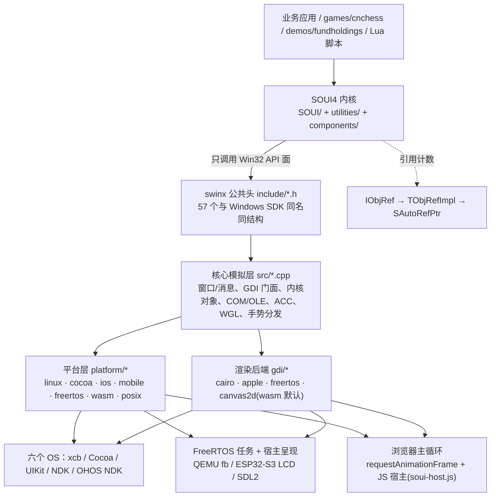
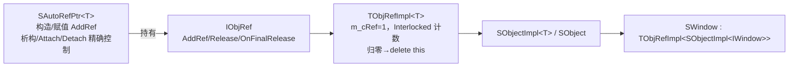
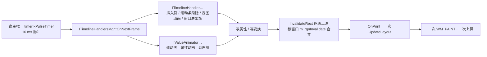
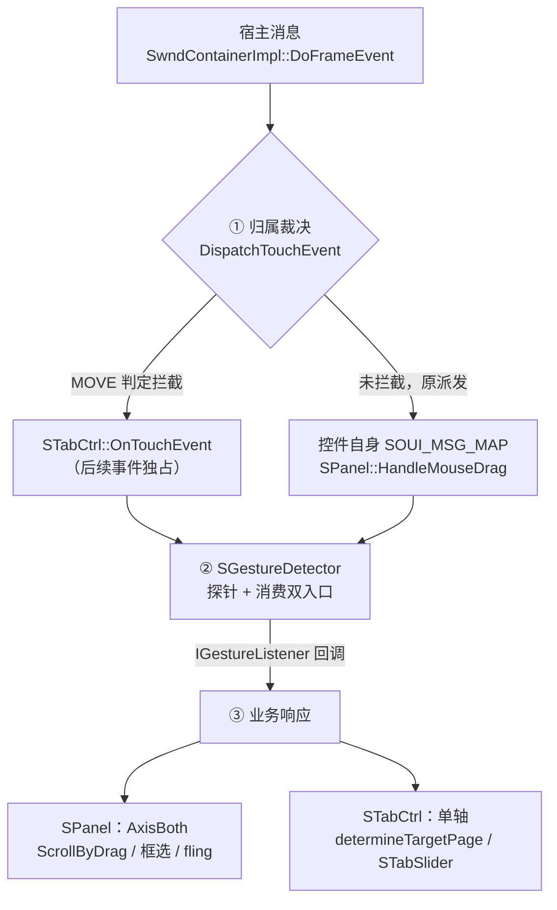

# SOUI4 跨平台 C++ GUI 框架项目评估报告

> **评估时间**：2026-11-14
>
> **代码基线**：主仓库 `soui4` HEAD `c36ca765`；`swinx` 子模块 HEAD `49cb7bd`（分支 `esp32`，版本 **1.9.0**）；`soui-freertos` 子模块 HEAD `c3a3181`（含 `esp32s3/` 真机工程）；内核版本 `SOUI_VER = 5.3.2.3`
>
> **统计口径**：所有规模、计数与能力判断均以三个仓库的 HEAD 为准；未跟踪文件不计入任何统计。
>
> **评估范围**：内核（`SOUI/`、`utilities/`）、跨平台层 `swinx/`、组件 `components/`（17 个）、扩展控件 `controls.extend/`、移动端宿主库 `soui-android-lib/`·`soui-ohos-lib/`，以及四块能力面——FreeRTOS（`soui-freertos/`）、WebAssembly（`demos/wasm-demo/` + 两个应用消费端）、OpenGL/WGL 兼容层（`swinx/include/wgl.h` + `demos/opengl_demo/`）、UI 自动化测试支撑库（`components/souitest/`）。
>
> **方法**：机制性结论逐条回源码核对并给出 `文件:行号`；规模与计数取自当前仓库实测（`git ls-files` 受控文件、按字节计 `\n` 数、`swinx/doc/tools/api_scan.py` 的清单、`ctest -N`、磁盘产物 `ls -l`）；性能数字取自 ESP32-S3 串口实测与 `demos/wasm-demo/tools/diag/` 的同机 A/B。凡是没有可复现证据的结论，正文会写明"未验证"。

---

## 〇、结论与速览

### 0.1 一句话结论

SOUI4 是一套**以 Win32 API 语义为统一编程面**的 C++ DirectUI 框架：借助自研的 `swinx` 兼容层，**同一套 C++ UI 与业务代码**在 **8 个运行目标**上原生运行——Windows / Linux / macOS / iOS / Android / OpenHarmony 六个操作系统，加上 FreeRTOS（裸机 MCU）与 WebAssembly（浏览器）。`games/cnchess` 与 `demos/fundholdings` 两个真实应用的业务源码里 `__ANDROID__`·`__OHOS__` 出现次数为 **0**，"一次编写、多端运行"是工程现实而非口号。

三个判断构成这份报告的主干：

1. **跨端的抽象是稳定的，成本落在"叶子"上（§2）**：`platform/` 7 个目录 × `gdi/` 4 个后端，新增一个宿主形态不需要改内核；每次扩张的代价都能被清楚归账（§3.4、§4.8）。
2. **两端"最不像 GUI 的地方"都已经跑起来（§3、§4）**：FreeRTOS 侧在带 SPI 屏与电容触摸的真实开发板上稳定 **20~27 fps**，上游改动只有 4 处；WASM 侧有三个真实消费端、双渲染后端可选、并且能开真线程（`SOUI_WASM_PTHREADS`）。
3. **"看起来像能力，实际是流程"的问题由机器看护（§1.4）**：七个 CI 工作流把**八个目标全部**纳入构建门禁——桌面三端、移动三端（Android / OHOS / **iOS** 交叉编译，iOS 只出静态库并独立复核 arm64 Mach-O）、FreeRTOS（census / 4 MB 预算 / QEMU 实跑 / 帧缓冲断言 / 宿主模拟器）、WASM（双后端烟测）。`swinx-api-gate` 的清单与源码一致，处于绿色状态。

必须与结论同置的边界：**移动三端只有"编译链路不断"这一层，没有任何运行期回归**；真机只有一个板型一块屏；WASM 的触摸与移动端浏览器未验证；FreeRTOS 的字体只烘了 ASCII（中文要按码位重烘）、图标不支持 PNG 压缩分帧、光标不绘制；多窗口 z-order 已落地但缺应用层自动化（§4.8）。这些是**工作量与流程问题**，没有一项需要推翻现有设计。

### 0.2 八目标的能力分档

"8 个运行目标"不等于"8 个可直接交付的目标"。按"有无 CI / 有无示例 / 有无运行期证据 / 已知缺口"四把尺子分档：

| 档位 | 目标 | 判据 | 还缺什么 |
|---|---|---|---|
| **产品级** | Windows / Linux / macOS | 门禁 + 完整示例 + 系统级能力（ACC、菜单、原生控件、对话框）齐备 | — |
| **产品级（移动）** | Android / OHOS | 交叉编译进 PR 门禁、宿主库两个（`soui-android-lib`/`soui-ohos-lib`）、两个应用各有 Android/OHOS 壳 | 无运行期回归；OHOS 的 ACC 被构建层强制关闭 |
| **产品级（Apple）** | iOS | 平台层完整（23 文件 / 6,218 行）、与 macOS 共用 `gdi/apple` 与资源路径取法（`GetAppleBundlePath` + `SResProviderFiles`，§6.4）；`swinx-ios-arm64` 交叉编译进 PR 门禁（macos-15 + Xcode，静态库 + `lipo` 复核 arm64） | 无运行期回归 |
| **能力证明级+** | FreeRTOS | 5 个工程、QEMU + **ESP32-S3 真机**、census/4 MB/QEMU/宿主模拟器四道门禁 | 字形只烘了 ASCII、只有一块板 |
| **能力证明级+** | WebAssembly | 3 个消费端、双后端、可选真线程、双后端烟测门禁 | 触摸/移动浏览器未验证、系统级 IME 与拖放未做、多窗口合成缺应用层自动化 |

这张表是本报告最重要的读法：**"能构建、`SApp` 能端到端跑通"与"能交付项目"之间的差，全部写在最后一列**。

### 0.3 核心数据速览

| 维度 | 当前值 | 出处 |
|---|---|---|
| 自有源码规模 | **1,199 个文件 / 540,527 行**（内核 `SOUI/`+`utilities/` = 186,985 行） | §1.2 |
| 跨平台层 `swinx` | **204,774 行 / 303 文件**（受控 `src/`+`include/`）；公共头 **57 个**（+ `GL/` 2 个）；API 声明 **1,153** · 有定义 **1,143** | §2.4 |
| 运行目标 | **8**：Windows / Linux / macOS / iOS / Android / OHOS / FreeRTOS（含真机）/ WASM（含 pthreads） | §0.2、§2.2 |
| 平台/渲染正交 | `platform/` **7 目录** × `gdi/` **4 后端**（`cairo` / `apple` / `freertos` / `canvas2d`） | §2.2 |
| ESP32-S3 真机 | 固件 **4,547,616 B**（6 MB 分区余 28%）；冷启动首帧 **≈4.4 s**；稳态 **20~27 fps**（`paint` 35~45 ms / `flush` <1.5 ms）；资源 COFF **81 KB / 56 条**；上游改动 **4 处** | §3 |
| WASM | canvas2d 产物 `.wasm` **4.53 MiB** + `.data` **0.77 MiB**（全套 5.5 MB）；cairo 后端 **6.18 MB** + **19.6 MB**（全套 26 MB）；3 个消费端；烟测 **35 断言 × 2 后端矩阵**；整窗重绘 **1,773 ops / 11.8 ms**，Lua 游戏页 **57 fps** | §4 |
| OpenGL/WGL | `wgl.h` + `GL/{gl,wglext}.h` 三头；契约测试 Windows **16 PASS / 0 FAIL / 1 SKIP** | §5 |
| 测试门禁 | **620 条** ctest（headless 615 / gui 5 / e2e 12）；`demos/fun_test` **55 个** `test_*.cpp`、`TEST`/`TEST_F` 声明 **619 处**；另有 wasm 单测腿（node 跑 gtest） | §1.4 |
| 控件面 | **40 个**内置控件头 + **37 个**扩展控件类；六列表控件统一多选/框选/键盘导航 | §7.4 |
| 可测性 | `components/souitest/souitest.h`（纯头）+ **41 条** `soui-uitest` 用例：定位/注入/断言三层，等价 QTest + QAccessible 范式 | §7.7 |
| 脚本绑定面 | `ScriptModule-LUA`：44 文件 / **4,403 行**；**74 个** `DEF_TOOBJ` + **25 个** `DEF_QICTRL` 类型登记；`test.lua` **4,430 行** | §8 |
| 体积 | 最小编译核心约 **2.3 MB**（README 口径）；常规配置 Windows ~4 MB / Linux ~10 MB / macOS ~7 MB；wasm 演示 5.5 MB（canvas2d，免内嵌字体） | §6.2 |
| 第三方 vendor | **11,770** 个受控文件，占两仓库受控文件合计（18,127）的 **64.9%** | §1.3 |

### 0.4 能力地图：四条主线 + 一条纵轴

| 主线 | 回答的问题 | 最硬证据 | 主要短板 |
|---|---|---|---|
| **跨端能力**（§2） | 同一套 C++ 能否多目标运行、代价多大 | 57 个与 SDK 同名同结构的公共头；`platform/`(7) × `gdi/`(4) 二维正交；两个真实应用业务零平台宏；连 WKE 都被接住 | 原生控件库仅 3 个、窗口菜单栏与 `DialogBoxParam` 族缺（§2.5） |
| **平台扩展性**（§3–§5） | 吸收一个新宿主形态要动多少 | FreeRTOS：上游 4 处、内核零移植改动、真机 25 fps；WASM：复用裸机蓝图 + 双后端 + 真线程 + 三消费端；OpenGL：三端同源 + 同一套契约断言 | 真机只有一块板、wasm 触摸未验、OpenGL 无 MSAA |
| **工程能力**（§6） | 内存安全、资源管理、体积、矢量渲染 | `SAutoRefPtr` + 控件树裸指针；资源"三层职责 + 字符串键"；核心 ~2.3 MB；SVG 为渲染原语；`SAppCfg` 可接内存提供器 | vendor 占比 64.9%；资源无条目级失效（§6.4） |
| **开发能力**（§7） | 写 UI 有多快、控件够不够、事件怎么写 | XML + 类 COM 工厂 + uieditor；6 类布局 + 两套动画 + 一条共享时间轴；40 控件头 / 37 扩展类；映射表 + 订阅双面（29 条用例）；手势归属链 + UIA 支撑库 | XML `on_*` 绑定与脚本处理器段无用例（§7.5） |
| **可编程能力**（§8） | 玩法能否免编译迭代 | XML 事件直挂 Lua；消消乐/俄罗斯方块/坦克大战全脚本编排；`ITaskLoop` + `PostTask` | JS/Python 分仓且仅桌面三端 |

**纵轴的结论**：三个新目标的落点全部收敛在 `swinx/src/platform/<os>/`，宿主形态从"有窗口系统"退到"裸机"，再退到"浏览器沙箱"，**内核改动都没有超出显式 include 与一两个回调注册点**。边际成本的分布也因此清楚：越往"能交付"走，钱花在板级驱动、资源管线、宿主壳上，框架本身的占比越小（§3.4）。

### 0.5 全文导航

| 章 | 回答什么 | 关键数字 |
|---|---|---|
| 一 · 项目底图 | 规模、构成、CI 与模块边界 | 540,527 行 / 18,127 受控文件 / 7 工作流 / 620 用例 |
| 二 · 跨端能力 | 同一套 C++ 如何多目标运行、兼容边界在哪 | 57 头 / API 1,153→1,143 / platform 7 × gdi 4 |
| 三 · FreeRTOS | 无 OS 场景怎么落地、真机实测到什么程度 | ESP32-S3 / 4.5 MB / 25 fps / 上游改 4 处 |
| 四 · WebAssembly | 浏览器场景怎么复用裸机蓝图、双后端与真线程意味着什么 | 5.5 MB vs 26 MB / 3 消费端 / 35×2 断言 |
| 五 · OpenGL/WGL | GPU 上下文怎么做到三端同源 | 3 头 / 16 PASS·0 FAIL·1 SKIP |
| 六 · 工程能力 | 内存、资源、体积、矢量 | 最小 2.3 MB / SVG 四后端 / 资源三层 + 内存提供器 |
| 七 · 开发能力 | 布局、动画（含共享时间轴）、控件完整性、事件体系、手势、UIA | 6 类布局 / 两套动画 + 27 插值器 / 单 timer 集中刷新 / 40 控件头 / 37 扩展类 / 29 条事件 + 17 条手势 + 41 条 UI 自动化用例 |
| 八 · 可编程能力 | 脚本化玩法迭代 | 44 文件 / 4,403 行 / 4,430 行 Lua |
| 九 · 国际化与高分屏 | 多语言热切换 + DPI 自动缩放 | `EnableMultiLang` / `SDpiHandler` / wasm 超采样 |
| 十 · 性能与线程 | 密集计算与 UI 线程协作、受限目标上的绘制预算 | 固定开销 vs 像素开销 / `ITaskLoop` 五宿主后端 / `PostTask` 边界 |
| 十一 · 横向对照 | 与 Qt / Flutter / Electron / wxWidgets 对照 | 17 个维度 |
| 十二 · 优势与风险 | 优势清单 + 风险清单 | 每项给出章节出处 |
| 十三 · 路线图 | 按性价比排序的措施 | 13 项（首位是"补一条移动端运行期回归"） |
| 十四 · 结论 | 总体判断与能力边界 | — |

---

## 一、项目底图：规模、构成、CI 与架构

### 1.1 项目速览（定位与关键事实）

| 维度 | 事实 | 出处 |
|---|---|---|
| 定位 | 轻量跨平台 C++ DirectUI 框架，持续开发 **14 年** | `README.zh-CN.md` |
| 版本 | 内核 `SOUI_VER = 5.3.2.3`；`swinx` **1.9.0** | `SOUI/include/soui-version.h`、`swinx/include/swinx_version.h` |
| 核心编译体积 | 约 **2.3 MB**（官方声明，动态链接核心库，Release x86） | `README.zh-CN.md` |
| 运行目标 | **8** 个：Windows / Linux / macOS / iOS / Android / OHOS / FreeRTOS / WASM | §2.2 |
| 渲染后端 | GDI / Direct2D（Win）、Skia（跨平台主流）、Cairo（Linux/Android/OHOS/FreeRTOS）、Core Graphics（Apple）、Canvas2D（wasm 默认）；GL 上下文经 swinx WGL 层承接 | `components/render-*`、`swinx/src/gdi/` |
| 内存模型 | 类 COM 引用计数 + 智能指针 `SAutoRefPtr` | `utilities/include/helper/obj-ref-impl.hpp` |
| 编程风格 | Win32/WTL 式 API + XML 描述 UI + Lua 脚本逻辑 | `README.zh-CN.md`、`components/ScriptModule-LUA` |
| 生态 | `demos/` **22 个子目录**（含设计器 `uieditor`、测试工程 `fun_test`、四端工具 `fundholdings`）；`games/` **3 个示例**（cnchess / junqi / upgrade）；内置 Lua 5.4，JS/Python 为独立仓库且仅桌面三端 | `demos/`、`games/` |
| 对外口径 | README 平台表列全八目标，并把 FreeRTOS / WebAssembly 标注为"**能力证明级**"；顶部徽章含 `FreeRTOS 门禁` / `WASM 门禁` | `README.zh-CN.md` |
| 许可 | 自有商业条款（非商用免费）；`swinx` 内含 Wine 派生代码并单列披露 | `LICENSE-zh.md`、`swinx/license_CN.txt` |

### 1.2 代码规模（实测）

框架**自有源码**（不含 `third-part/` 与 `swinx/thirdparty/` 的 vendor 代码；`swinx` 仅计受控 `src/`+`include/`）：

| 模块 | 源文件 | 行数 |
|---|---:|---:|
| `SOUI/`（DirectUI 内核） | 414 | 151,564 |
| `utilities/`（基础件） | 56 | 35,421 |
| `components/`（17 个可插拔组件） | 194 | 88,981 |
| `controls.extend/`（扩展控件） | 214 | 52,908 |
| `swinx/src` + `swinx/include` | 303 | 204,774 |
| `soui-android-lib/` + `soui-ohos-lib/` | 18 | 6,879 |
| **合计** | **1,199** | **540,527** |
| 附：`soui-freertos/`（子模块，工程胶水） | 43 | 6,425 |
| 附：`soui-freertos/FreeRTOS-Kernel/`（vendored） | 655 | 348,485 |

> **统计口径**：只计受控的 `.c/.cpp/.h/.hpp/.cc/.mm/.m/.inl`，按字节计 `\n` 数；不含 `.idl`/`.rc`/构建脚本。

> **规模结构读法**：框架真正的内核是 **`SOUI/` + `utilities/` = 186,985 行**，而兼容层 `swinx` 有 **204,774 行（1.09 倍）**——这套方案的核心成本不在 UI 框架本身，而在"让 Win32 语义在八个目标上成立"。这不是缺陷，是设计选择的必然结果：它换来的是内核里 0 处平台 `#ifdef`（§2.1）。`gdi/canvas2d`（6,336）与 `platform/freertos`（6,452）两个数字则说明**新目标的增量主要落在平台层**，而不是重写内核。

### 1.3 仓库文件构成（`git ls-files` 口径）

| 分区 | 受控文件数 |
|---|---:|
| 主仓库 `soui4` 合计 | **9,908** |
| ├ `third-part/`（vendor，含 3 个嵌套子模块） | 3,927 |
| ├ `demos/`（示例 + 设计器 + 测试工程） | 3,404 |
| ├ `games/`（棋牌示例） | 914 |
| ├ `SOUI/` | 418 |
| ├ `wizard/`（VS 向导） | 275 |
| ├ `components/` · `controls.extend/` | 255 · 217 |
| ├ `utilities/` · `tools/` · `doc/` · 移动端 lib · `__cmake/` | 61 · 69 · 57 · 58 · 14 |
| └ 其他（根目录文件、`.github/`、`AGENTS.md` 等） | 245 |
| `swinx` 子模块合计 | **8,219** |
| ├ `swinx/thirdparty/`（vendor） | 7,843 |
| └ `swinx` 自有（`src/` `include/` `doc/` 等） | 376 |

**第三方 vendor 合计 11,770 个受控文件**，占两仓库受控文件合计（18,127）的 **64.9%**；`swinx/thirdparty/` 占子模块的 **95.4%**。clone 与全仓检索的体验主要由这一块决定（风险 9）。

### 1.4 CI 与自动化现状

| 工作流 | 触发 | 覆盖 | 做什么 |
|---|---|---|---|
| `build.yml` | push tag、push `build-test` 分支 | Windows/Linux/macOS × x64/x86/arm64 | 全量构建 + `ctest -L '^soui-headless$'` + 上传 demo 制品 |
| `pr-core.yml` | PR → `master` | linux-x64 / windows-x64 / macos-arm64 | 构建 `fun_test` + 三腿跑 `-L '^soui-headless$'` |
| `gui-smoke.yml` | PR → `master`、手动 | linux-x64（Xvfb） | 真实宿主窗口烟测 |
| `swinx-api-gate.yml` | PR、push `master`、手动 | ubuntu-latest（纯文本扫描） | `api_scan.py --check` 断言声明面与 `api_scan.json` 一致、且没有任何函数低于"能力基线"（当前输出 `[OK]`，§2.4） |
| `swinx-mobile-gate.yml` | PR/push 且路径命中 `swinx` | Android arm64（API 28）+ OHOS arm64 + **iOS arm64** | `cross_build.py` 交叉编译，只保证"还能编过"。iOS 用 macos-15 + Xcode 自带的 iphoneos SDK，产物强制静态库并用 `lipo` 独立复核 Mach-O 的 cputype |
| `soui-freertos-gate.yml` | PR/push 命中 `soui-freertos`·`swinx`·`SOUI`·`utilities` | ubuntu-latest + windows-latest | 两个 job：① arm-none-eabi census 链接（全量符号解析）→ 可运行镜像 `.text < 4 MB` 断言 → QEMU 实跑 + 5 条日志标记 + PPM 帧缓冲"非空帧"校验；② Windows/MinGW 编 `soui_sim`，SDL `dummy` 驱动无头跑，断言干净退出 + `sim_frame.bmp` 生成 + 无 ASSERT |
| `soui-wasm-gate.yml` | PR/push 命中 `demos/wasm-demo` 等 | ubuntu-latest × **2 腿**（pump / pthreads） | emscripten 构建 `soui-wasm-demo` → `node smoke.js`（**35 处断言**）→ grep `^OK: 全部断言通过$` + 钉死 `[taskloop] pt=0/1` |

**这套门禁的三个特点**（决定它值不值得信任）：

- **分层断言，不是"能编过就算"**：FreeRTOS 把"能链接"（census：全量符号解析，失败即缺口清单）、"能装进 4 MB"（`.text` 预算）、"真跑出图"（QEMU + PPM 像素种类数 ≥3）拆成三道；WASM 把"能构建"与"烟测通过"分开，并用 `[taskloop] pt=N` 钉死产物来源，防止"哪条腿吃了哪份产物"错位。
- **八个目标都在 CI 里，但"编过"≠"跑过"**：桌面三端跑 headless 用例与 GUI 烟测；移动三端（Android / OHOS / iOS）只做交叉编译；FreeRTOS 与 WASM 有真实运行（QEMU / node）。所以"**移动端没有运行期回归**"是本报告最实的一条流程缺口（风险 1）——不是没有门禁，而是门禁只到编译为止。
- **有一处在 CI 里现改源码的垫片**：FreeRTOS 门禁的 Windows job 里 `cat > swinx/include/io.h`，用 `include_next` 透传 MinGW 的 `<io.h>` 并别名 `_chsize`（`soui-freertos-gate.yml:255-263`）。它说明宿主构建有一个已知的 include 顺序债还没上游进 `swinx`（风险 3）。

⚠️ 另外：工作流文件存在**不等于**线上 Required Check 已生效，后者仍须在 GitHub 分支保护规则现场核验。

**测试规模（`ctest -N` 实测）**：**620 条**，标签分布 `soui-headless` 615 / `soui-gui` 5 / `soui-e2e` 12，另有正交标签 `soui-unit` / `soui-integration` / **`soui-uitest`（41）**。源码侧 `demos/fun_test` 有 **55 个** `test_*.cpp`、**619 处** `TEST`/`TEST_F` 声明（经参数化展开为上述条目），另有 `demos/fun_test/wasm` 这条 wasm 单测腿（node 跑 gtest，可按后端分别构建）。

### 1.5 分层结构（8 目标）

这张图的关键读法：**三块"能力面"（`platform/freertos`·`platform/wasm`·`wgl`）位置相同、形状相同**——它们是同一抽象下的叶子，而不是并列的框架分支。这是"8 个目标"能共享一套内核的结构性原因。

### 1.6 模块划分

- **`SOUI/`**：DirectUI 内核——窗口树（`SWindow`）、消息路由、事件系统、布局、动画、XML 对象工厂、手势归属链（`SGestureDetector` + `OnInterceptTouchEvent`/`OnTouchEvent`）；`control/` 下 **40 个控件头**，MVC 虚拟列表 `SListView`/`SMCListView`/`STreeView`/`STileView`/`SComboView` 在此。
- **`utilities/`**：与 UI 无关的基础件——接口、引用计数、XML、字符串数学、COM 动态加载。
- **`swinx/`**：跨平台兼容层（§2）。Windows 下**不编译**。
- **`components/`**：**17 个**可独立链接的组件——`render-skia`/`render-gdi`/`render-d2d`、`imgdecoder-stb`/`-wic`/`-gdip`、`resprovider-zip`/`-7zip`、`ws`/`network`/`httpclient`/`TaskLoop`/`SIpcObject`、`ScriptModule-LUA`、`log4z`、`translator`、`souitest`（纯头文件 UI 自动化支撑库，§7.7）。组件的进退由统一开关（`SOUI_BUILD_*`，默认全 ON，定义在 `__cmake/component-options.cmake:20-28`）加 target 可用性双重门控（`components/CMakeLists.txt:108`），第三方库是否进构建图也跟随同一批开关（`third-part/CMakeLists.txt:40-47`）。
- **`controls.extend/`**：扩展控件——`propgrid`/`gridctrl`/`hellocharts`/`gif`/`qrcode`/`image3d`/`reole`/`smiley`/`trayicon` 等 9 个子目录 + 平铺源码，**37 个窗口类**经 `SCtrlsRegister::RegisterCtrls` 集中注册（`controls.extend/SCtrlsRegister.cpp:59`）。
- **`soui-android-lib/` / `soui-ohos-lib/`**：移动端宿主库，把 `SApplication` 托管进 `GameActivity`（JNI）/ `EntryAbility`（N-API）并填写 `PlatformAPI`；OHOS 侧以 **HAR 包**形态提供。
- **`soui-freertos/`**：FreeRTOS 工作区子模块——vendored 内核 + `cmake/soui.cmake` 唯一入口 + **5 个工程**（`demo`/`swinx_test`/`soui_fr` 跑 QEMU、`soui_sim` 跑 Windows、`esp32s3` 跑真机）+ 新建工程模板。
- **`demos/wasm-demo/`**：WebAssembly 演示 + 可复用宿主 `soui-host.js` + `tools/diag/` 验收脚本 + `smoke.js`（35 断言，进门禁）+ `zorder-selftest.sh`（多窗口合成像素自测，§4.8）。
- **`demos/fundholdings/`**：基金持仓工具，**四端同源**（桌面 / Android / OHOS / wasm），第二个"真实应用级"多端样本，也是 wasm 的第三个消费端。
- **`swinx/src/gdi/canvas2d/`**：浏览器 Canvas2D GDI 后端（6,336 行），wasm 默认后端。
- **`demos/opengl_demo/`**：OpenGL/WGL 三端同源验证装置（§5）。

---

## 二、跨端能力：`swinx` 跨平台兼容层

### 2.1 设计哲学：以 Win32 为"世界语"

`swinx` 不是"为每个平台写一套抽象接口"，而是**重演 Win32 语义**——`include/` 下 **57 个头文件**与 Windows SDK **同名同结构**（47 个直接对应 SDK 头，如 `windows.h`/`winuser.h`/`gdi.h`/`unknwn.h`/`oleacc.h`/`textserv.h`/`wgl.h`/`commdlg.h`；另 12 个是 SOUI 自有扩展头）。因此 SOUI 内核直接 `#include <windows.h>`，**零平台 `#ifdef`**。

这个选择的代价与收益都很具体：

- **收益**：14 年积累的 Win32/WTL 写法原样可用；Wine 派生的重组件（RichEdit、ListBox）与已有 SDK 头可以直接复用。
- **代价**：参考实现本身会演进。`PostMessage` 在 Win11 26H2 上可能出现投递顺序变化，因此 `SDropDown` 的两处不用投递队列、直接用 `SendMessage`（§7.5）——**"以 Win32 为世界语"意味着要跟着这门语言一起变**。
- **可维护性靠门禁而不是自觉**：`swinx/doc/tools/api_scan.py` 给每个声明记录实现等级（`impl`/`partial`/`stub`/未定义），`--check` 在 PR 上比对清单。当前声明面 **1,153** 条、有定义 **1,143** 条（§2.4），这个分母是主动维护的结果：不打算实现的声明会被删掉，而不是留着返回 NULL。

### 2.2 八目标 × 渲染后端矩阵

各 `*.cmake` 用 `file(GLOB)` 把当前平台源文件自动纳入编译，**新增 `.cpp`/`.mm` 不需改 cmake**。实际编译归属：

| 目标 | 平台适配层 | 渲染后端 | 构建脚本 | 宿主形态 / 呈现方式 |
|---|---|---|---|---|
| Windows | （不编译 swinx，用系统 Win32） | GDI / D2D | MSVC/MinGW | 系统窗口系统 |
| Linux | `platform/linux`（20 / 14,979） | `gdi/cairo` | `linux.cmake` | xcb + `poll()` 事件循环 |
| macOS | `platform/cocoa`（26 / 10,708） | `gdi/apple` | `macos.cmake` | `NSApplication` |
| iOS | `platform/ios`（23 / 6,218） | `gdi/apple` | `ios.cmake` | `UIApplicationMain`（`swinx_ios_entry` 托管） |
| Android | `platform/mobile`（15 / 2,797） | `gdi/cairo` | `mobile.cmake` | JVM 启动 + `PlatformAPI` 桥接 |
| OpenHarmony | `platform/mobile` | `gdi/cairo` | `mobile.cmake` | ArkTS 启动 + `PlatformAPI` 桥接 |
| FreeRTOS | `platform/freertos`（23 / 6,452） | `gdi/freertos`（99 行 cairo 包装 → 内存帧缓冲） | `soui-freertos/cmake/soui.cmake` | **无 OS**：任务跑消息泵，宿主取帧缓冲上屏（ESP32-S3 LCD / QEMU 半主机 / SDL2） |
| WASM | `platform/wasm`（17 / 4,298） | **`gdi/canvas2d`（默认，6,336）/ `gdi/cairo`（可选）** | `swinx/wasm.cmake` + `SOUI_BUILD_WASM_DEMO` | **浏览器**：`emscripten_set_main_loop` 驱动泵，JS 宿主按脏矩形 blit |

> **两个正交维度值得单独看**：纵向是"平台适配层"（窗口/输入/线程/文件），横向是"渲染后端"（光栅化落点）。二者可以任意组合——WASM 能在不改一行业务代码的前提下切 canvas2d / cairo（`-DSWINX_WASM_GDI_BACKEND=canvas2d|cairo`，由 `swinx/wasm.cmake` 拥有），这个组合自由度也是"跨后端对拍"的前提（§4.2）。

### 2.3 五大核心机制

1. **同符号、分目录实现、链接期解析**（`src/SwinxUtils.h`）：跨平台助手声明集中于此，各平台目录给同名同签名实现；`GLOB` 只编当前平台，调用方正文**无平台 `#ifdef`**。返回类型统一 `int` 而非 `BOOL`，规避 ObjC++ 中 `BOOL` 的宽度差异。
2. **`g_platformAPI` 回调机制**（`platform_api.h`，`PLATFORM_API_VERSION = 3`）：Android/OHOS 无桌面窗口系统，窗口/输入/剪贴板/提示音转发给宿主 App，`PlatformAPI_Init` 严格比对版本。
3. **非 MSVC 工具链上的 COM 自研**（`src/SUnkImpl.h`）：`DECLARE_INTERFACE_` 宏集 + `__uuidof` 降级 + `SUnkImpl<T>` + 弱符号 GUID；`BSTR/VARIANT/SAFEARRAY/IDispatch` 全自研，ACC 代码一字不改跨桌面平台编译。
4. **平台派生收敛到单一配置头**（`sfr_config.h`）：四个构建参数派生四个恒有定义（0/1）的开关，调用点只写 `#if SFR_HOSTED`；ESP-IDF 下另有 `SFR_ESPIDF`、`SFR_ARCH_XTENSA` 两个派生量（供临界区选择 `portMUX_TYPE` 而非 Cortex-M 的 `mrs primask`）。
5. **宿主异步回调：通用对话框**。`GetOpenFileName` 族不是"同步阻塞等用户选文件"——`dlghelper.cpp` 把选择结果经 `swinx_pick_file_deliver(ok, path, pfnDone, pCtx)` 投回，调用方给回调。桌面/移动/wasm/FreeRTOS 四个平台共用这一层（`platform/*/dlghelper.cpp`），因此**浏览器里能实现真正的文件选择**（`<input type=file>` 的 `change` 只在 JS 栈返回后派发，同步等待必然拿不到结果）。烟测里有 5 条断言钉住"发起不阻塞主线程 / 过期 id 丢弃 / 多选与 SAVE 显式拒绝"。

### 2.4 量化现状

| 维度 | 当前数据 |
|---|---|
| 代码规模 | `src/` + `include/` = **204,774 行**（303 文件） |
| 公共头 | **57 个**（47 个与 Windows SDK 同名同结构 + 12 个自有扩展头）+ `GL/` 2 个 |
| API 面 | 声明 **1,153**；有定义 **1,143**（完整实现 **1,094** / 部分实现 **9** / 空实现或语义桩 **40**）；未定义 **10** → **覆盖率 99.1%** |
| 平台层规模 | `posix` 26 / 27,048、`cocoa` 26 / 10,708、`linux` 20 / 14,979、`ios` 23 / 6,218、`freertos` 23 / 6,452、`wasm` 17 / 4,298、`mobile` 15 / 2,797 |
| 后端规模 | `gdi/cairo` 9 / 8,633、`gdi/apple` 3 / 8,032、`gdi/canvas2d` 4 / 6,336、`gdi/freertos` **1 / 99** |
| 已落地的通用对话框 | `GetOpenFileName`/`GetSaveFileName`/`ChooseFont` 族四平台实现 + 异步回调；`commdlg.h` 已公开 |
| 未定义的 10 条 | 全部是宏 / 编译器内建（`LOWORD`、`memcpy`、`DEFINE_GUID` …）或系统已提供的入口——**没有一条是"该有却没有"的真实 API 缺口** |
| 接口面缺口（迁移面） | 原生控件库仍是 `Static`/`Button`/`ListBox`；`SetMenu`/`GetMenu`/`DrawMenuBar` 无声明；`DialogBoxParam` 族全缺（`grep` 在 `include/*.h` 为空） |
| 无障碍（ACC） | 约 6,240 行支撑桌面三平台，全自研；Linux AT-SPI2 桥、macOS NSAccessibility 桥；Windows 复用系统 `oleacc` |

> **99.1% 这个数字要按"声明即承诺"读**：它的含义是"`swinx` 声明出来的函数都有定义"，**不等于**"Windows 有的这里都有"。分母是主动裁剪过的（不打算实现的声明会被删除），所以这个比例高说明的是"承诺与交付一致"，而不是"实现面接近 Win32 全集"。真正的迁移面缺口在下一节，与这个百分比无关。
>
> **门禁不止比"数量"，还比"等级"**：`api_scan.py --check` 除了比对声明/定义数，还带一层**能力基线**——清单里记录 **1,120 个**函数的最低实现等级，任何函数被"降级"（`impl` → `partial`/`stub`）也会让门禁变红。当前输出 `[OK] 清单与源码一致，且没有任何函数低于能力基线`。这一层防的是"把实现悄悄换回桩"这种比"忘更新清单"更隐蔽的退化。

### 2.5 兼容的边界：缺口与未覆盖面

> **范围界定**：`swinx` 的目标是让"用 SOUI 编写的应用"多端运行，不是让任意既有 Win32 程序零成本迁移。"原生控件 / 窗口菜单 / 资源对话框"属于**延伸目标**。

- **编译层面**：同一份 `#include <windows.h>` 源码多端编译——**成立**（§2.9 两个应用实证，§3/§4 再添两例）。
- **通用对话框（部分闭合延伸目标）**：`commdlg.h` 已公开，`GetOpenFileNameW`/`GetSaveFileNameW` 在 linux/mobile/wasm/freertos 四个平台都有实现（`platform/*/dlghelper.cpp`）；`test_commdlg.cpp` 4 条用例钉住"过滤器串 → accept 列表"的换算与"非法参数不回调"。**边界**：`DialogBoxParam`/`DialogBoxIndirectParam` 族仍全缺，`.rc` 对话框资源仍不能加载——`demos/opengl_demo` 用的是 SOUI 自己的 `SHostDialog`。
- **原生控件库**：只有 `Static`/`Button`/`ListBox` 三个（`ListBox` 走 Wine 搬运）；`Edit`/`ComboBox`/`ScrollBar`/公共控件全缺，缺失表现为 `CreateWindowEx` 返回 `NULL` 的**静默失败**。
- **窗口菜单栏**：`SetMenu`/`GetMenu`/`DrawMenuBar` 无声明——弹出菜单机制完整，缺的是窗口侧挂载。
- **语义边界**：`IsWindowUnicode` 返回 `FALSE` 是**有意为之**（UTF-8 作为多字节编码），并非缺陷。
- **新目标的边界**：FreeRTOS 无多进程、文件锁语义弱化；WASM 单线程不再是**硬**约束而是**默认配置**（开 `-pthread` 需要 `crossOriginIsolated`，§4.5）；OpenGL current context 为 per-thread（§5）。

### 2.6 新目标如何被"装进"同一套抽象（横向对照）

| 维度 | FreeRTOS（§3） | WebAssembly（§4） | OpenGL/WGL（§5） |
|---|---|---|---|
| **形态** | 无 OS，带显示 MCU（QEMU 与真机两种载体） | 无原生窗口，浏览器沙箱 | 不是新平台，是**能力面**（GPU 上下文） |
| **落点** | `platform/freertos`（23 文件）+ `gdi/freertos`（99 行）+ 子模块工程胶水（5 工程） | `platform/wasm`（17 文件）+ `gdi/canvas2d`（6,336）+ 三个 app 的 `wasm/` 目录 | `include/wgl.h` + `GL/*`、`src/platform/posix/wgl.cpp`、`platform/cocoa/SGLBridge.mm` |
| **复用谁** | 复用 `gdi/cairo`、`platform/posix` 系统 API | **复用 FreeRTOS 的帧缓冲蓝图**（四个宿主接缝） | 复用 Win32 WGL 语义；macOS `NSOpenGLContext`、Linux GLX `dlopen` |
| **内核改动** | 仅若干显式 include + `SConnection` 注册点；ESP-IDF 下新增两个 `sfr_config` 派生量 | `FontFallback.cpp` 一个 `__EMSCRIPTEN__` 分支 + `TaskLoop` 的 wasm 后端 | 零：消费端只多一行"平台 GL 头须在 `SNSBEGIN` 之前" |
| **宿主职责** | 帧缓冲上屏（LCD/SDL）+ 输入注入 | canvas blit + DOM 事件注入 + `requestAnimationFrame` 泵 +（可选）worker 线程环境 | 无（swinx 建在原生子窗口上） |
| **消费端** | 5 个工程（4 个 QEMU/宿主 + ESP32-S3 真机） | **3 个**：`demos/wasm-demo`（演示）+ `games/cnchess`（联网游戏）+ `demos/fundholdings`（工具应用） | `demos/opengl_demo` |
| **已证到哪** | QEMU Cortex-M3 出图 + ESP32-S3 真机 320×240 / 25 fps | 3 个应用出图 + 35×2 断言烟测 + 双后端 A/B + 真线程 + 系统字体 | 三端同源 demo + 契约测试 16/0/1 |
| **链接依赖** | cairo/pixman/libpng/zlib（**无 freetype**：字体走烘焙位图 + `cairo_user_font_face`） | canvas2d：**零 C 库**（字体走浏览器）；cairo：保留整族 C 库 + 内嵌字体 | libGL/系统 GL |
| **产物体量** | 帧缓冲 KB 级；固件 4.5 MB（含 cairo + 56 条资源） | canvas2d 5.5 MB；cairo 26 MB；应用侧 `.data` 0.5 MB（资源） | — |
| **未证/缺口** | 字形只烘了 ASCII（中文需按码位重烘）、PNG 压缩 ICO 未验、只有一块板 | 触摸/移动端浏览器、多窗口合成缺应用层自动化、真机输入法 | 无 MSAA、单 drawable、macOS deprecated |
| **代价形态** | 工程胶水（构建/资源打包/板级驱动/启动） | 宿主壳（`soui-host.js` 三消费端共用）+ 单线程心智模型（默认）+ 隔离头（开线程时） | 平台语义差异的显式降级契约 |

> **读法**：三列的"落点"都指向 `swinx/src/platform/<name>/`，"内核改动"都接近零。真正随"交付度"上升的不是框架代码，而是**板级驱动、资源管线、宿主壳**——这也是为什么把 FreeRTOS 从 QEMU 推到真机只花了 2,394 行，而 WASM 的 pthreads 只动了 `TaskLoop` 的一个后端与几条链接参数。

### 2.7 典型案例：重组件零改源码跨端（richedit41 / Scintilla）

`third-part/richedit41`（499 文件的 Windows RichEdit 引擎）与 `third-part/Scintilla` 被整体搬运，靠 swinx 的 `textserv.h`（`ITextHost`/`ITextServices`）、`richedit.h`、`imm.h` 与 GDI 面。业务侧只需链入组件即得 RTF 超链接编辑与代码编辑器——`demos/sci_demo`、wasm 演示的"编辑器"页都是实证。

> **要记住的边界**：重组件搬运的边界是**符号面**而不是**功能面**。`platform/freertos/win32_rich.cpp` 里 `OpenClipboard`/`SetClipboardData`/`OleGetClipboard`/`ReadFile` 都是桩——能编过靠"每个符号都有定义"，行为是否正确只在该功能真被调用时暴露。这也正是 `api_scan` 门禁（§1.4）存在的意义：它让"定义变了"这件事在 PR 上立刻可见。

### 2.8 典型案例：RC 资源文件跨桌面端编译

一份 Windows `.rc` 在三端同源编译进 PE/ELF/Mach-O（`ENABLE_BUILD_RESOURCE` + `SetSysResPeHandle`/`SetAppResPeHandle`）。FreeRTOS 侧沿用同一思路换载体：`uires.idx` → uiresbuilder → windres COFF → `.incbin` 数据段（`.balign 4`，Cortex-M 非对齐会 fault）；ESP32-S3 上这套资源以 `SResProviderPE` 原样加载（**81 KB / 56 条**），与桌面同一条 `FindResource` 路径。

`SAppCfg` 的 `ResType_Mem` + `SetSysResMem`/`SetAppResMem`（`SOUI/include/SAppCfg.h:43,81-82`）把"提供器由谁创建"也纳入了配置面：调用方可以把自己 `Init` 过的 `IResProvider` 直接交给 `SAppCfg`——资源"从哪里来"不再被限定为"文件 / PE / 内存块"，而是**任何实现了 `IResProvider` 的对象**（§6.4）。

### 2.9 真实应用实证：`games/cnchess` 与 `demos/fundholdings` 单代码库跨端

- `games/cnchess`：四端样本（桌面 / Android / OHOS / wasm），客户端与三个平台宿主共用同一份绘制与逻辑，**业务源码 `__ANDROID__` 与 `__OHOS__` 出现次数均为 0**。它同时是皮肤热换、机器人 AI 线程池、WKE 接入的样本。wasm 版的模态窗口用 `SModalRoot`/`SModalView` 而非 `SHostDialog::DoModal`（§7.5），登录、求和、认输三个弹层都走这条路径。
- `demos/fundholdings`：基金持仓工具，**四端同源**（桌面 / Android / OHOS / wasm），wasm 版默认开 pthreads，走 `serve-fundholdings.py` 的同源代理转发行情。它是"新平台可用性"的第二个独立样本——**不是棋类游戏，而是带网络请求的桌面工具形态**。

> 两个应用都在 `wasm/` 目录下自带构建脚本与部署说明（`build-fundholdings.sh`/`.bat`、`apache/` 静态站点 + 反代），说明"上浏览器"已经进入**应用团队的日常动作**，而不只是框架演示。

### 2.10 典型案例：WKE 浏览器引擎跨平台

内置网页渲染经 **WKE（WebKit 分支）** 以**运行期绑定**接入：`SWkeWebkit` 控件在非 Windows 平台已脱离条件编译，swinx 已补齐引擎所需 API。这套兼容层能承接**最复杂的客户端形态**，接入面按组件实际引用面划定。

**边界**：引擎本体在独立仓库 `wkex` 编译，`libwke.so`/`libwke.dylib` 不入库，"网页在非 Windows 端能否真跑"不在本报告可验证范围（风险 12）。

---

## 三、FreeRTOS：无 OS 目标的载体与真机实测

> 这一章回答两个问题：一个要求"窗口系统 + 线程 + 文件"的框架，凭什么能跑在没有 OS 的 MCU 上；以及它在真实硬件上到底跑成什么样。

### 3.1 四种载体

| 载体 | 跑什么 | 什么时候用 | 局限 |
|---|---|---|---|
| `soui_sim`（Windows 宿主，MinGW + SDL2） | 同一份 swinx FreeRTOS 层 + 同一份 app 代码，出图换 SDL2 | 日常迭代：改 XML/控件/逻辑，秒级重编 + 鼠标交互 | 验证不了裸机启动链、内存布局、真实时序 |
| QEMU mps2-an385（`swinx_test`/`soui_fr`/`demo`） | 交叉编译的 Cortex-M3 镜像 | 交付前必过：启动链、堆锁、链接脚本、无 OS 依赖 | 慢；交互只能注入；**4 MB FLASH 上限** |
| **ESP32-S3 真机（`esp32s3/`）** | ESP-IDF 固件 + ILI9341V 屏 + FT6X36 触摸，**真实上屏与触摸** | 交付形态验证：SPI 带宽、PSRAM 访存、触摸时序、真实帧率 | 只有一块板、一块屏；调试靠串口 |
| 目标板（泛指） | 换 UART 驱动 + 链接脚本 + LCD 控制器 | 交付 | 需真实硬件 |

**推荐顺序**：模拟器迭代 → QEMU 跑通 → 真机跑通 → 换板上线。前三步在本仓库都已跑完。

### 3.2 ESP32-S3 真机：规格与实测

| 项 | 值 |
|---|---|
| SoC | ESP32-S3 rev0.2，16 MB Flash，8 MB Octal PSRAM |
| 屏 | ILI9341V，SPI 40 MHz，横屏 **320×240** |
| 触摸 | FT6X36，I2C @0x38，8 ms 采样任务 |
| 固件 | `soui_esp32s3.bin` = **4,653,360 B / 0x46F930**（6 MB app 分区余 26%）；比只有 toy font 的版本多 ~105 KB，即烘焙字模 82.5 KB + 图标读取器 15.5 KB + 内嵌图标 ~5.5 KB |
| 冷启动 → 首帧 | **≈4.4 s**（上电 → COFF 资源解析 → 布局 + SVG 皮肤 → cairo 首帧 → 整屏 SPI；UI 任务内部约 3.0 s） |
| 稳态刷新 | **20~27 fps**（`paint` 35~45 ms、`flush` <1.5 ms） |
| 资源 | windres COFF **≈87 KB**（含测试图标的 `GRPICONDIR` + 两帧 `RT_ICON`），`SResProviderPE` 加载 |
| 渲染链路 | `render-gdi` → `gdi/cairo` → swinx 帧缓冲（PSRAM ARGB32）→ RGB565 转换 → SPI |

> **两个帧率数字的来历**：`esp32s3/README.md` 记录的是"两个动画（扫动 + alpha）同时跑"的 20~22 fps / paint 42~45 ms；单动画场景复测为 **25.7 fps / paint 35.3 ms / presents 1.18 次每帧**。两者不是矛盾，是**场景不同**——读数时别把 `presents 次数` 当帧率。
>
> **注**：冷启动与帧率两组数字取自字模/图标上线**之前**的固件。新增的 ~105 KB 是静态数据（字模常驻 flash 按需读取，字形 alpha mask 首次绘制时建一张并缓存），不进稳态绘制路径；首帧会多出十几个字形的 mask 构建。

**这台真机证明了什么**（每条都有串口日志或产物为证）：

1. **无 OS 前提成立**：消息泵由 FreeRTOS 任务驱动，没有窗口服务器、没有进程、没有文件系统也能跑 XML 布局。
2. **渲染链可跨宿主**：cairo 光栅到 PSRAM 帧缓冲，再由板级 `present` 回调转 RGB565 送 SPI——**"画到哪"是 `gdi` 的事，"怎么显示"是宿主的事**（§2.2 那条正交）。
3. **触摸链完整**：FT6X36 采样（8 ms）→ 注入 → 消息队列 → 命中测试 → 控件；下拉框、按钮这类可点控件在真机上可操作（`soui_board_esp32.cpp` 只负责采样与坐标换算，不含任何控件逻辑）。
4. **资源路径与桌面一致**：PE-COFF `.incbin` 进 `.rodata.embedded`，运行期走同一条 `SResProviderPE`/`FindResource`。
5. **文本与图标是"能当 UI 用"的那一步**：文本走烘焙位图字体（整数 advance，测宽与实绘一致，行末不再截断）；`ICON:` 走 `LoadImageA` → `CreateIconFromResource`（`cursoricon.cpp` 原样复用 Wine 实现），标题栏里 PNG 皮肤 logo 与图标资源并存。两条各有一个宿主侧无头自检（`SOUI_SIM_FONTPROBE` / `SOUI_SIM_ICONPROBE`）。

### 3.3 已证 / 未证：能力边界

**已证**（每项都有可复现方式）：

| 能力 | 状态 | 验证方式 |
|---|---|---|
| swinx 同步层（CRITICAL_SECTION/SRWLOCK/事件/信号量/线程） | ✅ | QEMU 实跑全部 `OK`；真机运行稳定 |
| 消息泵 / `SConnection` / 定时器 / 输入注入 | ✅ | QEMU 实跑 + 真机触摸操作 |
| cairo 软件渲染 + 帧缓冲 commit | ✅ | QEMU PPM 目检 + 真机 320×240 出图 |
| SOUI 核心编译 + 链接 | ✅ 100% 可编译、0 未定义符号 | `arm-none-eabi-gcc` 13.3 / cortex-m3 / `-Os`；CI census job |
| 完整 SApp + XML 布局渲染 | ✅ | `soui_fr`（QEMU）+ `esp32s3`（真机） |
| Windows 宿主模拟器 | ✅ 出图 + 鼠标交互 | `soui_sim`；CI 无头跑 + BMP 断言 |
| ESP-IDF 交叉编译 + 烧录 + 串口验证 | ✅ | `rebuild.sh` 一条命令（build + flash + log） |

**未证 / 缺口**（按影响排序）：

1. **字形集合是穷举的**：文本走烘焙位图字体（Lato，12/13/14/15/16 px × regular/bold，ASCII 0x20-0x7E 共 95 字形 × 10 面），整数 advance 让 `GetTextExtent` 与实绘完全一致，行末截断已消失；但未烘的码位统一落到 `?`，**中文需要按业务文案取子集重烘**（`swinx/tools/bakefont`，全字库不现实）。
2. **`ICON:` 已可用，但 PNG 压缩的 ICO 分帧未验证**：`LoadImageW/A`、`CreateIconFromResource(Ex)`、`LookupIconIdFromDirectoryEx` 由 `cursoricon.cpp` 提供（原样复用 Wine 实现），标题栏的 `<icon src="APP_ICON:16">` 即此路径；测试图标故意用未压缩 32bpp DIB 分帧。光标仍不绘制（`LoadCursor` 走 `CursorMgr`，帧缓冲路径没有指针图元）。
3. **只有一块板、一块屏**：320×240 / ILI9341V / FT6X36 这一组组合通了，不代表"任何 LCD 控制器换上去就通"。换板要动的是 `soui_board_esp32.cpp` 与链接/PSRAM 配置，**不是框架**。
4. **无像素级回归**：真机仍靠"人眼看 + 串口日志"；CI 里的像素断言只覆盖 QEMU 的 PPM 非空（`colors >= 3`），不是图像基线比对。字体的"测宽==绘制"与图标"落到像素"两条已做成无头自检（`SOUI_SIM_FONTPROBE` / `SOUI_SIM_ICONPROBE`），但它们跑在宿主模拟器上，不是真机。
5. **4 MB FLASH 的板级上限（QEMU）**：mps2-an385 的 ZBT SSRAM1 只有 4 MB，`.text` 越过 `0x00400000` 与 RAM 重叠即复位 HardFault。CI 已把它变成机器断言（`MinSizeRel` + `.text < 4 MB`）。

### 3.4 成本核算

| 口径 | 行数 |
|---|---:|
| `swinx/src/platform/freertos`（平台层） | 6,452 |
| `swinx/src/gdi/freertos`（渲染后端 + 烘焙字体运行时 + 字体桥；另有 4,521 行生成字模表 = 67 KB 数据） | **524** |
| `swinx/tools/bakefont`（宿主侧字模烘焙工具，不参与 target 构建） | 480 |
| `soui-freertos/`（构建 + 5 工程 + 模板 + 模拟器宿主 + 两条无头自检 421 行） | 6,425 |
| **合计（不含 vendored 内核）** | **≈13,881** |
| 参照：`swinx/src/platform/cocoa` | 10,708 |
| 参照：`swinx/src/gdi/cairo` | 8,633 |

**结论**：让一个"要求窗口系统 + 线程 + 文件"的框架跑到裸机上，累计代价约 **13,881 行**，其中真正属于"框架适配"的是 **6,976 行**（平台层 + 后端），其余是构建胶水、板级驱动、工程模板与离线工具。ESP32-S3 这一整套（IDF 组件、板级驱动、资源管线）只花了 **2,394 行**，低于 QEMU 裸机工程本身的规模，因为平台层、cairo 后端、资源管线、`SAppCfg` 全部可复用。**第 N 个载体的边际成本确实在下降**。

字体与图标这两项"最后一公里"的代价可以单独记账，因为它把"能出图"推到"能当 UI 用"：字模运行时 310 行 + 字体桥 151 行 + 烘焙工具 480 行（宿主侧），换来 10 个面 / 82.5 KB flash 的可复现字模；图标侧是**零新代码**——`swinx/src/platform/posix/cursoricon.cpp`（2,023 行，Wine 派生）原样编进目标，只加了两个宏（`SWINX_NO_MMAP`、`SWINX_OWN_USER32`）并删掉 4 个 NULL 桩，编译后 15.5 KB。

**这笔账还有一项不在 flash 上，在任务栈上**：文字从"空操作"变成"真的光栅化"以后，裸机渲染一个 320×240 帧的栈下限从 32 KB 以内抬到 ~44 KB。实测边界（`soui_fr`，`SOUI_FR_STACK_WORDS` 以 FreeRTOS word 计）：8192 / 10240 words（32 KB / 40 KB）在 `UpdateWindow` 里 `*** STACK OVERFLOW ***`，12288 words（48 KB）走到 `SOUISAPP FREERTOS DONE` 并 dump 出 PPM；现默认 16384 words（64 KB），留 ~30% 余量。这 44 KB 不出在字模表里（`static const`），而是 cairo/pixman 的固定开销，可直接从目标文件读出：`pixman-general.c` 的 `general_composite_rect()` 单是 `uint8_t stack_scanline_buffer[3 * 8192]` 就占 24,576 B（宽度放不下才转 malloc），`cairo-botor-scan-converter.c` + `cairo-spans-compositor.c` 再叠 ~14 KB 的梯形/span 状态。**移植层裁不掉它，只能给够**；参照 ESP32-S3 那份构建给 UI 任务是 49,152 字节，同一数量级。附带一个易踩的坑：同一个宏名在两边的单位不同——裸机是 FreeRTOS word，ESP-IDF 的 `xTaskCreate` 是 byte。

需要同时记录：这条链在 CI 里有四个断言层（census / 4 MB / QEMU / 宿主模拟器），但**真机那一段仍然只有人**——`esp32s3` 的结论来自本机 `COM4` 的串口日志与屏上画面，CI 覆盖不了（需要真实 USB 设备）。

---

## 四、WebAssembly：双后端、可选真线程、三个消费端

### 4.1 蓝图复用为什么成立

WASM 与 FreeRTOS 同属"无原生窗口服务器、软件渲染到内存、宿主负责呈现"，因此移植 ≈ **一个 `swinx` 平台后端 + 一个宿主 JS 壳**。四个宿主接缝（帧缓冲 / 上屏 / 输入 / 消息泵）与 FreeRTOS 同构——这是第二个、第三个消费端能"几乎零成本"起来的原因。

### 4.2 双后端：canvas2d 默认，cairo 可选

| 维度 | `gdi/canvas2d`（默认） | `gdi/cairo`（可选） |
|---|---|---|
| 代码量 | 4 文件 / **6,336 行** | 9 文件 / 8,633 行（与桌面/移动共用） |
| 字体 | **浏览器内置字体**（`ctx.fillText`） | 内嵌 TTF + freetype/fontconfig |
| C 库依赖 | **零**（不链 cairo/pixman/freetype/brotli） | 整族（cairo/pixman/freetype/fontconfig/zlib/png） |
| 演示产物 | `.wasm` **4.53 MiB** + `.data` **0.77 MiB** | `.wasm` **6.18 MB** + `.data` **19.6 MB** |
| 像素一致性 | 需逐条对齐 20+ 处 GDI↔Canvas2D 差异 | 与桌面同源，天然一致 |
| 适用场景 | 发布（体量优先） | 需要可控字形/离线字形，或做像素对拍 |

**开关**：`-DSWINX_WASM_GDI_BACKEND=canvas2d|cairo`（由 `swinx/wasm.cmake` 拥有），产物目录随后端区分（`demos/wasm-demo/out-c2d`、`out-cairo`；`demos/fun_test/out.canvas2d`）。

> **同机实测**：canvas2d 全套 **5.5 MB**，cairo 全套 **26 MB**——**差 4.7 倍**，其中 19.6 MB 全是内嵌字体与 C 库。这组数字说明"为什么默认 canvas2d"，也说明"为什么保留 cairo"：**当你要字形可控时，代价就是 20 MB**，这个交换必须能被显式选择，而不是被删掉。
>
> **额外收益：跨后端对拍**。`demos/fun_test/wasm` 是一条 **node 跑 gtest 的 wasm 单测腿**，可按后端分别构建（`out.canvas2d`/`out-cairo`），用 `run-node.js` 执行。这让"同一批 GDI 用例在两套实现上的行为差异"成为可自动化的事——**像素一致性问题从"人眼对齐"变成"用例对拍"**。

### 4.3 体量与结构：应用侧 `.data` 为什么能小

| 产物 | 当前值 |
|---|---|
| 中国象棋（应用） | `.wasm` 调试档 ~31 MB / **上线档 ~5 MB** + `.data` **0.5 MB** |
| 基金持仓（应用） | `.wasm` **3.77 MB** + `.data` **45 KB** |

机制（演示产物体量见 §4.2）：canvas2d 后端把文本交给浏览器 `ctx.fillText`，字形由**浏览器内置字体**提供，因此不需要 `--preload-file` 预载 CJK 字体，`.data` 只剩应用资源本身（主题包在运行期由 WebSocket 下载，见 §7.1）。控件 XML 里的字体名在浏览器里没有对应字体时走浏览器默认回退，汉字与棋子字形由系统 CJK 回退字体负责。

**代价**：字形不可控（同一个 app 在不同系统上字形不同）；要可控字形就走 cairo 分支，代价是 19.6 MB 的 `.data`（§4.2）。

### 4.4 三个消费端：演示、游戏、工具

| 消费端 | 性质 | 内容 |
|---|---|---|
| `demos/wasm-demo/` | 演示 | 阶段 0 swinx 裸窗口 + SOUI XML 多页（含编辑器、图表、Lua 小游戏）；`smoke.js` 进门禁 |
| `games/cnchess/client/wasm/` | 真实应用 | 登录/大厅/棋局/WebSocket 联网/主题包下载解压/音效/输入法昵称；`smoke.js` 48 处断言（起真服务器端到端） |
| `demos/fundholdings/wasm/` | 真实应用 | 基金持仓工具：行情代理、列表、图表；**默认开 pthreads**，需 `crossOriginIsolated`；附 Apache 部署样例（静态站点 + `/__soui_http` 反代） |

三者**共用同一份 `soui-host.js`**（54 KB：下载进度、脏矩形上屏、键鼠/滚轮注入、IME 代理、剪贴板桥、WebAudio、崩溃上报）。新程序在页面里 `SouiHost.start({container, wasm, factory, api})` 三五行即可。

### 4.5 线程：默认单线程，可选真线程

| 配置 | `ITaskLoop` 后端 | 前提 | 产物 |
|---|---|---|---|
| `SOUI_WASM_PTHREADS=OFF`（默认） | `STaskLoopPump` | 无 | 主线程队列，宿主每帧 `STaskLoopPump(预算ms)` 抽干 |
| `SOUI_WASM_PTHREADS=ON` | `TaskLoopWasm` worker | `-pthread` + `-sWASMFS=1` + `crossOriginIsolated`（COOP+COEP） | worker 线程执行，UI 只入队 + Atomics 唤醒 |

**四条链接参数缺一即退化**（`__cmake/wasm-lib-config.cmake`）：`-pthread` 编译与链接必须成对（否则 `pthread_create` 悄悄退化成 stub，页面仍显示 pump 产物）、`-sWASMFS=1`（默认 JS 文件系统下，worker 的 `fopen` 要主线程在 futex 里代跑，而本端口主线程从不阻塞 → 永不返回）、`-sINITIAL_MEMORY=64MB`（须大于 32 MB 静态栈）、`-sGROWABLE_ARRAYBUFFERS=1`（与内存增长并存时必须有）。四条都不是"加上就行"，而是"少一条就退化为另一种状态"。

> **评估意义**：线程把"浏览器里做不了重计算"从**架构结论**降级为**部署约束**。`cnchess` 的主题包解压真跑在 worker 上（`smoke.js` 断言 `offUi==posted`，泵后端必然给不出这个值）；`fundholdings` 的行情请求同理。代价是站点必须带 COOP/COEP 头（`python -m http.server` 那套起法跑不了），调试心智从"单线程"变"双线程 + 隔离"——**这是真实的复杂度增加，不是免费升级**。

### 4.6 烟测与门禁：双后端矩阵

| 项 | 现状 |
|---|---|
| `demos/wasm-demo/smoke.js` | **35 处断言**，node 无头，自带假 DOM 顶 canvas2d（不依赖浏览器） |
| `soui-wasm-gate.yml` | **matrix 双后端**：pump（30 断言）/ pthreads（31 断言，多出的要求 worker 真起来） |
| 产物来源校验 | `grep '[taskloop] pt='${{ matrix.expect_pt }}`——产物拿错了立刻红 |
| 覆盖内容 | 模块启动链 / 渲染上屏计数随泵增长 / 鼠标键盘滚轮 IME 剪贴板注入不崩 / `ITaskLoop` 双后端自测 / **异步文件选择 5 条** / 无致命错误 |
| `games/cnchess/client/wasm/smoke.js` | 48 处断言，**未接 CI**（门禁需要起 `cnchess_server`） |
| `demos/wasm-demo/zorder-selftest.{cpp,sh}` | 13 项像素断言，验证多窗口合成（cairo 帧缓冲可读回）；**不进 CI** |

> **口径要诚实**：`smoke.js` 里明确写着"**不证明像素好不好看、布局对不对、交互是否正确、字形对不对**"——它证明的是"启动链不崩、上屏在动、注入不炸、线程后端对上了"。pthreads 那条腿也**不证明浏览器能跑**（node 里没有 `crossOriginIsolated` 这个前提）。这是"能进门禁的最小可信断言集"，不是"验证完成"。

### 4.7 性能

整窗重绘每帧 **1,773 ops / 11.8 ms**（其中帧内 JS 5.3 ms）；Lua 游戏页（坦克大战）**57 fps**、idle `rafP95` **16.8 ms**。相对同机基线：ops −9%、span −14%、fps ×2.6。

> 口径：数字来自同一台机器的两版交替跑（"要报倍数就必须当场两版各一目录交替跑"）。**移动端 SoC 上的真实浏览器仍未测**。

### 4.8 客观代价与未覆盖面

| 项 | 状态 | 性质 |
|---|---|---|
| 演示产物 | canvas2d 5.5 MB；cairo 26 MB | 体量已可发布 |
| 应用产物 | cnchess 上线档 ~5 MB + 0.5 MB；fundholdings 3.8 MB + 45 KB | 字体大头已消除 |
| 栈 | 需 32 MB（建窗递归按桌面线程栈深写）；cnchess 默认 32 MB | 已解决但占内存 |
| 线程 | 默认可无；开 `-pthread` 后需 COOP+COEP 隔离 | 从硬约束变部署选项 |
| 触摸 / 移动端浏览器 | 仍只测桌面 Chromium；pointer 事件未真机跑 | **真缺口** |
| 系统级 IME / OLE 拖放 | IME 组合输入已在 cnchess 验证；拖放未做 | 部分覆盖 |
| cairo 分支体量 | 19.6 MB 的 `.data`（内嵌字体） | 明码标价的交换 |
| **多窗口 z-order 合成** | **已落地**：上屏统一收敛到一个合成器（顶层按创建序 / 子窗口跟随父窗口 / 屏幕矩形统一换算），配 13 项像素自测（`demos/wasm-demo/zorder-selftest.sh`） | 应用层无自动化：没有烟测驱动下拉/菜单/tooltip |

> **多窗口合成的边界**（`swinx/src/platform/wasm/SConnection.cpp`）：三条不变量——顶层窗口只按创建序排、`WS_CHILD` 子窗口必须紧跟其父（否则提升父窗口会把父挪到自己子控件后面）、屏幕矩形只对 `WS_CHILD` 累加祖先原点。"先到先贴"那条老路径已不存在。
>
> 会真正产生第二个顶层窗口的是下拉框（`SDropDownWnd`，含 `SDateTimePicker`/`SSearchDropdownList`）、`SMenu`/`SMenuEx`、`SToolTip`、`SDragWnd`、`SDockFloatWnd`、`SRealWnd`；**应用层模态对话框不是**——wasm 没有可重入消息循环，`cnchess` 与 `wasm-demo` 都改用 `SModalRoot`/`SModalView` 做在主窗窗口树内（`MainDlg.cpp:110`、`soui_main.cpp:1112`），对合成器透明。缺口正在此处：三条 wasm 应用烟测没有一条驱动下拉 / 菜单 / tooltip，覆盖只到 swinx 层的像素自测（`cnchess` 登录弹层的《性别》下拉是最省的一条应用级钩子，见路线图第 3 项）。

---

## 五、OpenGL / WGL 硬件加速接口

> 这一章不是"新增运行目标"，而是**给已有目标新增一个能力面**——让按 Windows 写法写的 OpenGL 代码在 macOS 与 Linux 上原样编译运行。

**核心事实**：实现分三段——`include/wgl.h`（255 行，两平台唯一声明源 + 能力矩阵注释）、`GL/gl.h`（35 行）、`GL/wglext.h`（96 行）；`src/platform/posix/wgl.cpp`（1,008 行，内部严格分"平台层 static / 公共层"）；`platform/cocoa/SGLBridge.mm`（339 行 `NSOpenGLContext` 桥）。合计约 **1,733 行实现**，设计与取舍记录在 `swinx/doc/swinx-OpenGL(WGL)跨平台实现.md`。

**关键设计**：上下文对象**首次 `wglMakeCurrent` 时才真正创建**，这样 `wglShareLists` 能在"创建之后、绑定之前"生效（GLX 与 NSOpenGL 都只允许创建时指定 share group）。macOS 侧按视图记账（一张 `NSView` 只有一个当前 GL 表面，且旧上下文的 `view` 属性仍指回该视图，**比较指针发现不了**）；Linux 侧给 GLX 装"只打印不退出"的错误回调（Xlib 默认 `exit()`，窗口销毁期的 `BadWindow` 会打死 UI）。

**验证装置**：`demos/opengl_demo`（11 文件 / 2,335 行）三层结构 `<realwnd>` + `SNativeWnd` + `HGLRC`；`GLWglTest.cpp` 是**契约测试**（测"三平台行为契约一致"，不测"某驱动支持某扩展"）。Windows（Intel Iris Xe / GL 4.6）实测 **16 PASS / 0 FAIL / 1 SKIP**（SKIP 是 Intel 驱动接受 `wglSwapIntervalEXT(-1)` 的驱动差异），`--selftest` 在 Windows 与 macOS 均 PASS。

**限制**：无 `wglChoosePixelFormatARB`（无 MSAA）；`wglShareLists` 仅"资源创建前"有效；macOS 只有 legacy / 3.2 core / 4.1 core（`NSOpenGLContext` 自 10.14 deprecated）；Linux 需 `libGL` 且纯 Wayland 无 XWayland 不可用；单 drawable。

> **评价**：它是本报告"证据质量最高"的一块，因为有**天然对照组**（Windows 真实现）。它也是唯一一块**不需要新平台就能扩能力面**的证明——`render-skia` 的 GL 后端只多了一行"平台 GL 头须在 `SNSBEGIN` 之前包含"。

---

## 六、工程能力：内存 · 资源 · 体积 · 矢量渲染

### 6.1 引用计数与内存管理

- **接口层 `IObjRef`**：仅 `AddRef`/`Release`/`OnFinalRelease` 三纯虚方法——COM `IUnknown` 的**引用计数子集**，无 `QueryInterface`（类型安全转换由 `sob_cast<T>()` 替代）。
- **计数实现 `TObjRefImpl<T>`**：`m_cRef=1`，`InterlockedIncrement/Decrement`，归零 `OnFinalRelease()` → `delete this`；`TObjRefImpl2<T,T2>` 解决多重继承下的正确析构类型。
- **智能指针 `SAutoRefPtr<T>`**：构造/拷贝 AddRef，析构/赋值 Release，`CopyTo`/`Attach`/`Detach`/`Get`。
- **控件树裸指针**（`m_pFirstChild`/`m_pParent`/`m_pNextSibling`），父窗口 owner 语义负责析构——**刻意避免父子循环引用**。
- **skin 子系统线程安全**：皮肤池与 `SUiDef` 的 skin/style/font 路径共用一把递归临界区，锁序只有一层；硬约束是 skin 临界区内不得再经 `GETSKIN` 取其它皮肤（避免 ABBA）。

> **一条真机侧实证**：ESP32-S3 上"内核停止调度后 C++ 静态析构会删 FreeRTOS 信号量并触发 `configASSERT(xPortRunning)`"，当前实现是 `_exit()` 跳过静态析构 + `ExitThread(0)` 绕开 `vTaskDelete`，相关代码**全部落在 `soui-freertos` 侧**、`FreeRTOS-Kernel` 保持原样。这印证"引用计数让对象回收不依赖 OS"——代价是**退出路径要自己设计**。

### 6.2 程序体积

| 手段 | 机制 | 出处 |
|---|---|---|
| 核心精简 | 最小编译约 **2.3 MB**（动态库、仅必需模块）；常规 **Windows ~4 MB / Linux ~10 MB / macOS ~7 MB** | `README.zh-CN.md` |
| 组件按需 | **17 个**组件均为独立 target，未用组件不链入 | `components/*/CMakeLists.txt` |
| 资源内嵌 | `ENABLE_BUILD_RESOURCE` 打进 PE/ELF/Mach-O，单文件部署 | `games/cnchess/client/*`、§2.8 |
| 交叉编译裁剪 | FreeRTOS 用 `--gc-sections`（4 MB FLASH）；wasm 用 `-Os` + 静态链 + canvas2d 去整族 C 库 | §3、§4 |
| 字体策略 | wasm canvas2d 用浏览器字体（省 20 MB）；cairo 分支保留内嵌字体以换取字形可控 | §4.3 |

**"最小体积"主张的客观评估**：

- ✅ 相对带运行时/虚拟机的方案成立（Qt 数十 MB、Electron 100 MB+、Flutter 10–数十 MB；SOUI 纯原生无 VM）。
- ⚠️ "最小"应限定在"**提供原生渲染 + 完整控件 + XML 布局的全功能跨平台 GUI 框架**"范畴；2.3 MB 是严格条件下的最优值，实际取决于配置。
- ✅ **wasm 体量已不是问题**：演示 5.5 MB（canvas2d），应用侧 `.data` 0.5 MB。
- ⚠️ **cairo 分支的 26 MB 要如实标注**：它不是"被淘汰的方案"，而是"需要可控字形时显式选择的路"。

### 6.3 渲染层对 SVG 的支持

SOUI 把 SVG 当**渲染原语**而非"另一种位图"：`IRenderTarget::DrawSVG` 是绘制接口之一，**四个后端全部实现**（`render-skia`/`render-d2d`/`render-gdi-win`/`render-gdi-linux`）；`SSkinImgList::SetSvg/GetSvg`（皮肤类型 `"svg"`）接入，`DrawSVG9Patch` 让 SVG 像 9-Patch 一样任意拉伸不糊边；绘制发生在目标 DPI 像素网格上，Retina/4K/移动高分屏天然清晰。

**落地痕迹**：系统主题里的 `sys_focus_checkbox.svg`/`sys_focus_radio.svg` 说明 SVG 已用在**框架级视觉状态**上，而不只是皮肤素材。

### 6.4 资源管理的设计价值

**一句话**：把"从哪里取字节"（提供器）、"谁覆盖谁"（提供器链）、"取到之后怎么变成运行时对象"（UI 定义池）切三层，运行期定位键只有**字符串**——`类型:逻辑名`，不含语言维度、不含数值 ID。

| 框架 | 运行期定位键 | 覆盖 / 热替换语义 |
|---|---|---|
| Qt | `:/路径`（`.qrc` 编译进二进制） | 内置资源不可被外部包覆盖；外置需另建一套查找 |
| Android | 数值 `R.id` + 限定目录 | 变体必须打包时枚举完，运行期不新增维度 |
| Flutter | `pubspec.yaml` 声明的包内路径 | 资源清单是构建输入，追加文件要重编 |
| Electron | `asar` 归档内相对路径 | 归档可整体替换，主题语义要应用层自建 |
| WPF | `pack://` URI + 资源字典 | URI 表达力强，跨平台依赖第三方 |
| **SOUI** | `类型串:逻辑名`（小写化哈希）+ 手写 `uires.idx` | **后挂载的提供器覆盖先挂载的**——主题包/热更目录天然盖住内置资源，各目标同一语义 |

**提供器与平台的对应关系**（`SAppCfg` 的 `ResType_*` 枚举即这份清单）：

| 平台 | 典型形态 | 接口 |
|---|---|---|
| Windows / Linux / macOS / **iOS** | 目录（`uires/` + `uires.idx`）或 PE 资源 | `SetAppResFile`（`SResProviderFiles`）/ `SetAppResPeFile`/`SetAppResPeHandle` |
| 可访问文件系统的任意目标 | zip / 7z 归档 | `SetAppResZip`（`SResProviderZip`/zlib）/ `SetAppRes7z`（`SResProvider7Zip`） |
| Android | APK assets | `SResProviderAndroidAsset` |
| OHOS | rawfile | `SResProviderOhosRawFile` |
| FreeRTOS | 链接进来的 PE-COFF | `SResProviderPE` |
| 任意 | 调用方自备的 `IResProvider` | `SetAppResMem`（`ResType_Mem`，`SAppCfg.h:43,81-82`） |

> **两点容易被搞错的事实**（均以源码为准）：
>
> 1. **iOS 用文件提供器，不需要专用实现**。`swinx` 在 iOS/macOS 上提供 `GetAppleBundlePath()`（`swinx/src/platform/ios/SConnection.mm:89`，与 `platform/cocoa` 同一实现），应用拿 bundle 根目录后直接用**桌面同一条** `SResProviderFiles`：`demos/demo/demo.cpp:93,159` 是 `GetAppleBundlePath` → `SetAppResFile(appDir + "/uires")`，`demos/fundholdings/main.cpp:36,76` 同理。平台差异只在"路径怎么来"（bundle / exe 目录 / assets），不在提供器类型上；`SResProviderAndroidAsset` 与 `SResProviderOhosRawFile` 之所以存在，是因为这两端的资源**根本不是文件系统里的普通文件**，而不是因为"移动端都要一个专用提供器"。
> 2. **`resprovider-7zip` 没有 `_WIN32` 开关**。该组件不按平台整体包裹：`SResProvider7Zip.cpp` 全文无平台宏，只有 `Zip7Archive.cpp:5-14` 一段 include 差异（Windows 用 `crtdbg/tchar/Windows.h/shlwapi`，其它平台 `<MyCom.h>` + `_ASSERTE assert`），`stdafx.h:9-13` 同样只包 Windows 头。它进不进构建图由两层开关决定：组件侧 `if(SOUI_BUILD_RES_7ZIP AND TARGET 7z)`（`components/CMakeLists.txt:108`），第三方侧 `if(SOUI_BUILD_RES_7ZIP) add_subdirectory(7z)`（`third-part/CMakeLists.txt:44-46`），两个开关默认 ON（`__cmake/component-options.cmake:20-28`）——**构建图里已没有平台排除**，7z 在所有目标上都构建，要裁掉只能显式 `-DSOUI_BUILD_RES_7ZIP=OFF`；7z 自身的 ASM 仅在 MSVC 上启用，其它平台走 C 实现（`third-part/7z/CMakeLists.txt:487-508`）。实际用法仍受数据形态限制：`SResProvider7Zip` 读的是文件系统路径，所以 Android 上以 `SResProviderAndroidAsset` 为主、OHOS 上以 `SResProviderOhosRawFile` 为主，7z 归档留给能把包放到文件路径上的宿主。

> **一处现存缺陷**：`demos/demo/demo.cpp:155,157` 的 ZIP / 7Z 两个分支调用 `cfg.SetAppResZipFile(...)` / `cfg.SetAppRes7ZipFile(...)`，而 `SAppCfg` 里真实的名字是 `SetAppResZip` / `SetAppRes7z`（`SOUI/include/SAppCfg.h:79-80`）；`RESTYPE_7Z` 分支的路径也是从 ZIP 分支复制来的 `uires.zip`。这两个分支因为 `RES_TYPE` 恒为 `RESTYPE_FILE`/`RESTYPE_PE`（`demo.cpp:33-37`）从不参与编译，所以从未暴露；但把宏改成 ZIP/7Z 就会立刻编不过。这是资源层唯一一处"示例代码与 API 不同步"的地方（收录为风险 11）。

**代价（如实记录）**：字符串键把拼写错误推到运行期；**没有条目级失效/版本/dirty 机制**，可用清除粒度只有整池级；`uires.idx` 手写无生成工具；资源交界只有 1 个集成用例 + 少量 E2E。

---

## 七、开发能力：快速开发 · 布局 · 动画 · 控件 · 事件 · 手势 · UIA

### 7.1 快速开发能力

- **XML 驱动 UI**：`pugixml` 封装为 `SXml`，`SObjectImpl::InitFromXml` 遍历属性 → `SetAttribute`，`<include>`/模板/命名空间；XML 节点名经 `SObjectFactory` 映射到 C++ 类。
- **可视化设计器**：`demos/uieditor`。
- **皮肤热换**：`games/cnchess/client/ThemeDownloadManager.h` 走 WebSocket 分块下载 → MD5 校验 → 解压到 `theme_cache/`；服务端按 `dwOSId` 分平台下发。
- **MVC 虚拟列表**：`SListView`/`SMCListView`/`STreeView`/`STileView`/`SComboView`。
- **富文本跨平台**：`SRichEdit` 经移植的 richedit41 实现 RTF/超链接/OLE，**包括 wasm**。
- **多目标一致性**：换 toolchain 就换目标（`soui_fr_project(... SIM_HOST)` 有无之别、`-DSOUI_BUILD_WASM_DEMO=ON` 开关之别、ESP-IDF 组件之别），不需要为每个目标维护工程文件。
- **迁移指南**：`doc/SOUI2-3升级到SOUI4-迁移指南.md`（30 KB）在三套源码（soui2/soui3/soui4）上逐条核对 3.0→4.0 的破坏性变更，附 `文件:行号` 出处。这给了"老项目能不能搬过来"一个书面答案。

### 7.2 布局：`pos` 锚点语法 + 标脏合并

**布局是 `SWindow::InitFromXml` 里第一个被处理的属性**（`SOUI/src/core/Swnd.cpp:1648-1654`，先于 `class` 与其它属性），决定"子窗口怎么摆"；未声明时默认 `SouiLayout`（`Swnd.cpp:615-616`）。六类布局各带一套参数对象（`SOUI/include/layout/`，6 个 `XxxLayout.h` + 6 个 `XxxLayoutParamStruct.h`）：

| `layout=` 取值 | 语义 | 要点 |
|---|---|---|
| `SouiLayout`（默认） | 自有锚点语法 | `pos` 的前缀字符是一套完整坐标系：`\|` 父中心、`[`/`]` 前/后兄弟近边、`{`/`}` 远边、`%` 父窗口百分比、`@` 在 `pos` 里直接给尺寸（`POSFLAG_*`，`SouiLayoutParamStruct.h:6-12`）；另有 `sib.left\|right\|top\|bottom@id:offset` 引兄弟做相对定位（`SouiLayout.cpp:125-170`）。表达力最强，学习成本也最高——四个值就能描述"居中 + 固定宽 + 由兄弟撑高" |
| `Anchor` | 9 宫格锚定 | 贴边 / 跟角的自适应 |
| `linearLayout` / `vbox` / `hbox` | 线性 | 列表、表单最常用；`weight` 分剩余空间 |
| `flowLayout` / `hflow` / `vflow` | 流式换行 | 标签云、自适应网格 |
| `frameLayout` | 叠放 | 子窗口铺满同一块区域，用于覆盖层 |
| `gridLayout` | 行列网格 | 表格式布局；`colWeight`/`rowWeight` 分格 |

**比"有六种布局"更重要的两条**：

1. **布局是"标脏 + 一次重排"，不是"改属性立刻重排"**：`RequestRelayout`（`Swnd.cpp:3127-3146`）只把 `m_layoutDirty` 置成 `dirty_self` / `dirty_child` 两档并按 `IsWrapContent` 向上传播，真正的 `UpdateChildrenPosition` 由 `SHostWnd::OnPrint` 在每次绘制前调一次 `GetRoot()->UpdateLayout()`（`shostwnd.cpp:761-764`，源码注释即 "Re-layout before refresh"）。因此"一次改 20 个子控件的 `width`"只产生**一次**布局 pass——这与 §7.3 的时间轴是同一个设计取向。唯一的例外是属性动画写布局参数（§7.3）：那条路径在写值后立刻 `RequestRelayout()` + `UpdateChildrenPosition()`（`Swnd.cpp:2499-2508`），因为动画每一帧都要拿到新矩形，不能滞后一帧。
2. **布局参数本身就是可动画的属性**：`LayoutProperty` 命名空间（`SOUI/include/core/SWnd.h:63-94`）把 `width`/`height`/`offsetX`/`offsetY`/`weight`/`extend*`/`left`/`top`/`right`/`bottom`/`posX`/`posY` 逐个导出成字符串常量，正是属性动画写属性时用的键名。布局与动画因此不是两个孤岛：**动画改的是布局输入，重排与重绘照旧走同一条合并路径**。

测试面：`test_soui_uitest_layout.cpp` **11 条**——`pos` 的 xy+wh / ltrb / 负值锚右下、`padding` 收缩、`extend` 在 vbox 内缩、`vbox` 竖排、`hbox` 的 `weight` 分配、`wrap_content` 测宽、`grid` 落格、嵌套容器偏移累加、resize 后子窗口跟随。

### 7.3 动画：两套动画 + 一条共享时间轴

SOUI 的动画分成两套：一套只改"这一次怎么画"的变换矩阵，一套改真实的窗口属性（布局与几何都随之改变）。它们共享同一个时间轴，收益在最后一段。

**A. 视图动画**（`SOUI/include/animation/`，8 个头 / 8 个源）——"只改变这一次怎么画"

- 四原语 + 组合：`alpha` / `rotate` / `scale` / `translate`，`set`（`SAnimationSet`）按时间轴串接；
- **27 个插值器**（`SOUI/include/animation/SInterpolatorImpl.h`）：`Linear`、`Accelerate`/`Decelerate`/`AccelerateDecelerate`、`Anticipate`/`AnticipateOvershoot`、`Bounce`、`Cycle`、`Overshoot`，以及 `Quad`/`Cubic`/`Sine`/`Expo`/`Quint`/`Back` 各三档（`In`/`Out`/`InOut`）；XML 里写 `interpolator="Bounce"` 直取；
- 作用点在**绘制**而非**几何**：每帧 `getTransformation(now, &m_transform)` 产出一个 `STransformation`（alpha + `SMatrix`），绘制时从控件沿祖先链逐级 `preConcat` 到渲染目标的变换上（`Swnd.cpp:3334-3348`），而 `GetWindowRect()` 始终不变；填充语义由 `fillAfter` 决定（`Swnd.cpp:227-237`）；
- **资源即模板**：`demos/demo/uires/anim/` 下 22 个 XML（`alpha_in`、`slide_show`、`tetris_fx_beam`、`xxl_scale_select`…），`IApp::LoadAnimation("anim:alpha_in")` 取用；窗口进/出场直接挂 `aniEnter`/`aniExit`，`SHostWnd::ShowHostWnd` 里一句 `m_pRoot->StartAnimation(m_pRoot->m_aniEnter)` 就接上时间轴。

**B. 属性动画**（`SOUI/include/valueAnimator/`，4 个头 / 3 个源）——"改的是属性，布局与绘制都会跟上"

这是"ObjectAnimator"式的一层，由三部分组成：

| 层 | 类 | 职责 |
|---|---|---|
| 时间引擎 | `SValueAnimator` | `duration` / `startDelay` / `repeatCount` / `repeatMode`（`restart`\|`reverse`）/ `interpolator` / `setCurrentPlayTime` / `reverse` / `clone`；每帧只算"已过比例 → 插值 → 值"，本身不认识任何窗口 |
| 值域 | `TValueAnimator<T>` + `TypeEvaluator<T>` | 模板化的值类型：`IntAnimator` / `FloatAnimator` / `byteAnimator` / `ColorAnimator` / `SizeAnimator` / `PointAnimator` / `RectAnimator`（XML 名取自各自的 `DEF_SOBJECT`） |
| 绑定 | `SPropertyAnimator`（XML 名 `propertyAnimator`） | `SetTarget(IWindow*)` + 一个或多个 `SPropertyValuesHolder`（`propertyName` + 关键帧数组 + 可选 `SetKeyFrameWeights`），每帧把值写进目标窗口的属性；工厂 `ofFloat` / `ofInt` / `ofLayoutSize` / `ofPosition` / `ofPropertyValuesHolder` |

三条关键性质：

- **属性名就是 XML 属性名**。两组常量把这件事固定下来：`LayoutProperty`（`width`/`height`/`offsetX`/`offsetY`/`weight`/`extend*`/`left`/`top`/`right`/`bottom`/`posX`/`posY`）与 `WindowProperty`（`alpha`/`colorBkgnd`/`colorText`/`scale`/`scaleX`/`scaleY`/`rotate`/`translate`/`translateX`/`translateY`，`SOUI/include/core/SWnd.h:96-108`）。所以"给一个控件做动画"不需要再造一套属性模型，用的是布局和皮肤里已经写过的那些键。
- **`ofLayoutSize` / `ofPosition` 是 DirectUI 特有的一条**：动画的是**布局输入**（尺寸、权重、锚点位置），每帧写值后立刻重排一次（`Swnd.cpp:2499-2508`）——`GetWindowRect()` 拿到的就是新值，兄弟窗口会跟着让位。视图动画做不到这件事（它只改这一次的绘制结果）。
- **组合能力是图而不是列表**：`SAnimatorSet`（XML 名 `animatorSet`）用 `AddAnimator` / `AddAnimatorAfter` / `AddAnimatorWith` 表述"与谁同时 / 在谁之后"（内部同时维护 after / with / before 三向边），`SEQUENCE` / `PARALLEL` 只决定未指定关系时的默认排布；它自身也是 `IValueAnimator`，因此可以嵌套。`SAnimatorGroup` 则管"这一组同进同出"的启停与状态回收。

**框架自用是它成熟的证据**，不是"提供了没人用"：

| 建在它之上的东西 | 实现 | XML 上的配置方式 |
|---|---|---|
| `SStackView` 切页 | `SViewSwitchAnimator : TValueAnimator<float>`，在 `onEvaluateValue` 里摆两个子页的位置 | `animator:` 前缀链到内嵌动画器（`ATTR_CHAIN_PTR_PREFIX(m_animator, 0, ANIMATOR)`） |
| `STabCtrl` 页签滑块 | `SFloatAnimator m_aniSlider`，`setDuration(0)` 即默认不动 | `slider:` 前缀（`SAttrChainPrefix::SLIDER`） |
| `SRootWindow` 焦点框 | `SRectAnimator`（200 ms 移动）+ `SByteAnimator`（淡出） | `focusAni:` / `fade:` 两个前缀（`FOCUSANI` / `FADE`） |

这三种写法能成立，靠的是**属性名前缀是选择器而不是装饰**（`SOUI/include/helper/SAttrCracker.h:60-98`）：`SOUI_ATTRS_BEGIN` 把 `animator:duration` 拆成前缀 `animator:` + 裸名 `duration`，只交给声明了 `animator:` 的那个成员，其它成员（含不带前缀的）根本不参与竞争。全部前缀集中在同一个命名空间里声明，共 11 个：`style:` / `layout:` / `animator:` / `interpolator:` / `gradient:` / `hover:` / `fade:` / `focusAni:` / `slider:` / `thumb:` / `value:`。一个控件因此可以同时拥有"布局的 `width`"与"动画的 `duration`"，而不会互相吞属性。

资源侧另有值动画模板：`demos/demo/uires/valueAni/alpha.xml` 一行 `<floatAnimator duration="1000" valueFrom="0" valueTo="1" repeatCount="2" repeatMode="reverse"/>`，`IApp::LoadValueAnimator("valueAni:alphaAni")` 取用；`demos/propanimator_demo` 是五类写法的独立样品（单属性、多属性并发、带 `weight` 关键帧、`ofFloat`、`ofPosition`）。测试面：`test_lua.cpp` 的 `ivalue_animator_app_load_release` / `ivalue_animator_global_load_release` / `ipropety_animator_release` / `lua_value_animator_gc_release` 等把资源加载与脚本侧引用计数钉住。

**C. 一条共享时间轴：动画只写状态，刷新由一次脉冲统一发起**

这是与"每个动画各起一个定时器"最关键的分野，也是本节要落地的性能结论——全部机制只有两个接口：

- `ITimelineHandler` 只有一个方法 `OnNextFrame()` 和一个常量 `kPulseInterval = 10`（`interface/STimelineHandler-i.h:19`）；
- `ITimelineHandlersMgr` 管注册表，实现在 `STimerlineHandlerMgr`：一次 `OnNextFrame()` 先跑所有 `ITimelineHandler`，再跑所有 `IValueAnimator`（`STimerlineHandlerMgr.cpp:53-86`）。**两类共用同一帧时间**，多个并发动画不会相位漂移。

三个可验证的结论：

1. **没有动画在跑时，宿主一个定时器都没有**。`SwndContainerImpl` 在注册/注销时做"空 ↔ 非空"边界检测（`SwndContainerImpl.cpp:636-674`），第一个 handler 进来才 `SetTimer(kPulseTimer, 10ms)`、最后一个走掉就 `KillTimer`（`SHostWnd::OnTimelineRequestChanged`，`shostwnd.cpp:1623-1633`）。这一层还向下递归：列表容器 `SOsrPanel` 把子项的时间轴请求向上透传，隐藏或无请求时注销自己的登记（`SItemPanel.cpp:388-405`，注释即 "so the host does not run a timeline timer for an idle panel"）。**对移动端与 ESP32-S3 是直接的功耗收益，不是纸面优化。**
2. **一个时间轴被多类时间敏感任务共用**：插入符闪烁（`SCaret`）、滚动条渐隐（`SScrollBarHandler`）、视图动画（`SAnimationHandler`）、窗口进出场（`SHostAnimationHandler`）、值 / 属性动画——新增一类动效不需要再申请一个定时器，也不会多一份"每帧唤醒"。
3. **集中刷新是这个设计的直接结果**：动画每帧只写属性；写入经 `SWindow::InvalidateRect` 逐级上溯到根，`SHostWnd::OnRedraw` 把矩形 `CombineRect` 进 `m_rgnInvalidate` 后再 `InvalidateRect`（`shostwnd.cpp:1280-1290`），配合 `OnPrint` 开头那一次 `UpdateLayout()`。于是**一帧内 N 个控件的 N 次修改 = 一次脏区并集 + 一次布局 pass + 一次 `WM_PAINT` + 一次上屏**。

**为什么第 3 条算性能设计而不是实现细节**：一帧的绘制成本只与**脏区并集**有关，与"有多少动画在同时跑"无关。在 ESP32-S3 上单次 `paint` 要 35~45 ms（§10.3），若每个控件各自起定时器、各自刷新、各自上屏，成本就是 N × 单帧——这正是"用合成次数/帧而不是窗口数做预算"这一结论成立的前提。

### 7.4 控件完整性

| 层 | 规模 | 构成 |
|---|---|---|
| 基础控件 `SOUI/include/control/` | **40 个控件头** | 列表族、组合族、编辑族、页签与导航、容器与布局、输入类、其他 |
| 扩展控件 `controls.extend/` | **37 个窗口类**经 `SCtrlsRegister::RegisterCtrls` 集中注册 | 页签、按钮与动效、编辑增强、进度/评分等；另以子目录提供 Scintilla、hellocharts、gridctrl、propgrid、qrcode 等重组件 |

**行为深度**（"40 个头"说明不了的部分）：六列表控件（`SListView`/`SMCListView`/`STreeView`/`STileView`/`SComboView`）共享一套由 `SPanel`（手势层）+ `SViewBase`（状态层）实现的多选 / 框选 / 键盘导航，`test_rubberband.cpp` **37 条**用例是这部分的行为基线。同一层还有若干"已实现但覆盖不均"的能力：`STabCtrl` 拖动切页（`test_tab_drag.cpp` 24 条 `TEST`）、`SListCtrl`/`STreeCtrl` 的键盘可达性（SPACE 切 checkbox，5 条用例）、`SRebar` 竖排（仅 demo 目检）——**控件面的广度已够，深度靠用例密度分层**。

> **焦点动画是一条刻意的取舍**：`SRootWindow` 的焦点矩形移动 + 淡出每帧都要重绘，在弱目标（PSRAM 帧缓冲/浏览器）上直接换算力——与 §10.3 里 layered 窗口"每帧一次合成"是同一类成本。"能力提供 + 默认不启用"（`demos/demo` 即不启用）是正确取舍，不是"做了一半"。

### 7.5 事件体系：一张映射表管住静态职责，一套订阅接住动态扩展

| 机制 | 解决的问题 | 对开发者的价值 |
|---|---|---|
| **事件映射表**：一个窗口类一张表 | "这个窗口负责哪些消息与事件"必须一眼可枚举 | **维护性**：处理器集中，删功能就是删一行 |
| **事件订阅**：控件暴露事件，任意对象挂槽/撤槽 | 框架、业务、第三方在编译期互不知情时如何协作 | **扩展性**：皮肤、脚本层、业务能追加/撤掉处理器，不改控件源码 |

**三条结构性收益**：① 一条 `DEF_EVT(...)` 同时产出数值 ID、数据结构体、事件类与 `on_*` 属性名——C++ 处理器、XML 声明式绑定、Lua 回调**共享同一份定义**，新增事件成本是"在控件头里加一行宏"；② 事件是"带语义的对象"，派发路径固定为"本窗口订阅槽 → 脚本处理器 → owner 窗口 → 容器"，任一段可标记"已处理/停止冒泡/取消动作"；③ 订阅让"框架、业务、脚本"三方在编译期解耦。

**代价与验证现状**：

- 编译期映射表换掉了运行期内省："这个控件支持哪些事件"只能读源码。
- 订阅面的坑集中在**去重与生命周期**：`StdFunctionSlot::Equal` 对 `std::function` 槽一律返回 TRUE，同一事件挂第二个不同闭包会被静默拒绝；成员函数槽不随对象析构自动解绑。这两条的现状都被用例钉住（见下表"槽身份"一行），不是只写在注释里的约定。
- **机制核心已有 29 条直接用例**（4 个文件，全在 `soui-headless` / `soui-uitest` 标签内，随 620 条门禁一起跑）：

| 文件 | 条数 | 钉住的是什么 |
|---|---|---|
| `test_event_dispatch.cpp` | 4 | `FireEvent` 四段链的"纯记账"契约：已处理不再冒泡到容器、未处理一路冒到容器、后订阅者截断先前订阅者、无容器时拒绝派发 |
| `test_event_slot_identity.cpp` | 7 | 槽身份与去重：`std::function` 槽**不可区分**（恒 TRUE 的现状被显式断言）、自由函数槽按函数+上下文比较、成员函数槽按对象比较、`SNotifyCenter::RegisterEventMap` 去重与注销、`RunOnUISync` 在返回前执行 |
| `test_soui_uitest_event_semantics.cpp` | 5 | 返回值语义是 `HandleCount` 而非"最后一个槽的结果"、每个处理槽都计数、无 owner 的事件永不到父、容器能看到窗口事件集之外的事件、`isMuted` 是引用计数 |
| `test_soui_uitest_events.cpp` | 13 | 经 `souitest` 注入的真实链：点击 / 命令 / 键盘三段、`bubbleUp` 三态、owner 链转发、订阅需注册过的事件、撤订阅、mute 抑制派发、`EVENT_RELAYOUT` 的位置与尺寸、宿主先销毁后 spy 仍存活 |

- **剩下两处缺口**（风险 13）：① XML `on_*` 声明式绑定没有直接用例——`DEF_EVT` 产出的属性名目前只在源码与示例里成立；② 脚本处理器段与 owner 段没有单独用例，它们与已覆盖的"订阅槽段 / 容器段"共用同一个 `SWindow::FireEvent` 实现（`test_event_dispatch.cpp` 的头注释把"容器尾部"明确当作冒泡链跑通的探针）。

> **一条平台事实值得记住**：`PostMessage` 在 Win11 26H2 上可能导致消息顺序不正确，`SDropDown` 的两处因此改用 `SendMessage`。这不是框架 bug，而是**新版 Windows 的消息投递语义变化**——"以 Win32 为世界语"意味着参考实现本身也会演进（§2.1）。

### 7.6 手势归属链：`SGestureDetector` 与拦截/消费双入口

**要解决的问题**：SOUI 的鼠标消息原本只有一条路径——容器用 `SwndFromPoint()` 找最内层窗口，交给它；消息与 `FireEvent()` **都不向父链冒泡**。于是"页面被铺满子控件时，父容器仍想感知拖动"这件事，靠事件订阅做不到。

**三层结构**（`doc/SOUI-鼠标手势支持设计与实现.md`）：

| 层 | 组件 | 职责 |
|---|---|---|
| ① 归属 | `SwndContainerImpl::DispatchTouchEvent` + `SWindow::OnInterceptTouchEvent/OnTouchEvent` | 决定"这次拖动归谁"：DOWN/MOVE/UP/CANCEL 流转、子控件放弃捕获、嵌套优先、事件流独占 |
| ② 识别 | `SGestureDetector` + `IGestureListener` | 与窗口无关的 touchSlop、轴判定、100 ms 速度窗、fling 判定、UP/CANCEL 状态机 |
| ③ 响应 | `SPanel`（滚动/惯性/框选）、`STabCtrl`（切页） | 把识别回调映射成位移、切页与动画 |

**关键设计**：`AxisHorizontal/Vertical/Both` 三档（"活跃轴主导" vs "两轴都收"）；`OnInterceptTouchEvent` 是**纯探针**（只回答"父容器要不要接管"，绝不发回调），接管后 `OnTouchEvent` 从**同一份状态**继续，起点与速度样本不丢不重。

**验证**：`demos/fun_test/test_panel_gesture.cpp` + 相关套件共 **17 条**用例已注册进 `soui-headless`（`PanelGestureTest` 10、`soui_panel_gesture_detector` 3、`soui_gesture_detector` 1、rubberband 的 band/多选解耦 2、其余 1），覆盖"低于 touchSlop 保持点击语义""派生消息映射链到 SPanel""斜向拖动两轴同时滚动""cancel 后下一次手势干净""stray UP 不算手势""不可滚动面板永不 arm""滚动否决按轴判定""框选否决与轴无关"等。

> **文档漂移一处**：设计文档头部写着"其后的嵌套修复、`SPanel` 统一接入、消息映射收尾**仅完成静态复核，待编译与 ctest**"，而 `ctest -N` 里这 17 条用例已注册并可跑。读者会把"已验证"误读成"未验证"（风险 11）。

### 7.7 UI 自动化测试支撑库：`components/souitest`

**动机**：`soui-headless` 的用例一直是"构造对象 → 调 API → 断言状态"，一旦要验证"点一下按钮真的触发了命令"就落到 GUI 腿（需要 Xvfb）。而 SOUI 有一条被低估的能力：`SWindow::SSendMessage` 能**不经原生窗口**把 `WM_*` 送进窗口处理链。

**做法**：`components/souitest/souitest.h`（纯头文件，对 `soui4`/`utilities4` **零侵入**）把"测试怎么写"固化成三层：

| 层 | 内容 | 对齐的范式 |
|---|---|---|
| 定位 | `findByName` / `findByPath` / `GetWindow` / `IsClass`（基于 `FindChildByName2`/`FindChildByNamePath`） | QTest 的对象查找 |
| 注入 | `mouseClick` / `mousePress` / `mouseRelease` / `keyClick` / **Tier A**（`SSendMessage`，无头）与 **Tier B**（真实 `PostMessage`，需宿主） | `QTest::mouseClick` / `keyClick` |
| 断言 | `SubscribeEvent`/`FireCommand` 观测 + 几何（`GetWindowRect` 坐标系）+ 状态（`GetState`/`GetAlpha`） | `QAccessible` + QTest 断言 |

**收益**：`soui-uitest` 标签 **41 条**用例；其中 `window_uitest.button_click_tierA_matches_tierB` 这类用例的价值在于**用同一份断言同时验证无头路径与真实消息路径等价**——这正是"无头测试能否代表真机行为"这个长期疑问的一个实证回答。

> **局限**：它仍是**框架级注入**（`SSendMessage`），不经过 swinx 的窗口过程、不验证焦点/激活/DPI 缩放的真实链路；band 视觉与边缘自动滚动的定时器 tick 仍需 demo 人工验证。`gtest` 是它的依赖（`#include <gtest/gtest.h>`），因此不适合进产品二进制。

---

## 八、可编程能力：ScriptModule-LUA

| 口径 | 当前值 |
|---|---|
| 模块本体 | `src/ScriptModule-Lua.cpp` + `.h` = 256 行 |
| 绑定面 | `src/exports/` **44 个文件 / 4,403 行**；**74 个 `DEF_TOOBJ`** + **25 个 `DEF_QICTRL`** 类型登记（宏表驱动） |
| `lua_tinker` 定制 | 2 文件 / 3,269 行 |
| 覆盖域 | 动画体系 / 矩阵 / XML DOM / 位图 / 窗口与控件 / 翻译 / 日志 / 系统 API |
| 零改动导出通道 | `NativeCall`（业务侧不写绑定代码即可被脚本调用） |
| 门禁 | **24 条**无头生命周期用例 |

> **绑定面怎么读**：绑定是 `DEF_TOOBJ`/`DEF_QICTRL` **宏表**形式（类型与方法在表里成组登记），所以按行数 `def(` 去数会严重低估——可复现的口径是"**74 个对象类型 + 25 个控件类型**登记，覆盖 4,403 行导出代码"。

**demo 实证**：`demos/demo` 的多页脚本化玩法来自同一份 `uires/lua/test.lua`（**4,430 行**）：跑马机、8×8 消消乐、俄罗斯方块、坦克大战。

- **消消乐是上限证明**：交换/消除/下落动画组、飞金币抛物线入账、七段 LED 滚动计分全部 Lua 编排，动画参数留在 XML 声明。
- **俄罗斯方块**证明可承载经典下落式玩法：运行时 CPU <0.5%、内存启动 99 MB / 游戏过程 105 MB。
- **坦克大战**是多实体 + 碰撞 + 关卡的样本。

**约束**：JS/Python 为独立仓库且仅桌面三端；多目标脚本化（移动端/FreeRTOS/WASM）只有 Lua 一条线；绑定面**尚未契约化**（没有 `api_scan` 那样的变更快照）；脚本运行时错误栈/性能热点依赖宿主。

---

## 九、国际化与高分屏

### 9.1 多语言

- `ITranslatorMgr` 加载语言包并**运行时热切换**；翻译发生在 **XML 解析期**，因此资源键不含语言维度——同一条 `@string/xxx` 在不同语言解析出不同文本，资源文件不必按语言复制目录。
- 实证：XMusic 中英双语 + 全 DPI；`demos/demo` 多语言页可现场切换。
- 边界：字符串表级别，不处理复数/性别；RTL 未支持。

### 9.2 高分屏

- `SDpiHandler<T>` 混入宿主窗口类：`WM_INITDIALOG` 首屏缩放，`WM_DPICHANGED` 随显示器重算；配合 SVG，"一套资源全 DPI 清晰"成立。
- **WASM**：走超采样——canvas 按 `devicePixelRatio` 向上贴内置档位（100/125/150/200/250/300），`SwinxSetCanvasScale` 放大帧缓冲物理尺寸，宿主仍按逻辑尺寸（800×600）建窗，再由 `SHostWnd::SetScale` 向控件树广播。
- **真机侧对照**：ESP32-S3 固定 320×240 帧缓冲、无 DPI 概念，同一份 XML 按 1:1 渲染，`SDpiHandler` 不参与。**"高分屏"是桌面 / 移动的能力，不是全目标一致的能力**。

---

## 十、性能取向与线程协作

### 10.1 为什么选 C++

棋盘搜索、路径规划、编解码、图像处理这类 CPU-bound 负载上，C++ 的优势不在"省一点运行时开销"，而在**内存布局、线程划分与时间预算全部可控**——多核才真能被吃满，且没有 GC 停顿打乱帧预算。`cnchess` 的机器人 AI 是实测样本。

### 10.2 密集计算与 UI 线程的协作

两层原语：`IMessageLoop::PostTask`（投递回 UI 线程）与 `ITaskLoop`（工作线程池），`STaskHelper::post` 一行交接。三条边界：

1. `PostTask` 是纯异步投递、无等待；`ITaskLoop::postTask` 的 `waitUntilDone=TRUE` 才同步等待，只有"目标线程反过来等调用线程"的环形依赖下才互等（同线程 + `waitUntilDone` 已短路为 inline）。
2. 对象可能先于任务销毁时用 `cancelTasksForObject` / `cancelTask(id)`；循环已停止时 `postTask` 返回 `-1`。
3. `IRunnable` 的引用计数 + `clone` 保证投递方栈对象生命周期安全。

**跨目标一致性**：同一套 `ITaskLoop` 在五个宿主上都有后端——FreeRTOS 用任务 + 队列，桌面/移动用线程池，WASM 默认 `STaskLoopPump`（主线程按帧预算抽干）、可选 `TaskLoopWasm`（worker + Atomics，§4.5）。**"能不能用后台线程"是配置/部署问题，不是 API 差异**。

### 10.3 受限目标上的绘制预算：ESP32-S3 的实测结论

把 ESP32-S3 的数字放进"性能取向"这一章，是因为它给出的结论**对桌面也有用**：

| 观察（本机实测） | 反直觉之处 | 可迁移结论 |
|---|---|---|
| 一次 `WM_PAINT` 只脏 ≈5,700 px（不到 320×240 屏的 8%），`paint` 仍要 35~45 ms | "刷新区域决定 fps"的直觉在这种情形下**不成立**——开销与像素数弱相关 | 先量"固定开销 / 像素开销"的比值，再谈优化 |
| 同一份渲染代码，`-O2` 与 `-Os` 的差距只有 **2 ms**（固件 4.49 MB vs 4.01 MB） | 剩下的几十毫秒不是指令数 | **结构性问题不能靠编译选项解决** |
| layered 窗口（`alpha≠255`）的成本在"每帧一次离屏合成"，与它的面积只有 40×16 无关 | 控件数量/面积是伪指标 | 用"合成次数/帧"而不是"窗口数"做预算 |
| 裁剪快路径要求 `SaveClip` / `RestoreClip` 严格配对，漏一层 DC 栈就静默失效 | 优化"看起来改了但没变快"最常见的原因 | 每加一条快路径，同时加"配对还原"与一条可观测断言 |
| 一帧的绘制成本只与**脏区并集**有关，与"有多少动画在同时跑"无关（单脉冲集中刷新，§7.3） | "动画越多越慢"未必成立 | 先问"每帧发起几次刷新"，再问"有多少动画" |

---

## 十一、客观评估矩阵（对照主流框架）

| 维度 | SOUI4 | Qt 6 | Flutter | Electron | wxWidgets |
|---|---|---|---|---|---|
| 语言 | C++（+Lua） | C++（+QML/JS） | Dart | JS/HTML | C++ |
| 编程模型 | Win32/WTL 式 + XML + Lua | 自有 Q* 体系 | 声明式 Widget | Web DOM | 原生控件 + 跨 API |
| 跨平台代码复用 | **高（零平台宏）** | 高 | 高（需 Dart） | 高 | 中 |
| **运行目标数** | **8**（三桌面 + 三移动 + FreeRTOS + WASM） | 桌面 + 移动（无 OHOS） | 桌面 + 移动（无 OHOS） | 桌面 + 移动（借 Capacitor） | 桌面为主 |
| **裸机 MCU / 浏览器** | **两者都有实证**：Cortex-M3 + ESP32-S3 真机 25 fps；浏览器跑 3 个应用（含真线程） | 均无 | 均无（Flutter Web 非裸机） | 浏览器本身 | 均无 |
| **GPU 接口** | **WGL 兼容面**（三端同源 + 契约测试） | 有（QOpenGL*，自有 API） | 有（Impeller 内部） | 有（Chromium 内部） | 有（wxGLCanvas） |
| **UI 自动化测试** | **有**：`souitest`（QTest/QAccessible 范式，框架级注入，41 条用例） | 有（QTest + Squish 商业） | 有（flutter_test） | 有（Playwright） | 弱 |
| 原生观感 | 自绘（Skia/Cairo/GDI/Canvas2D） | 自绘/QPA | 自绘（Impeller） | Web | **真原生控件** |
| 运行时依赖 | 无 VM，轻 | 无 VM，较重 | Dart VM | Chromium+Node | 系统原生 |
| 核心体积 | **~2.3 MB**；wasm 演示 5.5 MB | 数十 MB | ~10–数十 MB | 100 MB+ | 小（借系统） |
| 内存管理 | 类 COM 引用计数 | 父子树/智能指针 | GC（Dart） | GC（V8） | 引用计数/手动 |
| 脚本/热更 | 内置 Lua 5.4 | QML/JS 内置 | 语言本身即脚本 | 天生 | 无内置 |
| 事件模型 | **映射表 + 订阅**，共用同一份定义 | 信号槽（动态强，订阅散落） | 闭包/Builder（职责与重建耦合） | `addEventListener`（易泄漏） | MFC/WTL 映射表（缺订阅） |
| 资源与主题 | **运行期字符串键 + 提供器链尾部覆盖** | `.qrc` 编进二进制 | `pubspec` 声明即构建输入 | `asar` 整体替换 | 借系统 |
| 内置网页渲染 | 有：`SWkeWebkit` + WKE，运行期绑定，已扩到 Linux/macOS | 有：Qt WebEngine（体积/许可成本高） | 无内嵌引擎 | **天生** | 无内嵌引擎 |
| 许可 | 自有商业（非商用免费） | LGPL/商业 | BSD（引擎含限制） | MIT | LGPL/商业 |
| 学习曲线（Win32 程序员） | **低** | 中 | 高（换语言） | 低（Web） | 中 |

**定位判断**：SOUI4 的甜区是"**熟悉 Win32/WTL、想用一套 C++ 覆盖桌面+移动（含 OHOS）、并希望同一套代码还能下沉到嵌入式或上移到浏览器、且重视体积与原生渲染**"的团队。

> **需要克制的表述**：**"8 个目标"不等于"8 个可直接交付的目标"**（§0.2 的分档表）。六端是产品级；FreeRTOS 与 WASM 是"**有 CI、有真机或真实应用、但有明确缺口**"的能力证明级+——离"任意项目可直接用"还差字体、触摸、多窗口这些具体工程。写"8 个生产就绪"是不实的。

---

## 十二、优势与风险（客观清单）

### 12.1 核心优势

| # | 核心优势 | 支撑与出处 |
|---|---|---|
| 1 | **真正的单代码库跨端** | 业务源码零平台宏，`cnchess` + `fundholdings` 两个应用实证（§2.9） |
| 2 | **严格等于 Windows SDK 的兼容面** | 47 个同名同结构公共头；三机制（同符号链接解析 / `g_platformAPI` / COM 自研）（§2.1、§2.3） |
| 3 | **类 COM 引用计数** | `SAutoRefPtr` + 控件树裸指针；skin 单锁序（§6.1） |
| 4 | **体积可控** | 核心 2.3 MB；17 组件按需；资源可内嵌；wasm 演示 5.5 MB（§6.2） |
| 5 | **开发效率高** | XML + uieditor + 皮肤热换 + 40 控件头 + 迁移指南（§7.1、§7.4） |
| 6 | **矢量渲染原生支持** | SVG 是渲染原语，四后端 `DrawSVG`，系统主题已在用（§6.3） |
| 7 | **平台/渲染二维正交** | `platform/`（7）× `gdi/`（4）；wasm 还能换后端（§2.2） |
| 8 | **重组件零改源码跨端** | richedit41 / Scintilla，含 wasm（§2.7） |
| 9 | **RC 资源跨端编译** | 一份 `.rc` 三端同源；FreeRTOS 换 `.incbin`；内存提供器（§2.8、§6.4） |
| 10 | **OHOS 一等公民** | Android/OHOS 经 `PlatformAPI` 桥接（§2.3） |
| 11 | **与原生无缝互通** | 同线程调用原生能力，自写 JNI/NAPI（iOS 直连 C++） |
| 12 | **C++ 原生效率** | AOT、无 GC 停顿；cnchess AI 为实测样本（§10.1） |
| 13 | **重计算与 UI 线程协作成本低** | `ITaskLoop` + `PostTask` + `STaskHelper::post`，五宿主同 API（§10.2） |
| 14 | **脚本化玩法免编译迭代** | 44 文件 / 4,403 行绑定面 / `NativeCall` / 24 用例；`test.lua` 4,430 行承载四个小游戏（§8） |
| 15 | **七个 CI 工作流，八个目标全有构建门禁** | 桌面三端（headless 用例 + GUI 烟测）+ 移动三端（Android / OHOS / **iOS** 交叉编译）+ FreeRTOS（census/4MB/QEMU/帧缓冲/宿主模拟器）+ WASM（双后端烟测）+ API 面（声明与能力基线，当前绿）；**但移动三端只到"编过"**（风险 1）（§1.4） |
| 16 | **兼容层能承接最复杂客户端形态** | WKE 已扩到 Linux/macOS（§2.10） |
| 17 | **资源体系：一份描述多目标等价 + 覆盖式热换** | 三层职责 + 运行期字符串键 + `ResType_Mem`；iOS 复用文件提供器，Android/OHOS 才需专用形态（§6.4） |
| 18 | **事件体系：集中职责与动态扩展同时可得** | 映射表 + 订阅，共用 `DEF_EVT` 定义（§7.5） |
| 19 | **能下沉到裸机，且已在真机上跑** | ESP32-S3 + SPI 屏 + 电容触摸，320×240 / 20~27 fps / 4.65 MB 固件，文本已可用（烘焙位图字体）；`ICON:` 的资源读取/解码 API 已实现并由宿主模拟器的 `SOUI_SIM_ICONPROBE` 全链验证（复用 Wine 的 `cursoricon.cpp`）。裸机 ARM 目标上 `SIconWnd` 持真实 `HICON` 在 `CreateEx` 渲染路径挂死，属图标渲染问题，待独立排查；上游只改 4 处（§3.2） |
| 20 | **能上移到浏览器，且是三个真实消费端** | canvas2d（5.5 MB）与 cairo（26 MB）双后端；演示 + 联网游戏 + 工具应用；应用侧 `.data` 0.5 MB（§4.2–§4.4） |
| 21 | **浏览器里能开真线程** | `SOUI_WASM_PTHREADS` → `TaskLoopWasm` worker；`-pthread` / `-sWASMFS` / `-sINITIAL_MEMORY` / `-sGROWABLE_ARRAYBUFFERS` 四条参数缺一即退化（§4.5） |
| 22 | **GPU 上下文可跨端** | WGL 兼容面 + 契约测试 16/0/1（§5） |
| 23 | **可测性基础设施** | `souitest`（QTest/QAccessible 范式）+ 41 条 `soui-uitest` + wasm 单测腿（双后端对拍）+ 手势 17 条（§7.6、§7.7） |
| 24 | **动画自带调度器，不是"一个动画一个定时器"** | 单条 `ITimelineHandler` 脉冲（10 ms）同时驱动视图动画 / 值动画 / 属性动画 / 插入符 / 滚动条渐隐 / 窗口进出场；最后一个请求注销即 `KillTimer`，**没有动画时宿主零唤醒**；每帧 N 次属性修改合并成"一次脏区并集 + 一次布局 + 一次上屏"（§7.3、§10.3） |

### 12.2 客观风险与局限

| # | 风险/局限 | 性质 | 影响 | 出处 |
|---|---|---|---|---|
| 1 | **移动三端只有编译门禁** | 流程 | Android/OHOS/iOS 都已进 PR 门禁，但三端都**不跑**——没有运行期回归；宿主 lib（`soui-android-lib`/`soui-ohos-lib`）与 `PlatformAPI` 的桥接只能靠人工验 | §1.4 |
| 2 | **真机证据只有一块板** | 验证 | ESP32-S3 + ILI9341V + FT6X36 这一组通了；换屏/换控制器要重写板级文件。CI 覆盖不到真机（需 USB 设备） | §3.3 |
| 3 | **CI 里现改源码的垫片** | 工程债 | FreeRTOS 门禁的 Windows job 用 `cat > swinx/include/io.h` 打 `include_next` 补丁；说明 swinx include 顺序遮蔽 MinGW `<io.h>` 的债未上游化 | §1.4 |
| 4 | **新平台的可交付度仍不足** | 功能 | FreeRTOS：字体只覆盖 ASCII（中文要重烘字模）、`ICON:` 解码 API 已可用但裸机 `SIconWnd` 持真实 `HICON` 在 `CreateEx` 渲染路径挂死（图标渲染未通）、不支持 PNG 压缩分帧、光标不绘制、无真机像素回归。WASM：触摸/移动端浏览器未验证、系统级 IME 与拖放未做 | §3.3、§4.8 |
| 5 | **单作者（bus factor = 1）** | 可持续性 | 知识/维护集中；边界知识（canvas2d 像素差异、GLX 双连接时序、FreeRTOS 退出路径、wasm 线程参数）进一步集中。**缓解**：`AGENTS.md`（13 KB，仓库级）+ `swinx/AGENTS.md` 已把"分层/登记点/编码约束/C++03 要求"写成机器可读规则 | 提交史、`AGENTS.md` |
| 6 | **swinx 的"迁移既有 Windows 程序"接口面仍不完整** | 功能（延伸） | 原生控件仅 `Static`/`Button`/`ListBox`；`SetMenu` 族未提供；`DialogBoxParam` 族未提供（`commdlg` 族已有）；缺失表现为 `CreateWindowEx` 返回 NULL 的静默失败 | §2.5 |
| 7 | **OHOS 无障碍（ACC）在构建层强制关闭** | 无障碍 | 桌面三平台可用；OHOS 被 `set(SOUI_ENABLE_ACC OFF)` 强制关闭（`CMakeLists.txt:122-124`） | `CMakeLists.txt` |
| 8 | **`IsWindowUnicode` 返回 FALSE 为有意为之** | 设计语义 | swinx 以 UTF-8 为多字节编码，返回 FALSE 正确对应"多字节路径"，**并非缺陷** | swinx 源码注释 |
| 9 | **vendor 体量** | 工程 | 11,770 个受控文件（占两仓库 64.9%），clone/检索体验受影响 | §1.3 |
| 10 | **"最小体积"主张需限定语境** | 表述 | "最小"仅相对全功能 GUI 框架成立；wasm 的 cairo 分支 26 MB 是"可控字形"的明码价 | §6.2、§4.2 |
| 11 | **文档与示例代码的漂移（5 处实例）** | 文档 | ① 手势设计文档仍写"待编译与 ctest"，实际 17 条用例已注册；② `soui-freertos/README.md` 的工程表未列 `esp32s3`；③ 部分 readme 残留 `soui-wasm/` 旧路径；④ `demos/demo/demo.cpp:155,157` 的 ZIP/7Z 分支调用不存在的 `SetAppResZipFile`/`SetAppRes7ZipFile`（真实名 `SetAppResZip`/`SetAppRes7z`），且 7Z 分支路径抄成了 `uires.zip`，改 `RES_TYPE` 即编不过；⑤ `components/CMakeLists.txt:11-12,106-107` 的注释仍写"7z 不在 Android 上构建"，而 `third-part/CMakeLists.txt:44` 已无平台条件 | §6.4、§7.6 |
| 12 | **WKE 引擎与 swinx 双检出** | 验证/流程 | 引擎本体在 `wkex` 编译，产物不入库，本仓 CI 无 target 链接 wke | §2.10 |
| 13 | **事件体系已入门禁，剩 XML 订阅与脚本段未覆** | 验证（收窄） | 29 条用例（4 个文件）已钉住 `FireEvent` 四段派发与冒泡截断、`HandleCount` 返回语义、`isMuted` 引用计数、`SNotifyCenter` 去重与 `RunOnUISync`、槽身份（含 `StdFunctionSlot::Equal` 恒 TRUE 的现状）；未覆盖的是 XML `on_*` 声明式绑定与脚本处理器段（与已覆盖段共用同一实现）。资源侧另无条目级失效验证 | §6.4、§7.5 |
| 14 | **错误码/异常语义在跨端上不统一** | 语义 | `GetLastError`、`errno`、C++ 异常三者并存；FreeRTOS 端不开异常、wasm 端不要跨边界抛 | §3、§4 |
| 15 | **OpenGL 面有明确语义上限** | 功能 | 无 MSAA；`wglShareLists` 仅创建前有效；单 drawable；macOS 只有 legacy/3.2/4.1 core | §5 |
| 16 | **WASM 工程化收尾仍有 4 项** | 流程 | 多窗口合成器已落地，但**应用层没有任何烟测驱动下拉/菜单/tooltip**；触摸/移动端浏览器未验；真机输入法未验；cairo 分支体量未治理 | §4.8 |

---

## 十三、建议路线图（按性价比排序）

1. **补一条移动端运行期回归**（关闭风险 1）：三条移动腿现在只证明"编过"。最省的做法是给 `soui-android-lib` 加一个最小 `SApp`（一个 XML 页 + 一张图 + 一次触摸注入），在 CI 的 Android 模拟器上跑通并断言"首帧非空 + 点击回调被触发"；OHOS/iOS 先做到"能在真机/模拟器上手工跑通并录像留证"。**这是八目标里唯一"有门禁但从不运行"的地方。**
2. **把 CI 里的 `io.h` 垫片上游进 `swinx`**（关闭风险 3）：`platform/freertos` 已有一处 `malloc.h` 垫片的先例（同构做法），把 `include_next <io.h>` + `_chsize` 别名落在子模块里，CI 就不必"在流水线上改源码"。
3. **给 z-order 补应用层断言，并修掉 demo 的 `RES_TYPE` 分支**（关闭风险 16、11）：合成器已落地，缺的是"真实触发器"覆盖——最省的一条是在 `cnchess` 烟测里点开登录弹层的《性别》下拉（`cbx_sex`），断言弹出窗出现、关掉后主窗复原。这需要给 `cnchess_main.cpp` 加一个导出钩子（下拉是独立 HWND，现有 `CnchessChildCount` 查不到）。同时把 `demos/demo` 的 `SetAppResZipFile`/`SetAppRes7ZipFile` 改成 `SetAppResZip`/`SetAppRes7z`（7Z 分支的路径也要改）。
4. **FreeRTOS 的字形子集与真机回归**（收窄风险 4 的 FreeRTOS 侧）：测宽不一致与 `ICON:` 桩已关闭——字体换成烘焙位图 + `cairo_user_font_face`（整数 advance，`whole == chars == ink` 由 `SOUI_SIM_FONTPROBE` 断言），`LoadImageW/A`/`CreateIconFromResource` 由 `cursoricon.cpp` 原样复用（`SOUI_SIM_ICONPROBE` 断言到像素）。剩下的是**内容面**与**裸机渲染**：① 按业务文案把中文码位烘进字模表（`bakefont --chars`，汉字约 150-300 B/字 @16px），并给中文字号都烘一遍避免缩放模糊；② PNG 压缩分帧的 ICO 走一遍；③ 把两条无头自检接进 CI 的宿主模拟器 job，让"测宽==绘制""图标落到像素"每天可复现；④ 裸机 ARM 目标上 `SIconWnd` 持真实 `HICON` 在 `CreateEx` 渲染路径挂死（宿主侧 `icon_probe` 全链通过，说明是 SIconWnd/图标的裸机 cairo framebuffer 渲染问题，非资源 API），需在 QEMU+GDB 下专项排查。
5. **WASM 触摸 / 移动端浏览器真机验证**（关闭风险 4 的 WASM 侧）：pointer 事件在真机 Chrome/Safari 上跑一遍，附一条 `https+wss` 部署记录。
6. **补齐 XML 订阅与脚本段的用例**（关闭风险 13）：四段派发、冒泡截断、`HandleCount`、`isMuted`、`SNotifyCenter`、槽身份这六块已有 29 条用例，缺的是两处——① 加载一段带 `on_click="handler"` 的 XML，断言 `DEF_EVT` 产出的属性名真的接到了处理器（这条还顺带能防"宏改名而 XML 悄悄失效"）；② 用 `IScriptModule` 挂一个最小脚本处理器，断言它在"订阅槽之后、owner 之前"被执行。两处都能在 `souitest` 的 Tier A 上做，不需要宿主窗口。
7. **真机矩阵扩到第二块屏**（关闭风险 2）：至少换一种 LCD 控制器（如 ST7789）+ 一种分辨率，证明"板级文件可替换"而非"只此一板"。CI 覆盖不了，但可以做成**板级适配清单**（换屏要改哪 5 个地方）。
8. **文档口径同步五处**（关闭风险 11）：手势设计文档的验证状态、`soui-freertos/README.md` 的工程表加 `esp32s3`、清理 readme 里 `soui-wasm/` 旧路径、修正 demo 的 ZIP/7Z 分支 API 名与路径、更新 `components/CMakeLists.txt` 里"7z 不在 Android 上构建"的过期注释。**成本极低，收益是"别让内部人误判进度"**。
9. **按项目需要补齐"迁移面"**（关闭风险 6）：①窗口菜单栏（`SetMenu`/`GetMenu`/`DrawMenuBar`）；②常用原生控件（`Edit`/`ComboBox`/`ScrollBar`，沿 `ListBox` 的 Wine 搬运路径）；③公共控件与 `InitCommonControls(Ex)`；④`DialogBoxParam` 族（`.rc` 对话框）。
10. **脚本绑定面契约化**（强化优势 14）：把 `src/exports/` 的 74+25 个类型登记做一份像 `api_scan` 的快照，避免绑定与实现漂移。
11. **cairo-wasm 分支的体量治理**（关联风险 10）：若"字形可控"成为正式需求，就给 cairo 分支做字体子集化（把 19.6 MB 的 `.data` 降下来），否则明确标注"仅用于对拍与离线场景"。
12. **OHOS 无障碍按需桥接**（关联风险 7）：桌面三平台已可用；若移动端无障碍成为需求，再桥接 AT 能力并解除构建层强制 OFF。
13. **弱化单作者风险**（关联风险 5）：`AGENTS.md` 已经把规则写下来了，下一步是把"决策记录"补齐（ADR：为什么 canvas2d 默认（§4.2）、为什么 cairo 分支保留 19.6 MB 内嵌字体（§4.3）、为什么 wasm 的模态走 `SModalRoot` 而不产生第二个顶层窗口（§4.8）），并对每个新目标维护"**结论 + 证据 + 复现方式**"的三段式文档。

---

## 十四、结论

SOUI4 是一套**工程完成度高、设计自洽、且跨端抽象已被反复验证可外推**的 C++ DirectUI 框架。它的核心价值是"用 Win32 作为统一的编程世界语"，而这条路线在两个极端场景上都已经拿到了实物证据：

**FreeRTOS（§3）**证明抽象能伸到"没有 OS"：ESP32-S3 + ILI9341V + FT6X36，320×240、4.5 MB 固件、冷启动 4.4 s、稳态 20~27 fps，跑的是完整 `SApp` + XML 布局 + PNG/SVG 皮肤 + 值动画。为它，上游只改了 **4 处**，其余全是工程胶水（2,394 行）；它同时给出了"每帧固定开销与像素数弱相关"这一结构性结论（§10.3），对所有平台都成立。

**WASM（§4）**证明抽象能伸到"浏览器沙箱"：三个真实消费端、canvas2d（5.5 MB）与 cairo（26 MB）双后端可按需切换、pthreads 让"浏览器里做重计算"从架构结论降级为部署约束，应用侧 `.data` 靠浏览器字体压到 0.5 MB。

**OpenGL/WGL（§5）**则是"不给新平台也能扩能力面"的样本，且是证据质量最高的一块（有 Windows 真实现作天然对照）。

工程主干上的结论：类 COM 引用计数 + 控件树裸指针在 C++ GUI 内存安全上给出成熟解；17 组件按需装载 + 资源内嵌让它在全功能原生 GUI 框架中体积处于第一梯队；"三层职责 + 运行期字符串键"的资源模型与"编译期映射表 + 运行期订阅"的事件模型是两个实质差异点；"XML 声明 UI + Lua 脚本逻辑 + C++ 能力层"的三层分工已闭环；`souitest`（41 条）与手势（17 条）把"交互语义"纳入了无头门禁。

**结论必须与边界同置**：

- **"8 个目标"要分档看**（§0.2）：六端产品级；FreeRTOS 与 WASM 是"有 CI、有真机/真实应用、有明确缺口"的能力证明级+。把 FreeRTOS 当作"能上产线"是误读（字形只烘了 ASCII、光标不绘制、只有一块板、裸机上 `ICON:` 只能验证解码 API 而非 `SIconWnd` 渲染），把它当作"只是纸上推演"同样是误读（屏上真的在动，文本已可用、`ICON:` 解码链路在宿主模拟器已断言到像素）。
- **当前最该修的不是能力，是"只到编译为止"的那条线**：八个目标都有构建门禁，`api_scan` 的声明面与能力基线也都绿着；但移动三端（含 iOS）跑不起来、也没有任何运行期断言。"门禁存在"与"行为被验证"之间的这段距离，全部集中在移动端与真机像素回归上。
- **验证厚度不均仍是主要特征**：WASM 有 35×2 断言、cnchess 48 条端到端、OpenGL 有跨平台契约、ESP32 有真机日志；而事件体系的两张映射表、资源失效接口、真机像素回归仍是 0。**证据质量与代码量不相关，与"是否有人坚持写反证"相关。**
- **短板性质一致**：移动端无运行期回归、真机只有一块板、迁移面未建立、OHOS ACC 关闭、单作者、文档四处漂移——**全部是"工作量与流程"问题，没有一项需要推翻现有设计**。

**总体判断**：SOUI4 适合"以 Win32/WTL 经验、用一套 C++ 覆盖桌面+移动（含鸿蒙）、并希望同一套代码还能下沉到嵌入式或上移到浏览器、且重视体积与原生渲染"的场景，是当前跨平台 GUI 方案中差异度最高、对 Windows 程序员最友好的一个。它当前最需要补的不再是"新平台"，而是**让已经铺出去的八块能力都被机器看护住**：门禁转绿、回归网补齐、口径同步。这三件事的成本，仍远低于它们防止的损失。
