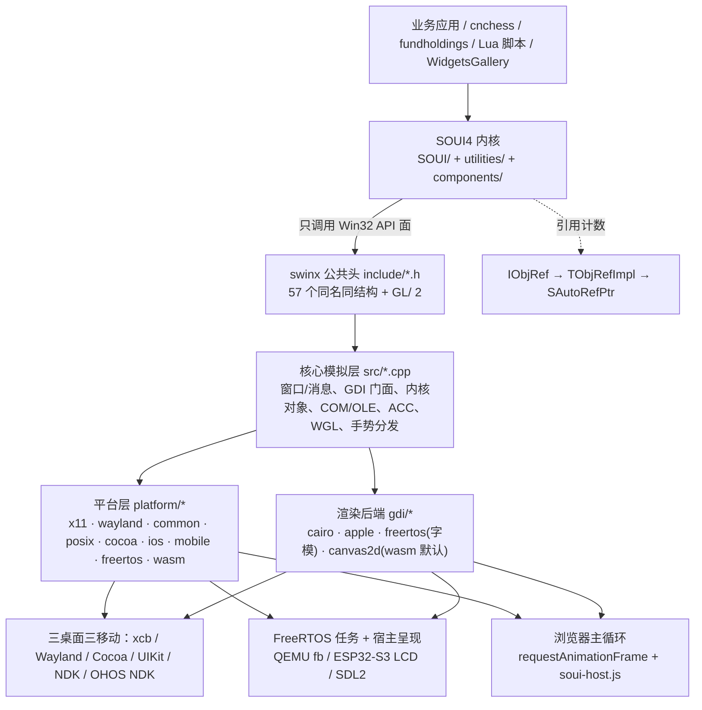
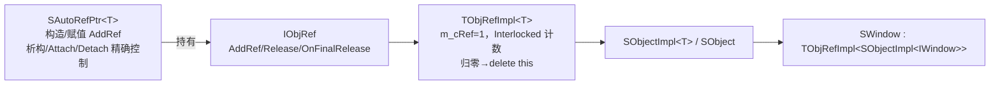

# SOUI4 跨平台 C++ GUI 框架项目评估报告

> **评估时间**：2026-11-24（替代 2026-11-17 版）
>
> **代码基线**：主仓库 `soui4` HEAD `8e85104a`（2026-11-23，"完善 edit lite，增加 undo/redo；增加 linux 平台的 perf_demo"）；提交版本 `SOUI_VER = 5.3.2.5`，工作区 `SOUI/include/soui-version.h:13` 已改为 **5.3.2.6（未提交）**；`swinx` 工作区 HEAD `6b4249e`（2026-11-24，版本 **1.9.2**，含 API 清单刷新）；`soui-freertos` 工作区 HEAD `818e585`（2026-11-24，"修复 editlite 编译"）。主仓库 HEAD 登记的 gitlink 仍是 `swinx@6b791dd` / `soui-freertos@4d44ade`，工作区已分别改到上述两个新提交但**尚未提交**；报告按当前工作区事实更新，并单列这一未提交项。
>
> **相对旧报告基线的增量**：主仓库 `0c610763..8e85104a` = **370 文件、+29,811 / −4,563 行**；`swinx` `01f0ba2..6b4249e` = **83 文件、+15,154 / −1,071 行**。一句话：这七天不是"又加了一个平台"，而是**把已铺出去的能力从"能编过"往"能交付"推进了一大步**——Linux 变成 X11/Wayland 双后端、模态会话与热重载重做、编辑框补 undo/redo、图像/XML 工具链修真 bug、WASM 移动端交互与诊断补强且已在真机浏览器验收通过；期间暴露的 API 清单漂移也已通过刷新清单关闭。
>
> **统计口径**：规模、计数与能力判断以三个仓库当前 HEAD 为准（工作区未提交改动单独标注）；构建产物与未跟踪文件不计入。规模取受控文件中 `\.(c|cpp|h|hpp|cc|mm|m|inl)$` 的 `\n` 字节数；API 面取 `swinx/doc/tools/api_scan.py`；测试数取本机 `ctest -N`；性能数字取同机 A/B 与工作日志中可复现的实测。**凡无可复现证据的结论，正文写明"未验证"。**
>
> **本报告的目的**：让第一次阅读的人系统性理解 SOUI4 的全貌——它是什么、怎么设计、覆盖哪些目标、每块能力证明到什么程度、边界在哪、下一步该做什么。它不是变更日志；最新进展只在改变"当前能力判断"时进入正文。

---

## 〇、结论与速览

### 0.1 一句话结论

SOUI4 是一套**以 Win32 API 语义为统一编程面**的 C++ DirectUI 框架：借助自研 `swinx` 兼容层，**同一套 C++ UI 与业务代码**在 **8 个运行目标**上原生运行——Windows / Linux / macOS / iOS / Android / OpenHarmony 六个操作系统，加 FreeRTOS（裸机 MCU）与 WebAssembly（浏览器）。`games/cnchess` 与 `demos/fundholdings` 两个真实应用的业务源码里 `__ANDROID__`·`__OHOS__` 出现次数为 **0**，"一次编写、多端运行"仍是工程现实。

相对上一版报告，三个主干判断需要更新：

1. **跨端抽象继续稳定，但"叶子"变大且开始分叉（§2）**：`platform/` 从 7 目录变 **9 目录**——Linux 被拆成 `x11` / `wayland` / `common`，新增 Wayland CSD 装饰窗、SNI 托盘、portal 对话框、跨进程剪贴板 / DnD / IME；这是**同一平台内换显示协议**，内核仍零改动。新代价落在平台叶子上：`swinx` 自有源码从 209,615 行涨到 **222,629 行**。
2. **能力从"能跑"推进到"行为正确"（§7、§10）**：模态会话重做并支持同步强制退出、F5 资源热重载落到 CMake 开关、`InitFromXml` 重复 `WM_CREATE` 的历史坑被探针钉死、`SHostWnd::SetTranslucent()` 修掉创建期属性的运行期误用、编辑框补 undo/redo、PNG 2bpp 解码错位有 96 行集成回归、Linux `perf_demo` 把"哪个后端快"从印象变成可复现数字（release 对 release `all.r4.frame`：**wl 27.2 ms vs x11 91.3 ms**）。
3. **门禁网曾出现自身缺口，现已修复（§1.4、§2.4）**：七个 CI 工作流仍覆盖八目标；Linux 平台目录改名一度让 `api_scan.json` 产生 43 处"实现位置变化"、`--check` 变红，`swinx@6b4249e`（1.9.2）已刷新清单与 API 文档，实测**退出码 0 / [OK]**。剩余流程问题只有一个：主仓 gitlink 的新指针还在工作区未提交。"工作流存在 ≠ 线上 Required Check 生效"的边界不变。

必须与结论同置的边界（多数沿用上版，按新证据重排）：**原生移动三端（Android / OHOS / iOS App）仍只有编译链路**；Wayland 在本地会话有性能参数但**未做跨合成器 / 真机矩阵**，且 11-24 的 CSD 改动只能做逻辑真值表验证；真机仍只有一块 ESP32-S3 + 一块屏、单动画 56~58 fps（当前设备双动画约 40 fps）；WASM 移动端浏览器已真机验收触摸三态 / 软键盘 / 中文输入法，但未进 CI、也无设备×浏览器矩阵；FreeRTOS 字体只烘 ASCII、无输入法；`api_scan` 清单已刷新、本地门禁回绿。**没有一项需要推翻现有设计。**

### 0.2 八目标的能力分档

| 档位 | 目标 | 判据 | 还缺什么 |
|---|---|---|---|
| **产品级** | Windows / Linux / macOS | 门禁 + 完整示例 + 系统级能力（ACC、菜单、原生控件、对话框）齐备；Linux 现在还可按 `SWINX_LINUX_BACKEND=x11\|wayland` 选显示协议 | Wayland 侧无跨合成器 / 真机矩阵，11-24 CSD 改动未 GUI 验收 |
| **产品级（移动）** | Android / OHOS | 交叉编译进 PR 门禁、宿主库两个（`soui-android-lib`/`soui-ohos-lib`）、两个应用各有 Android/OHOS 壳 | 无运行期回归；OHOS 的 ACC 被构建层强制关闭 |
| **产品级（Apple）** | iOS | 平台层 23 文件 / 6,218 行、与 macOS 共用 `gdi/apple`；`swinx-ios-arm64` 交叉编译进门禁；`build.yml` 新增独立 `build-ios` job，部署目标 12→15、runner 统一 macos-26 | 无运行期回归 |
| **能力证明级+（有真机性能参数）** | FreeRTOS | 5 个工程、QEMU + ESP32-S3 真机、census/4 MB/QEMU/宿主模拟器四道门禁；单动画 56~58 fps、双动画约 40 fps | 字形只烘 ASCII、只有一块板、双动画低于单动画、无输入法 |
| **产品级（浏览器）** | WebAssembly | 3 个消费端、双后端、可选真线程、双后端烟测门禁；宿主 JS 已收敛到仓库级 `tools/wasm/`；桌面与移动浏览器已在真机人工验收触摸（触摸屏/触控板）、软键盘、中文输入法，达到生产可用（11-20 结论，11-24 用户复核确认） | 人工验收未进 CI、设备×浏览器矩阵未沉淀；系统级 IME 与 OLE 拖放未做、多窗口合成缺应用层自动化、构建缓存里 pthreads 参数易残留 |

**这张表是最重要的读法**："能构建、`SApp` 能端到端跑通"与"能交付项目"之间的差，全部写在最后一列。

### 0.3 核心数据速览

| 维度 | 当前值 | 出处 |
|---|---|---|
| 自有源码规模 | **1,230 文件 / 562,392 行**（内核 `SOUI/`+`utilities/` = 190,953 行） | §1.2 |
| 跨平台层 `swinx` | **222,629 行 / 332 文件**；公共头 **59 个**（含 `GL/` 2）；API 声明 **1,150** · 有定义 **1,148**；`api_scan --check` **PASS（清单与源码一致，退出码 0）** | §2.4 |
| 运行目标 | **8**：三桌面 + 三移动 + FreeRTOS（含真机）+ WASM（含 pthreads）；Linux 内部分 X11/Wayland 双后端 | §0.2、§2.2 |
| 平台/渲染正交 | `platform/` **9 目录**（`x11`/`wayland`/`common`/`posix`/`cocoa`/`ios`/`mobile`/`freertos`/`wasm`）× `gdi/` **4 后端** | §2.2 |
| Linux 绘制性能（新） | 同机 release 对 release `all.r4.frame`：**wl 27.2 ms / x11 91.3 ms（wl 快 3.4×）**；x11 每帧固定泵 ≈2.84 ms（wl ≈0.04 ms）；图元单价 x11 ≈ wl 9× | §10.4 |
| ESP32-S3 真机 | 固件 **4,098,192 B（≈3.91 MB，6 MB 分区余 35%）**；冷启动首帧 ≈4.4 s；单动画稳态 **56~58 fps**、双动画约 **40 fps**；资源 COFF **87 KB / 59 条** | §3 |
| WASM | canvas2d 演示 **5.5 MB**（`.wasm` 4.53 MiB + `.data` 0.77 MiB）；cairo **26 MB**；3 个消费端；烟测 **35 断言 × 2 后端**；整窗重绘 **1,773 ops / 11.8 ms**（帧内 JS 5.3 ms）、Lua 游戏页 **57 fps**；同机 cairo 11.4 ms vs canvas2d 5.4 ms（**2.1×**） | §4 |
| OpenGL/WGL | `wgl.h` + `GL/{gl,wglext}.h`；契约测试 Windows **16 PASS / 0 FAIL / 1 SKIP** | §5 |
| 测试门禁 | **661 条** ctest（headless **646** / gui **15**；正交标签 unit 582 / integration 2 / e2e 13 / uitest 49）；`demos/fun_test` **57 个** `test_*.cpp`、**660 处** `TEST`/`TEST_F` | §1.4 |
| 控件面 | **40 个**内置控件头 + **37 个**扩展控件类；`SOUI_EDIT_LITE` 从 1,728 行增至 **2,701 行**并补 undo/redo（默认 OFF） | §7.4 |
| 可测性 | `components/souitest/souitest.h`（纯头）+ **49 条** `soui-uitest`；零成本绘制探针 `SPaintProbe.h`；`souitest` gui 烟测从 2/2 扩到 **11/11** | §7.7 |
| 脚本绑定面 | 44 文件 / 4,403 行；75 `DEF_TOOBJ` + 26 `DEF_QICTRL`；`test.lua` 4,430 行 | §8 |
| 体积 | 最小核心约 2.3 MB（README 口径）；wasm 演示 5.5 MB；editlite 让 fundholdings wasm 产物 **3,772,683 → 3,093,990 B（省 662.8 KB）** | §6.2、§4.3 |
| 第三方 vendor | **11,770** 受控文件，占两仓库受控文件合计（18,432）的 **63.9%** | §1.3 |

### 0.4 能力地图：四条主线 + 一条纵轴

| 主线 | 回答的问题 | 最硬证据 | 主要短板 |
|---|---|---|---|
| **跨端能力**（§2） | 同一套 C++ 能否多目标运行、代价多大 | 57 个与 SDK 同名同结构公共头（+ `GL/` 2）；`platform/`(9) × `gdi/`(4)；两个真实应用业务零平台宏；Linux 双显示协议 | `api_scan` 门禁回绿、`SetMenu`/`DialogBoxParam` 族缺 |
| **平台扩展性**（§3–§5、§10.4） | 吸收一个新宿主形态 / 新显示协议要动多少 | FreeRTOS 上游 4 处、内核零移植改动、真机单动画 56 fps / 双动画 40 fps；Wayland 走 `SWINX_LINUX_BACKEND` 切换、CSD/SNI/portal 落地；WASM 复用裸机蓝图 + 双后端 + 真线程 | Wayland 无合成器矩阵、WASM 真机验收未进 CI、OpenGL 无 MSAA |
| **工程能力**（§6） | 内存安全、资源管理、体积、矢量渲染、可观测性 | `SAutoRefPtr` + 控件树裸指针；三层资源 + `ResType_Mem`；核心 ~2.3 MB；SVG 为渲染原语；`perf_demo` 可归因到图元单价 | vendor 占 63.9%；资源无条目级失效；清单靠人工刷新（本次已刷新） |
| **开发能力**（§7） | 写 UI 有多快、控件够不够、事件怎么写 | XML + 类 COM 工厂 + uieditor；6 类布局 + 两套动画 + 共享时间轴；40 控件头 / 37 扩展类；模态会话同步退出 + F5 热重载；editlite undo/redo | XML `on_*` 绑定与脚本处理器段仍无用例 |
| **可编程能力**（§8） | 玩法能否免编译迭代 | XML 事件直挂 Lua；消消乐/俄罗斯方块/坦克大战全脚本编排；`ITaskLoop` + `PostTask` | JS/Python 分仓且仅桌面三端 |

**纵轴结论**：三个新目标 / 新能力面的落点全部收敛在 `swinx/src/platform/<os>/` 或 `gdi/`，宿主形态从"有窗口系统"退到"裸机"、再退到"浏览器沙箱"，Linux 内部再从 X11 分出 Wayland——**内核改动都没有超出显式 include 与一两个回调注册点**。边际成本随"交付度"上升而转移：越往交付走，钱花在板级驱动、资源管线、宿主壳、协议适配上，框架本身占比越小。

### 0.5 全文导航

| 章 | 回答什么 | 关键数字 |
|---|---|---|
| 一 · 项目底图 | 规模、构成、CI 与模块边界 | 562,392 行 / 18,432 受控文件 / 7 工作流 / 661 用例 |
| 二 · 跨端能力 | 同一套 C++ 如何多目标运行、兼容边界在哪 | 59 头 / API 1,150→1,148（门禁 FAIL）/ platform 9 × gdi 4 |
| 三 · FreeRTOS | 无 OS 场景怎么落地、真机性能做到什么程度 | ESP32-S3 / 3.91 MB / 单动画 56~58 fps、双动画 40 fps |
| 四 · WebAssembly | 浏览器场景怎么复用裸机蓝图、双后端与真线程 | 5.5 MB vs 26 MB / 3 消费端 / 35×2 断言 / 宿主 JS 仓库级收敛 |
| 五 · OpenGL/WGL | GPU 上下文怎么做到三端同源 | 3 头 / 16 PASS·0 FAIL·1 SKIP |
| 六 · 工程能力 | 内存、资源、体积、矢量、可观测性 | 最小 2.3 MB / SVG 四后端 / `ResType_Mem` / 零成本探针 |
| 七 · 开发能力 | 布局、动画、控件、事件、手势、模态与热重载 | 单 timer 集中刷新 / 40 控件头 / 37 扩展类 / editlite undo/redo / `EVT_RELOAD` |
| 八 · 可编程能力 | 脚本化玩法迭代 | 44 文件 / 4,403 行 / 4,430 行 Lua |
| 九 · 国际化与高分屏 | 多语言热切换 + DPI 自动缩放 | `EnableMultiLang` / `SDpiHandler` / Wayland fractional-scale |
| 十 · 性能与线程 | 密集计算与 UI 线程协作、x11/wl 绘制归因 | 固定开销 vs 像素开销 / `ITaskLoop` 五宿主 / wl 27.2 vs x11 91.3 ms |
| 十一 · 横向对照 | 与 Qt / Flutter / Electron / wxWidgets 对照 | 17 个维度 |
| 十二 · 优势与风险 | 优势清单 + 风险清单 | 每项给出章节出处 |
| 十三 · 路线图 | 按性价比排序的措施 | 13 项（首位是"提交已修复的 gitlink + 把真机验收转自动化"） |
| 十四 · 结论 | 总体判断与能力边界 | — |

---

## 一、项目底图：规模、构成、CI 与架构

### 1.1 项目速览

| 维度 | 事实 | 出处 |
|---|---|---|
| 定位 | 轻量跨平台 C++ DirectUI 框架，持续开发 14 年 | `README.zh-CN.md` |
| 版本 | 内核 `SOUI_VER = 5.3.2.5`（提交态）/ **5.3.2.6（工作区未提交）**；`swinx` **1.9.2**（工作区，主仓 gitlink 未更新） | `SOUI/include/soui-version.h:10-13`、`swinx/include/swinx_version.h:17-19` |
| 核心编译体积 | 约 **2.3 MB**（官方声明，动态链接核心库，Release x86） | `README.zh-CN.md` |
| 运行目标 | **8**：三桌面 + 三移动 + FreeRTOS + WASM；Linux 另有 X11/Wayland 两种显示后端 | §2.2 |
| 渲染后端 | GDI / Direct2D（Win）、Skia（跨平台）、Cairo（Linux/Android/OHOS/FreeRTOS）、Core Graphics（Apple）、Canvas2D（wasm）；GL 上下文经 swinx WGL 层承接 | `components/render-*`、`swinx/src/gdi/` |
| 内存模型 | 类 COM 引用计数 + 智能指针 `SAutoRefPtr` | `utilities/include/helper/obj-ref-impl.hpp` |
| 编程风格 | Win32/WTL 式 API + XML 描述 UI + Lua 脚本逻辑 | `README.zh-CN.md`、`components/ScriptModule-LUA` |
| 生态 | `demos/` **24 个子目录**（新增 `WidgetsGallery`、`perf_demo`；含 uieditor、fun_test、fundholdings）；`games/` 3 个示例；内置 Lua 5.4 | `demos/`、`games/` |
| 对外口径 | README 平台表列全八目标，FreeRTOS 标"能力证明级"、WebAssembly 标"产品级（浏览器，真机验收通过）"（本次同步） | `README.zh-CN.md` |
| 许可 | 自有商业条款（非商用免费）；`swinx` 内含 Wine 派生代码并单列披露 | `LICENSE-zh.md`、`swinx/license_CN.txt` |

### 1.2 代码规模（实测）

框架**自有源码**（不含 vendor；`swinx` 仅计受控 `src/`+`include/`）：

| 模块 | 源文件 | 行数 |
|---|---:|---:|
| `SOUI/`（DirectUI 内核） | 416 | 155,532 |
| `utilities/`（基础件） | 56 | 35,421 |
| `components/`（17 个可插拔组件） | 194 | 89,010 |
| `controls.extend/`（扩展控件） | 214 | 52,921 |
| `swinx/src` + `swinx/include` | 332 | 222,629 |
| `soui-android-lib/` + `soui-ohos-lib/` | 18 | 6,879 |
| **合计** | **1,230** | **562,392** |
| 附：`soui-freertos/`（子模块，工程胶水） | 43 | 6,425 |
| 附：`soui-freertos/FreeRTOS-Kernel/`（vendored） | 655 | 348,485 |

> 相对 11-17 基线（1,199 文件 / 547,951 行）增加 **31 文件 / 14,441 行**，主要来自：`SEditLite.cpp` 从 1,728 → 2,701 行（+973，`8e85104a`）、Wayland 平台层 18 文件 / 12,384 行、`perf_demo` 3 文件 / 1,418 行、WASM 宿主 JS 由 54 KB 增至 61 KB，以及 cairo/canvas2d 持续对拍的增量。
>
> **规模结构读法**：真正的内核是 `SOUI/` + `utilities/` = **190,953 行**，兼容层 `swinx` = **222,629 行（1.17 倍）**。核心成本仍在"让 Win32 语义在八个目标上成立"，而新目标的增量继续落在平台层。注意 `swinx/src/gdi/freertos` 已从 1 文件 / 99 行变成 **4 文件 / 5,045 行**（字体烘焙与字模数据纳入），这也是裸机侧"字体只烘 ASCII"这一限制的代码形态。

### 1.3 仓库文件构成（`git ls-files` 口径）

| 分区 | 受控文件数 |
|---|---:|
| 主仓库 `soui4` 合计 | **10,181**（旧 9,908） |
| ├ `third-part/`（vendor，含 3 个嵌套子模块） | 3,927 |
| ├ `demos/` | 3,404+（目录数 23→24，文件数随 WidgetsGallery/perf_demo 增长） |
| ├ `SOUI/` | 418+ |
| ├ `components/` · `controls.extend/` | 255 · 217 |
| `swinx` 子模块合计 | **8,251**（旧 8,219） |
| ├ `swinx/thirdparty/`（vendor） | 7,843 |
| └ `swinx` 自有（`src/` `include/` `doc/` 等） | 408 |

**vendor 合计 11,770 个受控文件**，占两仓库受控文件合计（18,432）的 **63.9%**；`swinx/thirdparty/` 占子模块 **95.0%**。clone 与全仓检索体验仍由这块决定（风险 9）。

### 1.4 CI 与自动化现状

| 工作流 | 触发 | 覆盖 | 做什么 |
|---|---|---|---|
| `build.yml` | push tag、push `build-test` | Windows/Linux/macOS × x64/x86/arm64 + **新增 `build-ios` job（macos-26 + Xcode）** | 全量构建 + headless + 上传 demo 制品；Intel runner 明确用 `macos-26-intel`（裸 `macos-26` 是 arm64） |
| `pr-core.yml` | PR → `master` | linux-x64 / windows-x64 / macos-arm64（runner 统一 macos-26） | 构建 `fun_test` + 三腿 headless |
| `gui-smoke.yml` | PR、手动 | linux-x64（Xvfb） | 真实宿主窗口烟测，**模态会话相关从 2/2 扩到 11/11** |
| `swinx-api-gate.yml` | PR、push `master`、手动 | ubuntu-latest（文本扫描） | `api_scan.py --check` 比对声明面与能力基线；**已回绿：清单与源码一致，见下** |
| `swinx-mobile-gate.yml` | PR/push 命中 `swinx` | Android arm64 + OHOS arm64 + iOS arm64 | `cross_build.py` 交叉编译；iOS 部署目标 **12→15**，runner 统一 macos-26 |
| `soui-freertos-gate.yml` | PR/push 命中相关路径 | ubuntu-latest + windows-latest | census → 4 MB 断言 → QEMU 实跑 + PPM 非空帧；Windows/MinGW 宿主模拟器 |
| `soui-wasm-gate.yml` | PR/push 命中 wasm 路径 | ubuntu-latest × 2 腿（pump / pthreads） | emscripten 构建 → `node smoke.js`（35 断言）→ grep `^OK: 全部断言通过$` + 钉死 `[taskloop] pt=0/1` |

**⚠️ 门禁现状的两条新边界**：

- **`swinx-api-gate` 已回绿**。11-24 早些时候本地检查因 Linux 平台目录改名产生 43 处"实现位置变化"（`platform/linux/* → platform/x11/*`）而 FAIL；`swinx@df925e0` 把 `DragQueryFileA/W` 从 `platform/posix/shellapi.cpp` 移到 `platform/common/sysapi.cpp`（同时修 ESP32-S3 链接失败），同步刷新 `api_scan.json` 与 `doc/swinx-API实现清单.md`，随后 `6b4249e` 发布 1.9.2。本次实测 `python swinx/doc/tools/api_scan.py --check`：清单 声明 1,150 / 有定义 1,148、能力基线 1,146，输出 `[OK] 清单与源码一致，且没有任何函数低于能力基线`，退出码 0。**这是刷新清单修绿的，不是放宽检查**。
- **子模块指针尚未提交**：主仓 HEAD `8e85104a` 登记的 gitlink 仍是 `swinx@6b791dd`、`soui-freertos@4d44ade`；工作区已改到 `swinx@6b4249e`（含 API 清单刷新与 Wayland CSD 修复）和 `soui-freertos@818e585`（修 editlite 编译），但未提交到主仓。CI 若按主仓 HEAD checkout 仍取旧指针，需提交后才能计入门禁。

**其余三条沿用上版判断**：① 分层断言（链接 / 4 MB / 真跑 / 烟测）而非"能编过就算"；② 八目标都在 CI 里，但移动三端只到编译；③ FreeRTOS 门禁 Windows job 仍用 `cat > swinx/include/io.h` 的 `include_next` 垫片（`.github/workflows/soui-freertos-gate.yml:328-332`），include 顺序债未上游化。工作流文件存在**不等于**线上 Required Check 已生效，仍须在分支保护规则现场核验。

**测试规模（`ctest -N` 实测）**：总计 **661 条**，标签分布 `soui-headless` **646** / `soui-gui` **15**；正交标签 `soui-unit` 582 / `soui-integration` 2 / `soui-e2e` 13 / **`soui-uitest` 49**。`demos/fun_test` 有 **57** 个 `test_*.cpp`、**660 处** `TEST`/`TEST_F` 声明。相对 11-17（638 条）净增 23 条，主要来自 PNG 解码集成用例、editlite undo/redo、combo 双 `WM_CREATE` 探针与模态会话烟测。另有 `demos/fun_test/wasm` 这条 node 跑 gtest 的 wasm 单测腿。

### 1.5 分层结构（8 目标）

关键读法：`platform/freertos`、`platform/wasm`、`platform/wayland`、WGL 能力面**位置相同、形状相同**——它们是同一抽象下的叶子，不是并列的框架分支。这是"8 个目标 + Linux 双协议"能共享一套内核的结构性原因。

### 1.6 模块划分（相对上版的变化）

- **`SOUI/`**：DirectUI 内核；`control/` 下 40 个控件头，MVC 虚拟列表 `SListView`/`SMCListView`/`STreeView`/`STileView`/`SComboView` 在此。新增/改造焦点：`SHostWnd` 模态会话与 `ReloadLayout`、`SEditLite` undo/redo、`SComboBox`/`SComboView`/`SComboBoxEx` 的 `WM_CREATE` 去重。
- **`utilities/`**：接口、引用计数、XML、字符串数学、COM 动态加载；`tools/src/xml2bin` 本轮修 POSIX 路径与 `node_declaration` 保存失败。
- **`swinx/`**：跨平台兼容层，Windows 下不编译；Linux 后端由 `SWINX_LINUX_BACKEND` 决定 x11 或 wayland（`swinx/linux.cmake:2-120`）。
- **`components/`**：17 个可插拔组件；WASM 侧 `SOUI_EDIT_LITE`/`SOUI_ENABLE_RELOAD` 的编译定义统一到 `__cmake/wasm-lib-config.cmake`，解决 app TU 漏宏。
- **`controls.extend/`**：37 个窗口类经 `SCtrlsRegister::RegisterCtrls` 集中注册。
- **`soui-android-lib/`、`soui-ohos-lib/`**：移动端宿主库（JNI / N-API）。
- **`soui-freertos/`**：5 个工程 + 新建工程模板；本周期只改 README，能力面不变。
- **`demos/wasm-demo/`**：演示 + `smoke.js` + `tools/diag/`；新增/变更的宿主 JS 已迁到仓库级 **`tools/wasm/soui-host.js`**（61 KB），由 `__cmake/wasm-host-js.cmake` 统一拷贝，三消费端共用。
- **`demos/perf_demo/`（新）**：Linux 绘制性能归因工具，1,212 行 + README 169 行，场景 fill/text/blit/lines/all，支持 sweep、`--compare`、`--probe-font`、落盘 `perf_<backend>.txt`（§10.4）。
- **`demos/WidgetsGallery/`（新）**：网友"玄光"提供的控件画廊 demo；其下拉弹不出暴露了 `translucent` 是创建期属性的问题，促成 `SHostWnd::SetTranslucent()`（§7.4）。
- **`demos/opengl_demo/`**：OpenGL/WGL 三端同源验证装置（§5）。

---

## 二、跨端能力：`swinx` 跨平台兼容层

### 2.1 设计哲学：以 Win32 为"世界语"

`swinx` 不是"为每个平台写一套抽象接口"，而是**重演 Win32 语义**——`include/` 下 57 个头文件与 Windows SDK 同名同结构（另 `GL/` 2 个），SOUI 内核直接 `#include <windows.h>`，零平台 `#ifdef`。

- **收益**：14 年积累的 Win32/WTL 写法原样可用；Wine 派生的重组件（RichEdit、ListBox）与已有 SDK 头直接复用。
- **代价**：参考实现本身会演进。`PostMessage` 在 Win11 26H2 上可能投递顺序变化，`SDropDown` 两处改用 `SendMessage`；"以 Win32 为世界语"意味着跟着这门语言一起变。
- **可维护性靠门禁而不是自觉**——本轮 43 处实现位置变化一度让 `--check` 变红，刷新清单后回绿（§1.4）。门禁扮演的角色恰恰在此显现：它把"目录改名但清单没跟"立刻暴露，而不是等到有人查文档才发现；代价是平台层每次挪文件都要同步刷新快照。

### 2.2 八目标 × 渲染后端矩阵

| 目标 | 平台适配层 | 渲染后端 | 构建脚本 | 宿主形态 |
|---|---|---|---|---|
| Windows | （不编译 swinx） | GDI / D2D | MSVC/MinGW | 系统窗口系统 |
| Linux / X11 | `platform/x11`（21 / 15,185） | `gdi/cairo` | `linux.cmake`，`SWINX_LINUX_BACKEND=x11` | xcb + XRender/glyph 缓存 |
| Linux / Wayland（新） | `platform/wayland`（18 / 12,384）+ `platform/common`（5 / 1,710） | `gdi/cairo`（image surface，无 Xlib/XCB surface） | `linux.cmake`，`SWINX_LINUX_BACKEND=wayland` | wl_display + xdg_wm_base + wl_shm；CSD 装饰 / SNI 托盘 / portal 对话框 |
| macOS | `platform/cocoa`（26 / 10,708） | `gdi/apple` | `macos.cmake` | `NSApplication` |
| iOS | `platform/ios`（23 / 6,218） | `gdi/apple` | `ios.cmake` | `UIApplicationMain`（`swinx_ios_entry`） |
| Android | `platform/mobile`（15 / 2,796） | `gdi/cairo` | `mobile.cmake` | JVM + `PlatformAPI` |
| OpenHarmony | `platform/mobile` | `gdi/cairo` | `mobile.cmake` | ArkTS + `PlatformAPI` |
| FreeRTOS | `platform/freertos`（25 / 5,756） | `gdi/freertos`（4 / 5,045，字模/烘焙数据） | `soui-freertos/cmake/soui.cmake` | 无 OS：任务跑消息泵，宿主取帧缓冲上屏 |
| WASM | `platform/wasm`（17 / 4,319） | `gdi/canvas2d`（默认，4 / 6,416）/ `gdi/cairo`（可选） | `swinx/wasm.cmake` | 浏览器主循环 + JS 宿主 |

> **两个正交维度**：纵向"平台适配层"（窗口/输入/线程/文件），横向"渲染后端"（光栅化落点）。WASM 能在不改业务代码的前提下切 canvas2d / cairo（`-DSWINX_WASM_GDI_BACKEND=`），Linux 能在不改业务代码的前提下切 X11 / Wayland（`SWINX_LINUX_BACKEND`）——这个组合自由度是"跨后端对拍"的前提（§4.2、§10.4）。
>
> **Wayland 的构建契约**（`swinx/linux.cmake`）：依赖 `libwayland-client` / `wayland-protocols` / `wayland-scanner`，三者缺失时仍编译"内存帧缓冲"骨架（库可构建、共享代码可链接，只是不连显示服务器）；托盘走 freedesktop StatusNotifierItem over D-Bus（`dbus-1` 已 vendor 化），不引入 libxcb。11-24 的 CSD 改动按内容窗当前 `dwStyle` 决定 min/max/close 按钮可见性——**不能创建时快照**，因为 `SHostWnd::InitFromXml`（`shostwnd.cpp:557-584`）会在创建后用 `ModifyStyle()` 追加 min/max box 位；同步入口是 `SwinxWlFrameOnContentStyleChanged()` + `SConnection::OnStyleChanged`。

### 2.3 五大核心机制

1. **同符号、分目录实现、链接期解析**（`src/SwinxUtils.h`）：各平台给同名同签名实现，`GLOB` 只编当前平台，调用方正文无平台 `#ifdef`；返回类型统一 `int` 规避 ObjC++ 的 `BOOL` 宽度差异。
2. **`g_platformAPI` 回调机制**（`platform_api.h`，`PLATFORM_API_VERSION = 3`）：Android/OHOS 无桌面窗口系统，窗口/输入/剪贴板/提示音转发宿主 App。
3. **非 MSVC 工具链上的 COM 自研**（`src/SUnkImpl.h`）：`DECLARE_INTERFACE_` 宏集 + `__uuidof` 降级 + 弱符号 GUID；ACC 代码一字不改跨桌面平台编译。
4. **平台派生收敛到单一配置头**（`sfr_config.h`）：四个构建参数派生四个恒有定义（0/1）的开关；ESP-IDF 下另有 `SFR_ESPIDF`/`SFR_ARCH_XTENSA`。
5. **宿主异步回调：通用对话框**。`GetOpenFileName` 族不是同步阻塞——`dlghelper.cpp` 经 `swinx_pick_file_deliver(ok, path, pfnDone, pCtx)` 投回；桌面/移动/wasm/FreeRTOS 共用这一层，Wayland 侧改走 portal。烟测 5 条断言钉住"发起不阻塞 / 过期 id 丢弃 / 多选与 SAVE 显式拒绝"。

### 2.4 量化现状

| 维度 | 当前数据 |
|---|---|
| 代码规模 | `src/` + `include/` = **222,629 行**（332 文件），旧 209,615 / 303 |
| 公共头 | **59 个**（含 `GL/` 2；旧版同值 57 头 + GL 2 头，按递归口径合并计数） |
| API 面 | 声明 **1,150**；有定义 **1,148**；能力基线 **1,146**；`api_scan.py --check` = **PASS（退出码 0，清单与源码一致）** |
| 平台层规模 | `posix` 26/25,758、`x11` 21/15,185、`wayland` 18/12,384、`cocoa` 26/10,708、`ios` 23/6,218、`freertos` 25/5,756、`wasm` 17/4,319、`mobile` 15/2,796、`common` 5/1,710 |
| 后端规模 | `gdi/cairo` 9/8,740、`gdi/apple` 3/8,078、`gdi/canvas2d` 4/6,416、`gdi/freertos` 4/5,045 |
| 已落地的通用对话框 | `GetOpenFileName`/`GetSaveFileName`/`ChooseFont` 族四平台 + 异步回调；Wayland 走 portal |
| 接口面缺口（迁移面） | 原生控件仍 `Static`/`Button`/`ListBox`；`SetMenu`/`GetMenu`/`DrawMenuBar` 无声明；`DialogBoxParam` 族全缺 |
| 无障碍（ACC） | 约 6,240 行支撑桌面三平台；Linux AT-SPI2 桥、macOS NSAccessibility 桥；OHOS 构建层强制 OFF |

> **99.8% 这个数字要按"声明即承诺"读**：1,148 / 1,150 说明"声明出来的函数都有定义"，**不等于**"Windows 有的这里都有"。分母是主动裁剪过的。本轮门禁曾因**目录改名后清单没刷新**变红、刷新后回绿——这恰好证明清单是"承诺快照"而不是"能力全集"。
>
> **门禁比数量也比等级**：`api_scan.py --check` 记录每个函数的最低实现等级，任何函数被"降级"（`impl` → `partial`/`stub`）也会变红；当前基线覆盖 1,146 个函数。本轮已按"刷新清单 + 重生成文档"处置并回绿；不应通过放宽检查"修绿"。

### 2.5 兼容的边界：缺口与未覆盖面

> **范围界定**：`swinx` 的目标是让"用 SOUI 编写的应用"多端运行，不是让任意既有 Win32 程序零成本迁移。"原生控件 / 窗口菜单 / 资源对话框"属于延伸目标。

- **编译层面**：同一份 `#include <windows.h>` 源码多端编译——成立，两个真实应用实证。
- **通用对话框（部分闭合）**：`commdlg.h` 已公开，`GetOpenFileNameW`/`GetSaveFileNameW` 在四个平台有实现；`DialogBoxParam` 族仍全缺，`.rc` 对话框不能加载（`demos/opengl_demo` 用 `SHostDialog`）。
- **原生控件库**：只有 `Static`/`Button`/`ListBox`；`Edit`/`ComboBox`/`ScrollBar`/公共控件全缺，缺失表现为 `CreateWindowEx` 返回 NULL 的静默失败。SOUI 自己的 `<edit>` 由 `SRichEdit`（richedit41）或 `SOUI_EDIT_LITE` 提供，不依赖 swinx 原生控件。
- **窗口菜单栏**：`SetMenu`/`GetMenu`/`DrawMenuBar` 无声明——弹出菜单机制完整，缺的是窗口侧挂载。
- **语义边界**：`IsWindowUnicode` 返回 FALSE 是有意为之（UTF-8 作多字节编码）。
- **新目标边界**：FreeRTOS 无多进程、文件锁语义弱化；WASM 单线程是默认配置而非硬约束；OpenGL current context 为 per-thread；Wayland 无 owner 的 toplevel 位置依赖合成器（本地用 `gsettings set org.gnome.mutter center-new-windows true` 规避）。

### 2.6 新宿主形态如何"装进"同一套抽象

| 维度 | FreeRTOS（§3） | WebAssembly（§4） | Linux/Wayland（新） | OpenGL/WGL（§5） |
|---|---|---|---|---|
| **形态** | 无 OS，带显示 MCU | 无原生窗口，浏览器沙箱 | 已有平台内换显示协议 | 能力面（GPU 上下文） |
| **落点** | `platform/freertos` + `gdi/freertos` + 子模块胶水 | `platform/wasm` + `gdi/canvas2d` + 三 app 的 `wasm/` | `platform/wayland` + `platform/common` + `linux.cmake` 后端开关 | `include/wgl.h` + `GL/*` + posix/cocoa 桥 |
| **复用谁** | `gdi/cairo`、`platform/posix` | FreeRTOS 的帧缓冲蓝图 | `gdi/cairo` image surface、dbus-1 vendor、共享窗口树 | Win32 WGL 语义 |
| **内核改动** | 若干显式 include + `SConnection` 注册点 | `FontFallback.cpp` 一个 `__EMSCRIPTEN__` 分支 + `TaskLoop` 后端 | **0**：只经 `SWINX_LINUX_BACKEND` 选平台源集 | 0 |
| **已证到哪** | QEMU 出图 + ESP32 真机 56~58/40 fps | 3 应用出图 + 35×2 烟测 + 双后端 A/B + 真线程 | 本地 Wayland 会话出图 + perf_demo 图元归因；CSD 逻辑真值表 | 三端同源 demo + 契约 16/0/1 |
| **未证/缺口** | ASCII 字模、一块板、无输入法 | 真机验收未进 CI、设备×浏览器矩阵、多窗口应用层自动化 | 跨合成器/真机矩阵、GUI 像素与输入、appindicator 点击语义差异 | 无 MSAA、单 drawable |
| **代价形态** | 工程胶水（构建/资源/板级驱动） | 宿主壳 + 单线程心智（默认）+ 隔离头 | 协议对象（xdg-shell/SNI/portal）+ CSD 命中测试 | 平台语义显式降级契约 |

> **读法**：四列"落点"都在 `swinx/src/platform/<name>/` 或能力面头文件，"内核改动"接近零。Wayland 的价值在于它证明**"平台扩展"和"平台内协议替换"是同一种成本结构**：真正随交付度上升的不是框架代码，而是协议对象、资源管线、宿主壳。

### 2.7 典型案例：重组件零改源码跨端（richedit41 / Scintilla）

`third-part/richedit41`（499 文件）与 `third-part/Scintilla` 整体搬运，靠 `textserv.h`/`richedit.h`/`imm.h` 与 GDI 面；`demos/sci_demo`、wasm 演示"编辑器"页是实证。**边界**：搬运的边界是**符号面**而非功能面——`platform/freertos/win32_rich.cpp` 里 `OpenClipboard`/`SetClipboardData` 等仍是桩；`api_scan` 门禁保证"定义变了"在 PR 上可见。

### 2.8 典型案例：RC 资源文件跨端编译

一份 Windows `.rc` 在三端同源编译进 PE/ELF/Mach-O（`ENABLE_BUILD_RESOURCE` + `SetSysResPeHandle`/`SetAppResPeHandle`）。FreeRTOS 换载体：`uires.idx` → uiresbuilder → windres COFF → `.incbin`（`.balign 8`）；ESP32-S3 以 `SResProviderPE` 加载（87 KB / 59 条）。`SAppCfg` 的 `ResType_Mem` + `SetSysResMem`/`SetAppResMem` 把"提供器由谁创建"纳入配置面（§6.4）。

### 2.9 真实应用实证：单代码库跨端

- `games/cnchess`：四端样本（桌面/Android/OHOS/wasm），业务源码 `__ANDROID__`/`__OHOS__` 出现次数均为 0；皮肤热换、机器人 AI 线程池、WKE 接入样本；wasm 版模态走 `SModalRoot`/`SModalView`。
- `demos/fundholdings`：四端同源的基金持仓工具，带网络请求；wasm 默认开 pthreads，需 `crossOriginIsolated`；`SOUI_EDIT_LITE` 让其 wasm 产物省 662.8 KB。
- `demos/WidgetsGallery`（新）：控件画廊，桌面端控件覆盖清单（`BUILTIN_CONTROLS.md`/`CONTROL_COVERAGE.md`）；它暴露并推动了 `SetTranslucent()` 的修复。

### 2.10 典型案例：WKE 浏览器引擎跨平台

内置网页渲染经 WKE（WebKit 分支）以运行期绑定接入：`SWkeWebkit` 在非 Windows 平台已脱离条件编译。**边界**：引擎本体在独立仓库 `wkex` 编译，`libwke.so`/`libwke.dylib` 不入库，本仓 CI 无 target 链接 wke（风险 12）。

---

## 三、FreeRTOS：无 OS 目标的适配结果

> 这一章能力面与上版一致：本周期 `soui-freertos` 子模块从 `4d44ade` 到 `818e585` 只改了 `cmake/SouiFreeRTOS.cmake`（2+/1−，修 editlite 相关链接），不改变已测性能或功能判断。

### 3.1 四种载体

| 载体 | 用途 | 状态 |
|---|---|---|
| `soui_sim`（Windows + SDL2） | 日常迭代 | ✅ 出图 + 鼠标交互 |
| QEMU mps2-an385 | 交付前门禁 | ✅ 4 MB FLASH 断言 |
| **ESP32-S3 真机** | 交付形态：320×240 SPI 屏 + 电容触摸 | ✅ 已上屏、可触摸 |
| 目标板（泛指） | 换 UART + LCD 驱动 + 链接脚本 | 需硬件适配 |

framebuffer 尺寸已运行时化，换屏只改板层两个常量，不再重编 swinx。

### 3.2 ESP32-S3 适配结果与性能参数

| 项 | 值 |
|---|---|
| SoC / 屏 / 触摸 | ESP32-S3 rev0.2，16 MB Flash，8 MB PSRAM / ILI9341V SPI 320×240 / FT6X36 I2C@0x38 |
| 固件 | **4,098,192 B（≈3.91 MB，6 MB app 分区余 35%）** |
| 冷启动 → 首帧 | ≈4.4 s |
| **稳态刷新（单动画，探针关）** | **56~58 fps**（frame 17.3 ms / paint 14.2 ms） |
| **稳态刷新（双动画，当前设备版本）** | 约 **40 fps** |
| 资源 | windres COFF **87,352 B / 59 条**，`SResProviderPE` 加载 |
| 渲染链路 | `render-gdi` → `gdi/cairo` → PSRAM 帧缓冲（ARGB32）→ RGB565 → SPI |
| 稳定性 | 连续运行无 panic、无 task_wdt |

**上游改动 4 处、内核零移植改动**；裸机载体累计约 13,881 行，框架适配 6,976 行，ESP32-S3 整套 2,394 行。逐项优化过程见 `soui-freertos/esp32s3/PERFORMANCE.md`。

### 3.3 已证 / 未证

**已证**：消息泵 / `SConnection` / 定时器 / 输入注入 / cairo 渲染 + 帧缓冲 / 完整 `SApp` + XML 布局 / ESP-IDF 编译烧录串口闭环 / 单动画 56~58 fps、双动画约 40 fps；CI 四层门禁（census / 4 MB / QEMU / 宿主模拟器）。

**未证 / 缺口**（按影响排序）：① 字体只烘 ASCII 0x20-0x7E；② 双动画 40 fps 低于单动画 56 fps（layered 离屏合成的结构性成本）；③ `<edit>` 无输入法；④ PNG 压缩分帧未验、光标不绘制；⑤ 只有一块板一块屏、无真机像素回归；⑥ QEMU 4 MB FLASH 上限（已做 CI 断言）。

---

## 四、WebAssembly：双后端、可选真线程、三个消费端

### 4.1 蓝图复用为什么成立

WASM 与 FreeRTOS 同属"无原生窗口服务器、软件渲染到内存、宿主负责呈现"，移植 ≈ 一个 `swinx` 平台后端 + 一个宿主 JS 壳；四个宿主接缝（帧缓冲 / 上屏 / 输入 / 消息泵）同构。本周期最大的结构变化是**宿主 JS 从 app 各自目录收敛到仓库级 `tools/wasm/soui-host.js`**（61 KB，含下载进度 / 脏矩形上屏 / 键鼠滚轮**触摸**注入 / IME 代理 / 剪贴板桥 / WebAudio / 崩溃上报 / 加载遮罩），由 `__cmake/wasm-host-js.cmake` 通过 `LINK_DEPENDS` + POST_BUILD 统一拷贝（配置期找不到即 `FATAL_ERROR`），三消费端只写三五行 `SouiHost.start({container, wasm, factory, api})`。契约见 `tools/wasm/README.md`。

### 4.2 双后端：canvas2d 默认，cairo 可选

| 维度 | `gdi/canvas2d`（默认） | `gdi/cairo`（可选） |
|---|---|---|
| 代码量 | 4 文件 / 6,416 行 | 9 文件 / 8,740 行（与桌面/移动共用） |
| 字体 | 浏览器内置字体（`ctx.fillText`） | 内嵌 TTF + freetype/fontconfig |
| C 库依赖 | **零** | 整族（cairo/pixman/freetype/fontconfig/zlib/png） |
| 演示产物 | `.wasm` 4.53 MiB + `.data` 0.77 MiB（全套 **5.5 MB**） | 6.18 MB + 19.6 MB（全套 **26 MB**） |
| 同机绘制（新） | 整窗重绘 **5.4 ms** | 11.4 ms（**2.1×** 慢，即使 SIMD 换序） |
| 适用场景 | 发布（体量优先） | 字形可控 / 像素对拍 |

**开关**：`-DSWINX_WASM_GDI_BACKEND=canvas2d|cairo`（`swinx/wasm.cmake` 拥有）；`demos/fun_test/wasm` 是 node 跑 gtest 的 wasm 单测腿，可按后端分别构建，让"同一批 GDI 用例在两套实现上的行为差异"自动化。

### 4.3 体量与应用侧 `.data`

| 产物 | 当前值 |
|---|---|
| 中国象棋（应用） | 调试档 ~31 MB / 上线档 ~5 MB + `.data` 0.5 MB |
| 基金持仓（应用） | `.wasm` 3.77 MB → **3,093,990 B（editlite 后省 662.8 KB）** + `.data` 45 KB |

canvas2d 把文本交给浏览器，不预载 CJK 字体，`.data` 只剩应用资源（主题包运行期由 WebSocket 下载）。代价是字形不可控；要可控就走 cairo，付 19.6 MB 的 `.data`。

### 4.4 三个消费端

| 消费端 | 性质 | 内容 |
|---|---|---|
| `demos/wasm-demo/` | 演示 | 阶段 0 裸窗口 + SOUI XML 多页（编辑器、图表、Lua 小游戏）；`smoke.js` 35 断言进门禁 |
| `games/cnchess/client/wasm/` | 真实应用 | 登录/大厅/棋局/WebSocket 联网/主题包下载解压/音效/输入法昵称；`smoke.js` 48 断言**未接 CI**（需起 `cnchess_server`） |
| `demos/fundholdings/wasm/` | 真实应用 | 行情代理、列表、图表；默认 pthreads；附 Apache 部署样例 |

三者共用 `tools/wasm/soui-host.js`。本周期宿主 JS 针对**移动端浏览器**修了两处：① touch/pen 不再走 `focusProxy`（软键盘只在 caret 就绪时拉起）；② `TOUCH_SLOP=8` 的三态判定——轻点、纵滑（`TOUCH_NOTCH_PX=40` 折算 `WM_MOUSEWHEEL`）、横滑拖拽，配 5 组合成 PointerEvent 探针。这两处已在**桌面与移动浏览器真机人工验收通过**（触摸轻点/纵滑/横滑、软键盘弹出收起、中文输入法组合输入，11-20 结论并经 11-24 复核），达到生产可用；缺的是把人工验收固化成 CI 与设备×浏览器矩阵（风险 19）。

### 4.5 线程：默认单线程，可选真线程

| 配置 | `ITaskLoop` 后端 | 前提 |
|---|---|---|
| `SOUI_WASM_PTHREADS=OFF`（默认） | `STaskLoopPump` | 无，主线程每帧按预算抽干 |
| `SOUI_WASM_PTHREADS=ON` | `TaskLoopWasm` worker | `-pthread` + `-sWASMFS=1` + `crossOriginIsolated` |

**四条链接参数缺一即退化**（`__cmake/wasm-lib-config.cmake`）：`-pthread` 编译与链接成对、`-sWASMFS=1`、`-sINITIAL_MEMORY=64MB`、`-sGROWABLE_ARRAYBUFFERS=1`。**构建缓存的坑**：`SOUI_WASM_USE_PTHREADS=0` 只关 CLI 开关，reconfigure 必须同时传 `-DSOUI_WASM_PTHREADS=OFF`，否则旧 CMakeCache 的 ON 会让产物带 `-pthread` 而链接参数不齐，出现"伪泵版"。历史上 cnchess 登录时 `RequestTheme` 崩溃即由此引起——`-sGROWABLE_ARRAYBUFFERS=1` 让 `HEAPU8.buffer.resizable=true`，Emscripten 胶水把 `HEAPU8.subarray()` 直接交 `WebSocket.send()` 会被 Chrome/Edge 以 `ArrayBufferView value must not be resizable` 拒绝；正确的处置是**强制重新配置为 OFF**（并可靠链接 `-pthread` 时用 `slice()`），而不是给 JS 打补丁（该补丁曾尝试后已撤销，`components/ws` 与 HEAD 一致）。

> **评估意义**：线程把"浏览器里做不了重计算"从架构结论降级为部署约束；代价是站点必须带 COOP/COEP 头，调试心智从单线程变双线程 + 隔离。

### 4.6 烟测、诊断与门禁

| 项 | 现状 |
|---|---|
| `demos/wasm-demo/smoke.js` | **35 处断言**，node 无头，自带假 DOM 顶 canvas2d；门禁 matrix 双后端（pump 30 / pthreads 31，多出 worker 真起来） |
| 产物来源校验 | `grep '[taskloop] pt='${{ matrix.expect_pt }}` |
| 覆盖内容 | 启动链 / 上屏计数随泵增长 / 鼠标键盘滚轮 IME 剪贴板注入不崩 / `ITaskLoop` 双后端 / 异步文件选择 5 条 |
| `games/cnchess/client/wasm/smoke.js` | 48 断言，未接 CI |
| `zorder-selftest.{cpp,sh}` | 13 项像素断言（cairo 帧缓冲可读回），不进 CI |
| **ASAN 诊断（新）** | LSan 入口 `___lsan_do_recoverable_leak_check`（三下划线）；三次检查均 8B/1 alloc（IME 代理良性）；修 `_DEBUG` ODR 导致的 `sizeof(SApplication)` 528→576 越界（宏挪到 `wasm-lib-config.cmake`）、1bpp 光标被 32bpp 读越界（`gdi.cpp` 的 `stretchDibExpand()`）；重建后全干净、内存恒定 126.6 MB |

> **口径诚实**：`smoke.js` 明确写着"不证明像素好不好看、布局对不对、交互是否正确、字形对不对"；pthreads 腿也不证明浏览器能跑（node 里没有 `crossOriginIsolated`）。这是"能进门禁的最小可信断言集"，不是"验证完成"。

### 4.7 性能

同机两版交替跑：整窗重绘 ops **1,949→1,773**、帧 **13.8→11.8 ms**、帧内 JS **7.5→5.3 ms**；Lua 坦克大战 **57 fps**、idle `rafP95` **16.8 ms**。canvas2d 5.4 ms vs cairo 11.4 ms（2.1×）；新数据取代上版的 11.8 ms 单点表述中的旧对照值。**移动端浏览器功能已在真机验收；上表性能数字仍是桌面 Chromium 同机对拍，移动端 SoC 档位性能未测**。

### 4.8 客观代价与未覆盖面

| 项 | 状态 |
|---|---|
| 演示 / 应用产物 | 5.5 MB / cnchess ~5 MB + 0.5 MB / fundholdings ~3.1 MB + 45 KB |
| 栈 | 需 32 MB（建窗递归按桌面线程栈深）；已解决但占内存 |
| 线程 | 默认可无；开 pthreads 需 COOP/COEP；构建缓存易残留 |
| 触摸 / 移动端浏览器 | 真机人工验收通过（触摸三态 / 软键盘 / 中文输入法，生产可用）；未进 CI、设备×浏览器矩阵未沉淀；性能数字只测桌面 Chromium |
| 系统级 IME / OLE 拖放 | 组合输入已在 cnchess 验证；拖放未做 |
| cairo 分支体量 | 19.6 MB `.data` 是"可控字形"的明码价 |
| 多窗口 z-order | 合成器已落地（顶层按创建序 / 子窗口跟父 / 矩形统一换算），13 项像素自测；**应用层烟测仍无一条驱动下拉/菜单/tooltip** |

> 会真正产生第二个顶层窗口的是 `SDropDownWnd`（含 `SDateTimePicker`/`SSearchDropdownList`）、`SMenu`/`SMenuEx`、`SToolTip`、`SDragWnd`、`SDockFloatWnd`、`SRealWnd`；应用层模态对话框不是——wasm 无可重入消息循环，cnchess 与 wasm-demo 都改用 `SModalRoot`/`SModalView` 在主窗窗口树内实现（§7.8）。

---

## 五、OpenGL / WGL 硬件加速接口

**核心事实**：实现分三段——`include/wgl.h`（255 行）、`GL/gl.h`（35 行）、`GL/wglext.h`（96 行）；`src/platform/posix/wgl.cpp`（1,008 行）；`platform/cocoa/SGLBridge.mm`（339 行），合计约 1,733 行。

**关键设计**：上下文对象**首次 `wglMakeCurrent` 时才创建**，让 `wglShareLists` 能在"创建之后、绑定之前"生效；macOS 按视图记账（`NSOpenGLContext` 旧上下文的 `view` 属性仍指回该视图，比较指针发现不了）；Linux 给 GLX 装"只打印不退出"的错误回调（Xlib 默认 `exit()` 会打死 UI）。

**验证装置**：`demos/opengl_demo`（11 文件 / 2,335 行）三层结构 `<realwnd>` + `SNativeWnd` + `HGLRC`；`GLWglTest.cpp` 是契约测试（测三平台行为契约一致，不测驱动支持哪些扩展）。Windows（Intel Iris Xe / GL 4.6）实测 **16 PASS / 0 FAIL / 1 SKIP**（SKIP 是驱动接受 `wglSwapIntervalEXT(-1)` 的差异）；`--selftest` 在 Windows 与 macOS 均 PASS。

**限制**：无 `wglChoosePixelFormatARB`（无 MSAA）；`wglShareLists` 仅创建前有效；macOS 只有 legacy/3.2/4.1 core（`NSOpenGLContext` 自 10.14 deprecated）；Linux 需 `libGL` 且纯 Wayland 无 XWayland 不可用；单 drawable。

> **评价**：证据质量最高的一块（有 Windows 真实现作天然对照），也是唯一"不需要新平台就能扩能力面"的样本。

---

## 六、工程能力：内存 · 资源 · 体积 · 矢量 · 可观测性

### 6.1 引用计数与内存管理

- `IObjRef` 仅三纯虚方法，是 COM `IUnknown` 的引用计数子集，无 `QueryInterface`（`sob_cast<T>()` 替代）。
- `TObjRefImpl<T>`：`m_cRef=1`，Interlocked 计数，归零 `OnFinalRelease()` → `delete this`；`TObjRefImpl2<T,T2>` 解决多重继承析构类型。
- `SWindow` 树用裸指针（owner 语义），刻意避免父子循环引用；skin 池与 `SUiDef` 共用一把递归临界区，硬约束是 skin 临界区内不得再 `GETSKIN`（避免 ABBA）。
- **本周期的相关教训集中在生命周期而非计数**：模态会话的 UAF 靠"会话替树 AddRef + 退场中那份由宿主 `m_endlingModalView` 持有 + `OnFinish` 用 `SAutoRefPtr` 双闸"解决（§7.8）；ESP32 上静态析构会删 FreeRTOS 信号量触发 `configASSERT`，用 `_exit()` 跳过（代码全在 `soui-freertos` 侧）。

### 6.2 程序体积

| 手段 | 机制 |
|---|---|
| 核心精简 | 最小 ~2.3 MB（动态库、仅必需模块）；常规 Windows ~4 MB / Linux ~10 MB / macOS ~7 MB |
| 组件按需 | 17 组件独立 target，未用不链入 |
| 资源内嵌 | `ENABLE_BUILD_RESOURCE` 单文件部署 |
| 交叉编译裁剪 | FreeRTOS `--gc-sections`；wasm `-Os` + canvas2d 去整族 C 库 |
| 字体策略 | canvas2d 用浏览器字体省 20 MB；cairo 保留内嵌字体换可控字形 |
| 编辑框按需 | `SOUI_EDIT_LITE`（默认 OFF）：`SEditLite.cpp` 2,701 行替代 richedit41；fundholdings wasm 产物省 **662.8 KB**；两种配置全量 ALL 编过 |

**客观评估**：相对带 VM 方案（Qt 数十 MB、Electron 100 MB+、Flutter 10–数十 MB）成立；"最小"应限定在"提供原生渲染 + 完整控件 + XML 布局的全功能跨平台 GUI 框架"范畴；wasm 体量已不是问题，cairo 的 26 MB 要如实标注为"可控字形"的交换。

### 6.3 渲染层对 SVG 的支持

SVG 是**渲染原语**：`IRenderTarget::DrawSVG` 四后端全实现（`render-skia`/`render-d2d`/`render-gdi-win`/`render-gdi-linux`）；`SSkinImgList::SetSvg/GetSvg` 接入，`DrawSVG9Patch` 任意拉伸不糊边；系统主题里的 `sys_focus_checkbox.svg`/`sys_focus_radio.svg` 证明已用在框架级视觉状态。（本周期 `612ba314` 更新了 `sys_focus_checkbox.png` 与 Wizard 模板图。）

### 6.4 资源管理的设计价值

**三层职责**：从哪里取字节（提供器）、谁覆盖谁（提供器链）、取到后怎么变运行时对象（UI 定义池）；运行期定位键只有**字符串** `类型:逻辑名`，不含语言维度、不含数值 ID。

| 框架 | 运行期定位键 | 覆盖 / 热替换语义 |
|---|---|---|
| Qt | `:/路径`（`.qrc` 编进二进制） | 内置不可被外部覆盖 |
| Android | 数值 `R.id` + 限定目录 | 变体打包时必须枚举完 |
| Flutter | `pubspec.yaml` 包内路径 | 追加文件要重编 |
| **SOUI** | `类型串:逻辑名` + 手写 `uires.idx` | **后挂载的提供器覆盖先挂载的**——主题包 / 热更目录天然盖住内置资源 |

**提供器与平台对应**：桌面 / iOS 用 `SResProviderFiles`（iOS 经 `GetAppleBundlePath()` 拿 bundle 根目录，**不需要专用提供器**）；zip/7z 用 `SResProviderZip`/`SResProvider7Zip`；Android assets / OHOS rawfile 各有专用提供器（因为资源根本不是普通文件）；FreeRTOS 用 `SResProviderPE`；任意目标可传自己的 `IResProvider`（`ResType_Mem`）。

> **两处仍存在的文档/示例漂移**（上版已记，本周期未修）：① `demos/demo/demo.cpp:155-157` 的 ZIP/7Z 分支调用不存在的 `SetAppResZipFile`/`SetAppRes7ZipFile`（真实名 `SetAppResZip`/`SetAppRes7z`），7Z 分支路径也抄成 `uires.zip`；因 `RES_TYPE` 恒为 FILE/PE 从不参与编译。② `components/CMakeLists.txt:11,106` 注释仍写"7z 不在 Android 上构建"，而构建图里已无平台排除。

**本周期修复的两处真 bug**：`tools/src/xml2bin/xml2bin.cpp` 两处 `\` → `/`（POSIX 路径）；`pugixml.cpp` 把 `node_comment` 误判改为 `node_doctype`（带 `node_declaration` 的 XML `save_tobin` 失败）。代价如旧：字符串键把拼写错误推到运行期；**没有条目级失效/版本/dirty 机制**；`uires.idx` 手写；资源交界只有 2 个集成用例 + 少量 E2E。

### 6.5 可观测性：零成本绘制探针与 perf_demo

`SOUI/include/core/SPaintProbe.h` 的设计点：默认 `log=NULL` 时每个挂点只做一次指针判空；header-only + 函数内静态，跨 8 目标共享同一实例无需改 CMake；回答"账是否闭合"而非单点耗时（脏区并集 / 进入·通过·实际绘制窗口数 / 阶段耗时）。

本周期新增的 `demos/perf_demo/` 把"可观测性"从 UI 绘制扩到**显示后端归因**：按图元类别（fill/text/blit/lines）分别计时、`empty`/`textmeasure` 拆固定成本与字形栅格、`--repeat=N` 分离 `fixed + N*perPass`、`--compare` 跨后端比对、`--probe-font` 探字体环境（bytes/glyphs/runs、hint_metrics、ppem、split/shape/extent 三段）。它直接推翻了"Wayland 字体慢 2~4.6×"的印象——根因是 x11 release / wayland Debug 的优化级别不一致（§10.4）。这也是"性能结论必须由可复现观测支撑"这条工程取向的最新实证。

---

## 七、开发能力：快速开发 · 布局 · 动画 · 控件 · 事件 · 手势 · 模态与热重载

### 7.1 快速开发能力

- **XML 驱动 UI**：`pugixml` 封装为 `SXml`，`InitFromXml` 属性 → `SetAttribute`，`<include>`/模板/命名空间；节点名经 `SObjectFactory` 映射 C++ 类。
- **可视化设计器** `demos/uieditor`；**皮肤热换**：`ThemeDownloadManager` WebSocket 分块下载 → MD5 校验 → 解压到 `theme_cache/`。
- **MVC 虚拟列表**：`SListView`/`SMCListView`/`STreeView`/`STileView`/`SComboView`。
- **富文本跨平台**：`SRichEdit` 经 richedit41 实现 RTF/超链接/OLE（含 wasm）；不需要富文本用 `SOUI_EDIT_LITE`。
- **迁移指南**：`doc/SOUI2-3升级到SOUI4-迁移指南.md`（30 KB）三套源码逐条核对破坏性变更，附 `文件:行号`。

### 7.2 布局：`pos` 锚点语法 + 标脏合并

六类布局：`SouiLayout`（默认，`pos` 前缀 `|`/`[`/`]`/`{`/`}`/`%`/`@` + `sib.*@id:offset`）、`Anchor`、`linearLayout`/`vbox`/`hbox`、`flowLayout`、`frameLayout`、`gridLayout`。

比"有六种布局"更重要的是两条：① 布局是**标脏 + 一次重排**——`RequestRelayout` 只置 `dirty_self`/`dirty_child`，真正的 `UpdateChildrenPosition` 由 `OnPrint` 前一次 `GetRoot()->UpdateLayout()` 完成，因此一次改 20 个子控件只产生一次 pass；② 布局参数本身就是可动画属性（`LayoutProperty` 字符串常量）。已修缺陷：`SWindow::UpdateLayout()` 原先不清 `dirty_self`，root 一旦脏就永远脏；修复后探针 `ld=` 从每帧脏变成 `1/1219`，layout 耗时 **550 → 5 µs**。测试面：`test_soui_uitest_layout.cpp` 11 条。

### 7.3 动画：两套动画 + 一条共享时间轴

- **视图动画**（8 头 / 8 源）：`alpha`/`rotate`/`scale`/`translate` + `set`；**27 个插值器**；作用点在绘制变换矩阵，`GetWindowRect()` 不变；资源即模板（`uires/anim/` 22 个 XML）。
- **属性动画**（4 头 / 3 源）：`SValueAnimator`（时间引擎）+ `TValueAnimator<T>`（值域）+ `SPropertyAnimator`（绑定）；`ofLayoutSize`/`ofPosition` 是 DirectUI 特有——动画改的是布局输入，兄弟窗口跟着让位；`SAnimatorSet` 组合是图而非列表。
- **共享时间轴**：`ITimelineHandler::kPulseInterval = 10` ms，宿主只有一个 `kPulseTimer`，`ITimelineHandlersMgr::OnNextFrame()` 先跑所有 handler 再跑所有 animator；空 ↔ 非空边界检测让**没有动画时宿主一个定时器都没有**。一帧内 N 个控件的 N 次修改合并成"一次脏区并集 + 一次布局 pass + 一次 `WM_PAINT` + 一次上屏"。

### 7.4 控件完整性

| 层 | 规模 |
|---|---|
| 基础控件 `SOUI/include/control/` | **40 个控件头** |
| 扩展控件 `controls.extend/` | **37 个窗口类**经 `SCtrlsRegister` 注册 |
| 轻量编辑框 | `SEditLite.cpp` **2,701 行**（旧 1,728），开关 `SOUI_EDIT_LITE` 默认 OFF |

**本周期的四个实质变化**：

1. **editlite 补 undo/redo**（`8e85104a`，+1,068 行 + 5 条用例）：`SEdit.h` 同步扩展 79 行；两种配置全量编过。
2. **组合框重复 `WM_CREATE` 修复**（`438cea2b`）：根因是 `Swnd.cpp:1680` 的 `InitFromXml` 已无条件发 `WM_CREATE`，`SComboBox.cpp`/`SComboView.cpp` 又手工发一次；修法是在手工发送处加 `if(!listStyle)`，`SComboBoxEx.cpp` 删掉手工行。回归用例在 `test_soui_uitest_container.cpp`（探针 `wndclass` 计数必须为 1）——这类坑的特征是"功能正常但事件回调跑两遍"。
3. **`SHostWnd::SetTranslucent()`**（`shostwnd.cpp:446`）：`translucent` 是**创建期属性**，`InitFromXml` 一次性装配 `WS_EX_LAYERED` + `m_dummyWnd`（唯一收 `WM_PAINT` 的泵）+ `m_memRT` 来源。WidgetsGallery 的下拉弹不出就是因为只改 `SHostWndAttr::SetTranslucent()` + `ModifyStyleEx`，得到"窗口在、能收键鼠、永不绘制、点击穿透"的僵尸窗口；正解是运行期走 `SHostWnd::SetTranslucent(bool)` 同步三者并 `_Redraw()`。SMenuEx 构造期设置是范例。
4. **WASM 编辑框宏注入统一**：`SOUI_EDIT_LITE`/`SOUI_ENABLE_RELOAD` 从分散注入统一到 `__cmake/wasm-lib-config.cmake`（FORCE OFF richedit + `add_compile_definitions`），修掉 app TU 漏宏导致的 wasm 编译/行为不一致。

**行为深度**：六列表控件共享 `SPanel`（手势层）+ `SViewBase`（状态层）的多选/框选/键盘导航，`test_rubberband.cpp` 37 条用例是基线；`STabCtrl` 拖动切页 24 条、列表/树键盘可达性 5 条；`SRebar` 竖排仅 demo 目检。焦点动画是刻意取舍——提供但默认不启用。

### 7.5 事件体系

| 机制 | 解决的问题 |
|---|---|
| 事件映射表（每窗口一张） | "这个类负责哪些消息与事件"一眼可枚举 |
| 事件订阅 | 框架、业务、脚本在编译期互不知情时协作 |

三条结构性收益：① 一条 `DEF_EVT(...)` 同时产出数值 ID、数据结构体、事件类和 `on_*` 属性名，C++ / XML / Lua 共享定义；② 派发路径固定为"本窗口订阅槽 → 脚本处理器 → owner → 容器"，任一段可标记已处理/停止冒泡/取消；③ 订阅让三方解耦。

**代价与验证**：编译期映射表换掉运行期内省；坑集中在去重与生命周期（`StdFunctionSlot::Equal` 对 `std::function` 一律 TRUE、成员函数槽不随对象析构解绑，现状均有用例钉住）。29 条直接用例（`test_event_dispatch.cpp` 4 / `test_event_slot_identity.cpp` 7 / `test_soui_uitest_event_semantics.cpp` 5 / `test_soui_uitest_events.cpp` 13）。**仍未覆盖**：XML `on_*` 声明式绑定、脚本处理器段——两者都在 `souitest` Tier A 上可补（§13 第 6 项）。

> 平台事实：`PostMessage` 在 Win11 26H2 上可能导致顺序不正确，`SDropDown` 两处因此改用 `SendMessage`——"以 Win32 为世界语"意味着参考实现本身也会演进。

### 7.6 手势归属链

三层结构（`doc/SOUI-鼠标手势支持设计与实现.md`）：① 归属裁决 `DispatchTouchEvent` + `OnInterceptTouchEvent`/`OnTouchEvent`；② 识别 `SGestureDetector` + `IGestureListener`（touchSlop、轴判定、100 ms 速度窗、fling、UP/CANCEL 状态机）；③ 响应 `SPanel`（滚动/惯性/框选）与 `STabCtrl`（切页）。`OnInterceptTouchEvent` 是**纯探针**，接管后 `OnTouchEvent` 从同一份状态继续。验证：`test_panel_gesture.cpp` 等 17 条已注册进 headless。WASM 侧本周期补了移动端触摸三态与软键盘时序（§4.4），并已在真机浏览器人工验收通过；尚未进 CI（§4.8）。

### 7.7 UI 自动化测试支撑库

`components/souitest/souitest.h`（纯头，对 soui4/utilities4 零侵入）固化三层：定位（`findByName`/`findByPath`/`IsClass`）、注入（`mouseClick`/`keyClick`，Tier A 用 `SSendMessage` 无头、Tier B 用真实 `PostMessage`）、断言（事件观测 + 几何 + 状态）。**收益**：`soui-uitest` **49 条**（旧 41）；`window_uitest.button_click_tierA_matches_tierB` 用同一份断言验证无头路径与真实消息路径等价。gui 烟测中的模态会话用例从 2/2 扩到 **11/11**，其中 `gui_smoke_modal_view_session_force_close` 等直接覆盖 §7.8 的同步退出。**局限**：仍是框架级注入，不经过 swinx 窗口过程、不验证焦点/激活/DPI 真实链路；依赖 gtest，不进产品二进制。

### 7.8 模态会话与热重载（本周期重点）

**模态会话（`SModalRoot` / `SModalView`）**——旧版"能弹窗"升级为"生命周期可证明地正确"：

- **状态只看 `SModalView::m_aniState`**（None/Enter/Exit）。Enter → `FinishAnimation()`；Exit → 非 noAni 直接 return，noAni 才 `FinishAnimation(TRUE)`；None → 有 exit 动画就播、否则同步 `OnFinish()`。
- **宿主用单个 `m_endlingModalView`**（`SHostWnd.h:279`）持有"退场中那份"，替代 finishing 列表；`CloseAllModalViews(exitCode)`（`shostwnd.cpp:2711`）循环 `EndModalViewSession(0, code, TRUE)` 到栈与该指针都空——**reload 与 OnDestroy 共用这条同步清场路径**。新增 `bNoAnimation` 让 `EventExitModalView` 与销毁在调用内完成。
- **修 UAF**：`BeginModalViewSession` 在 `InsertChild` 前 AddRef（窗口树不 AddRef 但 `Destroy()` 必 Release）；`BeginModalViewSession(pszLayout)` 返回**借用指针**不要 Release；调用方 `CreateWindowByName` 建会话后立即 Release 自己那份；`OnFinish` 用 `SAutoRefPtr` + `m_bFinished`/`m_isDestroying` 双闸；`OnModalViewFinish` 里 `RemoveChild`+`Destroy()` 后立即把 `m_endlingModalView` 置空（可能就是最后一次 Release）。
- **终审修正时序**：`m_aniState` 必须在 `StartAnimation()` **之后**赋值——否则 `ClearAnimation()` 的 cancel 同步回调会把状态复位成 None，退场动画重播；`OnAnimationStop` 的 exit 分支也要复位。

**热重载（`SHostWnd::ReloadLayout()`，debug F5）**：

- 开关 `SOUI_ENABLE_RELOAD` 是 **CMake option 默认 OFF、库内编译**（`CMakeLists.txt:141-143`），客户端 `#define` 无效；`EVT_RELOAD = 8004`（`SEvents.h:36`）**只对新 root 发，不是广播**。
- 正确顺序：`EventExit` + `WM_DESTROY` + `UM_SETSCALE` + `m_pRoot->Release()` → 重建 `CreateRoot`/`SetContainer`/`SetRoot` → `InitFromXml`；重载前 `EnablePrivateUiDef(FALSE)`（否则每重一层）、清 `Ani_host`/`Ani_win`（唯一清理点在 `SRootWindow::onAnimationEnd`）、摘图标句柄（`m_hostAttr.Init()` 会 DestroyIcon）、有模态先 `CloseAllModalViews(IDCANCEL)`；`UM_SETSCALE` 必须在 `InitFromXml` **之后**补（含 NC painter root），因为 `_InsertChild` 只在 `!m_isLoading` 时继承父 scale。

> 这组改动的价值不在"多了个功能"，而在**把"窗口关不掉 / 动画重播 / _dialog 下落后的悬垂指针"这类难复现问题变成了有明确状态机的工程对象**，并且有 11 条 gui 烟测看护。

---

## 八、可编程能力：ScriptModule-LUA

| 口径 | 当前值 |
|---|---|
| 模块本体 | 256 行 |
| 绑定面 | `src/exports/` **44 文件 / 4,403 行**；**75 `DEF_TOOBJ`** + **26 `DEF_QICTRL`** |
| `lua_tinker` 定制 | 2 文件 / 3,269 行 |
| 覆盖域 | 动画 / 矩阵 / XML DOM / 位图 / 窗口控件 / 翻译 / 日志 / 系统 API |
| 零改动导出通道 | `NativeCall` |
| 门禁 | **24 条**无头生命周期用例 |

绑定是宏表驱动，按 `def(` 行数会严重低估；可复现口径是"75 对象类型 + 26 控件类型登记，4,403 行导出代码"。demo 实证来自同一份 `uires/lua/test.lua`（4,430 行）：跑马机、8×8 消消乐、俄罗斯方块（运行时 CPU <0.5%、内存 99→105 MB）、坦克大战。约束：JS/Python 分仓且仅桌面三端；多目标脚本化只有 Lua；绑定面尚未契约化（无 `api_scan` 那样的快照）。

---

## 九、国际化与高分屏

- **多语言**：`ITranslatorMgr` 运行时热切换；翻译发生在 XML 解析期，因此资源键不含语言维度；实证 XMusic 中英双语 + 全 DPI、`demos/demo` 现场切换。边界：字符串表级别，不处理复数/性别；RTL 未支持。
- **高分屏**：`SDpiHandler<T>` 混入宿主窗口，`WM_INITDIALOG` 首屏缩放、`WM_DPICHANGED` 随显示器重算；配合 SVG 一套资源全 DPI 清晰。
- **WASM**：canvas 按 `devicePixelRatio` **向上贴**内置档位（100/125/150/200/250/300），`SwinxSetCanvasScale` 放大物理帧缓冲、宿主按逻辑尺寸建窗、再由 `SHostWnd::SetScale` 广播；**不要过 `SDpiScale::NormalizeScale`**（向下取整会把浏览器 110%/120% 打回 100%）。页面不能给 canvas 写死 CSS 宽（显示宽=逻辑宽，窄屏用 `max-width:100%`）。
- **Wayland（新）**：`fractional-scale`/`viewporter` 协议参与缩放，`SWINX_WL_SCALE=0` 回退；本地已用 perf_demo 在两种缩放配置下取数。
- **真机侧对照**：ESP32-S3 固定 320×240、无 DPI 概念，`SDpiHandler` 不参与——"高分屏"是桌面 / 移动 / 浏览器的能力，不是全目标一致的能力。

---

## 十、性能取向与线程协作

### 10.1 为什么选 C++

棋盘搜索、路径规划、编解码、图像处理这类 CPU-bound 负载上，优势在**内存布局、线程划分与时间预算全部可控**——多核能被吃满，且没有 GC 停顿打乱帧预算。`cnchess` 机器人 AI 是实测样本。

### 10.2 密集计算与 UI 线程的协作

两层原语：`IMessageLoop::PostTask`（投递回 UI 线程，纯异步）与 `ITaskLoop`（工作线程池，`waitUntilDone=TRUE` 才同步等待；同线程已短路 inline）。对象可能先于任务销毁时用 `cancelTasksForObject`/`cancelTask(id)`；循环停止时 `postTask` 返回 −1；`IRunnable` 的引用计数 + `clone` 保证栈对象安全。同一套 `ITaskLoop` 在五个宿主都有后端（FreeRTOS 任务+队列 / 桌面移动线程池 / WASM pump 或 worker）——"能不能用后台线程"是配置问题，不是 API 差异。

### 10.3 受限目标上的绘制预算

ESP32-S3 完整账本见 `soui-freertos/esp32s3/PERFORMANCE.md`。三条可迁移结论：① 一帧只脏 ≈5,700 px 但 paint 仍几十 ms——**固定开销 / 像素开销之比**才是预算起点；② `-O2` 与 `-Os` 只差 2 ms——结构性问题不能靠编译选项解决；③ layered 窗口成本在"每帧一次离屏合成"、与面积无关——用"合成次数 / 帧"而非窗口数做预算。同负载对照每像素 SOUI 比 LVGL 便宜约 20%。

### 10.4 Linux X11 / Wayland 绘制归因（本周期新增）

`demos/perf_demo` 让"哪个后端快"成为可复现问题。过程本身有两条方法论教训值得记录：

1. **先对齐构建类型再比数字**：早期"Wayland 字体慢 2~4.6×"是 x11 release / wayland Debug 造成的假象；两边统一 `RelWithDebInfo`（`probe.build` 都是 `opt=1 ndebug=1 cairo=1.18.4`）后字体差全部消失。
2. **分清"提交"与"完成"**：x11 的 `paint` 只量到 xcb 协议提交，轻负载显示假小数字（`lines.r1.paint` 0.659 ms 而 frame 29.6 ms，差 45×）；横比一律用 `frame − pump`。

**干净基准（release 对 release，paint ms，wl / x11）**：text 3.126 / 3.482、blit 0.155 / 0.095（wl 慢 2.8×）、fill 与 lines 则 x11 显著更贵；最接近真实场景的 **`all.r4.frame`：27.2 (wl) vs 91.3 (x11)，wl 快 3.4×**。x11 的两处主矛盾：① 每帧绘制外阻塞 ≈2.84 ms（wl ≈0.04 ms），构成帧率地板 ~350 fps 与 UI 延迟下限；② 图元单价约 wl 的 **9×**（线 209 µs vs 22 µs、fill 4.0 µs vs 0.54 µs），源于 xcb 上传 / mask 合成成本，而 text 走 XRender glyph 缓存不炸。结论是**传输路径的差异，不是 GDI 代码差异**。

> 探针自身的坑也已闭环：时钟地板 ~5 µs（分批 32 后误差降到 ~0.17 µs）、`cairo_get_font_options` 读不到有效项（须 `probe.sfeff`）、`once` 指纹被首次探针吃掉——均已修并记录在 `demos/perf_demo/README.md`。Wayland 侧 `hint_metrics=ON(2)` 而 x11 为 DEFAULT(0)，属**待观察的正确性风险**（advance 舍入可能不同）。

---

## 十一、客观评估矩阵（对照主流框架）

| 维度 | SOUI4 | Qt 6 | Flutter | Electron | wxWidgets |
|---|---|---|---|---|---|
| 语言 | C++（+Lua） | C++（+QML/JS） | Dart | JS/HTML | C++ |
| 编程模型 | Win32/WTL 式 + XML + Lua | 自有 Q* 体系 | 声明式 Widget | Web DOM | 原生控件 |
| 跨平台代码复用 | **高（零平台宏）** | 高 | 高（需 Dart） | 高 | 中 |
| **运行目标数** | **8**（三桌面 + 三移动 + FreeRTOS + WASM）；Linux 双显示协议 | 桌面 + 移动（无 OHOS） | 桌面 + 移动（无 OHOS） | 桌面 + 移动（借 Capacitor） | 桌面为主 |
| **裸机 MCU / 浏览器** | **两者都有实证**：ESP32-S3 真机单动画 56~58 fps；浏览器 3 应用含真线程 | 均无 | 均无 | 浏览器本身 | 均无 |
| **GPU / 绘制归因** | WGL 三端同源契约测试 + `perf_demo` 图元级 x11/wl 归因 | 有（QOpenGL*，自有 API） | 有（Impeller 内部） | 有（Chromium 内部） | wxGLCanvas |
| **UI 自动化测试** | `souitest`（49 条）+ 11 条 gui 模态烟测 + 零成本探针 + wasm 双后端对拍 | QTest + Squish（商业） | flutter_test | Playwright | 弱 |
| 原生观感 | 自绘（Skia/Cairo/GDI/Canvas2D） | 自绘/QPA | 自绘（Impeller） | Web | 真原生控件 |
| 运行时依赖 | 无 VM，轻 | 无 VM，较重 | Dart VM | Chromium+Node | 系统原生 |
| 核心体积 | ~2.3 MB；wasm 演示 5.5 MB | 数十 MB | 10–数十 MB | 100 MB+ | 小 |
| 内存管理 | 类 COM 引用计数 | 父子树/智能指针 | GC | GC | 引用计数/手动 |
| 脚本/热更 | 内置 Lua 5.4 | QML/JS | 语言本身 | 天生 | 无 |
| 事件模型 | 映射表 + 订阅，共用 `DEF_EVT` | 信号槽 | 闭包/Builder | `addEventListener` | MFC/WTL 映射表 |
| 资源与主题 | 字符串键 + 提供器链尾部覆盖 + 内存提供器 | `.qrc` 编进二进制 | `pubspec` 构建输入 | `asar` 整体替换 | 借系统 |
| 内置网页渲染 | `SWkeWebkit` + WKE，已扩 Linux/macOS | Qt WebEngine（体积/许可高） | 无 | 天生 | 无 |
| 许可 | 自有商业（非商用免费） | LGPL/商业 | BSD（引擎含限制） | MIT | LGPL/商业 |
| 学习曲线（Win32 程序员） | 低 | 中 | 高（换语言） | 低（Web） | 中 |

**定位判断**：甜区是"熟悉 Win32/WTL、想用一套 C++ 覆盖桌面+移动（含 OHOS）、并希望同一套代码还能下沉嵌入式或上移浏览器、且重视体积与原生渲染"的团队。**"8 个目标"不等于"8 个可直接交付的目标"**（§0.2）；写"8 个生产就绪"不实。

---

## 十二、优势与风险（客观清单）

### 12.1 核心优势

| # | 优势 | 出处 |
|---|---|---|
| 1 | 真正的单代码库跨端，业务源码零平台宏 | §2.9 |
| 2 | 严格等于 Windows SDK 的兼容面（57 头 + GL 2；同符号链接解析 / `g_platformAPI` / COM 自研） | §2.1、§2.3 |
| 3 | 类 COM 引用计数 + 控件树裸指针 + skin 单锁序 | §6.1 |
| 4 | 体积可控：核心 2.3 MB / 17 组件按需 / editlite 省 662.8 KB / 资源内嵌 | §6.2 |
| 5 | 开发效率高：XML + uieditor + 皮肤热换 + 40 控件头 + 迁移指南 | §7.1、§7.4 |
| 6 | SVG 是渲染原语，四后端 `DrawSVG`，系统主题在用 | §6.3 |
| 7 | 平台/渲染二维正交（9 × 4），wasm/Lx 可按后端对拍 | §2.2 |
| 8 | 重组件零改源码跨端（richedit41 / Scintilla，含 wasm） | §2.7 |
| 9 | RC 资源跨端编译 + `ResType_Mem` | §2.8、§6.4 |
| 10 | OHOS 一等公民，`PlatformAPI` 桥接 | §2.3 |
| 11 | 与原生同线程互通（JNI/NAPI，iOS 直连 C++） | §2.9 |
| 12 | C++ 原生效率，无 GC 停顿 | §10.1 |
| 13 | 重计算与 UI 协作成本低（`ITaskLoop` 五宿主同 API） | §10.2 |
| 14 | 脚本化玩法免编译迭代（75+26 类型 / `NativeCall` / 4,430 行 Lua） | §8 |
| 15 | 7 个 CI 工作流，八目标都有构建门禁；API 清单已刷新、`--check` 回绿（**但线上 Required Check 仍需现场核验**） | §1.4 |
| 16 | 兼容层能承接最复杂客户端形态（WKE） | §2.10 |
| 17 | 资源三层职责 + 尾部覆盖 + 运行期字符串键 | §6.4 |
| 18 | 事件"映射表 + 订阅"共用 `DEF_EVT` | §7.5 |
| 19 | 能下沉裸机且真机有性能参数（3.91 MB / 单动画 56~58 fps） | §3.2 |
| 20 | 能上浏览器且是三个真实消费端（5.5 MB canvas2d / 26 MB cairo） | §4.2–§4.4 |
| 21 | 浏览器里能开真线程（四条链接参数缺一即退化） | §4.5 |
| 22 | GPU 上下文可跨端（WGL 三端同源 + 16/0/1） | §5 |
| 23 | 可测性基础设施：souitest 49 条 + wasm 双后端单测 + 手势 17 条 + 探针 | §6.5、§7.6、§7.7 |
| 24 | 动画自带单定时器时间轴，无动画时宿主零唤醒 | §7.3 |
| 25 | 可观测性进入框架：`SPaintProbe.h` + `perf_demo` 图元级归因 | §6.5、§10.4 |
| 26 | **（新）模态会话同步退出 + F5 热重载有明确状态机与 11 条烟测** | §7.8 |
| 27 | **（新）Linux X11/Wayland 双协议，内核零改动，wl 端到端快 3.4×** | §2.2、§10.4 |
| 28 | **（新）WASM 移动端触摸三态 / 软键盘时序 / ASAN 全干净** | §4.4、§4.6 |

### 12.2 客观风险与局限

| # | 风险/局限 | 性质 | 影响 | 出处 |
|---|---|---|---|---|
| 1 | ~~`swinx-api-gate` FAIL（43 处实现位置漂移）~~ **已关闭** | 流程（已修复） | `swinx@6b4249e`（1.9.2）已刷新 `api_scan.json` + API 清单文档，实测 `--check` 退出码 0；不是放宽检查修绿 | §1.4、§2.4 |
| 2 | **主仓子模块指针未提交** | 流程 | 工作区已是 `swinx@6b4249e` / `soui-freertos@818e585`，主仓 HEAD 仍是 `6b791dd` / `4d44ade`；未提交则 CI 仍取旧代码，需提交并说明兼容性 | §1.4 |
| 3 | Wayland 真机/合成器矩阵缺失 | 验证（新） | 本地会话出图 + perf 参数；11-24 CSD 改动只能做逻辑真值表，MinGW 无法全量语法编译，无 GUI 像素/输入自动覆盖；appindicator 点击语义与 X11 不同 | §2.2、§10.4 |
| 4 | 移动三端只有编译门禁 | 流程 | Android/OHOS/iOS 进 PR 门禁但不跑，无运行期回归 | §1.4 |
| 5 | 真机证据只有一块板 | 验证 | ESP32-S3 + ILI9341V + FT6X36 通了；换屏/换控制器要重写板级文件，CI 覆盖不到 | §3.3 |
| 6 | CI 里现改源码的垫片 | 工程债 | FreeRTOS 门禁 Windows job `cat > swinx/include/io.h`，include 顺序债未上游化 | §1.4 |
| 7 | 新平台可交付度仍不足 | 功能 | FreeRTOS：ASCII 字模、双动画 40 fps、无输入法、光标不绘；WASM：真机验收虽通过但未进 CI、拖放未做 | §3.3、§4.8 |
| 8 | 单作者（bus factor = 1） | 可持续性 | 边界知识（canvas2d 像素差异、GLX 时序、ESP32 MSPI/cache、wasm 链接参数、Wayland 协议细节）进一步集中；缓解为 `AGENTS.md` 机器可读规则 | 提交史 |
| 9 | swinx 迁移面不完整 | 功能（延伸） | 原生控件仅 3 个；`SetMenu` 族 / `DialogBoxParam` 族缺，缺失表现为 `CreateWindowEx` 静默失败 | §2.5 |
| 10 | OHOS ACC 构建层强制 OFF | 无障碍 | 桌面三平台可用，OHOS 被 `set(SOUI_ENABLE_ACC OFF)` | `CMakeLists.txt` |
| 11 | `IsWindowUnicode` 返回 FALSE | 设计语义 | 以 UTF-8 为多字节编码，返回 FALSE 正确对应多字节路径，**非缺陷** | swinx 注释 |
| 12 | vendor 体量 | 工程 | 11,770 受控文件（63.9%），clone/检索体验受影响 | §1.3 |
| 13 | "最小体积"需限定语境 | 表述 | 仅相对全功能 GUI 框架成立；cairo wasm 26 MB 是"可控字形"的明码价 | §6.2、§4.2 |
| 14 | 文档与示例漂移 | 文档 | ① `demos/demo/demo.cpp` 的 `SetAppResZipFile`/`SetAppRes7ZipFile` 不存在且 7Z 路径错；② `components/CMakeLists.txt` 的 7z/Android 注释过期；③ 部分 readme 残留 `soui-wasm/` 旧路径；④ 手势设计文档验证状态未同步 | §6.4 |
| 15 | WKE 引擎与 swinx 双检出 | 验证/流程 | 引擎在 `wkex` 编译、产物不入库，本仓 CI 无 target 链接 wke | §2.10 |
| 16 | 事件体系剩 XML 订阅与脚本段未覆 | 验证（收窄） | 29 条已钉住四段派发与去重；未覆盖 XML `on_*` 与脚本处理器段 | §7.5 |
| 17 | 错误码/异常语义跨端不统一 | 语义 | `GetLastError`/`errno`/C++ 异常并存；FreeRTOS 不开异常、wasm 不跨边界抛 | §3、§4 |
| 18 | OpenGL 面有明确语义上限 | 功能 | 无 MSAA；`wglShareLists` 仅创建前有效；单 drawable；macOS legacy/3.2/4.1 | §5 |
| 19 | WASM 工程化收尾 | 流程 | 多窗口合成器已落地但应用层无烟测驱动下拉/菜单/tooltip；移动端真机验收未进 CI、矩阵未沉淀；cairo 体量未治理 | §4.8 |
| 20 | 删 `#if` 调试块曾误删功能代码 | 流程/质量 | `64426ff` 删调试块时连 z-order 三行一起删，下拉被动画擦掉（已修）；需对删除操作做语义复核 | 旧版报告 §12.2 #17 / 路线图 #3 |
| 21 | 工作区有未提交的版本/平台改动 | 流程（新） | `SOUI_VER4=6`、`swinx` 11-24 CSD 改动与子模块指针未同步；报告以 HEAD 为主、工作区单列 | 基线说明 |

---

## 十三、建议路线图（按性价比排序）

1. **提交已修复的子模块指针与版本**（原风险 1 已关闭、关闭风险 2/21，最高优先）：`swinx@6b4249e`（1.9.2，含 API 清单刷新与 Wayland CSD）与 `soui-freertos@818e585` 已只在工作区生效，把两个 gitlink 连同 5.3.2.6 版本号一并提交；提交前再跑一次 `python swinx/doc/tools/api_scan.py --check` 确认回绿。**API 清单刷新已完成，不要再把旧 FAIL 写进当前结论**。
2. **补一条移动端运行期回归**（关闭风险 4）：给 `soui-android-lib` 加最小 `SApp`（一个 XML 页 + 一张图 + 一次触摸注入），在 CI Android 模拟器断言"首帧非空 + 点击回调触发"；OHOS/iOS 先做真机/模拟器手工跑通录像。这是八目标里唯一"有门禁但从不运行"的地方。
3. **Wayland 验收矩阵**（收窄风险 3）：至少在两种合成器（GNOME / wlroots 系）上跑 `perf_demo --compare` 与 `widgets gallery`，人工验收 CSD 按钮、SNI 托盘点击、portal 文件对话框、IME preedit；把 `SwinxWlFrameOnContentStyleChanged()` 的 style 门控加一条像素/命中断言。
4. **把 CI 里的 `io.h` 垫片上游进 `swinx`**（关闭风险 6）：照 `platform/freertos` 的 `malloc.h` 垫片先例，把 `include_next <io.h>` + `_chsize` 别名落在子模块，流水线不再改源码。
5. **给 z-order 补应用层断言，并修 demo 的资源分支**（关闭风险 19、14）：在 cnchess 烟测里点开登录弹层《性别》下拉（`cbx_sex`），断言弹出窗出现、关闭后主窗复原（需给 `cnchess_main.cpp` 加导出钩子）；把 `demos/demo/demo.cpp` 的 `SetAppResZipFile`/`SetAppRes7ZipFile` 改成 `SetAppResZip`/`SetAppRes7z`，7Z 分支路径改 `uires.7z`；同步 `components/CMakeLists.txt` 注释。
6. **补齐 XML 订阅与脚本段用例**（关闭风险 16）：加载带 `on_click="handler"` 的 XML，断言 `DEF_EVT` 产出的属性名接到处理器；用 `IScriptModule` 挂最小脚本处理器，断言执行顺序在订阅槽之后、owner 之前。两处都能在 `souitest` Tier A 上做。
7. **FreeRTOS 字形子集与真机回归**（收窄风险 7）：按业务文案把中文码位烘进字模表；PNG 压缩分帧 ICO 走一遍；把 `SOUI_SIM_FONTPROBE`/`SOUI_SIM_ICONPROBE` 自检接进宿主模拟器 job；双动画 layered 离屏合成专项继续逼近单动画 56 fps。
8. **把 WASM 移动端真机验收转成回归**（强化风险 19 的处置）：触摸三态 / 软键盘 / 中文输入法已在真机浏览器人工验收通过，下一步是记录设备×浏览器矩阵、把关键路径做成浏览器自动化并接 CI；附 `https+wss` 部署记录；构建脚本每次显式 pin `-DSOUI_WASM_PTHREADS=OFF`（避免伪泵版）。
9. **真机矩阵扩到第二块屏**（关闭风险 5）：换一种 LCD 控制器（如 ST7789）+ 分辨率，验证 framebuffer 运行时化确实让"换屏只改板层两个常量"成立。
10. **文档口径同步**（关闭风险 14）：手势文档验证状态、`soui-freertos/README.md` 工程表加 `esp32s3`、清理 `soui-wasm/` 旧路径、把 `perf_demo` 的 wl/x11 基准与 `tools/wasm/README.md` 宿主契约写进入门文档。成本极低，收益是"别让内部人误判进度"。
11. **按项目需要补齐迁移面**（关闭风险 9）：`SetMenu` 族、常用原生控件（`Edit`/`ComboBox`/`ScrollBar`）、`InitCommonControls(Ex)`、`DialogBoxParam` 族。
12. **脚本绑定面契约化 + cairo-wasm 体量治理**（强化优势 14、关联风险 13）：给 `src/exports/` 的 101 个类型登记做 `api_scan` 式快照；若"可控字形"成正式需求则给 cairo 分支做字体子集化，否则明确标注仅用于对拍/离线。
13. **弱化单 author 风险 + 沉淀决策记录**（关联风险 8、20）：补 ADR（为什么 canvas2d 默认、为什么保留 cairo 的 19.6 MB 字体、为什么 wasm 模态走 `SModalRoot`、为什么 Wayland CSD 必须现读 style、为什么删 `#if` 块要语义复核），并对每个新目标维护"结论 + 证据 + 复现方式"三段式文档——`soui-freertos/esp32s3/PERFORMANCE.md` 与 `demos/perf_demo/README.md` 是范本。

---

## 十四、结论

SOUI4 是一套**工程完成度高、设计自洽、且跨端抽象已被反复验证可外推**的 C++ DirectUI 框架。核心价值是"用 Win32 作为统一的编程世界语"，这条路线在两个极端场景上拿到了实物证据，其中一个还做到了性能可解释；本周期又在同一抽象下证明了"同一平台换显示协议"同样成立。

**FreeRTOS（§3）**证明抽象能伸到"没有 OS"：ESP32-S3 + ILI9341V + FT6X36，320×240、3.91 MB 固件、冷启动 4.4 s，单动画稳态 **56~58 fps**、双动画约 **40 fps**，跑完整 `SApp` + XML + PNG/SVG 皮肤 + 值动画；上游只改 4 处，其余是工程胶水。

**WASM（§4）**证明抽象能伸到"浏览器沙箱"：三个真实消费端、canvas2d（5.5 MB）与 cairo（26 MB）双后端、pthreads 把"浏览器里做重计算"从架构结论降级为部署约束；本周期宿主 JS 仓库级收敛、移动端触摸三态与软键盘时序补强、ASAN 内存诊断全干净；移动端浏览器真机验收已通过（生产可用），但自动化与设备矩阵仍缺。

**Linux X11/Wayland（§2.2、§10.4）**是本周最实质的一块：不是新目标，而是把同一平台的显示协议替换做成开关；Wayland 侧 CSD/SNI/portal/IME 全部落在 `platform/wayland`，内核零改动；`perf_demo` 把"哪个后端快"从印象变成 release 对 release 的可复现数字（wl 27.2 ms vs x11 91.3 ms），并纠正了一次由构建类型不一致导致的错误结论。

**工程主干上的结论**：类 COM 引用计数 + 控件树裸指针在 C++ GUI 内存安全上给出成熟解；17 组件按需 + 资源内嵌 + editlite（现含 undo/redo）让它体积处于全功能原生 GUI 框架第一梯队；"三层职责 + 运行期字符串键 + `ResType_Mem`"的资源模型与"映射表 + 订阅"的事件模型是两个实质差异点；模态会话与热重载的状态机把一类难复现的生命周期问题变成了可看护对象；`souitest`（49 条）、手势（17 条）、11 条 gui 模态烟测、零成本探针与 `perf_demo` 把"交互语义与性能账"纳入可复现验证。

**结论必须与边界同置**：

- **8 个目标分档看**（§0.2）：三桌面 + 三移动 + WASM（浏览器）共七档产品级（Linux 的 Wayland 侧仍需合成器矩阵；WASM 真机验收未进 CI）；FreeRTOS 是"有 CI、有真机性能参数、有明确缺口"的能力证明级+。
- **门禁自身已修复**：`api_scan` 清单 43 处漂移已刷新、本地 `--check` 回绿，主仓子模块指针也已在工作区更新，只差提交；"门禁存在"与"行为被验证"之间的长距离，仍集中在原生移动端的运行期回归与真机像素回归上。
- **验证厚度不均仍是主要特征**：WASM 35×2 断言 + cnchess 48 条端到端（未进 CI）、OpenGL 16/0/1、ESP32 真机性能参数、Linux perf 图元归因；而事件 XML 订阅、资源条目级失效、真机像素回归仍是 0。**证据质量与代码量不相关，与"是否有人坚持写反证"相关。**
- **短板性质一致**：移动端无运行期回归、真机只有一块板、Wayland 无合成器矩阵、迁移面未建立、OHOS ACC 关闭、单作者、文档口径漂移、API 清单靠人工刷新（本次已刷新）、删调试块误删功能——**全部是"工作量与流程"问题，没有一项需要推翻现有设计**。

**总体判断**：SOUI4 适合"以 Win32/WTL 经验、用一套 C++ 覆盖桌面+移动（含鸿蒙）、并希望同一套代码还能下沉嵌入式或上移到浏览器、且重视体积与原生渲染"的场景，是当前跨平台 GUI 方案中差异度最高、对 Windows 程序员最友好的一个。它当前最需要补的不再是"新平台"，而是**让已经铺出去的八块能力都被机器看护住**：指针提交、回归网补齐、口径同步、把人工真机验收固化成自动化。这些成本仍远低于它们防止的损失。
