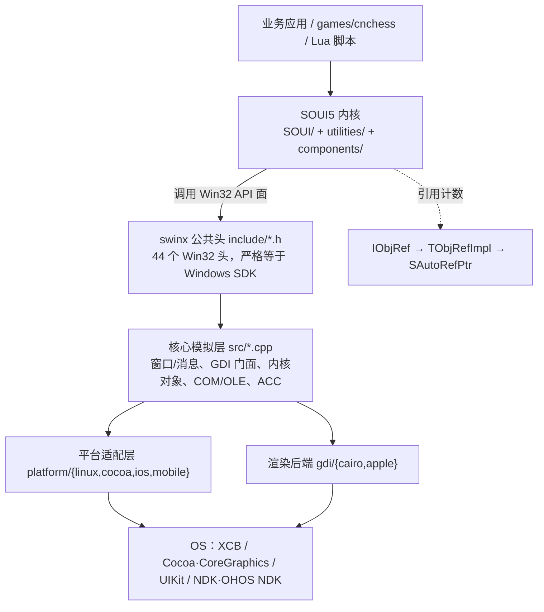
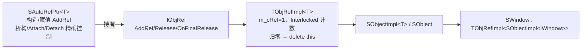

# SOUI5 —— 一套 C++ 代码覆盖六端的国产原生 GUI 框架

> ⚠️ **本版本已被取代（2026-10-14 v3）**：请以 **`SOUI5开源行业解决方案创新赛参赛文档-2026-10-14-v4.md`**（及更新的 v5）为最新定稿（v4 新增 §1.6，v5 将 §1.6 文体统一为陈述论证体）；本文件冻结保留，不再更新。

> **参赛主体**：2026 开源行业解决方案创新赛
>
> **方案名称**：SOUI5 跨平台原生 GUI 框架 —— 面向信创与 Qt 国产化替换的 C++ DirectUI 解决方案
>
> **文档版本**：2026-10-14 v3
>
> **技术基线**：SOUI4 内核 5.3.2.1（仓库名 `soui4`，对外称 **SOUI5**）；跨平台层 `swinx` 1.6
>
> **数据口径**：本文全部规模、计数与结论均取自 2026-10-14 当前源码与构建产物实测（`git ls-files` / `wc -l` / `api_scan` / `stat`），可逐条回溯核对；引用出处见文末《数据溯源》
>
> **v3 相对 v2 的主要更正**：① 修正了 §4.5.1 中渲染组件的**行数**论据（原数据有误），改用**实测 DLL 体积**作为论据；② 体积数据从 CMake `/MD` 开发树口径**更正为 VS2008 x86 `/MT` 发行构建口径**（内核 `soui4.dll` **2.31 MB**，含全部核心控件、不依赖 CRT——**这才是正常发行场景**）；③ 对"14 年"明确标注为项目方自述；④ 新增 §7「对本文观点的自我限定」。

---

## 0. 方案速览（一页读懂）

| 维度           | 内容                                                                                                                                                                                                |
| ------------ | ------------------------------------------------------------------------------------------------------------------------------------------------------------------------------------------------- |
| **一句话定位**    | 以 **Win32 API 语义为统一编程面**的 C++ DirectUI 框架，让**同一套 C++ UI 与业务代码**在 Windows / Linux / macOS / iOS / Android / OpenHarmony **六端原生运行**                                                                 |
| **解决的核心问题**  | 信创环境下，海量 Windows C++ 客户端资产无法在国产 Linux / 鸿蒙上复用，必须迁移；而现有的"Qt 重写"与"Wine 兼容"两条路代价高、可行性差，移动端尤其缺位                                                                                                       |
| **最硬的技术证据**  | 跨平台样板 `games/cnchess` 的**核心绘制与业务源码中 `__ANDROID__` / `__OHOS__` 出现次数均为 0**，"一次编写、六端运行"是工程现实而非口号                                                                                                    |
| **核心技术资产**   | 自研跨平台兼容层 `swinx`（**165,707 行**，**44 个**与 Windows SDK 同名同结构的头文件）                                                                                                                                   |
| **自有源码规模**   | **1,217 个文件 / 514,830 行**（内核 `SOUI/` + `utilities/` 合计 186,470 行）                                                                                                                                 |
| **体积（发行实测）** | 内核 `soui4.dll`（VS2008 x86、`/MT` 静态 CRT、**含全部 SOUI 核心控件**）**2.31 MB**——**这就是正常发行场景**；组件按需装载、选型直接影响体积——`render-gdi.dll` **0.14 MB** ↔ `render-skia.dll` **1.58 MB**（**约 11 倍**）（数据与口径见 §3.2、§4.5.1） |
| **可组合性**     | **能力按场景选、界面按需长**：16 个组件像积木一样挑选替换（选型决定体积与功能），皮肤 / 布局 / 窗口三维可无限扩展，XML 布局达成 UI 与逻辑分离                                                                                                                 |
| **质量保障**     | **约 426 条**无头自动化用例（`soui-headless`），4 个 GitHub Actions 工作流，含 swinx API 面回退门禁                                                                                                                      |
| **存量背书**     | 项目方自述持续开发 **14 年**（README，自 2011 年开源起算；本仓库 git 历史始于 2018-06，见 §7）；已落地恒星播放器、熊猫加速器、启程输入法、XMusic 等数十款商业产品                                                                                            |
| **国产化落点**    | 已适配 **OpenKylin / UOS / deepin** 等国产 Linux 发行版，并以 OpenKylin 社区上游仓库形态在信创体系内分发                                                                                                                      |
| **成长方向**     | 已具备"让既有 Win32 程序低成本跨端"的**框架能力本身**（兼容层重演 Win32 语义）；该能力正沿"补齐迁移面"方向收敛为开箱即用                                                                                                                           |

**核心创新骨架**（详见 §4）：① 以"重演 Win32"实现跨平台（路线）；② 业务代码零平台宏的六端同源（工程）；③ 平台 / 渲染二维正交的可扩展架构（架构）。三者互为支撑，共同构成本方案的技术辨识度。

---

## 一、项目背景

### 1.1 行业痛点一：Windows 客户端资产的"信创断点"

在国家推动信息技术应用创新（信创）的背景下，政企、金融、工业、能源等行业的客户端软件面临一个共同的现实：**存量资产几乎全部是 Windows C++ 程序**。

这些程序的资产结构有三个特征：

1. **业务逻辑与 UI 高度耦合**：界面代码、交互逻辑、业务规则混在几十万行 C++ 里；
2. **深度依赖 Win32**：窗口消息、GDI 绘制、COM 组件、内核对象、公共控件贯穿全局；
3. **迁移预算有限**：不可能为一个已有产品重新招团队、换语言、从头写一遍。

把这些资产迁到国产 Linux，现实中的两条主流路径各有硬伤：

**路径一：用跨平台框架重写（以 Qt 为代表）。** 代价有三重：

- **工作量巨大**：几十万行 C++ 业务要面向框架自有 API（`QWidget` 体系、信号槽、`QObject` 内存模型）重写，界面层几乎全部推翻；
- **授权成本**：LGPL 对闭源商业产品构成合规负担，商业授权费用昂贵；
- **移动端支持不友好**：Qt 在移动端要求 UI 必须跑在**独立于系统主线程的专用 UI 线程**上，于是不仅"业务线程 ↔ UI 线程"的交互要额外加锁/排队，**与系统自身的交互也变得别扭**（如系统 UI 的切入切出、系统级生命周期事件）。这很可能是**现实中几乎见不到用 Qt 做移动端原生应用**的重要原因之一。

> **一点必要的克制**：上面第三条是**基于技术模型的推断**（Qt 移动端确实采用独立 UI 线程，其与系统 UI 交互需要跨线程协调），并非对 Qt 的权威定论——Qt 在移动端应用不广，也可能同时受生态、工具链、厂商习惯等多重因素影响。本文将其作为"**值得权衡的一项事实约束**"陈述，而非单一因果结论。

**路径二：靠 Wine 做二进制兼容。** 据公开信息，OpenKylin、deepin 等国产发行版都在持续完善 Wine 以直接运行 Windows 软件，但**实际效果并不理想**：对简单的小程序或许可行，然而大型复杂项目依赖的 Win32 API 面极宽、且对特定版本行为有隐式假设，二进制兼容无法穷尽这些不可控因素——**这条路对大中型项目的现实可行性很低**。

> 同样需要克制：Wine 的成熟度在持续提升，且**对部分中型应用是可以工作的**；本文的判断限于"**大型复杂项目**"这一范畴，不主张 Wine 路线整体无效。

**SOUI5 提供的是第三条路：用 SOUI5 把现有 Windows 程序重写迁移，但不是"从零重写"。**

| 迁移路径           | 工作量                             | 授权成本                    | 移动端               | 可行性             |
| -------------- | ------------------------------- | ----------------------- | ----------------- | --------------- |
| **Qt 重写**      | 高（业务面向新 API 重写）                 | 高（LGPL 合规 / 商业授权）       | 差（双 UI 线程，系统交互别扭） | 桌面可行、移动端基本无人采用  |
| **Wine 二进制兼容** | 低（不改代码）                         | —                       | 无（仅桌面）            | 小程序可行，大型复杂项目不可控 |
| **SOUI5 重写迁移** | **中低**（UI 用声明式 XML 重描述，逻辑可大量保留） | **无**（自有授权，个人免费 / 商用收费） | **原生六端**          | **大中小项目均可落地**   |

之所以能做到"中低工作量"，是因为 SOUI5 的两项框架能力正好命中重写迁移的两个主要成本项：

- **声明式 UI（XML）**：界面用 XML 描述（控件树、属性、皮肤、布局），**UI 与逻辑分离**——界面层可以快速重描述，而不是把几十万行里的绘图代码逐行改写成新框架的 API 调用；
- **原生 Win32 API 兼容**：`swinx` 提供了**完整的 Windows 内核对象支持**（事件 / 互斥体 / 信号量 / 可等待定时器 / 定时器队列 / 文件映射、`WaitForSingleObject` / `WaitForMultipleObjects` 等），原有业务逻辑中基于 Win32 内核对象的同步、等待、线程协作代码**可以 0 成本迁移**，无需改写成另一套线程/同步模型。

> **该能力已由源码核实**：`swinx/src/sysobjs.cpp`（**2,381 行**）实现了 `CreateEvent` / `CreateMutex` / `CreateSemaphore` / `CreateWaitableTimer` / `CreateTimerQueue*` / `CreateFileMapping`+`MapViewOfFile` / `WaitForSingleObject` / `WaitForMultipleObjects` 等完整内核对象面（`swinx/include/sysapi.h` 声明，`sysobjs.cpp` 实现），底层以 fd（eventfd/管道）+ `select` 承载等待语义——**是真实实现，而非仅补头文件的空桩**。
>
> 需要客观说明的是"0 成本"的适用范围：上述内核对象是**进程内使用**的成熟实现；**跨进程按名字共享**的内核对象（命名对象）在非 Windows 平台受限于各自的跨进程机制，迁移时可能需要评估；此外 `WaitForSingleObject` 在句柄无效时返回 `WAIT_ABANDONED` 而非 Win32 标准的 `WAIT_FAILED`，属细节差异。这些不影响"**业务逻辑层面的同步代码可整体保留**"这一主线结论。

> 换句话说：SOUI5 迁移的是"**UI 层用声明式方式重描述 + 业务层几乎原样保留**"，而不是 Qt 那种"业务层也要面向新 API 重写"。

**并且，SOUI5 完整保留了"0 成本迁移 Windows 程序"的能力。** 当前的迁移方式是"用 SOUI5 重写迁移"，但支撑"直接迁移既有 Win32 程序"所需的底层能力——**以兼容层重演 Win32 语义**——已经是这套框架的既定路线与既有资产；需要时，完全可以在现有框架基础上把这一需求变为现实（详见文末边界说明）。

### 1.2 行业痛点二：一个产品、每个平台一份代码

第二个痛点来自另一个方向：**当 Qt 这类框架对移动端支持有限时，很多项目被迫"一个产品每个平台各写一份代码"**——Windows 一份、Linux 一份、Android 一份、iOS 一份、鸿蒙一份。多端各自维护，人力翻倍、版本漂移、缺陷要在多处重复修复。

近年来不少项目转向 **Flutter** 来解决跨平台问题：Flutter 对移动端的支持确实明显好于 Qt，但其代价是**换语言**（Dart）+ 背一套自带渲染引擎与 VM，**既有 C++ 资产与 Win32 技能栈无法复用**，且桌面端能力相对薄弱。**SOUI5 的"六端统一"为这一类问题提供了另一种值得评估的解法**：

| 方案          | 语言                | 资产复用                      | 移动端        | 桌面端      |
| ----------- | ----------------- | ------------------------- | ---------- | -------- |
| **每平台一份代码** | 各平台原生语言           | 无                         | 各自原生       | 各自原生     |
| **Qt**      | C++               | 需重写                       | 差（双 UI 线程） | 好        |
| **Flutter** | Dart              | 无法复用 C++                  | 好          | 一般       |
| **SOUI5**   | **C++（Win32 风格）** | **既有 C++ / Win32 资产直接复用** | **原生六端**   | **原生六端** |

SOUI5 的答案是：**一份 C++ 代码 + 一份 XML 界面描述，同时覆盖桌面与移动共六端**——既有资产不归零，多端维护收敛为一份（§4.2 给出"零平台宏"的硬证据）。

> **需要公允承认**：Flutter 在**移动端生态、第三方组件丰富度、UI 表现力与团队上手速度**上具备明显优势，是全球范围内跨平台移动开发的主流选择之一；SOUI5 与之并非"替换关系"，而是面向"**已有大量 C++ / Win32 资产、且需要覆盖桌面**"这一特定场景的另一条技术选型。若项目是纯新建、以移动为主、团队无 C++ 包袱，Flutter 往往是更省力的起点。**本方案的主张是"为存量 C++ 资产提供一个低迁移成本的六端方案"，而非"取代 Flutter"。**

### 1.3 项目沿革

| 阶段      | 时间       | 里程碑                                              |
| ------- | -------- | ------------------------------------------------ |
| 1.x     | 约 2011 起 | 基于 MIT 协议开源的轻量 DirectUI 引擎                       |
| 2.0     | —        | 完善模板结构框架                                         |
| 3.0     | —        | 引入矩阵变换与仿 Android 动画体系                            |
| 4.0     | —        | 类 COM 化重构：核心对象引用计数、便于 C 接口调用；XML 对象工厂            |
| 5.0     | —        | 链接 **swinx**，实现跨平台支持                             |
| 5.1–5.2 | —        | Anchor/Flow/Frame 布局、窗口属性动画、`.rc` 跨平台编译、全面支持 SVG |
| **5.3** | **2026** | **完成 Android / iOS 适配、初步完成鸿蒙（OHOS）适配**           |
| 5.3.2.1 | 2026-10  | 列表族就地编辑与复选框、Lua 组件导出面补齐、俄罗斯方块脚本示例                |

> **口径说明**：上表早于 5.x 的阶段划分来自项目方自述与 `ChangeLog.md`；本仓库 git 历史始于 **2018-06-28**，更早的版本演进未在当前仓库快照中完整体现。"**14 年**"是项目方（`README.md`）的表述，自 2011 年首次开源起算，**本文如实转述，不将其作为仓库可验证事实**。

`swinx` 兼容层自 2025 年立项、2026 年 10 月发布 1.6，是这套方案最年轻也最关键的一块。

### 1.4 三条国产化路径的技术路线对比

跨平台 GUI 的技术路线，本质上是四种选择，SOUI5 走的是最难走、也最少人走的那一种：

| 路线         | 代表                            | 跨平台怎么实现                       | 团队要付的代价                   |
| ---------- | ----------------------------- | ----------------------------- | ------------------------- |
| 换语言        | Flutter、Electron、React Native | 用另一门语言写 UI，各自渲染               | C++ 资产与技能栈归零，还背运行时        |
| 自建抽象 API   | **Qt**、wxWidgets              | 定义框架自己的 API，各平台分别实现           | 仍要 C++，但业务要面向新 API 重写     |
| 自绘引擎       | Flutter、Skia 系                | 自带渲染引擎直接画                     | 换语言 + 背 VM                |
| **重演平台本身** | **SOUI5**                     | **让 Windows 的 API 面在别的平台上成立** | 需自研兼容层（`swinx` 165,707 行） |

**SOUI5 选择的是第四条路**：不去抽象或替换 Windows，而是**让 Windows 的 API 面在别的平台上"重新成立"**——写一个兼容层，把 Win32 语义在 Linux / macOS / iOS / Android / OHOS 上重演出来。代价是这层兼容层要自己写、自己维护；收益则最为直接：

> **已有的 Win32/WTL 编程知识、已有的 SOUI C++ 代码，在新平台上不是负债，而是可以继续增值的资产。**

> **对"最难走"的自我审视**：这条路的代价是真实的——**兼容层的维护责任全部落在项目自己身上**，Win32 API 面越铺越宽，长期维护成本高于"定义小 API 面"的抽象路线；且**该路线的收益只在"已有 Win32 资产"的场景下才成立**，对全新项目反而是负担。SOUI5 的选择是把这份成本**集中在框架侧一次性投入**，从而把收益让给所有复用 Win32 资产的项目。

### 1.5 信创与 Qt 国产替换的契合点

| 诉求              | SOUI5 的对应能力                                                                               |
| --------------- | ----------------------------------------------------------------------------------------- |
| **国产 Linux 适配** | 已适配 **OpenKylin / UOS / deepin**；`swinx` 基于 XCB/X11 + Cairo 自建窗口系统，不依赖发行版 Qt 版本           |
| **鸿蒙原生支持**      | OHOS 为**正式支持平台**而非社区补丁，经 `PlatformAPI` 桥 + `soui-ohos-lib`（HAR 包）接入 `EntryAbility`        |
| **授权自主可控**      | 自有商业授权条款（个人免费 / 商用收费），**不受 LGPL 传染与商业授权约束**；`swinx` 内含 Wine 派生代码已单列披露与合规说明                |
| **不绑发行版组件版本**   | cairo / fontconfig / freetype / xkbcommon / dbus / skia 等全部**源码 vendor 化**，构建不依赖发行版提供什么版本 |
| **迁移成本可控**      | 业务层零平台宏，平台差异被兼容层与薄入口吸收；UI 用声明式 XML 重描述，Win32 逻辑可直接保留                                      |


> **对 Qt 的差异化**：Qt 以 QPA 平台抽象层实现跨平台，原生调用需切换/桥接线程，移动端还须维护独立 UI 线程；且 LGPL 授权对闭源商业产品构成合规负担。SOUI5 则以"重演 Win32"实现跨平台，原生能力经 JNI/NAPI **在同一线程同步调用**，**不需要双 UI 线程**，授权条款明确。
>
> **公允起见**：Qt 是经过大规模生产验证的成熟框架，**其文档、工具链（Qt Creator / Designer）、第三方生态与社区规模都远非 SOUI5 可比**；Qt 的 QPA 抽象也让它在"全新项目、不依赖 Win32 资产"时具备更好的可移植性与长期可预期性。SOUI5 的差异化只在**"存量 Win32 资产迁移"与"授权自主"两个具体维度**上成立，不宜泛化为"SOUI5 整体优于 Qt"。

---

## 二、技术架构

### 2.1 分层结构



| 层             | 内容                                                                                                               |
| ------------- | ---------------------------------------------------------------------------------------------------------------- |
| **业务代码**      | C++ + XML，六端共享，**零平台宏**                                                                                          |
| **SOUI5 内核**  | 窗口树（`SWindow`）/ 消息路由 / 事件系统 / 布局 / 动画 / 控件 / XML 对象工厂（`SObjectFactory`）                                          |
| **swinx 兼容层** | **44 个**与 Windows SDK 同名同结构的头文件 + **165,707 行**实现；Windows 上**不编译**（直接用系统 SDK）                                    |
| **底层**        | Win32 SDK · Linux XCB+Cairo · macOS Cocoa+CoreGraphics · iOS UIKit+CoreGraphics · Android/OHOS JNI·N-API + Cairo |

架构的价值集中在**两根支柱**（§2.2、§2.3）上，其余三节（§2.4–§2.6）是为支撑这套架构而配备的**工程配套机制**，一并简要列明。

### 2.2 支柱一：以 Win32 为"世界语"

`swinx/include/` 下的 `windows.h` / `gdi.h` / `unknwn.h` / `oleacc.h` / `textserv.h` 等 **44 个头文件与 Windows SDK 同名同结构**。因此 SOUI5 内核直接 `#include <windows.h>`，**零平台 `#ifdef`**。

三条机制支撑这套"世界语"：

1. **同符号、分目录实现、链接期解析**（`swinx/src/SwinxUtils.h`）：跨平台助手声明集中一处，各平台目录给出同名同签名实现，`file(GLOB)` 只编当前平台源文件 ⇒ 调用方写同一个函数名、正文无平台分支。
2. **`g_platformAPI` 回调机制**（`swinx/include/platform_api.h`，`PLATFORM_API_VERSION = 3`）：Android/OHOS 无桌面窗口系统，由宿主 App 通过结构体回调补上窗口/输入/剪贴板/提示音能力；`PlatformAPI_Init` **严格比对版本**，不一致拒绝注册，是跨版本演进的契约护栏。
3. **非 MSVC 工具链上的 COM 自研**（`swinx/src/SUnkImpl.h`）：gcc/clang 无 `__uuidof`，用 `DECLARE_INTERFACE_` 宏集 + `IUNKNOWN_BEGIN/ADD_IID/END` + `SUnkImpl<T>` + 弱符号 `DEFINE_GUID` 四件套补齐，`BSTR/VARIANT/SAFEARRAY/IDispatch` 全部自研——**让 SOUI 的无障碍（ACC）代码一字不改跨三桌面平台编译**。

> **对迁移的直接意义**：`swinx/src/sysobjs.cpp` 完整实现了 Win32 **内核对象**（event / mutex / semaphore / waitable timer / timer queue / file mapping 等，含 `WaitForSingleObject` / `WaitForMultipleObjects`）。这意味着已有 Windows 业务代码里基于这些对象的线程同步与等待逻辑，**可以整体保留**（§1.1 已给出适用范围与两处细节差异）。

### 2.3 支柱二：平台与渲染二维正交

`*.cmake` 用 `file(GLOB)` 自动纳入当前平台源文件，**新增 `.cpp/.mm` 不需改 cmake**：

| 目标平台        | 平台适配层                 | 渲染后端        | 平台专有依赖                              |
| ----------- | --------------------- | ----------- | ----------------------------------- |
| Windows     | （不编译 swinx，用系统 Win32） | GDI / D2D   | Win32 SDK                           |
| Linux（桌面）   | `platform/linux`      | `gdi/cairo` | ALSA（可选）、xcb / xkbcommon / dbus     |
| macOS       | `platform/cocoa`      | `gdi/apple` | Cocoa / CoreGraphics / CoreServices |
| iOS         | `platform/ios`        | `gdi/apple` | UIKit                               |
| Android     | `platform/mobile`     | `gdi/cairo` | Android NDK（JNI）                    |
| OpenHarmony | `platform/mobile`     | `gdi/cairo` | OHOS NDK（`napi` / `native_window`）  |

**设计要点**：`platform/*`（窗口壳/事件循环/剪贴板/IME/拖放/DPI）与 `gdi/*`（绘制）是**两个正交维度**——当前 `platform/` 有 4 个目录、`gdi/` 有 2 个。Linux 与 Android/OHOS 复用 Cairo 渲染而平台层不同；macOS 与 iOS 反之。**新增平台与新增渲染后端互不牵连。**

> 这里也解释了为什么 SOUI5 **没有** Qt 那类"双 UI 线程"负担：UI 直接运行在平台原生线程上，窗口消息由 `platform/*` 归一为 Win32 消息循环语义（内核 `SMsgLoop`），与系统 UI 的交互就是在原生线程上的常规消息处理。

### 2.4 配套机制一：类 COM 引用计数与内存安全



- **接口层 `IObjRef`**：仅 `AddRef`/`Release`/`OnFinalRelease` 三纯虚方法——是 COM `IUnknown` 的**引用计数子集**，无 `QueryInterface`（类型安全转换由模板 `sobj_cast<T>()` 替代，比 QI 更轻量）。
- **智能指针 `SAutoRefPtr<T>`**：构造/拷贝 `AddRef`，析构/赋值自动 `Release`，提供 `CopyTo`/`Attach`/`Detach`/`Get`，语义与 COM 指针管理一致。
- **控件树采用裸侵入式链表**，由父窗口以 owner 语义负责析构，**不走引用计数**——刻意避免父子循环引用导致永不释放。

> 该设计在"自动回收资源对象"与"避免控件树循环引用"之间取了正确平衡，系统性降低了 C++ 最常见的两类泄漏（忘记 Release、循环引用）。
>
> **需要克制的地方**："引用计数 + 裸指针 owner 语义"**降低**了两类典型泄漏风险，但**不等于内存安全已经"解决"**——循环引用仍可能在资源对象之间出现（只是控件树这一最常见的场景被规避），跨线程生命周期仍需开发者遵守约定。本节主张的是"**该设计降低了特定类别的风险**"，而非"消除了 C++ 内存问题"。

### 2.5 配套机制二：XML + 脚本的三层分工

```
┌─────────────────────────────────────────────────────────┐
│  XML 管布局    │  Lua 管逻辑       │  C++ 管能力          │
│  界面/皮肤/    │  玩法/原型/       │  重计算/系统能力/     │
│  动画参数声明  │  频繁调整的胶水   │  底层绘制             │
└─────────────────────────────────────────────────────────┘
```

- **XML 驱动 UI（声明式界面）**：`pugixml` 封装为 `SXml`，控件经 `SObjectFactory` 由 XML 节点名映射到 C++ 类——**换皮肤 / 换布局不改 C++ 代码**；配合可视化设计器 `uieditor`。这正是 §1.1 所说"UI 层可快速重描述"的技术基础。
- **脚本化玩法迭代**：XML 事件属性（`on_command` / `on_init`）可直接挂 **Lua 全局函数**，改脚本无需重编译 C++。绑定面 **44 个文件 / 约 1,470 处注册**，并具备 `NativeCall` **零改动导出通道**（宿主注册回调即可新增脚本能力，不动绑定层、不重编组件）。
- **动画参数留 XML**：时长/曲线在 XML 声明，脚本编排时序——demo 内消消乐、俄罗斯方块的动画修改**免重编译**。

### 2.6 配套机制三：异步任务与线程协作

| 原语                                   | 何时用                                         |
| ------------------------------------ | ------------------------------------------- |
| `IMessageLoop::PostTask(IRunnable*)` | 从**任意线程**把任务投到 **UI 线程**执行                  |
| `ITaskLoop::postTask(...)`           | 把任务投到**专属工作线程**（每线程一条队列），返回任务 ID 供取消        |
| `STaskHelper::post(...)`             | 把"对象 + 成员函数 + 参数"绑成 `IRunnable`，按目标线程类型自动选路 |

**"安全"落在三处契约上**：① 载荷归接收方所有（实现先 `clone`，投递方栈上对象返回即析构也安全，**不需要 `new`**）；② 参数按值绑定（发送线程栈数据不被接收方引用）；③ 业务侧无锁（接收方是某对象成员函数，天然只在自己线程跑）。

> 对照裸 Win32 的等价写法：要自己 `new` 载荷、`PostMessage`、在窗口过程里 `delete`，还要处理"窗口先销毁、消息后到"的悬空指针——SOUI5 下这一整类样板与陷阱被 `post` 一行吸收。

### 2.7 架构总账

| 维度           | 当前值                                                                                                                          |
| ------------ | ---------------------------------------------------------------------------------------------------------------------------- |
| 自有源码规模       | **1,217 文件 / 514,830 行**（内核 `SOUI/` + `utilities/` = 186,470 行）                                                              |
| 跨平台层 `swinx` | 165,707 行 / **44 个**等价 Windows SDK 头；API 声明 **1,042** · 有定义 **913**                                                          |
| 六端覆盖         | Windows / Linux / macOS / iOS / Android / OpenHarmony                                                                        |
| 控件面          | **40 个**内置控件头 + **37 个**扩展控件类                                                                                                |
| 脚本绑定面        | Lua 5.4 组件：44 文件 / 约 1,470 处注册 / `NativeCall` 零改动导出                                                                          |
| 质量保障         | **约 426 条** `soui-headless`，36 个 `test_*.cpp`                                                                                |
| 体积（发行实测）     | `soui4.dll` **2.31 MB**（VS2008 x86、`/MT` 静态 CRT、含全部核心控件）；组件按需装载，`render-gdi.dll` **0.14 MB** ↔ `render-skia.dll` **1.58 MB** |

---

## 三、应用场景

### 3.1 场景一：信创环境下的 Windows 客户端国产化迁移（核心场景）

**典型客户**：政企/金融/工业领域的存量 Windows C++ 桌面客户端。

**价值**：SOUI5 提供"**保留 C++ 逻辑资产、以声明式 XML 快速重述 UI**"的迁移路径，无需面向新框架 API 重写业务。已适配 **OpenKylin / UOS / deepin**；一份 Windows `.rc` 资源文件可在 Windows / Linux / macOS **三端同源编译**进 PE/ELF/Mach-O，UI 资源从"手工维护 resource.h + rc2"升级为"一次描述、三端复用"，并支持**资源内嵌单文件发布**。基于 Win32 内核对象的既有业务逻辑可整体保留（§1.1、§2.2）。

**可核对证据**：仓库 `games/cnchess`（中国象棋，含联机对弈、机器人对战、主题热下载）作为跨平台样板——同一份 `MainDlg/ChessGame/ChessBoard/algorithm` 经三个薄入口接入六端，**核心绘制/逻辑文件完全无平台宏**。（此处引用它是为了证明"业务代码六端同源"，与计算性能无关。）

### 3.2 场景二：Qt 国产替换

**适用对象**：因授权合规、体积、线程模型或某端（尤其鸿蒙 / 移动端）支持不足，需要替换 Qt 的项目。

| 对比维度              | SOUI5                              | Qt 6              | 差异含义                         |
| ----------------- | ---------------------------------- | ----------------- | ---------------------------- |
| 编程模型              | Win32/WTL 式 + XML + Lua            | 自有 Q* 体系          | Win32 程序员**知识资产可直接复用**，学习曲线低 |
| 核心体积              | **2.31 MB**（含全部核心控件、`/MT` 不依赖 CRT） | 数十 MB             | 显著更小，**但须按同等配置比较**           |
| 授权                | 自有商业（个人免费）                         | LGPL / 商业         | 闭源商业产品**无 LGPL 传染负担**        |
| 原生能力调用            | JNI/NAPI **同线程同步**（iOS 直连 C++）     | 需切换/桥接线程          | 移动端"调系统能力"摩擦更小               |
| **移动端线程模型**       | **单 UI 线程，与系统同线程**                 | **独立 UI 线程（双线程）** | 与系统 UI 交互无需跨线程协调             |
| 鸿蒙支持              | 正式支持（`PlatformAPI` 桥）              | 弱                 | 信创"桌面+鸿蒙"双覆盖                 |
| 脚本/热更             | 内置 Lua 5.4（免编译迭代）                  | QML/JS 内置         | 均具备，SOUI5 脚本层为可选组件           |
| **生态 / 工具链 / 文档** | **较弱，社区规模小**                       | **成熟完备，社区庞大**     | **这是 SOUI5 的明确短板（§7）**       |

> **体积口径说明**：上表的 **2.31 MB** 取自 **VS2008 x86、`/MT`（静态 CRT，不依赖 VC 运行库）、且编译了全部 SOUI 核心控件**的 Release 产物——**这正是正常发行版本的场景**，因此与前文"项目方自述约 2 MB"相互印证，二者实为同一量级（~2 MB）而非"最小值 vs 常规值"的差异。
>
> 需注意：本仓库另有一套 **CMake `/MD`（动态 CRT）开发树**，其产物显著更大（`soui4.dll` ≈4.9 MB、`render-skia.dll` ≈8.16 MB）——那是**开发/调试构建的口径，不代表发行体积**，本文不以其作为体积论据。与 Qt 比较时应按**同等配置**（同为静态 CRT / 同等功能模块）实测。

### 3.3 场景三：鸿蒙（OHOS）原生应用

SOUI5 把 OHOS 作为**一等公民**：Android/OHOS 共用 `platform/mobile` + `PlatformAPI` 桥，`soui-ohos-lib` 已以 **HAR 包形态**提供（ArkTS 侧经 `@soui/ohos` 导出，消费端以源码依赖接入）。**已有真实移植案例**：`games/cnchess` 的鸿蒙版运行于 `games/cnchess/client/ohos-demo`。

**价值**：Windows 客户端与 Android 客户端可低成本上鸿蒙——**一套 C++ 代码同时覆盖桌面、Android 与鸿蒙**。

> **成熟度提示**：OHOS 支持当前为"**初步完成**"（§1.3），且**移动端尚无 CI 自动构建与回归**（§7），鸿蒙端在工程化程度上仍处于早期，选型时应纳入评估。

### 3.4 场景四：一产品多平台代码的统一（取代"每平台一份代码"）

**适用**：因 Qt 移动端能力有限、不得不为 Windows / Android / iOS / 鸿蒙各维护一份代码的项目；以及正在考虑用 Flutter 重写桌面 + 移动端的团队（若团队有较重 C++ 资产）。


**价值**：SOUI5 用**一份 C++ + 一份 XML** 覆盖六端，多端维护收敛为一份，版本不再漂移；同时既有 C++ / Win32 资产不归零（这是 Flutter 无法提供的）。§1.2 的对照表已说明其相对"每平台一份代码 / Qt / Flutter"的位置。

> 若项目**没有 C++ 资产包袱**且以移动端为主，Flutter 通常是更优起点（§1.2）；本场景明确限定在"**有存量 C++ 资产**"的前提下。

### 3.5 场景五：对帧时序 / 体积敏感的客户端与企业跨平台应用

**适用**：游戏客户端、图形编辑器、音视频播放器、实时数据可视化、工业控制界面等对帧时序或包体敏感的场景；以及办公软件、管理工具等需要"一套代码覆盖桌面 + 移动"的跨平台企业应用。

**性能一侧**：SOUI5 的 UI 树遍历、事件分发、计时器与动画调度**全部跑在原生 C++ 上，无 VM、无托管堆**，因此帧时序可控、运行时不背虚拟机体积。相对 Android（ART）/OHOS（ArkCompiler）这类托管运行时的原生开发，其差异集中在**托管堆的 GC 抖动**与**运行时本身体积**两项：

| 维度    | SOUI5（无 VM）             | Android 原生（ART） | OHOS 原生（ArkCompiler） |
| ----- | ----------------------- | --------------- | -------------------- |
| 执行模型  | 原生 AOT 机器码，无 VM         | ART（托管）         | ArkCompiler（托管）      |
| GC 停顿 | **无**（类 COM 引用计数，确定性回收） | 有，可能影响帧时序       | 有，可能影响帧时序            |
| 运行时体积 | 无 VM，轻                  | 含 ART 运行时       | 含 ArkCompiler 运行时    |

需要客观说明的是：**这一优势的对照面是"托管语言的原生开发"（Java/Kotlin、ArkTS），而不是同一门 C++ 内部的框架选择**——对纯 C++ 的密集计算而言，语言本身不构成差异。此外，"无 GC 抖动"的收益在**绝大多数常规 UI 场景中并不显著**，只有在**确有帧时序硬约束**（如高刷新率游戏、实时可视化）时才构成实际优势；把这一点作为通用卖点会失真。

**企业应用一侧**：一套代码覆盖桌面 + 移动端；C++ 主体 + Lua 内置脚本，官方另有 JS（soui4js）、Python3（soui4py）独立仓库（覆盖桌面三端），团队可按技能栈分工；多语言 `ITranslatorMgr` **运行时热切换** + High-DPI `SDpiHandler` 自动缩放，已有真实产品（XMusic 中英双语 + 全 DPI 感知）验证。

### 3.6 场景六：脚本化快速迭代与原型验证

**适用**：需要频繁调整玩法/交互逻辑、希望"改完即生效"的项目。

`demos/demo` 内含三个完整的 Lua 脚本小游戏（跑马机、8×8 消消乐、俄罗斯方块，同源 `test.lua` 共 **2,861 行**）：

- **消消乐**：交换/消除/下落动画组、飞金币抛物线入账链、七段 LED 滚动计分与洗牌绕行动画**全部由 Lua 编排**；
- **俄罗斯方块**：七种方块 + 踢墙旋转 + Hold + Ghost 落点预测，动画与音效全部脚本编排；在该综合性 Demo 负载下 **CPU 稳定低于 0.5%**，内存启动约 99 MB、游戏过程稳定约 105 MB。

> 这证明"XML + Lua + C++ 能力层"的三层分工不仅能编排动画，也能承载**经典下落式玩法 + 音效 + 实时输入**的完整单机游戏循环。
>
> **口径提示**：上述 CPU / 内存数字来自**单个 Demo 在某一机器上的观测**，受硬件、构建配置与测量方式影响，宜作为"该负载下可运行且开销低"的佐证，而非可推广的基准数据。

---

## 四、创新点

SOUI5 的创新点按其技术辨识度分为两档：**核心创新**三条（§4.1–§4.3，构成方案的骨架）与**重要创新**三条（§4.4–§4.6，是骨架之上的能力延伸）。

> **"创新"的口径说明**：本文所称"创新"，指**在 SOUI5 这一技术路线上具有辨识度的工程选择**，而非"人类首次提出"。例如"引用计数""XML 描述 UI"在业界早已存在，SOUI5 的创新性在于**组合方式与落地彻底度**（如把 Win32 内核对象整体重演、把 6 端同源做到业务代码零平台宏）。评述时请按此口径理解。

### 4.1 创新点一：以"重演 Win32"实现跨平台（路线创新 · 核心）

**创新实质**：不是"抽象出更少的 API 让开发者少学"，而是"**让开发者已经会的那一整套 API 在新平台上继续有效**"。四条跨平台路线中（见 §1.4 对照表），SOUI5 走的是"重演平台本身"——需自研兼容层（`swinx` 165,707 行），但因此 Win32/WTL 知识资产与既有 SOUI 代码**直接复用为资产**。

**验证**：44 个与 Windows SDK 同名同结构的头文件；连最难移植的 Win32 富文本（`richedit41`，499 个受控文件）与 Scintilla 的 **Win32 分支**都被整体搬运到非 Windows 平台——**只要组件存在 Windows 实现，swinx 就足以让它跨平台，不必为每端另写后端**。

> **该路线的固有代价**（§1.4 已述）：兼容层的长期维护责任在项目侧；路线收益只在"已有 Win32 资产"场景成立。这是本创新点的**边界条件**，不是缺陷。

### 4.2 创新点二：业务代码零平台宏的六端同源（工程创新 · 核心）

| 宏             | 在 `games/cnchess` 业务源码中的出现次数                  |
| ------------- | --------------------------------------------- |
| `__ANDROID__` | **0 次**（仅 `README.md` 提及 1 处）                 |
| `__OHOS__`    | **0 次**（仅 ohos 目录 CMakeLists / readme）        |
| `_WIN32`      | 仅入口/资源层少量（`main.cc`、`stdafx.h`、`cnchess.rc`…） |
| `__MOBILE__`  | 仅区分"移动触屏 vs 桌面弹窗"（移动用 `SModalView` 替代对话框）     |

**核心绘制/逻辑文件 `ChessBoard.cpp`、`ChessPiece.cpp`、`myprofile.cpp`、`CnchessSkin.cpp`、`algorithm/*` 完全无平台宏。**

**创新实质**：平台差异被压在**三个薄入口**里（桌面/iOS 由 swinx 归一为 `WinMain`；Android 由 JNI 托管进 `GameActivity`；OHOS 由 N-API 托管进 `EntryAbility`），**同一份业务代码接三个宿主**。这在跨平台 GUI 框架中是罕见的彻底度。

> **证据的适用范围**：该"零平台宏"结论来自**单个业务样板（`games/cnchess`）**的实测，样本量为 1；它**强有力地证明了该模式可行**，但不能外推为"所有业务代码都能做到零平台宏"——不同业务对平台专有能力的依赖程度不同。样板选择中象棋子有"计算与绘制为主、平台专有能力依赖较少"的特点，选型时应结合自身业务评估。

### 4.3 创新点三：平台 / 渲染二维正交的可扩展架构（架构创新 · 核心）

`platform/`（4 目录）× `gdi/`（2 目录）两个维度**互不牵连**——Linux 与 Android/OHOS 复用 Cairo 渲染而平台层不同，macOS 与 iOS 复用 CoreGraphics 平台层不同。因此**新增一个平台不必碰渲染后端，新增一个渲染后端不必碰任何平台**。

配合 `g_platformAPI` 版本化契约（`PLATFORM_API_VERSION = 3`，严格比对后拒绝注册），使 Android/OHOS 这类无桌面窗口系统的宿主可以**在不修改框架主体的前提下**接入。

**该架构的直接产出：SVG 作为渲染原语而非图片格式。** 因为渲染后端是可替换的一维，矢量能力得以下沉为**渲染目标接口之一**——`IRenderTarget::DrawSVG` 在**四个后端全部实现**（skia / d2d / gdi-win / gdi-linux）：

- **矢量直绘**：整条链路是"矢量 → 后端原生路径 → GPU/光栅"，在显示分辨率上一次性成形，**不是先栅格化再拉伸**；
- **无损缩放 + 9-Patch**：`DrawSVG9Patch` 让 SVG 像 9-Patch 一样按任意尺寸拉伸而不糊边；DPI 从 100% 切到 200% 时按目标像素密度重新 tessellate，边缘永远锐利；
- **HiDPI 天然友好**：一套资源全端清晰，**不需要 @1x/@2x/@3x 多套位图**；
- **AI 工具链友好**：SVG 是文本化、可程序化生成与修改的矢量格式，更适合 LLM / 设计工具直接产出与改写。

> **两点克制**：① "四后端全部实现 `DrawSVG`"意味着**接口可用**，但各后端在**复杂 SVG 特性**（滤镜、渐变网格、部分 CSS）上的覆盖度可能存在差异，实际项目中宜按目标后端的支持范围验证；② **SVG 直绘在复杂图形下通常比预栅格位图更耗 CPU**，"矢量直绘 = 更快"并不普适——它的真实收益是**无损缩放、资源体积与分辨率无关**，而非绝对性能。

### 4.4 创新点四：跨端一致性 —— 类 COM 引用计数 + 重组件零改源码搬运（设计创新 · 重要）

这两项能力共同保证"六端不只是能编译，而且行为一致"。

**其一，类 COM 引用计数**（**降低** C++ GUI 内存管理风险，口径见 §2.4）：`IObjRef` + `TObjRefImpl<T>` + `SAutoRefPtr<T>` 三级机制——

- **资源对象引用计数**（皮肤、字体池、位图、渐变、事件参数），订阅即增引用，回调期间对象不会悬空；
- **控件树刻意用裸指针 + owner 语义**，避开父子循环引用；
- **skin 子系统统一单层锁序**（`SUiDef::GetSkinLock()` 递归临界区），把多 UI 线程访问收敛为唯一锁序，且 `GetImage/GetSvg` 返回 `SAutoRefPtr` 实现"引用计数 + 线程安全获取"二合一。

**其二，重组件"零改源码跨端"的可复用方法**：这是 swinx 兼容策略可复用、可扩展的最硬佐证——

- **RichEdit**：Win32 上依赖 Text Services / OLE / GDI+ 一整套私有契约，是最难移植的富文本编辑。swinx 提供 `richedit.h` / `textserv.h` 同名 API 面，底层搬运 `richedit41`（499 个受控文件）——**同一份 `SRichEdit` 源码六端一致**。
- **Scintilla**：SOUI 的 `CScintillaWnd` 只取 Scintilla 的 **Win32 分支**（`CreateWindowEx` + `SendMessage(SCI_*)` + GDI），靠 swinx 整体模拟出来，语法着色与代码折叠全部走 Win32 消息协议。
- **RC 资源**：一份 Windows `.rc` 经 `windres → COFF → 本平台目标文件 → 符号重命名 → 链接` 四步流水线，在 Windows / Linux / macOS **三端同源编译**进 PE/ELF/Mach-O。

> **方法论**：只要组件有 Windows 实现，无需为每端另写后端——这是 SOUI5 相对其他跨平台框架的**结构性节省**。


### 4.5 创新点五：按场景自由组合 —— 能力积木 + 界面三维扩展 + XML 分离（可组合性创新 · 重要）

SOUI5 的可组合性有两条正交的路径：**能力按场景选**（组件积木）与**界面按需长**（皮肤 / 布局 / 窗口可扩展 + XML 描述）。

#### 4.5.1 路径一：积木式组装 —— 16 个组件按场景挑选、像积木一样替换

框架的**每一个横向能力都是一个独立链接的组件**，而不是内核里写死的一段代码。项目可以**按目标场景挑选要哪几块积木**，选择结果同时决定"能做到什么"和"发行包有多大"。关键机制是**选择集中在一处**——`SAppCfg`（`SOUI/include/SAppCfg.h:50`）就是这份"积木选型清单"，一行链式调用选定一块积木：

```cpp
SAppCfg().SetRender(Render_Gdi)          // 渲染后端：Gdi / Skia / D2d 三选一
         .SetImgDecoder(ImgDecoder_Stb)  // 图像解码：Stb / Wic / Gdip 三选一
         .SetAppResZip(_T("uires.zip"))  // 资源提供：Zip / 7z / Pe / File 任选
         .SetLog(FALSE)                  // 不要日志 → 不链入 log4z
         .EnableMultiLang(_T("lang:lang_cn"), FALSE)  // 不要多语言 → 不链入 translator
         .EnableScript(FALSE);           // 不要脚本 → 不链入 Lua
```

| 类别    | 组件（共 16 个，各自独立 CMake target）                                          | 可替代项   |
| ----- | --------------------------------------------------------------------- | ------ |
| 渲染后端  | `render-skia` / `render-gdi` / `render-d2d`                           | 三选一    |
| 图像解码  | `imgdecoder-stb`（含 WebP）/ `imgdecoder-wic` / `imgdecoder-gdip`        | 三选一    |
| 资源提供  | `resprovider-zip` / `resprovider-7zip`（另有内置 Pe/File 路径）               | 任选     |
| 网络与任务 | `ws`（WebSocket）/ `network` / `httpclient` / `TaskLoop` / `SIpcObject` | 按需     |
| 脚本与其它 | `ScriptModule-LUA` / `translator` / `log4z`                           | 可整体不启用 |

**选型为什么真的有效——发行构建产物的实测体积（硬数据，可复现）**：

> 口径：`out/vs2008_x86/bin/Release/`（VS2008 **x86**、**`/MT` 静态 CRT**、Release），即**正常发行场景**；逐字节 `stat` 实测。

| 组件（Release DLL）             | 实测体积        | 为什么差这么多                                                                                              |
| --------------------------- | ----------- | ---------------------------------------------------------------------------------------------------- |
| `soui4.dll`（内核，**含全部核心控件**） | **2.31 MB** | 框架主体；`/MT` 已内含 CRT，**不额外依赖 VC 运行库**                                                                  |
| `render-skia.dll`           | **1.58 MB** | **静态链入 Skia 引擎**（`CMakeLists.txt:33` `target_link_libraries(render-skia skia …)`，`skia` 为 STATIC 目标） |
| `scriptmodule-lua.dll`      | **0.81 MB** | 含 Lua 5.4                                                                                            |
| `imgdecoder-stb.dll`        | 0.32 MB     |                                                                                                      |
| `utilities4.dll`            | 0.24 MB     |                                                                                                      |
| `log4z.dll`                 | 0.17 MB     |                                                                                                      |
| `render-d2d.dll`            | **0.16 MB** | 仅链系统 `d2d1` / `dwrite`，**不捆绑引擎**                                                                     |
| `render-gdi.dll`            | **0.14 MB** | 仅链系统 `msimg32` / `gdiplus`（Linux 下为 swinx+Cairo），**不捆绑引擎**                                           |
| `resprovider-zip.dll`       | 0.10 MB     |                                                                                                      |
| `translator.dll`            | 0.06 MB     |                                                                                                      |

**结论**：体积的决定因素**不是组件源码行数的多少，而是"是否在运行时静态捆绑一套渲染引擎"**。`render-gdi` 直接借用系统 GDI / Cairo，产出的 DLL 仅 **0.14 MB**；而 `render-skia` 自带一整套 Skia，产出 **1.58 MB**——**相差约 11 倍**。

> **因此，选型直接换体积**：**一个小程序只要基础功能、不在意渲染特性，选 `Render_Gdi` 就能把渲染这一块的发行体积从约 1.6 MB 压到约 0.14 MB**；反之，需要复杂图形 / 动画 / 跨端像素级一致性时才值得付出 Skia 的体积。同理，不要日志 / 多语言 / 脚本时，`log4z`（0.17 MB）/ `translator`（0.06 MB）/ `scriptmodule-lua`（0.81 MB）**根本不会进包**。这也是"**核心约 2 MB、按需装载**"这一发行特性的直接来源（§0、§2.7）。

> **v2 → v3 更正（两处）**：① v2 曾以"`render-gdi` 仅 **104 行** vs `render-skia` **5,437 行**"论证体积差异——经源码复核，该行数**不准确**（`render-gdi` 的 win 实现 **3,272 行**、linux 实现 **2,964 行**，同一构建只编其中一份；`render-d2d` 全目录实际 **46,274 行**），且**行数本身与体积无因果**，故改用**实测 DLL 体积**。② v3 初稿曾引用 CMake `/MD` 开发树的体积（内核 ≈4.9 MB / skia ≈8.16 MB）——那是**开发构建口径，不代表发行体积**；已更正为 **VS2008 x86 `/MT` 发行构建**的 **2.31 MB / 1.58 MB**。

*选型不影响业务代码的三个保证*：

- **同类可替换 = 无锁定**：换渲染器只换链接的积木 + `SetRender` 的一个枚举值，业务绘制代码与 XML 不动；跨平台工程通常选 `Render_Skia` + `ImgDecoder_Stb`（§2.3 六端矩阵）。
- **COM 形态 = 零侵入集成**：组件以类 COM 工厂装载（`SComMgr2::CreateRender_Skia` / `CreateResProvider_ZIP` / `CreateScrpit_Lua`…），**静态 COM（`LIB_SOUI_COM`）与 DLL COM 两种链接方式下调用代码零差异**，宿主不必为"用不用某插件"改造架构。
- **边界清楚 = 可独立演进**：每个组件自带 `CMakeLists.txt` 与自有文档，`ScriptModule-LUA` 甚至自带 3 篇文档，可在不触碰内核的前提下独立升级。

#### 4.5.2 路径二：皮肤 / 布局 / 窗口三维无限扩展，且以 XML 描述布局达成 UI 与逻辑分离

控件的**皮肤、布局、窗口本体**三者都是开放的可扩展点（`SApplication` 三个注册模板入口，`SOUI/include/SApp.h:662`、`:688`）：

| 可扩展维度               | 机制                                        | 扩展成本                                       | 源码证据                                                                                                                                                 |
| ------------------- | ----------------------------------------- | ------------------------------------------ | ---------------------------------------------------------------------------------------------------------------------------------------------------- |
| **皮肤（Skin）**        | 皮肤类型经工厂注册，XML `<skin type="...">` 按类型名实例化 | 新增一种皮肤 = 派生 `SSkinObjBase` + 注册类名          | `SOUI/src/core/SSkin.cpp`（`"svg"` 等类型分派）；扩展注册 `SSkinVScrollbar`/`SSkinAni`…（`controls.extend/SCtrlsRegister.cpp:100-104`）                            |
| **布局（Layout）**      | 布局与布局参数成对注册，`layout="xxx"` 即选中            | 新增一种布局 = 实现 `ILayout` + `ILayoutParam` 各一  | `SOUI/include/layout/` 已有 7 组（`SouiLayout`/`SLinearLayout`/`SGridLayout`/`SFlowLayout`/`SFrameLayout`/`SAnchorLayout`…），**可继续追加**                    |
| **窗口 / 控件（Window）** | 窗口类经注册后由 XML 节点名映射到 C++ 类                 | 新增一个控件 = `DEF_SOBJECT(基类, L"xml标签名")` + 注册 | cnchess 自定义控件 `DEF_SOBJECT(SWindow, L"chessboard")`、`DEF_SOBJECT(SImageWnd, L"chesspiece")`（`games/cnchess/client/ChessBoard.h:7`、`ChessPiece.h:10`） |

三层扩展点互不牵制——**可以只换皮肤不改布局，可以只加布局不动控件，可以直接从 `SWindow` 派生一个全新控件**；业务自定义控件与框架内置控件在 XML 里**地位完全对等**，因此控件面可被项目自由撑大，不受内置清单限制（`controls.extend/` 的 **37 个**扩展控件类经一次集中注册即可全量启用）。

**XML 作为布局描述语言是上述三件事落地的表达层基础**：界面结构（控件树、属性、皮肤引用、布局类型）由 XML 描述，C++ 只管能力与逻辑——

- **界面与逻辑解耦**：`pugixml` 封装为 `SXml`，控件经 `SObjectFactory` 由 XML 节点名映射到 C++ 类——**换皮肤 / 改布局 / 调结构都不改 C++ 代码**；业务逻辑通过事件属性（`on_command="xxl_on_restart"`）接回，而非写死在界面代码里。
- **模板化复用**：`<template>` 定义一次积木（多层 `stack` + `img` + `data` 参数），再用 `t:g.xxx` + `{{name}}` 占位符批量实例化——`demos/demo` 的消消乐棋子、七段 LED 数字位即以此方式复用（`uires/values/template.xml`）。
- **可视化设计与热替换**：界面是纯数据，因此可视化设计器 `uieditor` 与运行时皮肤热换（cnchess 经 WebSocket 下载主题包 + MD5 校验）都成立。

> **创新实质**：把框架能力从"**要么全要、要么不用**"变成"**按场景点菜**"，把界面从 C++ 里剥出来做到"**界面可长可换、逻辑不动**"——对信创场景尤其有意义：小程序/嵌入式部署要极简体积，办公/工业客户端要完整能力，同一套框架用不同选型即可同时覆盖。
>
> **一条操作层面的提醒（§7 亦述）**：`SAppCfg` 这类"选型清单"的**枚举值与工厂名必须与链接进包的组件一致**，否则会出现"选了但没生效"或"组件被链入却未使用"的静默不一致；组件选型是**构建期契约**（CMake target + 链接库），不是纯运行期开关。

### 4.6 创新点六：脚本层从"胶水"到"可承载完整玩法"（生态创新 · 重要）

内置 `ScriptModule-LUA`（Lua 5.4）把"玩法迭代"从 C++ 编译回路里摘出去，且已从"能跑"走到"可回归、可交接"：

- **接入零 C++ 代码**：XML 属性 `on_command="xxl_on_restart"` 即可把按钮点击接到 Lua 函数；
- **对象身份安全**：**模板克隆 + ctxId 路由**——脚本回调只携带 `ctxId`，Lua 侧凭 id 取回自己的上下文表，不依赖任何可能悬空的 C++ 对象身份；
- **释放路径三分法**：导出对象按"谁创建谁释放"分三类（宿主对象 / 工厂产品 / Lua 包装对象），误用会直接导致泄漏或双释放，框架给出明确红线；
- **`NativeCall` 零改动导出**：新增脚本能力只需在宿主回调里加分支，不动绑定层、不重编组件；
- **生命周期可判定**：24 条无头用例覆盖每个导出对象"创建 → 使用 → 释放 → GC"完整链路，脚本侧对象管理有明确契约。

> **上限已被两个真实游戏坐实**：消消乐（带动画状态机）与俄罗斯方块（经典下落式玩法 + 音效 + 实时输入），证明该路径不止于胶水代码。代价是**引入脚本层即引入一套新的生命周期契约**，团队需要学习并遵守（框架已给出明确红线），并非"零心智负担"。

---

## 五、方案价值总结

| 价值维度        | 具体体现                                                                                                      |
| ----------- | --------------------------------------------------------------------------------------------------------- |
| **对信创**     | 已适配 OpenKylin / UOS / deepin；以 OpenKylin 社区上游仓库形态分发；Windows C++ 逻辑资产可整体保留（UI 声明式重述 + Win32 内核对象同步代码保留）    |
| **对鸿蒙**     | OHOS 为正式支持平台；`soui-ohos-lib` HAR 化；已有 cnchess 鸿蒙实机案例；一套代码覆盖桌面 + Android + 鸿蒙（工程化程度仍属早期，§3.3）              |
| **对 Qt 替换** | 授权自主（无 LGPL 传染）；体积按同配置比较通常更小；单 UI 线程无跨线程协调；Win32 知识资产可复用（**生态/工具链为其短板，§7**）                               |
| **对企业**     | 六端同源、零平台宏，**可取代"每平台一份代码"**；已有数十款商业产品验证（见下）                                                                |
| **对开发者**    | XML + Lua + C++ 三层分工；组件按场景选型（实测发行体积差可达约 11 倍）；皮肤/布局/窗口三维可扩展；XML 布局分离 UI 与逻辑；可视化设计器；多语言热切换 + High-DPI 自动缩放 |
| **对开源生态**   | 组件化按需装载；Lua 内置脚本 + JS/Python 独立仓库；约 426 条无头用例与 `api_scan` 门禁保障工程质量与 API 面不回退                              |

**存量背书**：`products.md` 记录的真实商业产品（节选）——

| 产品                              | 开发商      | 备注                 |
| ------------------------------- | -------- | ------------------ |
| 恒星播放器                           | 冷湖科技（武汉） | 购买授权               |
| 熊猫加速器                           | 江苏友趣网络   | 购买授权               |
| 月轮加速器                           | 月轮网络科技   | 购买授权               |
| 航信电子开票系统                        | 北京航信     | 购买授权               |
| 启程输入法 / xmusic / xplayer / AI快寻 | 启程软件     | 作者自研               |
| OfficeAid                       | 北京云动智效   | PC 管理 + souiviewer |
| 简连                              | 厦门铠甲网络   | LinkViewer         |
| 特别授权                            | 网易天下事业部  | 2023.11            |

> **背书的合理口径**：上表是**项目方维护的落地清单**，体现的是"**该框架在真实商业产品中有实际使用**"；它**不是独立第三方审计**的结果，产品数量与授权规模请以清单所述为准。其价值在于证明"**框架已被生产环境长期使用**"，而非"市场占有率"。

### 5.1 质量保障（支撑项，非创新点）

工程质量不单列为创新点，但它是上述所有能力可信的基础，此处如实列出：

| 门禁                   | 内容                                                                                             |
| -------------------- | ---------------------------------------------------------------------------------------------- |
| `build.yml`          | push tag / `build-test` 分支：Windows/Linux/macOS × x64/x86/arm64 全量构建 + 跑 `soui-headless` + 上传制品 |
| `pr-core.yml`        | PR → master：linux-x64 / windows-x64 / macos-arm64 只构建 `fun_test` + 跑门禁（失败用 gdb 打印可疑用例栈）        |
| `gui-smoke.yml`      | Linux Xvfb：真实宿主窗口烟测（验证鼠标消息到按钮事件派发）                                                             |
| `swinx-api-gate.yml` | 纯文本扫描（约 2 分钟，无需编译）：断言 swinx 声明的 Win32 API 面与已提交快照一致，**动了实现未刷新清单则失败**                           |

**约 426 条** `soui-headless` 无头用例覆盖 swinx/utilities 单元测试、SOUI 核心函数、ZIP 资源提供器集成测试、资源索引与 XML 到控件树的无窗口 E2E；列表族多选/框选由单套件 **37 条**用例锁定全部交互语义。

> **该保障的覆盖边界**：`soui-headless` 覆盖的是**无窗口逻辑层**（swinx/utilities/内核函数/资源/XML→控件树）；**真实 GUI 交互的自动化覆盖有限**（`gui-smoke.yml` 仅一项 Linux Xvfb 烟测），且**移动端（iOS / Android / OHOS）尚无 CI 自动构建与回归**。这是"工程质量可信"的**实际范围**，不应被读作"全平台全场景已自动化验证"。

---

## 六、数据溯源

> 本文所有量化数据均取自 2026-10-14 当前源码与构建产物实测，可逐条回溯：
>
> - **代码规模**：`wc -l` 统计受控文件 → 自有源码 1,217 文件 / 514,830 行；文件数用 `git ls-files` 统计
> - **swinx 数据**：`swinx/doc/tools/api_scan.json`（API 声明 1,042 / 有定义 913 / 44 个 Win32 头 / 165,707 行）
> - **内核对象实现**：`swinx/src/sysobjs.cpp`（2,381 行，含 `CreateEvent`/`CreateMutex`/`CreateSemaphore`/`CreateWaitableTimer`/`CreateTimerQueue*`/`CreateFileMapping`/`WaitForSingleObject`/`WaitForMultipleObjects`）+ `swinx/include/sysapi.h` 声明
> - **组件体积（发行口径）**：`out/vs2008_x86/bin/Release/*.dll`（VS2008 x86、`/MT`、Release），以 `stat -c '%s'` 逐字节实测（`soui4.dll` 2,426,880 B；`render-skia.dll` 1,652,736 B；`render-d2d.dll` 169,984 B；`render-gdi.dll` 147,968 B；`scriptmodule-lua.dll` 852,480 B …）；CRT 链接方式由 `out/vs2008_x86/SOUI/soui4.vcproj` 的 `RuntimeLibrary="0"`（= `/MT`）确认
> - **组件体积（开发口径，仅供参考）**：`build/bin/Release/*.dll`（CMake `/MD` 开发树）——显著大于发行口径，本文**不以其作为体积论据**
> - **组件源码行数**：`find components/<name> -type f \( -name "*.cpp" -o -name "*.h" \) | xargs wc -l`
> - **测试门禁**：`demos/fun_test` 源码 `TEST` 声明 427 处，登记为 `soui-headless` 约 426 条（含 2 条按环境禁用）；`test_*.cpp` 36 个；列表框选 37 条；Lua 生命周期 24 条
> - **平台宏分布**：按 `games/cnchess` 业务源码逐文件计数（排除 `.cxx` 构建产物）
> - **脚本模块**：逐条回 `components/ScriptModule-LUA`（含其自带三篇文档）与 `SOUI` 源码核对
> - **"14 年"**：转述自 `README.md`（项目方自述口径），非本仓库可独立验证；**"约 2 MB"** 则已由 VS2008 x86 `/MT` 发行产物（`soui4.dll` **2.31 MB**，含全部核心控件）**实测印证**，与自述一致
> - **详细论证与风险清单**：见 `doc/SOUI4项目评估报告-2026-10-14.md`（本文为其面向赛事的方案化呈现）

### 需客观认知的边界

SOUI5 的当前能力边界（不影响本方案主张成立，但应如实说明）：

1. **"0 成本迁移既有 Win32 程序"尚未开箱即用**——当前推荐的迁移方式是"**用 SOUI5 重写迁移**"（UI 声明式重述 + Win32 逻辑保留）；要让**任意既有 Win32 程序**直接 0 成本跨端，还需补齐 swinx 的三块"迁移面"（原生控件库 / 窗口菜单栏 / 资源对话框）。**需要强调的是：这属于待补齐的工作量，而非架构上的不确定性**——支撑该需求的能力（以兼容层重演 Win32 语义、完整 Win32 内核对象支持、并以 `platform/` 与 `gdi/` 两个正交维度扩展平台与渲染）已经具备，缺的只是把这三块接口面逐一铺到 swinx 上；
2. **移动端 CI 尚无自动构建与回归**（iOS / Android / OHOS），桌面三端已有完整门禁；
3. **OHOS 无障碍在构建层被强制关闭**，待按需桥接；
4. **vendor 代码占两个仓库受控文件约 67.2%**（换取零版本兼容风险），clone 与检索体验受影响；
5. **项目维护集中度较高**，持续演进依赖核心贡献者规模扩大。

---

## 七、对本文观点的自我限定（v3 新增）

为避免把"方案陈述"读成"无条件结论"，此处集中列出**本文作者对自身论述保留意见的部分**：

| #  | 本文所述                   | 保留意见 / 适用边界                                                                                                                          |
| -- | ---------------------- | ------------------------------------------------------------------------------------------------------------------------------------ |
| 1  | "Qt 因双 UI 线程而几乎不用于移动端" | 技术模型成立，但属**推断**；移动端采用率低也可能受生态、工具链、厂商习惯影响，不宜作单一因果结论（§1.1）                                                                             |
| 2  | "Wine 路线可行性低"          | 仅限"**大型复杂项目**"；Wine 对部分中型应用可工作，且成熟度在持续提升（§1.1）                                                                                       |
| 3  | "六端同源、零平台宏"            | 证据来自**单个样板**（`games/cnchess`，样本量 1）；可证明模式可行，**不能外推为所有业务都能零平台宏**（§4.2）                                                                |
| 4  | "体积小一个数量级"             | 发行口径（VS2008 x86、`/MT`、含全部核心控件）核心 `soui4.dll` 实测 **2.31 MB**；与 Qt 比较仍**须按同等配置**（同 CRT 方式 / 同功能模块）实测，不宜直接对拍 Qt 的完整安装体积（§0、§3.2、§4.5.1） |
| 5  | "SVG 直绘"优势             | 接口四后端可用，但**复杂 SVG 特性覆盖度可能有差异**；且矢量直绘**通常比预栅格更耗 CPU**，真实收益是无损缩放与资源体积，非绝对性能（§4.3）                                                      |
| 6  | "无 GC 抖动"              | 只对**确有帧时序硬约束**的场景构成实际优势；常规 UI 场景收益不显著（§3.5）                                                                                          |
| 7  | "引用计数解决内存安全"           | 是**降低特定类别风险**（忘记 Release、控件树循环引用），非"消除 C++ 内存问题"（§2.4）                                                                               |
| 8  | "持续开发 14 年"            | 项目方自述（自 2011 开源起算）；**本仓库 git 历史始于 2018-06**，不作仓库可验证事实（§1.3）                                                                          |
| 9  | 落地产品清单                 | 来自**项目方维护**的 `products.md`，非独立第三方审计；价值在于证明"被生产环境长期使用"（§5）                                                                            |
| 10 | "创新点"表述                | 指**该路线上的工程辨识度**，非"人类首次提出"；多数单项技术（引用计数、XML UI）在业界已存在，创新性在**组合与落地彻底度**（§4 引言）                                                          |
| 11 | `SAppCfg` 组件选型         | 属**构建期契约**（CMake target + 链接库），枚举/工厂名须与链接进包的组件一致，否则静默不一致（§4.5.1）                                                                     |
| 12 | 质量保障覆盖                 | `soui-headless` 覆盖**无窗口逻辑层**；真实 GUI 交互自动化覆盖有限，**移动端无 CI**（§5.1）                                                                      |

**本文的总体立场**：SOUI5 是一个**在"存量 Win32 资产迁移 / 六端统一"这一特定场景上具备真实、可验证工程能力**的框架（其兼容层的实现深度是本文核实时最感意外、也最认可的一点）；但它在**生态、文档、工具链、社区规模、移动端工程化成熟度**上均弱于 Qt / Flutter 等主流方案。**选择它，是选择"以资产复用换生态成熟度"**——这笔交易对具体项目是否划算，取决于该项目 C++ 存量的多寡与迁移预算，而非框架本身的绝对优劣。

---

*本文档基于 SOUI4 项目评估报告（2026-10-14 基线）、仓库当前源码与构建产物编写，供 2026 开源行业解决方案创新赛评审使用。SOUI5 目前尚未做到让既有 Win32 程序零成本跨平台，但这套框架本身恰恰具备支撑这一需求的能力——它已经把"重演 Win32"这条路走通，剩下的只是把迁移面补齐，而这正是本方案在信创场景下最值得期待的长期价值。*
