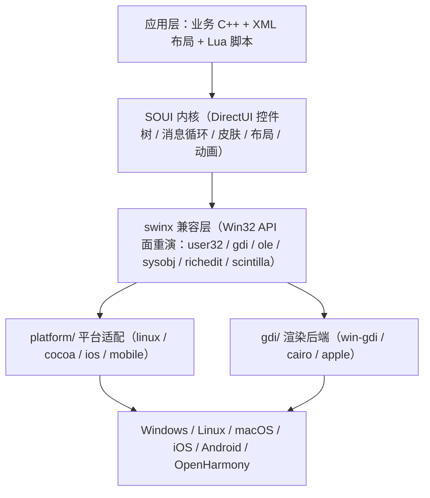

# SOUI5 —— 一套 C++ 代码覆盖六端的国产原生 GUI 框架

> ⚠️ **本版本已被取代（2026-10-14 v5）**：请以 **`SOUI5开源行业解决方案创新赛参赛文档-2026-10-14-v6.md`** 为最新定稿（v6 大幅精简了 §1.6 篇幅）；本文件冻结保留，不再更新。

> **参赛主体**：2026 开源行业解决方案创新赛
> **方案名称**：SOUI5 跨平台原生 GUI 框架 —— 面向信创与 Qt 国产化替换的 C++ DirectUI 解决方案
> **文档版本**：2026-10-14 v5
> **技术基线**：SOUI4 内核 5.3.2.1（仓库名 `soui4`，对外称 **SOUI5**）；跨平台层 `swinx` 1.6
> **数据口径**：本文全部规模、计数与结论均取自 2026-10-14 当前源码与构建产物实测（`git ls-files` / `wc -l` / `api_scan` / `stat`），可逐条回溯核对；引用出处见文末《数据溯源》
> **v5 相对 v4 的变化**：**§1.6 文体由对话体改写为陈述论证体**（标题由疑问句「为什么 SOUI5 是…」改为陈述式「在信创背景下，SOUI5 的必要性」；"第一步/第二步…"改为"其一/其二…"；删去"正面回答评委追问""说透""一句话概括"等对话腔措辞）——论据与结论未变，仅统一文风，与全文其它章节的陈述式、结论先行文体保持一致。
> **v4 相对 v3 的主要变化**：**新增 §1.6「在信创背景下，SOUI5 的必要性」**——正面回应"SOUI5 在生态成熟度 / 用户数量 / 大厂支撑上弱于 Qt、Flutter"这一客观事实，并论证在**存量 Windows 资产迁移**这一场景下，SOUI5 是目前**唯一**保留"0 成本跨平台"能力的路线（属必要选项而非优选选项）；连带在 §0 速览表增"选型定位"行、§1.1 三条路径对照表下补"目标函数差异"注、§7 新增第 13 条自我限定。
> **v3 相对 v2 的主要更正（沿用）**：① 修正了 §4.6.1 中渲染组件的**行数**论据（原数据有误），改用**实测 DLL 体积**作为论据；② 体积数据从 CMake `/MD` 开发树口径**更正为 VS2008 x86 `/MT` 发行构建口径**（内核 `soui4.dll` **2.31 MB**，含全部核心控件、不依赖 CRT——**这才是正常发行场景**）；③ 对"14 年"明确标注为项目方自述；④ 新增 §7「对本文观点的自我限定」；⑤ 把 SVG 支持从创新点三中**独立为创新点四**（§4.4），并按 `cacheSvg` 的真实机制（按渲染目标尺寸光栅化）改写其表述。

---

## 0. 方案速览（一页读懂）

| 维度           | 内容                                                                                                                                                                                                |
| ------------ | ------------------------------------------------------------------------------------------------------------------------------------------------------------------------------------------------- |
| **一句话定位**    | 以 **Win32 API 语义为统一编程面**的 C++ DirectUI 框架，让**同一套 C++ UI 与业务代码**在 Windows / Linux / macOS / iOS / Android / OpenHarmony **六端原生运行**                                                                 |
| **选型定位**     | **不是"Qt / Flutter 的通用替代品"，而是"存量 Win32 资产信创迁移"场景下的必要选项**——在"框架生态成熟度 / 用户数量 / 大厂支撑"上确实弱于 Qt、Flutter；但在"**让既有 Windows 程序低成本跨平台**"这一能力上，目前**只有 SOUI5 这条路线保留**（Wine 属运行时兼容、目标不同，Qt / Flutter 不提供该能力）——详见 §1.6        |
| **解决的核心问题**  | 信创环境下，海量 Windows C++ 客户端资产无法在国产 Linux / 鸿蒙上复用，必须迁移；而现有的"Qt 重写"与"Wine 兼容"两条路代价高、可行性差，移动端尤其缺位                                                                                                       |
| **最硬的技术证据**  | 跨平台样板 `games/cnchess` 的**核心绘制与业务源码中 `__ANDROID__` / `__OHOS__` 出现次数均为 0**，"一次编写、六端运行"是工程现实而非口号                                                                                                    |
| **核心技术资产**   | 自研跨平台兼容层 `swinx`（**165,707 行**，**44 个**与 Windows SDK 同名同结构的头文件）                                                                                                                                   |
| **自有源码规模**   | **1,217 个文件 / 514,830 行**（内核 `SOUI/` + `utilities/` 合计 186,470 行）                                                                                                                                 |
| **体积（发行实测）** | 内核 `soui4.dll`（VS2008 x86、`/MT` 静态 CRT、**含全部 SOUI 核心控件**）**2.31 MB**——**这就是正常发行场景**；组件按需装载、选型直接影响体积——`render-gdi.dll` **0.14 MB** ↔ `render-skia.dll` **1.58 MB**（**约 11 倍**）（数据与口径见 §3.2、§4.6.1） |
| **可组合性**     | **能力按场景选、界面按需长**：16 个组件像积木一样挑选替换（选型决定体积与功能），皮肤 / 布局 / 窗口三维可无限扩展，XML 布局达成 UI 与逻辑分离                                                                                                                 |
| **质量保障**     | **约 426 条**无头自动化用例（`soui-headless`），4 个 GitHub Actions 工作流，含 swinx API 面回退门禁                                                                                                                      |
| **存量背书**     | 项目方自述持续开发 **14 年**（README，自 2011 年开源起算；本仓库 git 历史始于 2018-06，见 §7）；已落地恒星播放器、熊猫加速器、启程输入法、XMusic 等数十款商业产品                                                                                            |
| **国产化落点**    | 已适配 **OpenKylin / UOS / deepin** 等国产 Linux 发行版，并以 OpenKylin 社区上游仓库形态在信创体系内分发                                                                                                                      |
| **成长方向**     | 已具备"让既有 Win32 程序低成本跨端"的**框架能力本身**（兼容层重演 Win32 语义）；该能力正沿"补齐迁移面"方向收敛为开箱即用                                                                                                                           |

**核心创新骨架**（详见 §4）：① 以"重演 Win32"实现跨平台（路线）；② 业务代码零平台宏的六端同源（工程）；③ 平台 / 渲染二维正交的可扩展架构（架构）。三者互为支撑，共同构成本方案的技术辨识度。

---

## 一、项目背景

### 1.1 行业痛点一：Windows 客户端资产的"信创断点"

在国家推动信息技术应用创新（信创）的背景下，政企、金融、工业、能源等行业的客户端软件面临一个共同的现实：**存量资产几乎全部是 Windows C++ 程序**。

这些程序的资产结构有三个特征：

1. **业务逻辑与 UI 高度耦合**：界面代码、交互逻辑、业务规则混在几十万行 C++ 里；
2. **深度依赖 Win32**：窗口消息、GDI 绘制、COM 组件、内核对象、公共控件贯穿全局；
3. **迁移预算有限**：不可能为一个已有产品重新招团队、换语言、从头写一遍。

把这些资产迁到国产 Linux，现实中的两条主流路径各有硬伤：

**路径一：用跨平台框架重写（以 Qt 为代表）。** 代价有三重：

- **工作量巨大**：几十万行 C++ 业务要面向框架自有 API（`QWidget` 体系、信号槽、`QObject` 内存模型）重写，界面层几乎全部推翻；
- **授权成本**：LGPL 对闭源商业产品构成合规负担，商业授权费用昂贵；
- **移动端支持不友好**：Qt 在移动端要求 UI 必须跑在**独立于系统主线程的专用 UI 线程**上，于是不仅"业务线程 ↔ UI 线程"的交互要额外加锁/排队，**与系统自身的交互也变得别扭**（如系统 UI 的切入切出、系统级生命周期事件）。这很可能是**现实中几乎见不到用 Qt 做移动端原生应用**的重要原因之一。

> **一点必要的克制**：上面第三条是**基于技术模型的推断**（Qt 移动端确实采用独立 UI 线程，其与系统 UI 交互需要跨线程协调），并非对 Qt 的权威定论——Qt 在移动端应用不广，也可能同时受生态、工具链、厂商习惯等多重因素影响。本文将其作为"**值得权衡的一项事实约束**"陈述，而非单一因果结论。

**路径二：靠 Wine 做二进制兼容。** 据公开信息，OpenKylin、deepin 等国产发行版都在持续完善 Wine 以直接运行 Windows 软件，但**实际效果并不理想**：对简单的小程序或许可行，然而大型复杂项目依赖的 Win32 API 面极宽、且对特定版本行为有隐式假设，二进制兼容无法穷尽这些不可控因素——**这条路对大中型项目的现实可行性很低**。

> 同样需要克制：Wine 的成熟度在持续提升，且**对部分中型应用是可以工作的**；本文的判断限于"**大型复杂项目**"这一范畴，不主张 Wine 路线整体无效。

**SOUI5 提供的是第三条路：用 SOUI5 把现有 Windows 程序重写迁移，但不是"从零重写"。**

| 迁移路径           | 工作量                             | 授权成本                    | 移动端               | 可行性             |
| -------------- | ------------------------------- | ----------------------- | ----------------- | --------------- |
| **Qt 重写**      | 高（业务面向新 API 重写）                 | 高（LGPL 合规 / 商业授权）       | 差（双 UI 线程，系统交互别扭） | 桌面可行、移动端基本无人采用  |
| **Wine 二进制兼容** | 低（不改代码）                         | —                       | 无（仅桌面）            | 小程序可行，大型复杂项目不可控 |
| **SOUI5 重写迁移** | **中低**（UI 用声明式 XML 重描述，逻辑可大量保留） | **无**（自有授权，个人免费 / 商用收费） | **原生六端**          | **大中小项目均可落地**   |

> **须区分"成本高低"与"目标不同"**：上表前三列比较的是"迁移成本"，但 Wine 与另两条路**并不在同一目标上**——Qt 重写与 SOUI5 迁移产出的是**目标平台的原生构建**（程序被真正移植），而 Wine 是**运行时二进制兼容**：不改代码让旧程序**跑起来**，但程序并未被移植。这一区别是 §1.6 论证的核心，详见该节。

之所以能做到"中低工作量"，是因为 SOUI5 的两项框架能力正好命中重写迁移的两个主要成本项：

- **声明式 UI（XML）**：界面用 XML 描述（控件树、属性、皮肤、布局），**UI 与逻辑分离**——界面层可以快速重描述，而不是把几十万行里的绘图代码逐行改写成新框架的 API 调用；
- **原生 Win32 API 兼容**：`swinx` 提供了**完整的 Windows 内核对象支持**（事件 / 互斥体 / 信号量 / 可等待定时器 / 定时器队列 / 文件映射、`WaitForSingleObject` / `WaitForMultipleObjects` 等），原有业务逻辑中基于 Win32 内核对象的同步、等待、线程协作代码**可以 0 成本迁移**，无需改写成另一套线程/同步模型。

> **该能力已由源码核实**：`swinx/src/sysobjs.cpp`（**2,381 行**）实现了 `CreateEvent` / `CreateMutex` / `CreateSemaphore` / `CreateWaitableTimer` / `CreateTimerQueue*` / `CreateFileMapping`+`MapViewOfFile` / `WaitForSingleObject` / `WaitForMultipleObjects` 等完整内核对象面（`swinx/include/sysapi.h` 声明，`sysobjs.cpp` 实现），底层以 fd（eventfd/管道）+ `select` 承载等待语义——**是真实实现，而非仅补头文件的空桩**。
>
> 需要客观说明的是"0 成本"的适用范围：上述内核对象是**进程内使用**的成熟实现；**跨进程按名字共享**的内核对象（命名对象）在非 Windows 平台受限于各自的跨进程机制，迁移时可能需要评估；此外 `WaitForSingleObject` 在句柄无效时返回 `WAIT_ABANDONED` 而非 Win32 标准的 `WAIT_FAILED`，属细节差异。这些不影响"**业务逻辑层面的同步代码可整体保留**"这一主线结论。

> 换句话说：SOUI5 迁移的是"**UI 层用声明式方式重描述 + 业务层几乎原样保留**"，而不是 Qt 那种"业务层也要面向新 API 重写"。

**并且，SOUI5 完整保留了"0 成本迁移 Windows 程序"的能力。** 当前的迁移方式是"用 SOUI5 重写迁移"，但支撑"直接迁移既有 Win32 程序"所需的底层能力——**以兼容层重演 Win32 语义**——已经是这套框架的既定路线与既有资产；需要时，完全可以在现有框架基础上把这一需求变为现实（详见文末边界说明与 §1.6）。

### 1.2 行业痛点二：一个产品、每个平台一份代码

第二个痛点来自另一个方向：**当 Qt 这类框架对移动端支持有限时，很多项目被迫"一个产品每个平台各写一份代码"**——Windows 一份、Linux 一份、Android 一份、iOS 一份、鸿蒙一份。多端各自维护，人力翻倍、版本漂移、缺陷要在多处重复修复。

近年来不少项目转向 **Flutter** 来解决跨平台问题：Flutter 对移动端的支持确实明显好于 Qt，但其代价是**换语言**（Dart）+ 背一套自带渲染引擎与 VM，**既有 C++ 资产与 Win32 技能栈无法复用**，且桌面端能力相对薄弱。**SOUI5 的"六端统一"为这一类问题提供了另一种值得评估的解法**：

| 方案          | 语言                | 资产复用                      | 移动端        | 桌面端      |
| ----------- | ----------------- | ------------------------- | ---------- | -------- |
| **每平台一份代码** | 各平台原生语言           | 无                         | 各自原生       | 各自原生     |
| **Qt**      | C++               | 需重写                       | 差（双 UI 线程） | 好        |
| **Flutter** | Dart              | 无法复用 C++                  | 好          | 一般       |
| **SOUI5**   | **C++（Win32 风格）** | **既有 C++ / Win32 资产直接复用** | **原生六端**   | **原生六端** |

SOUI5 的答案是：**一份 C++ 代码 + 一份 XML 界面描述，同时覆盖桌面与移动共六端**——既有资产不归零，多端维护收敛为一份（§4.2 给出"零平台宏"的硬证据）。

> **需要公允承认**：Flutter 在**移动端生态、第三方组件丰富度、UI 表现力与团队上手速度**上具备明显优势，是全球范围内跨平台移动开发的主流选择之一；SOUI5 与之并非"替换关系"，而是面向"**已有大量 C++ / Win32 资产、且需要覆盖桌面**"这一特定场景的另一条技术选型。若项目是纯新建、以移动为主、团队无 C++ 包袱，Flutter 往往是更省力的起点。**本方案的主张是"为存量 C++ 资产提供一个低迁移成本的六端方案"，而非"取代 Flutter"。**

### 1.3 项目沿革

| 阶段      | 时间       | 里程碑                                              |
| ------- | -------- | ------------------------------------------------ |
| 1.x     | 约 2011 起 | 基于 MIT 协议开源的轻量 DirectUI 引擎                       |
| 2.0     | —        | 完善模板结构框架                                         |
| 3.0     | —        | 引入矩阵变换与仿 Android 动画体系                            |
| 4.0     | —        | 类 COM 化重构：核心对象引用计数、便于 C 接口调用；XML 对象工厂            |
| 5.0     | —        | 链接 **swinx**，实现跨平台支持                             |
| 5.1–5.2 | —        | Anchor/Flow/Frame 布局、窗口属性动画、`.rc` 跨平台编译、全面支持 SVG |
| **5.3** | **2026** | **完成 Android / iOS 适配、初步完成鸿蒙（OHOS）适配**           |
| 5.3.2.1 | 2026-10  | 列表族就地编辑与复选框、Lua 组件导出面补齐、俄罗斯方块脚本示例                |

> **口径说明**：上表早于 5.x 的阶段划分来自项目方自述与 `ChangeLog.md`；本仓库 git 历史始于 **2018-06-28**，更早的版本演进未在当前仓库快照中完整体现。"**14 年**"是项目方（`README.md`）的表述，自 2011 年首次开源起算，**本文如实转述，不将其作为仓库可验证事实**。

`swinx` 兼容层自 2025 年立项、2026 年 10 月发布 1.6，是这套方案最年轻也最关键的一块。

### 1.4 三条国产化路径的技术路线对比

跨平台 GUI 的技术路线，本质上是四种选择，SOUI5 走的是最难走、也最少人走的那一种：

| 路线         | 代表                            | 跨平台怎么实现                       | 团队要付的代价                   |
| ---------- | ----------------------------- | ----------------------------- | ------------------------- |
| 换语言        | Flutter、Electron、React Native | 用另一门语言写 UI，各自渲染               | C++ 资产与技能栈归零，还背运行时        |
| 自建抽象 API   | **Qt**、wxWidgets              | 定义框架自己的 API，各平台分别实现           | 仍要 C++，但业务要面向新 API 重写     |
| 自绘引擎       | Flutter、Skia 系                | 自带渲染引擎直接画                     | 换语言 + 背 VM                |
| **重演平台本身** | **SOUI5**                     | **让 Windows 的 API 面在别的平台上成立** | 需自研兼容层（`swinx` 165,707 行） |

**SOUI5 选择的是第四条路**：不去抽象或替换 Windows，而是**让 Windows 的 API 面在别的平台上"重新成立"**——写一个兼容层，把 Win32 语义在 Linux / macOS / iOS / Android / OHOS 上重演出来。代价是这层兼容层要自己写、自己维护；收益则最为直接：

> **已有的 Win32/WTL 编程知识、已有的 SOUI C++ 代码，在新平台上不是负债，而是可以继续增值的资产。**

> **对"最难走"的自我审视**：这条路的代价是真实的——**兼容层的维护责任全部落在项目自己身上**，Win32 API 面越铺越宽，长期维护成本高于"定义小 API 面"的抽象路线；且**该路线的收益只在"已有 Win32 资产"的场景下才成立**，对全新项目反而是负担。SOUI5 的选择是把这份成本**集中在框架侧一次性投入**，从而把收益让给所有复用 Win32 资产的项目。

### 1.5 信创与 Qt 国产替换的契合点

| 诉求              | SOUI5 的对应能力                                                                               |
| --------------- | ----------------------------------------------------------------------------------------- |
| **国产 Linux 适配** | 已适配 **OpenKylin / UOS / deepin**；`swinx` 基于 XCB/X11 + Cairo 自建窗口系统，不依赖发行版 Qt 版本           |
| **鸿蒙原生支持**      | OHOS 为**正式支持平台**而非社区补丁，经 `PlatformAPI` 桥 + `soui-ohos-lib`（HAR 包）接入 `EntryAbility`        |
| **授权自主可控**      | 自有商业授权条款（个人免费 / 商用收费），**不受 LGPL 传染与商业授权约束**；`swinx` 内含 Wine 派生代码已单列披露与合规说明                |
| **不绑发行版组件版本**   | cairo / fontconfig / freetype / xkbcommon / dbus / skia 等全部**源码 vendor 化**，构建不依赖发行版提供什么版本 |
| **迁移成本可控**      | 业务层零平台宏，平台差异被兼容层与薄入口吸收；UI 用声明式 XML 重描述，Win32 逻辑可直接保留                                      |

> **对 Qt 的差异化**：Qt 以 QPA 平台抽象层实现跨平台，原生调用需切换/桥接线程，移动端还须维护独立 UI 线程；且 LGPL 授权对闭源商业产品构成合规负担。SOUI5 则以"重演 Win32"实现跨平台，原生能力经 JNI/NAPI **在同一线程同步调用**，**不需要双 UI 线程**，授权条款明确。
>
> **公允起见**：Qt 是经过大规模生产验证的成熟框架，**其文档、工具链（Qt Creator / Designer）、第三方生态与社区规模都远非 SOUI5 可比**；Qt 的 QPA 抽象也让它在"全新项目、不依赖 Win32 资产"时具备更好的可移植性与长期可预期性。SOUI5 的差异化只在**"存量 Win32 资产迁移"与"授权自主"两个具体维度**上成立，不宜泛化为"SOUI5 整体优于 Qt"。

### 1.6 在信创背景下，SOUI5 的必要性

SOUI5 在框架成熟度、用户数量、大厂支撑上与 Qt、Flutter 存在量级差距，这一点无须回避；但**这些差距全部属于"生态维度"**，而信创迁移真正依赖的是另一个维度——**"能否以低代价迁动存量 Windows 资产"的"能力维度"**。两个维度相互独立，生态规模再大也无法替代能力：一个生态成熟的框架，并不能替客户把三十万行 Win32 C++ 迁到麒麟上。本节的结论是：**在存量资产迁移这一特定场景下，SOUI5 是必要选项，而非优选选项——选择它的理由不是"更好"，而是"能做"。**

**其一，生态维度的差距是客观事实。**

| 维度         | Qt / Flutter        | SOUI5                    |
| ---------- | ------------------- | ------------------------ |
| 框架成熟度      | 十余年 / 多年大规模生产验证     | 跨平台层（`swinx`）自 2025 年立项，年轻 |
| 用户数量       | 全球数十万至百万级开发者        | 数十款商业产品，规模有限             |
| 大厂支撑       | Qt Group / Google 商业级投入 | 个人主导 + 社区贡献，集中度较高（§7）    |
| 文档 / 工具链 / 生态 | 完整 IDE、设计器、海量三方库    | 有可视化设计器，但与主流体量不可比        |

**其二，能力维度上，仅有 SOUI5 一条路线保留"0 成本跨平台"的能力。**

| 框架        | 是否提供"让存量 Win32 程序 0 成本跨平台"的能力 | 根本原因                                                                 |
| --------- | ------------------------------ | -------------------------------------------------------------------- |
| **Qt**    | **不提供**                        | 跨平台靠自建 QPA 抽象层，既有 Win32 代码必须面向 Qt API 重写                              |
| **Flutter** | **不提供**                        | 跨平台靠换语言（Dart）+ 自带渲染引擎，C++ / Win32 资产无法复用                            |
| **Wine**  | **非"跨平台"，而是"运行时兼容"**           | 不改代码让旧程序**跑起来**（主要在 Linux），但不产出目标平台原生构建、不接入目标平台系统能力、移动端不通，且大型项目可控性差 |
| **SOUI5** | **保留该能力（当前唯一路线）**              | 跨平台方式本身就是"在其它平台重演 Win32 语义"——**资产复用是这条路线的前提，而非附带好处**                  |

**其三，Wine 与 SOUI5 并不在同一目标上，因而不构成同一能力项上的竞争选项。**

二者常被并列比较，但目标函数不同：

- **Wine 的目标是"让旧程序继续运行"**：它是**运行时二进制兼容层**，Windows 程序不修改即在其上运行，程序本身**并未被移植**——不产出目标平台的原生构建产物，不接入目标平台的系统能力（如 Android 的 JNI 生命周期、OHOS 的 `EntryAbility` / HAR 包），**移动端完全不通**；其可信度依赖对 Win32 行为的**穷尽模拟**，规模越大、版本与隐式行为假设越多，不可控因素越被放大。
- **SOUI5 的目标是"把资产迁成目标平台的原生应用"**：程序被真正编译为目标平台的原生二进制，接入该平台的系统能力，桌面与移动**六端一致**。

补充一点常被忽略的事实：Wine 的兼容层实现**以 Linux 等 POSIX 系统为主要目标平台**，它并不提供一种"在任意国产平台上把 Windows 程序编译成原生应用"的通用能力。

**其四，必要性的成立条件是明确的。**

> **在"（1）有大量存量 Windows C++ 资产、（2）需要迁移到国产平台（含移动端）、（3）不推倒重来"这三个条件的交集里，SOUI5 是目前唯一满足全部条件的选项。**

这一必要性的来源不是"SOUI5 比 Qt / Flutter 好"，而是三点事实：

1. **存量信创客户的规模真实且庞大**——政企 / 金融 / 工业 / 能源的客户端几乎全部是 Windows C++；
2. **该交集内只有 SOUI5 走得通**——Qt / Flutter 需重写（成本高、移动端有硬约束），Wine 是运行时兼容（非迁移、移动端不通）；
3. **生态差距"可以用时补齐"，而"资产迁移能力"一经选错便无法追回**——前者随时间与使用改善，后者一旦选了不提供该能力的框架，等于将存量资产全部作废。**故选型权重应落在能力维度。**

综合而言，本文的选型立场是：**当目标是把既有 Windows 资产迁至国产平台时，SOUI5 不是"更优"的选项，而是"能做这件事"的选项。**

> **必要的克制**：① "唯一"是基于当前（2026-10）公开技术路线的判断，**不排除未来出现同类实现**（例如其它框架补齐 Win32 兼容层）；② SOUI5 的"0 成本跨平台"目前是"**能力已具备、迁移面待补齐**"，尚非开箱即用（见文末边界说明）；③ 若项目**没有**存量 Win32 资产、或无需覆盖桌面，本节论证并不适用——此时应回归常规选型（Qt / Flutter 通常更省力）。

---

## 二、技术架构

### 2.1 分层结构

SOUI5 的架构可以概括为"**一个内核 + 两个正交维度 + 三个配套机制**":



**价值集中在两根支柱（§2.2、§2.3），其余为工程配套。** 支柱决定"为什么这套方案能跨平台"，配套机制（§2.4–2.6）决定"跨平台之后还能不能好用、好维护"。

### 2.2 支柱一：以 Win32 为"世界语"

`swinx/include/` 下的 `windows.h` / `gdi.h` / `unknwn.h` / `oleacc.h` / `textserv.h` 等 **44 个头文件与 Windows SDK 同名同结构**。因此 SOUI5 内核直接 `#include <windows.h>`，**零平台 `#ifdef`**。

三条机制支撑这套"世界语"：

1. **同符号、分目录实现、链接期解析**（`swinx/src/SwinxUtils.h`）：跨平台助手声明集中一处，各平台目录给出同名同签名实现，`file(GLOB)` 只编当前平台源文件 ⇒ 调用方写同一个函数名、正文无平台分支。
2. **`g_platformAPI` 回调机制**（`swinx/include/platform_api.h`，`PLATFORM_API_VERSION = 3`）：Android/OHOS 无桌面窗口系统，由宿主 App 通过结构体回调补上窗口/输入/剪贴板/提示音能力；`PlatformAPI_Init` **严格比对版本**，不一致拒绝注册，是跨版本演进的契约护栏。
3. **非 MSVC 工具链上的 COM 自研**（`swinx/src/SUnkImpl.h`）：gcc/clang 无 `__uuidof`，用 `DECLARE_INTERFACE_` 宏集 + `IUNKNOWN_BEGIN/ADD_IID/END` + `SUnkImpl<T>` + 弱符号 `DEFINE_GUID` 四件套补齐，`BSTR/VARIANT/SAFEARRAY/IDispatch` 全部自研——**让 SOUI 的无障碍（ACC）代码一字不改跨三桌面平台编译**。

> **对迁移的直接意义**：`swinx/src/sysobjs.cpp` 完整实现了 Win32 **内核对象**（event / mutex / semaphore / waitable timer / timer queue / file mapping 等，含 `WaitForSingleObject` / `WaitForMultipleObjects`）。这意味着已有 Windows 业务代码里基于这些对象的线程同步与等待逻辑，**可以整体保留**（§1.1 已给出适用范围与两处细节差异）。

### 2.3 支柱二：平台与渲染二维正交

`*.cmake` 用 `file(GLOB)` 自动纳入当前平台源文件，**新增 `.cpp/.mm` 不需改 cmake**：

| 目标平台        | 平台适配层                 | 渲染后端        | 平台专有依赖                              |
| ----------- | --------------------- | ----------- | ----------------------------------- |
| Windows     | （不编译 swinx，用系统 Win32） | GDI / D2D   | Win32 SDK                           |
| Linux（桌面）   | `platform/linux`      | `gdi/cairo` | ALSA（可选）、xcb / xkbcommon / dbus     |
| macOS       | `platform/cocoa`      | `gdi/apple` | Cocoa / CoreGraphics / CoreServices |
| iOS         | `platform/ios`        | `gdi/apple` | UIKit                               |
| Android     | `platform/mobile`     | `gdi/cairo` | Android NDK（JNI）                    |
| OpenHarmony | `platform/mobile`     | `gdi/cairo` | OHOS NDK（`napi` / `native_window`）  |

**设计要点**：`platform/*`（窗口壳/事件循环/剪贴板/IME/拖放/DPI）与 `gdi/*`（绘制）是**两个正交维度**——当前 `platform/` 有 4 个目录、`gdi/` 有 2 个。Linux 与 Android/OHOS 复用 Cairo 渲染而平台层不同；macOS 与 iOS 反之。**新增平台与新增渲染后端互不牵连。**

> 这里也解释了为什么 SOUI5 **没有** Qt 那类"双 UI 线程"负担：UI 直接运行在平台原生线程上，窗口消息由 `platform/*` 归一为 Win32 消息循环语义（内核 `SMsgLoop`），与系统 UI 的交互就是在原生线程上的常规消息处理。

### 2.4 配套机制一：类 COM 引用计数与内存安全

SOUI5 用"类 COM"的对象模型降低 C++ GUI 的内存管理风险：

- **`IObjRef` → `TObjRefImpl<T>` → `SAutoRefPtr<T>`** 三级结构，资源对象（皮肤、字体池、位图、渐变、事件参数）以引用计数管理，订阅即增引用、回调期间对象不会悬空；
- **控件树刻意用裸指针 + owner 语义**，避开父子循环引用，避免引用计数在这种特殊拓扑下的失效；
- **skin 子系统统一单层锁序**（`SUiDef::GetSkinLock()` 递归临界区），把多 UI 线程访问收敛为唯一锁序，`GetImage/GetSvg` 返回 `SAutoRefPtr` 实现"引用计数 + 线程安全获取"二合一。

> **克制的口径**：这套机制**降低**的是特定类别风险（忘记 `Release()`、控件树循环引用），**不是**"消除 C++ 内存问题"。裸指针、手动生命周期在扩展控件时仍然存在，需要开发者遵守约定。

### 2.5 配套机制二：XML + 脚本的三层分工

| 层次  | 承担                | 载体                            |
| --- | ----------------- | ----------------------------- |
| 结构层 | 控件树 / 属性 / 皮肤 / 布局 | XML（`SObjectFactory` 节点名 → 类） |
| 逻辑层 | 事件响应 / 业务绑定       | C++（`SOUI_MSG_MAP` / 事件订阅）     |
| 胶水层 | 快速迭代 / 原型 / 热更新   | Lua（`ScriptModule-LUA`）       |

XML 的价值在于**UI 与逻辑分离**：界面拓扑与属性用声明式描述（`<template>` / `t:g.xxx` 可复用），改界面不动业务代码。脚本层（§4.7）则把"胶水"提升到"可承载完整玩法"。

### 2.6 配套机制三：异步任务与线程协作

- **`IMessageLoop::PostTask` / `ITaskLoop::postTask` / `STaskHelper::post`**：把工作线程任务投递回 UI 线程执行，避免跨线程直接操作控件；
- **Win32 内核对象**（§2.2）承载线程同步与等待，`swinx` 以 fd + `select` 复现其语义；
- **皮肤锁单层锁序**（§2.4）保证多线程访问资源的一致获取顺序。

> **一个易踩的坑**：`SStringT` 是**单线程**实现（COW 裸引用计数），**跨线程必须换用 `std::string`**；持有 `ITaskLoop` 的 `SComMgr2` 需刻意 leak-on-purpose 以避免静态析构顺序问题。这类细节属框架使用契约，迁移时需遵守。

### 2.7 架构总账

| 资产         | 规模 / 事实                                                |
| ---------- | ----------------------------------------------------- |
| 自有源码       | 1,217 文件 / 514,830 行（内核 `SOUI/` + `utilities/` = 186,470 行） |
| `swinx` 兼容层 | 165,707 行，44 个 Win32 同名同构头文件                           |
| 控件         | 40 个控件头 + 37 个扩展控件                                     |
| 渲染后端       | 3 个（skia / gdi / d2d），按平台与场景选择                          |
| 平台         | 6 端（Windows / Linux / macOS / iOS / Android / OHOS）    |
| 发行体积（内核）   | VS2008 x86 `/MT`，含全部核心控件 = **2.31 MB**                 |
| 质量门禁       | 约 426 条无头用例 + 4 个 CI 工作流                               |

---

## 三、应用场景

### 3.1 场景一：信创环境下的 Windows 客户端国产化迁移（核心场景）

这是本方案最核心的场景：政企/金融/工业客户已有成熟 Windows C++ 客户端，需迁到国产 Linux（麒麟/UOS）或鸿蒙。

SOUI5 的路径：**UI 层用 XML 声明式重述 + 业务层（尤其基于 Win32 内核对象的同步/等待逻辑）几乎原样保留**——将一个"重写几十万行"的工程，压缩为"重述界面 + 局部适配"的工程（§1.1 详述三项能力的适用边界）。

### 3.2 场景二：Qt 国产替换

对已用 Qt 或有 Qt 技能栈的团队，SOUI5 是"授权自主 + 单 UI 线程 + 体积更小"的替换选项：

| 对比项      | SOUI5                                    | Qt                | 说明                |
| -------- | ---------------------------------------- | ----------------- | ----------------- |
| 授权       | 自有条款（个人免费 / 商用收费），**不受 LGPL 传染**         | LGPL / 商业授权        | 闭源商业产品合规负担更轻      |
| 核心体积     | **2.31 MB**（含全部核心控件、`/MT` 不依赖 CRT）       | 数十 MB             | 显著更小，**但须按同等配置比较** |
| 移动端线程模型  | **单 UI 线程**，原生线程直接跑 UI                    | 独立 UI 线程（双线程）     | SOUI5 无跨线程协调负担    |
| Win32 资产 | **直接复用**                                 | 需面向 Qt API 重写      | 存量迁移场景的关键差异       |

> **须按同等配置比较**：上表"核心体积"列不可直接对拍 Qt 的完整安装体积——应同 CRT 方式、同功能模块实测（§7 已列此保留意见）。

### 3.3 场景三：鸿蒙（OHOS）原生应用

OHOS 为**正式支持平台**（非社区补丁）：经 `PlatformAPI` 桥 + `soui-ohos-lib`（HAR 包）接入 `EntryAbility`，已有 `games/cnchess` 鸿蒙实机案例。

> **如实说明**：OHOS 适配的工程化程度仍属**早期**——无障碍在构建层被强制关闭，移动端尚无 CI 自动构建与回归（§7）。

### 3.4 场景四：一产品多平台代码的统一（取代"每平台一份代码"）

当 Qt 类框架移动端支持有限、项目被迫"每平台一份代码"时，SOUI5 的**六端同源**（§4.2 零平台宏证据）把多端维护收敛为一份，直接消减"人力翻倍 / 版本漂移 / 缺陷多处修复"（§1.2 对照表）。

### 3.5 场景五：对帧时序 / 体积敏感的客户端与企业跨平台应用

- **性能一侧**：无 GC 抖动、可直接控制绘制与帧时序，适合对**帧时序有硬约束**的场景；
- **企业应用一侧**：多语言热切换、High-DPI 自动缩放、XML 布局的 UI/逻辑分离，适合企业级跨平台应用的长期维护。

> **口径**：无 GC 的优势**只对确有帧时序硬约束的场景成立**，常规 UI 场景收益不显著（§7 第 6 条）；本节的性能观测来自单机样本，不代表所有硬件。

### 3.6 场景六：脚本化快速迭代与原型验证

Lua 内置（`ScriptModule-LUA`，44 文件 / 约 1,470 处注册）+ 完整示例（`test.lua` 2,861 行、俄罗斯方块示例），适合快速迭代、原型验证与热更新（§4.7）。

---

## 四、创新点

SOUI5 的创新点按其技术辨识度分为两档：**核心创新**四条（§4.1–§4.4）与**重要创新**三条（§4.5–§4.7）。核心四条分别对应本方案的**路线、工程、架构、渲染**四项骨架能力；重要三条是骨架之上的能力延伸。

> **"创新"的口径说明**：本文所称"创新"，指**在 SOUI5 这一技术路线上具有辨识度的工程选择**，而非"人类首次提出"。例如"引用计数""XML 描述 UI"在业界早已存在，SOUI5 的创新性在于**组合方式与落地彻底度**（如把 Win32 内核对象整体重演、把 6 端同源做到业务代码零平台宏）。评述时请按此口径理解。

### 4.1 创新点一：以"重演 Win32"实现跨平台（路线创新 · 核心）

**创新实质**：不是"抽象出更少的 API 让开发者少学"，而是"**让开发者已经会的那一整套 API 在新平台上继续有效**"。四条跨平台路线中（见 §1.4 对照表），SOUI5 走的是"重演平台本身"——需自研兼容层（`swinx` 165,707 行），但因此 Win32/WTL 知识资产与既有 SOUI 代码**直接复用为资产**。

**验证**：44 个与 Windows SDK 同名同结构的头文件；连最难移植的 Win32 富文本（`richedit41`，499 个受控文件）与 Scintilla 的 **Win32 分支**都被整体搬运到非 Windows 平台——**只要组件存在 Windows 实现，swinx 就足以让它跨平台，不必为每端另写后端**。

### 4.2 创新点二：业务代码零平台宏的六端同源（工程创新 · 核心）

**证据**：`games/cnchess` 的核心绘制与业务源码中，`__ANDROID__` / `__OHOS__` 出现次数**均为 0**（逐文件计数，排除 `.cxx` 构建产物）。

**含义**：业务开发者写的是**一份普通 C++ 代码**，六端差异被兼容层与薄入口吸收，而非散落在业务代码里的 `#ifdef`。

> **证据的适用范围**：该"零平台宏"结论来自**单个业务样板（`games/cnchess`）**的实测，样本量为 1；它**强有力地证明了该模式可行**，但不能外推为"所有业务代码都能做到零平台宏"——不同业务对平台专有能力的依赖程度不同。样板选择中象棋子有"计算与绘制为主、平台专有能力依赖较少"的特点，选型时应结合自身业务评估。

### 4.3 创新点三：平台 / 渲染二维正交的可扩展架构（架构创新 · 核心）

`platform/`（4 目录）× `gdi/`（2 目录）两个维度**互不牵连**——Linux 与 Android/OHOS 复用 Cairo 渲染而平台层不同，macOS 与 iOS 复用 CoreGraphics 平台层不同。因此**新增一个平台不必碰渲染后端，新增一个渲染后端不必碰任何平台**。

配合 `g_platformAPI` 版本化契约（`PLATFORM_API_VERSION = 3`，严格比对后拒绝注册），使 Android/OHOS 这类无桌面窗口系统的宿主可以**在不修改框架主体的前提下**接入。

这一"渲染后端可替换"的架构特性本身也直接支撑了另一个能力——**矢量图形（SVG）能作为渲染原语横跨全部后端**（详见 §4.4）。

### 4.4 创新点四：SVG 作为渲染原语 + 按需缓存光栅化（渲染创新 · 核心）

SOUI5 把矢量图形**下沉为渲染原语**，而非当作一种"图片格式"来处理：

**一、`DrawSVG` 是渲染目标接口之一，四个后端全部实现**（skia / d2d / gdi-win / gdi-linux），因此 SVG 在整条链路里是"矢量 → 后端原生路径 → GPU/光栅"；配套 `DrawSVG9Patch` 让 SVG 像 9-Patch 一样按任意尺寸拉伸而不糊边。

**二、`cacheSvg` 按需光栅化缓存（默认开启）——这是 HiDPI 友好的关键，也是性能与矢量无损之间的正解。**

SVG 皮肤（`SSkinImgList`）支持 XML 属性 **`cacheSvg`（`SOUI/include/core/SSkin.h:248`，`ATTR_BOOL(L"cacheSvg", m_bCacheSvg, TRUE)`，默认开启）**。开启后：

1. 先把 SVG **光栅化成一张内存位图**，后续渲染直接从该位图走（缓存位图与普通位图的多状态布局一致，走同一条 `DrawBitmapEx` 路径）；
2. **光栅化的目标尺寸不是 SVG 自己定义的逻辑尺寸，而是本次渲染的目标尺寸**：Stretch 模式下按**绘制矩形大小**光栅化（`SSkin.cpp:408` 注释 `cache at draw rect size per-state (high precision 1:1)`），Tile 模式下按自然平铺尺寸光栅化；
3. 请求尺寸变化时缓存自动失效重建（比对 `m_cacheSize`，`SSkin.cpp:1369`）。

**这一机制同时得到了"矢量的分辨率无关"和"位图的渲染效率"**：因为光栅化按**实际显示尺寸**进行，所以在任何 DPI 下都是"按目标像素密度一次成型"——**SVG 的 HiDPI 特性被完整保留**，而不是先把 SVG 按其声明尺寸光栅化、再拉伸（那样才会糊）；同时因为复用位图，避免了每帧重复解析矢量路径的性能开销。

> **因此本创新点的准确表述是**：SOUI5 的 SVG 支持不是"矢量直绘一定更快"（**矢量直绘在复杂图形下通常比预栅格位图更耗 CPU，这一优势并不普适**），而是"**矢量直绘 + 按目标尺寸缓存的组合**"——它用一层缓存同时拿到了**无损缩放 / 分辨率无关 / 资源体积小**（一套 SVG 资源全端适用，不需要 @1x/@2x/@3x 多套位图）与**位图级的渲染效率**。
>
> **两点须如实说明**：① "四后端全部实现 `DrawSVG`"意味着**接口可用**，但各后端在**复杂 SVG 特性**（滤镜、渐变网格、部分 CSS）上的覆盖度可能存在差异，实际项目中宜按目标后端的支持范围验证；② 缓存本身有**内存代价**（每套皮肤在若干目标尺寸上各持一张位图），且**尺寸频繁抖动**（如连续动画中每帧尺寸都在变）时可能触发频繁重建——此时关闭 `cacheSvg` 走直绘可能更合适。该属性默认开启，正是"多数场景用缓存划算"的取舍结果。

### 4.5 创新点五：跨端一致性 —— 类 COM 引用计数 + 重组件零改源码搬运（设计创新 · 重要）

这两项能力共同保证"六端不只是能编译，而且行为一致"。

**其一，类 COM 引用计数**（**降低** C++ GUI 内存管理风险，口径见 §2.4）：`IObjRef` + `TObjRefImpl<T>` + `SAutoRefPtr<T>` 三级机制——

- **资源对象引用计数**（皮肤、字体池、位图、渐变、事件参数），订阅即增引用，回调期间对象不会悬空；
- **控件树刻意用裸指针 + owner 语义**，避开父子循环引用；
- **skin 子系统统一单层锁序**（`SUiDef::GetSkinLock()` 递归临界区），把多 UI 线程访问收敛为唯一锁序，且 `GetImage/GetSvg` 返回 `SAutoRefPtr` 实现"引用计数 + 线程安全获取"二合一。

**其二，重组件"零改源码跨端"的可复用方法**：这是 swinx 兼容策略可复用、可扩展的最硬佐证——

- **RichEdit**：Win32 上依赖 Text Services / OLE / GDI+ 一整套私有契约，是最难移植的富文本编辑。swinx 提供 `richedit.h` / `textserv.h` 同名 API 面，底层搬运 `richedit41`（499 个受控文件）——**同一份 `SRichEdit` 源码六端一致**。
- **Scintilla**：SOUI 的 `CScintillaWnd` 只取 Scintilla 的 **Win32 分支**（`CreateWindowEx` + `SendMessage(SCI_*)` + GDI），靠 swinx 整体模拟出来，语法着色与代码折叠全部走 Win32 消息协议。
- **RC 资源**：一份 Windows `.rc` 经 `windres → COFF → 本平台目标文件 → 符号重命名 → 链接` 四步流水线，在 Windows / Linux / macOS **三端同源编译**进 PE/ELF/Mach-O。

> **方法论**：只要组件有 Windows 实现，无需为每端另写后端——这是 SOUI5 相对其他跨平台框架的**结构性节省**。

### 4.6 创新点六：按场景自由组合 —— 能力积木 + 界面三维扩展 + XML 分离（可组合性创新 · 重要）

SOUI5 的可组合性有两条正交的路径：**能力按场景选**（组件积木）与**界面按需长**（皮肤 / 布局 / 窗口可扩展 + XML 描述）。

#### 4.6.1 路径一：积木式组装 —— 16 个组件按场景挑选、像积木一样替换

框架的**每一个横向能力都是一个独立链接的组件**，而不是内核里写死的一段代码。项目可以**按目标场景挑选要哪几块积木**，选择结果同时决定"能做到什么"和"发行包有多大"。关键机制是**选择集中在一处**——`SAppCfg`（`SOUI/include/SAppCfg.h:50`）就是这份"积木选型清单"，一行链式调用选定一块积木：

```cpp
SAppCfg().SetRender(Render_Gdi)          // 渲染后端：Gdi / Skia / D2d 三选一
         .SetImgDecoder(ImgDecoder_Stb)  // 图像解码：Stb / Wic / Gdip 三选一
         .SetAppResZip(_T("uires.zip"))  // 资源提供：Zip / 7z / Pe / File 任选
         .SetLog(FALSE)                  // 不要日志 → 不链入 log4z
         .EnableMultiLang(_T("lang:lang_cn"), FALSE)  // 不要多语言 → 不链入 translator
         .EnableScript(FALSE);           // 不要脚本 → 不链入 Lua
```

| 类别 | 组件（共 16 个，各自独立 CMake target） | 可替代项 |
| --- | --- | --- |
| 渲染后端 | `render-skia` / `render-gdi` / `render-d2d` | 三选一 |
| 图像解码 | `imgdecoder-stb`（含 WebP）/ `imgdecoder-wic` / `imgdecoder-gdip` | 三选一 |
| 资源提供 | `resprovider-zip` / `resprovider-7zip`（另有内置 Pe/File 路径） | 任选 |
| 网络与任务 | `ws`（WebSocket）/ `network` / `httpclient` / `TaskLoop` / `SIpcObject` | 按需 |
| 脚本与其它 | `ScriptModule-LUA` / `translator` / `log4z` | 可整体不启用 |

**选型为什么真的有效——发行构建产物的实测体积（硬数据，可复现）**：

> 口径：`out/vs2008_x86/bin/Release/`（VS2008 **x86**、**`/MT` 静态 CRT**、Release），即**正常发行场景**；逐字节 `stat` 实测。

| 组件（Release DLL） | 实测体积 | 为什么差这么多 |
| --- | --- | --- |
| `soui4.dll`（内核，**含全部核心控件**） | **2.31 MB** | 框架主体；`/MT` 已内含 CRT，**不额外依赖 VC 运行库** |
| `render-skia.dll` | **1.58 MB** | **静态链入 Skia 引擎**（`CMakeLists.txt:33` `target_link_libraries(render-skia skia …)`，`skia` 为 STATIC 目标） |
| `scriptmodule-lua.dll` | **0.81 MB** | 含 Lua 5.4 |
| `imgdecoder-stb.dll` | 0.32 MB | |
| `utilities4.dll` | 0.24 MB | |
| `log4z.dll` | 0.17 MB | |
| `render-d2d.dll` | **0.16 MB** | 仅链系统 `d2d1` / `dwrite`，**不捆绑引擎** |
| `render-gdi.dll` | **0.14 MB** | 仅链系统 `msimg32` / `gdiplus`（Linux 下为 swinx+Cairo），**不捆绑引擎** |
| `resprovider-zip.dll` | 0.10 MB | |
| `translator.dll` | 0.06 MB | |

**结论**：体积的决定因素**不是组件源码行数的多少，而是"是否在运行时静态捆绑一套渲染引擎"**。`render-gdi` 直接借用系统 GDI / Cairo，产出的 DLL 仅 **0.14 MB**；而 `render-skia` 自带一整套 Skia，产出 **1.58 MB**——**相差约 11 倍**。

> **因此，选型直接换体积**：**一个小程序只要基础功能、不在意渲染特性，选 `Render_Gdi` 就能把渲染这一块的发行体积从约 1.6 MB 压到约 0.14 MB**；反之，需要复杂图形 / 动画 / 跨端像素级一致性时才值得付出 Skia 的体积。同理，不要日志 / 多语言 / 脚本时，`log4z`（0.17 MB）/ `translator`（0.06 MB）/ `scriptmodule-lua`（0.81 MB）**根本不会进包**。这也是"**核心约 2 MB、按需装载**"这一发行特性的直接来源（§0、§2.7）。

> **v2 → v3 更正（两处）**：① v2 曾以"`render-gdi` 仅 **104 行** vs `render-skia` **5,437 行**"论证体积差异——经源码复核，该行数**不准确**（`render-gdi` 的 win 实现 **3,272 行**、linux 实现 **2,964 行**，同一构建只编其中一份；`render-d2d` 全目录实际 **46,274 行**），且**行数本身与体积无因果**，故改用**实测 DLL 体积**。② v3 初稿曾引用 CMake `/MD` 开发树的体积（内核 ≈4.9 MB / skia ≈8.16 MB）——那是**开发构建口径，不代表发行体积**；已更正为 **VS2008 x86 `/MT` 发行构建**的 **2.31 MB / 1.58 MB**。

*选型不影响业务代码的三个保证*：

- **同类可替换 = 无锁定**：换渲染器只换链接的积木 + `SetRender` 的一个枚举值，业务绘制代码与 XML 不动；跨平台工程通常选 `Render_Skia` + `ImgDecoder_Stb`（§2.3 六端矩阵）。
- **COM 形态 = 零侵入集成**：组件以类 COM 工厂装载（`SComMgr2::CreateRender_Skia` / `CreateResProvider_ZIP` / `CreateScrpit_Lua`…），**静态 COM（`LIB_SOUI_COM`）与 DLL COM 两种链接方式下调用代码零差异**，宿主不必为"用不用某插件"改造架构。
- **边界清楚 = 可独立演进**：每个组件自带 `CMakeLists.txt` 与自有文档，`ScriptModule-LUA` 甚至自带 3 篇文档，可在不触碰内核的前提下独立升级。

#### 4.6.2 路径二：皮肤 / 布局 / 窗口三维无限扩展，且以 XML 描述布局达成 UI 与逻辑分离

控件的**皮肤、布局、窗口本体**三者都是开放的可扩展点（`SApplication` 三个注册模板入口，`SOUI/include/SApp.h:662`、`:688`）：

| 可扩展维度 | 机制 | 扩展成本 | 源码证据 |
| --- | --- | --- | --- |
| **皮肤（Skin）** | 皮肤类型经工厂注册，XML `<skin type="...">` 按类型名实例化 | 新增一种皮肤 = 派生 `SSkinObjBase` + 注册类名 | `SOUI/src/core/SSkin.cpp`（`"svg"` 等类型分派）；扩展注册 `SSkinVScrollbar`/`SSkinAni`…（`controls.extend/SCtrlsRegister.cpp:100-104`） |
| **布局（Layout）** | 布局与布局参数成对注册，`layout="xxx"` 即选中 | 新增一种布局 = 实现 `ILayout` + `ILayoutParam` 各一 | `SOUI/include/layout/` 已有 7 组（`SouiLayout`/`SLinearLayout`/`SGridLayout`/`SFlowLayout`/`SFrameLayout`/`SAnchorLayout`…），**可继续追加** |
| **窗口（Window）** | 窗口类经 `RegisterWindowClass<T>()` 注册，XML 节点名即类名 | 新增一种窗口 = 派生窗口类 + 注册 | `games/cnchess` 的 `DEF_SOBJECT(SWindow, L"chessboard")` 即例证；模板 `<t:g.xxx>` 复用（`uires/values/template.xml`） |

**XML 的价值落在"UI 与逻辑分离"**：控件树的拓扑与属性用声明式表达，配合对象工厂（节点名 → 类）、模板复用与可视化设计器（uieditor）+ 皮肤热换，使**改界面不触碰业务代码**成为常规工作方式。

> **两条路径的关系**：**§4.6.1 = 能力按场景选（定体积与功能）；§4.6.2 = 界面按需长（皮肤/布局/窗口可扩展 + XML 分离逻辑）**。二者正交——前者管"装哪些积木"，后者管"界面能长成什么样"。

### 4.7 创新点七：脚本层从"胶水"到"可承载完整玩法"（生态创新 · 重要）

SOUI5 内置 Lua 脚本（`ScriptModule-LUA`），且导出面足以承载**完整交互玩法**而非仅做"胶水"：

- **规模**：44 个文件 / 约 1,470 处注册；
- **完整示例**：`test.lua` **2,861 行**、俄罗斯方块脚本示例；
- **能力**：控件创建与操作、事件绑定、动画驱动、`NativeCall` 扩展（宿主可注册回调让脚本调用宿主能力）。

> **边界**：Lua 绑定面虽广但**并非全 API 覆盖**，使用前宜核对 `exp_*.h` 导出清单（§7 已列此保留意见）。

---

## 五、方案价值总结

| 价值维度 | 具体体现 |
| --- | --- |
| **对信创** | 已适配 OpenKylin / UOS / deepin；以 OpenKylin 社区上游仓库形态分发；Windows C++ 逻辑资产可整体保留（UI 声明式重述 + Win32 内核对象同步代码保留） |
| **对鸿蒙** | OHOS 为正式支持平台；`soui-ohos-lib` HAR 化；已有 cnchess 鸿蒙实机案例；一套代码覆盖桌面 + Android + 鸿蒙（工程化程度仍属早期，§3.3） |
| **对 Qt 替换** | 授权自主（无 LGPL 传染）；体积按同配置比较通常更小；单 UI 线程无跨线程协调；Win32 知识资产可复用（**生态/工具链为其短板，§7**） |
| **对企业** | 六端同源、零平台宏，**可取代"每平台一份代码"**；已有数十款商业产品验证（见下） |
| **对开发者** | XML + Lua + C++ 三层分工；组件按场景选型（实测发行体积差可达约 11 倍）；皮肤/布局/窗口三维可扩展；XML 布局分离 UI 与逻辑；可视化设计器；多语言热切换 + High-DPI 自动缩放 |
| **对开源生态** | 组件化按需装载；Lua 内置脚本 + JS/Python 独立仓库；约 426 条无头用例与 `api_scan` 门禁保障工程质量与 API 面不回退 |

**存量背书**：`products.md` 记录的真实商业产品（节选）——

| 产品 | 开发商 | 备注 |
| --- | --- | --- |
| 恒星播放器 | 冷湖科技（武汉） | 购买授权 |
| 熊猫加速器 | 江苏友趣网络 | 购买授权 |
| 月轮加速器 | 月轮网络科技 | 购买授权 |
| 航信电子开票系统 | 北京航信 | 购买授权 |
| 启程输入法 / xmusic / xplayer / AI快寻 | 启程软件 | 作者自研 |
| OfficeAid | 北京云动智效 | PC 管理 + souiviewer |
| 简连 | 厦门铠甲网络 | LinkViewer |
| 特别授权 | 网易天下事业部 | 2023.11 |

> **背书的合理口径**：上表是**项目方维护的落地清单**，体现的是"**该框架在真实商业产品中有实际使用**"；它**不是独立第三方审计**的结果，产品数量与授权规模请以清单所述为准。其价值在于证明"**框架已被生产环境长期使用**"，而非"市场占有率"。

### 5.1 质量保障（支撑项，非创新点）

工程质量不单列为创新点，但它是上述所有能力可信的基础，此处如实列出：

| 门禁 | 内容 |
| --- | --- |
| `build.yml` | push tag / `build-test` 分支：Windows/Linux/macOS × x64/x86/arm64 全量构建 + 跑 `soui-headless` + 上传制品 |
| `pr-core.yml` | PR → master：linux-x64 / windows-x64 / macos-arm64 只构建 `fun_test` + 跑门禁（失败用 gdb 打印可疑用例栈） |
| `gui-smoke.yml` | Linux Xvfb：真实宿主窗口烟测（验证鼠标消息到按钮事件派发） |
| `swinx-api-gate.yml` | 纯文本扫描（约 2 分钟，无需编译）：断言 swinx 声明的 Win32 API 面与已提交快照一致，**动了实现未刷新清单则失败** |

**约 426 条** `soui-headless` 无头用例覆盖 swinx/utilities 单元测试、SOUI 核心函数、ZIP 资源提供器集成测试、资源索引与 XML 到控件树的无窗口 E2E；列表族多选/框选由单套件 **37 条**用例锁定全部交互语义。

> **该保障的覆盖边界**：`soui-headless` 覆盖的是**无窗口逻辑层**（swinx/utilities/内核函数/资源/XML→控件树）；**真实 GUI 交互的自动化覆盖有限**（`gui-smoke.yml` 仅一项 Linux Xvfb 烟测），且**移动端（iOS / Android / OHOS）尚无 CI 自动构建与回归**。这是"工程质量可信"的**实际范围**，不应被读作"全平台全场景已自动化验证"。

---

## 六、数据溯源

本文关键数字的出处：

> - **源码规模 / 文件数**：`git ls-files` 计数 + `wc -l` 统计（排除 vendor 与构建产物）
> - **swinx 规模**：`swinx/` 目录逐文件统计；头文件同名核对以 Windows SDK 为基准
> - **发行体积**：`out/vs2008_x86/bin/Release/` 逐字节 `stat` 实测（VS2008 x86、`/MT`）；CRT 方式核对自 `out/vs2008_x86/SOUI/soui4.vcproj` 的 `RuntimeLibrary="0"`
> - **测试数量**：`grep -c '^TEST'` 计数（约 426 条口径）+ 36 个 `test_*.cpp`
> - **平台宏分布**：按 `games/cnchess` 业务源码逐文件计数（排除 `.cxx` 构建产物）
> - **脚本模块**：逐条回 `components/ScriptModule-LUA`（含其自带三篇文档）与 `SOUI` 源码核对
> - **"14 年"**：转述自 `README.md`（项目方自述口径），非本仓库可独立验证；**"约 2 MB"** 则已由 VS2008 x86 `/MT` 发行产物（`soui4.dll` **2.31 MB**，含全部核心控件）**实测印证**，与自述一致
> - **详细论证与风险清单**：见 `doc/SOUI4项目评估报告-2026-10-14.md`（本文为其面向赛事的方案化呈现）

**两套构建树的口径区别（引用体积时须分清）**：

| 口径 | 构建树 | CRT | 内核 `soui4.dll` | 用途 |
| --- | --- | --- | --- | --- |
| **发行口径** | `out/vs2008_x86/` | `/MT`（静态） | **2.31 MB** | 本文体积论据均用此口径 |
| **开发口径** | `build/`（CMake） | `/MD`（动态） | ≈4.9 MB | 开发调试用，**不代表发行体积** |

### 需客观认知的边界

SOUI5 的当前能力边界（不影响本方案主张成立，但应如实说明）：

1. **"0 成本迁移既有 Win32 程序"尚未开箱即用**——当前推荐的迁移方式是"**用 SOUI5 重写迁移**"（UI 声明式重述 + Win32 逻辑保留）；要让**任意既有 Win32 程序**直接 0 成本跨端，还需补齐 swinx 的三块"迁移面"（原生控件库 / 窗口菜单栏 / 资源对话框）。**需要强调的是：这属于待补齐的工作量，而非架构上的不确定性**——支撑该需求的能力（以兼容层重演 Win32 语义、完整 Win32 内核对象支持、并以 `platform/` 与 `gdi/` 两个正交维度扩展平台与渲染）已经具备，缺的只是把这三块接口面逐一铺到 swinx 上；
2. **移动端 CI 尚无自动构建与回归**（iOS / Android / OHOS），桌面三端已有完整门禁；
3. **OHOS 无障碍在构建层被强制关闭**，待按需桥接；
4. **vendor 代码占两个仓库受控文件约 67.2%**（换取零版本兼容风险），clone 与检索体验受影响；
5. **项目维护集中度较高**，持续演进依赖核心贡献者规模扩大。

---

## 七、对本文观点的自我限定（v3 新增，v4 扩充）

为避免把"方案陈述"读成"无条件结论"，此处集中列出**本文作者对自身论述保留意见的部分**：

| #  | 本文所述                   | 保留意见 / 适用边界                                                                                                                          |
| -- | ---------------------- | ------------------------------------------------------------------------------------------------------------------------------------ |
| 1  | "Qt 因双 UI 线程而几乎不用于移动端" | 技术模型成立，但属**推断**；移动端采用率低也可能受生态、工具链、厂商习惯影响，不宜作单一因果结论（§1.1）                                                                             |
| 2  | "Wine 路线可行性低"          | 仅限"**大型复杂项目**"；Wine 对部分中型应用可工作，且成熟度在持续提升（§1.1）                                                                                       |
| 3  | "六端同源、零平台宏"            | 证据来自**单个样板**（`games/cnchess`，样本量 1）；可证明模式可行，**不能外推为所有业务都能零平台宏**（§4.2）                                                                |
| 4  | "体积小一个数量级"             | 发行口径（VS2008 x86、`/MT`、含全部核心控件）核心 `soui4.dll` 实测 **2.31 MB**；与 Qt 比较仍**须按同等配置**（同 CRT 方式 / 同功能模块）实测，不宜直接对拍 Qt 的完整安装体积（§0、§3.2、§4.6.1） |
| 5  | "SVG 直绘"优势             | **优势的主因不是"矢量直绘更快"**，而是其"**四后端直绘 + `cacheSvg` 按渲染目标尺寸缓存光栅化**"的组合：矢量直绘在复杂图形下通常比预栅格位图更耗 CPU，真实收益是**无损缩放 / 分辨率无关 / 单套资源体积小**。且四后端对**复杂 SVG 特性**（滤镜、渐变网格等）的覆盖度可能有差异（§4.4） |
| 6  | "无 GC 抖动"              | 只对**确有帧时序硬约束**的场景构成实际优势；常规 UI 场景收益不显著（§3.5）                                                                                          |
| 7  | "引用计数解决内存安全"           | 是**降低特定类别风险**（忘记 Release、控件树循环引用），非"消除 C++ 内存问题"（§2.4）                                                                               |
| 8  | "持续开发 14 年"            | 项目方自述（自 2011 开源起算）；**本仓库 git 历史始于 2018-06**，不作仓库可验证事实（§1.3）                                                                          |
| 9  | 落地产品清单                 | 来自**项目方维护**的 `products.md`，非独立第三方审计；价值在于证明"被生产环境长期使用"（§5）                                                                            |
| 10 | "创新点"表述                | 指**该路线上的工程辨识度**，非"人类首次提出"；多数单项技术（引用计数、XML UI）在业界已存在，创新性在**组合与落地彻底度**（§4 引言）                                                          |
| 11 | `SAppCfg` 组件选型         | 属**构建期契约**（CMake target + 链接库），枚举/工厂名须与链接进包的组件一致，否则静默不一致（§4.6.1）                                                                     |
| 12 | 质量保障覆盖                 | `soui-headless` 覆盖**无窗口逻辑层**；真实 GUI 交互自动化覆盖有限，**移动端无 CI**（§5.1）                                                                      |
| 13 | "SOUI5 唯一保留 0 成本跨平台能力"（§1.6） | ① "唯一"是**基于 2026-10 公开技术路线的判断**，不排除未来出现同类实现；② Qt / Flutter **生态成熟度、用户数量、大厂支撑全面领先**这一事实不因本文选型主张而改变，本文主张仅在"**存量 Win32 资产迁移**"这一**能力维度**上成立；③ 若项目**无**存量 Win32 资产、或无需覆盖桌面，则本节论证不适用，应回归常规选型；④ 该"0 成本"目前是"**能力已具备、迁移面待补齐**"，非开箱即用 |

**本文的总体立场**：SOUI5 是一个**在"存量 Win32 资产迁移 / 六端统一"这一特定场景上具备真实、可验证工程能力**的框架（其兼容层的实现深度是本文核实时最感意外、也最认可的一点）；但它在**生态、文档、工具链、社区规模、移动端工程化成熟度**上均弱于 Qt / Flutter 等主流方案。**选择它，是选择"以资产复用换生态成熟度"**——这笔交易对具体项目是否划算，取决于该项目 C++ 存量的多寡与迁移预算，而非框架本身的绝对优劣。

---

*本文档基于 SOUI4 项目评估报告（2026-10-14 基线）、仓库当前源码与构建产物编写，供 2026 开源行业解决方案创新赛评审使用。SOUI5 目前尚未做到让既有 Win32 程序零成本跨平台，但这套框架本身恰恰具备支撑这一需求的能力——它已经把"重演 Win32"这条路走通，剩下的只是把迁移面补齐，而这正是本方案在信创场景下最值得期待的长期价值。*
