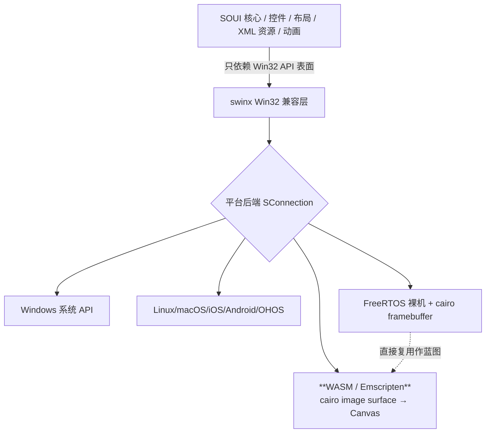

# SOUI4 WebAssembly (WASM) 编译可行性调研报告

> 调研日期：2026-10-27
> 适用仓库：`D:/work/soui4`（SOUI5 对外目录 `soui4`）
> 文档定位：与 `doc/soui-harmonyos-porting-plan.md`、`doc/SOUI-for-Android-适配方案技术文档.md` 同级，作为 WASM 移植的立项与路线依据。

---

## 0. 结论速览

**SOUI4 可以用 WebAssembly（Emscripten）编译并跑在浏览器里，且可行性很高。**

核心依据：仓库内已存在一个**几乎等价的先例——FreeRTOS 裸机移植**（无窗口系统、CPU 渲染到内存帧缓冲、由宿主注入输入/呈现）。WebAssembly 与 FreeRTOS 同属"无原生窗口服务器、软件渲染到内存、再交给宿主呈现"的形态，而 WASM（Emscripten）的运行环境（完整 libc/STL/异常支持、可选线程、Canvas 2D 呈现）甚至比 FreeRTOS 更宽松。因此 WASM 移植 ≈ 新增一个 `swinx` 平台后端 + 一个宿主 HTML/JS 壳，SOUI 核心、控件、布局、XML 资源、动画全部原样复用。

最大技术风险点（cairo 软件渲染后端跑到 WASM）已有成熟的 emconfigure/emmake 构建方案与外部成功案例（见附录）。

---

## 1. SOUI 跨平台架构与 WASM 落点

SOUI 核心（`SOUI/`、`components/` 下各 UI 组件）只依赖一套 **Win32 API 表面**：`HWND / HDC / MSG / WNDPROC / GDI / IMM / OLE`。

- **Windows**：直接调用系统 API。
- **非 Windows**：全部由 `swinx`（Win32 兼容仿真层）承接（`swinx/AGENTS.md` 第 1 节）。

平台差异被高度集中在两处，这正是移植工作量边界（与 OHOS/Android 的移植边界一致，见 `doc/SOUI-for-Android-适配方案技术文档.md` §2.2、`doc/soui-harmonyos-porting-plan.md` §2.2）：

| 集中点 | 文件 | 职责 |
|---|---|---|
| 平台层 | `swinx/src/platform/<os>/SConnection.{h,cpp}` | 消息循环、窗口/输入/定时器/剪贴板/光标、窗口表面创建 |
| 绘制后端 | `swinx/src/gdi/<后端>/gdi.cpp` | DC/位图/文本/路径绘制；当前有 `cairo`（软件）与 `apple`（Core Graphics）两个后端 |

**WASM 落点因此非常清晰**：新增 `swinx/src/platform/wasm/` 平台后端 + 一个宿主 HTML/JS 壳。SOUI 核心、控件、`uires` XML 资源、动画引擎均无需改动。



---

## 2. 关键先例：FreeRTOS 裸机移植

`swinx/src/platform/freertos/` 已经实现了一套**完整的、无窗口系统的 `SConnection`**，其渲染提交链路与 WASM 需要的形态一字不差。

### 2.1 帧缓冲呈现链路（WASM 直接复用）

```cpp
// swinx/src/platform/freertos/SConnection.cpp:1187
void SConnection::commitCanvas(HWND hWnd, const RECT &rc) {
    cairo_surface_t *surface = ...GetGdiObjPtr(wndObj->bmp);
    uint32_t *srcBase = (uint32_t*)cairo_image_surface_get_data(surface);  // cairo image surface
    memcpy(SwinxFbBits() + ..., srcBase + ..., w*sizeof(uint32_t));        // blit 到扁平 ARGB32 帧缓冲
    swinxFbPresent(&dirty);                                              // 呈现回调 (SConnection.cpp:1249)
}
```

- 窗口表面是 `cairo_image_surface_create(CAIRO_FORMAT_ARGB32, …)`（`SConnection.cpp:998` `CreateWindowSurface` / `:1006`）。
- 帧缓冲是静态扁平数组 `s_fbBits[W*H]` + `SwinxFbPresentCb` 回调（`swinx/src/platform/freertos/framebuffer.cpp`）。
- **对 WASM 来说，只需把"呈现回调"从"刷 LCD"改成"把 `s_fbBits` 拷贝进 Canvas 的 ImageData"**。

### 2.2 渲染后端与字体

- 渲染后端用 `components/render-gdi`（cairo 后端，非 Windows 下链接 `swinx` 并定义 `SOUI_RENDER_USE_GDI`）。
- 字体走无 fontconfig 桥（`swinx/src/gdi/freertos/textbridge.cpp`：`SwinXGetCachedFontFace` 返回 NULL 时退化为 cairo toy face）。WASM 上把该桥改为"从内嵌 TTF 经 FreeType 建 cairo FT face"即可获得真实中文字形。

### 2.3 输入与启动

- 输入是**注入式**（`SConnection::SetKeyDown` / `SetCursorPos` + `postMsg`），正好对应 JS 把鼠标/键盘/触摸事件喂进 wasm。
- 启动已有完整样板：`soui-freertos/soui_fr/soui_app.cpp`（`SApplication` + `SHostWnd` + 内存资源 provider `mem_res_provider.cpp`），以及可在宿主机跑的 `soui_sim`（SDL2 壳）用于增量验证。

> 一句话：**WASM 要写的 `SConnection` ≈ FreeRTOS 那份 `SConnection` 去掉裸机 STL 垫片、把帧缓冲呈现目标换成 Canvas。**

---

## 3. WASM 移植文件级清单

| 类别 | 新增/改动 | 说明 |
|---|---|---|
| 构建 | `swinx/wasm.cmake`（仿 `swinx/freeRTOS.cmake`） | `-DSOUI_PLATFORM=wasm`，静态库，glob `src/*.cpp` + `cmnctl32` + `platform/wasm`，链接 Emscripten 的 cairo/FreeType（或复刻 `swinx/thirdparty/cairo`） |
| 平台分派 | `swinx/CMakeLists.txt`（当前 `:31-39` 为 `freertos/OHOS/Android/iOS/Darwin` 分支） | 新增 `elseif(SOUI_PLATFORM STREQUAL "wasm")` 分支 |
| 顶层裁剪 | 根 `CMakeLists.txt` | 走非 Windows 路径（`WCHAR_SIZE=4`，见 `:194`）；关闭 `SOUI_BUILD_DEMOS/GAMES/TOOLS/WS`（`:112-118` 默认 OFF）；`SOUI_BUILD_HTTPCLIENT=OFF`（`:100`）；`SOUI_BUILD_RICHEDIT=OFF`（`:123-133`）；`SOUI_ENABLE_COM_LIB=ON`（`:78`，静态合并组件避免 dlopen）；`ENABLE_THUNK=OFF` |
| 平台层 | `swinx/src/platform/wasm/SConnection.{h,cpp}` | fork `freertos/SConnection`，`commitCanvas` 改为把像素写进 JS 可见的共享缓冲 / `ImageData` |
| 字体 | `swinx/src/gdi/wasm/textbridge.cpp` | 内嵌 TTF + FreeType 建 font face（替代 freertos 的 toy face） |
| 宿主 | `host/index.html` + `host/wasm_glue.js` | 建 2D canvas；`requestAnimationFrame` 驱动 `soui_pump()`；canvas 事件监听调导出函数 `soui_injectPointer/Key` |
| 导出入口 | 业务 `main.cpp`（参考 `soui-freertos/soui_fr/soui_app.cpp`） | 导出 `soui_app_run()`（SApplication + SHostWnd）与 `soui_pump()`（peekMsg + 触发到期定时器 + 呈现） |
| 资源 | Emscripten `--preload-file uires` + ZIP/file provider，或内存 provider | 复用 `soui-freertos/soui_fr/mem_res_provider.cpp` 思路 |

---

## 4. 各子系统可行性判定

| 子系统 | 判定 | 依据 |
|---|---|---|
| 核心/控件/布局/XML/动画 | ✅ 高 | 只依赖 swinx Win32 表面，非 Windows 已验证（Android/iOS/OHOS/FreeRTOS） |
| 渲染（cairo 软件后端） | ✅ 高 | FreeRTOS 已用同一条 cairo image surface 链路；cairo 可经 emconfigure/emmake 编到 WASM（见附录） |
| swinx 平台层 SConnection | ✅ 高 | FreeRTOS 已给出完整实现，WASM 主要改 present 目标 |
| 字体 | ✅ 中高 | FreeType 在 WASM 可用；内嵌 TTF 绕开 fontconfig（参考 freertos textbridge） |
| 主循环/消息泵 | ✅ 中高 | iOS 端已用外部 runloop 驱动（`CFRunLoopRunInMode`）；WASM 用 rAF 调 peek 泵是同源模式 |
| 输入（鼠标/键盘/触摸） | ✅ 高 | 注入式模型与 FreeRTOS `SetKeyDown`/`postMsg` 一致 |
| 定时器 | ✅ 高 | FreeRTOS 用 tick 驱动 `WM_TIMER`；单线程模型天然契合 WASM MVP |
| 剪贴板 | ⚠️ 中 | 内部剪贴板易；系统剪贴板走 `navigator.clipboard`（需用户手势/权限），可后置 |
| 依赖（zlib/lua/pugixml/imgdecoder-stb） | ✅ 高 | 纯 C/C++，WASM 友好；`imgdecoder-stb` 无 GDI+ 依赖（`components/CMakeLists.txt:7`） |
| 二进制体积 | ⚠️ 中 | cairo+FreeType+SOUI 核心合进单 wasm，预期数 MB（gzip 后约 1MB+）；靠 `-O2 -gc-sections` 收敛 |

---

## 5. 主要风险与缓解

| 风险 | 影响 | 缓解（与现有端口同源） |
|---|---|---|
| cairo 在 WASM 的构建/链接 | 首屏阻塞 | 用 `emconfigure/emmake` 构建 cairo（image + freetype backend，关掉 X11/GL）；或复用 `swinx/thirdparty/cairo`。外部已有 `cairo.wasm`、webR 在 WASM 内跑 cairo 出图的成功案例（见附录） |
| fontconfig 在 WASM 难配 | 文本异常 | **不依赖 fontconfig**，内嵌 1~2 个 TTF，`textbridge` 用 FreeType 直接建 face（freertos 已证明无 fontconfig 也能跑，只是要补真字体） |
| 主循环与浏览器事件耦合 | 交互卡顿 | 参考 iOS 模式：`soui_pump()` 由 rAF 调用，内部 `peekMsg` 非阻塞 + 到期定时器触发 + 脏矩形呈现 |
| 单线程模型 | 多线程能力受限 | WASM MVP 保持单线程（与 FreeRTOS 一致）；需要 worker 时再上 pthreads（需 COOP/COEP 响应头） |
| `ENABLE_THUNK` 可执行内存 | 崩溃 | 关 `ENABLE_THUNK`，根 HWND 做成虚拟窗口（同 OHOS/FreeRTOS MVP） |
| 组件动态加载 | 运行期找不到 so | `SOUI_ENABLE_COM_LIB=ON` 静态合并（同 OHOS MVP 原则） |
| `SRichEdit`/`libmsftedit` | 富文本不可用 | MVP 关 `SOUI_BUILD_RICHEDIT`，仅保证 `SEdit` 等基础输入 |
| openssl/libcurl/libwebsockets | 构建膨胀/失败 | 这些只在 `SOUI_BUILD_WS`/`HTTPCLIENT`/`network` 时编（`third-part/CMakeLists.txt:27-109`），MVP 全部关闭 |

---

## 6. 推荐 MVP 路线与工作量

### 6.1 阶段划分（参照 FreeRTOS `soui_sim` 节奏）

1. **阶段 0 — 编译打通**：建 `swinx/wasm.cmake` + 顶层平台识别，先让 `swinx` + `utilities4` + `SOUI` 在 Emscripten 下进入编译（仿 `SOUI5-FreeRTOS开发指南.md` 阶段 0，裁剪掉 WS/network/richedit/skia）。
2. **阶段 1 — 首屏呈现**：fork `freertos/SConnection` 为 `platform/wasm/SConnection`，`commitCanvas` 把帧缓冲写进 JS 共享缓冲；复用 `render-gdi`（cairo）。
3. **阶段 2 — 真实文本**：加载内嵌 TTF，实现 `textbridge` 让中文真出字。
4. **阶段 3 — 交互闭环**：写 host 页面（canvas + rAF 泵 + 鼠标/键盘注入）；资源用 `--preload-file uires` 或内存 provider。
5. **阶段 4 — 验证**：跑通 `SHostWnd` + 含按钮/文本/列表的 demo 布局，验证首屏 + 点击 + 定时器。


### 6.2 工作量估算

由于约 **90% 的平台层代码可直接复用 FreeRTOS 端口**，且 WASM 的 JS 桥（纯 C 导出 + Canvas）比 OHOS 的 N-API/ArkUI 桥简单得多：

- **WASM MVP（首屏 + 基础交互）**：预计 1 名熟悉 SOUI/swinx 的工程师 **4~8 周**。
- 对比参照：OHOS 同类全平台能力约 36~62 人周，WASM MVP 范围小得多。
- **完整能力**（系统剪贴板、IME 输入法、多窗口）另计，不在 MVP 范围。

---

## 附录：外部环境证据（cairo on WASM）

- cairo 可通过 `emconfigure ./configure` + `emmake make` 交叉编译到 WASM，仅需启用 `image` + `freetype` backend，关闭 X11/GL/PDF 等依赖显示后端。
- 社区已有 `cairo.wasm` 预编译包；R 语言运行时 webR 在 WASM 内通过 cairo 直接出图，证明该链路在生产环境可用。
- FreeType 官方支持 Emscripten 构建，是 WASM 中文字体渲染的成熟方案。

---

*本报告所有源码行号均基于 2026-10-27 检索 `D:/work/soui4` 当前状态；若后续重构导致行号偏移，请以函数名（如 `SConnection::commitCanvas`、`SConnection::CreateWindowSurface`）为准。*
