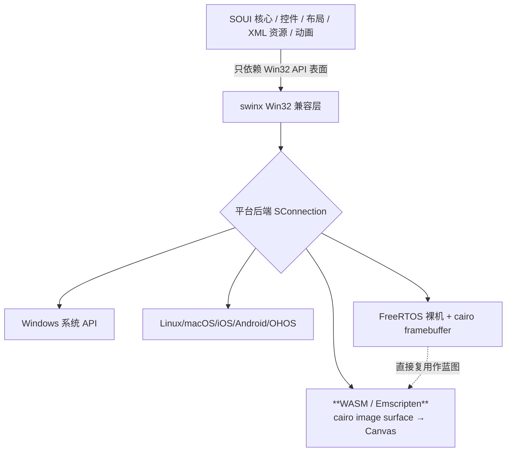

# SOUI4 WebAssembly (WASM) 编译可行性调研报告

> 调研日期：2026-10-27
> 适用仓库：`D:/work/soui4`（SOUI5 对外目录 `soui4`）
> 文档定位：与 `doc/soui-harmonyos-porting-plan.md`、`doc/SOUI-for-Android-适配方案技术文档.md` 同级，作为 WASM 移植的立项与路线依据。

---

## 0. 结论速览

**SOUI4 可以用 WebAssembly（Emscripten）编译并跑在浏览器里，且可行性很高。**

核心依据：仓库内已存在一个**几乎等价的先例——FreeRTOS 裸机移植**（无窗口系统、CPU 渲染到内存帧缓冲、由宿主注入输入/呈现）。WebAssembly 与 FreeRTOS 同属"无原生窗口服务器、软件渲染到内存、再交给宿主呈现"的形态，而 WASM（Emscripten）的运行环境（完整 libc/STL/异常支持、可选线程、Canvas 2D 呈现）甚至比 FreeRTOS 更宽松。因此 WASM 移植 ≈ 新增一个 `swinx` 平台后端 + 一个宿主 HTML/JS 壳，SOUI 核心、控件、布局、XML 资源、动画全部原样复用。

最大技术风险点（cairo 软件渲染后端跑到 WASM）已有成熟的 emconfigure/emmake 构建方案与外部成功案例（见附录）。

进度：阶段 0（swinx 编成 `libswinx.a`）与**裸窗口演示**（`soui-wasm/`，已在 Chromium 里出像素、拿到定时消息、注入输入并按脏矩形上屏）都已落地，实施记录与遗留项见 §9；阶段 1（顶层 wasm 裁剪 + `utilities4` + `SOUI` 核心进 wasm 构建）也已落地，`SApplication` 与 `SHostWnd` 能在 wasm 模块里构造，实施记录见 §10；阶段 2（`components/render-gdi` + `imgdecoder-stb` 进构建图、`render` 变实、**一份 SOUI XML 布局在浏览器里出字出皮肤并收到点击**）同样已落地，实施记录见 §11；阶段 3 的前两项——**键盘注入到 `WM_CHAR` 的语义对齐 Win32**（逐键字符断言 + A/B 证据，§12）与**一次绘制的多次 commit 合并上屏**（`req 2 -> present 1`，A/B 下为 `present 2`，§13）——已落地；第三项把 `controls.extend`、`third-part/richedit41`、`third-part/Scintilla` 拉进 wasm 构建图（Scintilla 的异常按"降级成 `abort()`"关闭），演示扩展成四页控件（基础控件 / 树 / 编辑器 / 扩展控件），无头断言 19 → 26 条，实施记录见 §14——`<edit>` 因此不再是"wasm 下不可用"；阶段 4 把 `ScriptModule-LUA` 送进 wasm 并把演示重写成官网页（八页 `<tabctrl>`、`SwinxDemo*` 导出面、Lua 三条断言，§16），随后修掉图形页两处"只错形状"的镜像缺陷（§17）；阶段 5 给 Lua 与 Scintilla 加独立编译开关（默认构建 `.wasm` 54.5 MB / 关掉两项 43.5 MB，−20.3%），演示扩到十一页（新增 MVC、表格、图表三页，布局页从文字说明改成可比对矩形的子块），无头断言 26 → 61 条，实施记录见 §18；阶段 6 把 **CJK 输入法组合输入**接进 wasm（`SwinxInjectText` → `WM_IME_CHAR` → richedit41，壳页组合代理 + 光标跟随，无头 5 条断言 + 两次变异 A/B），并顺手补上非 Windows 平台的 `ES_NUMBER` 闸门（该闸门随后由维护者主动关掉，§19.10），实施记录见 §19；紧接着把"体积有点大"按编译参数量化了一遍（`-g` 是 87.5% 的真相、`MinSizeRel` 整包 gz −46.0%、`-flto`/`wasm-opt`/`--closure` 都不划算），实施记录见 §20；阶段 7 在 wasm 分支把 `SOUI_ENABLE_SVG` FORCE 成 ON（实测代码代价 +570,403 B / +1.05%，`.data` 不变），并把 `demos/demo` 的三个 Lua 游戏（消消乐 / 俄罗斯方块 / 坦克大战）搬进第 11 页替换原 Lua 样例页——为了这条 SVG 链留下**唯一能抓住"皮肤没解码"的帧缓冲像素断言**，无头断言 66 → 72 条，实施记录见 §21；随后在浏览器验证「提示」时踩到**无限动画把 wasm 主循环变成死循环**（一点就冻住标签页），给 `SwinxDemoPump` 加了 100ms 预算并补一条回归断言，无头 72 → 73 条，见 §22；再往后是第二条按浏览器反馈修掉的阶段 7 缺陷——**带 `TIMERPROC` 的 `SetTimer` 在 wasm 后端从来没回调过**，脚本层的 `ITimer` 全部静默失效（方块没有重力、消行的 300ms 倒计时不走，也就是用户报的"消除一行方块时流程卡住"），补进 `SConnection::peekMsg` 并新增一条计时器回归断言，无头 73 → 74 条，见 §23。仍未覆盖的是触摸与移动端浏览器与真机输入法、多窗口 z-order 合成、`controls.extend` 里其余几十个控件的演练，以及 `.data`（19.9 MB，98% 是整份 CJK 字体）的体积治理；§22 与 §23 两条修复**已由用户在 Chromium 里实测通过**（2026-10-30，俄罗斯方块的重力与消行结算都走通了），`swinx` 侧的 wasm 改动由维护者提交为 `3368b06 "fix wasm timer."`；复查这条缺陷在其他后端的对称性时发现 **freertos 带着同一个洞**，本轮一并修掉：先把主机 emu 构建的五处阻塞打通（含 emu 下 `pthread_self()` 递归爆栈），再用探针在 emu 后端跑出 5 条断言与两次变异 A/B 的运行证据，`swinx` 侧由维护者提交为 `77cbc76 "freertos by ai."`，见 §23.8。随后把 wasm 后端的 `PlaySound` 从"空实现返回 FALSE"换成真链路（swinx 从 MEMFS 读出 wav → `EM_ASM_INT` → 宿主页面的 `Module.swinxAudioPlay`，6 个俄罗斯方块音效随之进 `.data`），无头 74 → 75 条，见 §24。

---

## 1. SOUI 跨平台架构与 WASM 落点

SOUI 核心（`SOUI/`、`components/` 下各 UI 组件）只依赖一套 **Win32 API 表面**：`HWND / HDC / MSG / WNDPROC / GDI / IMM / OLE`。

- **Windows**：直接调用系统 API。
- **非 Windows**：全部由 `swinx`（Win32 兼容仿真层）承接（`swinx/AGENTS.md` 第 1 节）。

平台差异被高度集中在两处，这正是移植工作量边界（与 OHOS/Android 的移植边界一致，见 `doc/SOUI-for-Android-适配方案技术文档.md` §2.2、`doc/soui-harmonyos-porting-plan.md` §2.2）：

| 集中点 | 文件 | 职责 |
|---|---|---|
| 平台层 | `swinx/src/platform/<os>/SConnection.{h,cpp}` | 消息循环、窗口/输入/定时器/剪贴板/光标、窗口表面创建 |
| 绘制后端 | `swinx/src/gdi/<后端>/gdi.cpp` | DC/位图/文本/路径绘制；当前有 `cairo`（软件）与 `apple`（Core Graphics）两个后端 |

**WASM 落点因此非常清晰**：新增 `swinx/src/platform/wasm/` 平台后端 + 一个宿主 HTML/JS 壳。SOUI 核心、控件、`uires` XML 资源、动画引擎均无需改动。



---

## 2. 关键先例：FreeRTOS 裸机移植

`swinx/src/platform/freertos/` 已经实现了一套**完整的、无窗口系统的 `SConnection`**，其渲染提交链路与 WASM 需要的形态一字不差。

### 2.1 帧缓冲呈现链路（WASM 直接复用）

```cpp
// swinx/src/platform/freertos/SConnection.cpp:1187
void SConnection::commitCanvas(HWND hWnd, const RECT &rc) {
    cairo_surface_t *surface = ...GetGdiObjPtr(wndObj->bmp);
    uint32_t *srcBase = (uint32_t*)cairo_image_surface_get_data(surface);  // cairo image surface
    memcpy(SwinxFbBits() + ..., srcBase + ..., w*sizeof(uint32_t));        // blit 到扁平 ARGB32 帧缓冲
    swinxFbPresent(&dirty);                                              // 呈现回调 (SConnection.cpp:1249)
}
```

- 窗口表面是 `cairo_image_surface_create(CAIRO_FORMAT_ARGB32, …)`（`SConnection.cpp:998` `CreateWindowSurface` / `:1006`）。
- 帧缓冲是静态扁平数组 `s_fbBits[W*H]` + `SwinxFbPresentCb` 回调（`swinx/src/platform/freertos/framebuffer.cpp`）。
- **对 WASM 来说，只需把"呈现回调"从"刷 LCD"改成"把 `s_fbBits` 拷贝进 Canvas 的 ImageData"**。

### 2.2 渲染后端与字体

- 渲染后端用 `components/render-gdi`（cairo 后端，非 Windows 下链接 `swinx` 并定义 `SOUI_RENDER_USE_GDI`）。
- 字体走无 fontconfig 桥（`swinx/src/gdi/freertos/textbridge.cpp`：`SwinXGetCachedFontFace` 返回 NULL 时退化为 cairo toy face）。WASM 上把该桥改为"从内嵌 TTF 经 FreeType 建 cairo FT face"即可获得真实中文字形。

### 2.3 输入与启动

- 输入是**注入式**（`SConnection::SetKeyDown` / `SetCursorPos` + `postMsg`），正好对应 JS 把鼠标/键盘/触摸事件喂进 wasm。
- 启动已有完整样板：`soui-freertos/soui_fr/soui_app.cpp`（`SApplication` + `SHostWnd` + 内存资源 provider `mem_res_provider.cpp`），以及可在宿主机跑的 `soui_sim`（SDL2 壳）用于增量验证。

> 一句话：**WASM 要写的 `SConnection` ≈ FreeRTOS 那份 `SConnection` 去掉裸机 STL 垫片、把帧缓冲呈现目标换成 Canvas。**

---

## 3. WASM 移植文件级清单

| 类别 | 新增/改动 | 说明 |
|---|---|---|
| 构建 | `swinx/wasm.cmake`（仿 `swinx/freeRTOS.cmake`） | `-DSOUI_PLATFORM=wasm`，静态库，glob `src/*.cpp` + `cmnctl32` + `platform/wasm`，链接 Emscripten 的 cairo/FreeType（或复刻 `swinx/thirdparty/cairo`） |
| 平台分派 | `swinx/CMakeLists.txt`（当前 `:31-39` 为 `freertos/OHOS/Android/iOS/Darwin` 分支） | 新增 `elseif(SOUI_PLATFORM STREQUAL "wasm")` 分支 |
| 顶层裁剪 | 根 `CMakeLists.txt` | 走非 Windows 路径（`WCHAR_SIZE=4`，见 `:194`）；关闭 `SOUI_BUILD_DEMOS/GAMES/TOOLS/WS`（`:112-118` 默认 OFF）；`SOUI_BUILD_HTTPCLIENT=OFF`（`:100`）；`SOUI_BUILD_RICHEDIT=OFF`（`:123-133`）；`SOUI_ENABLE_COM_LIB=ON`（`:78`，静态合并组件避免 dlopen）；`ENABLE_THUNK=OFF` |
| 平台层 | `swinx/src/platform/wasm/SConnection.{h,cpp}` | fork `freertos/SConnection`，`commitCanvas` 改为把像素写进 JS 可见的共享缓冲 / `ImageData` |
| 字体 | `swinx/src/gdi/wasm/textbridge.cpp` | 内嵌 TTF + FreeType 建 font face（替代 freertos 的 toy face） |
| 宿主 | `host/index.html` + `host/wasm_glue.js` | 建 2D canvas；`requestAnimationFrame` 驱动 `soui_pump()`；canvas 事件监听调导出函数 `soui_injectPointer/Key` |
| 导出入口 | 业务 `main.cpp`（参考 `soui-freertos/soui_fr/soui_app.cpp`） | 导出 `soui_app_run()`（SApplication + SHostWnd）与 `soui_pump()`（peekMsg + 触发到期定时器 + 呈现） |
| 资源 | Emscripten `--preload-file uires` + ZIP/file provider，或内存 provider | 复用 `soui-freertos/soui_fr/mem_res_provider.cpp` 思路 |

---

## 4. 各子系统可行性判定

| 子系统 | 判定 | 依据 |
|---|---|---|
| 核心/控件/布局/XML/动画 | ✅ 高 | 只依赖 swinx Win32 表面，非 Windows 已验证（Android/iOS/OHOS/FreeRTOS） |
| 渲染（cairo 软件后端） | ✅ 高 | FreeRTOS 已用同一条 cairo image surface 链路；cairo 可经 emconfigure/emmake 编到 WASM（见附录） |
| swinx 平台层 SConnection | ✅ 高 | FreeRTOS 已给出完整实现，WASM 主要改 present 目标 |
| 字体 | ✅ 中高 | FreeType 在 WASM 可用；内嵌 TTF 绕开 fontconfig（参考 freertos textbridge） |
| 主循环/消息泵 | ✅ 中高 | iOS 端已用外部 runloop 驱动（`CFRunLoopRunInMode`）；WASM 用 rAF 调 peek 泵是同源模式 |
| 输入（鼠标/键盘/触摸） | ✅ 高 | 注入式模型与 FreeRTOS `SetKeyDown`/`postMsg` 一致 |
| 定时器 | ✅ 高 | FreeRTOS 用 tick 驱动 `WM_TIMER`；单线程模型天然契合 WASM MVP |
| 剪贴板 | ⚠️ 中 | 内部剪贴板易；系统剪贴板走 `navigator.clipboard`（需用户手势/权限），可后置 |
| 依赖（zlib/lua/pugixml/imgdecoder-stb） | ✅ 高 | 纯 C/C++，WASM 友好；`imgdecoder-stb` 无 GDI+ 依赖（`components/CMakeLists.txt:7`） |
| 二进制体积 | ⚠️ 中 | cairo+FreeType+SOUI 核心合进单 wasm，预期数 MB（gzip 后约 1MB+）；靠 `-O2 -gc-sections` 收敛 |

---

## 5. 主要风险与缓解

| 风险 | 影响 | 缓解（与现有端口同源） |
|---|---|---|
| cairo 在 WASM 的构建/链接 | 首屏阻塞 | 用 `emconfigure/emmake` 构建 cairo（image + freetype backend，关掉 X11/GL）；或复用 `swinx/thirdparty/cairo`。外部已有 `cairo.wasm`、webR 在 WASM 内跑 cairo 出图的成功案例（见附录） |
| fontconfig 在 WASM 难配 | 文本异常 | **不依赖 fontconfig**，内嵌 1~2 个 TTF，`textbridge` 用 FreeType 直接建 face（freertos 已证明无 fontconfig 也能跑，只是要补真字体） |
| 主循环与浏览器事件耦合 | 交互卡顿 | 参考 iOS 模式：`soui_pump()` 由 rAF 调用，内部 `peekMsg` 非阻塞 + 到期定时器触发 + 脏矩形呈现 |
| 单线程模型 | 多线程能力受限 | WASM MVP 保持单线程（与 FreeRTOS 一致）；需要 worker 时再上 pthreads（需 COOP/COEP 响应头） |
| `ENABLE_THUNK` 可执行内存 | 崩溃 | 关 `ENABLE_THUNK`，根 HWND 做成虚拟窗口（同 OHOS/FreeRTOS MVP） |
| 组件动态加载 | 运行期找不到 so | `SOUI_ENABLE_COM_LIB=ON` 静态合并（同 OHOS MVP 原则） |
| `SRichEdit`/`libmsftedit` | 富文本不可用 | MVP 关 `SOUI_BUILD_RICHEDIT`，仅保证 `SEdit` 等基础输入 |
| openssl/libcurl/libwebsockets | 构建膨胀/失败 | 这些只在 `SOUI_BUILD_WS`/`HTTPCLIENT`/`network` 时编（`third-part/CMakeLists.txt:27-109`），MVP 全部关闭 |

---

## 6. 推荐 MVP 路线与工作量

### 6.1 阶段划分（参照 FreeRTOS `soui_sim` 节奏）

1. **阶段 0 — 编译打通**（✅ swinx 部分已于 2026-10-27 落地，见 §7；`utilities4` / `SOUI` 上层尚未接入）：建 `swinx/wasm.cmake` + 顶层平台识别，先让 `swinx` + `utilities4` + `SOUI` 在 Emscripten 下进入编译（仿 `SOUI5-FreeRTOS开发指南.md` 阶段 0，裁剪掉 WS/network/richedit/skia）。
2. **阶段 1 — 首屏呈现**：fork `freertos/SConnection` 为 `platform/wasm/SConnection`，`commitCanvas` 把帧缓冲写进 JS 共享缓冲；复用 `render-gdi`（cairo）。
3. **阶段 2 — 真实文本**：加载内嵌 TTF，实现 `textbridge` 让中文真出字。
4. **阶段 3 — 交互闭环**：写 host 页面（canvas + rAF 泵 + 鼠标/键盘注入）；资源用 `--preload-file uires` 或内存 provider。
5. **阶段 4 — 验证**：跑通 `SHostWnd` + 含按钮/文本/列表的 demo 布局，验证首屏 + 点击 + 定时器。


### 6.2 工作量估算

由于约 **90% 的平台层代码可直接复用 FreeRTOS 端口**，且 WASM 的 JS 桥（纯 C 导出 + Canvas）比 OHOS 的 N-API/ArkUI 桥简单得多：

- **WASM MVP（首屏 + 基础交互）**：预计 1 名熟悉 SOUI/swinx 的工程师 **4~8 周**。
- 对比参照：OHOS 同类全平台能力约 36~62 人周，WASM MVP 范围小得多。
- **完整能力**（系统剪贴板、IME 输入法、多窗口）另计，不在 MVP 范围。

---

## 7. 阶段 0 实施记录（2026-10-27）

> 本节记录阶段 0 已落地的范围、与本报告原方案的偏差、以及验证证据。实施细节以代码注释为准，本节只做索引与口径。

### 7.1 已落地范围

| 项 | 内容 |
|---|---|
| 平台 cmake | 新增 `swinx/wasm.cmake`：glob `src/*.cpp` + `src/cmnctl32/*` + `src/platform/posix/*.cpp` + `src/platform/wasm/*.cpp` + `src/gdi/cairo/*.cpp`，产出 **STATIC** `libswinx.a` |
| 平台识别 | `swinx/CMakeLists.txt`：`-DSOUI_PLATFORM=wasm` 显式选择；`elseif(EMSCRIPTEN)` 自动选择（不再落到 `linux.cmake` 的 xcb/dbus/ALSA 分支） |
| 平台层 | 新增 `swinx/src/platform/wasm/`（11 个文件，`SConnection.{h,cpp}`、`SConnBase.h`、`SClipboard.h`、`framebuffer.{h,cpp}`、`input.{h,cpp}`、`atoms.{h,cpp}`、`dlghelper.cpp`），从 `platform/freertos/` fork |
| 构建修正 | ①`swinx/CMakeLists.txt` 在 Emscripten 下把 `SIZEOF_UINT64_T` 固化进 cache；②`thirdparty/cairo/Configure_features.cmake` 为 Emscripten 关闭 XCB 后端；③`src/platform/posix/sysapi.cpp` 给 `GetThreadContext` 定义套上与其声明一致的 x86_64 架构守卫；④`src/winnsl.cpp` 的 locale 分支放行 `__EMSCRIPTEN__` |
| 条件编译 | 逐项判定 swinx `include/` + `src/` 内 43 处 `__linux__`（结论见 §8）：向 Emscripten 放行 `setlocale`/`<unistd.h>` 两项能力；inotify 一族改为显式拒绝桩；`src/hook.cpp` 的 xcb 专属调用收敛到各端口同名的 `SConnection::GetClipboardOwner()` |
| 门禁 | `api_scan.json` 与 `doc/swinx-API实现清单.md` 已刷新（声明 1272 / 有定义 1142 未变），`api_scan.py --check` 通过 |

构建命令与产物（Linux x64 主机，Emscripten 6.0.13 / emsdk `latest`，Node v24.19.0，CMake 3.22.1 + Ninja）：

```bash
emcmake cmake -S swinx -B build-wasm -G Ninja -DSOUI_PLATFORM=wasm -DSOUI_ENABLE_CORE_LIB=ON
cmake --build build-wasm --target swinx -j8
```

`libswinx.a` = 14,511,108 B（从零配置 + 全量编译产出），含 72 个对象（core 34 + cmnctl32 4 + posix 23 + wasm 5 + gdi/cairo 6），抽出的 `SConnection.cpp.o` 经 `file` 判定为 `WebAssembly (wasm) binary module version 0x1 (MVP)`。vendor 侧同时产出 `libcairo.a` 5,424,782、`libfreetype.a` 4,037,474、`libpixman-1.a` 2,653,532、`libfontconfig.a` 1,197,622、`libpng_static.a` 831,584、`libexpat.a` 550,540、`libzlib_static.a` 292,822、`libbrotlidec.a` 223,876。全量编译共 78 条警告，其中落在 `src/platform/wasm/` 的 4 条（`m_screenNum` 未用、`commitCanvas` 的 `rc` 未用、`s_nextRegisteredMessage` 未用、`wait` 未用）在 `src/platform/freertos/` 原文里逐字存在，fork 未新增警告，留待阶段 1 一并清理。

Linux x64 原生回归：重配置后 `swinx` 编译 0 error，cairo 仍为 `HAVE_UINT64_T 1` / `CAIRO_HAS_XCB_SURFACE 1`（其他平台配置未被本次改动波及）；`fun_test` 503 个用例（`--gtest_filter=-window.*`）全部通过。

**未包含在本轮**：`utilities4` 与 `SOUI` 上层进入编译、任何画面或交互验证。

### 7.2 与原方案的两处偏差

1. **cmake 形态取 `mobile.cmake` 而非 `freeRTOS.cmake`。** `freeRTOS.cmake` 完全不编译 `src/gdi/**`（cairo GDI 是它尚未落地的 framebuffer 切片），照搬会让 wasm 没有绘制后端；`mobile.cmake` 的 posix + `gdi/cairo` 组合才是"软件渲染到内存表面"的可用形态。Emscripten 自带 musl libc、pthreads、真实 `<mutex>/<thread>/<chrono>`、`dirent`、`dlfcn`，因此 `platform/freertos/` 下的裸机垫片（`stl/`、`sys/mman.h`、`uuid/`、`dlfcn.h`、`dirent.h`、`winobjs.cpp`、`syncapi.cpp`、`sysbridge.cpp`）全部不 fork——它们与 `src/platform/posix/` 的实现是同名冲突关系。
2. **不定义 `ENABLE_VIRTUAL_HWND`。** 该宏走的是"宿主工具包持有真窗口、swinx 通过 `SConnection::RegisterVirtualHWND` 登记镜像"的形态（`src/wnd.cpp:4327` 是唯一消费者），freertos 形态的 `SConnection` 没有这个入口：它把每个窗口直接在 swinx 内部做成虚拟 `_Window`。定义它会立刻链接失败。

### 7.3 风险项更新

| 原判 | 现状 |
|---|---|
| cairo 在 WASM 的构建/链接（首屏阻塞） | **已消解**：仓内 `thirdparty/cairo` 直接经 Emscripten 交叉编译通过，只需关掉 XCB 后端并固化 `uint64_t` 探测；无需引入外部 `cairo.wasm` |
| fontconfig 在 WASM 难配 | **部分消解**：`libfontconfig.a` 本身编译通过（含 expat/freetype 依赖闭合），所以阶段 2 未必需要 `gdi/freertos/textbridge.cpp` 那种"退化成 toy face"的兜底；但运行期 fontconfig 要字体目录与缓存，浏览器里没有——仍需 `--preload-file` 预置字体并验证 `FcConfigInit` 的实际行为 |
| 主循环与浏览器事件耦合 | **加重**：fork 出的 `wasm/SConnection.cpp` 里 `waitMsg()` 会阻塞在队列事件上，`waitMutliObjectAndMsg()` 的兜底循环用 `sched_yield()`（wasm 中是 no-op）；主线程一旦进入这两条路径，rAF 停摆、页面冻结。阶段 3 的宿主泵必须用有限超时或 `peekMsg`，并把忙等改成 `emscripten_set_main_loop` 驱动 |
| 依赖面判定 | **已消解**（逐项判定见 §8）：Emscripten **不定义 `__linux__`**，`src/platform/posix/*.cpp` 里以 `#ifdef __linux__` 划分的分支在 wasm 目标上全部被排除。本轮逐项判定完 43 处：Emscripten 的 musl 能提供同一能力的（`setlocale`/`<unistd.h>`）已放行；确实没有的（inotify、`/proc`、信号停车、ALSA、`system()`、`AF_PACKET`）保留排除，并把原先只在编译期"隐身"的缺口改成显式拒绝或就地注释 |
| 单线程模型 | 维持：本轮未开 `-sUSE_PTHREADS`，`libswinx.a` 按单线程链接 |
| 组件静态合并 | 维持，且**必须** `-DSOUI_ENABLE_CORE_LIB=ON`：`thirdparty/brotli` 强制 `BUILD_SHARED_LIBS OFF`，共享 cairo 链接时会报 `relocation R_WASM_MEMORY_ADDR_LEB cannot be used against symbol kBrotliBitMask` |

### 7.4 下一步（阶段 1）

1. ~~把 `SwinxSetFbPresentCb` 接到 JS~~ —— 已随阶段 0 演示完成，见 §9。
2. ~~写一个最小 `main.cpp`，验证 `CreateWindowEx → WM_PAINT → commitCanvas → 帧缓冲` 在真实浏览器里出像素~~ —— 已完成，见 §9。
3. ~~顶层 `CMakeLists.txt` 的 wasm 裁剪（关 demos/games/tools/WS/network/richedit/httpclient）随阶段 1 一起做~~ —— 已随阶段 1 完成，见 §10.1。
4. 阶段 1 的 SOUI XML 演示直接复用 §9 的宿主页（canvas + 脏矩形 blit + 输入注入三条通道与上层无关），只需把 `main.cpp` 换成 `SApplication` + `SHostWnd`。

### 7.5 需在其他平台复验（本轮只在 Linux x64 上验证过）

| # | 待复验项 | 判据 |
|---|---|---|
| 1 | **macOS arm64 / Linux arm64 的 swinx 编译**：`src/platform/posix/sysapi.cpp` 的 `GetThreadContext` 定义原先没有架构守卫，而 `LPCONTEXT` 只在 x86_64 声明（`include/sysapi.h:1177`）。本轮给定义套上了同一条件。需确认：改动前 aarch64 是否真的编不过（若是，则本轮顺手修掉一个既有缺陷）；改动后 x86_64 行为不变 | `cmake --build build --target swinx`；Webkit 侧若依赖 `GetThreadContext`，在 aarch64 上从"可调用但返回 FALSE"变成"符号不存在"，需检查调用方是否已在 x86_64 守卫内 |
| 2 | **Windows 原生构建**：`swinx/CMakeLists.txt` 新增的 `if(EMSCRIPTEN)` 与 `elseif(SOUI_PLATFORM STREQUAL "wasm")` 分支不应被命中 | MSVC/MinGW 配置 + 构建通过 |
| 3 | **Android / OHOS 交叉构建**：`thirdparty/cairo/Configure_features.cmake` 新增的 `elseif(EMSCRIPTEN)` 分支排在 `else()` 之前，需确认这两个平台的 `CAIRO_HAS_XCB_SURFACE` 仍为 0、`cairo/config.h` 的 `HAVE_UINT64_T` 仍为 1 | 各自 toolchain 配置后检查 `build/.../cairo/config.h` 与 `cairo-features.h` |
| 4 | **`SOUI_PLATFORM=freertos` 主机编译测试**：本轮把 `src/winnsl.cpp` 的 locale 分支从"新增 `__EMSCRIPTEN__` 独立分支"改成 `defined(__linux__) \|\| defined(__EMSCRIPTEN__)` 共用 Linux 分支，`SFR_PLATFORM` 分支未触碰。**2026-10-30 复查 `TIMERPROC` 时实测：当时在 Linux x64 主机上编不过**（三条拦路项见 §23.8），**当天已修通**，并在 emu 后端跑出运行证据 | `-DSOUI_PLATFORM=freertos -DSOUI_FREERTOS_EMULATE_HOST=ON` → `swinx` 目标 `rc=0`；计时器/消息泵探针 5 条断言 + 两次变异 A/B 全过（§23.8）。真机（arm-none-eabi/ESP-IDF）仍未验证 |
| 5 | **`fun_test` 桌面 GUI 烟测**：wasm 端口不改变桌面路径，但 `posix/sysapi.cpp` 属桌面编译单元 | `-DSOUI_ENABLE_GUI_SMOKE=ON` 后 `ctest -L '^soui-gui$'` |
| 6 | **Android / OHOS 的 `swinx` 交叉构建**：`src/hook.cpp:236` 原先在 mobile 形态下就编不过（`hwndFromXcb` 只在 `platform/linux/SConnection.h` 声明），本轮改成各端口同名的 `SConnection::GetClipboardOwner()`。若这两个平台此前能构建，说明它们用的是别的源集，需要核实真实差异 | NDK / OHOS toolchain 配置后 `cmake --build --target swinx`；本机已用"`-I src/platform/linux` 换成 `-I src/platform/mobile` + `-D__ANDROID__`"的 g++ 语法检查做过改动前后 A/B（改动前报 `hwndFromXcb was not declared`，改动后返回 0） |
| 7 | **macOS / iOS 的跨线程钩子派发**：改动前 `#ifdef __linux__` 为假，`HookMgr::call_hook` 在目标线程不是当前线程时什么都不做；改动后这两个平台会真的发一条 `UM_CALLHOOK`。Linux 侧表达式逐字等价，macOS/iOS 属**行为改变** | `fun_test` 全套 + 一个装在他线程上的钩子能收到回调；注意 `demos/fun_test/test_hook.cpp` 的 7 个用例全部用 `GetCurrentThreadId()` 装钩子，走同线程快路径，覆盖不到这一分支 |
| 8 | **`DllLoader` 构造函数容错**（§9.2 改动 1，2026-10-28）：`src/platform/posix/sysapi.cpp` 里"取可执行文件目录"改成只在 `GetModuleFileNameA` 成功时截断。Linux/macOS/Android/OHOS 上成功路径逐字等价，只有失败路径从写 `p[1]`（NULL 解引用）变成保留空目录项 | 在 macOS 上 `LoadLibraryA` 一个只存在于 app 目录的 `.dylib` 仍能加载（证明 `m_lstDirs` 首项没退化）；再确认 `/proc` 未挂载的 Linux 容器里 swinx 不再崩在启动阶段 |
| 9 | **Windows 侧不受影响**：`DllLoader` 与 `commitCanvas` 都在 `platform/posix`、`platform/wasm`，Windows 用系统 Win32 | MSVC 构建 + `fun_test` 通过即可，无需功能复验 |
| 10 | **`SOUI/src/core/SNativeWnd.cpp` 的 `#if ENABLE_THUNK` 包裹**（§10.2 改动 3，2026-10-28）：`tagThunk` 的架构枚举原先在守卫之外，wasm32 会撞 `#error Only AMD64, ARM, ARM64 and X86 supported`；现在整段枚举都要求 `ENABLE_THUNK` 为真 | Linux x64 已 A/B：`-DENABLE_THUNK=1` 与 `=0` 两次 `-fsyntax-only` 都返回 0（改动前 `=0` 也编得过，所以 Linux 无回归）。Windows 恒 `ENABLE_THUNK=1`、MSVC 走 `_M_AMD64`/`_M_IX86` 分支，只需确认构建通过；**macOS arm64 若要打开 thunk（`-DENABLE_THUNK=ON`）仍是原样**，本轮没改变它的行为 |
| 11 | **`components/CMakeLists.txt` 的 wasm 白名单**（§11.1，2026-10-28 阶段 2）：`add_subdirectory(render-gdi)` 从原位置移到 `if(NOT SOUI_WASM_MINIMAL) ... endif()` **之外**、文件末尾，`ws`/`network` 落进守卫内。桌面三平台 `SOUI_WASM_MINIMAL` 恒为假，守卫整体等价，但配置顺序确实变了（`render-gdi` 现在排在 `ws`/`network` 之后） | Windows(MSVC) / macOS arm64 / Linux x64 三处配置 + 全量构建通过，且 `render-gdi`、`render-skia`、`resprovider-zip`、`ws`、`network` 目标都仍然生成（`cmake --build build --target help \| grep -E 'render-gdi\|ws\|network'`） |
| 12 | **`third-part/CMakeLists.txt` 的 `if(SOUI_WASM_MINIMAL) ... return()`**（§11.1）：`return()` 在守卫内，桌面分支逐字未动 | 桌面配置输出里 `zlib/lua/nanosvg/skia/...` 仍全部进入构建图；只需确认配置期没有新增 `CMake Error`，无需功能复验 |
| 13 | **swinx `src/gdi/cairo/FontFallback.cpp` 的 `__EMSCRIPTEN__` 分支**（§11.2 改动 2）：wasm 下系统字体列表改成同步构建，非 wasm 仍走 `std::thread` 后台构建，`#else` 分支逐字未变。风险不在编译结果而在**启动时序**——本轮没有改动桌面路径，但这是文本链的核心文件 | macOS / Windows：`fun_test` 的文本测量用例全过 + 任一真实窗口演示（`demos/trd_demo`、`demos/logo_demo`）首帧文字与改动前一致；顺带确认没有因为少了一次线程同步而出现字体表为空的窗口 |
| 14 | **`soui-wasm/` 已进构建图，但只在 wasm 且显式打开时**（§15.1，2026-10-28）：根 `CMakeLists.txt` 新增 `option(SOUI_BUILD_WASM_DEMO ... OFF)`，`add_subdirectory(soui-wasm)` 包在 `if(EMSCRIPTEN AND SOUI_BUILD_WASM_DEMO)` 里。桌面三平台两者都不成立，目标集合应与改动前完全一致 | 桌面三平台配置输出里 `soui-wasm-demo` 不出现（`cmake --build build --target help \| grep soui-wasm-demo` 为空），且配置期没有新增 `CMake Error`；`SOUI_BUILD_DEMOS` 仍独立控制 `demos/` |
| 15 | **Windows 主机交叉编译 wasm**（§15，2026-10-28）：本轮把演示的链接命令从 bash 搬到 `soui-wasm/CMakeLists.txt`，就是为了让 Windows 主机不需要 bash 数组 / `sed` / `find`。本机只在 Linux 上跑过同一条 CMake 路径 | 见 §15.5 的 Windows 复验步骤（`emsdk_env.bat`、`-G Ninja`、`cmake --build --target soui-wasm-demo`、`node soui-wasm/smoke.js` 26 条通过） |

---

## 8. `__linux__` 与 Emscripten 的逐项判定（2026-10-28）

Emscripten 只定义 `__EMSCRIPTEN__`，**不定义 `__linux__`**，所以 swinx 里每一处 `__linux__` 都直接决定 wasm 走哪条分支；判错的方向有两种——该走的没走（能力被白白丢掉），或不该走的走了（编译期就崩，或运行期假装成功）。本节记录对 swinx `include/` + `src/` 全部 43 处 `__linux__` 文本出现（`thirdparty/**` 除外，其中也包含 `#endif` 的收尾注释）的结论。

判定依据是**本机实测**的 Emscripten 6.0.13 环境，不是文档推断：`wchar_t` = 4；有 `locale.h`、`langinfo.h`、`sys/sysinfo.h`、`ucontext.h`、`netpacket/packet.h`、`sys/wait.h`、`dlfcn.h`；**没有** `sys/inotify.h`、`linux/sockios.h`、`sys/prctl.h`、`execinfo.h`；`sysconf(_SC_NPROCESSORS_CONF/_SC_NPROCESSORS_ONLN)` = 1、`_SC_PAGESIZE` = 65536；`setlocale(LC_ALL,"")` 后仍为 "C" 但 `nl_langinfo(CODESET)` = "UTF-8"；`getifaddrs()` 返回 -1。

| 判定 | 位置 | 依据与处理 |
|---|---|---|
| 放行给 wasm | `src/winnsl.cpp:11`（`<locale.h>/<langinfo.h>`）、`:196`（`setlocale(LC_ALL, NULL)`） | musl 两个头都有、`setlocale` 可用，Linux 分支的答案在浏览器里同样成立（恒为 "C"，`nl_langinfo(CODESET)` 仍给出 "UTF-8"）。条件合并成 `defined(__linux__) \|\| defined(__EMSCRIPTEN__)`，并删掉此前为 wasm 单开的一条 `const char *locale = "C"` 分支——那是重复表达同一个值 |
| 放行给 wasm | `src/platform/posix/sysapi.cpp:10` 的 `<unistd.h>` | `sysconf()` 在本文件是无条件调用的（`:2686`、`:2728`、`:3324`、`:3553`），Emscripten 有 `<unistd.h>`。新增 `#elif defined(__EMSCRIPTEN__)` **只**引 `<unistd.h>`，不连带放行 `<sys/inotify.h>`/`<ucontext.h>` |
| 保持排除 + 改成显式拒绝 | `sysapi.cpp:4255` 起的 inotify 实现、`:4817`（原 `#else #pragma message("unsupport os")`） | `sys/inotify.h` 不存在，能力确实没有。原形态下 `FindFirstChangeNotificationA`/`FindNextChangeNotification` 在 wasm 上**只有声明没有定义**，缺口要到链接期才暴露；已在 `#else` 里补两个显式拒绝桩（`SetLastError(ERROR_CALL_NOT_IMPLEMENTED)` + `INVALID_HANDLE_VALUE`/`FALSE`）。`FindFirstChangeNotificationW` 在守卫之外、转发到 A 版，因此整族都可见了 |
| 保持排除（注释说明） | `sysapi.cpp:3177` `IsDebuggerPresent`（读 `/proc/self/status`）、`:3628` `queryMemoryRegion`（读 `/proc/self/maps`） | 浏览器沙箱没有 `/proc`。两者的 `#else` 本来就是诚实答案（按未调试处理 / 返回 false），只在注释里点明 wasm 走的正是这条，避免后来者"顺手"把 `__EMSCRIPTEN__` 加进 `__linux__` |
| 保持排除（绝不能放行） | 信号停车线程：`sysapi.cpp:4849`、`:4860`、`:4898`、`:4982`、`:4996`、`:5135`、`:5162` | `Swinx_ThreadParkHandler` 在 `sigsuspend()` 里循环等待恢复；Emscripten 的信号是 wasm 模拟，而**在浏览器主线程上调用 `sigsuspend()` 会冻结整个标签页**。wasm 下 `SuspendThread/ResumeThread` 只做挂起计数，`GetThreadContext` 因 x86_64 守卫（`:5217`）整体不导出 |
| 已正确排除，无需改动 | xcb / XDND / AT-SPI：`src/wnd.cpp:20`、`:415`、`:986`、`:1070`、`:1850`、`:1872`、`:3569`、`:3571`；`src/uimsg.h:314`、`:355`；`src/uimsg.cpp:4`、`:109`、`:124`；`src/oleacc.cpp:47` | 这些早就写成 `defined(__linux__) && !defined(__OHOS__)`（`oleacc.cpp` 另排除 `__ANDROID__/OHOS`，注释也写明了"同样定义 `__linux__` 的平台走 mobile.cmake"），语义是"xcb 桌面端口"而不是"任何 Linux"。浏览器既无 X server 也无 AT-SPI 总线，wasm 不定义 `__linux__` → 天然落在排除侧 |
| 保持排除 + 注释 | `src/platform/posix/mmsystem.cpp:10`、`:134`（ALSA 或 `fork+execlp("aplay")`）、`:523` `PlaySound` | Emscripten 既无 ALSA 也不能 fork。`PlaySound` 走 `#else return FALSE`，注释改为写明 wasm/裸金属没有 AudioPlayer、按 Win32 失败语义返回 |
| 保持排除 + 注释 | `src/platform/posix/shellapi.cpp:1340`（`system("xdg-open …")`）、`:1393` | Emscripten 的 `system()` 直接失败。wasm 开 URL 的正确通道是 JS 宿主（`window.open`），属阶段 3 的宿主桥；本轮只把 `#else` 注释补成"如实返回失败"，不伪造成功 |
| 保持排除 | `src/platform/posix/iface.cpp:24`（`netpacket/packet.h` + `linux/sockios.h`）、`:107`（`AF_PACKET`/`sockaddr_ll`） | `linux/sockios.h` 不存在 → 放行即编译失败（`SIOCGIFMTU` 本身由 musl 通用 ioctl 提供，所以 `queryMtu` 不受影响）。`appendPhysical` 的 `#else` 返回 false 是诚实答案；且 `getifaddrs()` 在 wasm 返回 -1，`collectInterfaces()` 如实失败 |
| 两条分支同值，不改 | `include/ctypes.h:126` `typedef int BOOL` | `__EMSCRIPTEN__` 既不定义 `__linux__` 也不预定义 `__OBJC_BOOL_IS_BOOL`，落到 `#else` 的 `typedef int BOOL`，与 Linux 分支**逐字相同** → 加条件只会多一个分支，没有意义 |
| 顺带修掉的既有缺陷 | `src/hook.cpp:9`、`:236` | 见下 |

### 8.1 `src/hook.cpp`：`#ifdef __linux__` 实际写的是"xcb 端口"

`HookMgr::call_hook()` 跨线程派发时调 `hwndFromXcb(conn->getClipboard()->getClipboardOwner())`，包在**裸** `#ifdef __linux__` 里（外层没有任何守卫），而 `hwndFromXcb()` 只在 `src/platform/linux/SConnection.h:27` 声明。Android/OHOS 走 `mobile.cmake`、`file(GLOB src/*.cpp)` 同样编 `hook.cpp`，又同样定义 `__linux__`。

基线复现（本机 g++，把桌面构建的 `-I src/platform/linux` 换成 `-I src/platform/mobile` 并加 `-D__ANDROID__` 做 `-fsyntax-only`）：

```
src/hook.cpp:238:37: error: 'hwndFromXcb' was not declared in this scope
```

改成各端口同名的 `SConnection::GetClipboardOwner()`：六个端口都声明它（`platform/{linux,mobile,cocoa,ios,freertos,wasm}/SConnection.h`）、都返回 swinx `HWND`，而 xcb 端口在方法**内部**完成 `hwndFromXcb` 转换（`src/platform/linux/SConnection.cpp:3350`）。这正是 `swinx/AGENTS.md` §2 的第 3 种收敛形态——差异压到同名方法里，调用方零 `#ifdef`。于是：

- Linux 侧表达式与改动前逐字等价（`getClipboard()` 返回的就是 `m_clipboard`），无行为变化；
- Android/OHOS 从"编不过"变成可编译；
- macOS/iOS/裸金属/wasm 从"跨线程钩子静默不派发"变成按 Win32 语义派发；`UM_CALLHOOK` 由公共层 `src/wnd.cpp:4127` 处理，本来就不专属某个平台；
- `#ifdef __linux__ #include "SClipboard.h"` 随之删除。

改动后同一条 `-fsyntax-only` 命令返回 0。这条改动的**代价在 macOS/iOS**：那是新增一次真实的消息发送，属行为改变，已登记进 §7.5 第 7 项；现有 `demos/fun_test/test_hook.cpp` 的 7 个用例全部用 `GetCurrentThreadId()` 装钩子，走 `hhk->tid == tid` 同线程快路径，覆盖不到这一分支，所以本轮不补"断言返回固定值"的桩用例，只交人工复验。

### 8.2 审计中发现、但本轮不改的两件事

1. **`GetModuleHandleA(NULL)` 依赖 `/proc/self/maps`**（`src/platform/posix/sysapi.cpp:3951` 起的 `#else`，注意它**不在** `__linux__` 守卫内）：浏览器里 `fopen` 失败 → `perror` + 返回 `NULL`。不影响编译与本轮链接产物，等阶段 1 确认是否有调用方把返回的 `HMODULE` 当实例句柄用之后再决定给不给 wasm 实现；现在伪造一个基址反而更糟。
2. **SOUI 上层还有 7 处 `__linux__` 未判定**：`SOUI/src/core/SNativeWnd.cpp:43/67/92`、`SOUI/src/res.mgr/SUiDef.cpp:154`、`components/ScriptModule-LUA/src/exports/exp_global.h:215`、`components/httpclient/httpHeader.cpp:78`、`components/network/src/tcp_client_socket.cpp:296`。阶段 0 的 wasm 目标只编 `swinx`，这些文件没进编译，判定推到阶段 1 顶层裁剪时做。**阶段 1 已判定并处理前四处**（`SNativeWnd.cpp` 的 thunk 结构体、`SUiDef.cpp` 的默认字体平台名，见 §10.2），后三处在 `components/`，wasm 最小构建仍不编译它们，判定留给渲染器进场的那一轮。

### 8.3 本轮验证结果

- wasm：`/tmp/build-swinx-wasm-clean` 增量重建 `swinx` → 0 error，`libswinx.a` = 14,523,998 B（§7.1 记录的 14,511,108 B 是本轮条件编译改动之前）；警告仍是既有的那批（`sysapi.cpp` 4 条 sign-compare + 1 条 `%x`/`UINT_PTR` format + `mmapToProtect` 未用——最后一条正是 `queryMemoryRegion` 在 wasm 走 `#else` 的直接后果，与判定一致）。
- Linux x64 原生：全量构建通过，`fun_test` 503 个用例全部通过（`--gtest_filter=-window.*`）。
- 门禁：`python3 doc/tools/api_scan.py --check` → `清单与源码一致`，声明 1272 / 有定义 1142 未变；`gen_doc.py` 重生成后分级为 实现 1001 / 部分实现 14（新增的两条 inotify 拒绝登记为 partial）。
- Android/OHOS 形态：`-fsyntax-only` A/B 见 §8.1。

重生成 `doc/swinx-API实现清单.md` 还顺带纠正了两条**手写进 .md、但和当前代码不符**的备注（`api_scan.py` 只比对声明面，看不出这种漂移）：`GetThreadTimes` 的"四个出参都允许传 NULL"（现码 `src/platform/posix/sysapi.cpp:5058` 在入口就拦成 `ERROR_INVALID_PARAMETER`，`test_swinx_wke_sysapi_unit.cpp:147` 也没有 NULL 断言）与 `ScriptItemize` 的"`cMaxItems<2` 报 E_INVALIDARG"（现码 `src/platform/posix/usp10.cpp:242` 仍报 `E_OUTOFMEMORY` 并回填需要项数，正是 WebKit 扩容重试依赖的那个码）。这两条口径以 `gen_doc.py` 的 `OVERRIDES` 为唯一来源，不要再直接改 .md。

---

## 9. 阶段 0 演示：swinx 裸窗口 wasm demo（2026-10-28）

`soui-wasm/`（`main.cpp` + `index.html` + `build.sh` + `readme.md`）：只链 `libswinx.a` 与 vendor 归档，
不依赖 SOUI 上层，在浏览器里跑通 `RegisterClassA/CreateWindowExA → PeekMessage 泵 → BeginPaint/cairo GDI
→ commitCanvas → 脏矩形上屏 → DOM 事件注入`。构建与操作说明、页面面板口径、已知限制清单都在
`soui-wasm/readme.md`，本节只记移植侧结论与两处 swinx 改动。

### 9.1 验收结果

- **Chromium（本机）**：加载无异常中止，动画持续重绘，鼠标移动/左键/方向键都有响应；
  控制台仅一条预期的 `readlink: No such file or directory`（见 §9.3 第 1 项）。
  脏矩形读数：启动整帧 `800x600`，动画稳定期 `24,74 - 324,324`（300×250），
  指针点 `24x24`，方块移动 `76x60`，**相对整帧拷贝节省约 84%**。
- **无头 node**（同一份产物，不需要浏览器）：`WM_TIMER` 连发、注入计数正确，脏矩形分布与浏览器一致，
  emscripten 的栈/堆金丝雀 `HEAPU32[0] == 'emsc'` 全程完好。
- **Linux x64 原生回归**：`posix/sysapi.cpp` 属桌面编译单元，重建 `fun_test` 后跑 `soui-headless` 门禁，
  结果见 §9.4。

### 9.2 移植侧改动（两处，都在 swinx 子模块内，未提交）

| # | 位置 | 改动 | 影响面 |
|---|---|---|---|
| 1 | `src/platform/posix/sysapi.cpp` `DllLoader` 构造函数 | 拿不到可执行文件路径时不再解引用 `strrchr` 的结果 | **所有 posix 平台**（Linux/macOS/Android/OHOS/wasm）。`GetModuleFileNameA` 成功时逐字等价，只有失败路径从"写 `p[1]`（p 为 NULL）"变成"保留空目录项，只按当前目录搜索" |
| 2 | `src/platform/wasm/SConnection.cpp` `commitCanvas` | 上屏范围改成 `DC 裁剪框 ∩ 窗口更新区`；更新区为空时退回裁剪框 | 仅 wasm 端口 |

改动 1 的根因链（这是浏览器里 `Aborted(Runtime error: The application has corrupted its heap memory area (address zero)!)` 的唯一来源）：
wasm 没有 `/proc/self/exe` → `GetModuleFileNameA` 返回 0 且 `szPath` 全零 → `strrchr(szPath,'/')` 返回 NULL →
`assert(p)` 在 Release/RelWithDebInfo 下是空操作 → `p[1] = 0` 往地址 1 写一个字节，正好打掉
`writeStackCookie()` 放在 `HEAPU32[0]` 的 `'emsc'` 金丝雀（实测值 `0x63730065`，第 2 字节被清零）。
定位手段：把 `__wasm_call_ctors` 里的 8 条 `call` 指令按前缀逐条改成 `nop` 重跑，
`…oleacc.cpp` 为止干净、再加 `_GLOBAL__sub_I_sysapi.cpp` 立刻复现（`-sSTACK_SIZE=4MB` 无效、
`SAFE_HEAP` 因地址 0 检查被编译掉而"看起来正常"，都不能当结论）。
Linux/macOS 上 `/proc/self/exe` 与 `_NSGetExecutablePath` 都会成功，所以这个空指针写是**既有潜在缺陷**，
只是 wasm 第一次踩到。

改动 2 的必要性：`ReleaseDC()` 先 `RestoreDC(hdc,-1)` 再 `GetClipBox(hdc,&rc)`，而框架在 `WM_PAINT`
里 `SelectClipRgn(hdc, invalid.hRgn)`、`BeginPaint()` 又不做更新区裁剪，两者都发生在 GetDC 的 `SaveDC`
之后 —— 于是 `RestoreDC(-1)` 一弹，交给 `commitCanvas` 的"裁剪框"永远是整块画布，脏矩形退化成整帧。
wasm 端口自己查 `GetUpdateRect()` 是唯一不改动共享 `BeginPaint/ReleaseDC` 语义（那会波及全部平台）
就能拿到真实脏矩形的落点。更新区为空时（`GetDC` 直接绘制，不走 `InvalidateRect`）保持原行为，
不会把已经能上屏的路径改成不上屏。

### 9.3 演示暴露、留给阶段 1 的四处

1. **`GetModuleFileNameA` 失败时的 `perror`** 让每个 wasm 页面控制台都带一条红字。要么给 wasm 一条
   诚实的"无路径"返回而不打印，要么把 `perror` 收进日志级别；现在先按预期输出记录在 `readme.md`。
2. **一次重绘上屏 3 次同一矩形**：`src/wnd.cpp` 的 `ReleaseDC` 调用点有 3 处会命中同一窗口
   （框架 `WM_PAINT` 的 `:1250`、应用 `EndPaint` 的 `:2418`、`OnNcPaint` 的 `:2554`），memcpy 幂等所以
   画面正确，但拷贝量 ×3。合并成"一次 paint 一次 commit"要动共享层，属阶段 1。
3. **方向键会产生一条 `WM_CHAR`**：wasm 的 `SConnection::TranslateMessage` 把 `vk ∈ [0x20,0x7e]` 直接
   映射成字符，而 `VK_LEFT..VK_DOWN` = `0x25..0x28` 落在区间内。真实文本输入应由宿主按 DOM
   `key`/`beforeinput` 注入，与阶段 2 的 TTF 字形一起做。
4. **首条 `WM_MOUSEMOVE` 被 hover 状态机吞掉**（`htCode` 首次变 `HTCLIENT` 时置 `bSkipMsg`）——
   与 Win32 一致，不是缺陷，但会让"注入一条移动消息"的自动化断言假阴性，写用例时要发两条。

### 9.4 本轮验证命令与结果

```bash
# wasm：增量重建 libswinx.a 并重链演示
cmake --build /tmp/build-swinx-wasm-clean --target swinx -j8     # 0 error，警告仍为既有那批
soui-wasm/build.sh /tmp/build-swinx-wasm-clean                  # 产物 html/js/wasm
node <harness>                                                   # 见 soui-wasm/readme.md
# Linux x64 原生回归（改动 1 影响 posix 桌面编译单元）
cmake --build build --target fun_test -j8
ctest --test-dir build -L '^soui-headless$' --output-on-failure
python3 swinx/doc/tools/api_scan.py --check                      # 未动声明面，清单应仍一致
```

实测结果：`libswinx.a` 重建 0 error（警告仍是 §7.1 记的那批）；`fun_test` 构建后自动跑的 503 个用例
全部通过，`ctest -L '^soui-headless$'` 为 **100% tests passed, 0 failed out of 507**（1 条 disabled 未跑，
与改动前一致）；`api_scan.py --check` 输出 `[OK] 清单与源码一致`，声明 1272 / 有定义 1142 未变
（两处改动都不在 `include/*.h` 声明面上，无需刷新清单与 `gen_doc.py`）。

---

## 10. 阶段 1：`utilities4` + SOUI 核心进 wasm 构建（2026-10-28）

### 10.1 构建形态：顶层 `CMakeLists.txt` 的 wasm 裁剪

在既有 option 声明之后、`include(__cmake/global.cmake)` 之前插入 `if(EMSCRIPTEN)` 段，把重能力全部 `CACHE ... FORCE` 关掉，并立一个内部开关 `SOUI_WASM_MINIMAL`：

| 开关 | wasm 取值 | 理由 |
|---|---|---|
| `SOUI_ENABLE_CORE_LIB` | **ON** | 浏览器没有 `dlopen`，组件不可能按 DLL 形态运行时加载；同时 `swinx/wasm.cmake` 要求 vendor 全部静态（brotli 会强制 `BUILD_SHARED_LIBS OFF`） |
| `SOUI_BUILD_DEMOS` / `GAMES` / `TOOLS` | OFF | 桌面/联网产物，且 `add_soui_exe` 没有 Emscripten 分支（见 10.4 的坑） |
| `SOUI_BUILD_HTTPCLIENT` / `WS` / `RICHEDIT` | OFF | 不引入 curl/openssl/libwebsockets/richedit41 |
| `SOUI_ENABLE_SVG` | OFF | `SOUI/src/core/Svg.cpp` 有 `#ifdef SOUI_ENABLE_SVG` 的整文件守卫与 `#else` 桩，关掉是受支持形态；SVG 需要 `third-part/nanosvg` |
| `SOUI_ENABLE_SPY` / `ACC` | OFF | 非 Windows 平台本就强制关 |

子目录侧用 `if(NOT SOUI_WASM_MINIMAL)` 包住 `third-part`、`components`、`soui-sys-resource{,2,-dark,-light}`、`controls.extend`，只留 `utilities` + `SOUI`（`swinx` 由既有的非 Windows 分支拉进来）。**能整块跳过 `third-part` 的依据**：`SOUI/src`、`utilities/src` 里没有一处 `#include` 指向 third-part 头（`zlib/zip/7z/json/skia/nanosvg/curl/lua/sqlite/Scintilla/stb/png/websockets/Detours` 全量 grep 为空），`SOUI/CMakeLists.txt` 的 `target_link_libraries(soui4 ...)` 也只到 `utilities4` + `swinx`。桌面构建的路径完全没被触碰——所有新分支都以 `EMSCRIPTEN` 为条件。

### 10.2 本轮改动清单

| # | 位置 | 改动 | 影响面 |
|---|---|---|---|
| 1 | 根 `CMakeLists.txt` | `if(EMSCRIPTEN)` 裁剪段 + `SOUI_WASM_MINIMAL` 守卫 | 仅 Emscripten；桌面配置读到的还是原来那套 option |
| 2 | `swinx/src/platform/wasm/{imm.cpp,ole2.cpp}`（新增） | 给 wasm 端口补齐 IME 与 OLE 拖放的**显式拒绝**实现 | 仅 wasm；见 10.3 |
| 3 | `SOUI/src/core/SNativeWnd.cpp` | `tagThunk` 的架构枚举整段包进 `#if ENABLE_THUNK` | 全平台，但只在"关 thunk 的非常见架构"上改变编译结果；见下 |
| 4 | `SOUI/src/res.mgr/SUiDef.cpp:154` | 默认字体平台名条件改成 `defined(__linux__) \|\| defined(__EMSCRIPTEN__)`，并写明为什么不给 wasm 单开 `<wasm>` 节点 | 仅 wasm（Linux/macOS/Windows 分支逐字不变） |

改动 3 的由来：wasm32 既不定义 `__i386__/__x86_64__/__arm__/__aarch64__`，就落进枚举末尾的 `#else #error Only AMD64, ARM, ARM64 and X86 supported`。而 `tagThunk` 的**全部**使用点（`sizeof`、`Init`、`GetCodeAddress`）本来就已经在 `#if ENABLE_THUNK` 里，`SOUI/include/core/SNativeWnd.h:100` 也只留了个前向声明——枚举与"是否用 thunk"绑在一起是多余的，非 x86/ARM 且关 thunk 的平台（wasm、将来的 RISC-V）都会撞 `#error`。`ENABLE_THUNK` 在 `SOUI/CMakeLists.txt:4-13` 里对非 Windows 是 `option(... OFF)`，所以 Linux/Android/OHOS 平时走的正是"有定义但不用"的形态；现在变成"不用就没有定义"，行为一致。

改动 4 的口径：`<deffont>` 节点自身的 `value` 是空的，平台子节点（`<macos>/<linux>/<win32>`）才是真正给默认字体的地方。wasm 与 Linux 用的是同一套文本栈（`swinx` posix 系统层 + `src/gdi/cairo` 的 freetype + fontconfig），所以复用 `linux` 节点；若给 wasm 起一个新名字，现有 uidef 没有该子节点，结果不是"落到某个字体"而是"默认字体被清空"。

### 10.3 链接期暴露的 swinx 后端缺口（`swinx/AGENTS.md` §8 的对称性）

`libsoui4.a` 首次做完符号闭合检查时，除 libc/libc++/compiler-rt 之外只剩两组未定义：

- `ImmCreateContext / ImmDestroyContext / ImmGetContext / ImmAssociateContext / ImmReleaseContext` —— 来自 `SOUI/src/core/shostwnd.cpp:1880-1893` 的 `SHostWnd::EnableIME()`；
- `RegisterDragDrop` —— 来自 `SOUI/src/core/shostwnd.cpp:2014` 的 `SHostWnd::EnableDragDrop()`。

原因是 IME 与 OLE 拖放属于"同名符号、分目录实现、链接期解析"那一族：`platform/{linux,cocoa,ios,mobile}` 各有 `imm.cpp`/`ole2.cpp`，`freertos` 把它们收在 `sysbridge.cpp`/`dlghelper.cpp` 里，而 `wasm.cmake` 的 `file(GLOB src/platform/wasm/*.cpp)` 目录下**一个都没有**。这正是 §8 警告的形态：缺一个后端不是运行期降级，而是链接错误。

补法沿用 §6 的"显式拒绝优于静默降级"：

- `wasm/imm.cpp` 五个函数一律不给伪造的 `HIMC`（`ImmGetContext` 返回 `NULL`，创建/销毁/释放返回失败并 `SetLastError(ERROR_CALL_NOT_IMPLEMENTED)`）。`EnableIME(TRUE)` 拿不到上下文就退回纯键盘路径，而浏览器里目前唯一可用的文本输入通道本来就是 `wasm/input.cpp` 的 `keydown/keypress → WM_KEYDOWN/WM_CHAR`。真正的组合输入缺的不是这几个函数，而是 DOM `compositionstart/update/end → ImmGetCompositionString` 的一条桥。
- `wasm/ole2.cpp` 的 `RegisterDragDrop`/`RevokeDragDrop` 返回 `E_FAIL`，**不学 `mobile/ole2.cpp` 那样在收不到任何 `DragEnter` 的情况下回 `S_OK`**：浏览器的拖放是 HTML5 DnD 事件，数据和坐标都在 DOM 侧，伪造成功只会把"不支持"伪装成"支持但坏了"。

`dlfcn` 一族不需要补：Emscripten 的 libc 自带桩，实测 `dlopen` 返回 `NULL`、`dlerror()` 给出 `dynamic linking not enabled`，`SOUI/src/control/SRichEdit.cpp:109` 与 `SOUI/src/SOhosApp.cpp` 的加载失败分支因此能正常走完。`api_scan.py` 刷新后这两个文件的 wasm 站点被自动登记为 `partial / not-implemented`，`--check` 仍为 `[OK]`（声明面未动，1272 / 1142 / 基线 1121 三项不变），`gen_doc.py` 重生成的 diff 只有 `Imm*` 与 `RegisterDragDrop/RevokeDragDrop` 各行的"等 N 处"计数 +1。按 §9 的口径，这类固定返回值的新桩不补用例。

### 10.4 本轮验证命令与结果

```bash
# wasm：配置 + 构建两个库（先 source <emsdk>/emsdk_env.sh）
emcmake cmake -S . -B /tmp/build-soui-wasm -DCMAKE_BUILD_TYPE=RelWithDebInfo -DSOUI_ENABLE_CORE_LIB=ON
cmake --build /tmp/build-soui-wasm --target utilities4 -j"$(nproc)"
cmake --build /tmp/build-soui-wasm --target soui4      -j"$(nproc)"
# 符号闭合：soui4 的未定义符号减去 soui4+utilities4+swinx 的定义集合
llvm-nm --undefined-only libsoui4.a | ... | comm -23 - <(llvm-nm --defined-only 三个归档 ...)
# 链接并跑一个只用到 SApplication/SHostWnd 的 wasm 模块（/tmp 里的临时用例，不入库）
em++ ... -Wl,--start-group libsoui4.a libutilities4.a libswinx.a <vendor 归档> -Wl,--end-group \
     -sALLOW_MEMORY_GROWTH=1 -sINITIAL_MEMORY=32MB -o slt.js && node slt.js
# 原生回归（改动 3/4 都在桌面编译单元里）
cmake --build build --target fun_test -j"$(nproc)" && ctest --test-dir build -L '^soui-headless$'
# swinx 门禁
python3 swinx/doc/tools/api_scan.py && python3 swinx/doc/tools/api_scan.py --check && python3 swinx/doc/tools/gen_doc.py
# 改动 3 的 A/B
g++ -fsyntax-only -DENABLE_THUNK=1 ... SOUI/src/core/SNativeWnd.cpp   # 返回 0
g++ -fsyntax-only -DENABLE_THUNK=0 ... SOUI/src/core/SNativeWnd.cpp   # 返回 0
```

实测结果：

- 配置输出 `SOUI_WASM_MINIMAL: only swinx + utilities4 + SOUI core are built` 与 `---Building [soui] with LIB_CORE`，构建图里不再有 `third-part/components/controls.extend/soui-sys-resource*`。
- `libutilities4.a` = 951,394 B，**0 error、utilities 自身 0 条警告**（日志里的警告全来自 vendor：expat 的 `-Wformat`、pixman 的未知属性、以及 Emscripten 反复提示的 `-Wunsupported-floating-point-opt`）。
- `libsoui4.a` = 20,402,646 B / 124 个目标文件，**0 error**，34 条警告都是桌面构建里早就存在的那批（`-Winconsistent-missing-override`、`-Wswitch` 的 `Any` 分支、`SRichEdit.cpp` 的 `-Wlogical-not-parentheses`）。
- 符号闭合：未定义 60 个，**全部**是 libc/libc++/compiler-rt（`malloc/strcmp/powf/swscanf/strftime`、`__cxa_*`、`vtable for __cxxabiv1::*`、`__dso_handle/__stack_pointer/__indirect_function_table/emscripten_return_address`），由 Emscripten sysroot 提供；补上 10.3 的两个文件后 IME 与拖放两组缺口清零。
- 链接产物 `slt.wasm` = 29,323,261 B，`node` 跑通并输出 `soui 5.3` / `hostwnd=0x354fa0` / `render=0`，中间一条 `load so failed, err=dynamic linking not enabled` 是 `SApplication` 尝试按 DLL 加载渲染组件的正常失败。`render=0` 就是下一阶段的入口：`IRenderFactory` 的实现在 `components/render-gdi/{linux,win}`，不在本轮的构建图里。
- Linux x64 原生：`fun_test` 构建后自动跑的 503 条用例全过，`ctest -L '^soui-headless$'` 为 **100% tests passed, 0 failed out of 507**（1 条 disabled 未跑，与改动前一致）。

**坑（写给下一轮）**：`__cmake/global.cmake:64` 的 `add_soui_exe` 只有 `WIN32` / `UNIX AND NOT APPLE` / `APPLE` 三个分支，Emscripten 下**一个可执行目标都不会创建**——wasm 演示要么直接写 `add_executable`，要么给这个宏补一条 `EMSCRIPTEN` 分支。

### 10.5 留给下一阶段

1. ~~渲染器进场：`components/render-gdi`（`src/gdi/cairo` 已经证明能过 wasm）+ `soui-sys-resource` 的 zip 资源包，这是 `render=0` 变实、以及 XML 演示出字的前置条件。~~ —— 渲染器与 `imgdecoder-stb` 已进场，`render` 变实；**资源包没有走 zip 路线**，改用 SOUI 核心的 `SResProviderFiles` + 目录预载，zip 那条路的阻塞点是 zlib 符号重复（见 §11.1、§11.6 第 4 项）。
2. ~~`add_soui_exe` 的 Emscripten 分支，或 `soui-wasm/` 之外一套独立的 wasm demo 目标写法。~~ —— 走了后者：`soui-wasm/build-soui.sh` 独立链接，`add_soui_exe` 未改（理由见 §11.2）。
3. §9.3 的四处（`perror` 噪声、一次 paint 三次 commit、方向键发 `WM_CHAR`、首条 `WM_MOUSEMOVE` 被吞）在 SOUI 层会被放大，其中"方向键发 `WM_CHAR`"和"没有组合输入"直接决定文本框能否用。—— 已在 SOUI 演示里逐条观察到，仍未处理，见 §11.6 第 1、2 项。
4. `components/` 的三处 `__linux__`（`ScriptModule-LUA`、`httpclient`、`network`）随组件进场再判定。—— 本轮这三个组件都没进 wasm 构建图，仍未判定。

---

## 11. 阶段 2：渲染器进场 + SOUI XML 演示进浏览器（2026-10-28）

§10.5 的前两项在本轮完成：`components/render-gdi` 与 `imgdecoder-stb` 进了 wasm 构建图，`SApplication` 拿到真实 `IRenderFactory`（§10.4 里那个 `render=0` 变实），并且一份普通的 SOUI 布局 XML 在 Chromium 里出了字、出了皮肤、收到了点击。演示的宿主接缝完全复用 §9 的裸窗口那三条（帧缓冲 / 上屏回调 / 输入注入），只是 `main.cpp` 换成 `SApplication` + `SAppCfg::DoConfig()` + `SHostWnd` 子类。

### 11.1 构建图改动（三个 CMakeLists，全部以 `EMSCRIPTEN` / `SOUI_WASM_MINIMAL` 为条件）

| 位置 | 改动 | 依据 |
|---|---|---|
| 根 `CMakeLists.txt` | `if(EMSCRIPTEN)` 段补 `SOUI_ENABLE_COM_LIB ON FORCE`；`soui-sys-resource{,2,-dark,-light}` 与 `controls.extend` 用 `if(NOT SOUI_WASM_MINIMAL)` 跳过（**`controls.extend` 那条在 §14 已挪出**，只剩系统资源包仍跳过） | 浏览器没有 `dlopen`，组件必须静态并进模块本体；系统资源包在桌面构建里是 zip 产物，wasm 下改成把目录原样预载进 MEMFS（见 11.3 第 1 条） |
| `components/CMakeLists.txt` | 白名单 = `imgdecoder-stb` + `render-gdi`；`translator/log4z/TaskLoop/ScriptModule-LUA/SIpcObject/resprovider-7zip/resprovider-zip/render-skia/ws/network` 都不进构建图 | `SAppCfg::DoConfig()` 拿不到 `IImgDecoderFactory` 直接返回 FALSE，所以图片解码器是必填项；`render-gdi` 的非 Windows 后端（`linux/render-gdi.cpp`）只调 Win32 GDI 接口，而这套接口已由 `swinx/src/gdi/cairo` 在 wasm 上编译通过 |
| `third-part/CMakeLists.txt` | `SOUI_WASM_MINIMAL` 分支只 `add_subdirectory(pbl_aupng)` 后 `return()` | `pbl_aupng` 是 `imgdecoder-stb` 需要的；**刻意不加 zlib**——`third-part/zlib` 与 `swinx/thirdparty/zlib_static` 是同一批 inflate/deflate 符号的两份拷贝，桌面构建里两者分处不同 `.so` 互不干扰，wasm 全链进一个模块会 `duplicate symbol` |

组件与资源提供器的取舍因此收敛成一句话：**wasm 用 SOUI 核心的 `SResProviderFiles`（读目录下的 `uires.idx`），不用 `resprovider-zip`**。这也让 §10.5 第 1 项里"`soui-sys-resource` 的 zip 资源包"不再是前置条件——zip 那条路要等 zlib 符号去重之后再说。

### 11.2 本轮改动清单

| # | 位置 | 改动 | 影响面 |
|---|---|---|---|
| 1 | 上表三个 `CMakeLists.txt` | wasm 组件白名单与资源包裁剪 | 仅 Emscripten；桌面配置读到的还是原来那套 option |
| 2 | `swinx/src/gdi/cairo/FontFallback.cpp`（子模块，未提交） | `__EMSCRIPTEN__` 下 `SystemFontList` 不再起后台线程，改成同步 `build()` | 仅 wasm；见 11.3 第 3 条 |
| 3 | `soui-wasm/{soui_main.cpp,soui.html,build-soui.sh,smoke.js,uires/**}`（新增） | SOUI XML 演示本体：入口、宿主页、链接脚本、无头烟测、布局与字符串资源 | 仅演示目录，不参与桌面构建（`SOUI_BUILD_DEMOS` 在 wasm 下本就 OFF，脚本独立调用 `em++`） |

`add_soui_exe` 的 Emscripten 分支（§10.5 第 2 项）本轮**没有**动：`__cmake/global.cmake:64` 那三个分支（`WIN32` / `UNIX AND NOT APPLE` / `APPLE`）要不要补第四条，取决于是否愿意让 wasm 产物走统一的目标写法，而 wasm 链接需要的一整串 `-s` 开关和 `--preload-file` 与桌面 demo 的产物形态差异太大，先留在独立脚本里更清楚。

### 11.3 链接期与运行期暴露的坑（按"下一次会踩"的顺序）

1. **`SCOM_MASK` 必须在 `#include <SAppCfg.h>` 之前定义**。`commgr2.h` 的 `#ifndef SCOM_MASK` 把默认值设成 `scom_mask_scom_all`，而 `SAppCfg::DoConfig()` 的 switch 无条件引用 `CreateResProvider_ZIP` / `CreateResProvider_7ZIP`：全掩码会让这两个组件的 `SCreateInstance` 变成真实链接依赖，而它们在 wasm 构建图里根本不存在（原因见 11.1）。按位收敛成 `scom_mask_render_gdi | scom_mask_imgdecoder_stb` 后，对应分支编译成 `return FALSE`，不产生任何引用。
2. **`-sSTACK_SIZE` 必须显著大于默认 5 MB**。render-gdi → cairo → freetype/fontconfig 这条绘制栈在 5 MB 下直接溢出。`build-soui.sh` 默认给 32 MB（`SWINX_WASM_STACK` 可覆盖）。
3. **不开 pthread 时，任何 `std::thread` 构造都会 abort 整个模块**。症状非常误导：`SHostWnd::Create()` 只是返回 `NULL`，控制台留下一句 `Aborted(...)`。本轮的触发点是 `FontFallback.cpp` 里后台构建系统字体列表的线程，`__EMSCRIPTEN__` 下改成同步执行（改动 2）。
4. **`emscripten_set_main_loop(fn, 0, 1)` 会展开 `main()` 的栈**。`simulate_infinite_loop=1` 让 `main()` 以"主循环已被接管"的方式退出，栈上对象随之析构——而 `SApplication` 是进程级单例，`SHostWnd` 的每次绘制、每次资源查找都要经过它。所以演示里刻意 `new` 出来并且永不 `delete`：标签页关掉时整个 wasm 实例连同线性内存一起消失。
5. **`<edit>` 在 wasm 下不可用**。〔**已被 §14 推翻**：`SOUI_BUILD_RICHEDIT` 在 `EMSCRIPTEN` 下改成 `ON`，`richedit41` 静态链入后 `<edit>` 可以正常创建与打字；下面保留的是本轮的现场，作为"当时为什么放弃"的记录。〕SOUI 的编辑框是 `SRichEdit`，依赖 `third-part/richedit41` 编出的 `msftedit`（`ITextHost`），而顶层在 `EMSCRIPTEN` 下强制 `SOUI_BUILD_RICHEDIT=OFF`；`SRichEdit::OnCreate` 只会打一句 `init ITextHost Failed!` 留下一块空白。演示因此把编辑框那一行换成 `WM_CHAR` 计数——键盘链路（注入 → `TranslateMessage` → `WM_CHAR` → 窗口过程）照样是可观察的证据。
6. **预置字体必须同时覆盖拉丁与 CJK**。`DroidSansFallbackFull.ttf` 的 cmap 有 28601 项却**一个 ASCII 都没有**（它是纯兜底字体），拿它当唯一字体的结果是整页英文变豆腐块。`build-soui.sh` 的候选顺序因此是 Noto CJK（`.ttc`/`.otf`）→ Source Han Sans → arphic uming → DejaVuSans，`DroidSansFallback*` 排到最后。字体文件被 `--preload-file` 整份内联进 `.data`（本轮 `.data` = 19.5 MB，其中大头就是字体 + 系统资源目录），选大字体等于加大首屏下载。面板上的"字体注册=1"只证明 `FcConfigAppFontAddFile` 成功，字形对不对只能在浏览器里看。
7. **`size` 的 `-1/-2` 语义和 Android 相反**：SOUI 是 `SIZE_WRAP_CONTENT = -1`、`SIZE_MATCH_PARENT = -2`（`SOUI/include/interface/slayout-i.h:19-25`）。写反了不报错也不警告，症状是"自适应行拿到整个父容器的高度、把后面的行一路推出可视区"——本轮 8 行的布局里，勾选行落在 y=675、状态行落在 y=2406，而窗口只有 600 高。这条已经用 `smoke.js` 的布局断言钉住（A/B 见 11.5）。
8. **SOUI 侧的两个 API 形状**：`SWindow::GetChild(i)` 是 **1 基**的（`GetIChild(0)` 命中 `CHILDID_SELF`，返回窗口自己，递归遍历会自旋）；`MESSAGE_HANDLER_EX` 展开成 `SetMsgHandled(TRUE)` 后调 handler，所以"只观察不消费"的 handler 必须自己 `SetMsgHandled(FALSE)`，`CHAIN_MSG_MAP` 才会继续往下派发。另外 `SHostWnd` **不发 `WM_INITDIALOG`**，初始化只能放在 `Create()` 返回之后；`SetTimer` 必须写成 `::SetTimer`，`SWindow`/`SNativeWnd` 上有同名成员函数会遮蔽它。

### 11.4 演示证明了什么、没证明什么

证明：`SAppCfg::DoConfig()` 在 wasm 上能装配真实渲染器与图片解码器；一份 XML 能被解析成控件树并按 SOUI 自己的布局规则排版；文本（拉丁 + CJK）、imgframe 皮肤、imglist 皮肤、GDI 渐变按钮四种绘制路径都出像素；DOM 事件 → `SwinxInject*` → 消息队列 → 命中测试 → 事件映射表 → `EVENT_NAME_COMMAND` 这条输入链在浏览器里成立；`WM_TIMER` 经 `emscripten_set_main_loop` + `PeekMessage` 到达；脏矩形仍是局部上屏。

没证明：像素与桌面端逐位一致（本轮只肉眼比对）；文本输入的正确性（本轮没有编辑框，只有 `WM_CHAR` 计数——§14 已补上 `<edit>`，选区/撤销/IME 仍未覆盖）；组合输入、剪贴板、拖放（§10.3 的显式拒绝桩）；触摸与移动端浏览器；`.data` 体积与首屏加载时间；线程/音频；以及 Windows/macOS/Linux 桌面上"这些改动没有回归"——原生门禁只覆盖到 §11.5 那两条。

### 11.5 本轮验证命令与结果

```bash
# wasm：配置 + 全量构建（先 source <emsdk>/emsdk_env.sh）
emcmake cmake -S . -B /tmp/build-soui-wasm -DCMAKE_BUILD_TYPE=RelWithDebInfo -DSOUI_ENABLE_CORE_LIB=ON
cmake --build /tmp/build-soui-wasm --parallel
bash soui-wasm/build-soui.sh /tmp/build-soui-wasm          # 链接演示 + 预载 uires/系统资源/字体
node soui-wasm/smoke.js                                    # 无头断言，退出码即结论
python3 -m http.server 8081 -d soui-wasm/out               # Chromium 打开 soui-wasm-demo.html

# 原生门禁（本轮改动 1 在桌面构建里也要配置一遍才算没回归）
cmake --build build --target fun_test -j"$(nproc)"
ctest --test-dir build -L '^soui-headless$' --output-on-failure
python3 swinx/doc/tools/api_scan.py --check
```

实测结果：

- 产物：`soui-wasm-demo.wasm` = 30,888,228 B，`.data` = 19,561,015 B，`.js` = 234,484 B；wasm 全量构建 0 error（`soui4/utilities4/render-gdi/imgdecoder-stb/aupng/swinx` + vendor 全部 Built target）。
- `node soui-wasm/smoke.js`：**11 条断言全 PASS，退出码 0**。含 `帧缓冲 800x600`、`ready=1`、`WM_PAINT>0`、`上屏回调>0`、`根窗口铺满帧缓冲 800x600 且直接子节点 8`、`布局行都在可视区内且自上而下排列`、`moves>0`、`clicked 0→1`、`WM_CHAR 0→3`、`WM_TIMER 0→3`、`脏矩形 [18,139,421,279] 小于整帧`。
- Chromium 实测（`http://127.0.0.1:8081/soui-wasm-demo.html`）：8 行布局全部落在 800×600 内，标题/提示/按钮文字/勾选框标签/状态行都有正确字形（拉丁 + CJK 混排）；imgframe 背景、imglist 图标、渐变按钮三种皮肤都出图。在画布坐标 `(93,114)`（`btn_click` 中心）派发一次 `pointerdown/up` → `clicked 事件次数 0→1`，按钮留下焦点虚框；canvas 取得焦点后派发一个 `h` 的 `keydown` → `WM_CHAR 次数 +1`，且不发键时该计数在 3 秒观察窗内恒定；心跳 tick 持续增长；面板"节省比例"约 85%。
- **新断言的 A/B**（证明它能在回归时失败）：把 4 个 hbox 行的 `size="-1,-1"` 改回 Android 写法的 `-2,-2` 并重链后，`XML 布局的行都在可视区内且自上而下排列` **FAIL**（实测 `[[18,98,168,130],[18,675,278,698],[198,1252,288,1274],[18,2406,421,2426]]`），其余 10 条仍 PASS，脚本退出码 1；改回正确写法后 11 条全 PASS。
- 构建图顺序的 A/B：`add_subdirectory(components)` 与 `(utilities)` 的相对顺序在 wasm 配置下**不影响结果**（两种顺序都 `Generating done` 且全量构建 + 11 条断言通过），因此保留上游原顺序，不留下无法解释的 diff。
- 原生门禁：`ctest -L '^soui-headless$'` = **100% tests passed, 0 failed out of 507**（1 条 disabled 未跑，与改动前一致）；`api_scan.py --check` = `[OK]`，声明 1272 / 有定义 1142 / 基线 1121 三项未变——本轮 swinx 只改 `src/gdi/cairo/FontFallback.cpp` 的实现，没动 `include/*.h`，所以清单与 `swinx-API实现清单.md` 都无需重生成。

### 11.6 留给下一阶段

1. **文本输入**：〔本轮已部分解决，见 §14：`richedit41` 静态链入后 `<edit>` 能创建、能敲字〕剩下的缺口是真正的组合输入——`DOM compositionstart/update/end → ImmGetCompositionString` 那条桥（§10.3），wasm 侧 `imm.cpp` 目前是显式拒绝桩。
2. **§9.3 遗留的四处**在 SOUI 层已被观察到：一次 `WM_PAINT` 仍有三次同矩形 commit（本轮实测"上屏次数"远高于"绘制次数"）、方向键仍会产生 `WM_CHAR`（`vk ∈ [0x20,0x7e]` 覆盖 `0x25..0x28`）、首条 `WM_MOUSEMOVE` 仍被 hover 状态机吞掉。`perror` 噪声在浏览器控制台里仍是三条（`readlink`、`fopen`、`load so failed`），前两条属预期，第三条是 `DllLoader` 在没有 `dlopen` 时的正常失败。（其中"方向键产生 `WM_CHAR`"这一条已在 §12 修掉并有逐键断言；"一次 `WM_PAINT` 多次同矩形 commit"已在 §13 收敛成一次上屏，实测每帧 commit 请求 2 次、上屏 1 次——非客户区重绘时请求会是 3 次。）
3. **体积**：`.wasm` 30.9 MB + `.data` 19.5 MB 不是可发布形态（§14 把 richedit41/Scintilla/controls.extend 链进来后是 46.4 MB + 19.6 MB）。可动的三处是 `-Os`/`-flto`、`--closure 1`、以及把字体子集化（当前是整份 CJK 字体进 MEMFS）。
4. **zip 资源链路**：等 `third-part/zlib` 与 `swinx/thirdparty/zlib_static` 的符号去重之后，`resprovider-zip` 与 `soui-sys-resource` 的 zip 产物才谈得上；现在用目录预载是可行替代，不是缺陷。
5. **触摸与移动端浏览器**、**`-sUSE_PTHREADS` 形态下的 `FontFallback` 线程**（11.3 第 3 条的同步化在开线程后需要重新判定）。
6. `components/` 的三处 `__linux__`（`ScriptModule-LUA`、`httpclient`、`network`）随组件进场再判定——本轮这三者都没进构建图。

---

## 12. 阶段 3 第一项：键盘语义对齐 Win32（2026-10-28）

阶段 3 的三件事（键盘语义、上屏收敛、体积治理）里先做键盘：它是后面 `<edit>`、IME 组合输入、wke 输入转发共同的下游，缺陷留在端口层会被上层反复吸收。

### 12.1 缺陷

`swinx/src/platform/wasm/SConnection.cpp` 的 `TranslateMessage` 把"vk 落在可打印 ASCII 区间"当成"这个键代表这个字符"：

```cpp
UINT vk = (UINT)pMsg->wParam;
if (vk >= 0x20 && vk <= 0x7e) { postMsg(hWnd, WM_CHAR, vk, ...); return TRUE; }
```

Win32 的 vk 是**键位**不是字符（字母 `0x41..0x5A`、主键盘数字 `0x30..0x39`、小键盘 `0x60..0x69`、OEM 标点 `0xBA..0xDE`），所以这一句同时造成三类错误（下面每一类都有 §12.4 的 A/B 实测值）：

- **伪造字符**：方向键 `0x25..0x28` → `% & ' (`，`VK_PRIOR` → `!`，`VK_INSERT/VK_DELETE` → `- .`，`VK_F1` → `p`，`VK_NUMPAD5` → `e`。焦点控件会把它们当文本吃进去。
- **丢失字符**：`Enter/Tab/Backspace/Esc`（`< 0x20`）在 Win32 是有 `WM_CHAR` 的（`0x0D/0x09/0x08/0x1B`），这里一个都不发，键盘提交与删除没有任何反馈。
- **忽略修饰键**：字母永远发大写 vk，Shift 与 CapsLock 不参与，`Shift+1` 也拿不到 `!`。

### 12.2 改动清单

| 文件 | 改动 | 归属 |
| --- | --- | --- |
| `swinx/src/platform/wasm/SConnection.cpp` | 新增 `vkToChar(vk, bShift, bCapsLock)`（US 布局：字母 + 主键盘数字 + 小键盘数字 + OEM 标点 + `Enter/Tab/Backspace/Esc/Space` + 小键盘运算符）；`TranslateMessage` 只在 `vkToChar` 非 0 时发字符消息，Alt 按下时发 `WM_SYSCHAR`；新增 `SConnection::ToggleKeyState` | swinx 子模块，提交由维护者执行 |
| `swinx/src/platform/wasm/SConnection.h` | 声明 `void ToggleKeyState(UINT vk);` | 同上 |
| `swinx/src/platform/wasm/input.cpp` | `SwinxInjectKey` 在 CapsLock/NumLock/ScrollLock 的 key-DOWN 上翻 toggle 位 | 同上 |
| `soui-wasm/soui_main.cpp` | `WM_CHAR` 逐条字符留痕（上限 64）+ 导出 `SwinxDemoCharLog(offset, pBuf, nMax)` | 主仓库 |
| `soui-wasm/build-soui.sh` | `EXPORTS` 增 `_SwinxDemoCharLog` | 主仓库 |
| `soui-wasm/soui.html` | VK 改按 `e.code`（物理键位）映射，`e.key` 只兜底；每次注入后同步抽干队列；面板新增"最近 WM_CHAR"一行 | 主仓库 |
| `soui-wasm/smoke.js` | 键盘断言从"条数变多"改成逐键字符值（11 条 → 17 条） | 主仓库 |

宿主页面这一侧原本还有一个独立的缺陷：`vkFromEvent` 用 `e.key.toUpperCase()` 算 VK。`Shift+1` 的 `e.key` 是 `!`（0x21，撞 `VK_PRIOR`），`[` 是 0x5B（撞 `VK_LWIN`），`.` 是 0x2E（撞 `VK_DELETE`）——上档键位与标点全被翻译成导航键，字符自然拿不到。现在按 `e.code` 映射成 `VK_OEM_*` / `VK_1`，字符交给端口的 `TranslateMessage` 算，职责回到 Win32 的分工上。

### 12.3 两处口径决定

1. **toggle 位与 transition 位分字节存放**：`SetKeyDown` 只动 `0x80`（按住），`ToggleKeyState` 只动 `0x01`（锁定），`GetKeyState` 把两者分别映射到 `0x8000` 与 `0x0001`——与 Win32 对 Lock 键的返回形状一致，两个语义不会互相覆盖。
2. **字符在"翻译时刻"读按键状态，而不是"入队时刻"的快照**。真实 Win32 的键盘状态是随按键消息生成时记录的；本端口 `TranslateMessage` 读的是当前状态。人打字时两者相差不到一帧，结果相同；但在同一次事件回调里连投 down/up（脚本合成 `KeyboardEvent`、或将来 wke 批量转发输入）时，Shift 的 keyup 会在任何一次泵之前把状态位清掉，`Shift+A` 就翻成了小写。本轮的处理是宿主页面在每次注入后同步调用 `_SwinxDemoPump()` 抽干队列（浏览器实测已恢复正确，见 §12.4）。端口级的修法要给 `Msg`（`swinx/src/uimsg.h:215`，`struct Msg : MSG`）带一份入队时刻的键盘状态，现在没有可用空位，和 IME 组合输入一起做更划算——已登记到 §12.5。

### 12.4 验证命令与结果

- `node soui-wasm/smoke.js`：**17 条断言全 PASS，退出码 0**。新增的逐键字符断言：`VK_H/VK_I/VK_5 → "hi5"`、`Shift+A → "A"` 且 `A → "a"`、`Shift+1 → "!"`、`CapsLock 开 → "A"` 且再按一次 → `"a"`、`方向键/PageUp/Insert/Delete/F1/Shift/CapsLock → 0 条 WM_CHAR`、`Enter/Tab/Backspace/Esc → [13,9,8,27]`、`VK_NUMPAD5 → "5"`。
- **新断言的 A/B**：用 `git show HEAD:` 取回 `SConnection.cpp` / `input.cpp` 的修改前版本重链后，键盘这 7 条**全部 FAIL**，失败值正是缺陷预测值——`"HI5"`、`["A","A"]`、`"1"`、`["A","A"]`、`25=%,26=&,27=',28=(,21=!,2d=-,2e=.,70=p`、`[null,null,null,null]`、`"e"`；其余 10 条仍 PASS，退出码 1。恢复修改后 17 条全 PASS。
- Chromium 实测（`http://127.0.0.1:8083/soui-wasm-demo.html`，canvas 聚焦后派发带 `code` 的真实 DOM 事件）：`KeyA → 97`、`ShiftLeft+KeyA → 65`、`ShiftLeft+Digit1 → 33`、`BracketLeft → 91` 且 `ShiftLeft+BracketLeft → 123`、`Period → 46`、`ArrowLeft/F5 → 不产生字符`；面板"最近 WM_CHAR"显示 `aA![{.`，SOUI 布局里的 `lbl_chars` 同步显示 6。截图 `/tmp/wasm-stage3-keyboard.png`。
- 原生门禁：`ctest --test-dir build -L '^soui-headless$'` = **100% tests passed, 0 failed out of 507**（1 条 disabled 未跑，与改动前一致）；`python3 swinx/doc/tools/api_scan.py --check` = `[OK]`，声明 1272 / 有定义 1142 / 基线 1121 三项未变——本轮 swinx 改动全在 `src/platform/wasm/`，`include/*.h` 未动，清单与 `swinx-API实现清单.md` 都不需要重生成。
- 跨平台复验：本轮**没有需要 Windows/macOS 复验的行为**——改动落在 `swinx/src/platform/wasm/`（只有 Emscripten 构建图编译它）与 `soui-wasm/`（JS/C++ 宿主），原生侧只剩门禁回归一项，已在 Linux x64 跑过。§7.5 的复验清单不因此增加条目。本机没有 `clang-format`，格式按各文件既有风格手工对齐，未做机器校验。

### 12.5 本轮没覆盖的

- **非 US 布局**：`vkToChar` 是 US 表，德/法键盘的上档符号会错。要修得对需要注入侧带上真实 `scanCode`（现在恒为 0）+ 按布局取表（`MapVirtualKey`/`ToUnicode` 的等价物）。
- **中文组合输入**：`compositionstart/update/end → ImmGetCompositionString` 那条桥仍然缺（§11.6 第 1 条）。
- **入队时刻的键盘状态快照**（§12.3 第 2 条）：需要给 `Msg` 加字段。
- **CapsLock 初始态**：端口只观察页面收到的 CapsLock 按键；页面加载前系统已开 CapsLock 时，第一个字母的大小写会反过来，按一次 CapsLock 后一致。
- **freertos 端口同一处缺陷未同步修改**：`swinx/src/platform/freertos/SConnection.cpp:436` 是同样的 `vk ∈ [0x20,0x7e]` 透传。本轮没有可跑的 freertos 输入回归，改了拿不到通过证据，留给有 `soui_sim` 输入用例时一起做。

---

## 13. 阶段 3 第二项：一次绘制的多次 commit 合并上屏（2026-10-28）

### 13.1 缺陷

wasm 端口的上屏只有一个入口：`::ReleaseDC()`（`swinx/src/wnd.cpp:3495`，commit 调用在 `:3523`）→ `SConnection::commitCanvas()` → `swinxFbPresent()` → JS 宿主回调把脏矩形拷进 Canvas ImageData。而 `commitCanvas()` 原本是**同步**的：每次调用立刻把画布拷进帧缓冲、再回调一次 JS。

一次 `WM_PAINT` 里 `ReleaseDC()` 并不只出现一次：默认处理在 `WM_ERASEBKGND` 之后收尾一次（`swinx/src/wnd.cpp:1250`），应用自己的 `EndPaint()` 再收尾一次（`:2418`），非客户区重绘还有一次（`:2554`）。这些提交针对的是同一块刚画好的画布，于是节点实测（`SwinxDemoRepaint()` 后泵 6 帧）一次 `WM_PAINT` 产生 **2 次 commit、2 次上屏**；`__SOUI__` 页面里定时器一轮产生 **6 次 commit、6 次上屏**。§11.6 第 2 条记录的"上屏次数远高于绘制次数"就是这个，端口层把同一帧的重复拷贝和重复 JS 回调都留给了宿主。

### 13.2 方案：请求期解析、上屏期合并

把 `commitCanvas()` 拆成两个时刻，各自只做在那个时刻仍然正确的部分：

- **请求期**（`commitCanvas`）：计数一次请求，取窗口画布与 cairo surface 句柄，把矩形裁到画布尺寸，再裁到 `GetUpdateRect()`，然后**只把这个窗口局部矩形并进 `m_pendingCommits[hWnd]`**（`UnionRect`）。不 blit，不回调 JS。
- **上屏期**（`flushPendingCommits`）：整体 `swap` 出 pending 表（JS 回调里销毁窗口会再入队，遍历活表会失效迭代器），逐窗口重新 `WndMgr::fromHwnd()` 取句柄（可能已销毁则跳过）、重新 `cairo_surface_flush()`、重新按 surface 实际尺寸钳制，按 `wndObj->rc.left/top` 换算成屏幕坐标、裁到帧缓冲（四边同步修正 `rcSrc`，保持 src/fb 尺寸一致），逐行 `memcpy`，最后**每窗口一次** `swinxFbPresent(&dirty)`。

四个不显然的点：

1. **合并只在窗口局部坐标做**。若存的是"画布局部 + 帧缓冲"一对矩形，两次提交被帧缓冲边缘裁掉的量不同，`UnionRect` 之后两个矩形就不再等宽，blit 会错位。所以 `PendingCommit` 只保留 `rcSrc`，帧缓冲坐标到上屏时按窗口当前位置重算。
2. **只对重叠的矩形取并集**。第一版无条件 `UnionRect`，实测反而更差：阶段 0 裸窗口演示一次绘制周期里失效的是互不相交的小块（动画条带 300×250 + 光标旧/新位置各 24×24），并集是个空旷的包围盒——同样的输入脚本、同样的 18 次上屏，累计拷贝面积从 1,461,708 像素涨到 2,258,856（**+54.5%**），而上屏次数一次没省。现在按面积判据合并：`并集面积 <= 两块面积之和`（即真的相交或紧贴）才并，否则先把已欠的那块上屏（`presentPending`）再重新记账。于是同矩形的多次提交（`WM_ERASEBKGND` 收尾 + `EndPaint`）仍并成一次，不相交的提交保持各自的小矩形，拷贝量不高于修改前。
3. **裁剪必须在请求期解析**。更新区域在 `WM_PAINT` 派发末尾才被清空（`swinx/src/wnd.cpp:1401`，`WM_NCPAINT` 之后的 `SetRectRgn(0,0,0,0)`），而这一点正是上屏时机——放到上屏期再问，拿到的永远是空区域，于是每次提交都把整块画布弄脏，脏矩形收益归零。
4. **上屏时机挂在消息派发的最外层**。`BeforeProcMsg` 只 `++m_msgRecursion`，`AfterProcMsg` 递减到 0 才 flush：一次 `WM_PAINT` 内部的 `SendMessage`（`WM_ERASEBKGND`/`WM_NCPAINT`）会递归回到同一对钩子，逐层上屏等于没合并。派发之外还有三处兜底：`peekMsg`/`getMsg` 开头各一次（覆盖 `UpdateWindow` 式直接 `GetDC/ReleaseDC` 绘制，以及应用准备阻塞前提绘），`waitMutliObjectAndMsg` 每轮轮询开头一次（这个循环可能长时间不返回消息）。

### 13.3 否掉的路线：复用 OHOS 的 `hdc->hasDirty/dirtyRect`

`ReleaseDC()` 里 `#ifdef __OHOS__` 分支用的是"DC 自带脏标记"。它不能当 wasm 的合并机制：`markDcDirty()` 只在 `__OHOS__` 下定义，整个 `src/gdi/cairo/gdi.cpp` 里只有 2 处调用（`:2290`、`:2369`），其余绘制路径不会置脏——搬到 wasm 会把"没被标记的绘制"静默丢掉，画面不再更新。因此 wasm 仍走 `GetClipBox()` + 更新区域裁剪，把收敛做在端口层而不是 GDI 层。

### 13.4 改动清单

| 文件 | 改动 | 归属 |
| --- | --- | --- |
| `swinx/src/platform/wasm/SConnection.cpp` | `commitCanvas()` 改为解析 + 入队（重叠才并，不相交先上屏）；新增 `presentPending()` 与 `flushPendingCommits()`；`BeforeProcMsg/AfterProcMsg` 加递归深度与最外层 flush；`peekMsg`/`getMsg`/`waitMutliObjectAndMsg` 加兜底 flush | swinx 子模块，提交由维护者执行 |
| `swinx/src/platform/wasm/SConnection.h` | `struct PendingCommit`（只存窗口局部 `rcSrc`）、`presentPending()`、`flushPendingCommits()`、`m_pendingCommits`、`m_msgRecursion` | 同上 |
| `swinx/src/platform/wasm/framebuffer.{h,cpp}` | 新增 `SwinxFbCountRequest()` / `SwinxFbRequests()` / `SwinxFbPresents()` 两个计数器，让"请求数 vs 上屏数"可被外部观察 | 同上 |
| `soui-wasm/build-soui.sh` | `EXPORTS` 增 `_SwinxFbRequests`、`_SwinxFbPresents` | 主仓库 |
| `soui-wasm/soui.html` | 面板新增"commit 请求 / 实际上屏"一行 | 主仓库 |
| `soui-wasm/smoke.js` | 新增 2 条断言（17 条 → 19 条） | 主仓库 |

### 13.5 验证命令与结果

- `node soui-wasm/smoke.js`：**19 条断言全 PASS，退出码 0**。新增两条：`多次 commit 请求合并成一次上屏 [req 2 -> present 1，WM_PAINT 1]`（要求 `req>=2 && pre>=1 && pre<req && pre<=paint`，断言的是逐次增量而不是累计计数）、`上屏次数不超过 commit 请求数 [11 <= 22]`。
- **新断言的 A/B**：把 `flushPendingCommits()` 改成在 `commitCanvas()` 末尾同步调用（即修改前形态）重链后，该条**FAIL** 且失败值正是预测值——`req 2 -> present 2，WM_PAINT 1`，另一条同时变成 `22 <= 22`，18 PASS / 1 FAIL、退出码 1；恢复延迟上屏后回到 19 PASS / 退出码 0。
- 探针（`/tmp/probe-commit.js`，node 直接加载 wasm 模块）：一次 `SwinxDemoRepaint()` 后 `req +2 / present +1 / WM_PAINT +1`，一次点击同样 `+2 / +1 / +1`，600 ms 定时器轮 `+6 / +3 / +3`。
- **合并判据自己的 A/B**（`/tmp/probe-stage0-pixels.js`，同一输入脚本：两次移动 + 点击 + 方向键 + 300 ms 定时器，阶段 0 裸窗口演示）：同步上屏 18 次 / 1,461,708 像素，无条件并集 18 次 / 2,258,856 像素（**+54.5%**），面积判据 21 次 / 1,686,708 像素。按"平均每次上屏面积"归一化后是 81,206 / 125,492 / 80,319 像素——面积判据把并集放大这一项消掉了，不相交的提交因此只是回到修改前的成本，不会更差。
- Chromium 实测（`http://127.0.0.1:8084/soui-wasm-demo.html?v=overlap`，最终构建）：面板"commit 请求 / 实际上屏"稳定在 2:1（采样 `900 / 450`），"上屏次数" 450、"节省比例" 87.0%、"本次脏矩形" `18,139 - 435,279`；在按钮物理位置 `pointermove/down/up` 后 `clicked 事件次数` 0 → 1、canvas 采样区像素哈希 `333406609 → -2140534565`，证明延迟上屏没有把这次改动留在画面外。整页截图 `/tmp/wasm-stage3-coalesce.png`。
- 原生门禁（在最终构建上重跑）：`ctest --test-dir build -L '^soui-headless$'` = **100% tests passed, 0 failed out of 507**（1 条 disabled 未跑，与改动前一致）；`python3 swinx/doc/tools/api_scan.py --check` = `[OK]`，声明 1272 / 有定义 1142 / 基线 1121 未变——改动全在 `src/platform/wasm/`，`include/*.h` 未动，清单与 `swinx-API实现清单.md` 不需要重生成。
- 跨平台复验：本轮**没有需要 Windows/macOS 复验的行为**，理由同 §12.4（改动只被 Emscripten 构建图编译）。本机没有 `clang-format`，格式按各文件既有风格手工对齐，未做机器校验。

### 13.6 本轮没覆盖的

- **多窗口重叠仍是"先到先得"**：`m_pendingCommits` 按 HWND 记账，帧缓冲按队列顺序逐窗口 blit，没有 z-order 概念。窗口重叠时的正确合成留给 §11.6 的 DOM 合成路线。
- **互不相交的提交不省上屏次数**：面积判据下它们各自 `presentPending()` 一次，只保证不放大拷贝。真正要同时省次数和面积得把一次 flush 的多个矩形交给宿主做区域 blit（要改 `swinxPresent` 的参数形状），本轮没有这个收益的证据需求。
- **同帧内的重复绘制只合并了上屏，没合并绘制**：`WM_ERASEBKGND` 与应用 `WM_PAINT` 仍然各画一遍画布，省下的是拷贝与 JS 回调，不是 cairo 绘制开销。
- **像素级回归缺少自动化**：上面的 canvas 哈希是人工采集的一次性证据，烟测里没有 baseline 图像比对，改渲染路径仍需人工在浏览器里看。
- **`swinxPresent` 回调里的 ImageData 拷贝本身**（每脏矩形一次 `putImageData`）没有再优化，收益体现在次数而不是单次成本。

---

## 14. 阶段 3 第三项：扩展控件 / richedit41 / Scintilla 进 wasm + 四页控件演示（2026-10-28）

§11 的演示只有核心控件（按钮/文本/勾选/progress/皮肤），证明的是"渲染 + 布局 + 输入 + 资源"四条主干，`<edit>` 在 §11.3 第 5 条里是被明确放弃的。本轮把三块**非核心**代码拉进 wasm 构建图并让它们在页面上真的跑起来：

- `controls.extend`（全部扩展控件库，含 `SScintillaView`、`SHexEdit`、`SColorizeText`、`SScrollText` 等）；
- `third-part/richedit41`（`SRichEdit` 的静态 `msftedit`，即 `<edit>`）；
- `third-part/Scintilla`（`SScintillaView` 的编辑器内核，走它的 headless 接口把绘制落在 SOUI 的 render target 上）。

演示随之从"一屏平铺"改成"顶部宿主接缝 + 一个四页 `<tabctrl>`"，每页对应一类控件，页签切换本身也走 SOUI 自己的点击、布局与绘制。

### 14.1 构建图改动（两个 CMakeLists 各加几行，一个新头文件）

| 位置 | 改动 | 依据 |
| --- | --- | --- |
| 根 `CMakeLists.txt` 的 `if(EMSCRIPTEN)` 段 | `SOUI_BUILD_RICHEDIT` 由强制 `OFF` 改成强制 `ON` | `SRichEdit` 有两条路：桌面构建 `LoadLibrary` 系统 `riched20/msftedit`，wasm 没有 `dlopen`，只能走 `INIT_RICHEDIT` 的静态链接分支（`SOUI/CMakeLists.txt` 按该开关挂 `richedit41`） |
| 根 `CMakeLists.txt` 的 `add_subdirectory` 段 | `add_subdirectory(controls.extend)` 从 `if(NOT SOUI_WASM_MINIMAL)` 里挪到外面，wasm 也进构建图 | 扩展控件全部只用 GDI 与核心接口，唯一的重依赖 `SScintillaView` 走 Scintilla 的 headless 接口，不需要真窗口 |
| `third-part/CMakeLists.txt` 的 `if(SOUI_WASM_MINIMAL)` 分支 | 在 `pbl_aupng` 之后加 `add_subdirectory(richedit41)` 与 `add_subdirectory(Scintilla)` | 前者是 `<edit>` 的实现，后者是 `SScintillaView`/`SHexEdit` 的实现；两者都按静态库编进模块本体 |
| `third-part/Scintilla/CMakeLists.txt` | 新增 `if(EMSCRIPTEN)` 分支：`-fno-exceptions -include ScintillaNoExcept.h` | 见 14.2 |
| `third-part/Scintilla/ScintillaNoExcept.h`（新增） | 把 `try/catch/throw` 语法降级成普通语句，`throw` 映射到 `::abort()` | 见 14.2 |
| `soui-wasm/build-soui.sh` | `EXPORTS` 增 `_SwinxDemoSelectTab`；`-I` 增 `controls.extend` | 切页入口与 `SCtrlsRegister.h` 的头文件路径 |

`controls.extend` 里 `SWkeWebkit` 也在 `SCtrlsRegister::RegisterCtrls` 的注册表里，但它通过 `SWkeLoader` 动态解析 wke 入口，wasm 上只是"注册了、创建时失败"，不引入额外的链接依赖，不影响本轮。

### 14.2 处置：关闭 Scintilla 的异常处理，而不是全模块打开 `-fexceptions`

Emscripten 默认把 `catch` 全部编译成不可达（`-sDISABLE_EXCEPTION_CATCHING=1`），要让某一个库真正拿到 `try/catch` 语义只能**全模块**打开 `-fexceptions`，代价是整套 libc++abi 异常表与所有调用点的 unwind 信息。Scintilla 的异常只有两类：

1. 内部不变量检查（`RunStyles::Check`、`CellBuffer::PerformUndoStep`、`SplitVector::ReAllocate`）——只在数据已经损坏时抛；
2. 资源/正则失败的回退（`Document::AddData` 的 `bad_alloc`、`BuiltinRegex` 的 `RegexError`）——`catch` 分支都只是返回一个状态码。

两类都不构成"必须展开栈"的理由，所以 `ScintillaNoExcept.h` 把它们降级成普通语句：

```
try { A } catch (X) { B } catch (...) { C }   ==>  if (true) { A } if (false) { B } if (false) { C }
throw EXPR;                                   ==>  ::abort(), (void) EXPR;
```

`throw` 落到 `abort()` 而不是"静默忽略"：这与 Emscripten 默认的"`throw` 即终止"语义一致，只是不再需要异常表；`catch` 分支仍然参与编译与类型检查，只是永远不进入。这个头**只**通过 `target_compile_options` 的 `-include` 注入 wasm 构建，桌面构建按各平台默认的异常设置编译，不受影响。代价是：真正走到 `throw` 的路径从"可以 unwind 回来"变成"整个模块 abort"，对这类只在不变量被破坏时触发的场景可以接受；若将来引入靠异常回退的新路径，需要重新评估是否值得全模块开 `-fexceptions`。

### 14.3 swinx wasm 后端补齐（子模块，已由维护者提交）

Scintilla 的 `win32/ScintillaWin.cxx` 会 `IMM`/`OLE`（输入法上下文、拖放、剪贴板），这些接口在 wasm 后端原先不存在——不是"编不过"，而是链接期缺符号。按 `swinx/AGENTS.md` §6 的"显式拒绝而非静默降级"，补的是明确失败的实现：

| 文件（`swinx/src/platform/wasm/`） | 新增符号 | 语义 |
| --- | --- | --- |
| `imm.cpp` | `ImmCreateContext` / `ImmDestroyContext` / `ImmGetContext` / `ImmReleaseContext` / `ImmAssociateContext` / `ImmGetCompositionStringW` 等 | 没有输入法上下文：返回空句柄 / 0，`ImmGetCompositionString*` 返回 0 并置 `ERROR_CALL_NOT_IMPLEMENTED` |
| `ole2.cpp` | `RegisterDragDrop` / `RevokeDragDrop` / `DoDragDrop` / `OleSetClipboard` / `OleFlushClipboard` / `OleIsCurrentClipboard` / `OleGetClipboard` / `ReleaseStgMedium` | 拖放与 OLE 剪贴板返回 `E_NOTIMPL`/`E_FAIL`，`DoDragDrop` 额外把 `*pdwEffect` 置 `DROPEFFECT_NONE`；`ReleaseStgMedium` 是真的释放（调用方即使拿到 `E_NOTIMPL` 也会走清理） |
| `utils.cpp`（新增） | `swinx_messageBeep` | 返回 `FALSE`：浏览器没有用户手势时不允许发声，`MessageBeep` 在这里只应是空操作 |
| `SConnection.cpp` | `SConnMgr::getProcessHeap` | 改成 `m_hHeap ? m_hHeap : (m_hHeap = HeapCreate(0,0,0))`：原先直接转调 posix 的 `GetProcessHeap`，两者互相递归到栈溢出 |

`python3 swinx/doc/tools/api_scan.py` → `gen_doc.py` → `api_scan.py --check` 已重跑：声明 1272 / 有定义 1142 / 基线 1121，`[OK]`。

### 14.4 演示结构：四页控件 + 一组给它做断言的宿主入口

| 页 | 控件 | 证明的链路 |
| --- | --- | --- |
| 基础控件 | `progress`×2（含 `showText`）、`sliderbar`、`switch`、`toggle`、`radio`×3、`calendar` | 核心控件的自绘 + 内置皮肤（`GETBUILTINSKIN`，不依赖随包图片）；calendar 自己的命中测试与翻页 |
| 列表与树 | `treectrl`（内联四级 `<item>`） | 树控件的展开/折叠、`fullRowSel` 选中带、缩进与滚动条 |
| 编辑器 | `<edit>`（richedit41）、`<scintilla>`、`<hexedit>` | 三套**非核心**编辑/视图控件，分别来自 `richedit41`、`third-part/Scintilla`、`controls.extend` |
| 扩展控件 | `colorizeText`、`scrolltext` | `controls.extend` 完成注册并绘制；`SScrollText` 的滚动定时器同样来自 swinx 的 `SetTimer/PeekMessage` |

宿主侧为"控件真的建成了、真的被布局了"补了三个导出：`SwinxDemoChildRect(name, pRect)`（按控件名取矩形，控件存在但被压成 0 高与控件不存在在画面上长得一样，只能这样问一次）、`SwinxDemoSelectTab(index)`（切页并请求重绘，返回 0 表示切页请求本身失败）、`SwinxDemoPressName(name)`（按名字合成一次点击）。`SwinxDemoCharLog(offset, buf, nMax)` 沿用 §12。数据填充在 `CWasmHostWnd::fillHexDemo()`：`<hexedit>` 的 XML 只有三个背景色属性，文字色必须用 `SetAdrCol/SetHexCol/SetAsciiCol`（详见 14.5 第 7 条）。

### 14.5 控件与主题的坑（按"下一次会踩"的顺序）

这些坑的共同点是**不报错、不警告，只是画不出来**，所以每一条都附了根因与判定方法（本轮全部用"取子控件矩形 + 帧缓冲像素直方图"定位，不靠猜）：

1. **根窗口不要挂 light 主题的 `_skin.sys.wnd.bkgnd`**。那是 `soui-sys-resource` 里的白色背景图（`colorUp=#ffffff` 一类），配本演示的近白文字就是白底白字。改成 `colorBkgnd="@color/panel"` 之后整条绘制链只剩 `FillRect`，也和 tabctrl/日历/编辑器的底色统一。
2. **挂在系统 light 皮肤上的按钮要用深色文字**。`_skin.sys.btn.normal` 的 `colorUp` 是 `#ffffff`，所以按钮文字沿用 sys 资源里 `normalbtn` 类的 `#385e8b`，而不是跟着 `class="row"` 写近白。
3. **`SProgress` 的百分比文字属性叫 `showText`**（`SOUI/include/control/SCmnCtrl.h:891` 的 `ATTR_BOOL(L"showText", m_bShowText, FALSE)`）。写成 `showPercent` 不会报错——没人认这个属性，文字就是不画。
4. **`SCalendar` 的背景写死在 `Init()` 里，而且 hover 色没初始化**。`SCalendar::Init()` 把 `m_crBg` 设成 `@color/thm_color`，这张表在 `soui-sys-resource/theme_sys_res/theme_color.xml` 里是 `rgb(255,255,255)`——不覆盖就是一个纯白方块；`m_crHoverText` 在 `Init()` 里没有赋值，鼠标划过日期会拿到未初始化颜色。XML 里显式给 `colorBkgnd/colorText/colorOtherText/colorHoverText/colorSelText`。另外 `GetDesiredSize()` 返回 0，`size="-1"` 会被压成 0 高，必须给固定尺寸。
5. **`SColorizeText` 的 `text` 必须写成属性，且排在 `key` 前面**。着色区间只在 `OnAttrKey → OnContentChanged → UpdateTextColors` 时算一次，而标签内联文本是 `InitFromXml` 在**全部属性应用完之后**才塞进 `m_strText` 的，那一步不触发 `OnContentChanged`——排到后面就永远算不出区间、一行都不着色。
6. **`<edit>` 的默认字符格式继承父链文字色**。`SRichEdit::InitDefaultCharFormat` 取 `BeforePaintEx()` 之后的 `pRT->GetTextColor()`，自己不写 `colorText` 就会继承 tabctrl 的深色 `#2b3550`，在本演示的深色底上几乎看不见。
7. **`<hexedit>` 的 XML 只暴露背景色**。`controls.extend/SHexEdit.h` 的 `AddrBkColor/HexBkColor/AsciiBkColor` 都是背景，文字色只能走 `SetAdrCol/SetHexCol/SetAsciiCol(背景, 文字, bUpdate)`；构造函数里的默认值是地址栏蓝色 `RGBA(0,0,0xBF)`、十六进制与 ASCII 纯黑（`SHexEdit.cpp:161-166`），深底上读不出来。
8. **`STreeCtrl` 没有 `colorItemSelText` 这个属性**。选中行底色来自构造时默认挂的内置 `itemSkin`（选中帧浅蓝），选中态文字走 `SWindowStyle` 的 `colorTextPush`；不设就回落到 `colorText`（近白），浅蓝底上白底白字。
9. **`tabSkin` 是浅灰图片时要配深色页签文字**。`_skin.sys.tab.header` 是 `sys_tab_header.png`（浅灰底 + 选中项蓝色下划线），页签文字写 `@color/text`（近白）在截图里只剩一条灰带。
10. **`controls.extend` 不是自注册的**。桌面构建由各 demo 自己调 `SCtrlsRegister::RegisterCtrls(app)`，wasm 没有静态自注册；漏了这一步 `<scintilla>/<colorizeText>/<scrolltext>` 会被当成未知标签**静默跳过**（树里没有、画面上也没有，只留一行日志）。本次在 `SApplication` 创建之后、`SHostWnd::Create()` 之前调用一次。

### 14.6 验证命令与结果

```bash
source "$EMSDK/emsdk_env.sh"
emcmake cmake -S . -B /tmp/build-soui-wasm -DCMAKE_BUILD_TYPE=RelWithDebInfo -DSOUI_ENABLE_CORE_LIB=ON
cmake --build /tmp/build-soui-wasm --parallel
bash soui-wasm/build-soui.sh /tmp/build-soui-wasm
node soui-wasm/smoke.js          # 26 条断言
python3 -m http.server 8137 -d soui-wasm/out   # Chromium 打开 soui-wasm-demo.html

# 原生门禁
ctest --test-dir build -L '^soui-headless$' --output-on-failure
python3 swinx/doc/tools/api_scan.py --check
```

- **产物**：`.wasm` = 46,395,318 B（+15.5 MB，richedit41 + Scintilla + controls.extend），`.data` = 19,569,081 B，`.js` = 236,302 B。体积增长全部来自静态库，不是资源；治理思路同 §11.6 第 3 项。
- **`node soui-wasm/smoke.js`：26 条断言全 PASS，退出码 0**（套件从 19 条扩到 26 条）。新增 7 条：`四页控件都建成了窗口对象`、`未选中页里的控件不参与布局（逐页检查才有区分度）`、`第 1..4 页控件被布局进可视区`×4，其中后四条分布在循环里。原有 19 条（布局、`clicked`、7 条逐键字符、定时器、脏矩形、2 条合并上屏）在本轮的构建上仍全部通过。
- **新断言的 A/B（1）**：把布局里的 `<scintilla>` 改成未注册的 `<scintillax>` 重链后，`四页控件都建成了窗口对象` **FAIL**（`missing=sci_demo`）、`第 3 页「编辑器」` **FAIL**（`切页=1，零尺寸/缺失=sci_demo`），其余 24 条 PASS、退出码 1。它证明这两条断言读的是真实控件树，而不是"控件名写对了就过"。
- **新断言的 A/B（2）**：把 `SwinxDemoSelectTab` 改成直接 `return 0`（切页不生效）重链后，`第 2/3/4 页` 三条 **FAIL**（`切页=0`，`零尺寸/缺失` 分别是 `tree_demo`、`edit_demo,hex_demo,sci_demo`、`clr_demo,roll_demo`），而 `四页控件都建成了窗口对象` 与 `未选中页里的控件不参与布局` 仍 PASS——说明逐页断言有独立区分度（控件存在 ≠ 被布局），也说明隐藏页确实是空矩形。
- **Chromium 实测**（`http://127.0.0.1:8137/soui-wasm-demo.html`）：四页分别截图核对了字形、皮肤与控件形状（`/tmp/final_tab2.png`、`/tmp/final_tab3c.png`、`/tmp/final_tab4b.png`）；页签点击走 SOUI 命中测试并立即重绘；点「点我 +1」`clicked 事件次数 0 → 1`；画布取得焦点后敲 `a` `WM_CHAR 次数 +1`，"最近 WM_CHAR" 显示 `a`；`tick` 持续增长；面板"节省比例"维持在局部矩形水平。
- **`<edit>` 真的能打字**（浏览器）：控制台没有 `init ITextHost Failed!`（`SRichEdit::OnCreate` 唯一的失败日志），点进第 3 页的输入框后连敲 `q`、`w`，框内文本从整段选中态（`WM_SETTEXT` 之后 rich edit 把文本留成选中）变为 `qw`——字符确实进了 `ITextServices` 的文档，而不是只被宿主窗口的观察者计数。合成点击在这台机器上第一次只完成聚焦、不落光标，所以人工验证要用真鼠标点两下（先聚焦再定位光标）；这不是 wasm 特有的行为，桌面端同样依赖点击位置。
- **原生门禁**：`ctest --test-dir build -L '^soui-headless$'` = **100% tests passed, 0 failed out of 507**（1 条 disabled 未跑，与改动前一致）；`api_scan.py --check` = `[OK]`（1272 / 1142 / 1121）。
- **跨平台复验：本轮没有需要 Windows/macOS 复验的行为。** 三处构建图改动的落点分别是：`SOUI_BUILD_RICHEDIT=ON` 在根 `CMakeLists.txt` 的 `if(EMSCRIPTEN)` 里；richedit41 / Scintilla 两个 `add_subdirectory` 在 `third-part/CMakeLists.txt` 的 `SOUI_WASM_MINIMAL` 分支里；`-fno-exceptions -include ScintillaNoExcept.h` 在 `third-part/Scintilla/CMakeLists.txt` 的 `if(EMSCRIPTEN)` 里。唯一可能落到原生的是把 `add_subdirectory(controls.extend)` 从 `if(NOT SOUI_WASM_MINIMAL)` 里提出来——该条件在非 wasm 构建下恒为真，所以桌面构建图的目标集合与改动前一致（这也是原生门禁 507/507 能直接当回归证据的原因）。swinx 侧（14.3）全部在 `swinx/src/platform/wasm/`。§7.5 的复验清单不因此增加条目。本机没有 `clang-format`，格式按各文件既有风格手工对齐，未做机器校验。

### 14.7 本轮没覆盖的

- **像素级回归仍是人工的**：四页都只在 Chromium 里用眼睛 + 像素直方图看过，烟测没有 baseline 图像比对。改控件绘制路径（如 render-gdi）仍需要人工看一遍。
- **只验证了"建成 + 布局 + 能画"**，没有逐控件驱动交互：树的展开/折叠、slider 拖动、radio 切换、calendar 翻页、Scintilla 的编辑与语法高亮、`<edit>` 的选区/撤销都只在浏览器里点过，没有自动化断言。
- **`<edit>` 没有 IME 组合输入**：`imm.cpp` 是显式拒绝桩（14.3），中文输入要靠 §10.3 的 `compositionstart/update/end → ImmGetCompositionString` 桥，本轮没做。`<edit>` 在桌面 20+ 行文本、Tab 缩进等语义也未核对。
- **Scintilla 的异常被降级成 `abort()`**：真正触发不变量检查的路径会直接终止模块（14.2 的代价），本轮没有构造这类输入去验证"它是 abort 而不是静默"，只验证了正常路径。
- **`controls.extend` 里大量控件仍未演练**：注册表里有几十个（`SPropertyGrid`、`SGridCtrl`、`SHelloCharts`、`SGifPlayer`、`SRatingBar`…），本轮只挑了四个纯文本/纯 GDI 的做代表；它们能不能在 wasm 上画出来没有证据。
- **体积**：46.4 MB 的 `.wasm` 不是可发布形态，本轮只记录数字，治理见 §11.6 第 3 项。

---

## 15. 阶段 3 第四项：wasm 构建支持 Windows 主机（2026-10-28）

本轮回答两个问题：**这套 wasm 移植依赖 swinx 吗**；**怎么在 Windows 主机上出 wasm 包**。前一版把演示的链接写成 `soui-wasm/build-soui.sh` 里的一段 em++ 命令行，用了 bash 数组、`sed`、`find` 与进程替换——这些工具 Windows 主机上没有，所以"Windows 支持"的落点不在 C++ 源、也不在 CMake，而在这条链接命令本身。改动把它搬进 CMake 目标，三平台都只剩两条命令。搬完暴露出的第二个问题是数据段布局（§15.3），除钉住链接选项外，还在 swinx 里加了启动自检，让"布局不合法"当场失败而不是变成 `Create()` 失败 + `err=0`。

### 15.1 依赖关系：swinx 是 wasm 构建图里的必需层，但"Windows 主机"不等于"Windows 后端"

`swinx/wasm.cmake` 把下面四组源编成静态 `libswinx.a`，SOUI 核心只认 Win32 API、不认这些文件：

| 源集 | 内容 | 在 wasm 上的作用 |
| --- | --- | --- |
| `swinx/src/*.cpp` | `user32`/`gdi32`/`ole32`/`shell32` 等 Win32 兼容层：窗口、消息、类注册、GDI 对象、剪贴板 | SOUI 的 `SNativeWnd`/`SHostWnd`/render-gdi 直接调用的就是它们 |
| `swinx/src/cmnctl32` | 通用控件（listbox/menu/msgbox） | 富文本与扩展控件间接使用 |
| `swinx/src/platform/posix` | 文件、注册表、同步、shell、socket、`dlopen` 替代 | 与 Linux 端口共用；Emscripten 有 `unistd.h`/`pthread`，但没有 `inotify`/`/proc` |
| `swinx/src/platform/wasm` | `SConnection`（帧缓冲 + 上屏回调）、输入注入、原子表、IME/OLE 桩 | 唯一和浏览器打交道的一层 |
| `swinx/src/gdi/cairo` + `thirdparty/` | GDI → cairo → freetype/fontconfig，pixman/libpng/zlib/expat/brotli | 整个绘制与文字链 |

外加 `controls.extend`、`third-part/richedit41`、`third-part/Scintilla`，它们都只用 GDI 与核心接口（§14.1）。

所以**是，wasm 包必须链 swinx**，而且 swinx 是子模块。但要注意方向：Emscripten 下 `_WIN32` 不定义，`__linux__` 也不定义，编译单元走的是 `__EMSCRIPTEN__` + `posix`/`wasm` 分支——**Windows 主机只是交叉编译的宿主，不参与任何 `#ifdef _WIN32` 的代码路径**。主机是 Windows 还是 Linux，产出的 `.wasm` 走的是同一套源。这也是"Windows 平台的 wasm 支持"能做到和不能做到的边界：能构建、能出同样的产物；不能用 Windows API 去实现 wasm 后端。

### 15.2 改动清单

| 文件 | 改动 | 依据 |
| --- | --- | --- |
| 根 `CMakeLists.txt` | 新增 `option(SOUI_BUILD_WASM_DEMO ... OFF)`，`if(EMSCRIPTEN AND SOUI_BUILD_WASM_DEMO) add_subdirectory(soui-wasm)` | `SOUI_BUILD_DEMOS` 在 `if(EMSCRIPTEN)` 段里被强制 `OFF`（`demos/` 下多数目标依赖桌面库），而 wasm 移植唯一的端到端入口就是这套演示，所以要独立开关；默认关 → 既有配置一律不受影响 |
| `soui-wasm/CMakeLists.txt`（新增） | 链接期全部内容：静态库组、`--preload-file` 资源与字体、`SUFFIX ".html"`、`MODULARIZE`/`EXPORT_NAME`/`STACK_SIZE`、导出符号、`-Wl,--stack-first`、`LINK_DEPENDS` | 原 `build-soui.sh` 的 em++ 命令逐项搬入；CMake 给出的路径是正斜杠，`file_packager` 按 `@` 切分不会被 Windows 反斜杠破坏 |
| 同上 | 字体候选按 `CMAKE_HOST_WIN32` / `CMAKE_HOST_APPLE` / 其他分三组，`SOUI_DEMO_FONT` 覆盖 | Windows 主机默认找 `msyh.ttc`/`simsun.ttc`/`Deng.ttf`/`arial.ttf`，macOS 主机找 `PingFang.ttc`/`STHeiti Medium.ttc`/`Supplemental/Arial Unicode.ttf`；仓库不带字体。主机判断必须用 `CMAKE_HOST_*`，不能用目标平台的 `APPLE`/`WIN32`（§15.7） |
| `soui-wasm/build-soui.sh` | 收敛成包装器：查 `em++`、确认构建目录打开了 `SOUI_BUILD_WASM_DEMO`（没开就带原缓存重配）、`cmake --build --target soui-wasm-demo`、打印产物与后续命令 | 保留原来的调用方式（`bash build-soui.sh <build-dir>`），但脚本本身不再包含任何编译/链接细节；`${arr[@]+"${arr[@]}"}` 是为了 macOS 自带 bash 3.2 在 `set -u` 下也能展开空数组 |
| `soui-wasm/readme.md` | "构建与运行"改成三步 CMake 流程，新增"Windows 主机构建"与"macOS 主机构建"小节 | Windows 三处坑：`ninja.exe` 不在 PATH、构建目录过长撞 MAX_PATH、`--preload-file` 的字体路径要正斜杠；macOS 见 §15.7 |
| `swinx/src/platform/wasm/lowmem.{h,cpp}`（新增，**子模块**） | 布局自检：读 wasm-ld 的 `__global_base`，加字面量兜底；违反"低 64 KB 无指针"就打印修法并 `abort()` | 演示侧钉 `-Wl,--stack-first` 只是这一份链接的契约；把前提做成可判定的失败，别的宿主（以及将来改链接脚本的人）才不会又落回"`Create` 失败、`err=0`" |
| `swinx/src/platform/wasm/atoms.cpp`、`SConnection.cpp`（**子模块**） | 在 `SAtoms::_registerAtom` 与 `SConnection::SConnection` 各调一次自检 | 两条最早入口：类名→原子发生在建窗之前，`SConnection` 覆盖只画图不建窗的宿主；自检幂等，两个入口都设也不重复检查 |

### 15.3 根因：`IS_INTRESOURCE` 撞上 `--no-stack-first --global-base=1024`

把命令搬进 CMake 之后**产物不是立刻就能跑**：`cmake --build` 出的 `.wasm` 在烟测里 `SHostWnd::Create()` 返回 NULL、`GetLastError()=0`，演示面板只打一行《布局 XML 或控件类注册有问题》——这条提示会把人带到 XML 上，实际与 XML 无关。

定位过程（每一步都是"只改一个链接变量"；下表测于自检加入之前，自检不改变布局，只改变失败形态）：

| 链接命令 | 结果 | `.wasm` |
| --- | --- | --- |
| `-O2 -g`（emcc 默认 `--no-stack-first --global-base=1024`） | 烟测**全挂** | 48,181,521 B |
| `-O0 -g`（同一批 `.o`/`.a`，emcc 默认切到 `--stack-first`） | **全过** | 46,698,143 B |
| `-O1 -Wl,--stack-first` | 全过 | — |
| `-O1`（不钉） | 全挂 | — |
| `-O2 -Wl,--no-stack-first -Wl,--global-base=33554432` | 全过 | — |

链接选项的写法本身也是个坑：`--global-base=` 必须带 `-Wl,` 前缀。裸写（`em++ ... --global-base=65536`）会被 emcc 吃掉，`-v` 里能看到转发给 wasm-ld 的只有 `--global-base=1024`（`-O1` 及以上的默认值），布局与不写完全一样。

结论是**数据段基址，不是优化级别**。机制在 swinx 对 `IS_INTRESOURCE` 的用法上：

1. `swinx/include/winuser.h:1081` 用 Win32 的判据区分"字符串指针"和 `MAKEINTRESOURCE` 整数：`(((ULONG_PTR)p) >> 16) == 0` 视为整数原子号；
2. 桌面平台上任何真实指针都远高于 64 KB，这个判据天然成立；而 `--no-stack-first --global-base=1024` 把数据段放在 1 KB 起，**字符串字面量落在低 64 KB 内**；
3. 于是 `SApplication::InitWndClass("HOSTWND")` 传的 `"HOSTWND"` 被判成原子号 `LOWORD(ptr)`（该布局下实测 `0x9e07` = 40455），`SAtoms::registerAtom` 根本没执行，`GetAtomNameA` 查不到（`swinx/src/wnd.cpp:517` 返回 0），`WIN_CreateWindowEx`（`swinx/src/wnd.cpp:536`）根本没被调用；
4. `SNativeWnd::CreateNative`（`SOUI/src/core/SNativeWnd.cpp:231`）因此返回 NULL，`SHostWnd::Create()` 失败，而这条路上没有任何一处设置 `LastError` —— 于是 `err=0`。

演示侧的对策是链接时显式钉 `-Wl,--stack-first`：栈在前、数据段排在 32 MB 栈之后，字面量永远在 64 KB 以上。这条写进 `soui-wasm/CMakeLists.txt` 而不是 `build-soui.sh`，正是为了让 Windows 主机只靠 CMake 也拿到同样的布局。

**光有契约不够，还要让它可判定。** 子模块里补了启动自检（`swinx/src/platform/wasm/lowmem.{h,cpp}`），在两条最早入口上做一次幂等检查：第一次把窗口类名登记成原子（`SAtoms::_registerAtom`）与第一次建立 `SConnection`（DC / 窗口 / 消息）。前提不满足时 `fprintf` 出数据段下界、探针地址和两种修法，然后 `abort()`——把"建窗失败、错误码 0、上层怀疑 XML"换成一条能直接对着改链接选项的信息。**没有新增公共 API**（声明只留在 `src/platform/wasm/` 的内部头），`api_scan.py --check` 仍是 `[OK]`。

判据用的是 wasm-ld 的 `__global_base`（静态数据段下界），不是"取一个字面量的地址"——后者单点取样会漏判：同一份坏布局模块里，段基址 `0x400`、`"HOSTWND"` 在 `0x9e07`、自检自己的探针字符串在 `0xe9130`，探针落在高位就把坏布局判成好布局（第一版就是这么误判的）。

| 链接选项 | `__global_base` | `"HOSTWND"` 实际地址 | `IS_INTRESOURCE` | 自检 | 烟测 |
| --- | --- | --- | --- | --- | --- |
| 演示默认：`-Wl,--stack-first -sSTACK_SIZE=32MB` | `0x2000000` | `0x2009a07` | 假 | 静默通过 | 26/26 PASS |
| `-Wl,--no-stack-first -Wl,--global-base=65536` | `0x10000` | `0x19a07` | 假（`>>16` = 1；边界值合法） | 静默通过 | 26/26 PASS |
| `-Wl,--no-stack-first -Wl,--global-base=33554432` | `0x2000000` | `0x2009a07` | 假 | 静默通过 | 26/26 PASS |
| `-Wl,--no-stack-first -Wl,--global-base=1024`（即 `-O2` 默认） | `0x400` | `0x9e07` | 真 → 原子号 40455 | 启动即终止，打印修法 | 0 PASS，退出码 1 |
| `--global-base=65536`（裸写，无 `-Wl,`） | `0x400`（emcc 未转发） | `0x9e07` | 真 | 启动即终止，打印修法 | 0 PASS，退出码 1 |
| `-Wl,--stack-first -sSTACK_SIZE=4KB` | — | — | — | 未走到（fontconfig 先在栈/数据相撞处 trap） | 0 PASS，`RuntimeError: memory access out of bounds` |

前三行是"不该报却静默"，后两行是"该报就报"，最后一行明确不构成自检的证据。地址是用一个临时脚本解析 `.wasm` 的 data 段（active segment 的 `i32.const` 偏移 + 段内偏移）得到的，`__global_base` 与 `"HOSTWND"` 的地址差固定为 `0x9a07`（"HOSTWND" 在首个数据段内的偏移）。

**但自检仍不是根治。** 它只负责"布局不合法时立刻说清楚"，合法布局下 `IS_INTRESOURCE` 依旧靠 64 KB 分界线工作；分发处没有回退——资源名（`resapi.cpp`）、光标名（`cursormgr.cpp`）、系统颜色笔刷（`clsmgr.cpp`，方向相反：低地址句柄会被当成系统颜色索引）在低地址布局下都还是静默误判。真正的消除要么在 wasm 下换掉判据（各域改成查表），要么彻底去掉指针/整数双关。**这条同样影响任何别的 wasm 宿主**：只要它选 `--no-stack-first` 且不读这条自检信息，SOUI 仍然在窗口创建这一步失败、错误码仍为 0。

### 15.4 验证命令与结果（Linux x64）

```bash
source "$EMSDK/emsdk_env.sh"

# 从零配置 + 构建（Ninja 是 Windows 主机唯一可用的生成器，这里也用同一个）
emcmake cmake -S . -B /tmp/build-soui-wasm-clean -G Ninja \
    -DCMAKE_BUILD_TYPE=RelWithDebInfo -DSOUI_BUILD_WASM_DEMO=ON \
    -DSOUI_WASM_DEMO_OUT=/tmp/build-soui-wasm-clean/out
cmake --build /tmp/build-soui-wasm-clean --target soui-wasm-demo -j8

# 包装器（与上面等价；已打开开关时不重配）
bash soui-wasm/build-soui.sh /tmp/build-soui-wasm-clean

node soui-wasm/smoke.js /tmp/build-soui-wasm-clean/out/soui-wasm-demo.js   # 26 条

# 原生门禁
ctest --test-dir build -L '^soui-headless$' --output-on-failure
python3 swinx/doc/tools/api_scan.py --check

# 自检的 A/B：复用同一批 .o/.a，只换链接选项（原命令从 Ninja 取，不手抄）
cd /tmp/build-soui-wasm-clean
relink() {                       # relink <输出子目录> <替换 -Wl,--stack-first 的选项>
    d=$1; shift
    c=$(ninja -t commands out/soui-wasm-demo.html | tail -1)
    c=${c#*: && }                                    # 去掉 "cd /path && "
    c=${c/-Wl,--stack-first/$*}                      # 换成目标布局
    c=${c/-o out\/soui-wasm-demo.html/-o $d/soui-wasm-demo.html}
    mkdir -p "$d" && eval "$c"
}
relink out-gb  "-Wl,--no-stack-first -Wl,--global-base=65536"
relink out-bad "-Wl,--no-stack-first -Wl,--global-base=1024"

cd /home/flyhigh/work/soui4
for d in out out-gb out-bad; do
    node soui-wasm/smoke.js "/tmp/build-soui-wasm-clean/$d/soui-wasm-demo.js" 2>&1 | grep -c '^PASS'
    echo "$d exit=${PIPESTATUS[0]}"          # 期望 26 / 26 / 0，退出码 0 / 0 / 1
done

# 表里的地址来自一次性的 .wasm data 段解析（active segment 的 i32.const 偏移 +
# 段内偏移），脚本没有入库：它只是核验手段，不是构建的一部分
```

- **从零构建**：配置 0 报错，775/775 步完成；产物 `.wasm` 47,890,500 B、`.data` 19,569,241 B、`.js` 192,682 B、`.html` 21,678 B。`em++` 只留一条 `running limited binaryen optimizations because DWARF info requested`，与 §14 的构建一致。（此后自检又改了 `lowmem.cpp` 的提示文字，增量重建 3 步：`lowmem.cpp.o` → `libswinx.a` → 重新链接，产物体积只多了几百字节。）
- **烟测**：**26 条全 PASS**，退出码 0（工具链、渲染器、资源、控件树、事件、输入、定时器全链路）。这是**从零 Ninja 构建**的产物，不是增量复用的旧输出。
- **包装器**：对同一个构建目录跑两次——第一次 `ninja: no work to do` 并打印产物清单；第二次带 `SOUI_DEMO_STACK=32MB SOUI_DEMO_FONT=...` 走重配分支，仍然成功出包。两条分支都在 `set -u` 下展开空/非空数组，`bash -n` 通过。
- **自检的行为**（§15.3 表格的来源，全部是同一个构建目录里的 `.o`/`.a`，只改链接变量）：三组合法布局（默认 stack-first、`-Wl,--global-base=65536`、`-Wl,--global-base=33554432`）stderr 无输出、各 26/26 PASS；`-Wl,--global-base=1024` 在建立 `SConnection` 之前终止，stderr 打《静态数据落在低 64 KB（数据段下界 0x400，字面量探针 0xe9130）》+ 两种修法 + 裸写 `--global-base` 无效的提醒，0 条 PASS、退出码 1；同一个坏布局在加自检前是"跑了大半、最后 `SHostWnd::Create()` 失败且 `err=0`"。
- **裸写链接选项的判据**：`emcc -O2 -g x.o -o x.js --global-base=65536 -v | grep -o '--global-base=[0-9]*'` 只输出 `--global-base=1024`，即用户的值没到 wasm-ld；换成 `-Wl,--global-base=65536` 或 `-sGLOBAL_BASE=65536` 后同一命令输出 `65536`，且可执行文件里 `__global_base` 也从 `0x400` 变成 `0x10000`。
- **原生回归**：`ctest -L '^soui-headless$'` = 507/507 通过；`api_scan.py --check` = `[OK]`（1272 / 1142 / 1121）。根 `CMakeLists.txt` 的改动只在 `EMSCRIPTEN` 下成立，桌面目标集合不变；自检的四个文件只被 `wasm.cmake` 的 GLOB 收进 wasm 目标，桌面构建根本不编译它们，原生回归是"没被这条改动碰到"而不是"新代码在桌面上也正确"。
- **A/B 的可证伪性**：§15.3 的表格每一行都只动一个链接变量，失败/通过都是 26 条断言的退出码，不是"看起来能跑"。

### 15.5 Windows 主机复验步骤（本机未执行）

本机没有 Windows 环境，以下步骤**未在这里运行过**，只作为交接清单；CMake 侧能保证的是"不依赖 POSIX 工具"，不能保证 Windows 上的 emsdk/Ninja 安装形态：

```bat
C:\emsdk\emsdk_env.bat

emcmake cmake -S C:\src\soui4 -B C:\bw -G Ninja ^
    -DCMAKE_BUILD_TYPE=RelWithDebInfo -DSOUI_BUILD_WASM_DEMO=ON
cmake --build C:\bw --target soui-wasm-demo

node soui-wasm\smoke.js soui-wasm\out\soui-wasm-demo.js
py -m http.server 8081 -d soui-wasm\out
```

| # | 检查 | 判据 |
| --- | --- | --- |
| 1 | `em++`、`ninja` 都在 PATH（`emsdk_env.bat` 不加 Ninja，需单独装或由 VS/Chocolatey 提供） | `em++ --version`、`ninja --version` 都返回 0 |
| 2 | 生成器只能是 Ninja / Makefiles | 用 VS 生成器时 CMake 会因 `CMAKE_SYSTEM_NAME=Emscripten` 报错，属预期 |
| 3 | 构建目录路径短（如 `C:\bw`） | 路径过长时 `--preload-file` 的中间文件会撞 260 字符限制 |
| 4 | 字体自动命中 | 配置输出 `font=...msyh.ttc` 之类；没有就 `-DSOUI_DEMO_FONT=C:/Windows/Fonts/msyh.ttc`（正斜杠） |
| 5 | 产物齐四件 | `soui-wasm-demo.{html,js,wasm,data}` 都在 `soui-wasm\out` |
| 6 | 烟测 26 条 | `node soui-wasm\smoke.js ...` 退出码 0，最后一行《无头烟测通过》 |
| 7 | `-Wl,--stack-first` 确实进了链接命令 | 失败时先查这条：症状是 `SHostWnd::Create()` 失败且 `err=0`（§15.3） |
| 8 | 启动自检没有报错 | 烟测 stderr 里**不应**出现 `[swinx/wasm] 致命：静态数据落在低 64 KB`；出现就是第 7 条没生效（自检打印的下界会直接给出地址） |

### 15.6 本轮没覆盖的

- **Windows 主机整条链路没有实跑**（15.5 全部是待办）。macOS 主机已于 2026-10-29 实跑，结果与修复见 §15.7。
- **`IS_INTRESOURCE` 的根因没有消除，只做了快速失败**：`swinx/src/platform/wasm/lowmem.{h,cpp}`（新增）+ `atoms.cpp` / `SConnection.cpp` 两个调用点，布局不合法时 `abort()`。改动落在 swinx 子模块（分支 `wasm`），主仓库这边只涉及指针更新；自检不是公共 API（声明只在内部头），`api_scan.py --check` 仍是 `[OK]`。分布处的回退（整数原子未注册、低地址句柄被当成系统颜色）都没有做：`swinx/src` 下 `IS_INTRESOURCE` 除自检注释外还有 30 处判断（`wnd.cpp`、`class.cpp`、`clsmgr.cpp`、`resapi.cpp`、`cursormgr.cpp`、`coffparser.cpp`、两个 GDI 后端与平台目录）。合法布局下判据仍然是"指针 > 64 KB"，所以自检只保证"错得清楚"，不保证"错了还能跑"。
- **`swinx/src/clsmgr.cpp:64` 的未初始化读没修**：未知原子时 `getAtomName` 返回 0，`new char[1]` 没有初始化就被 `strcmp`（全平台 UB，与本轮 wasm 无关）。发现于排查过程，未改动。
- **4 KB 栈那组不构成自检证据**：`-Wl,--stack-first -sSTACK_SIZE=4KB` 在字体初始化阶段就 trap（`RuntimeError: memory access out of bounds`），根本走不到 `SConnection`，只能说明"栈太小会先撞别的墙"。
- **`-Wl,--stack-first` 的代价没有量化**：数据段整体后移 32 MB，内存增长下首帧的 `memory.grow` 次数与本轮之前不同，但烟测没有测内存峰值。
- **`build.sh`（阶段 0 的裸窗口演示）仍是 POSIX 脚本**：Windows 主机上跑不了，需要 Git Bash / WSL，或者不跑它——它不覆盖 SOUI 层。
- **体积**：47.9 MB 的 `.wasm` 仍是 RelWithDebInfo 形态，体积治理（阶段 3 待办）见 §11.6 第 3 项。

### 15.7 macOS 主机复验（2026-10-29 实跑）

环境：macOS 12.7.6（x86_64）、Emscripten 6.0.13（emsdk `latest` / `upstream`）、Node 24.19、Ninja。
命令与 15.4 相同，未传任何额外的 `-D`：

```bash
source "$EMSDK/emsdk_env.sh"
emcmake cmake -S . -B /tmp/build-soui-wasm -G Ninja \
    -DCMAKE_BUILD_TYPE=RelWithDebInfo -DSOUI_BUILD_WASM_DEMO=ON
cmake --build /tmp/build-soui-wasm --target soui-wasm-demo
node soui-wasm/smoke.js soui-wasm/out/soui-wasm-demo.js
```

| 检查 | 结果 |
| --- | --- |
| 从零配置 | 0 报错；`SOUI_WASM_DEMO: 800x600, stack=32MB, font=/System/Library/Fonts/PingFang.ttc` |
| 从零构建 | 776 步全部成功，链接成功，无错误 |
| 烟测 | **27/27 PASS**，退出码 0；stderr 只有预期的 `readlink`/`fopen` |
| 浏览器（Chrome for Testing 131 headless） | 启动到 `s_ready=1` 3121 ms；`HEAPU8` 407 MB |
| 交互 | 真实点击 `clicked 0 → 1`；`a/Shift+a/1/Shift+1` → `WM_CHAR` 0→4、序列 `aA1!`；四个页签、radio/switch/日历/树折叠与选中均生效 |
| 上屏 | commit/present ≈ 361/182（约 2:1），脏矩形节省 41%–49%，FPS 60 |

macOS 主机暴露的三个问题与本轮处理：

1. **字体探测用了目标变量 `APPLE`（已修）**。Emscripten 交叉编译时 `CMAKE_SYSTEM_NAME=Emscripten`，
   实测 `APPLE=`、`CMAKE_HOST_APPLE=1`，`elseif(APPLE)` 永远不成立 → 落到 Linux 候选列表并告警，
   必须手传 `-DSOUI_DEMO_FONT` 才有中文字形。改为 `CMAKE_HOST_APPLE` 后自动命中 PingFang。
2. **上万条 `-Winconsistent-missing-override`（已修）**。Darwin 分支的抑制按目标平台判断，交叉编译
   到 wasm 时不生效；在根 `CMakeLists.txt` 的 `if(EMSCRIPTEN)` 段补了同一抑制。`-Wnontrivial-memcall`
   （richedit41 既有代码）与 wasm 侧 4 条未使用变量警告（`SConnection.cpp`）未处理。
3. **Retina 与 macOS 快捷键（未改代码）**。dpr=2 下 canvas 的 CSS 与 backing store 都是 800x600，
   由合成器放大到约 1602x1204，文字边缘发虚，属"帧缓冲 1:1 上屏"的固有表现；`MetaLeft/Right` 映射为
   `VK_LWIN`，编辑框的 Cmd+C/V/A/Z 不命中 SOUI 的 Ctrl 快捷键（剪贴板本身也是桩），物理 Control 可用。

未覆盖：Safari（macOS 12 的 Safari 15 无法自动化）、IME 中文组合输入、真实窗口/输入设备、与桌面端
像素级一致性、移动端浏览器。

---

## 16. 阶段 4：ScriptModule-LUA 进 wasm + 演示重写为官网页（2026-10-29）

本阶段两个目标：**把 `components/ScriptModule-LUA` 编进 wasm 并能真正执行脚本**；**把 wasm 演示从"四页控件清单"重写成可以挂到官网上的能力展示页**（八页，参考 `demos/demo` 的组织方式）。过程中修掉了三个"不报错、只是不对"的缺陷，其中两个在 swinx / render-gdi 里，一个有可复现的单元测试。

### 16.1 构建图与会话入口

| 位置 | 改动 | 为什么必须在这一层做 |
| --- | --- | --- |
| `components/CMakeLists.txt`（`SOUI_WASM_MINIMAL` 分支） | 加 `ScriptModule-LUA`、`translator` | 浏览器里没有 COM 注册表，脚本工厂只能静态链入后由宿主 `new` 出来；Lua 导出表里的 `CreateTranslatorMgr` 被静态 COM 加载器展开成 `SNS::TRANSLATOR::SCreateInstance` 的真实引用，不链 `translator` 是**链接期**未定义符号 |
| `third-part/CMakeLists.txt`（`SOUI_WASM_MINIMAL` 分支） | 加 `lua-54` | 纯 C、不依赖 `dlopen`；`setjmp/longjmp` 由 wasm libc 提供，错误处理语义与桌面一致 |
| `soui-wasm/CMakeLists.txt` | 链接 `scriptmodule-lua lua-54 translator`；导出增 `_SwinxDemoChildText/_SwinxDemoChildVisible` | 后者是烟测读"脚本写进去的文字"与"控件真的可见"的入口 |
| `soui-wasm/soui_main.cpp` | `extern "C" Script_Lua_SCreateInstance` + `SetScriptFactory`；新增 `SwinxDemoChildText/ChildVisible`；`fillListDemo()` | 脚本工厂必须在 `SHostWnd::Create()` 之前交给 `SApplication`，否则 `<script>` 节点找不到模块 |
| `soui-wasm/uires/` | 新增 `lua/demo.lua`、`xml/lua_panel.xml`，`uires.idx` 增 `LAYOUT:XML_LUA_PANEL` / `lua:demo_script`；`dlg_main.xml` 重写为八页 | 资源索引是脚本与 XML 的唯一入口，脚本用的 `LAYOUT:` 与 C++ 同一份 |
| `soui-wasm/uires/xml/dlg_main.xml` | 顶部宿主接缝保留；下半部改成 8 页：概览 / 基础控件 / 列表与树 / 布局 / 图形控件 / 编辑器 / 扩展控件 / Lua 脚本；`tabctrl` 关掉 `animateSteps` | `STabSlider` 过渡窗口会吞掉切页后立刻到来的点击（现象见 16.7 关于 `STabSlider` 的一条与 `soui-wasm/readme.md` 的「阶段 4 特有的坑」），展示页不需要动画 |

注册侧还补了 `SProgressRing`（`ring_demo`）到 wasm 扩展控件注册表——`SCtrlsRegister::RegisterCtrls` 原本没有它，漏了就是"标签被静默跳过"。

### 16.2 缺陷一：`PathToRegion` 对圆弧返回空区域（swinx cairo / apple）

**现象**：图形控件页的 `progressRing` 只剩中间的 `68%` 文字，`SpeedMeter` 外圈整块空白。

**定位**：临时探针打出 `SetClipPath` 之后的区域与裁剪状态：区域是 `(0,0,0,0)`，`cairo_clip_extents` 一类的状态码是 **22**。22 是 `CAIRO_STATUS_CLIP_NOT_REPRESENTABLE`——cairo 对"不是轴对齐矩形拼出来的裁剪路径"**拒绝导出**矩形列表，而不是返回空列表。原实现把任何失败都当成"没有矩形"，于是区域为空，后续绘制被整块裁掉。用 `/tmp/sweeptest/clip.c`（圆弧裁剪）与 `clip2.c`（关闭抗锯齿再试）在本机原生复现，二者都返回 22。

**修复**（`swinx/src/gdi/cairo/gdi.cpp`，apple 后端同构）：
1. `cairo_save` → `cairo_new_path` → `cairo_append_path` → `cairo_path_extents` 取得整数外接框；
2. 建 `CAIRO_FORMAT_A8` 掩码、`CAIRO_ANTIALIAS_NONE`、`cairo_translate(-left,-top)`，`cairo_fill`（nonzero = Win32 的 WINDING 填充规则）；
3. 逐行扫描像素，把连续同值段合并成 RECT，按 `RGNDATA` 布局（`dwSize = FIELD_OFFSET(RGNDATA, Buffer) + n*sizeof(RECT)`，**字节数**）交给 `ExtCreateRegion`，再 `CombineRgn(RGN_COPY)`；
4. 掩码创建失败时退回外接框矩形（显式降级，不静默返回空）。

apple 后端同一套算法，差异只在坐标系：`CGBitmapContext` 原点在左下，构造函数里 `y = top + (hei - 1 - r)` 翻转行号。**apple 侧本机无法编译验证**，见 16.6。

### 16.3 缺陷二：`DrawGradientPath` 被实现成"填充"，契约是"描边"

修完 16.2 之后外圈出现了，但变成了**实心扇形**。对照三个后端：

- Skia（`components/render-skia/render-skia.cpp:1903`）：`SkPaint::kStroke_Style` + `setStrokeWidth(m_curPen->GetWidth())` + 渐变 shader；
- D2D（`components/render-d2d/render-d2d.cpp:2327`）：用当前笔的 brush 描边（颜色取笔色，与 Skia 不一致，属上游差异，本轮未动）；
- linux GDI（`components/render-gdi/linux/render-gdi.cpp`）：原来是"把路径变成区域 + 用区域裁剪 + 用渐变填充"。

`SSpeedMeter::DrawColorArcs` 先把笔宽设成 `m_nRingWidth` 再调用 `DrawGradientPath`，所以它期望的是**环带描边**，不是扇形填充。修复方式是给渐变画刷做一支几何钢笔：

```cpp
HBRUSH hBr = ::CreateGradientBrush(...);              // 现有函数
LOGBRUSH lb = {0};
lb.lbStyle = BS_BRUSH;                                // swinx 扩展：lbHatch 放 HBRUSH
lb.lbHatch = (LONG_PTR)hBr;
HPEN hPen = ::ExtCreatePen(dwStyle | PS_GEOMETRIC, nWidth, &lb, 0, NULL);
SelectObject(m_hdc, hPen);
pGdiPath->ExecuteCommands(m_hdc);
::StrokePath(m_hdc);
```

`BS_BRUSH` 是 swinx 既有的扩展（SVG 渐变描边在同文件的 `ApplyPen -> ApplyBrush` 路径上早就用了），不需要新 API。Windows GDI 与 D2D 的实现不受影响（Windows 的 `DrawGradientPath` 对非线性渐变返回 `E_NOTIMPL`）。

### 16.4 缺陷三：脚本建的按钮点不到（demo 布局，不是框架缺陷）

`lua_panel.xml` 的根 `<window>` 也会被建成窗口——`CreateChildrenFromResId` 走
`SWindow::CreateChildren(xmlDoc.root())`，而 `SXmlDoc::root()` 返回 **document 节点**
（`SOUI/src/core/Swnd.cpp:1733`）。根上不写 `size`/`layout` 时，实测根窗口矩形是
`[36,218,235,1938]`，按钮被排到 `x=235..385`、落在父矩形之外；`SwndFromPoint` 先要求父矩形
包含落点，点击只能停在 `lua_host` 上，脚本订阅的 `EVT_CMD` 永不触发。修复：根改成
`size="-2,-2" layout="vbox"`，树变成 `[36,218,764,544]`，命中结果从 `lua_host` 变成 `lua_btn_a`。

排障用的是两个临时导出（**验证完已删除**，不进 API 面）：一个按深度优先打印控件树（句柄/类名/
矩形/可见），一个直接返回 `SwndFromPoint` 的命中句柄。它们比"看截图猜"有效：截图里按钮明明在，
只有命中句柄和树形逐层矩形能把"画得出来 ≠ 点得到"分开。

顺带确认了一个时序事实：脚本在 `on_init` 里建的子控件**初始矩形是 `[0,0,0,0]` 且不可见**，
因为它们所在的页在启动时未被选中、没跑过布局。任何"按名字取矩形再点"的自动化都必须先切页。

### 16.5 验证命令与结果（Linux x64）

```bash
source /home/flyhigh/emsdk/emsdk_env.sh
bash soui-wasm/build-soui.sh /tmp/build-soui-wasm          # 全量构建 → soui-wasm/out
node soui-wasm/smoke.js /home/flyhigh/work/soui4/soui-wasm/out/soui-wasm-demo.js

# 原生门禁
cmake --build build --target fun_test --parallel
ctest --test-dir build -L '^soui-headless$' --output-on-failure
python3 swinx/doc/tools/api_scan.py && python3 swinx/doc/tools/gen_doc.py && python3 swinx/doc/tools/api_scan.py --check
```

- **烟测 33 条全 PASS**（`INFO 字形链` 不计入），退出码 0。新增 6 条：八页建成、未选中页不可见、
  第 1..8 页逐页可见、Lua 三条（建控件 / `on_init` 写字 / 点击回写）。Lua 第三条是本次唯一
  在修前 FAIL、修后 PASS 的断言（实测值 `["Lua 已就绪：控件由脚本创建"]` → `["Lua 收到点击：1"]`），
  即它确实能抓住 16.4 的回归。
- **Chromium 实测**（`http://127.0.0.1:8137/soui-wasm-demo.html`）：八页逐页截图核对；图形控件页
  的环带形状正确（16.2 + 16.3）；用真实 `pointerdown/pointerup` 点 Lua 页按钮，标签按
  `Lua 已就绪` → `Lua 收到点击：1` → `：2` → `：3` 递增；切页动画结束前点击会被过渡窗口吃掉，
  与 `STabSlider` 的语义一致。
- **`PathToRegion` 回归用例**：`demos/fun_test/test_dc.cpp` 新增
  `PathToRegion_roundrect_keeps_shape`（四角在区域内、`(22,22)` 在区域外——专门证伪"外接框降级"）
  与 `PathToRegion_pie_covers_sector`（扇形上下两半归属不同、两个角在外）。**A/B**：把
  `swinx/src/gdi/cairo/gdi.cpp` 换回旧的"裁剪矩形导出"实现重编，两条都 FAIL（空区域）；
  换回修复版后两条 PASS。`cmp` 校验过恢复的文件与修复版本逐字节一致。
- **原生门禁**：`ctest -L '^soui-headless$'` = **100% passed, 0 failed out of 509**（注册 510，
  1 条 `DISABLED_` 未跑）。其中 2 条是本轮新增的 `PathToRegion` 用例；其余用例与改动前一致。
- **swinx API 门禁**：`api_scan.py`（刷新）→ `gen_doc.py` → `api_scan.py --check` =
  `[OK]`，声明 1272 / 有定义 1142 / 基线 1121。
- **产物**：`.wasm` 54,320,077 B、`.data` 19,584,754 B、`.js` 195,747 B（比阶段 3 的 46.4 MB
  多 ≈7.9 MB：`lua-54` + `ScriptModule-LUA` + `translator`）。

### 16.6 跨平台复验清单（本机未执行）

| 平台 | 需要复验什么 | 怎么做 / 预期 |
| --- | --- | --- |
| Windows x64 桌面 | `components/render-gdi/linux/render-gdi.cpp` **不参与** Windows 构建，但要确认 Windows 的 `DrawGradientPath` 仍是 `E_NOTIMPL` 分支且 `SSpeedMeter` 在桌面上外观与之前一致 | 构建 `soui` + `demos/demo`，看 SpeedMeter 外圈；预期无变化（Windows 路径本轮未改） |
| Windows 主机出 wasm 包 | 新增的 `scriptmodule-lua` / `lua-54` / `translator` 三个目标 + `--preload-file` 的 Lua 脚本是否都能进包 | 按 §15.5 的流程配置并构建，`node soui-wasm/smoke.js` 全 PASS（阶段 4 为 33 条，§17 补 4 条像素断言后 37 条），尤其 Lua 三条与图形页四条 |
| macOS 桌面 | `swinx/src/gdi/apple/gdi.cpp` 的 `PathToRegion` 栅格化必须**编译并跑通**（本机只做了同构改写，没有编译） | 构建 `fun_test`，跑 `--gtest_filter=*PathToRegion*`；两条用例都要 PASS。再跑 `soui-wasm`（apple 是 swinx 的原生后端，`SWINX_PLATFORM` 不是 wasm 时也走这份 gdi） |
| macOS 桌面 | `CreateSweepGradientPattern` 的 apple 分支是**退化实现**：`grad_sweep` 返回第一个色标的纯色并打一次警告。SpeedMeter 在 macOS 上会是单色环带 | 打开 `demos/demo` 看 SpeedMeter；如果要彩色 sweep，需要按 cairo 的 mesh 思路补 CoreGraphics 实现（`CGGradient` 不支持锥形） |
| macOS / Windows 桌面 | 默认字体大小兜底（未给 `lfHeight` 时按 12px）：cairo 与 apple 都改了，Windows 没改 | 桌面看 tooltip/状态栏等"只设字体名"的文本是否与之前一致；apple 上重点看是否有字号突变 |

### 16.7 本轮没覆盖的

- **像素级回归仍是人工的**：八页只在 Chromium 里截图核对，没有 baseline 图像比对；改 render-gdi /
  swinx 绘制路径依然需要人工看一遍（§14.7 的同类限制）。
- **Lua 的覆盖面只有"建控件 + 订阅 EVT_CMD + 写文字"**：`IWindow`/`IListBox`/`ISouiFactory`
  等导出、`CreateAnimatorGroup`、多脚本模块、脚本异常（`error()` 会不会冒泡到宿主）都没有驱动。
- **sweep 渐变的 apple 实现是已知缺口**（16.6 第 4 条），本轮只保证"不崩、画单色"。
- **D2D 的 `DrawGradientPath` 取笔色而非渐变**属上游差异，本轮没有统一（改它会动 Windows 渲染结果）。
- **`STabSlider` 的过渡窗口会吞点击**：demo 通过关掉 `animateSteps` 绕开，没有修框架；
  如果将来要在别的页面开动画，需要先决定"过渡期点击是排队还是丢弃"。
- **体积**：54.3 MB 的 `.wasm` 仍不是可发布形态（§11.6 第 3 项 / 任务"体积治理"）。

## 17. 阶段 4 补丁：图形页的两处镜像缺陷（2026-10-29）

阶段 4 交付后由用户实测发现：`SSpeedMeter` 的 sweep 渐变环缺口跑到了上方，`SWaveProgress` 的波浪
被画成"三角形 + 一条贝塞尔"。两者都不影响控件存在、可见性与事件，`smoke.js` 原有的结构性断言全部
通过——只有读帧缓冲像素才看得见。

### 17.1 缺陷一：cairo `LineTo` 在记录期补 `cairo_move_to`（波浪楔形）

- **位置**：`swinx/src/gdi/cairo/gdi.cpp` 的 `LineTo`。
- **根因**：记录期（`hdc->pathRecording`）本应只把线段追加进当前图元，老实现在 `cairo_line_to()`
  之后无条件补一次 `cairo_move_to()`。填充路径时每个子路径各自隐式闭合，`SWaveProgress::OnSize`
  （`moveTo(-cx,0)` + N 段 `cubicTo` + `lineTo(2cx,cy)` + `lineTo(-cx,cy)` + `close()`）就被拆成
  若干互不相连的子路径，填充结果退化成楔形。
- **修复**：记录期 `cairo_line_to()` 后直接返回；只有非记录分支（把线段画成独立的设备空间临时路径）
  才补 `cairo_move_to()` 维持"`LineTo` 之后当前点是终点"的 GDI 语义。
- **为什么只有 cairo**：`swinx/src/gdi/apple/gdi.cpp` 的 `LineTo` 在记录期本来就提前返回，没有这个
  缺陷；`SWaveProgress` 的控件代码本身是对的，没有改。

### 17.2 缺陷二：`PATH_CMD_ADDARC` 的角度换算与 `Arc` 参数（仪表盘缺口在上方）

- **位置**：`components/render-gdi/linux/render-gdi.cpp` 与 `components/render-gdi/win/render-gdi.cpp`
  的 `SPath_GDI::ExecuteCommands` 里 `PATH_CMD_ADDARC` 分支。
- **根因**：`IPathS::addArc(rc, 150, 240)` 的角度语义与 Skia 的 `addArc` 一致——屏幕坐标，y 向下、
  3 点钟为 0、顺时针为正。老实现按 y 向上取点（`cy - r*sin`），并把 `Arc(hdc, rc, start, end)`
  原样传下去。GDI 的 `Arc` 是**从起点逆时针画到终点**，因此这样画出来的是另一侧的 240° 圆弧：
  `SSpeedMeter` 的缺口从上跑到下、本来在下的部分变成环带。
- **修复**：改成 y 向下取点（`cy + r*sin`），并把终点当起点传（`Arc(hdc, rc, end, start)`）——
  逆时针从 `start+sweep` 走到 `start`，刚好覆盖 `[start, start+sweep]`。同文件
  `SRenderTarget_GDI::DrawArc`（`linux/render-gdi.cpp:1173`）一直是这个写法，本次是让它对齐。
- **渐变参数化没有动**：sweep 的 `t = (角度 − startAngle) / 360`（cairo 后端
  `CreateSweepGradientPattern` 用 180 段扇形 mesh 逼近，`swinx/src/gdi/cairo/gdi.cpp:129`），与
  Skia 把 `localMtx` 旋转 `startAngle` 的等价结论一致。修后实测环带左中段 `0,252,125`（绿）、
  右中段 `255,69,0`（红橙），接缝在弧起点——与桌面 Skia 版同向。

### 17.3 验证命令与结果（Linux x64）

```bash
source /home/flyhigh/emsdk/emsdk_env.sh
bash soui-wasm/build-soui.sh /tmp/build-soui-wasm
node soui-wasm/smoke.js /home/flyhigh/work/soui4/soui-wasm/out/soui-wasm-demo.js

cmake --build build --target fun_test            # 附带跑 --gtest_filter=-window.*
ctest --test-dir build -L '^soui-headless$' --output-on-failure
python3 swinx/doc/tools/api_scan.py --check
```

- **烟测 37 条全 PASS**（新增 4 条像素断言）。断言点按控件矩形换算，不写死坐标；"背景"取控件外
  同一页面的像素，容差 10 覆盖页面上的两层浅灰底（`244,246,250` / `241,245,249`）。
- **A/B（两处修复同时回退后重链）**：3 条 FAIL、其余 PASS，实测

  | 断言 | 旧实现 | 新实现 |
  | --- | --- | --- |
  | 环带在上、缺口在下 | 上=`244,246,250`（底） 下=`255,69,0`（环） | 上=`255,140,0` 下=`244,246,250` |
  | 左中段绿 / 右中段红橙 | 左=`74,229,90` | 左=`0,252,125` 右=`255,69,0` |
  | 波浪底部贯穿整宽 | `[波,波,底,波,波]` | 五点全 `147,197,253` |

  恢复两个文件后逐字节比对备份（`md5sum` 一致），重链后全 PASS。
- **原生回归**：`demos/fun_test/test_dc.cpp` 新增
  `PathRecording_consecutive_lineto_stays_onefigure`（`MoveToEx` + 3×`LineTo` → 4 个点、
  `PathToRegion` 覆盖四边形右下角）。回退 cairo `LineTo` 后 FAIL（`Value of: 4 / Expected: n /
  Which is: 7`），恢复后 **506 条全过**；`ctest -L '^soui-headless$'` = 100% passed, 0 failed
  out of 510（注册 511，1 条 `DISABLED_` 未跑）。
- **swinx API 门禁**：`api_scan.py --check` = `[OK]`，声明 1272 / 有定义 1142 / 基线 1121
  （只改实现，声明面不变，无需刷新清单）。
- **Chromium 实测**（`http://localhost:8080/soui-wasm-demo.html`）：点「图形控件」页签后，
  仪表盘缺口在正下方、左端绿右端红橙、指针指向 180；波浪是矩形填充 + 贝塞尔顶边、裁剪在椭圆内。

### 17.4 跨平台复验清单（本机未执行）

| 平台 | 需要复验什么 | 怎么做 / 预期 |
| --- | --- | --- |
| Windows x64 桌面 | `components/render-gdi/win/render-gdi.cpp` 的 `PATH_CMD_ADDARC` 改了同名分支，本机没有 Windows 环境 | 构建 `soui` + `demos/demo`（或 `soui-wasm` 的 Windows 主机包），看 SpeedMeter：缺口应在正下方；同时确认 `DrawArc` 路径未受影响 |
| macOS 桌面 | macOS 用 `linux/render-gdi.cpp` + apple 后端；apple 的 `Arc` 注释声称与 cairo 同语义（`CGContextAddArc(..., arc_start, arc_end, false)`），本机未编译验证 | 构建 `fun_test` 跑 `*PathToRegion*` 与 `*consecutive_lineto*`；再打开演示看 SpeedMeter 缺口朝下、waveProgress 是矩形 |
| macOS / Windows 桌面 | `LineTo` 记录期修复只在 cairo；apple 与原生 GDI 本来就正确，预期无变化 | 跑 `fun_test` 的 `*PathRecording*` 用例；Windows 上 `GetPath` 应返回 4 个点 |
| 浏览器 | 波浪的两种颜色（`colorFore` + `colorWave`）：demo 里 `colorWave=#93C5FD` 不透明，会把 `colorFore` 完全盖住，画面上只有单色水 | 这是 demo 的配色选择（不是缺陷）；若要两色层次，把 `colorWave` 换成带 alpha 的值 |

---

## 18. 阶段 5：能力开关 + MVC/表格/图表三页 + 布局页改成可测量（2026-10-29）

需求原话是"为 lua 脚本模块及 scintilla 控件增加编译开关，再进一步完善这个 demo，增加更多控件、
布局的演示。重点演示 mvc 控件、表格控件、hellochart 控件"。拆成四件事：两个独立开关、三页新数据
控件、布局页升级、以及把新页面接进烟测与浏览器验证。

### 18.1 两个独立编译开关

`SOUI_BUILD_WASM_LUA` / `SOUI_BUILD_WASM_SCINTILLA`（根 `CMakeLists.txt:179-180`，默认 ON）
各自关掉一条链：前者是 `lua-54` + `ScriptModule-LUA` + `translator` + `uires/lua` 预载，
后者是 `Scintilla` + `controls.extend` 里的 `SScintillaView.cpp`。要点有三个：

1. **`controls.extend` 的注册也要跟着关**。`SCtrlsRegister::RegisterCtrls` 里
   `RegisterWindowClass<SScintillaView>()` 用 `SOUI_WASM_HAS_SCINTILLA` 包住（宏默认 1，
   其他平台与不设开关的构建等价于恒开，不改变既有行为）；只从源文件列表里摘掉
   `SScintillaView.cpp` 会留下一个指向不存在实现的真实链接引用。
2. **关掉的构建必须在页面上说清楚**。`noteDisabledFeatures()` 往 `lua_hint` / `edit_hint`
   写"本构建没带 …"，否则"开关没生效"和"开关生效了"在画面上完全一样，而后者只表现为
   少一个标签（SOUI 查不到注册名就是静默跳过）。
3. **烟测要先知道自己是哪一种构建**。新增 `SwinxDemoFeatureMask()`（bit0=Lua、bit1=Scintilla），
   `smoke.js` 据此切换断言集，并在关掉的分支上保留断言（两条 `*_hint` 说明断言）。

实测（同一份 XML/资源，只差这两个开关）：

| 构建 | mask | `.wasm` | `.data` | 烟测 |
| --- | --- | --- | --- | --- |
| 默认（Lua + Scintilla） | 3 | 54,528,681 B | 19,598,121 B | 61 条全 PASS |
| 两个都关 | 0 | 43,461,196 B | 19,596,302 B | 60 条全 PASS |

`.wasm` −11,067,485 B（−20.3%），`.data` 基本不变——字体才是 `.data` 的大头，体积治理仍未收
（任务"阶段 3：wasm 产物体积治理与量化"）。

### 18.2 三页数据控件：空壳看不出来，所以每条都要能读回一个确定值

- **MVC**：`<listview>`/`<tileview>`/`<mclistview>` 共用一个 `SAdapterBase`，行模板
  `LAYOUT:XML_MVC_ITEM` 里的 `item_name` 由 `getView` 填。关键契约是**行窗口只在
  `SListView::OnPaint` 里、且 `m_bDatasetInvalidated` 为真时才物化**
  （`SOUI/src/core/SListView.cpp:212-218`），`GetItemPanel()` 对未物化的行返回 NULL
  （同文件 886-898）。因此"读到第 0 行文字"同时证明了行被建出来 + `getView` 填了内容，
  而适配器报的行数两件事都证明不了；烟测必须**先切页再读**。刷新只调一次
  `LvAdatperImpl::notifyDataSetChanged()`（经 `GetAdapter()` 拿），三个视图一起变。
- **表格**：`<gridctrl>` 的行列、单元格文字、复选状态只能从宿主侧
  `SetRowCount/SetColCount/SetItemText/SetCellType(CELL_TYPE_CHECKBOX)` 写进去，
  逐格翻转要 `GetCellOp<IGridCellCheck>`；`<propgrid>` 见下一小节的硬前提。
- **图表**：`<lineChart>`/`<columnChart>`/`<pieChart>` 的数据由
  `SetLineChartData/SetColumnChartData/SetPieChartData` 喂，参数从 `m_nChartSeq` 推出
  （`nPt=5+seq%4`、`nCol=4+seq%3`、`nSlice=3+seq%3`），状态行读的是控件**自己的**
  `GetLineChartData()` 等，不是宿主里那份变量。

### 18.3 `<propgrid>` 缺 `<cmdbtnstyle>` 会终止整个模块

`SPropertyGrid::CreateChildren` 无条件 `child(L"cmdbtnstyle")` 并对结果 `SASSERT`
（`controls.extend/propgrid/SPropertyGrid.cpp:341-342`）。第一次把 `<propgrid>` 加进
`dlg_main.xml` 时，wasm 在 `SHostWnd::Create()` 阶段直接
`Assertion failed: xmlCmdBtn ... SPropertyGrid.cpp:342` **中止整个模块**——不是"这一页没内容"，
而是十一页一起没有画面。就地样式名另有 `editStyle` / `optionStyle`
（`propitem/SPropertyItem-Text.cpp:54`、`propitem/SPropertyItem-Option.cpp:63-64`）。
这条的价值在于**无头烟测在上线前就把它拦住了**：`控件树建立` 与逐页断言当场就红，
不需要等到浏览器里看到一片空白。

### 18.4 布局页：从"写着属性名的文字"改成"能比对的矩形"

旧版六张卡只放一行"weight = 均分"之类的文字——属性写错、甚至整段 layout 没生效，画面一模一样。
现在每张卡里放**真的按该属性排布的具名子块**（`lay_w1..3`、`lay_i1..3`、`lay_g_*`、`lay_gr_*`、
`lay_pos_*`、`lay_n*`），烟测逐条比矩形，共 7 条。

这一轮顺带纠正了两处**写在注释里的错误认知**（都是"看起来理所当然、读代码才发现不成立"）：

- `layout="hbox"` 的容器 `gravity` 管的是**垂直轴**，且只实现 `G_Center` 与 `G_Right` 两个分支，
  而 `G_Right` 走 `rcParent.Height() - rcChild.Height()`，即**底对齐**（`SOUI/src/layout/SLinearLayout.cpp:430-445`）。
  不是 Android 那套"右对齐"。
- `pos` 的"距右/下边界"语义只在**四元组**形式（`pos="x1,y1,x2,y2"`，后两个写负值）里成立：
  `SouiLayout::PositionItem2Value` 的 `PIT_NORMAL + bMinus` 分支返回 `nMax - value`，二元组时
  这个值被用作**左边缘**，子块会伸出父窗口。

原来那张"gravity=right 右对齐"的卡与对应断言就是照错误认知写的，第一次跑就 FAIL
（实测子块 `[34,521,130,547]` 贴在容器 `[34,428,259,547]` 的左下）。改完两张卡之后全绿。

### 18.5 顺带修掉的一处合并回退

用户的 `dev2` 合并把 `soui-wasm/CMakeLists.txt` 里三个导出（`_SwinxDemoChildText`、
`_SwinxDemoChildVisible`、`_SwinxDemoEditSel`）从 `-sEXPORTED_FUNCTIONS` 里丢了，
`SwinxDemoStat` 的 14/15 两个 case 也没了。症状是烟测在很后面才以
`Cannot read properties of undefined` / 全零矩形的形式炸出来，很难归因。现在补齐这三处，
并在套件最前面加一条 `宿主导出符号齐全`（缺失项列名字），把"导出没接上"这类问题在第一条断言
就报出来；页下标也一律从 `pageCtrls` 的 key 顺序推（新增 `tabctrl 页数与烟测页名表同步`），
不再写死数字——之前写死过一次，`编辑器` 被当成下标 2，于是拖动选区那条读到全零矩形，
看起来像产品坏了，其实测的是没有该控件的页面。

### 18.6 验证命令与结果（Linux x64）

```bash
source /home/flyhigh/emsdk/emsdk_env.sh
bash soui-wasm/build-soui.sh /tmp/build-soui-wasm
node soui-wasm/smoke.js /home/flyhigh/work/soui4/soui-wasm/out/soui-wasm-demo.js
SOUI_BUILD_WASM_LUA=0 SOUI_BUILD_WASM_SCINTILLA=0 bash soui-wasm/build-soui.sh /tmp/build-soui-wasm
node soui-wasm/smoke.js soui-wasm/out/soui-wasm-demo.js   # 60 条

cmake --build build --target fun_test --parallel 8
ctest --test-dir build -L '^soui-headless$' --output-on-failure
```

- **烟测（默认构建）61 条全 PASS**，`INFO 构建能力: mask=3`；关掉两个能力后 60 条全 PASS、
  `mask=0`、两条 `*_hint` 说明断言生效。
- **布局 7 条的 A/B**（四处属性同时改坏后重链）：恰好对应四条 FAIL，其余（含两条 `pos`、嵌套）
  仍 PASS，退出码 1。

  | 改坏 | FAIL 的断言 | 实测值 |
  | --- | --- | --- |
  | `lay_w2` `weight=2`→`1` | weight 1:2:3 分到宽度 | `[44,44,133]` |
  | `interval=14dp`→`6dp` | interval 给到两段间距 | `[6,6]` |
  | `lay_g_center` `layout_gravity=center`→`left` | layout_gravity 三向对齐 | 三块左边缘同为 540 |
  | 去掉 `lay_gr_box` 的 `gravity=center` | 容器 gravity 共用垂直中线 | 两块顶边同为 439 |

  恢复后重链回到 61 条全 PASS。
- **MVC 的 A/B**：临时让 `notifyMvcViews()` 不刷新，恰好一条 FAIL，失败详情正是
  "状态行文字变了、已物化的行没变"——这条断言要抓的回归本身；恢复后全绿。
- **Chromium 实测**（`python3 -m http.server 8099 -d soui-wasm/out`）：十一页的页签行在帧缓冲
  `y≈99`（本轮用截图反算定位：`布局` 页签中心 ≈ `[212,99]`），真实 `pointerdown/up` 切到「布局」页后
  六张卡的色块都在，且与烟测读到的矩形一致（对 `#1D4ED8`/`#0EA5E9`/`#F59E0B`/`#7C3AED` 四个标记色
  做像素定位，均落在预期卡内）。
- **原生门禁**：`cmake --build build --target fun_test --parallel 8` 成功（`ninja: no work to do`，
  本轮没动原生源码），`ctest --test-dir build -L '^soui-headless$'` = **100% tests passed, 0 tests
  failed out of 554**（168 号 `swinx_misc.is_dbcs_lead_byte_codepage_dependent` 是 `DISABLED_`，未跑）。
  `controls.extend/SCtrlsRegister.cpp` 那处注册被 `SOUI_WASM_HAS_SCINTILLA`（默认 1）包住，
  非 wasm 构建的注册集合与改前一致；`swinx/` 本轮没有改动，所以 `api_scan.py --check` 无需刷新。

### 18.7 跨平台复验清单（本机未执行）

| 平台 | 需要复验什么 | 怎么做 / 预期 |
| --- | --- | --- |
| Windows 主机 | 两个开关的 cmake 分支、`build-soui.sh` 的环境变量转发（Windows 上应改用 `emcmake cmake -D...`） | 分别以默认与 `-DSOUI_BUILD_WASM_LUA=OFF -DSOUI_BUILD_WASM_SCINTILLA=OFF` 配置构建，跑 `node soui-wasm/smoke.js`：61 / 60 条全 PASS，`mask=3` / `mask=0` |
| Windows / macOS 桌面 | `controls.extend/SCtrlsRegister.cpp` 的 `#if SOUI_WASM_HAS_SCINTILLA` 包住了一行注册，宏默认 1 | 构建 `fun_test` 并跑 `ctest -L '^soui-headless$'`；再开 `demos/demo` 确认 `<scintilla>` 仍能创建（注册被漏掉的症状是标签静默消失） |
| macOS 桌面 | `<propgrid>` 缺 `<cmdbtnstyle>` 的 `SASSERT` 在 debug 构建上同样会中止 | 用不带 `cmdbtnstyle` 的 propgrid XML 复现一次（预期 `Assertion failed: xmlCmdBtn`），确认这不是 wasm 特有行为 |
| 浏览器 | 十一页的视觉与交互（MVC 打乱/追加、表格加行/翻转、图表换数据、布局页六张卡） | 按 `soui-wasm/readme.md`「十一页控件的人工验证步骤」逐条走；重点看 MVC 三个视图是否同步变化、`pos` 四元组那块是否随窗口宽度拉伸 |

### 18.8 本轮没覆盖的

- 三页新控件的**像素级**正确性（gridctrl 的网格线、hellocharts 的图例位置、propgrid 就地编辑器
  下拉面板）只做到"控件建成 + 数据读回 + 浏览器肉眼"，没有像素断言。
- `<wke>` 浏览器控件、`<slrcview>` 等 `controls.extend` 里其余控件仍未进演示。
- 产物体积治理仍未做（任务 #44）；`.data` 里的字体仍是全量 CJK。
- 中文组合输入、macOS Cmd 快捷键、真机移动端浏览器与 HTTP 缓存行为同前几轮，未覆盖（中文组合输入已在 §19 补齐）。

---

## 19. 阶段 6：输入法（CJK 组合输入）进 wasm，并补上非 Windows 平台的 ES_NUMBER 闸门（2026-10-29）

需求原话是"测试发现 wasm 里的输入法还没有支持。编辑器里打开输入法的情况下也只能输入字母"。
做完之后发现这不只是一个 wasm 缺口：`SRichEdit` 那一处改动保护的是整个非 Windows 平台。

### 19.1 三层链路，缺的是最上面那层

浏览器里的组合输入到 SOUI 文档，要穿过三层，每层各归各的所有者：

| 层 | 位置 | 干什么 |
| --- | --- | --- |
| DOM | `soui-wasm/soui.html` | 键盘焦点固定在透明代理 `<input>`（`#ime-proxy`）上，接 `compositionend` / `input(insertText)`，把成品串按 UTF-8 交给 `SwinxDemoText`；`syncProxyPos()` 每帧读 `SwinxDemoCaretPos` 把代理框钉在插入符上，浏览器候选窗才会出现在正在输入的那行字旁边 |
| swinx | `swinx/src/platform/wasm/input.cpp` 的 `SwinxInjectText` | UTF-8 解码，**逐码点** `postMsg(WM_IME_CHAR, cp, 0)`；不发 `WM_KEYDOWN`/`WM_KEYUP`，因为一次组合不是一次物理按键，伪造键位会让 `GetKeyState` 和控件里的 Ctrl 组合判断跟着错 |
| SOUI | `SOUI/src/control/SRichEdit.cpp` 的 `OnImeChar` | 接 `WM_IME_CHAR`，补 `ES_NUMBER` 过滤后交给 richedit41 的 `ITextServices` |

### 19.2 根因修正：`SRichEdit` 从来没有"丢掉"`WM_IME_CHAR`

第一轮我给这处改动写的理由是"非 Windows 平台以前没人接 `WM_IME_CHAR`，所以输入法只能打出键盘上的
ASCII"。**这句是错的**，两条独立证据：

1. `SRichEdit::SwndProc`（`SOUI/src/control/SRichEdit.cpp:1431-1450`）末尾有个兜底转发——把没人处理的消息
   整个转给 `ITextServices::TxSendMessage`。`WM_IME_CHAR` 落到这里就能进 re41
   （`third-part/richedit41/re41/textserv.cpp:833` → `OnTxChar`）。实测：把 `SRichEdit` 的消息映射项删掉重链，
   汉字**照样**进文档（§19.4 的 wasm-A/B-1）。
2. swinx 在各非 Windows 后端早就按 `WM_IME_CHAR` 投递非 ASCII 字符，一条一个码点：Linux 是 XIM 的
   commit 回调（`swinx/src/platform/linux/SConnection.cpp:235`），macOS 是 `NSTextInputClient` 的
   `insertText:`（`SNsWindow.mm:1181`）加 `TranslateMessage` 里的 `c<127 ? WM_CHAR : WM_IME_CHAR`
   （`SConnection.mm:601`），iOS 同构（`SUIWindow.mm:458`）。

所以 wasm 真正缺的只有第 1、2 层（DOM 组合事件 → 注入入口），第 3 层一直通着。
`OnImeChar` 的实际价值是另一件事：**`ES_NUMBER` 这类风格过滤在 Windows 上是 `DefWindowProc` 顺路给的**
（`WM_IME_CHAR` → `WM_CHAR` → `OnChar` 的数字判断），swinx 不做那步转换，过滤对整个非 Windows 平台落空——
`number="1"` 的编辑框能用输入法塞进汉字。这是本轮唯一需要改 `SOUI/` 的理由，也是它不只影响 wasm 的理由。

### 19.3 为什么不复用 `OnChar`

非 Unicode 构建下 `SRichEdit::OnChar` 里有个 ANSI DBCS 累加器（`SRichEdit.cpp:1766-1783`），按 `wParam`
的**低字节**调 `IsDBCSLeadByte`。`输` U+8F93（低字节 0x93）、`人` U+4EBA（0xBA）都落在 GBK 前导区
`0x81-0xFE`：如果输入法提交走 `WM_CHAR`，它们会被当成半个字存起来、和下一个字拼成乱码，最后一个字整条吞掉。
实测退化形态（§19.4 的 wasm-A/B-2）：`你好，输入法人` 上屏成 `你好，鍥햺`——4 个字变 2 个乱码，长度都不对。
wasm 构建的 `WCHAR_SIZE=4`（`-DWCHAR_SIZE=4`），re41 里那段 `#if WCHAR_SIZE==2` 的 UTF-16 代理对拆分不参与，
所以一条消息一个码点直接进文档即可。

### 19.4 四次变异 A/B：每条断言都知道自己是为什么存在的

| # | 变异 | 预期 | 实测 |
| --- | --- | --- | --- |
| wasm-1 | 注释掉 `SRichEdit.h` 的 `MESSAGE_HANDLER_EX(WM_IME_CHAR, OnImeChar)` | 数字框那条 FAIL | FAIL：`前="1234" 后="123412人3"`；**另外 4 条 IME 断言仍 PASS** —— 正是"兜底转发本来就通、handler 只为 ES_NUMBER 存在"的证据 |
| wasm-2 | `SwinxInjectText` 的 `WM_IME_CHAR` 改成 `WM_CHAR` | 文本/码点/键盘链三条 FAIL | FAIL：上屏 `你好，鍥햺`（DBCS 累加器拆坏）、`IME +0 期望 +7`、`WM_CHAR 14 → 21`（伪造了键盘链）、插入符仍前进（`326 → 391`，说明"光标动了"不足以证明文本正确） |
| native-1 | 同 wasm-1，在原生 `fun_test` 上 | `number_style_drops_non_digit_ime_chars` FAIL | FAIL：`DocOf(pNumber)` = `L"12\x4EBA" L"0"`，期望 `L"120"`；`wm_ime_char_inserts_each_code_point` 仍 PASS（同一结论） |
| native-2 | `OnImeChar` 保留但直接 `return 0`（吞掉消息） | 两条都 FAIL | FAIL：文档为 `L""` —— 证明第一条不是"空串等于空串"的空断言 |

native-1/native-2 是在 `demos/fun_test/test_e2e_richedit_ime.cpp`（`soui-e2e` 层，进无头门禁）上做的，
用的就是 swinx Linux 后端投递的同一种消息形态，所以这条契约在桌面 CI 上也有守卫，不只在 wasm 烟测里。

### 19.5 改了什么

- `swinx/src/platform/wasm/input.{h,cpp}`：新增 `SwinxInjectText`。**在 git 子模块里，由本子模块的维护者提交**，
  本仓库不代为提交；改动放在平台内部头（不是 `swinx/include/*.h`），所以 `api_scan.py` 的声明面清单与
  后端对称性门禁都不受影响。
- `soui-wasm/soui.html`：`#ime-proxy` 代理输入框、`compositionend` / `input` 两条上屏路径、
  `syncProxyPos()` 光标跟随、`canvas.keyed` 类名代替 `:focus` 高亮。
- `soui-wasm/soui_main.cpp`：导出 `SwinxDemoText` / `SwinxDemoImeLog` / `SwinxDemoCaretPos` 三个入口；
  `SwinxDemoEditSel` 的控件名从写死 `edit_demo` 改成参数——写死时数字框那条断言读到的是另一个控件的偏移量
  （实测 `[39,39]`，那是 `edit_demo` 注入 7 个字之后的光标），`slice` 越界后**照样拼出看起来对的字符串**，
  断言形同虚设；改成参数后读到 `[4,4]`，才是数字框自己的插入点。
- `SOUI/include/control/SRichEdit.h` + `SOUI/src/control/SRichEdit.cpp`：`OnImeChar` 与其消息映射项。
  （**2026-10-29 维护者决定不做这个闸门**：这处改动没有进入版本库，工作树已回到 `HEAD`
  （`git log -- SOUI/src/control/SRichEdit.cpp` 最近一条仍是 `dc1994b86`），`git show HEAD:...SRichEdit.cpp`
  里 `OnImeChar` 出现 0 次。也就是说 `WM_IME_CHAR` 在非 Windows 平台不再过 `ES_NUMBER` 过滤，
  受影响的用例见 §19.10。本节其余描述是当时的状态，不是现在的代码。）
- `soui-wasm/uires/xml/dlg_main.xml`：编辑器页新增 `number="1"` 的数字框（既是演示，也是那条断言的落点）。
- `soui-wasm/CMakeLists.txt`：`EXPORTED_RUNTIME_METHODS` 补 `HEAP32`——插入符坐标是有符号的，
  `soui.html` 的 `syncProxyPos()` 和 `smoke.js` 的 `caretPos()` 都用 `Module.HEAP32` 读；只导出 `HEAPU32` 时
  前者在浏览器里读到的是 `4294967xxx`，后者直接 `TypeError`。
- `demos/fun_test/test_e2e_richedit_ime.cpp` + `e2e-res/xml/core_e2e_richedit.xml` + `e2e-res/uires.idx`：
  原生无头 E2E 两条用例。测试串用码点数字而不是源码里的中文串，源文件保持纯 ASCII，MSVC 不指定
  `/source-charset` 也不会把字面量按系统 ANSI 代码页解错。

### 19.6 实测结果

- 无头烟测：默认构建（mask=3）**66 条全 PASS**，连续 3 轮稳定；两个开关都关（mask=0）**65 条全 PASS**
  （关掉的 Lua 页少了按钮/标签两条），输入法那 5 条与开关无关。
- 提交串 `你好，输入法人` → `WM_IME_CHAR` 码点序列
  `[20320,22909,65292,36755,20837,27861,20154]`（精确相等）；插入点 `[32,32]`；
  插入符 `[326,210] → [417,210]`（y 不变 = 没换行，x 前进 91px = 7 个字）；`WM_CHAR` 计数 `14 → 14`。
- 数字框：`12人3` 的四个码点 `[49,50,20154,51]` 全部投达控件，文档只多 `123`。
- 原生门禁：`ctest --test-dir build -L '^soui-headless$'` = **100% tests passed, 0 tests failed out of 556**
  （上轮 554，本轮 +2；168 号 `swinx_misc.is_dbcs_lead_byte_codepage_dependent` 是 `DISABLED_`，未跑）。
- 产物体积（未治理，任务 #44）：默认构建 `.wasm` 54,535,253 B / `.data` 19,599,086 B，
  两开关全关 `.wasm` 43,467,727 B / `.data` 19,597,231 B。

**浏览器（Chromium，`http.server` + DevTools 脚本）实测**——在无头烟测之外，把 DOM 那一层也跑了一遍。
组合事件是用 `CompositionEvent` 合成派发的，不是真的操作系统输入法；两者进的是 `soui.html` 里同一个
`compositionend` 回调，所以这条能证明 JS→wasm→SOUI 的接线，候选窗外观与真实输入法时序仍需人工。
**但这轮漏发了组合中途的 `input(insertCompositionText)`，因此没测出"候选窗一闪即闭"——
覆盖面的缺口与补齐后的 A/B 见 §19.8**：

| 观测点 | 实测 |
| --- | --- |
| 代理框跟随插入符 | 光标在行首 `[24,210]` → `#ime-proxy` 渲染在 `[44,203]`；光标在行尾 `[378,210]` → `[399,203]`。两个坐标都等于 `syncProxyPos()` 按画布 `getBoundingClientRect()` 缩放算出的期望值，误差 0 |
| 组合期间不污染文档 | `compositionupdate('shuru fayan zheng')` 后面板 `s_comp` 显示原文，`edit_demo` 文本不变、提交计数 0；此时派发 `keydown('a')` 也被丢弃（`WM_CHAR` 计数 0）——不会出现「shuru…你好」半成品叠成品 |
| 选词提交 | `compositionend('输入法验证')` → `WM_IME_CHAR` 码点 `[36755,20837,27861,39564,35777]`（逐字相等），文档由 `点进来…` 变成期望串 `输入法验证点进来…`（按 `[0,0]` 插入点拼接，精确相等）；`WM_CHAR` 计数仍为 0 = 没伪造键盘链；插入符 `[24,210] → [89,210]` |
| 组合结束后键盘恢复 | 同一焦点下 `keydown('a')` → `WM_CHAR` 计数 `0 → 1`、文档出现 `输入法验证a…`。这一步是上一条的对照：按键被丢是"组合中"造成的，不是键盘注入坏了 |
| `number="1"` 数字框 | 提交 `12人3`：四个码点 `[49,50,20154,51]` 全部投达，文档 `1234 → 1231234`（只进 `123`，`人` 被 `OnImeChar` 挡掉），`WM_CHAR` 计数不变 |
| 字形真的画出来了 | 帧缓冲 `edit_demo` 行带（y=202..238）内，`输入法验证` 所在 x=24..89 有 65 个有墨列 / 407 个有墨像素，同宽度的空白右端 x=700..765 为 0 列 / 0 像素（对照取自同一行的背景色 `[250,246,244]`，不是猜的底色）；截图里 5 个汉字无豆腐块、无乱码 |

### 19.7 跨平台复验清单（本机未执行）

| 平台 | 需要复验什么 | 怎么做 / 预期 |
| --- | --- | --- |
| Linux 桌面（swinx） | XIM commit 投的 `WM_IME_CHAR` 现在会先过 `OnImeChar` 的 `ES_NUMBER` 过滤 | 构建 `fun_test` 跑 `ctest -L '^soui-e2e$'`，两条 `soui_richedit_ime_e2e.*` 必须**真跑而不是跳过**（跳过会打印"richedit 文本服务不可用"，说明 `libmsftedit.so` 没被 dlopen 成功）；再在 `demos/demo` 里对 `number="1"` 的编辑框用 fcitx/ibus 提交汉字，预期不进文档 |
| macOS 桌面（swinx） | `insertText:` 与 `TranslateMessage` 两条路都投 `WM_IME_CHAR`，同样新过一遍过滤 | 同上跑 `fun_test`；再用系统简体拼音在 `<edit>` 里提交，预期逐字上屏、数字框拒绝汉字 |
| Windows 桌面 | `OnImeChar` 在 Windows 上只影响"直接发给控件的 `WM_IME_CHAR`"（正常输入法仍走 `DefWindowProc` → `WM_CHAR`）；`InitRichedit` 那条路径没变 | 构建并跑 `fun_test`（`SOUI_BUILD_RICHEDIT` 默认 OFF，用系统 `Msftedit.dll`），两条新用例需 PASS；富文本框中文输入按原路径回归一次 |
| iOS / Android / OHOS | 各平台输入法桥同样投逐码点 `WM_IME_CHAR`，本轮改动对它们是行为变化（多了风格过滤） | 在真机输入法下验证 `<edit number="1">`：数字照常、非数字被丢弃；普通 `<edit>` 汉字逐字上屏 |
| 浏览器（Chromium / Safari / 手机） | 代理输入框、候选窗位置、软键盘 `insertText` 路径 | JS→wasm→SOUI 这条接线（含光标跟随、组合期丢弃按键、`ES_NUMBER` 挡汉字、字形上屏）已用合成 `CompositionEvent` 在 Chromium 里跑过，见 §19.6。**没跑的是真输入法**：本机 `evaluate_script` 造不出 fcitx/ibus 的候选窗与组合时序，也造不出 marked text 的显示效果；Safari 与手机软键盘（只发 `input(insertText)`，不发组合事件）同样要按 `soui-wasm/readme.md`「输入法（CJK 组合输入）」的 5 步人工走一遍 |

### 19.8 复盘：合成事件测不到的那一半（候选窗弹出即关闭）

§19.6 那轮 Chromium 验证之后，用户实测反馈"打开输入法按键，候选窗弹出又立即关闭，没有文字上屏"。
说明前面那套"6 条 IME 断言 + Chromium 合成事件"给的绿灯是**过强的结论**：

- 无头烟测（`smoke.js`）走的是直接调 `SwinxDemoText` 注入成品，压根不经过 DOM 事件层。
- Chromium 那轮合成的是 `compositionstart → compositionupdate → compositionend`，**缺了中间每敲一个
  拼音字母都会发生的 `input(insertCompositionText)`**。被测的那条缺陷只在缺的那类事件里发作。
- 于是脚本验的是"成品能不能进文档"，真输入法挂的是"组合能不能活到成品"。两句话的差别就是这次返工的全部原因。

**根因**（`soui-wasm/soui.html` 的 `input` 监听）：

```js
proxy.addEventListener('input', (e) => {
  if (e.inputType === 'insertText' && e.data) commitImeText(e.data);
  proxy.value = '';            // ← 无条件清空
});
```

`insertCompositionText` 也进这个分支，`proxy.value = ''` 就把 `<textarea>` 里的预编辑串抹掉了。
`#ime-proxy` 是输入法唯一的编辑缓冲宿主：改它的内容等于打断组合，浏览器表现正是"候选窗闪一下
就关闭、`compositionend` 永不到来"。手机软键盘那条路（只有 `insertText`、没有组合）不受影响，
所以这个缺陷只在组合型输入法上暴露。

**修法**：`input` 监听第一句 `if (composing || e.isComposing) return;`——组合进行中完全不碰这个框；
清空只留在"没有组合"的分支和 `compositionend` 之后。`compositionend` 里原有的
`proxy.value = ''` 保留：那时组合已闭合，留着上一次的字符会让下一个词被重复提交。

**A/B（同一份探针、两个页面，探针逐键发 `keydown(229,isComposing) → compositionupdate →
input(insertCompositionText)`，每键后读 `proxy.value`）**：

| 判据 | 修复前（把守卫删掉的 `prefix-check.html`） | 修复后（`soui-wasm-demo.html`） |
| --- | --- | --- |
| 逐键后代理框内容（`n/i/h/a/o`） | `""`、`""`、`""`、`""`、`""` ← 缓冲被清，真实输入法在此断 | `n`、`ni`、`nih`、`niha`、`nihao` |
| 组合期间文档 / `WM_CHAR` 计数 | 不变 / 0 | 不变 / 0 |
| `compositionend('你好')` 后 | 按插入点精确拼接、`WM_IME_CHAR` +2、`WM_CHAR` +0 | 同左，且框在提交后清空（下一个词从干净状态开始） |

第一行是可证伪的那一条：它在修复前必红、修复后必绿，且直接对应"输入法活不活得下来"。

**仍然没验到的**：本机拿不到真实输入法引擎（`evaluate_script` 造不出候选窗与组合时序，这台机器上
也没有可用的 Chrome CDP 端点去调 `Input.imeSetComposition`），所以"候选窗不再一闪即闭"这句话
**本轮只有代码级与代理框内容级的证据，最终判定仍要用户/官网访问者的真输入法**。下一个嫌疑点
（第一个按键的 `keydown` 被 `preventDefault()`，在 `isComposing`/`keyCode===229` 都还没亮时）
与判读方法写在 `soui-wasm/readme.md`「输入法（CJK 组合输入）」的事件留痕片段里。

**本轮实测**：重链后无头烟测 66 条全 PASS（`FAIL` 0 条）；`.wasm` 54,535,253 B / `.data` 19,599,086 B
不变（只改了 shell 模板，`.html` 30,515 → 31,205 B）。

### 19.9 本轮没覆盖的

- **合成事件测不到"组合被打断"这一类缺陷**（§19.8 的教训）：`insertCompositionText` 由输入法和
  渲染器共同维护，脚本能造出事件但造不出"清缓冲导致组合中止"这个后果。这一类只能靠真输入法，
  或者接 CDP `Input.imeSetComposition`（本机没有可用的 Chrome 端点，未做）。
- **画布内不显示组合期预编辑文本**（marked text / 带下划线的拼音串）：浏览器只在候选窗里显示，
  wasm 侧没有把它画进 `SRichEdit`；要做需要 re41 侧的 composition 区间与绘制支持。
- 真实的 `HIMC` / `ImmGetCompositionString` 那条 Windows IME 路径没有碰（swinx 的 `imm` 在 wasm 上是壳）。
- 真机移动端浏览器（iOS Safari / Android Chrome）的输入法行为只在代码层面考虑了 `input(insertText)`，
  没有实机验证。
- 多窗口 z-order 下的输入法（代理框属于宿主页面，不随 SOUI 的浮动窗口移动）未处理。
- 产物体积治理见 §20。

### 19.10 闸门关掉之后：两条为它写的断言现在是红的（2026-10-29）

维护者决定不在 `SRichEdit` 里做 `WM_IME_CHAR` 的 `ES_NUMBER` 过滤，于是上一轮为这处改动写的两条断言
必然失败。记录在这儿是为了让"红"有出处，而不是让人再当作回归去查：

| 用例 | 命令 | 实测 |
| --- | --- | --- |
| `soui_richedit_ime_e2e.number_style_drops_non_digit_ime_chars` | `./build/bin/fun_test --gtest_filter='soui_richedit_ime_e2e.*'` | FAIL：`DocOf(pNumber)` = `L"12\x4EBA" L"0"`，期望 `L"120"`；同一轮里 `wm_ime_char_inserts_each_code_point` 仍 PASS（逐码点上屏那条与过滤无关） |
| 数字框那条（wasm 无头烟测） | `node soui-wasm/smoke.js <产物>.js` | FAIL：`12人3` 四个码点全投达，文档从 `"1234"` 变成 `"123412人3"`；其余 **65 条 PASS**（`-Os` 与 `-O2 -DNDEBUG` 两种构建都是这个结果） |

**一个要记的坑**：判定前必须重编。`build/bin/fun_test` 还是上一轮带 `OnImeChar` 时留下的旧二进制时，
`--gtest_filter='soui_richedit_ime_e2e.*'` 会跑出 **2 tests PASSED** —— 绿灯来自过期产物，不是来自当前源码。
`cmake --build build --target fun_test` 之后同一条件才报出上面那条 FAIL。

## 20. 阶段 6 之后：编译参数对产物体积的实测（2026-10-29）

需求原话："编译出来体积有点大，分析一下如何优化编译后的程序体积，减少下载数据量"，
并限定"编译的数据应该没有调整空间，主要是需要调整一下编译参数"。所以本轮只动编译器/链接器，
不动预载资源。所有数字都是本机（Linux + emsdk）实测，不是估算。

### 20.1 体积解剖：大头根本不是代码

`soui-wasm/out/soui-wasm-demo.wasm` 在 `RelWithDebInfo`（该构建目录的
`CMAKE_CXX_FLAGS_RELWITHDEBINFO = "-O2 -g"`）下 54,535,253 B，按 wasm 段解析：

| 段 | 字节 | 占比 |
| --- | --- | --- |
| `.debug_info` + `.debug_line` + `.debug_str` + `.debug_loc` + `.debug_ranges` + `.debug_abbrev` + `.debug_aranges` + `name` | 47,690,750 | **87.5%** |
| `code`（id 10，26,158 个函数体 5,379,719 B） | 5,415,278 | 9.9% |
| `data`（id 11） | 1,362,514 | 2.5% |
| `element` / `type` / `import` / `function` / `table` / `memory` / `global` / `export` | 66,711 | 0.1% |

代码部分按函数名前缀归到库：`SOUI::` 及其 thunk 1,613,007 B（30.0%，11,978 个函数）、
richedit41 321,186 B、Lua+ScriptModule 303,911 B、Scintilla 286,455 B、FreeType 165,415 B、
libc++ 146,543 B、pugixml 42,409 B。**没有任何一项超过 6%**，也就是说"砍掉某个库"这类做法
在代码段上省不出数量级——省得动的只有那 87.5% 的调试信息。

### 20.2 实测矩阵（gzip/brotli 都是 wasm+data+js+html 四个文件的整包）

| 配置 | 关键 flags | `.wasm` raw | 整包 gz | 整包 br | 功能验证 |
| --- | --- | --- | --- | --- | --- |
| 现状 | `-O2 -g`（C++ 无 `NDEBUG`） | 54,535,253 | 32.95 MB | 27.03 MB | 基线，66 条烟测原样 |
| 同一产物剥调试段 | `llvm-objcopy --remove-section='.debug_*' --remove-section='name'` | 6,844,468 | 18.06 MB（−45.2%） | 14.95 MB | 65 PASS + ES_NUMBER 那条预期红 |
| `-O2 -DNDEBUG`（无 `-g`） | 只去掉 `-g`、补上 `NDEBUG` | 6,252,298 | 17.95 MB（−45.5%） | 14.89 MB | 同上，65/66 |
| `Release` | `-O3 -DNDEBUG` | 6,318,469 | 17.97 MB（−45.5%） | 14.90 MB | 同上，65/66；比 `-O2` 只多 66 KB raw / +0.1% gz |
| `MinSizeRel` | `-Os -DNDEBUG` | 5,356,946 | **17.79 MB（−46.0%）** | 14.73 MB | 同上，65/66；Chromium 复验见 §20.4 |
| `MinSizeRel -flto` | 上面 + `-flto` | 5,597,872 | 17.84 MB（**+0.3% vs 不开 LTO**） | 14.75 MB | 65/66 |
| `MinSizeRel` + 链后 `wasm-opt -Oz` | post-pass | 5,284,679 | 17.78 MB（−0.1% vs `MinSizeRel`） | 14.72 MB | 能跑（`-all` 版本 node 加载失败，要按特性给 `--enable-bulk-memory` 等） |

表里的 `.wasm` 是各档链完当次的快照；§20.4 修好壳页后默认档最后一次重建是 54,533,688 B
（差 0.003%，改动只在宿主 JS，不碰 wasm 代码），不影响任何一档的比例结论。

拆开看每个参数各自的贡献：`-g` → 不带 `-g` 省 **45.5%** 整包 gz（这一项几乎就是全部收益）；
`NDEBUG` 在 `-O2` 档再省约 590 KB raw（断言代码 + 断言字符串都进了产物）；
`-O2 → -Os` 再省 14% raw / 0.9% gz；`-O2 → -O3` 反而多 66 KB raw。
`-flto` 与链后 `wasm-opt` 在这个工程上是**零到负**收益，
因为 emscripten 在 `-O1` 以上已经跑过自己的 `wasm-opt`，而跨模块内联在这个代码规模下反而膨胀。

`.js` / `.html` 不用管：`-Os` 档下 `.js` gz 25 KB、`.html` gz 7.6 KB，合计占整包 gz 的 0.19%，
`--closure 1` 和 `-sENVIRONMENT=web` 只能动这两个文件，收益不到千分之二，不值得为此冒
压缩壳页的风险（风险见 §20.4，就是这么来的）。

### 20.3 `-fno-exceptions` / `-fno-rtti` 不能用（证据是使用面）

按目录数 `throw` / `catch` / `dynamic_cast` 的出现次数：`components` catch 36、
`controls.extend` dynamic_cast 12 且 throw 1、`utilities` throw 16、`swinx/src` throw 3 + catch 6、
`richedit41` throw 6 + catch 9。全局加 `-fno-exceptions` 会让这些 catch 变成"抛异常直接终止"，
`-fno-rtti` 在 `controls.extend` 直接编不过。真要省这一笔只能按目标分别关，收益不明而风险是运行期，
本轮不做，也不建议。

### 20.4 切到 `-O1` 以上暴露的真缺陷：壳页里的 `'\0'` 变成裸 0x00 → U+FFFD（已修）

`-Os`/`Release` 下 emscripten 除了跑 `wasm-opt`，还会**压缩 `--shell-file` 生成的 html**
（`.html` 从 31,670 B 变 16,705 B，`.js` 从 196,521 B 变 96,703 B；这两个是修复后的当前值）。压缩器把
`soui-wasm/soui.html` 里 `new TextEncoder().encode(s + '\0')` 的 `'\0'` 落成了**文件里的裸 0x00 字节**
（实测：未压缩产物裸 NUL 计数 0，压缩产物计数 1，位置就在那一句）。浏览器按 HTML 规范把 script 数据里的
NUL 替换成 U+FFFD，于是交给 `SwinxDemoText` 的串多带一个字符：

| 场景 | 实测 |
| --- | --- |
| 压缩产物 + 修复前，派发 `compositionend('你好')` | `WM_IME_CHAR` 码点 `[20320, 22909, 65533]` —— 每次提交都往文档里塞一个乱码 |
| 同一页面直接调 `Module._SwinxDemoText`（自己带 NUL） | `[20320, 22909]` 正确 —— 缺陷在壳页字符串，不在 swinx/re41 |
| 未压缩产物（`-O2 -g`） | 裸 NUL 计数 0，无此问题 |
| 压缩产物 + 修复后（终止符写进堆：多分配 1 字节再写数值 0） | `compositionend('你好')` → `[20320, 22909]`；`('abc')` → `[97,98,99]`；`WM_CHAR` 计数不变 |

**为什么 node 烟测测不到**：`smoke.js` 的 `cstr()` 也在 JS 里拼 `'\0'`，但那是 node 直接执行的 JS 源，
不经过 HTML 解析器，永远不会变成 U+FFFD。这条与 §19.8 是同一类教训——宿主页面 JS 的缺陷只能在浏览器里
量出来，无头烟测再全也覆盖不到。

改的地方：[soui-wasm/soui.html:379-392](file:///home/flyhigh/work/soui4/soui-wasm/soui.html)。
往后再往 wasm 传 C 字符串，终止符都从堆上写，别在壳页里用 NUL 字面量。

### 20.5 建议的构建参数

1. **上线用 `MinSizeRel`（`-Os -DNDEBUG`，不带 `-g`）**——它是这轮测出来的最小整包（17.79 MB gz），
   而 §20.6 的基准显示 `-Os` 相对 `-O2`/`-O3` 在本机**没有可测出的重绘代价**（差异 4%，噪声 39%）；
   `NDEBUG` 顺带把断言代码和断言字符串从产物里去掉（`-O2` 档实测约 590 KB raw）。
   如果更在意"别动优化级别"，用 `-O2 -DNDEBUG` 也成立，只多 0.9% gz：
   ```
   # 首选：体积档
   emcmake cmake -S . -B <bld> -G Ninja -DCMAKE_BUILD_TYPE=MinSizeRel \
       -DSOUI_BUILD_WASM_DEMO=ON

   # 备选：只去掉 -g、补上 NDEBUG，优化级别留在 -O2
   emcmake cmake -S . -B <bld> -G Ninja -DCMAKE_BUILD_TYPE=RelWithDebInfo \
       -DCMAKE_CXX_FLAGS_RELWITHDEBINFO="-O2 -DNDEBUG" \
       -DCMAKE_C_FLAGS_RELWITHDEBINFO="-O2 -DNDEBUG" \
       -DSOUI_BUILD_WASM_DEMO=ON
   ```
   `Release`（`-O3`）不推荐：比 `-O2` 多 66 KB raw / +0.1% gz，本机也只快 1.5%（在噪声里）。
   两种写法都会把 `soui_main.cpp` 留在 `-O0 -g`（`soui-wasm/CMakeLists.txt` 里那条
   `target_compile_options` 显式覆盖，出问题时行号可读）——压缩的是库，不是演示入口本身。
2. **开发/调试继续用默认的 `RelWithDebInfo`（带 `-g`）**，浏览器 DevTools 能看到源码级栈；
   这种产物不要直接上线。临时要上线又不想重编时，`llvm-objcopy --remove-section='.debug_*'
   --remove-section='name'` 剥一次就能拿到 −45.2%（本机验证过能跑）。
3. **别开 `-flto`，也别加链后 `wasm-opt`**：一个 +0.3% gz，一个 −0.1% gz，都换不来工序。
4. `-fno-exceptions`/`-fno-rtti` 不做（§20.3）。
5. 剩下的大头不是编译参数：`.data` 19,599,086 B 里 99.4%（19,484,784 B）是自动探测到的
   `NotoSansCJK-Regular.ttc`，字体文件自己 gz 15,503,708 B。改完编译参数后，整包 gz 的 87.5% 就是它。
   这一项由配置期变量 `SOUI_DEMO_FONT` 决定，本轮按"数据不动"的要求没碰；如果以后还要再降一档下载量，
   只有"换子集字体"这一条路，编译参数已经没有数量级空间了（代码段总共才 5.4 MB，未压缩）。

### 20.6 档位重绘基准，与本轮没测到的

- **优化档位的运行开销：测了，差异小于噪声，不能用来裁决**。基准是 `node` 里驱动同一份 UI 的整帧重绘
  （`/tmp/bench.js`，未入库的测量脚本：11 页轮转 10 遍取每页均值 + 首页连续重绘 30 次取每次均值；
  用 `-DSOUI_WASM_DEMO_OUT=` 把每档产物分到不同目录后 `node bench.js <目录>/soui-wasm-demo.js` 即可复现），
  三个配置各 5 轮、轮内交替出现（`-O2 -DNDEBUG` → `Release -O3` → `MinSizeRel -Os` 循环），拿每档中位数：

  | 配置 | 每页切换+重绘 | 范围 | 单次整帧重绘 | 范围 | 启动 |
  |---|---|---|---|---|---|
  | `-O2 -DNDEBUG`（不带 `-g`） | 15.68 ms | 15.47–21.55 | 0.72 ms | 0.68–1.87 | 1027 ms |
  | `Release`（`-O3 -DNDEBUG`） | 15.45 ms | 15.08–17.30 | 0.70 ms | 0.69–1.11 | 1019 ms |
  | `MinSizeRel`（`-Os -DNDEBUG`） | 16.15 ms | 15.79–17.05 | 0.75 ms | 0.70–1.19 | 1021 ms |

  三档中位数相差 4%（15.45 / 15.68 / 16.15），而**单档内部的极差就有 39%**（`-O2` 那 21.55 是一次被抢占）
  ——差异被噪声吃掉，结论只能是"这台机器上测不出 `-Os` 的代价"。`per_full_repaint` 更明显：同一个二进制
  能从 0.68 跳到 1.87，说明这个指标对系统负载比对编译档位敏感。第一次跑（本机同时在构建）出现的
  26.09 vs 34.71 ms 是同一现象，那次已经把结论记成"争抢 CPU 时不可信"，本轮空闲重跑复核后仍然成立。
  所以 §20.5 的取舍按体积走：`-Os` 比 `-O2` 少 0.9% gz，运行上没有可测的代价；`-O3` 只比 `-O2` 快
  1.5% 却多 66 KB raw，不划算。真机（手机浏览器 + 移动端 SoC）的差距不在这里，仍未测。
- brotli 数字是 `python3 -c "import brotli"` 的 quality=9，未测 CDN（Cloudflare/nginx brotli 参数）实际值。
- Windows / macOS 主机用同一套 flags 重编没有跑（本机只有 emsdk + Linux）；`-flto` 在 Windows
  主机上的构建时间差异尤其未知。
- 真机手机浏览器（输入法那条链在压缩壳页上的表现）仍按 `soui-wasm/readme.md` 的 5 步人工验证。

---

## 21. 阶段 7：SVG 皮肤进 wasm + 三个 Lua 游戏搬到第 11 页（2026-10-30）

需求原话："将demos/demo中现有的几个lua实现的游戏加入到这个wasm的demo中，替换最后一个lua页面内容"，
并追加一条硬约束："必须启用SVG支持"。两条合起来决定了这一轮的验收形状：**游戏要能跑**只是功能面，
真正要留下证据的是"SVG 这条链在没有 GPU、没有原生 svg 库的 wasm 里真的把皮肤光栅化出来了"——
因为关掉 SVG 不报错、不警告，症状只是画面空白。

### 21.1 改了哪些文件

| 文件 | 改动 |
| --- | --- |
| `CMakeLists.txt`（根，wasm 分支） | `SOUI_ENABLE_SVG` 从"跟着桌面默认"改为在本分支 `FORCE` ON，并写明关掉之后的症状与体积代价的指向 |
| `soui-wasm/uires/lua/games.lua` | 新增（从 `demos/demo` 的消消乐/俄罗斯方块/坦克大战三份脚本合成单文件），只删掉依赖主界面赛马布局的跑马机；`tetris_cell` 24→15、`tank_cell` 26→18 |
| `soui-wasm/uires/xml/page_game.xml` | 新增：页内 `<tabctrl name="tab_game">` 三张子页；三个游戏各自的卡片、棋盘、结束遮罩 |
| `soui-wasm/uires/values/skin.xml`、`template.xml` | 新增：游戏皮肤（全是 `src="svg:..."`）与两个模板 `g.xxl_ele`（38×38）、`g.xxl_digit`（LED 位） |
| `soui-wasm/uires/svg/*.svg`、`anim/`、`animator/` | 新增资源（约 180 KB 源码，全部随 `--preload-file uires` 进 `.data`） |
| `soui-wasm/uires/xml/dlg_main.xml` | 第 11 页换成 `<include src="layout:XML_PAGE_GAME"/>` + `<script src="lua:games_script"/>`；删除 `uires/lua/demo.lua`、`uires/xml/lua_panel.xml` |
| `soui-wasm/soui_main.cpp`、`CMakeLists.txt`、`soui.html` | 新观测点 `SwinxDemoChildIndexRect`（见 21.4） |
| `components/render-gdi/linux/render-gdi.cpp` | SVG 绘制分支两处空路径防御 + 虚线数组的 VS2008 兼容写法（见 21.5） |
| `soui-wasm/smoke.js` | +9 条游戏页断言（66→72），其中一条是帧缓冲像素断言 |
| `soui-wasm/readme.md` | 新增"Lua 游戏页"与"Lua 游戏页的人工验证步骤"两节，烟测覆盖与体积表按本轮实测改写 |

### 21.2 SVG 的代价是实测出来的：+1.05% `.wasm`，`.data` 一个字节都不变

控制变量：同一份源码，只把根 `CMakeLists.txt` 的 `SOUI_ENABLE_SVG` 在 ON/OFF 之间改一次，
各自从干净目录 `emcmake cmake` + `cmake --build --target soui-wasm-demo`（都是
`RelWithDebInfo` = `-O2 -g`、`SOUI_BUILD_WASM_LUA/SCINTILLA` 都开）：

| | `.wasm` | `.data` | `.js` | 烟测 |
| --- | --- | --- | --- | --- |
| SVG ON | 54,786,270 | 19,854,263 | 200,251 | 71 PASS + `ES_NUMBER` 预期红 |
| SVG OFF | 54,215,867 | 19,854,263 | 200,007 | 70 PASS + 2 条红（`ES_NUMBER` 与 SVG 像素断言） |

`.wasm` 差 **+570,403 B（+1.05%）**，来自 header-only 的 nanosvg 解析与 render-gdi 的
`renderNSVGshape` 分支被内联进多个编译单元；`.data` **逐字节相同**（`md5 c198940bfc7707ca006a9bcfd19efca8`），
因为 `uires/svg/*.svg` 是被 `--preload-file` 整目录打包的，跟这个开关无关——**关掉 SVG 省不下资源，
只是让资源变成没人能解码的字节**。这条是"必须启用 SVG"最直接的量化依据：代价 1%，收益是整页画面。

### 21.3 纵向预算 343dp 与 `gridlayout` 的"列宽只加不减"

第 11 页可用区是 `[20,188,780,558]`（外层 `tab_main` 的内容区，内层 `tab_game` 的 tab 竖排在左占
`tabWidth="90"`），纵向只有 **343dp**。三个游戏的棋盘都是 `layout="gridlayout"`，格子由脚本批量建，
`demos/demo` 的原尺寸在这里放不下：消消乐格子按 SVG 原始尺寸 64（`size="-1,-1"` 是 wrap-content，
拿到的是 SVG 的固有尺寸），8 列 × 64 = 512 > 可用宽；俄罗斯方块 20 行 × 24 = 480 > 343；
坦克 15 行 × 26 = 404 > 343（实测坦克棋盘底边落到 616，页区底只有 558）。

**为什么 SOUI 不帮你缩**：`SGridLayout` 的 pass 2 只在"列宽合计小于可用宽"时按 weight 分配
**剩余**空间（`SOUI/src/layout/SGridLayout.cpp:900` 列、`:926` 行都是
`if (totalWidth < netParentWid && totalColWeight > 0.0f)`），放不下时既不压缩也不警告；
容器 `gravity="fill"` 又把 `szDesired` 设成格子尺寸。所以越界的后果是"控件仍在树里、仍 `IsVisible`、
矩形却画在画布外"——鼠标点不到、屏幕上看不见，而烟测里"控件建成了""这页可见"一条都不会红。
最终解法是**改资源而不是改布局器**：`g.xxl_ele` 写死 38×38（`values/template.xml`）、
`tetris_cell=15` / `tank_cell=18`（`games.lua`，坦克的精灵步长是从实测格子矩形反推的，改一个数就够），
卡片同时收紧（`interval` 与 `padding` 各减一档、"金币/得分"这类标签并进 LED 那一行）。
另一处同源的风险记在 `page_game.xml` 头注释：**命中测试要求父窗口矩形包住子控件**
（`SWindow::SwndFromPoint` 先判父矩形再往下找），所以棋盘上的浮层必须 `msgTransparent="1"`，
否则 `EVT_CMD` 一次都不会发。

### 21.4 新观测点 `SwinxDemoChildIndexRect`，和 `GetIChild` 是 1-based 这个坑

游戏格子是脚本建的，只有数字 id、没有 `name`，既有的 `SwinxDemoChildRect(name)` 问不到，
所以宿主加了按**下标**问矩形的 `SwinxDemoChildIndexRect(pszName, nIndex, pRect[4])`：先按名字找到
容器（棋盘），再取第 `nIndex` 个子窗口。JS 侧配套 `childIndexRect()`（`_malloc(16)` + 读回 4 个 int + free）。

第一次实现直接 `pWnd->GetChild(nIndex)`，结果 0 号格子拿到的是**棋盘自己的矩形**、
后面 22 格读成 `[0,0,0,0]`。原因在 `SOUI/src/core/Swnd.cpp:3641`：
`SWindow::GetIChild()` 对 `CHILDID_SELF`(0) 返回 `this`，循环是 `for (i = 0; i < iChild - 1 ...)`
——**子窗口下标从 1 起**；`SWindow::GetChild()`（`:4504`）只是它的 C++ 包装。
对外保持 0-based、内部 `+1`，并在两处（宿主实现 + `soui-wasm/CMakeLists.txt` 导出清单）写下这条注释。

有了逐格矩形，两条断言才成立：`消消乐 64 个格子都按自己的矩形布局在帧缓冲内`（结构：脚本批量建格 +
343dp 预算没被顶穿）与 `消消乐 64 个格子中心都盖住了 SVG 糖果`（像素：SVG 真的被解码并画出来了）。

### 21.5 render-gdi 的 SVG 分支：两处改动，其中一处的"根因"被自己的 A/B 否证

- **虚线数组**：`ExtCreatePen(..., strokeDashCount, &dashArray[0])` 在 `strokeDashCount == 0` 时
  会对空 `std::vector` 取 `[0]`（越界解引用）。维护者另外要求保持 `&dashArray[0]` 的写法而不是
  `.data()`——VS2008 的 `std::vector` 没有 `data()`。所以现在是
  `shape->strokeDashCount > 0 ? &dashArray[0] : NULL`。
- **渐变分支的空路径**：`GetPathBounds(hdc,&rcBounds)` 在本平台的路径为空时返回 FALSE 且**不写**
  `rcBounds`，而紧接着要用它算 `width/height` 和 `radial.centerX = cx/width`；未初始化的栈内容会
  变成 inf/NaN 喂进 `cairo_pattern_create_radial`。fill 与 stroke 两处都改成
  `SetRectEmpty` + 判返回值 + 判宽高，拿不到边界就 `continue`（空路径本来也 `FillPath` 不出东西）。

**必须写进记录的更正**：这一轮早些时候我把"第一次打开 SVG 时 wasm 报 `memory access out of bounds`"
归因到这两处空路径未初始化上。做了 A/B 之后这个结论站不住：把两处防御**同时撤掉**重链，
`node smoke.js` 连续 5 次都没崩；再加一次插桩构建（在两个渐变分支打印进入与 `GetPathBounds` 返回值）
显示分支确实进了、但 `GetPathBounds` 从未返回 FALSE。也就是说**这条防御目前在本演示资源下走不到**，
它挡的是未定义行为，不是某次已被证实的崩溃。**那次崩溃的真实根因仍未定位**；现在的产物
（SVG ON，`-O2 -g` 与 `-O2 -DNDEBUG` 两档）重复跑烟测都是可复现的绿。防御保留，注释只写实测到的事实。

### 21.6 烟测：72 条，其中游戏页 9 条；SVG 那条是像素断言

净 +6（66→72）= 新增游戏页 9 条（`games.lua 建三张棋盘与预览区` 1、消消乐结构+像素 2、
两张子页切换 2、`EVT_CMD`/`EVT_KEYDOWN` 进脚本 3、按钮与棋盘都在页区内 1），
删掉原 Lua 样例页的 3 条（`Lua 在 on_init 里建出了按钮与标签`、`Lua 写入的文字进了控件`、
`Lua 订阅的 EVT_CMD 收到点击并回写文字`）——这三条覆盖的能力被游戏页那 6 条事件/脚本断言完全包住，
不是覆盖变薄。**可证伪性按维护者的要求做了变异 A/B**：
把 `SOUI_ENABLE_SVG` 改 OFF 重链，结果只有那条像素断言 FAIL，实测
`非底色格子=32/64，底色样本=255,255,255，第 0 格=[395,219,433,257]`；
其余 71 条（除了本来就常红的 `ES_NUMBER`）——包括"64 格都在帧缓冲内""第 11 页可见""点开始进脚本"
"按钮和棋盘都在页区内"——**一条都没红**。这正是选像素断言的理由：矩形/可见性/事件类断言对"皮肤没解码"是盲的。
（关掉 SVG 仍有 32 格采到非底色，是 `` 拿不到皮肤后剩下的像素；为什么正好一半没查，
不影响"必须 64/64"这个阈值。）
> 21.6 的条数（72）与 21.2 的 `.wasm`（54,786,270）是 §22 那次主循环修复**之前**的记录，
> 修复后是 73 条与 54,786,558 B，见 §22.5–22.6；§23 那次计时器修复之后是 74 条与 54,779,018 B，
> 见 §23.5–23.6。

### 21.7 本轮验证边界

- **跑了**：`emcmake` 配置 + `soui-wasm-demo` 构建（SVG ON/OFF 各一次、`-O2 -DNDEBUG` 上线档一次）、
  `node soui-wasm/smoke.js` 三份产物、`.wasm/.data/.js` 体积与 `.data` 的 md5 对照。
- **没跑（必须人工）**：Chromium 里三个游戏的实际操作——糖果是否画对、点两格能否交换与消除、
  LED 是否翻页、←→↑↓/空格/`P` 的键盘链、消行与结束遮罩动画、坦克的连续移动与炮弹命中。
  步骤与预期已写进 `soui-wasm/readme.md` 的"Lua 游戏页的人工验证步骤"。**烟测只到"点一次开始、
  按一次 P"为止，键盘→lua→重画整条链没有自动证据。**
- **没跑**：Windows / macOS 主机重编（本机只有 emsdk + Linux）；真机手机浏览器；
  `SOUI_BUILD_WASM_LUA=0` 与 `SCINTILLA=0` 两份产物在本轮资源下的体积与条数（表里那两行是阶段 5 快照）。
- **待提交**：`components/render-gdi/linux/render-gdi.cpp`、根 `CMakeLists.txt`、`soui-wasm/**`
  （含新增 `uires/lua/games.lua`、`uires/xml/page_game.xml`、`uires/values/skin.xml`、`template.xml`、
  `uires/svg/`、`anim/`、`animator/`，以及删除 `uires/lua/demo.lua`、`uires/xml/lua_panel.xml`）
  与本文档都由维护者提交；`swinx` 子模块本轮未改。

---

## 22. 阶段 7 补丁：一个 `repeatCount="-1"` 的动画把 wasm 主循环变成死循环（2026-10-30）

起因是 §21.7 里那条"没跑（必须人工）"：在 Chromium 里按清单第 2 步点「提示」，**整个标签页冻住**，
之后 `evaluate_script` / `take_screenshot` / `navigate_page` 全部超时，预览页在这台机器上救不回来
（浏览器跑在 Qoder 应用进程里，没有可单独重启的本地 chrome 实例，也没有权限动宿主进程）。
这一节记的是：怎么在无头里复现、根因在哪一层、修在哪一层，以及**为什么这个坑属于演示宿主而不是 SOUI**。

### 22.1 无头复现比浏览器更好用

同一份产物，node 里直接按名字按按钮再泵一次：`_SwinxDemoPressName('btn_xxl_hint')` 之后
**一次** `_SwinxDemoPump()` 永不返回（进程挂着不出输出）。不需要浏览器、不需要合成指针事件，
也不依赖"点没点中"——先把点击坐标是否命中这个变量排除掉（在画布上逐行扫出 `btn_xxl_hint` 的
实测矩形 `[139,303,212,339]` 才发现早先那次 (176,341) 的点击落在按钮下边框之外，而
`evaluate_script` 的异步脚本会超时，鼠标链的人工复现只能拆成同步的两次调用）。

### 22.2 根因：10ms 动画脉冲 + 每帧整窗失效 + 抽干式 pump

三层各自的行为都正常，叠在一起才是死循环：

1. **SOUI 用 10ms 定时器驱动动画**。`ITimelineHandler::kPulseInterval = 10`
   （`SOUI/include/interface/STimelineHandler-i.h:19`）；有时间轴请求时
   `SHostWnd::OnTimelineRequestChanged()` 开这个定时器（`SOUI/src/core/shostwnd.cpp:1524-1528`），
   请求清空时关掉（`:1532`）。`WM_TIMER(kPulseTimer)` → `SwndContainerImpl::OnNextFrame()`
   （`SOUI/src/core/shostwnd.cpp:994`）→ `STimerlineHandlerMgr::OnNextFrame()`
   （`SOUI/src/core/STimerlineHandlerMgr.cpp:53`）→ 每个 handler 的 `OnNextFrame()`。
2. **每一帧动画都整窗失效**。`SAnimationHandler::OnNextFrame()`（`SOUI/src/core/Swnd.cpp:215`）在算
   变换前后各调一次 `OnAnimationInvalidate()`，而它就是 `InvalidateRect(NULL)`
   （`SOUI/src/core/Swnd.cpp:4400-4403`）。只有 `getTransformation()` 返回 FALSE 才停；
   `repeatCount="-1"` 时 `hasEnded()` 永不成立（`SAnimation::computeDurationHint()`
   在这种情况下直接返回 `INT_MAX`，`SOUI/src/animation/SAnimation.cpp:193-197`），于是**永不返回 FALSE**。
3. **wasm 侧一条 `WM_TIMER` 都算不上"迟到"，因为一帧比 10ms 贵得多**。
   `SConnection::updateMsgQueue()`（`swinx/src/platform/wasm/SConnection.cpp:328`）在每次
   `PeekMessage` 前把所有 `now - fireRemain >= elapse` 的定时器**立刻**投一条 `WM_TIMER` 进队列；
   本机一次重绘 35~107ms（SVG 密集页），远超 10ms，所以每次泵都一定投出一条定时消息，
   处理它又产生一次 `WM_PAINT`，`WM_PAINT` 又推进动画——**队列永不排空**。
   实测一次不限量泵里计数停在 `WM_TIMER=275` / `WM_PAINT=15` 这个量级还在继续涨。

`SwinxDemoPump` 当时的形状是 `while (PeekMessageA(...)) { TranslateMessage; DispatchMessage; }`——
"把队列抽干再返回"。这个写法在原生 `GetMessage` 循环里没有对应物：桌面上无限动画本来就该一直重绘，
而循环阻塞是**正常的**（空闲时 `GetMessage` 等待）。浏览器里 `emscripten_set_main_loop(SwinxDemoPump, 0, 1)`
（`soui-wasm/soui_main.cpp:1529`）把这条 pump 变成了 **requestAnimationFrame 回调本身**，
一次调用不返回 = 主线程不再处理任何事件 = 标签页冻住。**所以该修的是演示宿主的主循环适配层**，
不是动画、不是 render-gdi、也不是 swinx 后端。

### 22.3 A/B：触发点缩到那一条无限动画

逐个变量在同一个无头探针里改（改资源→重链→按「提示」→只泵一次看是否返回）：

| 变量 | 改法 | 一次 pump 是否返回 |
| --- | --- | --- |
| 特效皮肤/动画 | 只留 `skin_xxl_fx2` + `anim:xxl_fx_ring`（有限） | 返回，耗时 594ms |
| 特效动画换长的 | `anim:xxl_fx_pop`（有限） | 返回，耗时 1868ms |
| 选中脉冲 | `xxl.ani_sel:clone()` 播在两格上（`repeatCount="-1"`） | **不返回** |
| 选中脉冲改成有限次数 | 同一条动画，`repeatCount` 给正数 | 返回 |

有限动画那两行还给出一个可核对的关系：**第一次 pump 的耗时 ≈ 动画时长**（ring 440ms→594ms、
fx_pop 1650ms→1868ms，差额是一帧重绘），说明"抽干"之所以看起来正常，只是因为动画播完了。
这就是为什么这一坑在之前的所有验证里都没露头：本页其余特效全是有限动画。
中途一条**无效数据**也记下来：早先我以为"点格子也播同样的脉冲且没卡住"，
探针里那次合成点击的 Lua 输出是 0 条，说明处理函数根本没进，那次不能当反证。

### 22.4 修法：给 pump 加时间预算，并把"没抽干"变成可读的观测点

`soui-wasm/soui_main.cpp`：一次 `SwinxDemoPump` 最多工作 `kPumpBudgetMs = 100.0`
（`:122`，选值依据是它必须**大于单帧重绘耗时**，否则一次 WM_PAINT 都跑不完，画面会停住），
超时即带着 `g_cPumpTruncated = 1` 返回（`:118` 声明、`:1154` 赋值），剩下的消息留给下一次调用。判超时放在
派发**之后**——"至少派发一条再判"（`:1143-1155`），否则一条自身就超过预算的 `WM_PAINT` 会让 pump
一帧都不画就返回。观测点新增一项：`SwinxDemoStat(17)` = 上一次是否被预算截断（`:1115`）。

语义变化只在"一次调用"这个粒度上：**消息不会丢**，只是分摊到多帧。浏览器里正好是想要的行为
（动画按 rAF 逐帧推进，主线程每 100ms 拿回控制权）。

> §8 风险表里"主循环与浏览器事件耦合"那一行（以及 §9 对 `waitMsg()` 阻塞的"加重"判定）早就写了
> "阶段 3 的宿主泵必须用**有限超时**或 `peekMsg`"。当时按"不阻塞就行"落地成抽干式 `PeekMessage`，
> 漏掉的正是"有限超时"这半句——本轮补回来，修的位置和风险预测指向的位置一致。

### 22.5 回归断言：烟测 72 → 73 条

`smoke.js` 的 `pump(n)` helper 现在读到 `stat(17)` 就补泵（上限 12 次，给无限动画兜底），
保持既有"抽干 n 轮"的语义不变，所以其余 72 条不受影响。新增一条（放在游戏页那段末尾）：

`「提示」的无限脉冲动画：单次 pump 按时返回且队列仍有消息，画面逐帧变化` —— 按 `btn_xxl_hint` 后
**只泵一次**，要求 `stat(17) == 1`（被预算截断，即没有抽干），同时连续 8 帧按步长 3 采样棋盘区域
像素和、要求出现 ≥2 种不同的值（截断后画面仍在推进，而不是停住）。
两个细节是被实测教出来的：相邻两次 pump 可能落在脉冲的同一相位上（实测采到两个相同的和），
所以判"8 帧内出现过两种"而不是"下一帧一定不同"。**可证伪性**：修复前的形态（无预算抽干）在这条上
`_SwinxDemoPump()` 永不返回，整套烟测卡死不出结论——这本身就是最强的证据，不需要再造第二份产物。

### 22.6 两档产物重测

| 档 | `.wasm` | `.data` | `.js` | `.html` | 整包 gz | 烟测 |
| --- | --- | --- | --- | --- | --- | --- |
| `-O2 -g`（`soui-wasm/out/`） | 54,786,558（修复前 54,786,270） | 19,854,263 | 200,251 | 31,790 | 33.13 MB | 72 PASS + `ES_NUMBER` 预期红 |
| `-O2 -DNDEBUG`（`soui-wasm/release/`） | 6,302,728（修复前 6,302,662） | 19,854,263 | 102,080 | 16,821 | 18.09 MB | 72 PASS + `ES_NUMBER` 预期红 |

上线档 `.data` gz 15,678,957 B 占整包 gz 的 **86.7%**，其中字体
`NotoSansCJK-Regular.ttc`（19,484,784 B，gz 15,553,186 B）占 `.data` 原始字节的 98.1%、
占 `.data` gz 的 99.2%——体积结论没变：**编译参数已经没有数量级空间**。
`readme.md` 的体积表、断言条数、剥调试段的对照数字（54.8 MB → 6.90 MB，整包 gz −45.1%）同步刷新。

### 22.7 本轮验证边界

- **跑了**：两档重链 + 各自的 `node soui-wasm/smoke.js`（都是 72 PASS + 1 条预期红，且不再卡死）、
  无头 A/B（上表四行 + 首次 pump 耗时与动画时长的对应关系）、体积与 gz 复测。
- **没跑（关键缺口）**：**修复后的浏览器实测**。§22.1 那次冻结把预览标签占死了，这台机器上无法恢复，
  所以"点「提示」不再冻住"目前没有 Chromium 侧的直接证据，只有无头等价路径（同一条产物、同一次
  `PressName` + 单次 pump）的证据。人工清单第 2 步已按这个预期改写，接手的人需要重新
  `python3 -m http.server 8137 -d soui-wasm/out` 起一次并**刷新页面**。
- **没跑**：桌面原生平台。原生 `GetMessage` 循环下无限动画本来就一直重绘，没有"一次回调必须返回"的
  约束，因此不认为本坑在 Windows/Linux/macOS 上表现为故障，但**这个判断没有实测支撑**。
- **另记一条踩坑**：`-DSOUI_ENABLE_SVG=OFF` 在 wasm 分支已经关不掉 SVG——根 `CMakeLists.txt:171`
  `set(SOUI_ENABLE_SVG ON CACHE BOOL ... FORCE)`。本轮想复算 §21.2 那行 A/B 时拿着旧构建目录里
  `SOUI_ENABLE_SVG:BOOL=OFF` 当真，结果 `.wasm` 只涨不跌、SVG 像素断言照样 PASS，量出来的"代价"是假的。
  §21.2 那张表要用现值重测，必须先改那一行。
- **待提交**：`soui-wasm/soui_main.cpp`、`smoke.js`、`readme.md`、`doc/soui-wasm-port-plan.md`
  与 `soui-wasm/out|release/` 产物由维护者提交；`swinx` 子模块本轮未改。

---

## 23. 阶段 7 补丁二：`SetTimer` 的回调在 wasm 里一次都没跑过（2026-10-30）

浏览器实测反馈：*"俄罗斯方块消除一行方块时流程卡住了，demo 中是播放一个动画再得分，现在直接卡住了，
应该是后续流程在等待动画完成事件。"* 这个猜测的方向对了一半（确实有东西没跑完），但**不是**动画
`stop` 回调：`games.lua` 的消行流程是 `tetris_lock` 置 `state="clearing"` → `tetris_on_timer` 把
`flash_ms` 累到 300ms → `tetris_pop_row_fx` + `tetris_collapse`（抹行、计分、出下一块），整段由
`ITimer` 驱动，不挂任何动画结束事件。真因在更下面一层：**wasm 后端从来没有调用过带回调的计时器函数**，
所以脚本层的计时器一步都不走。

### 23.1 复现：状态进了 `clearing`，倒计时一步都没走

无头复现（比浏览器好用，且不需要真玩几十秒凑一行）：临时把 `tetris_on_restart` 改成"重开即造两行满行、
按 `tetris_lock` 的满行分支同款进入 `clearing`"，在 `tetris_on_timer` 的 clearing 分支加 `print`。
**驱动必须真的等墙上时间**：无头里连续 `_SwinxDemoPump` 不消耗时间，50ms 的计时器永远不会到期，
会把"没时间"误判成"定时器死了"——第一版探针就是这么差点下错结论。用
`Atomics.wait(new Int32Array(new SharedArrayBuffer(4)), 0, 0, 20)` 每轮睡 20ms 再泵一次。

修复前实测（60 轮）：`SwinxDemoStat(2)`（宿主 tick）+23、paints +30、`truncated=1` 与 `0` 交替，
说明消息队列一直在被抽干、动画脉冲一直活着；但 `tetris_on_timer` **一次都没进**（没有任何 tick 打印），
状态恒为 `状态:消除中` —— 用户看到的"卡住"就是这里。

### 23.2 根因：带 `TIMERPROC` 的 `WM_TIMER` 被当成普通消息派发给了空气

调用链（每一环都验证过）：

| 环 | 位置 | 做了什么 |
| --- | --- | --- |
| 脚本 | `soui-wasm/uires/lua/games.lua`（`souiFac:CreateTimer(timerSlot)` + `timer:StartTimer(50, 1, 0)`） | 建 Lua 计时器 |
| SOUI | `SOUI/src/helper/STimer.cpp:17-22` → `SOUI/src/helper/STimerGenerator.cpp:48` | `::SetTimer(NULL, 0, nElapse, _TimerProc)`：**hwnd 恒为 NULL，靠回调投递** |
| swinx 语义核 | `swinx/src/wnd.cpp:2341` | `hWnd==NULL && lpTimerFunc` 才走连接队列，把 proc 交给后端 |
| wasm 后端 | `swinx/src/platform/wasm/SConnection.cpp:702`（存进 `TimerInfo`）、`:328`（`updateMsgQueue` 到期时 `msg->lParam = (LPARAM)ti.proc`） | proc 被塞进 `lParam`，**再没有人读它** |
| 派发 | `swinx/src/wnd.cpp:4105` `DispatchMessage`：`if (!pMsg->hwnd) return FALSE;` | 消息被取出后原地丢弃，回调进了黑洞 |

缺的那一步在 `SConnection::peekMsg`（`wasm/SConnection.cpp:567`）：Linux 后端在同名函数里就把它办了
（`swinx/src/platform/linux/SConnection.cpp:1032-1041`：先 `erase` + 记下 `hwnd/wParam/time`，
`FreeLock()` 放锁，`proc(msg->hwnd, WM_TIMER, msg->wParam, msg->time)`，`RestoreLock()`，再递归
`peekMsg`）。这才是 Win32 的语义——**回调型计时器由 `GetMessage`/`PeekMessage` 内部调用，
从不产生一条可派发的消息**。wasm 后端是从 `src/platform/freertos/` 分叉来的（见 `swinx/wasm.cmake`
头注释），fork 时漏掉了这条支路。

为什么"看起来一切正常"：宿主自己的动画脉冲 `kPulseTimer` 是**消息型**计时器（hwnd 非空、proc 为 NULL），
照常派发，`SwinxDemoStat(2)` 数的正是它。所以 tick 计数、脏矩形、`repeatCount` 动画全都活着，
唯独脚本计时器静默失效——这也是"消行卡住"和 §22"点提示冻住"表面上都是动画问题、根因却在两处不同层的
原因。

影响面：`tetris_on_timer`（重力 + 消行倒计时）和 `tank_on_timer`（坦克移动、子弹推进）走同一条链路，
两个游戏都受影响；消消乐不靠 `ITimer`，所以只有它没被波及。方块不掉落被"手动 ↓/空格也能玩"掩盖了，
用户是在第一次消行时才撞上。

### 23.3 A/B：把那一句调用换成 `(void)proc;`

只改一行，重链，跑同一套烟测与同一个探针：

| 构建 | `俄罗斯方块：Lua ITimer 回调被派发…` | 其余断言 | 探针（强进 `clearing`） |
| --- | --- | --- | --- |
| 修复 | PASS：`起始=880 最低=912`（`-O2 -g`）/ `最低=944`（`-O2 -DNDEBUG`） | 73 PASS + `ES_NUMBER` 预期红 | `flash_ms=50/100/150/…/300` 逐拍打印，到点 `tetris_pop_row_fx` + `tetris_collapse()` 返回 `ok=true state=playing lines=2` |
| 变异（不调用回调） | FAIL：`起始=880 最低=880`（跑满 40 轮 sleep 也没动过） | **只有这一条变红**，72 PASS + 2 红 | 没有任何 tick 打印，状态恒为 `状态:消除中` |

顶边和 +64 = 4 格 × 16dp 行高，正好一格（棋盘实测 `[358,200,533,543]`，20 行、`interval=1`、`padding=8`）。

### 23.4 修法：把回调补进 `peekMsg`，并让 `getMsg` 复用同一条路径

`swinx/src/platform/wasm/SConnection.cpp:593-614`（新增分支，位置在消息过滤之后、`memcpy` 之前）：

```cpp
if (msg->message == WM_TIMER && msg->lParam)
{
    HWND hTimer = msg->hwnd;  WPARAM wpTimer = msg->wParam;
    DWORD tTimer = msg->time; TIMERPROC proc = (TIMERPROC)msg->lParam;
    m_msgQueue.erase(it);
    delete msg;
    lock.unlock();
    proc(hTimer, WM_TIMER, wpTimer, tTimer);
    lock.lock();
    return peekMsg(pMsg, hWnd, wMsgFilterMin, wMsgFilterMax, wRemoveMsg);
}
```

三条口径：

1. **改在 `peekMsg` 而不是 `DispatchMessage`**：Win32 也不会把回调型 `WM_TIMER` 交给 `DispatchMessage`；
   放这里与 Linux 后端同形，满足 `swinx/AGENTS.md` §2「实现下沉」与 §8「后端对称性」。
2. **放锁再回调**：`_TimerProc` 里会 `KillTimer`/`SetTimer`/`postMsg`（同一把 `m_mutex`，`CountMutex`
   是 recursive，重入不会自锁），但更关键的是回调可能 `SendMessage` 等另一个线程回包——持锁调用等于
   自己堵住那条回包路径。Linux 分支用 `FreeLock()/RestoreLock()` 是同一个动机，这里用
   `unique_lock::unlock()/lock()`（只持一层，语义等价且不会把 `unique_lock` 的所有权记账打乱）。
3. **`getMsg` 改成 `return peekMsg(..., PM_REMOVE)`**（`:625`）：它原来自己扫一遍队列，与 `peekMsg`
   是两份重复代码——本次缺口同时挂在两条入口上，留着迟早再分叉一次。wasm 不能阻塞浏览器主线程，
   队列为空时仍然直接返回 `FALSE`，不进 `waitMsg`。

另：`PM_NOREMOVE` 也会消费掉回调型 `WM_TIMER`（与 Linux 一致）——它本来就不是一条能被"看一眼再放回去"
的消息。

### 23.5 回归断言：烟测 73 → 74 条

新增 `俄罗斯方块：Lua ITimer 回调被派发，重力让活动方块逐格下落`（`soui-wasm/smoke.js`）：读
活动方块所在浮层 `wnd_tetris_aniframe` 的 4 个 img 顶边和，然后最多 40 轮「`sleepSync(20)` + 单次
`_SwinxDemoPump`」，要求顶边和真的变大过。配套的 `sleepSync` 写在 pump 助手旁边并注释了原因——
**去掉 sleep 这条断言就恒 PASS，等于没有断言**。选它而不选状态文字：`tetris_collapse()` 不刷
`txt_tetris_state`（自然流程里连 `消除中` 都不会显示出来），而事件类断言（`EVT_CMD`/`EVT_KEYDOWN`）
对本缺陷是盲的——按钮和按键都照常进脚本，计时器却可以一次都不跑。

### 23.6 两档产物

| 档位 | `.wasm` | `.data` | 整包 gz | 烟测 |
| --- | --- | --- | --- | --- |
| `-O2 -g`（`soui-wasm/out/`） | 54,779,018（§22.6 记 54,786,558） | 19,854,263（md5 `c198940b…`，与 §21.2 起一致） | 33.13 MB | 74 条：73 PASS + `ES_NUMBER` 预期红 |
| `-O2 -DNDEBUG`（`soui-wasm/release/`） | 6,302,632（§22.6 记 6,302,728） | 同上 | 18.09 MB | 同上 |

`.data` 的 md5 与本轮定位期间往 `games.lua` 里加打印时**没测**，但 revert 后回到同一个值——说明
`--preload-file` 是按目录在链接期打包的（`soui-wasm/CMakeLists.txt:101-109`），资源改动会连带改
`.data`，`.data` 一致即资源一致。gz 一律按 `wasm+data+js+html` 四个文件各自 `gzip -9` 相加（§20.2 口径）。

### 23.7 本轮验证边界

- **跑了**：`swinx` wasm 后端一处改动后两档重链 + 各自 `node soui-wasm/smoke.js`（都 73 PASS + 1 条
  预期红）、一行变异 A/B（上表）、定向探针两次（修复 / 变异）。变异结束后源文件恢复得比重链更晚，所以
  最后用恢复过的源文件把两档各自重链并复跑一遍烟测，上表的两个体积与 74 条结果都来自这一轮（10:48）。
- **没跑（关键缺口）**：**Chromium 实测**。§22.1 那次冻结把预览标签占死了，这台机器上至今无法恢复，
  所以"方块会自己掉、消行会走完结算"目前没有浏览器侧直接证据，只有无头等价路径。人工清单第 3 步已按
  这个预期改写（不按任何键也要落、闪白约 300ms 后必须出下一块）。
- **没跑**：桌面原生平台。`src/platform/wasm/` 不在原生 `fun_test` 的编译集合里（只有 `wasm.cmake`
  在 EMSCRIPTEN 下 GLOB 它），因此 557 条头门禁与本次改动**无交集**；Linux/Windows/macOS 走各自的
  `SConnection`（Linux 早就有这条分支，Windows 用真 Win32），不受影响——这是读代码得出的判断，没有实测。
- **门禁现状另记一条**：`python3 swinx/doc/tools/api_scan.py --check` 报 2 处不同步
  （`decl_total 1272 → 1270`、`defined_total 1142 → 1140`）。用 `git show HEAD:src/platform/wasm/SConnection.cpp`
  换回原文件复跑，**同样报这 2 处**，即本次改动之前就已存在，不是这次引入的。本轮没有顺手重生成清单，
  避免把一次无关的刷新混进这个修复里；需要维护者决定。
- **待提交**：~~`swinx` 子模块里唯一的改动 `src/platform/wasm/SConnection.cpp` 由维护者提交~~ —— 维护者已于
  2026-10-30 11:00 提交为 `swinx 3368b06 "fix wasm timer."`（用户在 Chromium 里试过俄罗斯方块后确认通过）；
  主仓库侧 `soui-wasm/smoke.js`、`soui-wasm/readme.md`、本文件与 `out|release` 产物待提交；
  定位期间加在 `soui-wasm/uires/lua/games.lua` 的三处 `AB-TEMP` 已全部 revert（`grep -n AB-TEMP` 无残留，
  且 `git status --short` 对该文件已无输出，即与 HEAD 完全一致；`.data` md5 回到 `c198940b…` 也印证了这点）。

### 23.8 复查其余后端：freertos 带着同一个缺陷（2026-10-30）

wasm 后端是 `src/platform/freertos/SConnection.cpp` 的 fork（见该文件头注释），漏掉 `TIMERPROC` 这一步
是从 fork 源继承的，所以**源头仍然漏**。按"`SetTimer` 带回调到底谁来调"复查六个后端：

| 后端 | 计时器实现 | `peekMsg`/`getMsg` 里调 `proc` | 结论 |
| --- | --- | --- | --- |
| `linux` | 自驱入队 | 是，`platform/linux/SConnection.cpp:1032-1041` | 正确 |
| `cocoa`(macOS) | 自驱入队 | 是，`platform/cocoa/SConnection.mm:749-756` | 正确 |
| `ios` | 自驱入队 | 是，`platform/ios/SConnection.mm:559-563` | 正确 |
| `mobile`(Android/OHOS) | 转 `g_platformAPI.window.setTimer`，宿主记下 `proc` 直接回调（`soui-android-lib/src/main/cpp/src/AndroidPlatformAPI.cpp:551`，`proc==NULL` 才 `SendMessage`） | 不经队列 | 正确（另一种形态） |
| `wasm` | 自驱入队 | **本轮之前为否** | 已修，见 §23.3–23.4 与维护者提交 |
| `freertos` | 自驱入队（`platform/freertos/SConnection.cpp:299-325` 把 `WM_TIMER` 带 `lParam=proc` 入队） | **本轮之前为否** | **同一个洞，已修**（`77cbc76`），emu 上跑出了运行证据 |

freertos 侧的判据（不需要跑起来也能定死）：
1. 它的 `peekMsg`/`getMsg` 与**修复前的 wasm 版本逐行同形**——把 `git show HEAD~1:src/platform/wasm/SConnection.cpp`
   的这两个函数与 freertos 的同名函数 diff，除了 wasm 独有的 `flushPendingCommits()` 之外没有第二处差异；
   而那段"队列抽干、计数照涨、回调一次都不跑"的行为已经在 §23.3 的变异 A/B 里被实测过一遍。
2. `grep -rn "proc(" swinx/src/platform/freertos/*.cpp` → **零命中**：整个后端没有任何地方调用 `TIMERPROC`。
3. 消费方是 `SOUI/src/core/SMsgLoop.cpp`：`HandleMsg → PeekMsg → OnMsg → ::DispatchMessage`，而
   `swinx/src/wnd.cpp:4105` 的 `DispatchMessage` 见 `pMsg->hwnd == NULL` 直接 `return FALSE`；
   `SOUI/src/helper/STimerGenerator.cpp:48` 恒用 `::SetTimer(NULL, 0, nElapse, _TimerProc)`。

改动（`swinx` 子模块；维护者已提交：`04f6404 "update freertos timer."` 是 `peekMsg` 初版，
`77cbc76 "freertos by ai."` 收进本轮全部 9 个文件）：
- `platform/freertos/SConnection.cpp:487` 的 `peekMsg` 加同一条分支。**与 wasm 有一处刻意的差别**：
  wasm 写成 `peekMsg` 递归重扫，freertos 改成外层 `for (;;)`，因为任务栈只有几 KB，递归深度会随
  "同一拍到期的计时器个数"增长（这条已写进 `swinx/AGENTS.md` §8 的派发契约）。
- `getMsg`（`:559`）**不能只委托 `peekMsg` 就返回**：Win32 的 `GetMessage` 拿不到可派发消息时
  要**等**，`PeekMessage` 不等。实现成"`peekMsg(PM_REMOVE)` 拿到就返回、拿不到就 `waitMsg()`"；
  队列非空但全部被过滤条件挡掉时，`waitMsg()` 的"队列非空即返回 true"会变成死转，所以这类走
  `Sleep(10)`。消费方 `src/cmnctl32/msgbox.cpp:217` 的 `while (GetMessage(...))` 靠的就是这个"睡"。
- `waitMsg`（`:331`）每轮按"下一个计时器到期"重算等待上界。原实现只在进循环前算一次，超时后
  上界换成剩余的用户超时，`INFINITE` 时等于最长睡 0x7fffffff ms —— 计时器再也叫不醒它。

验证（上一版只到"编译证据"，本轮补成"编译 + 运行 + 变异 A/B"）：
1. **主机 emu 构建通了**：`cmake -S swinx -B /tmp/build-frt -DCMAKE_BUILD_TYPE=Debug \
   -DSOUI_PLATFORM=freertos -DSOUI_FREERTOS_EMULATE_HOST=ON` + `cmake --build … --target swinx`
   → `rc=0`。上一版记的三条拦路项，加上随后暴露的两处，一次修掉：
   - `uuid/uuid.h` 的 FreeRTOS 头挪进 `SFR_KERNEL_REAL` 分支，emu 用 `clock_gettime` 取 tick；
   - 核心层 8 处 `#if defined(__linux__) …` 补 `&& !SFR_PLATFORM`（`wnd.cpp` 4 处、`uimsg.cpp`/`uimsg.h`
     2 处、`oleacc.cpp` 的 AT-SPI 1 处），并给这些 TU 补显式 `#include "sfr_config.h"`——否则未定义的
     宏按 0 处理，`!SFR_PLATFORM` 恒真，守卫等于没加；不补的话 freertos 目录被拉进 XDnD/XCB 头，
     违反 `swinx/AGENTS.md` §2.1；
   - `SConnection.cpp` 的让出从裸 `taskYIELD()` 改成 `#if SFR_KERNEL_REAL taskYIELD() #else sched_yield()`；
   - `winobjs.cpp` 三处 emu 缺口：`vTaskDelete/vTaskSuspend/vTaskResume` 改走 `swinx_fr::task_*`
     （REAL 转发内核、EMU 用 pthread；`task_suspend` 在 emu **明确返回 false**，不假装冻结成功）、
     句柄真值判断改 `sem_handle_valid()`（REAL 看空指针、EMU 看 `ok` 位）、`irq_save/irq_restore`
     补 `SFR_KERNEL_EMU` 分支（进程级锁；裸金属仍是 PRIMASK 汇编）；
   - **emu 下 `pthread_self()` 自己调自己**：端口把 `pthread_self()` 重定义成
     `(pthread_t)GetCurrentThreadId()`，而 emu 的 `task_current()` 又要问宿主 `pthread_self()` →
     `GetCurrentThreadId → task_current → pthread_self → …` 无限递归爆栈（gdb 里 39 万层）。现在这个
     重定义只在 `!SFR_KERNEL_EMU` 下提供。
2. **运行证据**：探针在 `doc/probes/freertos-timer-probe/`（`probe_timer.cpp` + `gdi_stubs.cpp` +
   `run.sh`，不接进 CMake，链接 `/tmp/build-frt/libswinx.a`；GDI 侧把 `src/gdi/cairo/*.cpp` 一起编进来的，
   不是靠忽略未定义符号）。5 条断言连跑 3 次稳定：

   | 用例 | 断言 | 实测 |
   | --- | --- | --- |
   | T0 | 空队列时 `PeekMessage` 立即返回 FALSE（不等） | wall 0 ms |
   | T1 | `SetTimer(NULL,0,50,proc)` + `PeekMessage` 泵 400 ms：`proc` 被调到、id 对、**没有** WM_TIMER 被派发 | calls 7 / id 1 / dispatched 0 |
   | T2 | 同一计时器只靠阻塞 `GetMessage` 驱动：`proc` 在第 2 拍投 WM_QUIT，循环返回 FALSE | ret 0 / calls 2 / wall 121 ms |
   | T3 | 空队列 + 另一线程 400 ms 后投递：`GetMessage` 确实在等，且不是空转 | wall 401 ms / cpu 0.7 ms |
   | T4 | 队列里只有"不属于本窗口"的消息：过滤后不能死转 | wall 410 ms / cpu 3.5 ms |

3. **变异 A/B（两条都翻了）**：
   - M1 把 `peekMsg` 的 `if (msg->message == WM_TIMER && msg->lParam)` 短路成 `false`（还原修复前行为）
     → T1 `calls=0 dispatchedWM_TIMER=7`，T2 的 `GetMessage` 循环 201 圈、12.1 s 都等不到退出
     （"消行卡死"在 freertos 形态下的复现），T0/T3/T4 不受影响；
   - M2 把 `getMsg` 的 `Sleep(10)` 换回无条件 `waitMsg()` → T4 `cpu 399.3 ms / wall 400 ms`（满核空转），
     其余四条不受影响。两条变异都已还原，`SConnection.cpp` 的 md5 与提交态一致。
4. 回归面：Linux x64 上 `fun_test` 重建 + `ctest -L '^soui-headless$'` → 556 注册、555 通过，
   唯一红的是 `soui_richedit_ime_e2e.number_style_drops_non_digit_ime_chars`（`ES_NUMBER` 闸门，维护者
   主动关掉的那条，非本轮引入）。

仍未覆盖与顺带记下的缺口：
- 读代码得出、**未实测**的两处不对称：freertos 没有 wasm 阶段 3 的 commit 收敛（`m_msgRecursion` +
  `flushPendingCommits`，见 `platform/wasm/SConnection.cpp:195-205`），而它的 `commitCanvas`（`:1207`）
  是**真在 blit**，所以一次 `WM_PAINT` 里的嵌套 `SendMessage` 会逐层重复上屏；另外 freertos 的
  `TranslateMessage` 只做 `0x20..0x7E` 直转（无 IME、无 shift 表），这是端口设计如此，不是缺陷。
- **真机（arm-none-eabi / ESP-IDF）上的同一组断言没跑**：emu 用的是 pthread 后端，`task_suspend`
  在 emu 是"明确不支持"，`CREATE_SUSPENDED` 因此会直接开跑；REAL 分支才是真 `vTaskSuspend/vTaskResume`
  （in-tree 无调用方）。
- `PostQuitMessage` 在 freertos 是**空操作**：核心 `src/wnd.cpp:1768` 走 `PostThreadMessage`，而
  `sysbridge.cpp:1318` 的实现把四个入参全 `(void)` 掉 → `msgbox.cpp:217` 的模态循环没有退出路径
  （linux/wasm 都实现了）。探针因此改为直接 `conn->postMsg(NULL, WM_QUIT, …)`。
- `PostMessageA(NULL, …)` 也到不了本线程队列：核心见 `hWnd` 为空就走 IPC 分支（`src/wnd.cpp:1747`），
  而 freertos 没有 IPC 通道，返回 FALSE。
- `src/gdi/cairo/fontapi.cpp` 需要 `std::once_flag`/`std::call_once`，`src/platform/freertos/stl/mutex`
  没实现，所以 cairo GDI 后端里这一个文件编不进 emu（探针用两个字体度量桩顶替，未走文本路径）。
- `freeRTOS.cmake:105` 仍写成 `PRIVATE BEFORE ${dir}`（CMake 把 `BEFORE` 当目录名，命令行里多一条不存在
  的 `-I…/swinx/BEFORE`）；正确写法是 `BEFORE PRIVATE`。stl 兼容层恰好仍排在真实目录最前，当前无害。

---

## 24. wasm 后端的 `PlaySound`：音效交给宿主页面的 WebAudio（2026-10-30）

### 24.1 问题：一个"显式 FALSE"被上层丢掉返回值，变成静默无声

`uires/lua/games.lua:1507-1513` 的 `tetris_play_snd` 拼 `GetAppDir() .. "/snd/<name>.wav"` 后调
Lua 导出的 `PlaySound`，三个游戏里只有俄罗斯方块真正发声（消行 / 锁定 / 升级 / 旋转 / 结束，共 6 个 wav）。
wasm 后端从 §21 起是空实现：`swinx/src/platform/posix/mmsystem.cpp` 里
`#if defined(__EMSCRIPTEN__) … return FALSE`，理由是 Emscripten 既没有 ALSA 也不能 fork/exec `aplay`。

`FALSE` 本身符合 Win32 语义（"没能播放"），但**调用方不看返回值**：脚本继续跑，浏览器里既没有报错也没有
声音，和"静音了"完全无法区分。所以这不是一个能靠加日志排查的问题，只能把能力补上。

### 24.2 实现：C++ 读 MEMFS → `EM_ASM_INT` → 宿主钩子 `Module.swinxAudioPlay`

新文件 `swinx/src/platform/wasm/audio.cpp`（wasm.cmake 会 GLOB 到它，和 `posix/` 一起编）：

- **口径**（与桌面后端对齐的部分）：只支持 `SND_FILENAME` 形式的文件播放，`SND_MEMORY` /
  `SND_RESOURCE` / `SND_ALIAS` / `SND_ALIAS_ID` 一律显式返回 `FALSE`；`SND_ASYNC` 是唯一形态
  （`SND_SYNC` 按异步处理——页面不可能同步播完）；`SND_LOOP`/`SND_NOSTOP` 原样转发；返回 `TRUE`
  的含义是"已经交给宿主页面"，不是"播完了"。
- **停止**：`pszSound == NULL` / 空串 / 带 `SND_PURGE` 时调 `swinxAudioPlay(0, 0, flags, 0)`
  让页面停掉（NULL/空串按 Win32 语义**只停**并返回 `TRUE`，`SND_PURGE` 带文件名的组合比较少见，
  按平台惯例先停再播）。
- **读文件**：`audio.cpp:32` 的 `readWholeFile` 用 `fopen/fread` 把整段 wav 读进堆。wasm 的 libc
  文件 IO 落在 Emscripten 的 MEMFS 上，`--preload-file` 进去的资源就是普通文件，不需要额外 API。
  文件打不开（路径没预载 / `GetAppDir()` 拼错）→ `FALSE`，不假装成功。
- **过桥**：`audio.cpp:92` 的 `EM_ASM_INT` 依次传 `ptr / len / flags / 路径指针`。`EM_ASM` 是**同步**
  的，页面侧在返回前用 `HEAPU8.slice` 把字节拷走，所以 C++ 侧之后 `free(data)` 是安全的。
  路径也一起传，是为了让页面按"同一个音效"做缓存与 `SND_NOSTOP` 去重——只给裸指针做不到。
- **没有宿主钩子时返回 `FALSE`**：和 `wasm/utils.cpp` 的 `MessageBeep` 同一个约定
  （`if (typeof Module.xxx === 'function')` 才调用），不把"页面没装钩子"伪装成播放成功。

`posix/mmsystem.cpp` 里原先那份（`mmsystem.cpp:514`）整体包进 `#if !defined(__EMSCRIPTEN__)`，原因见
§24.4 的 M1：`wasm.cmake` **同时** GLOB `src/platform/posix/*.cpp` 与 `src/platform/wasm/*.cpp`，不包起来就是
同一归档里两个 `PlaySound`。`freertos` 不编译 `mmsystem.cpp`，这次也没有为它实现音效——那里引用即链接失败，
`swinx/AGENTS.md` §8 已按这个口径登记。

### 24.3 演示侧接线：资源、app dir、壳页钩子

三处必须同时成立，少一处就是"没声音且不报错"：

1. **资源预载**（`soui-wasm/CMakeLists.txt:118`）：`soui-wasm/snd/` 用
   `--preload-file=…/snd@/opt/soui/snd` 挂进 MEMFS。只在 `SOUI_BUILD_WASM_LUA` 打开时预载——没有脚本工厂
   就没有游戏，6 个 wav 会白占约 140 KB 的 `.data`。同一目录也加进了 `LINK_DEPENDS`
   （`CMakeLists.txt:246`），否则换 wav 不会触发重链、`.data` 还是旧的。
2. **app dir**（`soui-wasm/soui_main.cpp:1454`）：`.SetAppDir(_T("/opt/soui"))`。`GetAppDir()` 读的就是
   它，不设时是空串，`tetris_play_snd` 拼出来是 `/snd/x.wav`（没有 `/opt/soui` 前缀），`fopen` 必然失败。
   注意 `SAppCfg` 只在目录存在时才应用 app dir（`SOUI/include/SAppCfg.h` 的 `SetAppDir`），而 `/opt/soui`
   是第 1 步的预载点建的——两处是同一条链。
3. **壳页钩子**（`soui-wasm/soui.html:324` 的 `swinxAudioPlay`，以及 `:209` 挂进 `Module` 字面量）：
   `AudioContext` 懒建，按路径缓存解码后的 `AudioBuffer`（同一个音效只 `decodeAudioData` 一次），
   `SND_NOSTOP` 时同 key 还在响就直接返回、`SND_LOOP` 设 `src.loop`，播新的前先停同 key 旧的。
   面板上加了一行"音效播放"（`soui.html:154` + `:649`）：累计次数 / 解码失败数 / 最近一条路径。

**浏览器的自动播放策略**是这条链唯一的"看运气"部分：`AudioContext` 创建时是 `suspended`，必须在用户
手势里 `resume()`。SOUI 的泵跑在 DOM 事件回调里，所以**按键触发的音效天然落在手势链中**；由 `ITimer`
驱动的音效（消行闪白结束后的 `tetris_lock` / `tetris_clear`）取决于此前有没有过一次点击或按键。
`swinxAudioPlay` 里每次被调时都试着 `resume()`，但页面在被完全静音/自动播放策略拒绝时**没有任何可靠
信号**能回给 C++，所以这条只能写进人工验证步骤，不能变成断言。

### 24.4 验证：一条全链路断言 + 三次变异（M1 是这轮最值得记的）

回归断言在 `soui-wasm/smoke.js:600`：在俄罗斯方块子页按三次 `VK_UP`（贴边时 `tetris_try_rotate`
会拒绝，所以按多次保证至少成功一次），然后检查宿主 spy 收到的调用——**路径、字节数、flags 三样一起断**：

```text
PASS 俄罗斯方块：旋转按键经 PlaySound 把 wav 交到宿主（swinx 从 MEMFS 读真字节）
  [{"key":"/opt/soui/snd/tetris_rotate.wav","bytes":7982,"flags":131089}]
```

- 路径对上 = `GetAppDir()` 与预载点对齐（只有把 app dir、预载路径、Lua 拼串三者都写错成同一个值才可能假过，
  概率上没意义，但语义上是三个独立变量）；
- 字节对上 = swinx 真的从 MEMFS 读到了文件，而不是传了一段空缓冲；期望值由 node 侧
  `fs.statSync(snd/tetris_rotate.wav).size` 现算，不硬编码；
- `flags = 0x20011` = `SND_FILENAME | SND_ASYNC | SND_NOSTOP` = 转发层没吃掉标志位。

**变异 A/B（三条都翻成红，之后逐条还原）**：

| 变异 | 做法 | 结果 |
| --- | --- | --- |
| M3 | 去掉 `soui_main.cpp` 的 `.SetAppDir(...)` | `audioCalls` 为空：拼出 `/snd/…` → `fopen` 失败 → 返回 FALSE，脚本拿不到任何声音 |
| M2 | `audio.cpp` 在 `readWholeFile` 之前直接 `return FALSE` | 同上，`audioCalls` 为空 |
| M1 | **去掉 `mmsystem.cpp:514` 的 `#if !defined(__EMSCRIPTEN__)`** | **链接不报错**，`audio.cpp.o` 根本没被拉进来，`mmsystem.cpp.o` 里那个 `return FALSE` 的桩满足全部引用，烟测同样红 |

M1 是这轮唯一的"反直觉"证据，值得单独写清楚：这里是**静态库**，两个同名符号分处两个 `.o`，
链接器只按"谁先被拉进来"决定，另一个永远不参与——所以不可能出现"重复定义"报错。用
`llvm-nm` 看 `libswinx.a` 可以确认：去掉守卫后 `mmsystem.cpp.o` 有 `T PlaySound`、`audio.cpp.o` 也有，
但最终模块里只有前者的地址。**推断方式**：症状是"代码看着对、断言红在调用列表为空"，不是链接失败；
把守卫加回去后立刻变绿。这也是为什么 §24.2 里那份守卫不是历史遗留，而是必需的。

同一套断言在两档产物上都跑过，结果一致：调试档与 `-O2 -DNDEBUG` 都是 **74 PASS + `ES_NUMBER` 那条预期红**
（总条数 74 → 75）。Linux 原生构建不受影响：`libswinx.so` 里 `PlaySound` 仍来自 `posix/mmsystem.cpp`
（`nm -D` 可见 `T PlaySound`），`src/platform/wasm/` 在原生构建里不参与编译。

### 24.5 体积、边界与遗留

两档产物（同一份源码，`snd/` 6 个 wav 共 140,060 B）：

| 文件 | 改动前 | 改动后 | 差 |
| --- | --- | --- | --- |
| `.data`（两档共用） | 19,854,263 | 19,994,323 | **+140,060**（正好是 6 个 wav，未压缩） |
| `.wasm`（`-O2 -DNDEBUG`） | 6,302,632 | 6,302,997 | +365 |
| `.js`（同上） | 102,080 | 102,783 | +703（`swinxAudioPlay` 与面板） |
| `.html`（同上） | 16,821 | 18,723 | +1,902（同上的压缩前形态 + 说明文字） |
| `.wasm`（`-O2 -g`） | 54,779,018 | 54,768,418 | −10,600（调试段，见下） |
| 整包 gz（`-O2 -g` / `-O2 -DNDEBUG`） | 33.13 / 18.09 MB | 33.26 / 18.22 MB | +0.13 MB（wav 压缩后约 130 KB） |

调试档 `.wasm` 反而小了约 10 KB：一个 TU 的增删在 `-g` 产物里会连带改动 DWARF 与节排布，这个量级不可解释为
"代码变少了"，功能差异只体现在上面那几个数字级的变化上——**要用体积做判断时只看两档同向的部分**。

**验证边界（没跑的东西）**：

- **没有真实浏览器验证**：node 里的 spy 只证明"C++ 侧把正确的路径/字节/flags 交到了宿主钩子"，
  不证明 `decodeAudioData` 成功、不证明有声音、更不证明自动播放策略放行。这三件事都需要人工在
  Chromium 里点一次（先点一次页面再进俄罗斯方块，否则定时器驱动的音效可能被静音策略挡掉），
  步骤已写进 `soui-wasm/readme.md` 的"Lua 游戏页的人工验证步骤"。
- **没有 Windows / macOS 主机构建**：改动不涉及主机侧逻辑（生成的都是同一份 wasm），但按惯例这属于
  "读代码得出、未实测"。
- **没有移动端浏览器**：iOS Safari 的 WebAudio 需要更严格的手势，且 `AudioContext` 可能被系统打断
  （来电、切后台），当前实现没有处理 `interrupted` 状态。
- **没有权衡混音/音量**：多个音效同时播放由页面自己决定（现在每个 key 各一条 `BufferSource`，
  同 key 覆盖），没有全局音量、没有 `SND_NOSTOP` 之外的优先级；`SND_SYNC` 被静默当成异步。
- **API 门禁**：`python3 swinx/doc/tools/api_scan.py --check` 现在是 `[OK]`。清单是重新生成的，
  顺带吸收了 `ffaa3bf remove io.h` 留下的 2 处声明漂移（`decl_total 1272 → 1270`、
  `defined_total 1142 → 1140`），那 2 处在本次改动之前就存在、与本功能无关。
  `gen_doc.py` 给 `PlaySound` 补了实现口径（`gen_doc.py:34`），生成的
  `swinx/doc/swinx-API实现清单.md` 里它从"桩/未实现"变成 `src/platform/*/audio.cpp 等 2 处`。
- **swinx 子模块**：`src/platform/wasm/audio.cpp` 与 `posix/mmsystem.cpp` 的改动留在工作区，由维护者提交；
  本轮没有也不应该代为提交。

---

## 25. 阶段 8：中国象棋客户端的 wasm 版（浏览器原生 WebSocket + 单线程 TaskLoop）（2026-10-30）

用例是 `games/cnchess/client` 这个完整业务客户端（不是演示页）：登录弹窗、大厅、房间、
90 子棋盘、残局、聊天、求和/认输，加上"连服务器 → 校验主题包 MD5 → 下载 4.4 MB → 解压 →
加载主题 → 插入棋盘"这条链路。它同时踩到了这轮移植里最不好绕的两件事——**原版用 libwebsockets
的 `ws` 组件收包**、**原版用线程池版 TaskLoop 做多线程交互**，这两块在浏览器里都不成立。

### 25.1 三处口径差异（其余源码零改动）

| 方面 | 桌面版 | wasm 版 |
| --- | --- | --- |
| 网络 | `components/ws`：libwebsockets + 自建事件循环 + 收包线程 | `emscripten_websocket_*`，底下就是页面的 `WebSocket` 对象 |
| 线程 | `components/TaskLoop/thread`：pthread 线程池，`postTask` 跨线程投递 | 主线程队列，`postTask` 只入队，宿主每帧 `STaskLoopPump(budget)` 抽干 |
| 弹窗 | `SHostDialog::DoModal()`：嵌套消息循环 | `SModalRoot` + `SModalView`（与 Android/iOS 同一套布局） |

客户端业务代码只动了"平台分支"：`MainDlg.cpp` / `ChessGame.cpp` / `MainDlg.h` 里原本只有
`#if defined(__MOBILE__)` 的分支扩成 `|| defined(__EMSCRIPTEN__)`（共 7 处，都是
"没有第二条消息循环"这件事的两个侧面：登录走 `OnLoginSuccess` 回调、求和/认输/应答走
`SModalRoot`）。`WebSocketClient` / `WsClientListener` / `ThemeDownloadManager` / `ChessGame`
的协议与流程一行没改。

### 25.2 网络：`ws` 组件的浏览器后端（`components/ws/src/wasm/`）

`WsClientWasm.cpp` 实现同一个 `IWsClient`，四个回调通过
`emscripten_websocket_set_on{open,error,close,message}_callback` 挂到 JS 侧：

- **URL 拼法**（`WsClientWasm.cpp:48`）：`wss|ws + host + :port + path`。cnchess 传的 path 是
  `/cnchess/?`，端口单独给；`bSecure` 决定 `wss`。烟测断言的是拼出来的完整 URL，不是"连上了就行"。
- **子协议**：`attr.protocols` 用调用方给的值，空串传 `NULL`（浏览器不协商子协议），与桌面版
  lws 客户端传 `""` 的行为一致。
- **回调期数据**（`WsClientWasm.cpp:110` 附近）：`onmessage` 里的 `e->data` 是 JS 侧视图，回调返回
  即失效，所以 `onMessage` 第一件事是 `std::vector<unsigned char> buf(pData, pData + nBytes)`。
- **`blockReceive`**：桌面版在收包线程里排 `m_pendingRecv`，这里同样排队，`blockReceive(FALSE)`
  时一次性 `flushPending()`。`wait()` 直接返回 `FALSE`——事件由 JS 事件循环投递，不在 C 调用栈上，
  没有可等的对象；客户端调到它时本来也只是"尽力等待"。
- **拆连接**（`WsClientWasm.cpp:122`）：`emscripten_websocket_delete` 只摘 handler、不 close，
  所以先 `close(1000)` 再 `delete`，且用 `m_closed` 挡住重复 close。
- **二进制发送**：`sendBinary2` 自己拼 8 字节头（`dwType + nLen`），然后
  `send_binary(&frame[0], size)`。取址用 `&frame[0]`、空 vector 先判空——VS2008 的
  `std::vector` 没有 `.data()`，这条约束在客户端代码里到处都在用，新写的后端也不能例外。

`-lwebsocket.js` 是链接期必需项（`components/ws/CMakeLists.txt` 的 `target_link_libraries(... websocket.js)`），
否则 `emscripten_websocket_new` 是未定义符号。桌面版那套 lws 源文件在 wasm 下根本不参与编译，
所以"到底走的哪条实现"这件事，烟测只能靠**探针替换 `global.WebSocket`** 来证明（见 25.5）。

### 25.3 线程：TaskLoop 的单线程后端（`components/TaskLoop/wasm/TaskLoopWasm.cpp`）

浏览器主线程只有一个：起不了工作线程，也不能在任务里阻塞 UI。同一个 `ITaskLoop` 接口被实现成：

| 方法 | 语义 |
| --- | --- |
| `postTask(prio, FALSE)` | 入队；同优先级 FIFO，高优先级插到低优先级之前 |
| `postTask(prio, TRUE)` | **内联执行**并返回 -1（本线程就是任务线程，等自己等于死锁） |
| `start/stop` | 切 running 标志；`stop` 清空队列并通知监听器（与桌面版"stop 之后不再执行"一致） |
| 心跳 | `STaskLoopPump` 每次调用按 `GetTickCount` 判断到期，不需要定时器线程 |
| 诊断 | `STaskLoopRunCount / PendingCount / LiveCount` 三个计数器 |

消费入口 `STaskLoopPump(double budgetMs)`（`TaskLoopWasm.cpp:296`）：遍历实例注册表、按预算跑，
预算 ≤0 表示不限。注册表是裸指针，`CreateInstance` 里登记、析构里摘掉——泵在遍历前用自己的
`SAutoRefPtr` 数组 AddRef 一遍，因为任务里可能 `stop/Release` 掉别的 loop。

这个后端跟桌面版共用同一批调用点：`ThemeDownloadManager::ExtractZipAsync` 往 loop 上投解压任务，
`OnExtractFinished` 再 `PostTask` 回 UI 的 `IMessageLoop`。所以"多线程改单线程"对业务代码是透明的，
代价只在延迟上：解压变成"下一帧解压"。

### 25.4 宿主接线：`games/cnchess/client/wasm/cnchess_main.cpp`

三件事每帧都要做，缺一条就卡在某个环节不动：

1. **`PeekMessageA` + `Translate/DispatchMessage`**：100 ms 预算（`kPumpBudgetMs`），超预算把剩下的
   消息留给下一帧（`CnchessStat(12)` 可观测）。
2. **`SMessageLoop::ExecutePendingTask()`**（`cnchess_main.cpp:221`）：`SApplication::Run()` 本来是
   在每条消息后做的，这里绕过了 `Run()`，就必须自己调——连"已连上服务器"这个通知本身都是
   `STaskHelper::post` 投进消息循环的任务（`SMessageLoop::PostTask` 只在 `Run()` 过的循环里起
   200 ms 定时器，宿主不泵它，队列永远不动）。
3. **`STaskLoopPump(剩余预算)`**（`cnchess_main.cpp:229`）：主题包解压。

导出面（`CnchessStat` / `CnchessPump` / `_CnchessMouse` / `_CnchessKey` / `_CnchessClick` /
`_CnchessChild*`）是烟测与页面外壳共享的契约，`0..17` 的含义写在 `CnchessStat` 上方的注释里。
其中 `5` 数的是 **`chessboard` 的子节点**而不是 `game_container` 的：布局里 `game_container`
本来就只有一个 `chessboard` 子节点，拿它做证据永远是 1，等于没断言。

两个移植期的坑值得记：

- **include 顺序**：宿主源文件必须先 `#include "stdafx.h"`（客户端预编译头的末尾有
  `using namespace SOUI;`），否则 `MainDlg.h` 里的 `SObject` / `SWindow` / `SAutoRefPtr` 全是未知类型。
- **`MyProfile` 单例**：它是 `SSingleton`，桌面版在 `_tWinMain` 里 `new` 出来。wasm 没有退出路径
  （主循环不返回），宿主同样建一个并有意不释放——生命周期就是一个页面。少了它
  `getSingletonPtr()` 是 NULL，登录成功的第一个回调就会踩空（实测崩在
  `MyProfile::SetAvatarId`，报 `memory access out of bounds`）。

### 25.5 构建接线

- 开关 `SOUI_BUILD_WASM_CNCHESS`（默认 OFF）只挂 `games/cnchess/algorithm` 与
  `games/cnchess/client/wasm` 两棵子树；`components/CMakeLists.txt` 在同一个开关下补
  `TaskLoop` / `ws` / `resprovider-zip` 三个组件。
- `resprovider-zip` 在 wasm 下改吃 swinx 自带的 `zlib_static`：`third-part/zlib` 与
  `swinx/thirdparty/zlib` 是同一批符号的两份拷贝，同时链进去就是 duplicate symbol。
  `zlib_static` 的头目录挂在 PUBLIC usage requirements 上，`add_dependencies` 不会带进编译期，
  所以还要 `target_link_libraries(... PUBLIC zlib_static)`（否则 `zipArchive.cpp` 找不到 `zconf.h`）。
- 链接选项：`-sMODULARIZE=1 -sEXPORT_NAME=createCnchess -sALLOW_MEMORY_GROWTH=1`、
  `-sSTACK_SIZE=32MB`、`-Wl,--stack-first`。最后一条不是洁癖：swinx 用 Win32 的
  `IS_INTRESOURCE`（判据 `(ULONG_PTR)p >> 16 == 0`）区分字符串与原子号，`--no-stack-first`
  布局下数据段从 1024 开始，窗口类名会落进低 64 KB 被当成原子号，`CreateWindowEx` 直接失败。
- 预载：客户端 `uires`、`soui-sys-resource`、一份 CJK 字体，分别挂到 `/opt/soui/uires`、
  `/opt/soui/soui-sys-resource`、`/opt/soui/fonts/demo.ttf`，与 `cnchess_main.cpp` 里的
  `kAppResDir/kSysResDir/kFontPath` 必须逐字一致。
- 客户端源码按 `-O0 -g` 编译，体积/速度来自链接期整模块优化；这与演示页同一口径。
- 编译脚本按演示页的成对约定给全：`build-cnchess.sh`（Linux/macOS）与 `build-cnchess.bat`
  （Windows，纯 ASCII），每个脚本两档——默认档 `RelWithDebInfo` 落到 `wasm/out`，
  `--release` / `release` 档自建 `CMAKE_BUILD_TYPE=Release` 的构建目录
  （默认 `/tmp/build-cnchess-ship`，`SOUI_CNCHESS_SHIP_BUILD` 覆盖）并把产物目录指到
  `wasm/release`，与演示页"调试档在 `out/`、上线档在 `release/`"的口径一致。构建目录没配置过
  就现场 `emcmake cmake -G Ninja` 配一个；已经配过则只透传缓存变量、不动 `CMAKE_BUILD_TYPE`
  ——换档位等于整树重编，不该由脚本替用户决定，所以上线档指到非 `Release` 目录时直接报错退出。
  实测两档：`out/cnchess-wasm.wasm` 39.9 MB（带 DWARF，链接期 binaryen 只做有限优化），
  `release/cnchess-wasm.wasm` 5.1 MB。`.bat` 按 `soui-wasm\build.bat` 的同一条约定保持纯 ASCII
  （`cmd.exe` 按 OEM 代码页逐行解码，UTF-8 中文注释会断成幽灵命令），另外用 CRLF 行尾——它靠
  `goto` 跳标签，而 `cmd.exe` 分块扫描标签，LF 文件里跨块的标签可能扫不到。Windows 主机不在
  本轮验证环境里，`.bat` 只做过静态检查，两档实测结论都来自 Linux 上的 `.sh`。

### 25.6 验证：一条真服务器上的端到端烟测 + 三次变异

`games/cnchess/client/wasm/smoke.js` 在 node 里跑，不需要浏览器：临时目录里拷一份
`cnchess_server`、用 `zip -r` 打包 `client/pc_theme` 成 `pc_theme.zip`、写一份把端口换成空闲端口的
`config/config.xml`，然后加载 wasm 模块、注入登录、等主题就绪。27 条断言，退出码即结论。
关键证据（一次真实运行）：

```text
PASS 只建了一条 WebSocket 连接                        [ctor=1]
PASS 连接 URL 由 host:port + /cnchess/ 拼出           [got ws://127.0.0.1:34847/cnchess/? ...]
PASS 协议是二进制帧（没有文本帧）                     [text=0 recv=73]
PASS 收到的字节数覆盖整个主题包                       [4464212 >= 4393065]
PASS 主题加载完成                                    [1414ms]
PASS InitGame 把棋盘插满了                           [boardKids=103]
PASS 大厅列表收到房间信息 / 残局列表收到服务器数据     [roomKids=3 endgameKids=2]
PASS TaskLoop 执行过任务 / 队列已跑空 / 实例已释放     [run=1 pending=0 live=0]
```

`global.WebSocket` 被换成 `node-websocket.js`（自带的 RFC6455 客户端，node 18 既没有全局
`WebSocket` 也不想引 `ws` 依赖）。探针必须用 **属性 setter**，不能只包一层子类：emscripten 的
`libwebsocket.js` 是给 `socket.onopen/onmessage` **直接赋值**的，用普通字段会在构造后被覆盖，
计数器永远读 0（这是第一版探针的实测症状）。

**变异 A/B（三条都翻红，之后逐条还原）：**

| 变异 | 做法 | 结果 |
| --- | --- | --- |
| A | `CnchessPump` 里删掉 `STaskLoopPump` | 6 条红：主题不落地、棋盘不插、进度弹窗不关、TaskLoop 三个计数全 0 |
| B | 删掉 `ExecutePendingTask()` | 6 条红：连 `onConnected` 都进不去，`sent=0 / recv=0` |
| C | 拼 URL 时丢掉端口（`if (nPort && false)`，保留花括号） | 8 条红，URL 断言逐字符不符（`got ws://127.0.0.1/cnchess/?`） |

变异 C 第一次做的时候把 `if` 连同花括号一起写掉了，URL 变成 `ws://127.0.0.1`（连路径也没了），
失败理由和"端口丢了"不是一回事——所以做变异要连语法一起看，别让编译器或资源管理器替你把结论解释成别的。

**Chromium 手动验证（本轮实际做过，步骤写进 `readme.md`）**：登录弹窗 → 改服务器地址 → 点「登 录」→
主题进度弹窗（下载/解压）→ 大厅 6 桌、右上"在线: 1" → 点空位入座 → 点准备 → 棋局页 90 子、
两侧头像、回合计时器在走、机器人还着。状态行同步变成
`pump 1295 · present 34 · theme 1 · board 167 · taskloop run/pending/live 1/0/0`
（`board 167` 是棋局页的棋盘节点数，比 `103` 多出的部分是走子动画/选中态插的临时节点）。

手动验证顺带修掉外壳页的两个坑，都值得记，因为症状是"黑屏 + 一行报错"，看代码看不出来：

1. `cnchess.html` 里 `const Module` 在 IIFE 内，而 `createCnchess(Module)` 写在 `{{{ SCRIPT }}}`
   之后的独立 `<script>` 里——两个名字都不在作用域。改成在 IIFE 末尾
   `window.addEventListener('load', ...)` 里引导。
2. 注释里写了外壳占位符本身（或脚本结束标签的文字形式），emscripten 先做占位符替换，替换内容
   自带结束标签，会在注释中间把整段脚本截断，剩余源码全部变成页面正文渲染出来。这条只能靠
   "看渲染结果"发现。

### 25.7 体积、边界与遗留

| 文件 | 调试档（`-O2 -g`，`out/`） | 上线档（`-O2 -DNDEBUG`，`release/`） |
| --- | --- | --- |
| `.wasm` | 39,715,318（gz 13.1 MB） | 5,111,500（gz 2.0 MB） |
| `.data` | 19,995,961（gz 15.9 MB） | 19,995,961（gz 15.9 MB） |
| `.js` | 208,363 | 107,361 |
| `.html` | 13,581 | 5,755 |

两档同一份源码、同一份 `.data`，差别只在链接期的整模块优化（`-g` 在调试档里占了大头）。
`.data` 里主体是客户端资源（贴图 + SVG 皮肤）与一份 CJK 字体；服务器下发的那份主题包
（4.39 MB）不预载，走网络。`--release` 那条命令是从零配置一个 Release 构建目录（约 12 分钟），
两档的 `smoke.js` 都是 27 条全过。

**没跑的东西**：

- **移动端浏览器**：pointer 事件按触摸也算同一套注入路径，但没有真机验证。
- **`https://` + `wss://`**：代码里 `bSecure` 走 `wss`，没在真证书上跑过；页面用 `https` 部署时
  浏览器会拒绝明文 `ws`，这一点只写在 readme 里。
- **多客户端对局**：烟测与手动验证都只起了一个客户端，服务器侧的房间/走子广播没有双端对照。
- **Windows/macOS 主机构建**：只跑了 Linux 主机上的 emcc；脚本里给了 Windows 的等价命令。
- **CI**：`.github/workflows/soui-wasm-gate.yml` 只构建 `soui-wasm-demo`（它的烟测不需要外部服务器），
  `cnchess-wasm` 的构建与 `smoke.js` 都还不在门禁里——要进 CI 就得在 runner 上先构建 native
  `cnchess_server`（拉 libwebsockets/openssl），属于另一件事，没在本轮做。
- **`swinx` 子模块**：本轮没有改 swinx，`api_scan.py --check` 与本功能无关。

---

## 26. 演示收尾：MVC 页接管树控件、顶栏版本号/QQ 群、壳页下载进度（2026-10-31）

三处都是演示层的改动，不碰 swinx、不碰 SOUI 核心。前两处改 `uires/` 与 `soui_main.cpp`，
第三处改 `soui.html`。

### 26.1 树控件从「更多控件」搬到「MVC」

需求是让树视图和另外三个列表视图同页展示"同一份数据的不同呈现"。搬到 MVC 页后它是一列
196dp 宽的 `treeview`（`uires/xml/dlg_main.xml:298`），`hasLines="1"`、`indent="14dp"`，
数据仍由 `CTreeDemoAdapter`（`STreeAdapterBase` 派生）喂，宿主在 `setupMvcDemo()` 里
`FindChildByName2<STreeView>(_T("mvc_tree"))` 后挂上去（`soui_main.cpp:410`）。

**唯一没预料到的坑是控件重名**。「列表与树」页的 `treectrl` 已经叫 `tree_demo`，搬家后的树如果
沿用同名，两页各有一个同名子窗口，`FindChildByName2` 会按遍历顺序命中其中一个——表现是
"列表与树页的树突然变成两组的演示树"。改成 `mvc_tree` 后消失；XML 里留了注释说明这个约束。

展开/折叠不需要额外接线：`STreeView::OnLButtonDown` 在 `m_bHasLines` 时把点往右偏 `nIndent`
做命中测试，再判原始点是否落在 `[rcItem.left - nIndent, rcItem.top + (h-nIndent)/2]` 的
`nIndent × nIndent` 方块里，命中且 `HasChildren` 就 `ExpandItem(TVC_TOGGLE)`
（`SOUI/src/control/STreeView.cpp:2122-2146`）。这个方块的左边界是**节点文字左侧再往左一个缩进**，
不在控件左边缘——验证时按布局推坐标（树列左 566、组行 337、方块 580..593）才点中，
点 `(573,344)` 差 13px 落在方块外，什么都不会发生。

### 26.2 顶栏版本号与 QQ 群

版本号只有一个真相源：`SOUI/include/soui-version.h` 的 `SOUI_VER1..4`。XML 里 `app_brand`
只写占位词，`ShowWindow` 之后由 `fillBrand()`（`soui_main.cpp:365`）`Format` 成
`SOUI 5.3.2.1` 再 `setLabel`；QQ 群与渲染信息是 `values/string.xml` 的静态串
（`qq_group` / `stack_hint`）。顶栏是一行 hbox，加了 QQ 群之后原先把 cairo/帧缓冲写全的
`stack_hint` 会换行，缩成 `swinx 800x600 · render-gdi`；改文案时按 752dp 可用宽度留余量。

### 26.3 下载进度：加载器没有可用的进度源

远程加载慢，需要百分比、速度与剩余时间。Emscripten 加载器这边拿不到：`.wasm` 的下载在
MODULARIZE 工厂闭包里（`wasmBinary` 是局部变量，没挂到 `Module`），`.data` 只有
`dataFileDownloads` 的"开始/结束"事件，没有分块回调。

做法是壳页先自己拉一遍，再通过加载器的两个官方钩子把内存交进去（`soui.html:201-300`）：

| 钩子 | 用在哪 | 语义 |
| --- | --- | --- |
| `Module['getPreloadedPackage']` | `.data` | 同步返回 `ArrayBuffer`，加载器跳过自己的下载；返回值必须是 `ArrayBuffer`（`FS_createDataFile` 的 `canOwn=true`，壳页要保持引用） |
| `Module['instantiateWasm']` | `.wasm` | 在 `findWasmBinary()` 之前被检查，自己 `WebAssembly.instantiate` 后回调 `successCallback(instance, module)`，加载器不再 fetch |

两个钩子都在工厂内部、`onRuntimeInitialized` 之前求值，所以必须在 `createSouiDemo(Module)`
之前挂上。壳页的进度来自 `fetch(name, {cache: 'no-cache'})` + `ReadableStream` 逐块累加：
100ms 节流刷 DOM、200ms 窗口算一次速度并做 EMA，剩余时间只在速度 > 0.2 MB/s 时估算。
`cache: 'no-cache'` 不是可选的：产物文件名固定，浏览器会复用旧缓存，换构建后仍跑上一版。

失败的三种情况（下载 HTTP 错误、`WebAssembly.instantiate` 拒绝、`DoConfig` 失败）都写进
同一块遮罩并把进度条染红，同时写 `#log`——遮罩盖在 canvas 上，避免"卡在加载"和"黑屏"被混为一谈。

### 26.4 验证

- **构建**：`/tmp/build-soui-wasm`（`RelWithDebInfo`）与 `/tmp/build-soui-ship`
  （`-O2 -DNDEBUG`）都重出，产物分别写 `soui-wasm/out/` 与 `soui-wasm/release/`
  （上线档 `.wasm` 6,310,227 B、`.data` 20,004,295 B、整包 gzip 18.23 MB）。
  `release/` 这一档在本地静态服务器上重新加载验证过：字体注册、`soui 5.3`、Lua 三个游戏
  的 `on_init` 日志都正常，没有模块级错误。
- **加载进度**：用 8 MB/s 限速的本地静态服务器观察，进度条走过
  `36% · 26.1 / 71.5 MB · 15.7 MB/s · 约 2.9 秒`（限速器按 512 KB 块 sleep，实测速度高于标称），
  随后阶段文字切到"正在编译并初始化 SOUI…"，遮罩淡出，`#log` 无错误。
- **顶栏与树**：Chromium 里读回帧缓冲像素确认顶栏一行放下
  `SOUI 5.3.2.1` + `QQ 群 229313785` + `swinx 800x600 · render-gdi`；MVC 页树的两组默认展开。
  折叠验证用合成 pointer 事件点 `(586,342)` → 三个子节点行消失，再点一次恢复。
- **跨平台**：本轮只跑 Linux 主机上的 Chromium；Windows Edge 与移动端未跑。

### 26.5 边界

- 进度条只在壳页预取路径成立；直接打开 `soui-wasm-demo.js`（不经壳页）仍走加载器原路径，没有进度。
- `render-gdi` 的绘制仍按脏矩形局部上屏，进度遮罩是 DOM 层，两者互不影响。
- `release/` 里是 `-O2 -DNDEBUG` 档；跑 `MinSizeRel` 会覆盖同一目录，必须整档重出。

---

## 27. 演示页改造：MVC 500 行富模板与子页签、waveProgress 重写、scrolltext 两种模式（2026-10-31）

本轮只有 `controls.extend/SWaveProgress.*` 是控件实现，其余都在演示层
（`soui-wasm/uires/xml/dlg_main.xml`、`values/string.xml`、`soui_main.cpp`、`soui.html`、
`readme.md`）。swinx 与 SOUI 核心未改动，也没有新增公共接口。

### 27.1 MVC：用子 tabctrl 装四个视图

MVC 的特点是大数据量 + 行模板不受限，旧页只放了 8 行、两列文本，这一点体现不出来。
现在页头之下是 `tabctrl name="tab_mvc"`（`dlg_main.xml:278`），四个子页的标题就是控件类名
（`listview` / `tileview` / `treeview` / `mclistview`），每页再带一句该类控件的行为说明——
用户要的"加 title 识别是什么控件"就落在这两处，不需要额外的标签控件。

子 tabctrl 和外层一样不设 `animateSteps`：外层 `STabSlider` 的教训（动画时长在没有真实
时钟推进的环境里不会结束）对它同样成立。内层因此是点一下立即换页。

四个视图的共享关系没变：前三个仍共用 `g_lvRows` 与 `CDemoLvAdapter`，`SMCListView` 走
`CDemoMcAdapter`，树走 `CTreeDemoAdapter`（`STreeAdapterBase` 派生）。打乱与追加各只
`notifyDataSetChanged()` 一次，状态行改成
`共 %d 行 · 列表%d / 平铺%d / 多列%d ｜ 首行 %s`（`soui_main.cpp:514`）。

### 27.2 500 行数据与富行模板

`mvcSeedRows()`（`soui_main.cpp:137`）用 20 个前缀 × 25 个品类铺满 500 行，名字不重复；
每行另有来源、版本、说明、下载量、热度五个字段。行数本身是这一页的验收点：`listview` /
`tileview` / `mclistview` 都只为可视区建行窗口，500 行与 5 行的常驻窗口数相同，滚动条拖到
哪里就按需取哪一段。

行模板不再是"一行文本"，三套模板各自是完整的控件树：

| 视图 | 行尺寸 | 模板内容 |
| --- | --- | --- |
| `listview` | 48dp 高（`dlg_main.xml:288`） | 30dp 头像块 + 首字、名称、来源、说明、90×10 热度条、右对齐下载量 |
| `tileview` | 168×100dp 卡片（`dlg_main.xml:308`） | 34dp 头像、居中名称/来源、120×8 热度条；横向用 `pos="|0,y" offset="-0.5,0"` 居中 |
| `mclistview` | 28dp 行、5 列（`dlg_main.xml:347`） | 控件/来源/版本/说明四列文本，第五列是每行自己的进度条 |

三处热度条的高度分别是 10dp / 8dp / 10dp，默认 `progress` 皮肤在这两个高度下画不出完整胶囊，
本轮随后换成了自定义 SVG 皮肤，形状与验证见 §28。

适配器按名字填模板里的普通控件：`item_initial` 取名称首字符，`item_score` / `mc_score`
是 `SProgress`，必须用 `FindChildByName2<SProgress>`（`FindChildByName` 只返回 `SWindow*`）。
`mclistview` 的列容器仍必须叫 `col1..col5`，与适配器 `GetColumnName` 返回的名字一致，
否则控件不会把它们搬到表头对应的列矩形里。

树的演示数据扩大成三组 15 个节点（`soui_main.cpp:290`）：`SOUI 核心（5）`、`构建与渲染（4）`、
`组件（5）`，其中"平台适配"这一支挂在构建组的最后一个节点下面、**故意不展开**，用来在一屏里
同时看到三级缩进和展开箭头。展开/折叠仍走基类默认的 `STreeView` 命中测试，没有额外接线。

### 27.3 waveProgress：从"整数像素平移"改成连续相位 + 两层独立路径

旧实现有两个问题：

- `m_nOffset` 是整型，每次 `+= m_fWaveSpeed * Width()`（800px 下约 16px），到边界直接归零。
  水面平移量归零的那一帧，整条波会瞬间跳回起点——动画越快越明显。
- 前后两层共用同一条路径，只有颜色不同、横向错开半周期；波高完全一样，看起来是两条重叠的
  同形曲线，没有"前后水面"的层次。

新实现在 `OnNextFrame`（`SWaveProgress.cpp:39`）里把相位改成以**波长为单位**连续累加：
`period = cx / nWaveCount`，`phase += speed * period`，超过一个周期就减掉周期；后景波反向
以 0.6 倍步长漂移，并在 `OnSize` 里从半周期处起步。`BuildWavePath`（`SWaveProgress.cpp:75`）
从 `-2*period` 画到 `cx+2*period`，每个周期两段三次贝塞尔；因为两侧各多留两个波长，相位在
`[0, period)` 内循环时左右边缘始终有完整的波，不会露出拼接缝。

`OnSize` 现在建两条路径：`m_pathFront`（振幅 1.0，`colorFore`）与 `m_pathBack`（振幅 0.65，
`colorWave`）。`OnPaint` 先画后景再画前景，各自按自己的相位平移后 `FillPath`，填充完立即把
平移量减回去——路径对象跨帧复用，偏移不还原会逐帧漂走。水面高度仍由 `value` 决定，另外补了
`nSpan <= 0` 的保护，避免 `min == max` 时除零。

### 27.4 scrolltext 的两种滚动模式

扩展控件页放了两个 `SScrollText`（`dlg_main.xml:650`、`:657`）：

- `roll_hoz`：420dp 宽、文本明显宽于窗口，`speed="8"`。控件测得文本宽度大于客户区，按水平
  跑马灯从右向左推进，到末尾循环。
- `roll_v`：文本用 `&#10;` 写成三行，`staytime="1600"`、`speed="10"`。控件按换行符拆行，
  一次显示一行，停留 1.6 秒后逐像素向上滚到下一行，最后一行之后回到第一行。

### 27.5 combobox / listbox 移到基础控件页

两个都是核心控件，和 progress/slider/radio 放在一起更顺；「更多控件」页则只剩 hotkey/ipctrl
与 `controls.extend` 的四个控件，不再拥挤。`combobox name="cbx_demo"`（`dlg_main.xml:135`）
仍是 `SDropDownWnd` 弹出窗的验收页——它是 wasm 下的第二个软件宿主窗口，点开、点外关闭、
关闭后的画面恢复都走多窗口合成，所以保留在这条必经路径上，`animateTime="0"` 也保持不变。
`listbox` 跟在它下面占满剩余高度。

### 27.6 验证

- **构建**：`/tmp/build-soui-wasm`（`RelWithDebInfo`）与 `/tmp/build-soui-ship`
  （`-O2 -DNDEBUG`）都重出，产物分别写 `soui-wasm/out/` 与 `soui-wasm/release/`。
  调试档 `.wasm` 54,932,733 B（其中 `.debug_*` + `name` 48,021,903 B，87.4%）、整包 gzip
  33.31 MB；上线档 `.wasm` 6,315,626 B、`.data` 20,009,751 B、整包 gzip 18.23 MB
  （MB 按 10⁶ 字节计；随后换行内进度条皮肤时 `.data` 变为 20,011,853 B，见 §28.3；接入滚轮并迁到 root 后为 20,012,101 B，见 §29.3）。上线档在 Chromium 里重新加载过：控制台 `font=1`、`soui 5.3`、
  `extend ctrls registered`、`script factory=lua` 与三个游戏的 `on_init` 都正常，MVC 页
  状态行读回 `共 500 行 · 列表500 / 平铺500 / 多列500`。
- **MVC**：Chromium 里逐个点子页签确认四个视图都在；`listview` 显示头像块/两行标题/说明/
  热度条/下载量，`tileview` 是四列卡片网格，`mclistview` 五列且最后一列有进度条、表头无横向
  滚动条，树是两组展开 + 一组三级收起。点「打乱数据」三个视图首行同时变化，点「追加一行」
  状态行从 `共 500 行` 变 `共 501 行`。
- **waveProgress**：在图形控件页隔帧截图，两层波的亮暗边界都在移动且方向相反；静止时是
  矩形填充 + 贝塞尔顶边，不是楔形。
- **scrolltext**：水平那行在两帧之间明显前移；多行那块按 `第一行 → 第二行 → 第三行` 循环。
  用户已确认这一段效果正常。
- **基础控件页**：combobox 点开出现 5 项下拉、选中后框内文字变化；listbox 点项高亮；
  原有的 progress/slider/switch/radio/calendar 均未受影响。
- **跨平台与边界**：只跑 Linux 主机上的 Chromium；Windows Edge、移动端浏览器未跑。
  wasm 产物没有无头断言，`ctest -L '^soui-headless$'` 覆盖不到这一层；树的展开/折叠点击
  这一轮只做了目视确认，没有像上一轮那样用合成指针事件复验坐标。`ES_NUMBER` 的两条数字框
  断言仍是维护者主动关闭后的预期红，与本轮无关。

### 27.7 边界

- 500 行在宿主内存里同步播种，没有模拟异步分页；行窗口的回收复用由控件负责，演示只验证
  "数据量变大后滚动仍然只画可视区"。
- 富模板里的进度条是真实 `SProgress` 子窗口，行被回收时随整棵模板子树一起换内容，不存在
  单独缓存的进度状态。
- `release/` 只保留当前选定的那一档；换 `MinSizeRel` 会覆盖同一目录，必须整档重出。

---

## 28. MVC 行内进度条换成小边距 SVG 皮肤（2026-10-31）

### 28.1 现象与根因

行内热度条一开始直接用 `<progress>` 的默认皮肤。`SProgress::DrawRail` / `DrawPos` 取的是
`_skin.sys.prog.bkgnd`（`SSkinImgFrame`，margin 8）与 `_skin.sys.prog.bar`（margin 5）。
九宫格在目标矩形小于边距之和时**不会自动收边距**：`DrawBitmap9Patch` 把中间段裁掉，只画
固定的四边与四角。listview 行内条高 10dp、tileview 卡片只有 8dp，都小于轨道上下边距之和
8+8=16dp，于是轨道只剩上下两段色带直接对接，左右两端本应出现的圆角被压平——胶囊看起来
像两条硬边。

### 28.2 皮肤形状与接线

新增两个 16×16 的 SVG 皮肤：

| 文件 | 形状 | 用途 |
| --- | --- | --- |
| `uires/svg/mvc_prog_track.svg` | 16×16 圆角矩形，`rx=ry=4`，填充 `#E5E7EB` | 轨道（`bkgndSkin`） |
| `uires/svg/mvc_prog_fill.svg` | 同上，填充 `#2563EB` | 已填充部分（`posSkin`） |

`values/skin.xml` 注册为两个 `<imgframe margin="4,4,4,4">`，边距取 4 的理由：

- 8dp 的目标高度正好是上 4 + 下 4，中间段为 0，九宫格拼出的就是上下两个 4dp 半圆角，
  合成完整胶囊；10dp 时中间留 2dp 直边，两端仍是圆角。
- 填充用**纯色**而不是竖向渐变：8dp 时中间段为 0，渐变会在上下两半之间跳变；纯色没有接缝。
- 源图 16×16、目标 8/10dp，接近 1:1；`m_bCacheSvg` 默认把 SVG 按自然尺寸光栅化后再九宫格，
  缩放误差比"做大图再缩小"小。
- 轨道与填充 margin 相同，value 增长时两端的轮廓才一致。

接线三处：`uires.idx` 的 `<svg>` 组加入 `mvc_prog_fill` / `mvc_prog_track`；XML 里
listview 的 `item_score`（90×10dp）、tileview 的 `item_score`（120×8dp）与 mclistview 的
`mc_score`（`col5` 内拉伸）都补上 `bkgndSkin="mvc_prog_track" posSkin="mvc_prog_fill"`。
没有改 `SProgress` 本身：边距属于皮肤资源，按用途配一套比在控件里猜目标尺寸更可控。

### 28.3 验证

- **构建**：`/tmp/build-soui-wasm`（`RelWithDebInfo`）与 `/tmp/build-soui-ship`
  （`-O2 -DNDEBUG`）都重出。`.data` 从 20,009,751 B 增到 **20,011,853 B**（+2,102 B，
  即两个 SVG 与索引/皮肤 XML 的增量）；`.wasm` 不变（调试档 54,932,733 B、上线档
  6,315,626 B），整包 gzip 仍是 33.31 MB / 18.23 MB。
  （随后接入滚轮、目录迁到 `soui-wasm/` 时上线档 `.wasm` 为 6,315,766 B，`.data` 20,012,101 B，
  整包 gzip 18.23 MB，见 §29.3、§30.3。）
- **帧缓冲读回**（debug 与 release 两个档位结果一致，坐标是 800×600 帧缓冲坐标）：
  - listview 10dp：bar 占 `y=305..314`。填充 `#2563EB` 在中间行是 `x=582..621`，顶行是
    `x=584..618`，右端轨道到 `x=671`（顶行 669）——每端各收 2px，且顶行有抗锯齿过渡
    （`(248,250,253) → (133,166,239)`），不是硬切。
  - tileview 8dp：bar 占 `y=374..381`，高度正好 8px。顶行蓝色 `x=80..635`，中间行
    `x=78..638`，两端各收 2px，说明 4+4 的边距把 8dp 分成了两个半圆角。
  - mclistview 10dp：bar 占 `y=321..330`。填充顶行 `x=660..692`、中间行 `x=658..695`；
    轨道顶行铺到 `x=740`、中间行到 `x=743`，左填充与右轨道两端的圆角都在。
- **浏览器**：两个档位都在 Chromium 里点开 MVC 的四个子页签，8dp 与 10dp 两组高度都看到
  完整胶囊；「打乱数据」「追加一行」后进度条随行内容重填，没有残留旧长度。

### 28.4 边界

- 这两个皮肤只服务 8–10dp 这一档高度。再矮于 8dp 时 `margin=4+4` 会把中间段压成 0，
  圆角仍会退化成两段，需要另配更小边距的皮肤。
- wasm 没有无头断言，`ctest -L '^soui-headless$'` 覆盖不到像素；这轮证据只有浏览器帧缓冲。
  其他平台/浏览器未跑。

---

## 29. 滚轮交给 SOUI：光标在画布上时由页面接管滚动（2026-10-31）

### 29.1 现象与两处根因

需求是"鼠标在 SOUI 窗口上时，滚轮归 SOUI 处理"。实际表现是：光标放在列表上滚轮，整页正文在滚，
SOUI 里的列表纹丝不动。链路断在三个地方：

1. **壳页根本没有滚轮监听**。`soui.html` 只接了鼠标按下/抬起/移动与键盘，`wheel` 落在 `<canvas>`
   上时走浏览器默认动作——滚页面。SOUI 连一条 `WM_MOUSEWHEEL` 都没收到。
2. **即使注入了，框架也会把它发给焦点窗口**。`SwndContainerImpl::OnFrameMouseWheel`
   （`SOUI/src/core/SwndContainerImpl.cpp:348`）的顺序是：有 capture 给 capture；否则看
   `IsSendWheel2Hover()`，开则用 `lParam` 做 `SwndFromPoint` 命中测试；否则给焦点窗口。演示根节点
   没写这个属性，而 `SHostWndAttr` 的默认值是 `FALSE`（`SOUI/include/core/SHostWnd.h:147`），
   于是滚轮落到"当前焦点窗口"——列表/树这类被点选的对象并不持有键盘焦点，消息被静默丢弃。
   桌面 demo 的根节点一直写着 `sendWheel2Hover="1"`，wasm 这棵树漏了。
3. **`wParam` 的打包方式不同**。`SwinxInjectMouse` 把 `fwKeys` 原样当 `wParam` 投递，这只对
   鼠标键消息成立；`WM_MOUSEWHEEL` 需要低字 `MK_` 键位、高字带符号滚动量。因此不能直接复用
   `SwinxDemoMouse`。

### 29.2 接线（四处，不新增 swinx 接口）

- **壳页监听**（`soui.html`）：`canvas` 上挂 `wheel`（`passive:false`）。指针在画布上时一律
  `preventDefault()`，滚动权归 SOUI；`Ctrl`/`⌘`+滚轮放行给浏览器缩放。浏览器给的是
  `deltaMode` 三种单位（0=像素、1=行、2=页），页面按 Chromium 的 100px/格、Firefox 的 3 行/格
  换算成"格"，**小数累积**，攒满一整格才注入——触控板一次几像素的增量若直接取整会永远是 0，
  `SPanel::OnMouseWheel` 也就永远凑不满 `WHEEL_DELTA`（120）。
- **补一条同坐标的移动消息**：`SHostWnd::OnMouseWheel`（`SOUI/src/core/shostwnd.cpp:1109`）
  不读滚轮消息自带的 `lParam`，而是把最近一条 `WM_MOUSEMOVE` 缓存的坐标交给
  `DoFrameEvent`；先注入 `WM_MOUSEMOVE` 再做命中测试，否则可能按旧的光标位置选目标。
- **`SwinxDemoWheel`**（`soui_main.cpp`）：`SwinxInjectMouse(g_hWnd, WM_MOUSEWHEEL, x, y,
  MAKEWPARAM((WORD)fwKeys, (WORD)zDelta))`，在调用前完成高/低字打包。`soui-wasm/CMakeLists.txt`
  的 `-sEXPORTED_FUNCTIONS` 增加 `_SwinxDemoWheel`。
- **根节点属性**：`uires/xml/dlg_main.xml` 的 `<SOUI>` 加 `sendWheel2Hover="1"`，与桌面 demo
  同口径。

### 29.3 验证

- **A/B（证明第 2 条是必要条件）**：同一脚本、同一注入序列，把 `sendWheel2Hover` 改回 `0`
  重建，mclistview 的行分布变化为 **0 行**；改回 `1` 重建后为 **43 行**。只加监听、不改属性时
  滚轮依旧被丢弃。
- **行为**（debug 与 release 两档一致，Chromium）：在画布上派发 `WheelEvent`，`defaultPrevented`
  为真、`window.scrollY` 不变；mclistview 的进度条行分布 43 行变化；反向滚同样格数后帧缓冲
  逐像素回到原状态（`restored=true`）；连续两次反向/正向滚动仍由 SOUI 消费。
- **体积**：上线档 `.wasm` 6,315,766 B、`.data` 20,012,101 B、四文件整包 gzip 18.23 MB
  （`.data` 占 gz 的 86.8%）；调试档 `.wasm` 54,933,142 B。

### 29.4 边界

- 只跑 Linux 主机上的 Chromium；Firefox 的 `deltaMode=1` 分支只按固定换算测过逻辑，Safari
  触控板、Windows Edge、手机浏览器的滚动惯性与手感未验证。
- 滚轮只在 canvas 内拦截：正文其它区域的滚动行为不变；画布内嵌套的滚动容器按 SOUI 自己的
  父子链传递，未做逐控件专项测试。
- wasm 产物没有无头断言，`ctest -L '^soui-headless$'` 覆盖不到这一层；证据全部来自浏览器帧缓冲
  与事件返回值。

---

## 30. 演示目录迁到仓库根 `soui-wasm/`（2026-10-31）

### 30.1 动机

这套 wasm 演示已经是"整个移植唯一的端到端入口"（根 `CMakeLists.txt` 的原话），不是 `demos/`
里某个平台的示例；放在仓库根、与 `swinx/`、`SOUI/` 平级更符合它的实际地位，也省掉路径里
`demos/` 这一层的误导（它不是 `SOUI_BUILD_DEMOS` 的一部分，那个开关在 EMSCRIPTEN 下恒关）。

### 30.2 改动范围

- `git mv demos/wasm soui-wasm`，包含 59 个受控文件与两个被 `.gitignore` 的产物目录
  （`out/`、`release/`）；未纳入版本控制的产物随目录一起移动，随后由新构建覆盖。
- 根 `CMakeLists.txt`：`add_subdirectory(soui-wasm)`、`SOUI_BUILD_WASM_DEMO` 的说明与注释。
- 目录内脚本：`build.sh` / `build-soui.sh` 的 `ROOT` 从 `$HERE/../..` 改为 `$HERE/..`，
  `build.bat` 的 `%HERE%..\..` 同理；注释里的自路径同步。
- 兄弟模块的注释引用：`games/cnchess/client/wasm/*`、`swinx/src/platform/wasm/audio.cpp`、
  `components/TaskLoop/wasm/TaskLoopWasm.cpp`、`third-part/CMakeLists.txt`。
- CI：`.github/workflows/soui-wasm-gate.yml` 的触发路径 `soui-wasm/**` 与构建后 `ls` 路径。
- 文档：本文件与 `soui-wasm/readme.md`、`doc/SOUI4项目评估报告-2026-10-29.md`、
  根 `README.md` / `README.zh-CN.md` 的路径全部改写；readme 顶部注明"早期记录里位于
  `demos/wasm/`"。

### 30.3 构建与验证

- 两个构建目录都重新配置：缓存里的 `SOUI_WASM_DEMO_OUT` 仍指向旧路径，必须显式传
  `-DSOUI_WASM_DEMO_OUT=<soui4>/soui-wasm/{out,release}`，否则产物会写回已删除的目录。
  配置输出确认 `SOUI_WASM_DEMO: 800x600 ... -> /home/flyhigh/work/soui4/soui-wasm/out`。
- `soui-wasm-demo` 两档重出：调试档 `.wasm` 54,933,142 B（比迁移前 +409 B，调试信息里的源路径
  变短/变长的净差）；上线档 `.wasm` 6,315,766 B、`.data` 20,012,101 B、整包 gzip 18.23 MB。
- 浏览器从新路径重新加载两档：控制台 `font=1`、`soui 5.3`、`extend ctrls registered`、
  `script factory=lua` 与三个游戏的 `init done` 都在；MVC 子页签与滚轮滚动在原坐标上仍生效
  （见 §29.3 的 43 行判定）。

### 30.4 边界与遗留

- `.github/workflows/soui-wasm-gate.yml` 里仍有一个 `node soui-wasm/smoke.js` 步骤。`smoke.js`
  在本轮之前就已随无头烟测设施一起删除（readme 的"无头烟测（已随测试设施移除）"一节记录），
  这次只改了路径、没有改门禁语义：那条步骤在迁移前就是失效的，是否把门禁收敛为"只构建"或补一份
  新的无头断言，需要维护者决定。
- 本次只迁移目录与路径，没有改动 `swinx` 子模块，也没有重出 cnchess 的 wasm 产物。
- 未在 Windows/macOS 主机上验证 `build.bat` 与 CMake 配置；路径改动对它们是纯字符串替换，
  但仍应以一次真实构建为准。

---

## 31. cnchess 壳页补上加载进度（对齐 §26 的同一套契约）（2026-10-31）

### 31.1 动机

`soui-wasm/soui.html` 在 §26 里做过带进度的下载遮罩，cnchess 的壳页当时只留了一行
`正在加载模块…` 的状态文本。这里的等待更长：`.wasm` 调试档 39,932,019 B（上线档 5,120,178 B）、
`.data` 19,995,961 B，合计约 57 MB，公网部署下这段是纯黑盒，用户无法区分"在下"和"卡死"。
两个壳页的宿主契约本来就要求逐字对齐（输入法、滚轮、音效三条桥都是这个口径），加载遮罩补齐
后仍然只有一份做法。

### 31.2 改动（只动 `games/cnchess/client/wasm/cnchess.html`）

- 画布外面套 `#screen-wrap`（`position: relative`），遮罩 `#loading` 绝对定位盖住画布，
  配色换成 cnchess 的深棕 + 金（`rgba(22,16,10,.96)` 底、`#ffd700` 进度条），结构、类名与
  `soui.html` 一致，方便两边同改。
- `fail()` 从"只写状态行"改成状态行与遮罩双写：下载 404、`WebAssembly` 实例化异常、
  `DoConfig` 失败都发生在第一帧之前，遮罩还盖着，只写状态行等于用户永远看着"正在加载"。
  失败时进度条转红并停住，遮罩不淡出。
- 新增 `APP_FILES` + `loadStat` / `addBytes` / `paintLoad` / `fetchAppFile` / `startApp`：
  页面用 `fetch(..., {cache:'no-cache'})` 带进度地读两个文件，再经 `Module.getPreloadedPackage`
  交 `.data`、`Module.instantiateWasm` 交 `.wasm`（§26.2 的两个官方钩子，语义相同）。
  速度用 200 ms 一测的 EMA，DOM 每 100 ms 才刷一次。
- `onWasmReady()` 在首帧 `presentDirtyRect` 之后调 `hideLoading()`；原来页面末尾那段
  `window.addEventListener('load', () => createCnchess(Module))` 的引导被 `startApp()` 取代，
  闭包内只留一处工厂调用。

### 31.3 验证（Linux x64 + Chromium）

- 两档产物重出：`out/cnchess-wasm.html` 36,009 B（改前 28,342 B）、`release/cnchess-wasm.html`
  12,138 B（Release 会剥注释）；`.wasm` 与 `.data` 字节数与 §25 记录的完全一致，本次没碰链接选项。
- 中间态取证用一个 512 KB / 80 ms 分块回写的本机静态服务器（等价约 6 MB/s），截图到
  `97% · 55.6 / 57.2 MB · 6.2 MB/s · 约 0.2 秒`，进度条与百分比同步；随后遮罩切到
  「正在编译并初始化中国象棋…」。
- 完成态：`#loading` 的 class 变 `done`、400 ms 后 `display:none`，画布 800x600 出登录弹窗，
  状态行 `pump 2380 · present 9 · theme 0 · board 1`；控制台除既有的 MEMFS `readlink`/`fopen`
  提示外没有新错误。
- 失败路径：把 `.data` 从服务目录里去掉后刷新，遮罩转红并显示
  `加载失败：cnchess-wasm.data 下载失败：HTTP 404`，状态行同文，遮罩不淡出。
- 上线档在 `python3 -m http.server` 下直接跑通：`24.0 MB 下载完成` → 淡出 → 画面就绪。
- 无头烟测复跑（`node smoke.js out/cnchess-wasm.js`）：32 项通过 / 6 项失败。登录链路本身已随
  维护者的 `0998cbcea` 变绿（WebSocket、主题下载解压、棋盘插入、音效播放都通了），剩余 6 项是
  插入符坐标 2 条、输入法文本 1 条、粘贴 1 条、主题进度弹窗关闭 1 条、音效路径解析 1 条，
  与本次壳页改动无关（烟测不加载 `.html`）。

### 31.4 边界与遗留

- 真实公网带宽、CDN 与移动端浏览器未测；`Content-Length` 缺失时（某些 gzip 代理会不给）
  退化成"结束时跳一次"，这条退化路径与 `soui.html` 相同，也未在真机上复现过。
- 遮罩只覆盖 `.wasm`/`.data` 的下载与编译期。登录之后主题包的下载进度是 SOUI 内部的
  `dlg_theme_progress.xml` 弹窗，两套进度不是一回事，也不合并。
- 本次只改 cnchess 的壳页与文档，未动 `swinx` 子模块、未动 CMake 与构建脚本。

---

## 32. ITaskLoop 的 wasm 特化：泵后端 + worker 线程双路（2026-11-03）

### 32.1 需求与验收

需求原文："这个 taskloop 模型最核心的需求就是可以将 UI 线程要处理的可能卡住 UI 的任务给到
后台线程来处理。后台线程处理完后可以将结果抛回给 UI 线程。js 的 atomics 对象可以用来做同步，
UI 线程一般来说也不需要等待 worker。"

拆成可断言的验收项（都落在 `demos/wasm-demo/smoke.js` 第 6 节，12 个计数由
`SwinxDemoTaskLoopSelfTest` 从 C++ 侧写回）：

| 项 | 判据 |
| --- | --- |
| 一条队列走完 start → 投递 → 排空 → stop → Release 不崩 | 全程无 `Module.souiFatal` |
| 投递的任务一条不多一条不少 | `exec == posted == 8`（少了=丢任务/合并唤醒，多了=重复执行） |
| 结果都回到 UI 线程执行 | `ui == posted`，且回调体内比对线程 id |
| send 语义（`waitUntilDone=TRUE`）不阻塞 UI | `inline == 1`，由调用线程就地跑掉 |
| 心跳任务仍然周期执行 | `beat >= 1` |
| Release 后实例从注册表摘掉 | `liveDelta == 0` |
| 带 `-pthread` 时任务真的离开 UI 线程 | `workers == 1` 且 `offUi == posted` |
| 不带 `-pthread` 时行为与改动前一致 | `workers == 0` 且 `offUi == 0`，其余判据同样成立 |

### 32.2 为什么 worker 是"能等结果"而不是"能等"

三条实测结论决定了形态：

- **浏览器主线程没有真正的 `Atomics.wait`。** 主线程上的等待由 Emscripten 用忙等模拟，等待期间
  DOM 事件不再派发。所以"UI 线程等 worker"在这个平台上不是性能取舍，是不可用。实现里 UI 侧只
  入队 + 唤醒，`stop()` 的 join 只在"这条队列不是被 UI 线程自己跑着"时发生（任务里 `Release()`
  掉最后一条引用时退化成 `pthread_detach`，避免 `pthread_join` 自 join 的静默死锁）。
- **`SSemaphore` 在 worker 里不可用。** 桌面版 `TaskLoop.cpp` 的等待用的是 `SSemaphore`，落到
  swinx posix 的 `CreateSemaphore`/`WaitForSingleObject` 即 pipe + select；实测阻塞 poll/select 在
  Emscripten worker 里永不返回。故 worker 后端的同步换成线性内存上的一个 32 位量 +
  `emscripten_futex_wait`/`emscripten_futex_wake`（即 `Atomics.wait`/`notify`）。
- **门只能按"待办条数"计数，不能做成布尔标志。** 两次入队都发生在 worker 睡着之前时，布尔门会把
  两个任务合并成一个（实测复现：`seq=3` 而只跑了 2 个任务）。`m_pending` 因此是单调计数：入队
  `+1`、取任务 `-1`，只在 `0 → 1` 那一次叫醒，睡下去前再读一次以防漏。
- UI 侧一轮 futex 往返实测 ~53ms（3 轮），worker 线程从 `pthread_create` 到就绪 ~54-56ms。

### 32.3 线程路线：`-pthread`，不是 `-sWASM_WORKERS`

- `-sWASM_WORKERS=1 -sWASMFS=1` 链不动：`libc++-ww-noexcept.a(mutex.o)` 报
  `undefined symbol: pthread_mutex_lock` 等 —— Wasm Workers 只提供一条裸线程，不提供线程安全的
  libc++/WASMFS，而本模块要用 `SCriticalSection`、任务里要读文件。
- 因此取 `-pthread`（Web Worker + 共享 `SharedArrayBuffer` 线性内存），worker 里可以照常持锁、
  读 FS。`-pthread` 与 `ALLOW_MEMORY_GROWTH` 同时开会触发 `GROWABLE_ARRAYBUFFERS` 提示，且
  `INITIAL_MEMORY` 必须大于 `STACK_SIZE`（本端口 `STACK_SIZE=32MB`），所以 worker 构建额外给
  `-sINITIAL_MEMORY=64MB -sGROWABLE_ARRAYBUFFERS=1`；worker 自己的栈不按 `STACK_SIZE` 取，
  在 `pthread_attr_setstacksize` 里单独给 4MB，否则每条队列都要按 32MB 占堆。
- 代价是产物必须在 `crossOriginIsolated` 的页面里才跑得起来（COOP+COEP 发头，见
  `demos/wasm-demo/serve-isolated.py`）。所以 `SOUI_WASM_PTHREADS` **默认 OFF**：默认构建的产物、
  壳页与门禁都不变。

### 32.4 结果回抛为什么不用自己写 marshalling

复用 `IMessageLoop::PostTask`（`SOUI/src/core/SMsgLoop.cpp`）：那条队列本身有 `SCriticalSection`
保护，宿主每帧调一次 `ExecutePendingTask`（`demos/wasm-demo/soui_main.cpp` 的 `SwinxDemoPump` 与
`games/cnchess/client/wasm/cnchess_main.cpp` 都已接）。worker 任务算完直接
`pMsgLoop->PostTask(&result)`，UI 线程下一帧取走 —— 不需要在本模块再造一套回调队列。

**这里有个 wasm 专属前提**：`PostTask` 内部会 `m_msgWnd.StartTimer()`，`SNativeWnd::SetTimer` 带的
是有效 HWND（`SMsgLoop::startLoop` 以 `HWND_MESSAGE` 建的消息窗口，所以窗口归属 UI 线程），
swinx `::SetTimer` 因此按窗口找到 UI 线程的 `SConnection`。若换成 `hWnd == NULL` 的 swinx 调用，
`SConnMgr::getConnection(workerTid)` 会在 worker 线程上现场构造一份 `SConnection`，而它的构造函数
执行 `emscripten_run_script("Module.fbFormat = 'canvas';")` —— worker 的 JS realm 里没有页面那套
`Module`/DOM。**后台任务里不得调用 `hWnd == NULL` 的 swinx API**（这条是 worker 后端的硬约束，
不是建议）。

### 32.5 改动清单

- `components/TaskLoop/wasm/TaskLoopWasm.cpp`：单一 `ITaskLoop` 实现下分两条后端。泵后端保持原语义
  （按帧预算消费队列）；worker 后端新增 `m_pending`/`m_stopping`/`m_workerLive` 三个 32 位原子量、
  `startWorker/wakeWorker/joinWorker/workerLoop` 四个收口点（非 pthread 构建里是三个空操作，因此
  `start/stop/postTask/pump` 正文不带平台分支）、跨线程存取的 `tlAtomic*` 包装，实例注册表加锁。
  `pump()` 在 `m_workerLive` 置位时直接返回 0 —— 队列归 worker，再跑一遍就是重复执行。
- `components/TaskLoop/wasm/TaskLoopWasm.h`：新增 `STaskLoopWorkerCount()`（0 说明退回泵后端），并把
  `TASKLOOP::SCreateInstance` 的声明自带一份，宿主不必为了建实例去 include 桌面版
  `thread/TaskLoop.h`（那份会再拉进 `thread/thread.h`）。
- 根 `CMakeLists.txt`：`option(SOUI_WASM_PTHREADS ...)`（默认 OFF），开启时给 `CMAKE_C/CXX_FLAGS`
  追加 `-pthread`、定义 `SOUI_WASM_PTHREADS=1`，并用 `add_link_options` 一次性给出
  `-sWASMFS=1 -sINITIAL_MEMORY=64MB -sGROWABLE_ARRAYBUFFERS=1`。放在根而不是演示目录：cnchess 的
  wasm 目标也要这三条（缺 `INITIAL_MEMORY` 时 `em++` 直接报"必须大于 `STACK_SIZE`"，本轮实测踩过），
  而 `add_link_options` 会沿目录树继承给之后定义的每个目标。
- `components/CMakeLists.txt`：`add_subdirectory(TaskLoop)` 从"仅 cnchess"里挪出来，成为 wasm
  最小构建的常规组件（原来那份注释写的是"单线程队列"，已改）。
- `demos/wasm-demo/CMakeLists.txt`：导出 `_SwinxDemoTaskLoopSelfTest`，并把 `taskloop` 链进演示目标；
  原本挂在本地的三条 pthread 链接选项已上移到根。
- `demos/wasm-demo/soui_main.cpp`：`SCOM_MASK` 补 `scom_mask_taskloop`；`SwinxDemoPump` 每帧
  `ExecutePendingTask()` + `STaskLoopPump(剩余预算)`（两个消费点缺一个，"后台算完抛回 UI"就在
  UI 侧断掉）；新增 `SwinxDemoTaskLoopSelfTest(int pOut[12])` 自测入口。
- `demos/wasm-demo/smoke.js`：新增第 6 节（8 条两条后端共有的断言 + 一行计数打印 + 一条按 `pt`
  分支的后端形态断言）；补 node 缺失的
  `location` 假对象 —— `main()` 用 `location.search` 读 `?dpr=`，`emscripten_run_script_string` 里
  的 `eval` 在 node 找不到 `location` 会直接 `ReferenceError` 让整个模块加载失败（见 32.7）。
- `demos/wasm-demo/serve-isolated.py`：给 worker 构建用的静态服务，带 COOP/COEP 头。
- `.github/workflows/soui-wasm-gate.yml`：烟测步骤补 `set -o pipefail` 和 `OK` 收尾行检查（见 32.7），
  并改成 `wasm-pump` / `wasm-pthreads` 两条 matrix 腿（见 32.8）；头注释的断言数按两种配置改写。

### 32.6 本轮验证命令与结果

```bash
source <emsdk>/emsdk_env.sh
# worker 后端（-pthread）
cmake -S . -B /tmp/build-soui-wasm-pt -G Ninja -DCMAKE_TOOLCHAIN_FILE=... \
      -DSOUI_BUILD_WASM_DEMO=ON -DSOUI_BUILD_WASM_CNCHESS=ON -DSOUI_WASM_PTHREADS=ON
cmake --build /tmp/build-soui-wasm-pt --target soui-wasm-demo
node demos/wasm-demo/smoke.js            # DEMO_JS=out/soui-wasm-demo.js
# 泵后端（默认，产物与改动前同形态）
cmake -S . -B /tmp/build-soui-wasm-def -DSOUI_WASM_PTHREADS=OFF
cmake --build /tmp/build-soui-wasm-def --target soui-wasm-demo
node demos/wasm-demo/smoke.js
```

`-pthread` 构建 20 项、默认（泵）构建 19 项断言全通过，退出码 0（差的正是表里最后两行的互斥分支：
worker 侧两条、泵侧一条）。计数字段实测值：

- `-pthread`：`pt=1 workers=1 posted=8 exec=8 offUi=8 ui=8 inline=1 beat=1 pending=0
  afterStop=0 liveDelta=0`
- 默认（泵）：`pt=0 workers=0 posted=8 exec=8 offUi=0 ui=8 inline=1 beat=1 pending=0
  afterStop=0 liveDelta=0`

两条配置的区别只在 `offUi`：它只能由一条真实线程产生，所以这条断言在改动前的构建里必然失败。
`TaskLoopWasm.cpp` 在不带 `-pthread` 时也参与编译（空操作后端），已单编该 TU 验证过两种配置。

node 侧的 `-pthread` 构建会打印一条 `[wasm!] shm_open with O_CREAT: No such file or directory`
（默认构建没有）：Emscripten 的 posix 共享内存落在 node 没有的挂载路径上，非致命，线程与队列照常
工作；页面侧未观察到此路径。

两种配置的构建目录共用同一个产物目录 `demos/wasm-demo/out`，这在本轮制造过一次假结论：A 配置重链后
`out/` 换了产物，B 配置的 ninja 因为产物时间戳比输入新而报 `no work to do`，于是从 `out/` 复制走的
"默认构建产物"实际是 `-pthread` 产物，`pt=0` 的期望跑出 `pt=1` 的结果。分开对比产物必须先强制重链
（`rm -f demos/wasm-demo/out/soui-wasm-demo.{js,wasm,data,html}` 再 build，或 `--clean-first`），
并核对 `smoke.js` 打印的 `[taskloop] pt=`。

### 32.7 顺带发现并修掉：wasm 门禁的退出码被 `tee` 吞掉了

`.github/workflows/soui-wasm-gate.yml` 的烟测步骤原本只有 `node demos/wasm-demo/smoke.js 2>&1 | tee
smoke.log`，没有 `set -o pipefail`（同文件的构建步骤有）。GitHub 的默认 `bash -e` 不含 pipefail，
管道退出码取 `tee` 的 0，所以 `smoke.js` 里任何 `FAIL` 都不会让这一步变红。本轮补的 `location` 假对象
就是这条盲区下的一个实例：在此之前，node 加载演示模块时 `main()` 就在 dpr 读取处抛 `ReferenceError`，
烟测的断言一条也没真的跑过。

现在的烟测步骤是 `set -o pipefail` + 管道 + `grep -q '^OK: 全部断言通过$' smoke.log`。第二条是留给
"退出码本身不可信"的情形（进程被 abort、留下半截全绿日志）：`smoke.js` 只在失败列表为空时才打这一行。

A/B 证据（本轮实测，两份都是同一条命令在本地跑）：

| 门禁逻辑 | 脚本 | 结果 |
| --- | --- | --- |
| 旧（只有 `tee`） | `git show 6428a461e:demos/wasm-demo/smoke.js`（补 `location` 之前） | 步骤退出码 **0**，日志里 `PASS` 行数 **0**，只有一句 `ReferenceError: location is not defined` |
| 新（`pipefail` + `OK` 行 grep） | 同一份脚本 | 步骤退出码 **1** |
| 新 | 当前 `smoke.js`，同一产物 | 退出码 **0**，19 项断言全过 |
| `grep '^OK: 全部断言通过$'` 单独 | 伪造的半截日志（只有一行 `PASS`） | 退出码 **1** |

这条盲区的后果不是"少跑了一条断言"，而是"一条也没跑"：`location` 缺失发生在 `main()` 里，模块加载
就失败了，日志里 `PASS` 行数为 0，步骤却是绿的。所以"退出码即结论"要由门禁自己保证，不能只靠脚本内部。

### 32.8 CI 补上 worker 后端这条腿：两条 matrix

`.github/workflows/soui-wasm-gate.yml` 原来只构建默认（不带 `-pthread`）的产物，也就是说 32.1 表里
最后两行的 worker 侧从没被机器跑过。现在改成 matrix 两条腿：

| 腿 | 配置 | 断言 | 独有保障 |
| --- | --- | --- | --- |
| `wasm-pump` | `-DSOUI_WASM_PTHREADS=OFF` | 19 | `workers==0` 且 `offUi==0`（产物形态没被改掉） |
| `wasm-pthreads` | `-DSOUI_WASM_PTHREADS=ON` | 20 | `workers==1` 且 `offUi==posted==8`（任务真的离开 UI 线程） |

三条设计上的注意点：

- **两条腿各占一台 runner**。产物目录 `demos/wasm-demo/out` 由 `SOUI_WASM_DEMO_OUT` 决定、默认按源
  目录写死，同一台机器上先后两次构建会互相覆盖，被覆盖那侧的 ninja 又因产物时间戳更新而报
  `no work to do`（32.6 记的坑就是它）。分机器最省事，也不必给每条腿编一个产物目录。
- **每条腿再 `grep` 一句 `[taskloop] pt=<期望值>`**。这条不是断言的重复，而是防"腿与产物不匹配"：
  万一以后有人把两条腿挪回同一台机器，拿错产物会立刻变红而不是静默地两条腿测同一份东西。
  本地按 CI 步骤的原文各跑一遍验过两个方向：`pt=1` 产物 + worker 腿 → 步骤退出码 0；同一份
  `-pthread` 产物 + 泵腿（要求 `pt=0`）→ 步骤退出码 **1**（19 条断言全绿也救不回来，因为这条 grep
  盯的是配置匹配而不是行为）。
- **`fail-fast: false`**。默认腿的结论不该被 worker 腿取消，两条后端各自的红/绿要能分开看。

本地按 CI 的命令序列复验（干净配置，`-j4`）：

| 命令 | 结果 |
| --- | --- |
| `emcmake cmake -S . -B /tmp/build-wasm-ci-pt -G Ninja -DCMAKE_BUILD_TYPE=RelWithDebInfo -DSOUI_BUILD_WASM_DEMO=ON -DSOUI_FUN_TEST_POST_BUILD=OFF -DSOUI_WASM_PTHREADS=ON` | 配置通过（日志尾部有 `SOUI_WASM_PTHREADS: -pthread + -sWASMFS=1` 那句 STATUS） |
| `cmake --build /tmp/build-wasm-ci-pt --target soui-wasm-demo -j4` | 549 个目标全过，配置结束到产物完成 2.3 分钟；`.wasm` 45.3 MB。链接期两条 em++ 警告已知非致命：`-pthread + ALLOW_MEMORY_GROWTH may run non-wasm code slowly, consider -sGROWABLE_ARRAYBUFFERS=2`（本轮维持 1：实测 worker 往返 53ms、启动 54-56ms，没有慢到需要换语义）与 DWARF 限制了 postlink 优化 |
| `node demos/wasm-demo/smoke.js` | 20 项全 PASS，退出码 0：`pt=1 workers=1 posted=8 exec=8 offUi=8 ui=8 inline=1 beat=1 pending=0 afterStop=0 liveDelta=0` |

node 版本也过了一遍：CI 的 ubuntu runner 只保证有 node，本机最高只到 v18.20.8，而 worker 后端要
`SharedArrayBuffer` + `worker_threads`。用 v18.20.8 跑 `-pthread` 产物同样 20 项全过
（`pt=1 workers=1 offUi=8`），所以 `Atomics.wait` 可用不是 node 24 才有的条件。
node 侧会打印一句 `[wasm!] shm_open with O_CREAT: No such file or directory`（见 32.6），非致命。

**这条腿不等于浏览器验证**：node 里没有 `crossOriginIsolated` 这道前提，Chromium 侧仍按 readme 的
清单人工过（32.9）。

### 32.9 边界与需在其他环境复验

- **浏览器里跑 `-pthread` 产物未实测**（本机无带 COOP/COEP 的真机验证）。要在 Chromium 复核：
  `crossOriginIsolated === true`、worker 线程从 `mainScriptUrlOrBlob`/`currentScript` 拿到胶水地址、
  页面卡住时后台解压/计算仍能推进。`serve-isolated.py` 提供头，剩下的按 readme 清单人工过。
  胶水侧的取值口径已从 Emscripten 源码确认：非 `EXPORT_ES6` 产物用 `var pthreadMainJs = _scriptName`
  （`src/lib/libpthread.js` 的 `allocateUnusedWorker`），`soui-host.js` 是用 `<script src>` 挂进
  页面的，所以 `_scriptName` 就是胶水自己的 URL，worker 能加载；页面若改成 `import()` 就得同时给
  `Module.mainScriptUrlOrBlob`。
- **cnchess 的无头烟测在 node 里跑不起来，与本轮无关（A/B 实测）**：`node
  games/cnchess/client/wasm/smoke.js` 在 `DllMain → CW32System::CW32System → RegisterWindowMessageA
  → SConnMgr::getConnection → SConnection → SwinxCanvasCreate` 处抛
  `Cannot read properties of undefined (reading 'createElement')` —— 那份 smoke.js 没有像
  `demos/wasm-demo/smoke.js` 那样造假 `document`。把 `SOUI_WASM_PTHREADS=OFF` 重新链一份 cnchess，
  同一处、同一栈再跑一遍，报错完全一致，所以这是它自己的烟测设施缺口，不是 worker 后端引入的。
- **本轮让 cnchess 也能带 `-pthread` 链接**：三条链接期设置原先只写在 `demos/wasm-demo` 里，
  cnchess 一开这个开关就在 wasm-ld 期报 `INITIAL_MEMORY must be larger than STACK_SIZE`
  （16MB < 32MB），现在由根 `CMakeLists.txt` 的 `add_link_options` 统一给。但"cnchess 切到 worker
  后端"没做：要先解决上一条暴露的口径问题（后台线程里任何走到 `SConnMgr::getConnection` 的调用都会
  在 worker 的 JS realm 里建 `SConnection`），并复核浏览器隔离环境。
- Windows/macOS 不受影响：worker 后端整块在 `__EMSCRIPTEN_PTHREADS__` 下，`wasm/TaskLoopWasm.cpp` 只在
  `EMSCRIPTEN` 分支参与编译（`components/TaskLoop/CMakeLists.txt`），桌面版仍用 `thread/TaskLoop.cpp`。
  按既有分工，这两平台的复验交给维护者，本轮只给清单。
- cnchess 客户端目前仍只用泵后端（`SOUI_WASM_PTHREADS` 默认 OFF）。现在 worker 后端已就位，切到
  `-pthread` 后主题包解压就能整条离开主线程；那一步需要先解决 32.4 的硬约束（后台任务里不得调用
  `hWnd == NULL` 的 swinx API）并复核浏览器隔离环境。
- 557 项无头门禁（`ctest -L '^soui-headless$'`）未受影响：本轮改动都在 `EMSCRIPTEN` 编译分支与
  wasm 演示目录里；桌面构建的 `TaskLoop.cpp` 一行未动。
- **CI 的线上结果没在本机核验**：本仓 `origin` 指向 gitee，GitHub Actions 的运行历史要在目标仓库
  现场看。本轮能保证的是本地按 matrix 两条腿的命令原文（configure → `build -j4` → 烟测步骤的两条
  `grep`）各跑过一遍都绿；`wasm-pthreads` 这条腿第一次在 runner 上跑仍是新暴露面（runner 的 node
  版本、`SharedArrayBuffer` 在 node 里不需要隔离头这两点已在本机按 v18 复验过）。

## 33. 文件选择：浏览器给不出同步对话框，就把异步契约交给调用方（2026-11-03）

### 33.1 需求与验收

需求原文："现在开始做文件选择支持。" 展开：wasm 版要能让用户从磁盘挑一个文件，挑完的结果
在 C++ 侧可直接 `fopen`；这件事在桌面/iOS 上是既有的同步 API（`GetOpenFileNameA`），本轮要把
它变成一套六个平台都能用、且在浏览器里不冻住主线程的接口。

拆成可断言的验收项（无头的落在 `swinx`/`demos/wasm-demo` 两侧，真机的落在 33.9 清单）：

| 项 | 判据 | 落在哪 |
| --- | --- | --- |
| 发起请求不阻塞浏览器主线程 | 调用返回后**立刻**读回调计数必须为 0；标题与 accept 由宿主钩子收到 | `smoke.js` 7b |
| 选中的文件可直接 `fopen` | 回调给的路径读回首字节 83、共 17 字节 | `smoke.js` 7c（演示页则打一行 `[pick]`） |
| 浏览器给的文件名决定不了落盘位置 | `../../etc/pass wd.txt` → `/tmp/swinx-pick/2-etcpass_wd.txt` | `smoke.js` 7d |
| 回调只在发起线程、只回一次 | `cb==1` 且 `onUi==1`；一个没人等的 id 回投后 `cb` 不变 | `smoke.js` 7c / 7e |
| 不支持的形态显式拒绝 | 多选 / wasm 的 `SAVE` → 0 + `ERROR_CALL_NOT_IMPLEMENTED`；参数非法 → 0 + `ERROR_INVALID_PARAMETER`；三种都一次回调都不给 | `smoke.js` 7e + `fun_test` 两条 |
| Win32 筛选表 → `accept` 的换算 | 7 组表格用例 + 探长度 + 短缓冲 `-1` | `smoke.js` 7a + `fun_test` 两条 |
| 既有路径不被破坏 | 两条 CI 腿与 564 项无头门禁照常绿 | 33.8 |

### 33.2 为什么只能是一条异步 API

浏览器主线程在这次 JS→wasm 调用里等不到结果：`<input type=file>` 的 `change` 事件只在 JS 栈
返回之后才派发，所以在 wasm 内部阻塞等它，等到的是整页冻死（同一平台的另一条证据见 §32.2：
主线程上的 `Atomics.wait` 是忙等模拟，等待期间 DOM 事件也不再派发）。iOS 端把异步包成同步用的是
`dispatch_semaphore` + 嵌套 `CFRunLoop`（`swinx/src/platform/ios/dlghelper.mm`），浏览器没有
可重入的嵌套消息循环可借。

三条被排除的路线：

- **`-sASYNCIFY=1`**：把整模块的 JS↔wasm 边界改造成可暂停栈，代价由所有导出承担，而不只是一个
  对话框；本轮的取证工具（node 直调导出）也会跟着变复杂。
- **给 `PLATFORM_API_VERSION` 加一位、让宿主实现同步取文件**：Android/OHOS 宿主按严格版本匹配
  校验，bump 之后现网宿主直接拒载 —— 一条演示用的文件选择不足以让整个移动端换 ABI。
- **在 wasm 上让同步版返回 FALSE 当作"用户取消"**：这是静默降级，调用方分不清"用户按了取消"和
  "这台设备根本没有文件选择能力"。swinx 的口径是显式拒绝（`SetLastError` + 返回失败）。

结论：新增一条 swinx 私有扩展 `SwinxPickFileAsyncA`，把异步语义交给调用方；`GetOpenFileNameA`
在 wasm 上**仍然**保持原来的显式拒绝（两者互不冒充）。

### 33.3 契约（写在 `swinx/include/commdlg.h` 的注释里）

1. 返回 1 = 请求已受理，结果一律经 `pfnDone` 给出；返回 0 = 请求没发起，原因见 `GetLastError`，
   `pfnDone` 不会被调用。
2. `nResult`：1=已选中、0=用户取消、-1=失败（含本平台显式拒绝该能力）。
3. `lpszUtf8Path` 只在回调调用期间有效，要留存必须自己拷贝；`nResult != 1` 时为 NULL。
4. 不回写调用方的 `p->lpstrFile`（异步返回时那块缓冲可能已经不在）；只支持单选；只有 A 版
   （UTF-8），不给 W 变体。

桌面 / iOS 的本地对话框本来就是阻塞的，所以那里的回调在 `SwinxPickFileAsyncA` 返回**之前**内联
执行；裸金属与移动端没有对话框能力，走的也是这条内联路径，结果就是 `nResult = -1`。调用方因此
只写一套代码，"回调什么时候来"由平台决定 —— 这正是同一个符号要在六个平台目录里各给一份实现的理由。

wasm 额外两条限制：`mode` 只能是 `OPEN`（SAVE 要把字节写到磁盘上的某个名字、FOLDER 要枚举整个
目录，都超出 `<input type=file>` 的能力），以及必须在 UI 线程调用。后一条不是风格问题：worker
线程的 JS realm 里没有页面那份 `Module`，`EM_ASM` 取到的宿主钩子是"不存在"，请求会以
`ERROR_CALL_NOT_IMPLEMENTED` 失败，而不是被悄悄挂到主线程上（与 §32.4 那条"后台任务里不得调用
`hWnd == NULL` 的 swinx API"同一根源）。

### 33.4 收敛形态：一个跨 TU 钩子 + 一份共享尾部

按 swinx 的"同名符号分平台目录、链接期解析"形态：

- `int swinx_pick_file_async(LPOPENFILENAMEA, DlgMode, SWINXFILEPICKCALLBACK, void *)` 声明在
  `src/SwinxUtils.h`，返回 `int` 而不是 `BOOL`（跨 TU 的 `__OBJC_BOOL_IS_BOOL` 口径，与
  `swinx_messageBeep` 同一个理由）。六个平台目录各给一份定义，不给占位桩就会链接失败。
- 共享尾部 `swinx_pick_file_deliver()`（inline，同一份头文件）把同步版的 BOOL 结果翻译成
  `nResult`：1→1、`GetLastError()==ERROR_CALL_NOT_IMPLEMENTED`→-1、其余→0，并负责调用用户回调。
  于是 linux / cocoa / ios / mobile / freertos 五处各只写 4 行（转调现成的同步
  `SGetOpenFileNameA`），平台差异全部落在那一份共享尾部里，不会出现"某平台忘了调回调"。
- `SwinxPickFileAsyncA` 本体在 `src/cmmmdlg.cpp`：参数校验 → 多选拒绝 → `new` 一份请求（含按
  `nMaxFile` 复制的路径缓冲，`lpstrFileTitle`/`nMaxFileTitle` 归零）→ 调钩子 → 未受理时立刻释放。
  调用方的 `OPENFILENAMEA` 只当输入读，字符串字段只在本次调用期间被读用，所以调用方返回后即可
  释放自己的结构体与字符串。

### 33.5 wasm 侧：字节怎么从 JS 进到能 `fopen` 的路径

`swinx/src/platform/wasm/dlghelper.cpp`：

- 8 个槽位的 POD 表 + 一个递增的 `nId`（0 表示空闲，序号绕回 0 时跳过）。表满时报
  `ERROR_NO_PROC_SLOTS` 并拒绝新请求 —— 有请求发出去之后没等到回投（页面把 input 摘掉却没触发
  `change`）时，宁可让新请求显式失败，也不让它压到别人的回投上。
- 落盘目录 `/tmp/swinx-pick`（`mkdir 0700`，`EEXIST` 容忍），路径是 `<目录>/<nId>-<消毒后的名字>`。
  `snprintf` 放不下就整条失败（截断等于把一个不存在的路径交给调用方）；`fwrite` 少写了就 `remove()`
  再失败，不留半截文件。
- 名字消毒：只留 `[0-9A-Za-z-_., >=0x80]`（UTF-8 非 ASCII 字节整段保留，中文文件名不受影响），
  空格转 `_`，`/`、`\`、`:` 与控制字符丢弃，连续两个点压成一个。**前导点整段去掉** —— 分隔符和
  `..` 已经在前面处理过，剩下能出现在开头的点只会把落地的文件变成隐藏文件。
- 唯一重入口 `SwinxFilePickDone(nId, nResult, pszName, pData, nLen)`：按 `nId` 查表；`nId==0` 或
  查不到就丢掉（过期/重复回投绝不回调第二次）；**先摘槽位再回调**，所以回调里可以再发一次选择请求
  而不会撞进同一条槽。`pszName`/`pData` 由 JS 侧 `_malloc`、JS 侧 `free`，本函数只读 —— 与
  `SwinxClipboardSetBrowserText` 同一所有权约定。
- `accept` 由筛选表现算到一个 512 字节的栈缓冲；算不下就直接返回 0（留空等于"接受全部"，那是
  静默降级），错误码由换算函数置好。
- 宿主钩子 `Module.swinxPickFile(nId, title, accept)`（`demos/wasm-demo/soui-host.js`）：
  `_SwinxFilePickDone` 没导出时返回 false，让 swinx 走显式失败而不是发起一个永远回不来的请求；
  `navigator.userActivation.isActive === false` 时同样拒绝（浏览器只在用户手势里允许弹文件选择）；
  建一个隐藏的 `<input type=file>` 并**挂进 document**（Firefox 不挂进文档不会派发改事件），
  `onchange` 读 `File.arrayBuffer()`（旧浏览器回落 `FileReader`）、`oncancel` 报取消，两条出口
  汇到同一个 `reply()`：malloc 名字与字节 → 调 `_SwinxFilePickDone` → `finally` 里 free + 摘掉
  input。

### 33.6 筛选串 → `accept`：`SwinxFilterToAcceptA`

纯函数（`src/cmmmdlg.cpp`，无副作用，所以能进无头用例）：丢弃描述段、按 `;` 切分模式、`*.x` 去星
留 `.x`、MIME 型模式原样交给浏览器、去重并 trim 空白。`*`、`*.*` 或空模式段表示"这组接受全部"，
而 `accept` 表达不了"其中一组接受全部"，所以整份筛选退化成空串（= 不限制）。分组数上限 64，防
一份没闭合的串把整段内存当筛选表读完。

`cchOut == 0` 是**探长度**形态：返回含结尾 0 的所需字节数且一个字节都不写；缓冲放不下返回 -1 +
`ERROR_INVALID_PARAMETER`，绝不静默截断。这里本轮踩过一次：拿 `cchOut = 0` 去当"短缓冲"用例的
两个 accept-all 分支拿到的是 1（探长度的正确返回），因为空 accept 的"差一个字节"正好是 0 ——
是用例写错了，不是实现错了，改成只在 `want` 非空时才测短缓冲。

### 33.7 改动清单

- `swinx/include/commdlg.h`（+52）：两个新声明 + 契约注释。这是 swinx 私有扩展，Win32 没有同名
  API；`swinx/doc/tools/api_scan.py` 的清单从 1270/1140 涨到 1272/1142。
- `swinx/src/SwinxUtils.h`（+41）：`swinx_pick_file_async` 声明（返回 `int`）+ 共享尾部
  `swinx_pick_file_deliver`。
- `swinx/src/cmmmdlg.cpp`（+182）：`SwinxFilterToAcceptA`、`SwinxPickFileAsyncA`、请求结构与
  转发回调。
- `swinx/src/platform/wasm/dlghelper.cpp`（+215/-3）：`swinx_pick_file_async` 的浏览器实现、
  `SwinxFilePickDone`、槽位表、落盘与名字消毒。原有的四个显式拒绝桩（`SGetOpenFileNameA` /
  `SChooseColor` / `ChooseFontA/W`）一个没动。
- `swinx/src/platform/{linux,cocoa,ios,mobile,freertos}/dlghelper.*`（各 +9）：4 行转调现有同步实现。
- `swinx/doc/tools/api_scan.py`（1 行）：`site_classes` 改成排序输出。它原来按 `os.walk` 的文件系统
  顺序写入，任何一次 unlink+create 都会让这份**已提交的**清单在下次重生成时整片重排（本轮第一次
  刷新实测 1062/1030 行差异，绝大多数与此功能无关）；`--check` 本身比较的是 `files`（已排序）与
  `agg`，所以门禁不受影响，受影响的是可读的 diff。排序后同一份改动只剩 75/43 行。
- `swinx/doc/tools/gen_doc.py`（+3）：两个新名字进 `OVERRIDES`，级别写 `impl` 并附契约说明 ——
  扫描器把函数体里那句 `ERROR_CALL_NOT_IMPLEMENTED` 当成 `not-implemented` 标记，会把
  `SwinxPickFileAsyncA` 判成 `partial`，而显式拒绝是契约行为不是漏实现。
- `swinx/doc/tools/api_scan.json`、`swinx/doc/swinx-API实现清单.md`：按上面的流程重生成。
- `demos/wasm-demo/soui_main.cpp`（+152）：`SwinxDemoFilePickSelfTest(nPhase, pOut[8])` 三阶段探针
  （0=发起并报告回调计数、1=报告回调次数/结果/读回字节数与首字节/路径长度、2=四条拒绝 + 一次过期
  id 回投）、`OnWasmFilePicked` 回调（`fopen` 读回并打一行 `[pick]`）、`SwinxDemoFilePickPath()`。
- `demos/wasm-demo/CMakeLists.txt`：导出表补 `_SwinxDemoFilePickSelfTest` /
  `_SwinxDemoFilePickPath` / `_SwinxFilePickDone` / `_SwinxFilterToAcceptA`。
- `demos/wasm-demo/soui-host.js`（+71）：`Module.swinxPickFile` 钩子。
- `demos/wasm-demo/soui.html`（+54）：一个「选择文件」按钮 —— 必须在真实点击（用户手势）里发起，
  页面对话状态每 200ms 读一次探针。这是给人在浏览器里过这条链路的入口，不是烟测的一部分。
- `demos/wasm-demo/smoke.js`（+155/-1）：第 7 节 11 条断言（accept 表格 2 条 + 文件选择 9 条），
  含一个带两份载荷（含恶意文件名）的假 `Module.swinxPickFile`，用 `setTimeout` 走真投递路径。
- `demos/fun_test/test_commdlg.cpp`（新增，4 条 `swinx_commdlg.*` 用例）：`SwinxFilterToAcceptA`
  的表格/探长度/短缓冲，和 `SwinxPickFileAsyncA` 的参数非法与多选拒绝（都不会真的弹对话框）。整文件
  在 `#ifndef _WIN32` 下 —— 这两个符号只存在于 swinx 的 `commdlg.h`，Windows 用的是系统 SDK 那份。
- `.github/workflows/soui-wasm-gate.yml`：头注释的断言数按两种配置改写（见 33.8）。

### 33.8 本轮验证命令与结果

```bash
source <emsdk>/emsdk_env.sh
# 泵后端（默认）
emcmake cmake -S . -B build-wasm -G Ninja -DCMAKE_BUILD_TYPE=RelWithDebInfo \
  -DSOUI_BUILD_WASM_DEMO=ON -DSOUI_FUN_TEST_POST_BUILD=OFF
cmake --build build-wasm --target soui-wasm-demo -j4
node demos/wasm-demo/smoke.js                        # 30 条断言全过，退出码 0
# worker 后端。产物目录单独给，避开 §32.6 记过的"两条配置共用 out/"这条坑
emcmake cmake -S . -B build-wasm-pt -G Ninja -DCMAKE_BUILD_TYPE=RelWithDebInfo \
  -DSOUI_BUILD_WASM_DEMO=ON -DSOUI_WASM_PTHREADS=ON -DSOUI_WASM_DEMO_OUT=$PWD/demos/wasm-demo/out_pt
cmake --build build-wasm-pt --target soui-wasm-demo -j4
node demos/wasm-demo/smoke.js demos/wasm-demo/out_pt/soui-wasm-demo.js   # 31 条全过
# 无头门禁
cmake --build build --target fun_test -j4
ctest --test-dir build -L '^soui-headless$' --output-on-failure
# swinx API 面门禁
python3 swinx/doc/tools/api_scan.py && python3 swinx/doc/tools/gen_doc.py
python3 swinx/doc/tools/api_scan.py --check
```

| 检查 | 结果 |
| --- | --- |
| `smoke.js`（泵产物） | 30 条 PASS、0 条 FAIL，`[taskloop] pt=0`，退出码 0 |
| `smoke.js`（`-pthread` 产物） | 31 条 PASS、0 条 FAIL，`[taskloop] pt=1`，退出码 0 |
| `ctest -L '^soui-headless$'` | `100% tests passed, 0 failed out of 564`（注册 565 = 515 单元 + 1 集成 + 12 无窗口 E2E + 37 控件无头，其中 1 条 `swinx_misc.is_dbcs_lead_byte_codepage_dependent` 带 `DISABLED_` 不执行）；`ctest -N` 里能看到新增的 4 条 `swinx_commdlg.*` |
| `api_scan.py --check` | `[OK] 清单与源码一致，且没有任何函数低于能力基线`；声明 1272 / 有定义 1142，`api_baseline.json` 未改 |
| 编译告警 | `cmmmdlg.cpp`、`platform/wasm/dlghelper.cpp` 各单编一次 `-fsyntax-only -Wall -Wextra`（`em++` 与 g++ 两侧）干净；`.mm`/移动端目录本机没有对应 SDK，未编译 |

**A/B 证据（本轮实测）**：

| 组合 | 结果 |
| --- | --- |
| 新 `smoke.js` + 改动前的产物（构建于源码改动之前，`out/` 整份复制到 `/tmp/prefix_out`） | `[FAIL] 导出符号齐全 [_SwinxDemoFilePickSelfTest,_SwinxDemoFilePickPath,_SwinxFilePickDone,_SwinxFilterToAcceptA]`，随后 `TypeError: m._SwinxFilterToAcceptA is not a function`，退出码 **1** —— 新增的 11 条断言在改动前的构建里一条也立不住 |
| 同一份新 `smoke.js` + 新产物 | 30 条全过（`pt=0`），退出码 0 |
| 名字消毒的第一版实现（不去前导点） + 新 `smoke.js` | `[FAIL] …路径没跑出选择目录 [path=/tmp/swinx-pick/2-.etcpass_wd.txt]` → 去掉前导点后变绿 |
| 短缓冲用例的第一版（拿 `cchOut=0` 当短缓冲） | `[FAIL] accept 探长度正确、短缓冲显式拒绝 [短缓冲返回 1 期望 -1]` ×2（正对应两条 accept-all 用例）→ 用例改成只在 `want` 非空时测，实现未动 |

断言数从 §32 记录的 19/20 涨到 30/31，差的 11 条正是本节新增的第 7 节；两条腿各自的 `pt=` grep 仍然
有效（`smoke.js` 打印的 `[taskloop] pt=` 与配置一致）。

### 33.9 边界与需在其他环境复验

- **浏览器真机未实测**。人工清单（Chromium，`demos/wasm-demo/serve-isolated.py` 或任意静态服务均可，
  默认构建不需要隔离头）：
  1. 点「选择文件」→ 系统选择框出现，标题是"选择文件（swinx 异步文件选择）"，且只列 `.txt`/`.png`
     （筛选串来自 `soui_main.cpp` 的探针）；
  2. 选中一个 `.txt` → 页面状态行显示"回调 1 次，nResult=1"，控制台一行 `[pick] result=1 path=/tmp/swinx-pick/… bytes=N`，
     且 N 与真实文件大小一致（这一步同时证明字节真的落进了 wasm 文件系统）；
  3. 中文文件名、含空格的名字各选一次 → 路径里的 `_` 与 UTF-8 名字符合预期，文件仍读得开；
  4. 打开选择框后按取消 → 状态行显示 `nResult=0`，再点一次按钮仍能发起（槽位被回收）；
  5. 连开 9 次都在打开后直接关标签页/不选（不给 `change` 也不给 `cancel`）→ 第 9 次按钮报
     `ret=0 lastError=…`（`ERROR_NO_PROC_SLOTS`），这是**已知的槽位泄漏**：Safari 一类不发
     `cancel` 事件的浏览器会把槽位占住，宁可显式失败也不压掉别人的回投；
  6. `-pthread` 产物：先在 `crossOriginIsolated` 页面里过 1-4，再从 worker 线程调一次
     `SwinxPickFileAsyncA` → 必须是 `ret=0` + `ERROR_CALL_NOT_IMPLEMENTED`（33.3 的那条限制）。
- **Windows 上没有这两个符号**：`swinx` 不参与编译，`<commdlg.h>` 是系统 SDK 那份。调用方要跨
  Windows 就必须分两条：Windows 用同步 `GetOpenFileNameA`，其它平台用 `SwinxPickFileAsyncA`
  （桌面/iOS 的回调是内联的，所以同一套回调代码在五个平台上只用写一遍）。`demos/fun_test/test_soui.cpp`
  里那个交互用例仍用同步版，未改。
- **桌面/iOS/移动端的钩子是 4 行转调既有的同步实现，本机没有真弹过窗**：Linux 的 DBus portal、
  macOS 的 `NSOpenPanel`、iOS 的 semaphore+CFRunLoop 包装、Android/OHOS 的宿主回调路径都只经过
  编译期检查（`.mm` 与移动端目录本机无 SDK，连编译都没做）。按既有分工，这些平台的复验交给维护者，
  清单是同一条：正常选中 / 取消 / 用户不响应（这条在桌面上是阻塞的，不存在"回调稍后来"）三种结果
  各一次，且 `pfnDone` 恰好调用一次。freertos 与移动端预期 `nResult = -1`（没有对话框能力）。
- **cnchess 未接入**：`games/cnchess/client/wasm/CMakeLists.txt` 的导出表里没有 `_SwinxFilePickDone`，
  所以它的页面钩子会走"没装钩子"分支；`LoginDlg.cpp` 的 `OnAvatarExt` 仍用同步 `GetOpenFileNameA`。
  接入要做三件事：加导出、`OnAvatarExt` 换成 `SwinxPickFileAsyncA` + 回调里把头像路径交给 Lua，
  以及 cnchess 自己的 `smoke.js` 造假 `document`（§32.9 记的那条既有缺口）。
- **一次请求只回一条路径**（多选显式拒绝）。要多选得换一种打包（`p->lpstrFile` 里的双 `\0` 列表），
  那是另一条契约，本轮没有半实现。
- 落盘目录 `/tmp/swinx-pick` 只增不删：选过的文件留在 wasm 文件系统里直到模块退出。内存代价是一次
  选择的字节数，`fopen` 语义换来的，若以后要做"选完即弃"要在回调之后由调用方 `remove`。

---

## 34. cnchess 客户端切到 `-pthread` 的 worker 任务队列（2026-11-04）

### 34.1 需求与验收

需求原文："将cnchess/client/wasm改成使用pthread的taskloop来实现。" 展开：§32 已经把 worker 后端
做进 `TaskLoopWasm` 并接到了演示页，本轮把真正的业务客户端 —— `games/cnchess/client/wasm` ——
默认切到那条后端上，让主题包的解压（4.4 MB / 46 个文件）像桌面版一样跑在真正的线程里，
而不是每帧从 UI 线程泵出来。

拆成可断言的验收项，每一条都指定落在哪：

| 项 | 判据 | 落在哪 |
| --- | --- | --- |
| 构建默认给 worker 后端 | `build-cnchess.sh` 不带参数即 `-DSOUI_WASM_PTHREADS=ON`，产物落 `out_pt/`；`--no-pthreads` 才退回 `out/` | 两个包装脚本 + `CMakeLists.txt` 的 `_soui_cnchess_out_default` |
| 解压真的不在 UI 线程上 | `stat 19`（worker 上执行掉的任务数）== `stat 6`（总执行数）；泵腿必须 `offUi==0 && workers==0` | `smoke.js` 第 6 节按 `pt` 分流 |
| 解压跨帧（不是内联跑完） | 逐帧轮询采到 `live>=1 && pending>=1 && workers>=1`；泵腿同一轮询只能是 `0/0/0` | `smoke.js` 的采样峰值 |
| 端到端没被切后端弄坏 | `theme 1`、`board 103`、ws 收包字节覆盖整包、音效交出 19518 字节的 RIFF/WAVE | `smoke.js` 1-5 节 |
| 浏览器真机在隔离头下跑通 | Chromium + `serve-isolated.py`：`iso=true pt=1 workerRun=run=1`，峰值 `1/1/1`，进度弹窗关闭、无 crash | 34.5 的浏览器 A/B |
| 既有门禁不破 | `api_scan.py --check` 绿、`ctest -L '^soui-headless$'` 绿 | 34.5 |

### 34.2 三条只有 worker 产物才会踩到的坑

切后端不是把开关拨过去就完事，这条路上撞到的三处都是"泵后端不会暴露、worker 后端必暴露"的：

1. **可增长的 `SharedArrayBuffer` 喂不进 `TextDecoder` 和 `ImageData`。**
   `-pthread` 之后 wasm 内存是一块 growable SAB，而这两个 JS API 都明确拒绝可增长/共享的
   `ArrayBuffer`（Chrome 实测 `The provided ArrayBuffer value must not be resizable` /
   `... Uint8ClampedArray value must not be resizable`）。原来的胶水直接在堆视图上切
   `Uint8ClampedArray` 构造 `ImageData`、直接把 `typed_memory_view` 交给 `TextDecoder`，
   泵产物（定长 ArrayBuffer）没事，worker 产物一上屏/一画文本就抛。改法是在 JS 侧准备两块
   **按需长大的定长缓冲**，每次只剩一次整块 `set()` 拷贝（`swinx/src/gdi/canvas2d/js_glue.cpp`
   的 `SwinxCanvasPutPixelsAt` 与 `SwinxJsText`）；`putImageData` 之后浏览器本来还要再复制一遍
   像素，所以这一步不改变上屏路径的量级。
2. **`-sWASMFS=1` 把 `--preload-file` 铺出来的树当成只读资源。**
   worker 后端必须开 WASMFS（§32.3 记过原因：默认 JS 文件系统里 worker 一睡主线程的 stdio
   就永不返回），代价是 `/opt/soui` 整棵树只读 —— 实测 `mkdir /opt/soui/theme_cache` 直接
   `EACCES`。主题缓存目录与登录配置因此都改到 Emscripten 自己建的、两种文件系统下都可写的
   `/tmp`（`MainDlg.cpp:62` 的 `ThemeCfgPath()`、`MainDlg.cpp:92` 的 `m_strThemeCacheDir`）。
   浏览器没有跨会话磁盘，这份配置只在当前页面生命周期内有效。
3. **注入式点击会整批失效：模态视图的入场动画吞掉鼠标消息。**
   `SModalView::SwndFromPoint`（`SOUI/src/core/SModalViewSession.cpp:150`）在 `m_isAnimating`
   期间直接返回自己，整棵子树收不到鼠标消息；动画只由 `kPulseTimer` 的 `WM_TIMER` 推进，而
   swinx-wasm 的 `WM_TIMER` 是 `SConnection::peekMsg` 里按**真实时间**到期补出来的。node 里
   canvas2d + 假 DOM 让一次空泵几乎不花钱（实测连泵 32 帧只走 1 ms），于是一帧动画都没推进，
   注入的三条鼠标消息全被动画吃掉；浏览器里真人点击天然落在动画之后，所以只有注入式烟测暴露
   它。改法是"等到命中测试真的落到目标控件上再注入"：`cnchess_main.cpp:330` 的 `CnchessClick`
   按 1.5 s 墙上时间放开泵（不是按帧数——帧数在这条路上推不动动画），`smoke.js:444` 的
   `settle()` 给弹窗开/关两条生命周期断言用同样的口径（它必须 `await sleep(20)` 让出事件循环，
   否则时间不会走）。到上限仍不满足条件就照原样注入 / 返回 false，让失败留在断言里而不是被
   静默兜住。

### 34.3 浏览器端"主题加载失败"是夹具打错了包，不是线程回归

切完后端后，Chromium 里出现过一条看着像线程问题的失败：解压在 worker 上报告
`extracted 46/46 files, bytes=4949573/4949573`，UI 线程紧接着
`Failed to load theme from /tmp/theme_cache/def_theme`，随后 `RuntimeError: null function`
（wasm 栈把崩溃报在 `CMainDlg::OnThemeReady` 那一帧，且紧跟在 `InitGame: initializing game`
这条日志之后 —— `InitGame` 被内联进来了，主题没落地时它拿不到皮肤与控件，最后走到一条空函数
指针上）。
同一份产物在 node 里 `theme=1`，两边唯一的差别在**给 `cnchess_server` 配的那只 zip**：

| 夹具 | 大小 | zip 条目 | 解压结果 |
| --- | --- | --- | --- |
| `smoke.js` 自己打的（`cd client/pc_theme && zip -r … .`） | 4.4 MB | `anim/`、`config.xml`… 根层级 | `def_theme/config.xml` → 主题加载成功 |
| 浏览器腿手搓的那只 | 4394219 字节 | 全部带 `pc_theme/` 前缀 | `def_theme/pc_theme/config.xml` → `file:config.xml` 找不到 |

`ThemeDownloadManager.cpp:208` 把主题目录定成 `<cache>/def_theme`，`:252` 按
`def_theme/config.xml` 判缓存是否可用，而 `NormalizeZipPath`（`:48`）只做分隔符换算、**不剥根目录**
—— 客户端的契约就是"zip 条目以主题内容自己的根为根"。带 `pc_theme/` 前缀的包在桌面版同样加载不了，
跟 `-pthread` 没有因果关系。换回 `smoke.js` 那套打包口径重新起服务器，浏览器腿一次就绿（34.5）。

这条排查顺手留下一个与主题加载等价、但更早能看到的证据：worker 线程写进虚拟 FS 的文件，UI 线程
`stat` 全部读得到（Chromium 实测 `def_theme` 下 `anim/Sound/xml/config.xml/image/svg/Sprite` 七项齐全，
`config.xml` 7833 字节）。WASMFS 的文件系统状态在 wasm 线性内存里，而线性内存就是那块共享 SAB，
所以两条线程看到的是同一棵树 —— §32.3 选这条路线的前提在这里第二次得到确认。

### 34.4 改动清单

- `games/cnchess/client/wasm/build-cnchess.sh` / `.bat`：默认 `-DSOUI_WASM_PTHREADS=ON`，
  `--no-pthreads` 与同名环境变量可退回泵后端；产物目录按后端取 `out_pt` / `out`
  （上线档 `release_pt` / `release`）。`.bat` 仍保持纯 ASCII + CRLF。
- `games/cnchess/client/wasm/CMakeLists.txt`：`_soui_cnchess_out_default` 按 `SOUI_WASM_PTHREADS`
  选目录（老构建目录里缓存的 `out` 会把 worker 产物盖到泵产物上）；导出表补
  `_CnchessPlayEffectSound` 等输入口注释；配置期打一行 `taskloop=ON/OFF (ON=worker / OFF=pump)`。
- `games/cnchess/client/wasm/cnchess_main.cpp`：`CnchessStat` 新增 18/19/20 三口
  （`STaskLoopWorkerCount` / `STaskLoopWorkerRunCount` / 是否带 `-pthread` 链接），
  注释里写清"19 与 6 相等才是解压整条离开 UI 线程，光看 6>0 两条后端都给得出"；
  `CnchessClick` 换成按墙上时间放开命中等待（34.2 第 3 条）。
- `games/cnchess/client/wasm/smoke.js`：`global.location` 桩补 `host`（缺它拼出
  `ws://undefined`）、`settle()` 辅助（弹窗生命周期两条断言要等动画收敛）、
  音效路径断言改成 `/tmp/theme_cache/def_theme/…`；第 6 节按 `pt` 分流成 worker 腿三条专属
  （起过 worker 线程、`offUi==run`、逐帧采到活的实例）与泵腿一条专属（`workers==0 && offUi==0`），
  所以断言总数是 42 / 40，两条腿不可能同时给绿。
- `games/cnchess/client/MainDlg.cpp`：`ThemeCfgPath()` 与 `m_strThemeCacheDir` 的 `__EMSCRIPTEN__`
  分支落到 `/tmp`（34.2 第 2 条）。
- `components/TaskLoop/wasm/TaskLoopWasm.{h,cpp}`：新增 `STaskLoopWorkerRunCount()`（`TaskLoopWasm.h:34`），
  `g_runCount` / `g_workerRunCount` 改走 `tlAtomicAdd` —— 两条线程会同时递增，裸 `++` 丢一次
  递增就是一条红断言；`STaskLoopRunCount()` 改原子读。
- `swinx/src/gdi/canvas2d/js_glue.cpp`（+43/-10）：`SwinxCanvasPutPixelsAt` / `SwinxJsText`
  改走定长 JS  scratch 缓冲（34.2 第 1 条）。这是本轮唯一落到 swinx 子模块里的改动，
  声明面没变，所以 `api_scan.py --check` 不需要刷新清单。
- `games/cnchess/client/wasm/.gitignore`：`/out_pt/`、`/release_pt/`。
- `games/cnchess/client/wasm/readme.md`：文件表、构建表、`SOUI_WASM_PTHREADS` 环境变量、
  运行与观测点（18/19/20）、烟测断言数与变异表、手动清单同步到本轮口径。

### 34.5 本轮验证命令与结果

```bash
source <emsdk>/emsdk_env.sh
# worker 后端（本轮默认）
games/cnchess/client/wasm/build-cnchess.sh /path/build-wasm-pt
node games/cnchess/client/wasm/smoke.js games/cnchess/client/wasm/out_pt/cnchess-wasm.js
# 泵后端（--no-pthreads）
games/cnchess/client/wasm/build-cnchess.sh --no-pthreads /path/build-wasm
node games/cnchess/client/wasm/smoke.js games/cnchess/client/wasm/out/cnchess-wasm.js
# 浏览器：worker 腿必须带隔离头
python3 demos/wasm-demo/serve-isolated.py games/cnchess/client/wasm/out_pt --port 8099
# 泵腿用任意静态服务就够
python3 -m http.server 31968 -d games/cnchess/client/wasm/out
# 门禁
python3 swinx/doc/tools/api_scan.py --check
cmake --build build --target fun_test -j4 && ctest --test-dir build -L '^soui-headless$' --output-on-failure
```

node 无头 A/B（两份产物都是本轮源码重链后的最终件）：

| 腿 | 断言 | taskloop 行 | 逐帧采样峰值 `live/pending/workers` | 端到端 |
| --- | --- | --- | --- | --- |
| `out_pt`（worker） | 42 条 PASS、退出码 0 | `pt=1 run=1 offUi=1 workers=0 workersPeak=1` | `1/1/1` | `主题加载完成 773ms`、`boardKids=103` |
| `out`（泵） | 40 条 PASS、退出码 0 | `pt=0 run=1 offUi=0 workers=0 workersPeak=0` | `0/0/0` | `主题加载完成 731ms`、`boardKids=103` |

`offUi==run`（1/1）加上跨帧 `livePeak=1` 是"解压整条离开 UI 线程"的直接证据；泵腿的
`workers===0 && offUi===0` 是同一条断言的反向形态，两条腿不可能同时给绿 —— 这就是本轮的证伪设计。

Chromium 154 A/B（同一个 `cnchess_server`，`pc_theme.zip` md5 `55b66e99…`，即 `smoke.js` 的打包口径）：

| 腿 | 页面 | `iso` / `pt` | `run` / `workerRun` | 采样峰值 `live/pending/workers` | `theme` / `board` | 最大帧间隔 |
| --- | --- | --- | --- | --- | --- | --- |
| worker | `serve-isolated.py :8099` | `true` / `1` | `1` / `1` | `1/1/1` | `1` / `103` | 230 ms |
| 泵 | `python3 -m http.server :31968` | `false` / `0` | `1` / `0` | `1/0/0` | `1` / `103` | 298 ms |

两条腿都跑到进度弹窗关闭、登录弹窗销毁、`truncated=0`（没有一帧被判定超预算）、控制台无
`[FATAL]`。帧间隔 298→230 ms 只算"没有变差"：这条链上占大头的是 ws 收包、MD5、落盘与主题加载本身，
把解压挪到 worker 上不会把它挪没 —— 本轮拿它当观测，不当判据。

| 门禁 | 结果 |
| --- | --- |
| `api_scan.py --check` | `[OK] 清单与源码一致，且没有任何函数低于能力基线`（声明 1272 / 有定义 1142 / 基线 1120）。本轮没动 `swinx/include/*.h`，清单与 `gen_doc.py` 产物未刷新 |
| `ctest -L '^soui-headless$'` | `100% tests passed, 0 tests failed out of 564`（注册 565，其中 1 条 `swinx_misc.is_dbcs_lead_byte_codepage_dependent` 带 `DISABLED_` 不执行） |

本轮源码改动只落在 wasm-only 文件与 `TaskLoopWasm.cpp/.h`（桌面构建里这个文件不参与编译），跑门禁
是为了防 `MainDlg.cpp` 那两条路径改动碰到共享代码。

### 34.6 边界与需在其他环境复验

- **上线档（`--release`）本轮没重编**：`release/` 还是 2026-10-31 的旧产物（那时还打包字体，
  `.data` 约 20 MB），`release_pt/` 尚未生成。 worker 后端要上线时得先跑
  `build-cnchess.sh --release` 重出 `release_pt`，并按 34.5 的浏览器清单在它上面复跑一次 ——
  `-O2 -DNDEBUG` 会改掉断言与栈行为，两条腿的证据不能从调试档推过去。
- **`build-cnchess.bat` 的 worker 档没在 Windows 上真跑过**：本机无 `cmd.exe`，只做了静态检查
  （纯 ASCII + CRLF、`goto` 与标签配对、`SOUI_WASM_PTHREADS` 透传）。需要在 Windows 主机上确认
  两件事：默认档产出的是 `out_pt`、`--no-pthreads` 产出的是 `out`；以及产物在带 COOP+COEP 的
  服务器上 `stat 18` 能起来（拿不到隔离头时它静默退回泵后端，这是最容易看漏的一条）。
- **macOS 的 `.sh` 同理**（bash 3.2 的空数组写法已按注释规避，未真机跑过）。
- **浏览器只过了 Chromium 桌面版**：Safari/Firefox 的 SAB + COEP 组合、移动端浏览器、
  `https://` + `wss://` 部署都未验证。worker 后端的可用性判据仍是页面里的 `crossOriginIsolated`
  与状态行的 `worker N/M`。
- **夹具口径**（34.3）值得在服务器侧或部署文档里写死：主题 zip 的条目必须以主题内容自己的根
  为根（`config.xml` 在顶层）。客户端不剥前缀目录，带 `pc_theme/` 的包在任何平台都加载不了。
- **`offUi==run` 只在"这条链上只投一条任务"时才是完整证据**。以后 cnchess 往同一个 TaskLoop 上
  投多条任务（AI、复盘），断言仍成立，但"每一类任务都离开了 UI 线程"要按类型分别取证。
- **`.github/workflows/soui-wasm-gate.yml` 里没有 cnchess 这条腿**：它的烟测需要真
  `cnchess_server` 二进制，CI 现在只构建 `soui-wasm-demo`。cnchess 的两条腿仍要在本机各跑一次，
  结论不能从 CI 绿推出来。

---

## 35. TaskLoop 按后端分目录，CMake 收成一个尾（2026-11-04）

### 35.1 需求与验收

需求是原话："将这个 taskloop 的代码组织按照目录来区分 wasm 版本和其它版本，简化 cmake"。
这是纯组织性重构，**不改任何行为**，所以验收定的是一条都不许变：

| 验收项 | 判据 |
| --- | --- |
| 文件归属 | `components/TaskLoop/wasm/` 只放 wasm 后端，`components/TaskLoop/thread/` 只放真线程后端；用 `git mv` 迁移，`git status` 认成 `R`（重命名）而不是"删一个加一个" |
| 字节不变 | 六个源文件与 `TaskLoop.rc` 的内容一个字节都不改（含 BOM 与 `.rc` 的 936 代码页），只有一处注释因路径变化而改写 |
| 构建形态等价 | 桌面 `SOUI_ENABLE_COM_LIB=OFF` 仍是 `SHARED` + `TaskLoop.rc` + Windows 下链 `Winmm`；`=ON` 仍是 `STATIC`；wasm 仍是 `STATIC` 且不进 `install` |
| 行为零回归 | 重组前跑绿的四条腿（native 门禁 + wasm 两条腿 + demo 两条腿）在重组后同口径重跑，数字一字不差 |

### 35.2 目录与 CMake 的前后对比

```
components/TaskLoop/                  components/TaskLoop/
├── CMakeLists.txt                    ├── CMakeLists.txt
├── TaskLoop.h / TaskLoop.cpp         │   ├── thread/  TaskLoop.h/.cpp thread.h/.cpp TaskLoop.rc
├── thread.h / thread.cpp             │   └── wasm/    TaskLoopWasm.h/.cpp
├── TaskLoop.rc                       │
└── TaskLoopWasm.h / TaskLoopWasm.cpp ┘
```

改前的 `CMakeLists.txt` 把 wasm 写成一条 `if(EMSCRIPTEN) … return()` 的早退分支，`add_library` /
`target_link_libraries` / `COM_LIBS` / `FOLDER` 四件事在两个分支里各抄一遍，源文件逐条点名；
`set(TaskLoop_header TaskLoopWasm.h)` 那种"整体覆盖前面列表"的写法也容易被后面新增的文件带跑。
改后只剩一个尾：

| 点位 | 改后写法 |
| --- | --- |
| 选后端 | `if(EMSCRIPTEN) set(TaskLoop_backend wasm) else (… thread)`，一行决定目录 |
| 取源 | `file(GLOB … CONFIGURE_DEPENDS ${TaskLoop_backend}/*.cpp|*.h)`：目录里只有这一个后端的文件，按目录取就不必逐文件点名，后端里加文件也不用再改 CMake |
| 库形态 | `if(EMSCRIPTEN OR SOUI_ENABLE_COM_LIB)` 走 `STATIC`，否则 `SHARED` 并带 `${TaskLoop_backend}/TaskLoop.rc`（`Winmm` 仍只在 `WIN32` 下） |
| 公共尾 | `target_link_libraries(taskloop utilities4)` → `COM_LIBS` → `FOLDER components` 各一份，没有 `return()` |
| install | 用 `if(NOT EMSCRIPTEN)` 包住原来的 Debug/Release 两段，保持"wasm 产物不 install" |

`CONFIGURE_DEPENDS` 需要 CMake ≥ 3.12，根 `CMakeLists.txt` 已声明 `cmake_minimum_required(VERSION 3.16)`，
所以安全。代价是配置期/构建期多一次目录复查（日志里的 `Re-checking globbed directories`），换的是
两条后端不会再出现"列了没编 / 编了没列"的偏差。

### 35.3 include 路径的三处改动（唯一的源码改动）

`components` 本身在各消费者自己的 `include_directories(${PROJECT_SOURCE_DIR}/components)` 里，所以
`<TaskLoop/…>` 前缀就是组件目录名，子目录会出现在路径里。三处按新目录改写，其余文件一律走相对
引（`TaskLoop.cpp` 引 `"TaskLoop.h"`、`thread.cpp` 引 `"thread.h"`、`TaskLoopWasm.cpp` 引
`"TaskLoopWasm.h"`），同目录内不受影响：

| 文件 | 改前 | 改后 |
| --- | --- | --- |
| `games/cnchess/server/RobotAIPool.cpp:4` | `<TaskLoop/TaskLoop.h>` | `<TaskLoop/thread/TaskLoop.h>` |
| `demos/wasm-demo/soui_main.cpp:64` | `<TaskLoop/TaskLoopWasm.h>` | `<TaskLoop/wasm/TaskLoopWasm.h>` |
| `games/cnchess/client/wasm/cnchess_main.cpp:47` | `<TaskLoop/TaskLoopWasm.h>` | `<TaskLoop/wasm/TaskLoopWasm.h>` |

`wasm/TaskLoopWasm.h` 里那句"桌面版把它声明在 `TaskLoop.h` 里，而那份头会再拉进 `thread.h`"的注释
同步改成 `thread/TaskLoop.h` / `thread/thread.h`，否则注释指不到文件。文档里的旧路径指针一并刷新
（`games/cnchess/client/wasm/readme.md`、`demos/wasm-demo/readme.md`、本文件 §25/§32/§34、
`doc/SOUI4项目评估报告-2026-10-14.md`、`doc/知乎-03-为什么我推荐SOUI4.md` 里的
`components/TaskLoop/TaskLoop.cpp:69` —— 该行内容随文件整体迁移，行号仍是 69）。

### 35.4 四条腿重跑

每条腿都在改动后重新配置过（`file(GLOB)` 与目标源列表都变了，旧 build 目录的缓存不能直接复用）：

| 腿 | 命令 | 结果 |
| --- | --- | --- |
| native（桌面，`SOUI_ENABLE_COM_LIB=OFF`） | `cmake -S . -B build && cmake --build build --target taskloop fun_test cnchess_server --parallel 8` | exit 0；对象落到 `taskloop.dir/thread/`，产物仍是 `build/bin/libtaskloop.so`（SHARED 腿生效）；`RobotAIPool.cpp.o` 用新 include 路径重编 |
| native 门禁 | `ctest --test-dir build -L '^soui-headless$'` | `100% tests passed, 0 tests failed out of 564`（与 §34.5 同一注册数，1 条 `DISABLED_` 不执行） |
| wasm 泵腿 | `cmake -S . -B build-wasm && cmake --build build-wasm --parallel 8`；`node games/cnchess/client/wasm/smoke.js out/cnchess-wasm.js`；`node demos/wasm-demo/smoke.js` | 299 个目标 exit 0；cnchess **40 PASS / 0 FAIL**（`pt=0 run=1 offUi=0 workersPeak=0`，跨帧峰值 `0/0/0`）；demo **30 PASS**（`workers=0 offUi=0`） |
| wasm worker 腿 | `cmake -S . -B build-wasm-pt && cmake --build build-wasm-pt --parallel 6`；`node games/cnchess/client/wasm/smoke.js out_pt/cnchess-wasm.js`；`node demos/wasm-demo/smoke.js out_pt/soui-wasm-demo.js` | exit 0；cnchess **42 PASS / 0 FAIL**（`pt=1 offUi=1/1 workersPeak=1`，峰值 `1/1/1`）；demo **31 PASS**（`workers=1 posted=8 exec=8 offUi=8`） |

四条腿的数字与 §34.5 逐项相同，这就是"重组没改行为"的证据本身：断言集里 worker 腿与泵腿互斥，
两条同时保持原来的形状，说明选目录的逻辑和后端选择仍然对齐。

### 35.5 边界

- **Windows / macOS 未实跑**：本机只有 Linux。这两平台的构建形态（`TaskLoop.rc` 参与 `SHARED`、
  `Winmm` 链接）由 CMake 逻辑保证与改前一致，复验清单：配置后 `cmake --build build --target taskloop`
  应产出 `taskloop.dll`/`.lib` 且 `taskloop.dir/thread/` 下有 `TaskLoop.rc.res`；`SOUI_ENABLE_COM_LIB=ON`
  时应产出静态库且不带 rc。
- **仓库里没有手写的 TaskLoop `.vcxproj`/`.sln`**（只有 third-party expat 自带），所以 IDE 侧不需要
  跟着改；VS 解决方案由 CMake 现场生成，文件目录变化会自动反映。
- **`install(TARGETS taskloop …)` 仍只在非 wasm 下**：`components/CMakeLists.txt` 只 install 组件根
  的三个头，与本组件无关，未动。
- **`file(GLOB)` 的取舍**：目录里只允许存在同一个后端的源。以后若要加第三种后端（例如又回到线程
  版），新目录 + 一行 `set(TaskLoop_backend …)` 即可；反过来说，把两个后端的文件混放进同一目录会
  被 GLOB 一起编进来，这类错误要靠构建期的重定义符号暴露。

---

## 36. ws 的收包交付搬到 `ITaskLoop` 投递队列（2026-11-06）

### 36.1 需求与验收

需求原文："帮我完善games/cnchess/client/wasm这个例子，上次改成了使用pthread版本的taskloop模块。
帮我把websocket等功能和桌面版本一样放到taskloop这个后台线程中去。再本地编译服务器后做好集成测试。"

§34 把主题包解压搬上了 worker，但收包链仍整条留在主线程：wasm 的 `ws` 实现在 JS 消息回调里
**同步**调 `IConnListener`，于是拆包头、`std::vector` 构造、`STaskHelper::post` 全挤在浏览器事件
回调的栈上。桌面版不是这样 —— `IConnListener` 的四个回调由 libwebsockets 的工作线程调用，
`CMainDlg::OnMessage` 因此第一件事就是 `STaskHelper::post(GetMsgLoop(), …)` 切回 UI。本轮把
wasm 侧对齐到同一口径。

动手前先探清工具链给的边界（结论都来自 Emscripten 6.0.13 的 `src/lib/libwebsocket.js`）：

- `emscripten_websocket_new` 里还挂着 `TODO: Add support for createOnMainThread==false; currently
  all WebSocket connections are created on the main thread`；
- 四个 `emscripten_websocket_set_on*_callback_on_thread` 的 JS body **忽略**传入的 thread 参数，
  一律 `makeDynCall` 回主线程；
- 这些接口全是 `__proxy: 'sync'`。

所以"把 socket 对象搬进 worker"在当前工具链上不通，能搬、也该搬的边界只能放在**回调之后**：
主线程的 C 回调只做一次拷贝 + 入队，拆包和监听器调用交给这条连接自己的 `ITaskLoop`。

| 项 | 判据 | 落在哪 |
| --- | --- | --- |
| 交付线程与桌面版同口径 | `stat 22`（不在主线程上的帧数）== `stat 21`（交给监听器的帧数）；泵腿必须 `22==0` | `smoke.js` 第 6c 节按 `pt` 分流 |
| 一帧都不许丢 | `stat 21` 与 node 侧 `WebSocket` 实际收到的帧数逐帧相等（实测 73） | `smoke.js` 第 6c 节 |
| 端到端没被搬线程弄坏 | `theme 1`、`board 103`、大厅/残局收到数据、音效交出 19518 字节 RIFF/WAVE | `smoke.js` 1-5 节（未改判据） |
| 长驻队列不泄漏 | 收尾 `stat 8 == 1`：只剩每条连接那条投递队列，解压那条临时队列已释放 | `smoke.js` 第 6 节（原判据 `== 0`，本轮按形态改写） |
| 页面能看出来 | 状态行新增 `ws N/M` 两段，缺隔离头时 `M` 停在 0 | `cnchess.html` |
| 既有门禁不破 | native `ws` 与 `cnchess_server` 构建绿；`ws` 的桌面实现一行没动 | 36.5 |

### 36.2 形状：一次拷贝 + 一次排队

新增的是 `CWsWasmMailbox` / `CWsWasmMailboxTask`（都在 `components/ws/src/wasm/`）：

- 主线程回调 → `enqueue()`：在锁里把载荷 `assign` 进 `std::vector` 再 `push_back`，随后按队列
  形态决定就地交付还是 `postTask` 一条任务。拷贝必须留在回调里 —— 回调返回后 `e->data` 指向的
  JS 缓冲就失效了。
- `IRunnable` 侧只复制信箱引用（`clone()` 复制一个 `SAutoRefPtr`），队列里因此不额外持有字节
  拷贝；`getObject()` 回指信箱，`cancelTasksForObject` 才有得可匹配。
- 执行线程 → `runOne()`：取队首一条，**带着同一把锁**调监听器。这条是全部安全性的落点 ——
  `detach()` 也在同一把锁里置 `m_active=false`，所以调用方摘完监听器就能安全释放它，与桌面版
  `WsClient::quit()` 里 join 工作线程给的是同一个保证。
- `blockReceive(TRUE)` 只堆不交付，`FALSE` 给堆着的每一条补投一条任务 —— 顺序照旧，与桌面版
  同义。
- 队列建不起来（组件没链进来、或 `postTask` 失败）时**就地交付**，退回改动前的形态。丢事件比
  "在主线程上调一次回调"更糟，这里不做静默降级。

### 36.3 三处只有搬了线程才会暴露的地方

1. **`wait()` 在这个平台上没有可等的队列。** 事件先到主线程、再排队，把 UI 线程睡下去等于冻住
   整个标签页，所以恒返回 `FALSE`（口径不变，注释改成"为什么等不了"）。要缓存用 `blockReceive`，
   要即时处理就在监听器自己排队 —— cnchess 走的正是后者（`OnMessage` 立刻 `post` 回 UI）。
2. **`detach()` 里的 `stop()` 会 join worker。** 能等到，是因为 worker 上最后一条回调只做
   "拷一份 + `IMessageLoop::PostTask` 回 UI 队列"，而 `SMessageLoop::PostTask` 非阻塞
   （`SOUI/src/core/SMsgLoop.cpp:250`：加锁 `AddTail` + 起定时器），不会反过来等 UI 线程。
   真在 worker 上销毁客户端时 `joinWorker()` 的自 join 保护（`EDEADLK` → `detach`）兜住，
   不会静默死锁。
3. **`postTask` 的入参可以是栈对象。** wasm 后端只 `clone()`、不对入参 `AddRef`
   （`SWasmTaskLoop::postTask`），所以 `CWsWasmMailboxTask task(this); m_pLoop->postTask(&task, …)`
   在栈上是安全的 —— 与桌面版 `STaskHelper` 的用法同形。

另外两处是构建/接线，不是线程语义：`ws` 的 wasm 目标此前不需要 `components/` 这一层
include（现在要 `#include <commgr2.h>` 走 `SComMgr2::CreateTaskLoop`，与
`ThemeDownloadManager` 拿解压队列同一个入口，`SCOM_MASK` 关掉的分支被预处理器直接摘掉，
不会给没链进来的组件留引用）；`SCOM_MASK` 在这个 TU 里没定义会退成 `scom_mask_scom_all`，但
只有**被调用到**的 `Create*` 才会产生符号引用，`CreateTaskLoop` 之外的一条都不实例化。

### 36.4 改动清单

| 文件 | 要点 |
| --- | --- |
| `components/ws/src/wasm/WsClientWasm.h` | 新增 `WsWasmEvent` / `CWsWasmMailboxTask` / `CWsWasmMailbox`；`CWasmWsClient` 删掉自带的 `m_pendingRecv`/`m_bBlockReceive`（信箱替了它的位置），加 `ensureDelivery()`；导出 `WS_WasmDeliveredFrames()` / `WS_WasmDeliveredFramesOffMain()`；类注释改成"边界在回调之后"＋工具链的三条依据 |
| `components/ws/src/wasm/WsClientWasm.cpp` | 信箱实现；`connectTo` 先建队列（每连接一条，`start("ws_delivery", Normal)`）；四个回调改成 `enqueue`；`teardown` 顺序是先摘信箱再关 socket；帧计数用 `emscripten_atomic_add_u32` + `emscripten_is_main_runtime_thread()` |
| `components/ws/CMakeLists.txt` | 只在 `if(EMSCRIPTEN)` 分支里加 `include_directories(${SOUI_ROOT_DIR}/components)` |
| `games/cnchess/client/wasm/cnchess_main.cpp` | `CnchessStat` 新增 21/22 两项，注释表同步；include `ws/src/wasm/WsClientWasm.h` |
| `games/cnchess/client/wasm/smoke.js` | 第 6 节的"实例已释放 `live==0`"改成"只剩收包投递那一条 `live==1`"；新增 6c 两判据；文件头补第 7 条说明 |
| `games/cnchess/client/wasm/cnchess.html` | 状态行加 `ws N/M` |
| `games/cnchess/client/wasm/readme.md` | 「与桌面版的差异」第 1 条重写；观测点表补 21/22 并给出典型形状；烟测条数 44/42、变异表补一行；人工清单第 2/4 步按新数字改写 |

`components/ws/src/*.cpp`（桌面 lws 实现）、`interface/ws-i.h`、`swinx/` 一行没动 —— 搬的是
wasm 后端内部的线程归属，不是对外契约。

### 36.5 本轮验证命令与结果

| 腿 | 命令 | 结果 |
| --- | --- | --- |
| native（组件没被带坏） | `cmake --build build --target ws cnchess_server --parallel 6` | exit 0 |
| wasm worker 腿 | `cmake --build build-wasm-pt --target cnchess-wasm`；`node smoke.js out_pt/cnchess-wasm.js` | **44 PASS / 0 FAIL**，exit 0；`pt=1 run=75 offUi=75 workers=1 workersPeak=2 pending=0 live=1`、`ws-delivery frames=73 offUi=73 jsRecv=73` |
| wasm 泵腿（A/B 对照） | `cmake --build build-wasm --target cnchess-wasm`；`node smoke.js out/cnchess-wasm.js` | **42 PASS / 0 FAIL**，exit 0；`pt=0 run=75 offUi=0 workers=0 live=1`、`ws-delivery frames=73 offUi=0 jsRecv=73` |
| 变异（新判据不是摆设） | `postOne()` 改成永远 `runOne()`（投递退回主线程），只重建 worker 腿 | **1 FAIL**：`FAIL worker 后端：交付全部发生在非主线程 [offUi=0/73]`，其余 43 条照绿；`taskloop` 回到 `run=1`（只剩解压那条），`ws frames` 仍是 73 |

`run=75` 的构成是 73 条投递 + 1 条解压 + 1 条杂项；两腿的 `offUi` 分别是 75 与 0，就是"整条交付
离开主线程"的直接证据。变异腿给出的信息比"红几条"更值钱：帧数判据照绿、线程判据单独红，说明
这两条断言各测各的东西。改回后 `run=75 offUi=75` 复现，两腿再次全绿。

`demos/wasm-demo` 不受影响：它不链 `ws`。`soui-wasm-gate.yml` 也只构建演示页，cnchess 两腿仍以本机为准。

### 36.6 边界与需在其他环境复验

- **浏览器隔离页未复跑**（本机没有 Chromium 交互环境）。人工判据写在 readme 第 2/4 步：
  `crossOriginIsolated === true`、状态行 `ws 73/73 (pt=1)`；缺 COOP/COEP 时应为 `ws 73/0`。
  这是本轮唯一没有自动化覆盖的关键差异，上线前必须补。
- **`stat 8 == 1` 依赖"烟测全程只有一条连接"**。多连接场景（真机双人各开一条 ws）没测：桌面版
  也是每连接一条线程，但浏览器里 worker 有上限，长连接多的页面要实测线程数。
- **泵后端下交付延迟一帧**：帧仍然不丢（21 与实收对齐），但回调落在下一次 `STaskLoopPump` 里，
  比改动前的"JS 回调内同步交付"晚最多一帧。真实交互（点登录 → 弹窗关闭）在烟测与人工清单里
  都过，帧间延迟只当观测。
- **`wait()` 仍恒 `FALSE`**：这是平台限制，不是漏实现；调用方需要"等到一包"的写法在 wasm 上
  本来就不成立。
- **Windows / macOS 未实跑**：本轮 diff 全在 `components/ws/src/wasm/` 与 cnchess 的 wasm 目录，
  这两平台的 `ws` 走的是同一份未改动的桌面实现，风险只剩"`ws/CMakeLists.txt` 的 EMSCRIPTEN
  分支加了 include" —— 非 wasm 分支不受该语句影响。
- **两个 wasm 源文件此前没有 BOM**（`WsClientWasm.cpp/.h`），本轮按 `AGENTS.md` 的编码约束补齐；
  `WsWasm.cpp` 同样缺 BOM，但它本轮一行没动，留待单独整理。

---

## 37. 本地链接的同源 WebSocket 反代（2026-11-06）

### 37.1 需求与验收

需求原文："直接点击登陆后没有开始下载主题数据。请确定服务器端口为8080，如果端口没有问题可能要看下
逻辑哪里出错了，你可以自己点击登陆。"

先回答端口：**8080 不是棋服务器的端口**。`cnchess_server` 在 3311（`config/config.xml`，实测
`ss -ltnp` 只有它监听 3311），8080 是 `serve-isolated.py` 的静态页面服务。之所以"点登录不下载主题"，
是因为 §36 之前就存在的这条默认值：`games/cnchess/client/MainDlg.cpp` 的 `__EMSCRIPTEN__` 分支把登录框
地址填成 `ws://` + `location.host`，也就是**同源**——它假设线上由 Apache/nginx 在同 origin 反代
`/cnchess/` 到同机 cnchess_server。本机只起静态服务时没有这一层，握手打到静态服务自己身上，于是
`ws 0/0`、`theme 0`，而 `cnchess_server` 日志里连一条新连接都没有。这不是 §36 的线程改动引入的回归
（同一份产物把地址手工写成 `127.0.0.1:3311` 就一切正常，§36.5 的浏览器腿就是这么跑的）。

验收定为：用**默认地址**在 8080 上点登录就能下载主题，且状态行仍是 `ws 73/73 (pt=1)`；泵腿（8081，
`--no-isolation`）同样用默认地址，状态行 `ws 73/0 (pt=0)`。

| 项 | 判据 |
| --- | --- |
| 端口口径说清 | readme「运行」与人工清单不再要求手工改地址；默认同源 + `--ws-proxy` 的因果写进文档 |
| 同源链路真通 | 浏览器用默认地址点登录 → `theme 1 · board 103 · ws 73/73`（worker 腿）/`ws 73/0`（泵腿） |
| 反代不吞错误 | 上游不给 101 时回 502 并带上上游首行；没给 `--ws-proxy` 时回 501 并说明参数 |
| 不污染静态服务 | 普通 GET 仍走 `SimpleHTTPRequestHandler`，COOP/COEP 与 MIME 不变 |

### 37.2 形状：只隧道带 `Upgrade: websocket` 的请求

`demos/wasm-demo/serve-isolated.py` 加 `--ws-proxy HOST:PORT`：

- `do_GET` 先看 `Upgrade` 头，命中才进 `tunnel_websocket()`，其余照旧交给父类。
- 隧道把请求行 + 全部请求头**原样**重发给上游（不改 `Host`、不改 `Origin`、不删 `Sec-WebSocket-*`），
  因为浏览器只在拿到 101 时才把这条连接当 WebSocket。
- 上游首行是 101 就把它连同之后已读到的字节写给浏览器 socket，然后进 `relay()`：`select` 双向搬到
  任一侧关闭为止。首行不是 101 → 502 + 首行文本。
- 服务改用 `ThreadingTCPServer` + `daemon_threads`：一条活着的 WebSocket 会占住整个 handler 线程直到
  断开，单线程服务会把页面请求全卡住。

### 37.3 一处只有真握手才会暴露的坑

第一版隧道在重发请求头后想"顺手把 rfile 缓冲里可能残留的字节也带过去"，用了 `self.rfile.peek()`。
`peek()` 在缓冲为空时会去填缓冲，也就是**一直等到有字节为止**——而客户端在收到 101 之前不会发第一个
帧（RFC 6455 §1.3），所以这里永远等不到：handler 卡在 `peek()`，浏览器侧表现是握手超时、页面上
`ws 0/0`，与"反代没生效"一模一样。修法是不读 `rfile`（确实没有残留），并在隧道开头就把
`close_connection` 置真，避免握手结束后 handler 再拿 `rfile` 去解析下一个请求。

按 `AGENTS.md` 的基线 A/B 口径定位：同一份握手报文直连 3311 得到
`HTTP/1.1 101 Switching Protocols`（含 `Sec-WebSocket-Protocol: cnchess`），走 8080 隧道超时 ——
故障面因此收敛到隧道本身，而不是 lws 拒绝浏览器形态的握手（`Origin: http://localhost:8080`、
`Host: localhost:8080`、`Sec-WebSocket-Extensions: permessage-deflate` 它都接受）。

### 37.4 改动清单

| 文件 | 改动 |
| --- | --- |
| `demos/wasm-demo/serve-isolated.py` | 模块 docstring 补 `--ws-proxy` 一节；`do_GET` 分流；`tunnel_websocket()` / `relay()` / `parse_host_port()`；`ThreadingTCPServer`；启动时打印反代目标 |
| `games/cnchess/client/wasm/readme.md` | 「运行」两条命令改成带 `--ws-proxy` 的形式，新增"默认地址是同源"这条口径；人工清单前提与第 3 步改成默认地址 + 不带反代时的反向验证 |
| `doc/soui-wasm-port-plan.md` | 本节 |

`MainDlg.cpp` 的同源默认值**没改**：它是线上部署形态的正确假设，本机缺的是那层反代，不是默认值。

### 37.5 验证命令与结果

```bash
# 基线 A/B：同一份握手报文，直连 vs 走隧道
python3 - <<'EOF'   # 直连 127.0.0.1:3311 → 101；走 127.0.0.1:8080 → 修前 timed out，修后 101
```

- 直连 3311：`HTTP/1.1 101 Switching Protocols ... Sec-WebSocket-Protocol: cnchess`
- 隧道 8080（修 `peek()` 前）：`ERR timed out`，`b''`
- 隧道 8080（修后）：与直连逐字节相同的 101
- `curl -sI http://localhost:8080/cnchess-wasm.html`：仍有 `Cross-Origin-Opener-Policy: same-origin`
  与 `Cross-Origin-Embedder-Policy: require-corp`，静态服务未被分流影响
- 浏览器（Chromium，`_CnchessClick('btn_login')`，地址保持默认 `ws://localhost:8080`）：
  - worker 腿 8080：`crossOriginIsolated=true`，`theme 1 · board 103 · taskloop 75/0/1 ·
    worker 1/75 · ws 73/73 (pt=1)`，大厅 6 张桌子、「在线: 1」，登录弹窗与主题进度弹窗都关闭
  - 泵腿 8081（`--no-isolation`，产物 `pt=0`）：`theme 1 · board 103 · taskloop 75/0/1 ·
    worker 0/0 · ws 73/0 (pt=0)` —— 帧全部交付、全部在主线程，与 §36 的泵腿烟测同口径
- `python3 -m py_compile demos/wasm-demo/serve-isolated.py` 通过

### 37.6 边界

- **反代只做本机开发用**：它不校验 `Origin`、不做 TLS，不能当线上组件；线上仍是 Apache/nginx 那层。
- **一条隧道占一条线程**：`daemon_threads` 让 Ctrl-C 不用等在跑的隧道上，代价是退出时不保证把残余
  字节搬完——开发场景可接受。
- **上游首行不是 101 时只回 502 + 首行文本**，不转发上游完整响应体；够用（这条路径的意义就是"配置错了
  要看得见"）。
- **`--ws-proxy` 只隧道 `/cnchess/` 之外的所有路径一视同仁**：任何带 `Upgrade: websocket` 的请求都会
  转到同一个上游，本机只有一个棋服务器时这个简化没有代价。
- **Windows / macOS 未实跑**：本轮只改 `demos/wasm-demo/serve-isolated.py`（Python，跨平台）与两个
  markdown；交接清单里对应两条：用默认地址点登录应出现主题进度弹窗，状态行 `ws` 两段在 worker 腿相等、
  泵腿第二段为 0。

---

## 附录：外部环境证据（cairo on WASM）

- cairo 可通过 `emconfigure ./configure` + `emmake make` 交叉编译到 WASM，仅需启用 `image` + `freetype` backend，关闭 X11/GL/PDF 等依赖显示后端。
- 社区已有 `cairo.wasm` 预编译包；R 语言运行时 webR 在 WASM 内通过 cairo 直接出图，证明该链路在生产环境可用。
- FreeType 官方支持 Emscripten 构建，是 WASM 中文字体渲染的成熟方案。

---

*本报告所有源码行号均基于 2026-10-27 检索 `D:/work/soui4` 当前状态；若后续重构导致行号偏移，请以函数名（如 `SConnection::commitCanvas`、`SConnection::CreateWindowSurface`）为准。*
