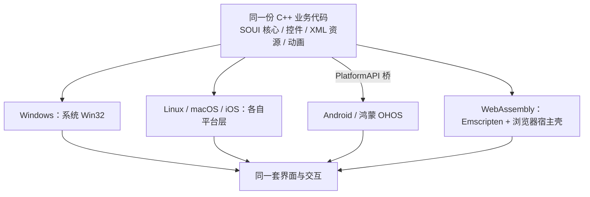

# 一套 C++ 代码，桌面、移动端、浏览器通吃：SOUI5 的 WebAssembly 版现在做到哪一步了？

> 2026-11-12 盘点。不做技术拆解，只交代四件事：做到了什么程度、性能如何、部署体积多少、为什么它能和桌面端 / 移动端共用同一份 C++ 代码。想抠实现细节的，文末给了源码入口。

先上能直接点开的东西。下面三个是官网已经上线的 WebAssembly 版本，**不是截图，不是录屏，是同一个 SOUI 应用真的在浏览器里跑**：

| 在线演示 | 直达地址 | 点进去能验证什么 |
| --- | --- | --- |
| SOUI 控件画廊 | https://www.soui.com.cn/wasm/soui-wasm-demo.html | 十二页控件：MVC 虚拟列表、树、表格、图表、代码编辑器、SVG 皮肤、Lua 小游戏 |
| 开心象棋 | https://www.soui.com.cn/cnchess/wasm/cnchess-wasm.html | 联网对战客户端的界面、AI、残局，与桌面 / 手机同一套 C++ 逻辑 |
| 基金持仓助手 | https://www.soui.com.cn/fundholdings/wasm/fundholdings.html | 桌面版 1440×860 的原样界面 + 真实在线取数，输入六位基金代码即可查 |

官网汇总入口：https://www.soui.com.cn/#wasm 。首次打开要下载几 MB 资源，建议用桌面版 Chrome / Edge；进去以后随便切页签、拖滑块、在编辑框里用中文输入法打几个字，都是 C++ 控件在响应，不是网页元素。

（下文仓库目录叫 `soui4`，对外版本叫 SOUI5，官网当前标 5.3，统称 SOUI。）

---

## 一、做到了什么程度

一句话：**桌面端那套 SOUI 应用能做的事，绝大部分已经能在浏览器里做，包括中文输入法。**

| 方面 | 目前的状态 |
| --- | --- |
| 界面 | 窗口、控件、布局引擎、XML 皮肤、动画、SVG / PNG 资源、高分屏缩放，全部可用；演示页里十二个页签塞进了基础控件、MVC 虚拟列表（一份 500 行数据供三种视图复用）、树、表格、属性表、折线 / 柱状 / 饼图、进度环 / 仪表盘 / 波形 / 二维码、richedit41 / Scintilla / 十六进制编辑器，以及 Lua 写的消消乐、俄罗斯方块、坦克大战 |
| 输入 | 鼠标、键盘、滚轮、剪贴板、WebAudio 音效、文件选择；**中文输入法完整可用** |
| 网络 | WebSocket 客户端（象棋的联网对战）、HTTP 客户端（基金行情，经同源转发）；象棋客户端的 `WebSocketClient.cpp` / `WsClientListener.cpp` 一行未改 |
| 线程 | 两种形态都在用：默认单线程泵版（任意静态站点可跑），以及基金持仓用的真 Web Worker / pthread 版，取数不阻塞绘制 |
| 渲染 | 默认走浏览器原生 Canvas 2D；另保留一套 wasm 内 cairo 软件光栅后端，用于像素级对照 |


---

## 二、性能：整窗重绘 5.4 ms，稳态 60 fps

给两组能复现的实测，口径都写清楚，避免"很快"这种没法核对的说法：

| 指标 | 实测值 | 口径 |
| --- | --- | --- |
| 整窗重绘最重帧 | **中位 5.4 ms，P90 15.4 ms** | 同机 headless Edge，800×600，切页触发整窗重绘；计时是 rAF 主循环回调的同步执行时长（含消息泵 + 绘制） |
| 单帧上屏 | 0.26 ms | 同上，只算把画面合成到显示画布 |
| 对照：cairo 后端 | 中位 11.4 ms，P90 20.6 ms | 同机 A/B，已做零拷贝 + SIMD 换序，仍约 2 倍慢于默认后端 |
| 持续动画页 | idle 59.7 fps / 方向键移动 59~60 fps，rAF P95 16.8 ms | 坦克大战（Lua 游戏页），项目内部基准记录 |
| 空闲状态 | 跟随浏览器 rAF，16.5 ms ≈ 60 fps | 两个后端一致 |

5.4 ms 落在 60 fps 的 16.7 ms 帧预算里，还有一半以上余量。这也解释了为什么默认后端选浏览器原生 Canvas 2D：把光栅化交给浏览器，比在 wasm 里跑 cairo 软件光栅更快——哪怕后者把像素传输压到近乎零成本也追不上。数据来自项目内 `swinx/doc/swinx-wasm-canvas2d-性能优化与cairo对比.md`，里面有复现命令。

对读者的意义其实很简单：**打开上面三个链接，切页、拖动、在 Lua 游戏页按方向键，手感跟本地窗口没有代差**。

---

## 三、部署体积：单个应用 4 MB 上下，压缩后 1~1.7 MB

以下是 2026-11-12 从官网线上直接取的产物字节数（十进制 MB），不是估算：

| 应用 | `.wasm` | `.wasm` gzip | `.wasm` brotli | `.data` 资源 | 首次下载合计（未压缩，含胶水 js） |
| --- | --- | --- | --- | --- | --- |
| 控件画廊（控件最全） | 4.68 MB | 1.73 MB | 1.32 MB | 0.81 MB | **约 5.7 MB** |
| 开心象棋 | 3.47 MB | 1.39 MB | 1.04 MB | 0.51 MB | 约 4.2 MB |
| 基金持仓助手 | 3.77 MB | 1.48 MB | 1.09 MB | 0.045 MB | 约 4.0 MB |

### 和同类方案比一比

对标选 Qt 的 **`wiggly`**：它是 `QtCore + QtGui + QtWidgets` 的 Widgets 基线，与 SOUI 同属原生 C++ 控件库路线；`helloglwindow` 连 Widgets 都没有，`SensorTag` 是 Qt Quick / QML + Charts 的另一套栈，拿来比都不对等。两边统一按**压缩后下载量**这把尺子：

| 方案 | 体积 | 口径与出处 |
| --- | --- | --- |
| **SOUI5 wasm 控件画廊** | `.wasm` gzip **1.73 MB** / brotli 1.32 MB；整包（含 `.data` + 胶水 js）gzip 约 **2.2 MB** | 官网线上产物实测，包含整套控件库 + 编辑器 + Lua 脚本 + 图表 |
| **Qt for WebAssembly `wiggly`（Core+Gui+Widgets，对标项）** | gzip **4.3M** / brotli **3.2M** | [Qt 官方文档](https://doc.qt.io/qt-6.6/wasm.html)「典型下载体积」。参考：`helloglwindow`（Core+Gui）2.8M / 2.1M，`SensorTag`（+Quick+Charts）8.6M / 6.3M。字体必须随应用分发，Qt 自身内嵌一款 |
| **Flutter Web** | CanvasKit 渲染器额外约 1.5 MB，skwasm 约 1.1 MB | [Flutter 官方文档](https://docs.flutter.dev/development/platform-integration/web/renderers)，只是引擎增量，另需应用代码 / 字体 / 资源 |
| **Electron** | Hello World 安装包普遍 100 MB+ 量级 | 社区实测，口径是本地安装包（自带 Chromium + Node），不是网页下载，仅作"另一条路线"的参照 |

同一把尺子下，SOUI 单个 `.wasm` 的 gzip 只有 wiggly 的 **40%**（1.73 MB 对 4.3M），把 `.data` 和胶水 js 全算进整包也**只有约一半**（2.2 MB 对 4.3M）；brotli 是 1.32 MB 对 3.2 MB，同样是四成。而这边装的是十二页控件、MVC 虚拟列表、richedit41 / Scintilla、图表和 Lua 游戏，那边只是一个抖动的文字窗口——**功能完整得多，首包反而比同类 Widgets 基线小一半**。

字体这一项差别也明确：Qt 官方文档说明 wasm 沙箱访问不到系统字体、必须随应用分发（Qt 自身就内嵌一款），SOUI 直接复用浏览器字体，省下的是整个字体资源包；代价是字形随用户系统字体略有差异，属于取舍，不是白捡的便宜。

---

## 四、凭什么和桌面端、移动端共用同一套 C++ 代码

机制一句话就能说完：**Windows 直接用系统 API，其它平台由 swinx 重新实现 Win32 API 表面；SOUI 核心、控件、XML 资源和业务代码只认这一层接口，因此跨平台时换的是底座，不是上层**。浏览器只是继 Windows / Linux / macOS / iOS / Android / 鸿蒙 OHOS 之后的又一个底座。

| 平台 | 谁启动 | 界面画在哪 | 资源从哪来 |
| --- | --- | --- | --- |
| Windows | 系统 Win32 | GDI / Direct2D / Skia | PE 内嵌资源 / 文件 |
| Linux | xcb 事件循环 | Cairo | 文件 |
| macOS / iOS | 各自启动器 | Core Graphics | Bundle |
| Android | JVM + PlatformAPI 桥 | Cairo / Skia 渲染工厂 | APK assets |
| 鸿蒙 OHOS | ArkTS + PlatformAPI 桥 | Cairo / Skia 渲染工厂 | HAP rawfile |
| **WebAssembly** | Emscripten + 浏览器宿主壳 | Canvas 2D / cairo | MEMFS 里的同一份 `uires` |

具体到这三个应用，"同一套代码"不是宣传语：

- **开心象棋**：Windows / Linux / macOS / Android / 鸿蒙 / iOS 六大平台 + 浏览器，共用同一份主窗口类、游戏规则、AI 引擎、残局数据和网络协议；wasm 版连 `WebSocketClient` / `WsClientListener` 都没改，仍是二进制帧 + 8 字节包头。
- **基金持仓助手**：桌面版 1440×860 的 XML 布局、皮肤、图片原样搬进浏览器，只是把取数换成了同源 HTTP 转发。
- **控件画廊**：`controls.extend`、`third-part/richedit41`、`third-part/Scintilla`、`ScriptModule-LUA` 全部静态链进同一个 wasm 模块；Lua 脚本和 SVG 皮肤也来自仓库里同一份资源。

换句话说，一次业务逻辑修改、一处 XML 调整，桌面端、移动端、Web 端一起生效。真正需要为每个平台单独写的，只有入口、平台层、绘制后端和资源提供器——这部分由框架承担，应用开发者不碰。

实现机制就说到这里。具体怎么把鼠标事件翻译成 Win32 消息、GDI 语义如何对齐 Canvas 2D、脏矩形怎么合并、worker 腿怎么跑，源码里都有，留给有兴趣的读者自己探索，索引在最后一节。

---

## 五、想看源码 / 自己编一个

仓库：https://gitee.com/setoutsoft/soui4 。最短路径（本地验证用 emsdk 6.0.13）：

```
emcmake cmake -S demos/wasm-demo -B build-wasm -G Ninja -DCMAKE_BUILD_TYPE=RelWithDebInfo
cmake --build build-wasm --target soui-wasm-demo -j4
python3 -m http.server 8080 -d demos/wasm-demo/out
```

| 想看什么 | 从哪个文件开始 |
| --- | --- |
| 完整设计与能力矩阵 | `swinx/doc/swinx-wasm-design.md`（§10） |
| 两个渲染后端的性能口径 | `swinx/doc/swinx-wasm-canvas2d-性能优化与cairo对比.md` |
| 平台层、消息与窗口 | `swinx/src/platform/wasm/` |
| 输入法与键鼠注入 | `demos/wasm-demo/soui-host.js`、`swinx/src/platform/wasm/input.cpp` |
| 三个应用各自的入口 | `demos/wasm-demo/`、`games/cnchess/client/wasm/`、`demos/fundholdings/wasm/` |
| 构建开关与导出表 | `__cmake/wasm-lib-config.cmake`、`swinx/wasm.cmake`、各 app 的 `CMakeLists.txt` |

---

最后把体验入口再放一次，点开就能玩：

- SOUI 控件画廊：https://www.soui.com.cn/wasm/soui-wasm-demo.html
- 开心象棋（在线试玩）：https://www.soui.com.cn/cnchess/wasm/cnchess-wasm.html
- 基金持仓助手：https://www.soui.com.cn/fundholdings/wasm/fundholdings.html
- 官网在线演示汇总：https://www.soui.com.cn/#wasm

一套 C++ 代码，桌面、移动端、浏览器三处开花，首包几 MB、整窗重绘 5 ms 出头、中文输入法跟手可用——这就是 SOUI5 wasm 目前交出的成绩单。欢迎去页面里挑毛病，评论区见。

---

## 附录：配图用的 mermaid 源码（发布时转成图片或删除）

知乎编辑器不渲染 mermaid，这段用于生成"一套代码、多端底座"的配图。


